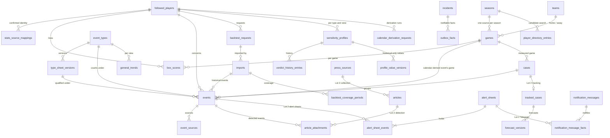

# Domain model

The data model of Egoscope: every entity, column, status set, invariant and exchange format the
application stores or reads, traced to the French specifications (`docs/*.md`), the decision
records (`docs/adr/`, `docs/engineering/spec-deviations.md`), the clarifications
(`docs/engineering/clarifications/`) and the glossary (`docs/engineering/glossary.md`), which names
everything here. The database schema implements these files verbatim; every feature relies on them.
A change to an entity goes through this folder first.

The core and Lot 1 areas, and every entity both lots share, are in the eight files below. The five
Lot 2 files hold the press collection, detection, alert sheets, automatic tracking and validation,
and notifications; they reference the shared entities by name.

## 1. How to read an area file

Each area file has the same seven sections:

1. **Entities** — for each: its purpose, its table, a column table, the row checks, unique
   constraints and indexes with the query each serves, what a deletion cascades to, and the
   TypeScript view where it differs from the columns.
2. **Lifecycles** — each status set as a transition table (`from | to | trigger | guard | side
effects`).
3. **Invariants** — each rule the data must satisfy, with where it is enforced: a database
   constraint, or the owning service inside a transaction.
4. **Stored or derived** — what is computed on read, what is stored, and what recalculates it.
5. **Exchange formats** — where the area has one.
6. **Rulings applied** — the decisions and clarifications that shaped it, and the model's own
   choices with their reason.
7. **Diagram** — a Mermaid ER diagram of the area.

Column tables read: `column | type | null | default | constraint or reference | class | spec IDs`.
`type` is the PostgreSQL type; `null` says whether the column is nullable; `identity` in the default
column means `GENERATED ALWAYS AS IDENTITY`; `class` is the sensitive-data class of section 3. A
foreign key always states its `ON DELETE` rule.

## 2. Conventions

**Names.** Tables are snake_case plurals, columns snake_case; code uses the camelCase of the same
words; every name is the glossary's. No code type takes the name of a browser built-in: an event
is `PlayerEvent`, keyed by `playerEventId` (columns `player_event_id`), and its source is
`PlayerEventSource`; the tables keep the plain words (`events`, `event_sources`). A foreign key to a
followed player is `player_id`. Stored enumeration values are the glossary's; module names, routes,
parameter keys (namespaced, module map section 6, for example `journal.retentionDays`) and
scheduled-task keys (module map section 4, for example `statistics-update`) are the module map's.
The origin of a calendar-derived event is stored `calendar`, never `schedule`.

**Keys.** Every table has an integer identity `id` primary key, except where a spec demands another
identifier: `followed_players.id` is a random UUID (CL-JOU-09); `event_types.id` is the kebab-case
slug (TAX-02, CL-TAX-02); `parameter_overrides` is keyed by the parameter key and
`sequence_counters` by the counter's name, `seasons` by the season label and
`database_size_samples` by the day; the singletons (`withdrawn_event_counter`, `accounts`,
`installation`, `ui_state`, `scheduler_lease`) have `id = 1`; join tables (`team_source_refs`,
`team_seasons`, `player_directory_teams`, `backtest_request_events`, `restore_report_events`,
`database_activity_minutes`) have a composite key. Identifiers are never
reused (CL-IHM-19).

**Time.** An absolute instant is `timestamptz`, epoch milliseconds in code (`EpochMs`); a calendar
date is `date`, an ISO `YYYY-MM-DD` string in code (`IsoDate`); there is no naive local timestamp.
Every date column names its calendar:

| calendar         | meaning                                                                                                                                   | used by                                                                                                                      | spec IDs                     |
| ---------------- | ----------------------------------------------------------------------------------------------------------------------------------------- | ---------------------------------------------------------------------------------------------------------------------------- | ---------------------------- |
| US date          | the date of an instant in `America/New_York`: the day of a game, which also stands for the venue's local date (SEN-02, STA-31, birthdays) | `games.game_day_on`, the derived event's date, first and last game played                                                    | TRV-72, CL-TRV-03            |
| owner's calendar | the date in the owner's time zone (the `display.timeZone` parameter, Paris by default)                                                    | `backtest_requests.created_on`, request period ends, task days, the day hashed in a withdrawal fingerprint for a timed event | TRV-72, CL-BKT-10, CL-DSN-06 |
| as written       | the date part of a value the research AI or the owner wrote, in its own offset                                                            | historical public dates, source and illustration dates, coverage periods                                                     | CL-IMP-09                    |

A "date, or date and time" from the research is three columns: the calendar date as written, the
instant when it had a time, and the original offset (TRV-68, CL-IMP-09). The pure engine receives
instants and local dates as data and does no time-zone arithmetic.

**Enumerations.** `text` columns with a `CHECK` on snake_case values; no PostgreSQL enum types;
string-literal unions in code. A set the glossary lists takes its values; the sets it does not list
are the model's own, in section 6.

**Structured or jsonb.** Anything queried, constrained or erased selectively is a column. `jsonb`
holds only snapshots written whole and read back whole: sheet content in versions and in the change
history, triggered-criterion values, a profile's reason breakdown, an import's whole-result
warnings, lead counts and gaps, parameter values and snapshots, journal message parameters and
technical details, task-run summaries and incident counts.

**Numbers.** Calculation results are `double precision`, never rounded in storage (STA-12, SEN-09,
CL-STA-09); counts are `smallint` or `integer`.

**Concurrency.** Every row the owner edits carries `row_version`, incremented by every save; a save
sent with an older version is refused and the screen shows the current one (CL-IHM-18).

**Erasure.** An event row is removed only through the erasure step of
[sensitive-data.md](sensitive-data.md) section 2.1; `events.player_id` is `ON DELETE RESTRICT` so
that a player's deletion goes through it.

**Lot boundary.** No core table references a Lot 2 table: a core row that must name a Lot 2 object
(an outbox fact) holds its identifier without a foreign key. Lot 2 tables reference core tables,
mostly `ON DELETE RESTRICT`, so every erasure runs the Lot 2 erasers first, in the order of
[sensitive-data.md](sensitive-data.md) section 2.1.

**Seeds.** The nine candidate event types with their English starter sheets (TAX-15); no player
(JOU-06, ADR 0020). Seeds live in `data/`. Teams, seasons and the player directory come from the
statistics source with each season it reads.

**Volumes and indexes.** H-TRV-04: 20 to 30 followed players over whole careers. The league schedule
of every fetched season is stored once (about 1,300 games a season, at most 34 seasons); box-score
lines only for followed players (tens of thousands); the player directory about 20,000 entries; events
and cases in the thousands; profiles at most players × types × 3 views; the journal for 90 days. The recalculation paths and the indexes
they use:

| path                                                | reads                                                                                    | indexes                                                                                                                               |
| --------------------------------------------------- | ---------------------------------------------------------------------------------------- | ------------------------------------------------------------------------------------------------------------------------------------- |
| Statistics update for competition day D             | the games of D, their lines, the cases those lines or a new provisional baseline touch   | `games_game_day_idx`, `box_scores_game_idx`, `cases_player_game_idx`, `cases_player_baseline_season_idx`                              |
| Import of a research result                         | the player's events of each type, his team games after each reference instant, his lines | `events_player_type_idx`, `games_home_team_start_idx`, `games_away_team_start_idx`, `box_scores_player_game_key`                      |
| Attachment walk, absences, derivation               | a team's games in time order, the player's team history                                  | `games_*_team_start_idx`, `player_team_changes_player_changed_idx`                                                                    |
| Baselines, thresholds, team records, opponent level | every game and line of a season and phase                                                | `games_season_phase_idx`, `box_scores_player_game_key`                                                                                |
| Profile and its case list                           | the cases and events of a player and type                                                | `cases_player_type_idx`, `events_case_idx`, `event_sources_event_idx`                                                                 |
| General trend                                       | every case of a type                                                                     | `cases_type_status_idx`                                                                                                               |
| Matching at import and detection                    | the player's events near a date, shared links, live fingerprints                         | `events_player_reference_date_idx`, `events_player_reference_at_idx`, `event_sources_cleaned_url_idx`, the fingerprint's unique index |
| Next game                                           | the current team's upcoming games                                                        | `games_*_team_start_idx`, `games_open_status_idx`                                                                                     |
| Pending cases                                       | the cases awaiting their game                                                            | `cases_awaiting_idx`                                                                                                                  |

## 3. Sensitive-data classes

Every column carries one or more classes (`docs/13-donnees-sensibles.md`).

| class | meaning                                                                                                    | erased by                                                                          | in backups and full exports | shown, logged                                            |
| ----- | ---------------------------------------------------------------------------------------------------------- | ---------------------------------------------------------------------------------- | --------------------------- | -------------------------------------------------------- |
| —     | no personal or press-derived content                                                                       | —                                                                                  | yes                         | yes                                                      |
| PI    | about a followed player: identity, statistics, requests, imports, profiles (JOU-08)                        | the player-data deletion (JOU-24, CL-JOU-06)                                       | yes                         | in the app; the journal names him by reference only      |
| BD    | his day and month of birth, never a year (CL-DSN-21)                                                       | the player-data deletion; the owner removing it                                    | yes                         | in the app; never sent to an AI, never logged as a value |
| EV    | designates or reveals one event: the event row, anything tied to it, any reference to it (DSN-06)          | the event's withdrawal and the other erasures (sensitive-data 2.1)                 | yes                         | in the app; the journal by reference only (CL-TRV-10)    |
| TX    | a free text under the wording rules: description, unverified note, comments, reasons, limitations (DSN-10) | with its row                                                                       | yes                         | in the app; never in the journal (DSN-11)                |
| PR    | a press reference kept as published: link, outlet, title (DSN-08)                                          | with its row                                                                       | yes                         | in the app; never in the journal (DSN-11)                |
| SE    | credential material: password hash, initial-password fingerprint, session token hash (TRV-60, TRV-63)      | password change, reset, logout                                                     | no (CL-TRV-05)              | never (TRV-64)                                           |
| WL    | a withdrawal-ledger hash (ADR 0017, CL-DSN-08)                                                             | the daily purge at its horizon                                                     | no (CL-DSN-08)              | never                                                    |
| DR    | a pasted text in a draft (DSN-32, CL-DSN-17)                                                               | save, discard, expiry, restore, a withdrawal of the player's event (import drafts) | no (CL-DSN-17)              | in the import or exploration screen only; never logged   |

What a withdrawal erases, in which order, and what remains; what each purge removes and when; what
exports and backups contain: [sensitive-data.md](sensitive-data.md).

## 4. TypeScript conventions

```ts
declare const brand: unique symbol;
type Brand<T, B extends string> = T & { readonly [brand]: B };
type EpochMs = Brand<number, 'EpochMs'>; // an absolute instant, from timestamptz
type IsoDate = Brand<string, 'IsoDate'>; // 'YYYY-MM-DD', from date; its calendar is the column's
type Season = Brand<string, 'Season'>; // '2024-25'
```

Each integer key has its brand (`PlayerEventId`, `CaseId`, `GameId`, `TeamId`, `BacktestRequestId`,
`ImportId`, …); `PlayerId` brands a UUID string and `EventTypeId` a slug. Status sets are unions of
the glossary's values; rows with per-origin columns are discriminated unions (`PlayerEvent`).

## 5. Index of entities

| entity (code type)                            | table                                                | file                                                       | lot  |
| --------------------------------------------- | ---------------------------------------------------- | ---------------------------------------------------------- | ---- |
| `FollowedPlayer`                              | `followed_players`                                   | [players.md](players.md)                                   | 1    |
| `NameVariant`                                 | `player_name_variants`                               | [players.md](players.md)                                   | 1    |
| `PlayerStatusChange`                          | `player_status_changes`                              | [players.md](players.md)                                   | 1    |
| `PlayerTeamChange`                            | `player_team_changes`                                | [players.md](players.md)                                   | 1    |
| `StatsSourceMapping`                          | `stats_source_mappings`                              | [games-and-statistics.md](games-and-statistics.md)         | 1    |
| `MappingCandidate`                            | `mapping_candidates`                                 | [games-and-statistics.md](games-and-statistics.md)         | 1    |
| `Team`                                        | `teams`                                              | [games-and-statistics.md](games-and-statistics.md)         | 1    |
| team source identifiers                       | `team_source_refs`                                   | [games-and-statistics.md](games-and-statistics.md)         | 1    |
| `Game`                                        | `games`                                              | [games-and-statistics.md](games-and-statistics.md)         | 1    |
| `Series`                                      | `series`                                             | [games-and-statistics.md](games-and-statistics.md)         | 1    |
| `BoxScore`                                    | `box_scores`                                         | [games-and-statistics.md](games-and-statistics.md)         | 1    |
| `StatCorrection`                              | `stat_corrections`                                   | [games-and-statistics.md](games-and-statistics.md)         | 1    |
| `PlayerIndicators`                            | `player_indicators`                                  | [games-and-statistics.md](games-and-statistics.md)         | 1    |
| `FetchQueueItem`                              | `fetch_queue_items`                                  | [games-and-statistics.md](games-and-statistics.md)         | 1    |
| source versions                               | `stats_source_versions`                              | [games-and-statistics.md](games-and-statistics.md)         | 1    |
| `Season` and its coverage                     | `seasons`                                            | [games-and-statistics.md](games-and-statistics.md)         | 1    |
| `TeamSeason`                                  | `team_seasons`                                       | [games-and-statistics.md](games-and-statistics.md)         | 1    |
| `DirectoryEntry`                              | `player_directory_entries`, `player_directory_teams` | [games-and-statistics.md](games-and-statistics.md)         | 1    |
| `EventType` and its `TypeSheet`               | `event_types`                                        | [event-types.md](event-types.md)                           | 1    |
| type status history                           | `event_type_status_changes`                          | [event-types.md](event-types.md)                           | 1    |
| `TypeSheetVersion`                            | `type_sheet_versions`                                | [event-types.md](event-types.md)                           | 1    |
| `TypeSheetChange`                             | `type_sheet_changes`                                 | [event-types.md](event-types.md)                           | 1    |
| `IllustrationSource`                          | `type_illustration_sources`                          | [event-types.md](event-types.md)                           | 1    |
| `TypeOccurrence`                              | `type_occurrences`                                   | [event-types.md](event-types.md)                           | 2    |
| `PlayerEvent`                                 | `events`                                             | [events-and-cases.md](events-and-cases.md)                 | both |
| `PlayerEventSource`                           | `event_sources`                                      | [events-and-cases.md](events-and-cases.md)                 | both |
| `ImportWarning`                               | `event_import_warnings`                              | [events-and-cases.md](events-and-cases.md)                 | 1    |
| `EventMark`                                   | `event_marks`                                        | [events-and-cases.md](events-and-cases.md)                 | 2    |
| dismissal history                             | `event_status_changes`                               | [events-and-cases.md](events-and-cases.md)                 | 2    |
| correction history                            | `event_corrections`                                  | [events-and-cases.md](events-and-cases.md)                 | both |
| `Case`                                        | `cases`                                              | [events-and-cases.md](events-and-cases.md)                 | both |
| triggered criteria                            | `case_triggered_criteria`                            | [events-and-cases.md](events-and-cases.md)                 | both |
| `ReviewFlag`                                  | `case_review_flags`                                  | [events-and-cases.md](events-and-cases.md)                 | both |
| `ManualDecision`                              | `case_manual_decisions`                              | [events-and-cases.md](events-and-cases.md)                 | both |
| `CaseHistoryEntry`                            | `case_history_entries`                               | [events-and-cases.md](events-and-cases.md)                 | both |
| `TallyExit`, `EventDeletionTrace`             | `tally_exits`                                        | [events-and-cases.md](events-and-cases.md)                 | both |
| `DerivationRequest`                           | `calendar_derivation_requests`                       | [events-and-cases.md](events-and-cases.md)                 | both |
| `BacktestRequest`                             | `backtest_requests`                                  | [backtest-and-import.md](backtest-and-import.md)           | both |
| requested types                               | `backtest_request_types`                             | [backtest-and-import.md](backtest-and-import.md)           | 1    |
| attached detected events                      | `backtest_request_events`                            | [backtest-and-import.md](backtest-and-import.md)           | 2    |
| `BacktestCoverage`                            | `backtest_coverage_periods`                          | [backtest-and-import.md](backtest-and-import.md)           | 1    |
| `Import`, `ImportTrace`                       | `imports`                                            | [backtest-and-import.md](backtest-and-import.md)           | 1    |
| import outcomes                               | `import_event_outcomes`                              | [backtest-and-import.md](backtest-and-import.md)           | 1    |
| `PossibleDuplicate` answers                   | `import_possible_duplicates`                         | [backtest-and-import.md](backtest-and-import.md)           | 1    |
| `SensitivityProfile`                          | `sensitivity_profiles`                               | [sensitivity-and-profiles.md](sensitivity-and-profiles.md) | both |
| `GeneralTrend`                                | `general_trends`                                     | [sensitivity-and-profiles.md](sensitivity-and-profiles.md) | both |
| `VerdictHistoryEntry`                         | `verdict_history_entries`                            | [sensitivity-and-profiles.md](sensitivity-and-profiles.md) | both |
| recalculation jobs                            | `recalculation_jobs`                                 | [sensitivity-and-profiles.md](sensitivity-and-profiles.md) | both |
| `ProfileValueVersion`                         | `profile_value_versions`                             | [sensitivity-and-profiles.md](sensitivity-and-profiles.md) | both |
| `WithdrawalFingerprint`                       | `withdrawal_fingerprints`                            | [sensitive-data.md](sensitive-data.md)                     | 1    |
| `DeletedPlayerEntry`                          | `deleted_player_entries`                             | [sensitive-data.md](sensitive-data.md)                     | 1    |
| withdrawn-events counter (`WithdrawalLedger`) | `withdrawn_event_counter`                            | [sensitive-data.md](sensitive-data.md)                     | 1    |
| parameter overrides                           | `parameter_overrides`                                | [operations.md](operations.md)                             | both |
| parameter changes                             | `parameter_changes`                                  | [operations.md](operations.md)                             | both |
| parameter snapshots                           | `parameter_snapshots`                                | [operations.md](operations.md)                             | both |
| `JournalEntry`                                | `journal_entries`                                    | [operations.md](operations.md)                             | both |
| technical details                             | `journal_technical_details`                          | [operations.md](operations.md)                             | both |
| `Incident`                                    | `incidents`                                          | [operations.md](operations.md)                             | both |
| `QuotaUsage`                                  | `quota_usage`                                        | [operations.md](operations.md)                             | both |
| `TaskRun`                                     | `task_runs`                                          | [operations.md](operations.md)                             | both |
| `Backup`, `BackupRegister`                    | `backups`                                            | [operations.md](operations.md)                             | 1    |
| `Export`, the exports downloaded              | `export_downloads`                                   | [operations.md](operations.md)                             | 1    |
| first start                                   | `installation`                                       | [operations.md](operations.md)                             | 1    |
| the single account                            | `accounts`                                           | [operations.md](operations.md)                             | 1    |
| `Session`                                     | `sessions`                                           | [operations.md](operations.md)                             | 1    |
| `LoginFailure`                                | `login_failures`                                     | [operations.md](operations.md)                             | 1    |
| `ImportDraft`, exploration draft              | `drafts`                                             | [operations.md](operations.md)                             | 1    |
| `UiSettings`                                  | `ui_state`                                           | [operations.md](operations.md)                             | 1    |
| gapless counters                              | `sequence_counters`                                  | [operations.md](operations.md)                             | 1    |
| `OutboxFact`                                  | `outbox_facts`                                       | [operations.md](operations.md)                             | both |
| the tick lease                                | `scheduler_lease`                                    | [operations.md](operations.md)                             | both |
| database activity                             | `database_activity_minutes`                          | [operations.md](operations.md)                             | both |
| measured volumes                              | `database_size_samples`                              | [operations.md](operations.md)                             | 1    |
| `RestoreSummary`                              | `restore_reports`, `restore_report_events`           | [operations.md](operations.md)                             | 1    |

Lot 2 files, written by the other modeler: `collection.md`, `detection.md`, `alert-sheets.md`,
`tracking-and-validation.md` and `notifications.md`. No table of this model references one of
theirs; the prose names some of them (`articles`, `article_attachments`, `tracked_cases`,
`alert_sheets`, `notification_messages`) where a core rule calls a Lot 2 hook.

## 6. Stored values this model defines

The glossary names the values the owner sees or that another document quotes, and the model takes
them as they are; every other stored value is defined here, and the lists below are those. The
module map owns the task and parameter keys. Every other `CHECK` list of the model is a glossary
set (67c24c2) or a subset of one.

| where                    | values the glossary does not have yet                                                                                                                                                                                                                                                                                                                                                                                              |
| ------------------------ | ---------------------------------------------------------------------------------------------------------------------------------------------------------------------------------------------------------------------------------------------------------------------------------------------------------------------------------------------------------------------------------------------------------------------------------- |
| players                  | `birthday_origin`: `stats_source`, `owner`                                                                                                                                                                                                                                                                                                                                                                                         |
| games and statistics     | statistics-source key `sportsdataverse_espn`; `FetchUnitKind`: `publication_probe`, `season_games`, `season_box_scores`, `season_players`, `player_records`; `stats_source_versions.resource`: `publication`, `season_games`, `season_box_scores`, `season_players`; `series.round` (seven values); `failed_checks` (five values); `stat_corrections.element` (sixteen values); `Participation`: `played`, `not_played`, `unknown` |
| event types              | `TypeSheetVersionKind`: `validation`, `substantive_change`, `merge`; `TypeSheetChangeKind`: `formal`, `substantive`, `criterion_switch`; `CalendarDerivation`: `birthday`, `former_team`                                                                                                                                                                                                                                           |
| events and cases         | `event_corrections.field` (thirteen values); `reference_date_rule`: `earliest_source`, `coverage_threshold` (CL-DET-27); `DerivationRequestKind`: `regular`, `full`; `DerivationCause` (nine values)                                                                                                                                                                                                                               |
| backtest and import      | coverage `origin`: `import`, `merge`, `split`                                                                                                                                                                                                                                                                                                                                                                                      |
| sensitivity and profiles | recalculation `scope`: `import`, `statistics_update`, `event_or_case_change`, `full`; job status `pending`, `running`, `done`; the code type `ProfileValueVersion`                                                                                                                                                                                                                                                                 |
| operations               | `BackupKind`: `weekly`, `manual`, `before_update`; backup failure causes (six values); `ExportKind`: `full`, `players`, `events`, `cases`, `profiles`; restore `source_kind`: `backup`, `full_export`; `lot2_object_kind`: `press_source`, `article`, `alert_sheet`, `notification_message`; export format `egoscope-export`                                                                                                       |

Stored subsets of glossary sets: `EventMark` without `detected_after_tip_off` (derived, CL-DET-16); `ContextIndicationOrigin` without
`calculation` on events (a calculated condition is a case criterion); `ImportOutcome` without
`not_recorded_sensitive_data` (never stored, IMP-37); `DatePrecision` without `none` for an
owner-added source. The export reminder is the incident `export_reminder`, with no outbox fact kind
of its own.

## 7. Overview

The main entities of both lots; Lot 2 entities carry the names of their files, which define them.


