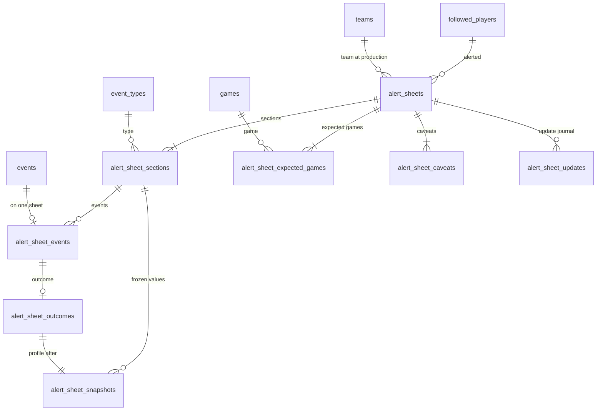

# Domain model — alert sheets (Lot 2)

Alert sheets, their dated sections, frozen profile and trend snapshots, expected-game history, caveats, update journal and outcome: file 09 (ALE-01 to ALE-31) as ruled by `CL-ALE-01` to `CL-ALE-16`, with ADR 0015 and ADR 0016. Events, cases, profiles, games, teams and players belong to the core model; tracked cases and forecasts are in [tracking-and-validation.md](tracking-and-validation.md); the alert message's data is in [notifications.md](notifications.md).

**Conventions.** As in [collection.md](collection.md). Volumes are small — a few sheets a week (H-TRV-04) — so indexes are named only where a list or a task's read needs them.

**Sensitive-data classes:** the core model's (`—`, `PI`, `EV`, `TX`, `PR`; README §3) and the two Lot 2 classes `EX` and `OW`, as the top of [collection.md](collection.md) says. A sheet exists only because of its events, so its rows are erased by their withdrawal (ALE-30); no column of this file holds an article's title, excerpt or an event's description (09 "Données manipulées").

## 1. Entities

### 1.1 Alert sheet — `alert_sheets`

The sourced write-up produced when a profiled player has a new detected event, or for an upcoming calendar-derived event (ALE-01, `CL-ALE-13`). Its identifier is its sheet number.

| Column                      | Type             | Null | Default  | Constraint or reference                                                                                                                                                                                                                                                                                       | Class | Spec                      |
| --------------------------- | ---------------- | ---- | -------- | ------------------------------------------------------------------------------------------------------------------------------------------------------------------------------------------------------------------------------------------------------------------------------------------------------------- | ----- | ------------------------- |
| `id`                        | integer identity | no   | —        | primary key; also the sheet number shown ("Sheet no. {n}"): production order, never reused, gaps accepted                                                                                                                                                                                                     | —     | ALE-06, ALE-30, CL-ALE-11 |
| `player_id`                 | uuid             | no   | —        | → core `followed_players.id` `ON DELETE RESTRICT`                                                                                                                                                                                                                                                             | PI EV | ALE-01, ALE-07            |
| `team_id_at_production`     | integer          | yes  | null     | → core `teams.id` `ON DELETE RESTRICT`; kept after a trade; null for a player without a team at that instant (STA-26, CL-JOU-20), whom the header shows "Player without a team" (ALE-07)                                                                                                                      | —     | ALE-07, STA-26            |
| `produced_at`               | timestamptz      | no   | —        |                                                                                                                                                                                                                                                                                                               | —     | ALE-02, ALE-05, ALE-06    |
| `profile_values_entered_at` | timestamptz      | yes  | null     | for a sheet produced while its profile was being computed (ALE-05), its initial section waiting for its values at `produced_at`, the instant its values entered, never earlier than `produced_at`, a re-initialization included (§1.9 step 4); with `produced_at`, it gives the timing instant of `CL-ALE-04` | —     | ALE-05, CL-ALE-04         |
| `status`                    | text             | no   | `'open'` | `CHECK (status IN ('open','closed','canceled'))` (`AlertSheetStatus`)                                                                                                                                                                                                                                         | —     | ALE-26                    |
| `cancellation_reason`       | text             | yes  | null     | `CHECK (cancellation_reason IN ('all_events_dismissed','attachment_corrected','event_no_longer_applies'))` (`AlertSheetCancellationReason`); `CHECK ((status = 'canceled') = (cancellation_reason IS NOT NULL))`                                                                                              | —     | ALE-22, ALE-31, CL-ALE-13 |
| `is_late`                   | boolean          | no   | false    | the « tardive » mark: timing instant at or after the expected game's scheduled start, then, once the measured game is established, at or after that game's                                                                                                                                                    | —     | ALE-24, CL-ALE-04         |
| `caveats_frozen_at`         | timestamptz      | yes  | null     | instant the caveats froze: the scheduled start of the expected game                                                                                                                                                                                                                                           | —     | CL-ALE-07                 |

- **Unique and indexes:** `alert_sheets_player_idx` `(player_id, produced_at)` — the alert history by player and period (ALE-28, IHM-33); `alert_sheets_status_idx` `(status, produced_at)` — the open, closed and canceled sections of IHM-33; `alert_sheets_late_idx` `(produced_at) WHERE is_late` — the "late sheets" filter.
- **Deletion cascades to:** every table below. A sheet is deleted only by an erasure of the event it exists for — the withdrawal, or the erasure by requalification or split, of its only event, or of the event a correction or a merge took off it (`CL-ALE-16`) — or by the deletion of its player's data (ALE-28, ALE-30, §1.9).
- **TypeScript:** `id: AlertSheetId`, exposed as the glossary's `number` on screens and in messages; `type AlertSheetState = { status: 'open' | 'closed' } | { status: 'canceled'; cancellationReason: AlertSheetCancellationReason }`; `isLate` gives the `AlertSheetTiming` `late` or `produced_before_tip_off`.

### 1.2 Section — `alert_sheet_sections`

The block of one event type on a sheet: the initial content, a dated section for a later event of another type (ALE-20) or for a type correction (ALE-31), each with its own frozen profile.

| Column                           | Type             | Null | Default | Constraint or reference                                                                                                                                                                                                                                                                                                                                                                                                                                                                                                                                                                                                                                                                                                                          | Class | Spec                      |
| -------------------------------- | ---------------- | ---- | ------- | ------------------------------------------------------------------------------------------------------------------------------------------------------------------------------------------------------------------------------------------------------------------------------------------------------------------------------------------------------------------------------------------------------------------------------------------------------------------------------------------------------------------------------------------------------------------------------------------------------------------------------------------------------------------------------------------------------------------------------------------------ | ----- | ------------------------- |
| `id`                             | integer identity | no   | —       | primary key                                                                                                                                                                                                                                                                                                                                                                                                                                                                                                                                                                                                                                                                                                                                      | —     | ALE-20                    |
| `alert_sheet_id`                 | integer          | no   | —       | → `alert_sheets.id` `ON DELETE CASCADE`                                                                                                                                                                                                                                                                                                                                                                                                                                                                                                                                                                                                                                                                                                          | —     | ALE-20                    |
| `kind`                           | text             | no   | —       | `CHECK (kind IN ('initial','later_event','type_change'))` (`AlertSheetSectionKind`); one `initial` section per sheet that keeps events; changed, with `added_at`, only by a re-initialization (§1.9 step 4)                                                                                                                                                                                                                                                                                                                                                                                                                                                                                                                                      | —     | ALE-20, ALE-31, CL-ALE-16 |
| `event_type_id`                  | text             | no   | —       | → core `event_types.id` `ON DELETE RESTRICT`                                                                                                                                                                                                                                                                                                                                                                                                                                                                                                                                                                                                                                                                                                     | EV    | ALE-09, ALE-20            |
| `added_at`                       | timestamptz      | no   | —       |                                                                                                                                                                                                                                                                                                                                                                                                                                                                                                                                                                                                                                                                                                                                                  | —     | ALE-20, ALE-31            |
| `profile_state`                  | text             | no   | —       | `CHECK (profile_state IN ('pending','frozen'))` (`ProfileSnapshotState`); `pending` shows "Profile being computed"                                                                                                                                                                                                                                                                                                                                                                                                                                                                                                                                                                                                                               | —     | ALE-05, ALE-19            |
| `frozen_at`                      | timestamptz      | yes  | null    | `CHECK ((profile_state = 'frozen') = (frozen_at IS NOT NULL))`                                                                                                                                                                                                                                                                                                                                                                                                                                                                                                                                                                                                                                                                                   | —     | ALE-19                    |
| `profile_status_notice`          | text             | yes  | null    | `CHECK (profile_status_notice IN ('recalculation_in_progress','no_measured_case_yet'))`; only on a frozen section                                                                                                                                                                                                                                                                                                                                                                                                                                                                                                                                                                                                                                | —     | ALE-05, 09 edge cases     |
| `type_not_covered`               | boolean          | no   | false   | the player's coverage lacked the type when the section was added                                                                                                                                                                                                                                                                                                                                                                                                                                                                                                                                                                                                                                                                                 | —     | ALE-14, DET-40            |
| `profile_changed_since_issue_at` | timestamptz      | yes  | null    | the calculation instant of the first default-view profile found to differ from the frozen values, set by `game-tracking` after a recalculation                                                                                                                                                                                                                                                                                                                                                                                                                                                                                                                                                                                                   | —     | ALE-19, CL-ALE-07         |
| `vacated_by_event_id`            | integer          | yes  | null    | → core `events.id` `ON DELETE RESTRICT`; set when a correction or a merge leaves the section with no event: the corrected event, moved to another sheet or section (ALE-31), or the kept event of a merge (DET-47); on an initial section, set the same way as soon as a correction or a merge takes the event the sheet was produced for off it, even when other events stay in it, and then kept when a correction or a merge takes them off it or others join it, since the sheet's production still belongs to that event (§1.9); on another section, null again when an event joins it; cleared by a re-initialization that keeps the section's events (§1.9 step 4); repointed to the kept event at a later merge; always a detected event | EV    | ALE-30, ALE-31, CL-ALE-16 |

- **Unique and indexes:** `alert_sheet_sections_uq` unique `(alert_sheet_id, event_type_id)` — two events of the same type share one section (ALE-20); `alert_sheet_sections_initial_uq` unique `(alert_sheet_id) WHERE kind = 'initial'` — one initial section, which a re-initialization changes by first making the former one `later_event`, or deleting it when it holds no event (§1.9 step 4); `alert_sheet_sections_type_idx` `(event_type_id)` — the history filtered by type (IHM-33) and the "profile changed" read of `game-tracking` after a recalculation.
- **Deletion cascades to:** `alert_sheet_snapshots`, `alert_sheet_events`, and update entries of the section, except those about another event that a correction or a merge took off it, whose reference a withdrawal empties first (§1.9). A section with `vacated_by_event_id` is deleted with that event by its eraser when it holds no event, with its last event when that event is erased (§1.9 step 2), or by a re-initialization that leaves it a former initial section with no event (§1.9 step 4, `CL-ALE-16`).
- **TypeScript:** `type AlertSheetSection = { profileState: 'pending' } | { profileState: 'frozen'; frozenAt: EpochMs; profileStatusNotice: ProfileStatusNotice | null; profile: ProfileSnapshot; trend: TrendSnapshot | null }`.

### 1.3 Snapshot — `alert_sheet_snapshots`

Profile and trend values copied as they are, in the default view, when they enter the sheet, never rewritten (ALE-09, ALE-19): the section's profile (`ProfileSnapshot`), the type's general trend (`TrendSnapshot`), and the outcome's profile after the case (`CL-ALE-12`).

| Column                   | Type             | Null | Default | Constraint or reference                                                                                                                                                                                                                                                                                                      | Class | Spec                     |
| ------------------------ | ---------------- | ---- | ------- | ---------------------------------------------------------------------------------------------------------------------------------------------------------------------------------------------------------------------------------------------------------------------------------------------------------------------------- | ----- | ------------------------ |
| `id`                     | integer identity | no   | —       | primary key                                                                                                                                                                                                                                                                                                                  | —     | ALE-19                   |
| `alert_sheet_section_id` | integer          | yes  | null    | → `alert_sheet_sections.id` `ON DELETE CASCADE`                                                                                                                                                                                                                                                                              | —     | ALE-09, ALE-11, ALE-12   |
| `alert_sheet_outcome_id` | integer          | yes  | null    | → `alert_sheet_outcomes.id` `ON DELETE CASCADE`; `CHECK (num_nonnulls(alert_sheet_section_id, alert_sheet_outcome_id) = 1)`                                                                                                                                                                                                  | —     | ALE-27, CL-ALE-12        |
| `kind`                   | text             | no   | —       | `CHECK (kind IN ('profile','trend'))` (`SnapshotKind`); an outcome snapshot is a `profile`                                                                                                                                                                                                                                   | —     | ALE-09, ALE-11           |
| `mean_gap`               | double precision | yes  | null    | null when there is no valid case                                                                                                                                                                                                                                                                                             | —     | ALE-09, SEN-20           |
| `range_low`              | double precision | yes  | null    | plausible range (SEN-22)                                                                                                                                                                                                                                                                                                     | —     | ALE-09, SEN-38           |
| `range_high`             | double precision | yes  | null    | `CHECK (range_high >= range_low)`                                                                                                                                                                                                                                                                                            | —     | ALE-09, SEN-38           |
| `valid_count`            | integer          | no   | —       | `CHECK (valid_count >= 0)`                                                                                                                                                                                                                                                                                                   | —     | ALE-09                   |
| `historical_count`       | integer          | yes  | null    | profile only                                                                                                                                                                                                                                                                                                                 | —     | ALE-09, SEN-21           |
| `tracked_count`          | integer          | yes  | null    | profile only                                                                                                                                                                                                                                                                                                                 | —     | ALE-09, SEN-21           |
| `excluded_count`         | integer          | yes  | null    | profile only                                                                                                                                                                                                                                                                                                                 | —     | ALE-09                   |
| `player_count`           | integer          | yes  | null    | trend only                                                                                                                                                                                                                                                                                                                   | —     | ALE-12, SEN-29           |
| `verdict_level`          | text             | no   | —       | `CHECK (verdict_level IN ('inconclusive','possible','probable'))`                                                                                                                                                                                                                                                            | —     | ALE-09, SEN-23           |
| `verdict_direction`      | text             | yes  | null    | `CHECK (verdict_direction IN ('increase','decrease'))`; `CHECK ((verdict_level = 'inconclusive') = (verdict_direction IS NULL))`                                                                                                                                                                                             | —     | ALE-10, SEN-24           |
| `profile_confidence`     | text             | no   | —       | `CHECK (profile_confidence IN ('low','medium','high'))`                                                                                                                                                                                                                                                                      | —     | ALE-09, SEN-25           |
| `fragile`                | boolean          | yes  | null    | profile only                                                                                                                                                                                                                                                                                                                 | —     | ALE-09, SEN-26           |
| `valid_case_threshold`   | integer          | yes  | null    | profile only: threshold in force                                                                                                                                                                                                                                                                                             | —     | ALE-09, ALE-12           |
| `computed_at`            | timestamptz      | no   | —       | the profile's calculation date                                                                                                                                                                                                                                                                                               | —     | ALE-09                   |
| `detail`                 | jsonb            | no   | `'{}'`  | immutable display detail read back whole: confidence-drop reasons, coverage and version warnings (SEN-46) with the number of cases on an earlier sheet version, which the profiles derive on read (sensitivity-and-profiles.md §4) and the snapshot keeps as shown, the confounder warning (ADR 0016), excluded-case reasons | —     | ALE-09, SEN-46, ADR 0016 |

- **Unique and indexes:** `alert_sheet_snapshots_section_uq` unique `(alert_sheet_section_id, kind) WHERE alert_sheet_section_id IS NOT NULL`; `alert_sheet_snapshots_outcome_uq` unique `(alert_sheet_outcome_id) WHERE alert_sheet_outcome_id IS NOT NULL`.
- **Deletion:** with its section or outcome; cascades to nothing.
- **TypeScript:** `ProfileSnapshot` and `TrendSnapshot` are two types over this table, discriminated by `kind`; a below-threshold profile is a `ProfileSnapshot` with `validCount < validCaseThreshold`, shown "indicative" after the trend (ALE-12).

### 1.4 Sheet event — `alert_sheet_events`

An event placed on a sheet. Its type, description, reference date, sources, marks, context and state are read from the event itself; only the detection confidence is kept as issued, since a later source must change nothing else (ALE-21).

| Column                          | Type             | Null | Default | Constraint or reference                                                                                                                                                                   | Class | Spec                      |
| ------------------------------- | ---------------- | ---- | ------- | ----------------------------------------------------------------------------------------------------------------------------------------------------------------------------------------- | ----- | ------------------------- |
| `id`                            | integer identity | no   | —       | primary key                                                                                                                                                                               | —     | ALE-08                    |
| `alert_sheet_section_id`        | integer          | no   | —       | → `alert_sheet_sections.id` `ON DELETE CASCADE`; the section of the event's type                                                                                                          | —     | ALE-20                    |
| `player_event_id`               | integer          | no   | —       | → core `events.id` `ON DELETE RESTRICT`; unique                                                                                                                                           | EV    | ALE-03, ALE-08            |
| `added_at`                      | timestamptz      | no   | —       | the instant the event joined the sheet; a type correction that moves the row to another section keeps it, a player correction that moves it to another sheet sets the instant of the move | —     | ALE-20, ALE-31, CL-ALE-16 |
| `detection_confidence_at_issue` | smallint         | yes  | null    | `CHECK (detection_confidence_at_issue BETWEEN 0 AND 100)`; null for an event of origin user or calendar-derived                                                                           | —     | ALE-08, ALE-21, CL-ALE-13 |

- **Unique and indexes:** `alert_sheet_events_event_uq` unique `(player_event_id)` — an event belongs to one sheet only (ALE-03); the sheet of an event (IHM-32 "what the event triggered").
- **Deletion:** with its section; by the withdrawal step (§1.9); moved to the new player's sheet on a player correction (ALE-31), its outcome then deleted with its snapshot and stored values, since the new sheet records its own at closure; moved to the new type's dated section on a type correction (ALE-31); the absorbed event's row at a merge (§1.9). The section such a move or deletion leaves with no event takes `vacated_by_event_id`, and so does an initial section from which it takes the event the sheet was produced for, even when other events stay in it; an initial section already marked keeps its mark (§1.2). Its outcome goes with it (§1.8).
- **TypeScript:** `{ playerEventId: PlayerEventId; detectionConfidenceAtIssue: number | null }`, joined at read time with the event's `PlayerEvent` view.

### 1.5 Expected-game entry — `alert_sheet_expected_games`

The expected game shown by the sheet, and every game it replaced, struck through with the reason (ALE-15, ALE-23).

| Column                | Type             | Null | Default | Constraint or reference                                                                                                                                                                                                                                                   | Class | Spec                   |
| --------------------- | ---------------- | ---- | ------- | ------------------------------------------------------------------------------------------------------------------------------------------------------------------------------------------------------------------------------------------------------------------------- | ----- | ---------------------- |
| `id`                  | integer identity | no   | —       | primary key                                                                                                                                                                                                                                                               | —     | ALE-15                 |
| `alert_sheet_id`      | integer          | no   | —       | → `alert_sheets.id` `ON DELETE CASCADE`                                                                                                                                                                                                                                   | —     | ALE-15                 |
| `state`               | text             | no   | —       | `CHECK (state IN ('current','superseded','unknown'))` (`ExpectedGameState`)                                                                                                                                                                                               | —     | ALE-15, ALE-23         |
| `game_id`             | integer          | yes  | null    | → core `games.id` `ON DELETE RESTRICT`; `CHECK ((state = 'unknown') = (game_id IS NULL))`                                                                                                                                                                                 | —     | ALE-15, SUI-03, STA-27 |
| `scheduled_start_at`  | timestamptz      | yes  | null    | the game's scheduled start when the entry was recorded, so a superseded game shows its old time; null when unknown                                                                                                                                                        | —     | ALE-15, ALE-23         |
| `opponent_team_id`    | integer          | yes  | null    | → core `teams.id` `ON DELETE RESTRICT`; null when unknown                                                                                                                                                                                                                 | —     | ALE-15                 |
| `is_home`             | boolean          | yes  | null    | null when unknown or when the schedule does not say                                                                                                                                                                                                                       | —     | ALE-15, STA-26         |
| `passed_game_id`      | integer          | yes  | null    | → core `games.id` `ON DELETE RESTRICT`; the team game, on the US date of the reference date, whose tip-off the cautious reference instant follows, named by ALE-15's explanation                                                                                          | —     | ALE-15, CL-ALE-02      |
| `unknown_reason`      | text             | yes  | null    | `CHECK (unknown_reason IN ('offseason','schedule_not_published','stats_source_unavailable','player_without_team'))` (`ExpectedGameUnknownReason`; `player_without_team` is STA-26's « joueur sans équipe »); `CHECK ((state = 'unknown') = (unknown_reason IS NOT NULL))` | —     | ALE-15, ALE-23         |
| `recorded_at`         | timestamptz      | no   | —       |                                                                                                                                                                                                                                                                           | —     | ALE-23                 |
| `superseded_at`       | timestamptz      | yes  | null    | `CHECK ((state = 'superseded') = (superseded_at IS NOT NULL))`                                                                                                                                                                                                            | —     | ALE-23                 |
| `supersession_reason` | text             | yes  | null    | `CHECK (supersession_reason IN ('postponed','brought_forward','canceled','player_did_not_play','reference_date_moved'))` (`ExpectedGameChangeReason`); `CHECK ((state = 'superseded') = (supersession_reason IS NOT NULL))`                                               | —     | ALE-21, ALE-23, SUI-18 |

- **Unique and indexes:** `alert_sheet_expected_games_live_uq` unique `(alert_sheet_id) WHERE state IN ('current','unknown')` — one live block per sheet; `alert_sheet_expected_games_game_idx` `(game_id) WHERE state = 'current'` — the sheet of a player and game when an event arrives (ALE-03), schedule changes of a game (ALE-23), Home's order (CL-IHM-22).
- **Deletion:** with its sheet; an `unknown` entry is deleted when a game becomes known (the update journal keeps the change); at a re-initialization, every entry recorded up to the new production instant except the one live then, which becomes the first (§1.9 step 4); at a withdrawal, the entries that the withdrawn event's moved reference date produced, when the block is recomputed from the remaining events (§1.9 step 6).
- **TypeScript:** `type ExpectedGameEntry = { state: 'current' | 'superseded'; game: GameRef; supersession?: { at: EpochMs; reason: ExpectedGameChangeReason } } | { state: 'unknown'; unknownReason: ExpectedGameUnknownReason }`.

### 1.6 Caveat — `alert_sheet_caveats`

One caveat the sheet shows, every applicable one, none hidden (ALE-16); recomputed until the expected game's scheduled start, frozen afterwards (`CL-ALE-07`), except once more after a withdrawal (ALE-30), an erasure by requalification or split (CL-TAX-09) or a merge of two detected events (DET-47), as §2.4 says, except the caveats that a section added after the freeze brings, added with it (§2.4), and except `late_sheet`, which follows `is_late` at every instant (§2.4).

| Column                  | Type             | Null | Default | Constraint or reference                                                                                                                                                                                                                         | Class | Spec             |
| ----------------------- | ---------------- | ---- | ------- | ----------------------------------------------------------------------------------------------------------------------------------------------------------------------------------------------------------------------------------------------- | ----- | ---------------- |
| `id`                    | integer identity | no   | —       | primary key                                                                                                                                                                                                                                     | —     | ALE-16           |
| `alert_sheet_id`        | integer          | no   | —       | → `alert_sheets.id` `ON DELETE CASCADE`                                                                                                                                                                                                         | —     | ALE-16           |
| `kind`                  | text             | no   | —       | `CHECK (kind IN ('small_sample','effect_direction','known_context','several_events','confidence_near_threshold','dating_to_verify','incomplete_or_earlier_version','late_sheet','type_not_covered','confounder_not_separable'))` (`CaveatKind`) | —     | ALE-16, ADR 0016 |
| `event_type_id`         | text             | yes  | null    | → core `event_types.id` `ON DELETE RESTRICT`; the section's type for `small_sample`, `effect_direction`, `incomplete_or_earlier_version`, `type_not_covered`, `confounder_not_separable`                                                        | —     | ALE-16           |
| `player_event_id`       | integer          | yes  | null    | → core `events.id` `ON DELETE RESTRICT`; the event for `confidence_near_threshold` and `dating_to_verify`                                                                                                                                       | EV    | ALE-16           |
| `known_context_reasons` | text[]           | yes  | null    | `CHECK (known_context_reasons <@ ARRAY['high_stakes','injury_return_flagged','opponent_strength'])` (`KnownContextReason`); `CHECK ((kind = 'known_context') = (known_context_reasons IS NOT NULL))`                                            | —     | ALE-16, D-19     |
| `computed_at`           | timestamptz      | no   | —       |                                                                                                                                                                                                                                                 | —     | CL-ALE-07        |

- **Unique and indexes:** `alert_sheet_caveats_uq` unique `NULLS NOT DISTINCT (alert_sheet_id, kind, event_type_id, player_event_id)`.
- **Deletion:** with its sheet; replaced as a set at each recomputation (§2.4); the absorbed event's rows at a merge (§1.9).
- **TypeScript:** a union on `kind`; the two forms of the direction caveat (`CL-ALE-03`) follow the section's `verdict_level`.

### 1.7 Update — `alert_sheet_updates`

The append-only update journal: every dated change the sheet records (ALE-20 to ALE-25, ALE-31, `CL-ALE-07`).

| Column                   | Type             | Null | Default | Constraint or reference                                                                                                                                                                                                                                                                                                                                                            | Class | Spec                                                         |
| ------------------------ | ---------------- | ---- | ------- | ---------------------------------------------------------------------------------------------------------------------------------------------------------------------------------------------------------------------------------------------------------------------------------------------------------------------------------------------------------------------------------- | ----- | ------------------------------------------------------------ |
| `id`                     | integer identity | no   | —       | primary key                                                                                                                                                                                                                                                                                                                                                                        | —     | ALE-31                                                       |
| `alert_sheet_id`         | integer          | no   | —       | → `alert_sheets.id` `ON DELETE CASCADE`                                                                                                                                                                                                                                                                                                                                            | —     | ALE-31                                                       |
| `occurred_at`            | timestamptz      | no   | —       |                                                                                                                                                                                                                                                                                                                                                                                    | —     | ALE-20 to ALE-25                                             |
| `kind`                   | text             | no   | —       | `CHECK (kind IN ('event_added','source_added','event_dismissed','event_reinstated','expected_game_changed','late_mark_changed','context_corrected','attachment_corrected','profile_values_entered','profile_changed_since_issue','caveats_changed','status_changed','outcome_recorded','outcome_value_changed','event_no_longer_applies'))` (`AlertSheetUpdateKind`)               | —     | ALE-20 to ALE-31, CL-ALE-04, CL-ALE-07, CL-ALE-12, CL-ALE-13 |
| `player_event_id`        | integer          | yes  | null    | → core `events.id` `ON DELETE RESTRICT`; the event the entry concerns, always a sheet event, of origin `detected` or `calendar`; for `outcome_recorded` and `outcome_value_changed`, the sheet event whose outcome it is, so that the entry names no case and follows its event; `CHECK (kind NOT IN ('outcome_recorded','outcome_value_changed') OR player_event_id IS NOT NULL)` | EV    | ALE-20 to ALE-22, ALE-25, ALE-27, ALE-31, CL-ALE-12          |
| `alert_sheet_section_id` | integer          | yes  | null    | → `alert_sheet_sections.id` `ON DELETE CASCADE`; the section concerned                                                                                                                                                                                                                                                                                                             | —     | ALE-05, ALE-19, ALE-20                                       |
| `detail`                 | jsonb            | no   | `'{}'`  | immutable values of the entry, read back whole (shapes below); identifiers and closed values only, never a text of an event or an article                                                                                                                                                                                                                                          | —     | ALE-31, CL-ALE-12                                            |

- **Detail by kind:** `source_added` `{ articleId }`; `expected_game_changed` `{ fromEntryId, toEntryId, reason }`; `late_mark_changed` `{ isLate }`; `attachment_corrected` `{ correction: 'player' | 'type' | 'merge', newSheetId? }`; `status_changed` `{ from, to, cancellationReason? }`; `outcome_recorded` `{}` (its event in `player_event_id`); `outcome_value_changed` `{ field: 'gap', previous: { value, status } | null }`, `{ field: 'baseline', previous: { mean, deviation, status } }` or `{ field: 'category', previous: CaseCategory | null }`, `previous` being the outcome's stored value, logged once per sheet for a case several of its outcomes share (§1.8); `event_no_longer_applies` `{ eventTypeId, gameId, reason }`; the other kinds `{}`.
- **Unique and indexes:** `alert_sheet_updates_sheet_idx` `(alert_sheet_id, occurred_at)` — the update journal in order; `alert_sheet_updates_event_idx` `(player_event_id) WHERE player_event_id IS NOT NULL` — the withdrawal step, a merge and a derivation drop.
- **Deletion:** with its sheet; entries about a withdrawn or erased event, outcome entries included, by the eraser before the event goes; at a merge, entries about the absorbed event are repointed to the kept event; at a derivation drop, the dropped event's outcome entries are deleted and its other entries stay with `player_event_id` set to null (§1.9); at a re-initialization, the entries recorded up to the new production instant, except those about another event that a correction or a merge took off the sheet before it and the `event_no_longer_applies` entry of a calendar-derived event dropped before it (§1.9 step 4); at a withdrawal, the changes naming no event that produced one of the withdrawn event's expected-game entries (§1.9 step 6). No entry names a case, so no deletion of a case concerns this table. A notification message that names an entry blocks its deletion (notifications.md): at an erasure, the notifications eraser first deletes every message whose fact is an entry the alerts eraser deletes (notifications.md §1.8).
- **TypeScript:** a union on `kind` with the detail shapes above.

### 1.8 Outcome — `alert_sheet_outcomes`

The outcome of a sheet event's case at closure (ALE-27). It names the sheet event, not the case: the measured game, index, baseline, gap, case status, category and frozen forecast are read live from that event's current case and its tracked case, marked provisional while they are (`CL-ALE-12`), and its profile after the case is frozen in `alert_sheet_snapshots`. A sheet whose events share a case shows that case's outcome once, from the earliest-recorded of them. The row also stores the values of the three logged fields it last showed — gap with its status, baseline (mean, deviation, status), category — written at closure from the event's current case: they are only the base the next comparison uses, the sheet always displaying the live values, and they are rewritten by design, unlike the profile-after snapshot, which never changes.

| Column                     | Type             | Null | Default | Constraint or reference                                                                                                                                                                                                 | Class | Spec              |
| -------------------------- | ---------------- | ---- | ------- | ----------------------------------------------------------------------------------------------------------------------------------------------------------------------------------------------------------------------- | ----- | ----------------- |
| `id`                       | integer identity | no   | —       | primary key                                                                                                                                                                                                             | —     | ALE-27            |
| `alert_sheet_event_id`     | integer          | no   | —       | → `alert_sheet_events.id` `ON DELETE CASCADE`; the event whose current case the outcome describes; the outcome goes with its event                                                                                      | EV    | ALE-27, ALE-29    |
| `recorded_at`              | timestamptz      | no   | —       | the closure that recorded it                                                                                                                                                                                            | —     | ALE-27            |
| `shown_gap`                | double precision | yes  | null    | the case's `normalized_gap` the outcome last showed; null when the case had none                                                                                                                                        | EV    | ALE-27, CL-ALE-12 |
| `shown_gap_status`         | text             | yes  | null    | `CHECK (shown_gap_status IN ('provisional','final'))` (`GapStatus`); `CHECK ((shown_gap IS NULL) = (shown_gap_status IS NULL))`                                                                                         | EV    | SEN-09, CL-ALE-12 |
| `shown_baseline_mean`      | double precision | yes  | null    | the case's `baseline_mean` last shown                                                                                                                                                                                   | EV    | STA-16, CL-ALE-12 |
| `shown_baseline_deviation` | double precision | yes  | null    | the case's `baseline_standard_deviation` last shown                                                                                                                                                                     | EV    | STA-16, CL-ALE-12 |
| `shown_baseline_status`    | text             | yes  | null    | `CHECK (shown_baseline_status IN ('final','provisional','building','insufficient'))` (`SeasonBaselineStatus`), the case's `baseline_status` last shown                                                                  | EV    | STA-16, CL-ALE-12 |
| `shown_category`           | text             | yes  | null    | `CHECK (shown_category IN ('confirmed','refuted','neutral','no_forecast'))` (`CaseCategory`), its tracked case's category last shown; null without one (an excluded or not measurable case, a case that is not tracked) | EV    | SUI-22, CL-ALE-12 |

- **Unique and indexes:** `alert_sheet_outcomes_uq` unique `(alert_sheet_event_id)` — one outcome per sheet event.
- **No case reference** (`CL-TRV-24`, `CL-ALE-12`): an outcome and its entries always describe the current case of one of the sheet's own events, by construction. When the event's case changes — a regrouping, a merge, a reference-date correction that the recalculation turns into another measured game — the live read shows the new case at once, and `alerts.recordOutcomeChange`, called by `game-tracking` after the recalculation, logs the changed values (below); when the event goes, its outcome goes with it. No deletion of a case, Lot 1 paths included (IMP-29, IMP-33), can meet an alerts row.
- **Logged changes** (`CL-ALE-12`): `alerts.recordOutcomeChange()`, called by `game-tracking` at the end of each run, compares every outcome's stored values with the live values of its event's current case and, in one transaction, writes one `outcome_value_changed` entry per field that differs, whose `previous` is the stored value, then stores the live values. When several outcomes of one sheet describe the same case, it stores the live values on every one of them but writes the entries once, on the outcome the sheet shows for that case (its earliest-recorded event's), so that when the events stop sharing the case, or the shown event goes, the next comparison starts from what the sheet last showed. The gap differs when its value or its status differs, so a provisional gap that becomes final is logged once; the baseline differs when its mean, deviation or status differs; the category when it differs, null included. Values are compared exactly, as stored, never rounded. Whatever changed them — a recalculation, a regrouping, a merge, a correction — is logged the same way. Between a change and the next run, the sheet shows the new value with no entry yet.
- **Deletion cascades to:** its snapshot; the stored values go with the row.
- **TypeScript:** `AlertSheetOutcome = { alertSheetEventId; recordedAt; shown: OutcomeShownValues; profileAfter: ProfileSnapshot }` joined with the live values of its event's current case; `interface OutcomeShownValues { gap: { value: number; status: GapStatus } | null; baseline: { mean: number | null; deviation: number | null; status: SeasonBaselineStatus | null }; category: CaseCategory | null }`.

### 1.9 Withdrawal, other erasures, purge, export and backup

**Withdrawal of an event E** (ALE-30, DSN-27). The alerts eraser runs after the notifications eraser, which has already deleted every message about E's sheet that names E (notifications.md §1.8), and before the tracking eraser. In the withdrawal's transaction, every test of the steps below — whether a sheet was produced for E, which sections E vacated, which update entries name E, which expected-game changes are E's — is decided on the state read before step 1 or 2 deletes anything, and whenever a step deletes a section of a sheet that stays, the entries about another event that a correction or a merge took off that section first get an empty `alert_sheet_section_id` and stay (ALE-31):

1. if E is the only event of its sheet, the sheet is deleted with everything below it; its number is never reused;
2. otherwise E's sheet-event row with its outcome and snapshot, its update entries, outcome entries included, and its per-event caveats are deleted, its section too if no other event remains in it, and the caveats are recomputed even when frozen, the `late_sheet` caveat following the late mark that step 4 computes, not the one read before it (§2.4);
3. every section whose `vacated_by_event_id` is E — left with no event when a correction moved E to another sheet or section, or when a merge absorbed another event into E (an initial section already marked by another event keeping that mark), or an initial section from which a correction or a merge took the event its sheet was produced for, even with other events in it (§1.2, `CL-ALE-16`) — is deleted with its snapshots and its other update entries when it holds no event; an initial section that still holds events keeps them and loses the mark; every sheet then left with no event is deleted whole with everything below it, as in step 1, when it was produced for E (step 4) or has no section left, and otherwise stays, as the canceled sheet of its other events, without E's sections and entries (`CL-ALE-16`);
4. every sheet that keeps events and was produced for E — E's `alert_sheet_events.added_at` was its `produced_at`, whichever section held E (step 2), or its initial section was vacated by E (step 3) —, or that steps 2 and 3 left with no initial section, is initialized again from its earliest remaining event, wherever that event sits (`CL-ALE-16`): that event's section becomes `initial`; a former `initial` section that keeps events becomes `later_event`, its `added_at` set to the earliest `alert_sheet_events.added_at` of its events, as ALE-20 dates a later event's section, and one that holds no event is deleted with its snapshots and its other update entries; every section the re-initialization keeps with events loses its `vacated_by_event_id`, the sheet's production no longer belonging to the event it names; `produced_at` = that event's `alert_sheet_events.added_at`; `profile_values_entered_at` depends on the section that becomes initial, in three cases — when it was waiting for its profile values at `produced_at` (ALE-05), added at or before that instant and frozen after it, the instant they entered, its `frozen_at`; when it was waiting for them then and still is, added at or before that instant and still `pending`, null until they enter, then the instant they enter, `is_late` being computed again then (CL-TEL-13); otherwise null, its values counting as there at production, whether they were there at `produced_at` or a correction added the section after that instant (a `type_change` section), whose values come from the correction, not from the wait of ALE-05, and set no `profile_values_entered_at` when they enter later —, so the timing instant is never earlier than `produced_at`; `team_id_at_production` = the player's team at `produced_at` (core team history, CL-STA-05), null when he had none; `is_late` computed again for the timing instant of CL-ALE-04 — the instant the values entered in the first case, `produced_at` otherwise —, the `late_sheet` caveat written or removed with it (§2.4); the expected-game entries and the update entries recorded up to `produced_at`, that event's `event_added` entry included, are deleted, except the expected-game entry live at that instant, which becomes the first one, with `recorded_at` = that instant and `passed_game_id` set again from that event's reference date (CL-ALE-02), and except the entries about another event that a correction or a merge took off the sheet before that instant, which stay with the section it left, or with no section when the withdrawal deleted that section (ALE-31), and the `event_no_longer_applies` entry of a calendar-derived event dropped before that instant, which stays as a correction's entries do, its message not deleted from Telegram; a message whose fact is one of the deleted entries is a message concerned, deleted first by the notifications eraser (notifications.md §1.8); the header is then read from the new initial section and that first entry (§4); after the erasure, every sheet that keeps events has exactly one initial section;
5. the outbox facts of every deleted sheet and update entry (`outbox_facts.lot2_subject_id`, kinds `alert_sheet_produced` and `alert_sheet_updated`) are deleted, and journal entries naming a deleted sheet (`lot2_object_kind = 'alert_sheet'`) get the pair set to null (`CL-TRV-10`); when step 4 initializes a sheet again and its new initial section still waits for its profile values, the sheet's `alert_sheet_produced` fact, consumed or not, is deleted too, and `completeProfileValues` emits it again when the values enter (§2.2), the alert being composed then, late if it is (CL-TEL-13); in the other two cases of step 4 the fact stays and no message follows; an alert composed but not yet sent when E is withdrawn is discarded as moot (notifications.md §1.8) and not replaced: the withdrawal is the owner's own action (TEL-18), and the sheet as it now stands is in the application (`CL-ALE-16`);
6. E's expected-game entries go from every sheet that stays: each entry that one of E's expected-game changes produced (its `toEntryId`) — the `expected_game_changed` entries that name E, reason `reference_date_moved` (§2.3), which step 2 deletes —, and each entry that a later change naming no event, such as a schedule change of a game that only E's reference date gave, produced from one of them, that change going with it, with its outbox fact (step 5); the entry that step 4 makes the first one is the new production's, not one of E's, and an entry that a change naming another event produced is that event's: both stay. Each deleted entry leads back, through the changes that produced it, to the entry that E's change replaced, its `fromEntryId`, which is not one of E's entries. A remaining change whose `fromEntryId` was deleted here takes that entry instead, whose `superseded_at` and `supersession_reason` become the remaining change's instant and reason; when the live entry was deleted, that entry is live again as it was before E's change, its supersession cleared. When E's change had replaced an `unknown` entry, which §1.5 deletes when a game becomes known, a remaining change takes that entry's id instead, as any change from an unknown game does, and a deleted live entry is replaced by the recomputation below. A message whose fact is an update entry deleted here is a message concerned, deleted first by the notifications eraser (notifications.md §1.8). Then every sheet that keeps events has its expected-game block recomputed from its remaining events' reference dates and the schedule as it stands, with no update entry and no message (ALE-30, ALE-15, TEL-18) — when their expected game is not the live entry's, a new live entry replaces it, the old one superseded with the reason the schedule gives, as at any expected-game change —, and takes the status ALE-26 gives its remaining events, as if E had never been on it (`CL-ALE-16`): `canceled` with `all_events_dismissed` when every remaining event is dismissed; `closed` when every remaining non-dismissed event's case has left awaiting its game, its outcomes recorded as at any closure (§2.1); `open` otherwise;
7. no update entry and no message records the withdrawal: neither the re-initialization of step 4, its late mark and `late_sheet` caveat included, nor the expected-game recomputation and the status change of step 6 writes an entry, and the `outcome_recorded` entries of a closure name only remaining events.

What may remain: the sheet of the other events, with its other sections, snapshots, outcomes and update entries, initialized again when it was produced for E or lost its initial section. Accepted residual limits (`CL-ALE-16`): a status that changed with no entry, or a closure on a day when no case of the sheet changed, can let a reader guess that something left the sheet that day; the sheet's number keeps the production order of E's sheet; the snapshots frozen in its sections, the new initial one included, whose snapshot may predate the new production instant and gives the header its sentence, and on the pair's or the type's other sheets, keep the values in force before the withdrawal (ALE-19, ALE-28, `CL-SEN-18`); a section kept from before the new production instant keeps its `profile_changed_since_issue_at`, whose `profile_changed_since_issue` entry may have gone with the entries up to that instant; the entries about another event that a correction or a merge took off the sheet before that instant stay with the section it left, dated before the new production instant, or with no section when the withdrawal deleted that section (steps 2 to 4), while the section of an event that joined before that instant and that a correction or a merge took off since stays, dated before it, unless the withdrawal deleted it, without that event's entries up to it; and the `event_no_longer_applies` entry of a calendar-derived event dropped before that instant stays, as a correction's entries do (step 4).

**Other erasures.** An erasure by requalification or split (CL-TAX-09) follows the same steps. A player-data deletion (CL-JOU-06) erases every sheet of the player through the withdrawal of each of his events, then deletes any sheet of his left without events, such as one canceled by an attachment correction whose event belongs to another player. A merge of two detected events follows the rules below. An upcoming calendar-derived event dropped before tip-off (`CL-SUI-14`) is not an erasure (`alerts.onCalendarEventDropped`, in the derivation reactions of module map §1.10): its sheet-event row goes, its earlier entries stay with `player_event_id` set to null, an `event_no_longer_applies` entry records its type, game and reason, the sheet is canceled with that reason when no other non-dismissed event remains (`CL-ALE-13`), and its sections and snapshots stay. A calendar-derived event dropped after its game started (`CL-TAX-19`, `CL-SEN-25`) goes the same way, `alerts.onCalendarEventDropped` deleting its outcome with its snapshot (with the sheet-event row) and its outcome entries (`outcome_recorded`, `outcome_value_changed`), so that nothing blocks the event's deletion; no message follows (`CL-TEL-21` only covers drops known before the scheduled start), and the core journals the drop and counts it in the profile's tally as `no_longer_derived`. Outcomes name no case, so a regrouping or the deletion of a case leaves them alone (§1.8).

**Merge of two detected events** (DET-47). `alerts.onAttachmentCorrected`, called by `detection.correct` after `tracking.moveEventReferences` and before the absorbed event is erased (module map §1.7), leaves nothing that points at the absorbed event, table by table; no alerts row names a case:

- `alert_sheet_events` (state): the absorbed event's row is deleted, never moved — the unique index keeps an event on one sheet and the kept event keeps its own membership (ALE-03); an `attachment_corrected` entry (`correction: 'merge'`, `newSheetId` the kept event's sheet when it has one) records it on the absorbed event's sheet, which is canceled with reason `attachment_corrected` when no other non-dismissed event remains (ALE-26, ALE-31); the section that row leaves with no event, or the initial section it leaves, even with other events in it, when the sheet was produced for the absorbed event, takes `vacated_by_event_id` = the kept event, an initial section already marked keeping its mark (§1.2), and every section whose `vacated_by_event_id` was the absorbed event is repointed to the kept event (`CL-ALE-16`);
- `alert_sheet_updates` (history): every entry about the absorbed event, outcome entries included, is repointed to the kept event, which no index forbids, so each sheet's update journal stays true;
- `alert_sheet_caveats` (state): the absorbed event's per-event caveats are deleted, then the caveats of each sheet concerned are recomputed for the kept event, with a `caveats_changed` entry when the set changes, after `caveats_frozen_at` too, as after a withdrawal (ALE-30);
- `alert_sheet_expected_games` (state, no event reference): recomputed from the sheet's remaining events when the merge moves the kept event's reference date (ALE-23);
- `alert_sheet_outcomes`: the absorbed event's outcome goes with its sheet-event row, with its snapshot; the kept event's outcome follows its own case and keeps its own stored values, so the next `alerts.recordOutcomeChange` logs what the merge changed;
- `alert_sheet_sections` and `alert_sheet_snapshots`: their frozen values stay as issued; no snapshot names an event, and a section's one event reference, `vacated_by_event_id`, is set and repointed as the first item says (`CL-ALE-16`).

**Purge.** None: the alert history is kept (ALE-28).

**Export and backup** (`CL-TRV-05`). Every table of this file is in each backup and in the full export; none feeds a spreadsheet export.

## 2. Lifecycles

### 2.1 Sheet status (`AlertSheetStatus`)

| From                         | To                                                      | Trigger                                                                                                                                                                                                | Guard                                                                                                                                                                                                                                | Side effects                                                                                                                                                                                                                                                                                                                                                                                                                              | Spec                                   |
| ---------------------------- | ------------------------------------------------------- | ------------------------------------------------------------------------------------------------------------------------------------------------------------------------------------------------------ | ------------------------------------------------------------------------------------------------------------------------------------------------------------------------------------------------------------------------------------ | ----------------------------------------------------------------------------------------------------------------------------------------------------------------------------------------------------------------------------------------------------------------------------------------------------------------------------------------------------------------------------------------------------------------------------------------- | -------------------------------------- |
| —                            | `open`                                                  | end of the detection pass that recorded the event; an import before tip-off (ALE-05); the owner's classification, rescue or detachment (`CL-ALE-09`); an upcoming calendar-derived event (`CL-ALE-13`) | event not dismissed, player active, type validated; player profiled (DET-39, DET-40) unless the event is calendar-derived; no sheet of the player whose current expected game is the event's — otherwise the event joins it (ALE-03) | initial section, snapshots or `pending`, sheet event, expected-game entry, caveats; `is_late` from the timing instant; an `alert_sheet_produced` outbox fact, at production when the initial section is frozen and otherwise when its values enter (§2.2), except after an owner action whose values are already in (`CL-ALE-09`)                                                                                                         | ALE-01 to ALE-06, CL-ALE-09, CL-ALE-13 |
| —                            | `closed`                                                | production of a sheet whose cases have all left awaiting their game                                                                                                                                    | —                                                                                                                                                                                                                                    | born closed with its outcomes (ALE-24)                                                                                                                                                                                                                                                                                                                                                                                                    | ALE-24                                 |
| `open`                       | `closed`                                                | every non-dismissed event's case is measured, excluded or not measurable                                                                                                                               | —                                                                                                                                                                                                                                    | one outcome per non-dismissed sheet event, shown once per case, with its profile-after snapshot and its stored values taken from its event's current case; `outcome_recorded`, `status_changed` entries                                                                                                                                                                                                                                   | ALE-26, ALE-27, CL-ALE-12              |
| `open`, `closed`             | `canceled` (`all_events_dismissed`)                     | the owner dismisses the last non-dismissed event                                                                                                                                                       | —                                                                                                                                                                                                                                    | `event_dismissed`, `status_changed` entries; outcomes unchanged; no message                                                                                                                                                                                                                                                                                                                                                               | ALE-22, CL-ALE-06                      |
| `open`, `closed`             | `canceled` (`attachment_corrected`)                     | a player correction or a merge leaves the sheet no non-dismissed event                                                                                                                                 | —                                                                                                                                                                                                                                    | `attachment_corrected` entry; the section left with no event, and the initial section from which the correction or the merge takes the event the sheet was produced for, take `vacated_by_event_id`, an initial section already marked keeping its mark (§1.2); a new sheet for the new player when ALE-01 applies                                                                                                                        | ALE-26, ALE-31, CL-ALE-16              |
| `open`, `closed`             | `canceled` (`event_no_longer_applies`)                  | a calendar-derived event is dropped, before tip-off or after its game started (§1.9), and no other non-dismissed event remains                                                                         | —                                                                                                                                                                                                                                    | `event_no_longer_applies` entry; an `alert_sheet_updated` fact when the drop comes before tip-off, the sheet was notified and the drop does not follow the owner's own change, such as a corrected birthday: `alerts.onCalendarEventDropped` emits none when the derivation request's `follows_owner_change` flag, which `calendarEvents.processDerivations` passes it, is true (events-and-cases.md §1.13; CL-TEL-21, CL-JOU-16, TEL-18) | CL-ALE-13, CL-TEL-21                   |
| `canceled`                   | `open` or `closed`                                      | an event is reinstated (DET-45), or a new event arrives for the same game (`CL-ALE-14`)                                                                                                                | the state ALE-26 gives                                                                                                                                                                                                               | reinstatement: entry, no message; new event: a dated section and an `alert_sheet_updated` fact if the sheet was notified, else `alert_sheet_produced`                                                                                                                                                                                                                                                                                     | ALE-22, ALE-26, CL-ALE-14              |
| `open`, `closed`, `canceled` | `canceled` (`all_events_dismissed`), `closed` or `open` | a withdrawal of one of its events (§1.9 step 6)                                                                                                                                                        | the sheet keeps events                                                                                                                                                                                                               | the status ALE-26 gives the remaining events; a closure records their outcomes and `outcome_recorded` entries; no `status_changed` entry, no message                                                                                                                                                                                                                                                                                      | ALE-26, ALE-30, CL-ALE-16              |
| any                          | (deleted)                                               | withdrawal, or erasure by requalification or split, of its only event or of an event a correction or a merge took off it                                                                               | for the latter, the sheet keeps no event and was produced for that event, or keeps no section once the sections vacated by that event go (§1.9 step 3)                                                                               | §1.9                                                                                                                                                                                                                                                                                                                                                                                                                                      | ALE-30, CL-ALE-16                      |

**Late mark.** `is_late` is recomputed when the expected game changes, when the profile values enter (`CL-ALE-04`) and once file 08 establishes the measured game, after which it keeps its value; each change is a `late_mark_changed` entry, except its recomputation at a re-initialization (§1.9 step 4, `CL-ALE-04`), which writes none; none sends a message. Whenever `is_late` is computed or changes, at production too, the same transaction writes or removes the `late_sheet` caveat, after `caveats_frozen_at` too, so that the caveat follows the mark at every instant (§2.4); an alert whose text is built after such a change shows the caveat (`CL-TEL-13`).

### 2.2 Section profile state (`ProfileSnapshotState`)

| From      | To        | Trigger                                                | Guard | Side effects                                                                                                                                                                                                                                                                                                                                                                                                                                                                                                                                                                                                                                                                                                                        | Spec              |
| --------- | --------- | ------------------------------------------------------ | ----- | ----------------------------------------------------------------------------------------------------------------------------------------------------------------------------------------------------------------------------------------------------------------------------------------------------------------------------------------------------------------------------------------------------------------------------------------------------------------------------------------------------------------------------------------------------------------------------------------------------------------------------------------------------------------------------------------------------------------------------------- | ----------------- |
| —         | `pending` | a section is added while its profile is being computed | —     | shows "Profile being computed"                                                                                                                                                                                                                                                                                                                                                                                                                                                                                                                                                                                                                                                                                                      | ALE-05            |
| —         | `frozen`  | a section is added with its values available           | —     | profile and trend snapshots copied as they are, `frozen_at = now`; during a recalculation the last complete values with `recalculation_in_progress`                                                                                                                                                                                                                                                                                                                                                                                                                                                                                                                                                                                 | ALE-09, ALE-19    |
| `pending` | `frozen`  | the profile values become available                    | —     | for any section, the snapshots and the `profile_values_entered` entry; only for the sheet's initial section that was waiting for its values at `produced_at`, `profile_values_entered_at` on the sheet, `is_late` recomputed (the `late_sheet` caveat following it, §2.4) and the alert fact emitted then (TEL-11, CL-TEL-13), after a re-initialization too, whose withdrawal deleted the sheet's earlier `alert_sheet_produced` fact, consumed or not (§1.9 step 5, `CL-ALE-16`); the values of any other section, a `later_event` or `type_change` section added `pending` after `produced_at`, the one a re-initialization made initial included (§1.9 step 4), set no `profile_values_entered_at` and leave `is_late` as it is | ALE-05, CL-ALE-04 |

A frozen snapshot never changes; a later change of the profile sets `profile_changed_since_issue_at` once, with a `profile_changed_since_issue` entry (ALE-19).

The triggers of this section's rules that come from Lot 1 work — profile values that become available, a changed profile, a case that leaves awaiting its game or whose gap, baseline or category changes — are read, not pushed: `game-tracking`, chained after the statistics tasks, `calendar-derivation` and `recalculation` (module map §4, §1.10), applies these rules from what the core then holds. No Lot 1 module calls `alerts`.

### 2.3 Expected-game entry (`ExpectedGameState`)

| From      | To           | Trigger                                                                                   | Guard                                                                                                                                                             | Side effects                                                                                                                                             | Spec                         |
| --------- | ------------ | ----------------------------------------------------------------------------------------- | ----------------------------------------------------------------------------------------------------------------------------------------------------------------- | -------------------------------------------------------------------------------------------------------------------------------------------------------- | ---------------------------- |
| —         | `current`    | the sheet is produced, or a new game replaces the current one                             | the first official game of the player's team with a scheduled start strictly after the reference date (CL-ALE-02); for a calendar-derived event, its derived game | `passed_game_id` set when the reference instant follows a game of that US date                                                                           | ALE-15, CL-ALE-02, CL-SUI-12 |
| —         | `unknown`    | no game is known                                                                          | —                                                                                                                                                                 | the reason                                                                                                                                               | ALE-15                       |
| `current` | `superseded` | the game is postponed, brought forward or canceled, or the player does not play it        | the event's case still awaits its game                                                                                                                            | the new entry; an `expected_game_changed` entry naming no event; an `alert_sheet_updated` fact when known before the new game's tip-off (ALE-23, TEL-12) | ALE-23, SUI-18               |
| `current` | `superseded` | the reference date moves (`reference_date_moved`): a new source or the owner's correction | the event's case still awaits its game                                                                                                                            | the new entry; an `expected_game_changed` entry naming that event; no `alert_sheet_updated` fact (ALE-21, TEL-12)                                        | ALE-21, TEL-12               |
| `unknown` | (deleted)    | a game becomes known                                                                      | —                                                                                                                                                                 | a `current` entry; an `expected_game_changed` entry                                                                                                      | ALE-23                       |

### 2.4 Caveats

The caveat set is recomputed as a whole whenever one of its inputs changes before `caveats_frozen_at` — a context correction (ALE-25), a new event (ALE-20), an expected-game change (ALE-23), a dating mark, the late mark — with a `caveats_changed` entry; at the expected game's scheduled start `caveats_frozen_at` is set and the set no longer changes, except once more after a withdrawal (ALE-30), an erasure by requalification or split (CL-TAX-09) or a merge of two detected events (DET-47), and except the caveats that a section added after the freeze brings — an event detected after tip-off that joins the sheet, or a type correction after tip-off: those that apply to it and to its event, `effect_direction` for its type and `several_events` included, added with it under a `caveats_changed` entry and with no message of their own, the caveats frozen before staying unchanged (ALE-16, ALE-19, ALE-20, D-35). The `late_sheet` caveat is outside that freeze and follows `is_late` at every instant, since ALE-16 hides no caveat that applies: whenever `is_late` is computed or changes — at production, when awaited profile values enter (`CL-TEL-13`), when the measured game is established, when the expected game changes, and at a re-initialization (§1.9 step 4, `CL-ALE-16`) — the same transaction writes or removes it, with a `caveats_changed` entry, after the freeze too, and none at a re-initialization; an alert whose text is built after such a change shows it. The other caveats freeze as above. The `effect_direction` caveat is always present (ALE-16). For a calendar-derived event, `confidence_near_threshold`, `dating_to_verify` and `type_not_covered` never apply (`CL-ALE-13`).

## 3. Invariants

| Rule                                                                                                                                                                                                                                                                                                                                                                                                                  | Spec                                                 | Enforced by                                                                                                                                                     |
| --------------------------------------------------------------------------------------------------------------------------------------------------------------------------------------------------------------------------------------------------------------------------------------------------------------------------------------------------------------------------------------------------------------------- | ---------------------------------------------------- | --------------------------------------------------------------------------------------------------------------------------------------------------------------- |
| An event belongs to one sheet only.                                                                                                                                                                                                                                                                                                                                                                                   | ALE-03                                               | unique `alert_sheet_events_event_uq`                                                                                                                            |
| A sheet holds the events of one player whose expected game was the same at their detection.                                                                                                                                                                                                                                                                                                                           | ALE-03, H-ALE-02                                     | alerts service at production and addition                                                                                                                       |
| No sheet for a paused or withdrawn player, a non-validated type, or a non-profiled player's researched type.                                                                                                                                                                                                                                                                                                          | ALE-01                                               | alerts service at production                                                                                                                                    |
| A sheet is canceled exactly when it has a cancellation reason.                                                                                                                                                                                                                                                                                                                                                        | ALE-26                                               | `CHECK` on `alert_sheets`                                                                                                                                       |
| A sheet has one live expected-game entry.                                                                                                                                                                                                                                                                                                                                                                             | ALE-15                                               | partial unique index                                                                                                                                            |
| Frozen snapshots, the issued detection confidence and outcome profiles (the profile-after snapshots) are never rewritten; an outcome's stored values are, by design (§1.8).                                                                                                                                                                                                                                           | ALE-19, CL-ALE-07, CL-ALE-12                         | alerts service: no update path for the snapshot rows and the issued confidence; only `alerts.recordOutcomeChange` updates an outcome                            |
| The sheet computes nothing: snapshot values are the core profile's values at that instant.                                                                                                                                                                                                                                                                                                                            | ALE-09                                               | alerts service copies the core's read model                                                                                                                     |
| No article text or event description is stored on a sheet.                                                                                                                                                                                                                                                                                                                                                            | 09 "Données manipulées", DSN-06                      | no column holds one                                                                                                                                             |
| The direction caveat is always present; caveats change only before they freeze, or after a withdrawal (ALE-30), an erasure by requalification or split (CL-TAX-09) or a merge of two detected events (DET-47), as §2.4 and §1.9 give it, or when a section added after the freeze brings the caveats that apply to it and to its event (§2.4); the `late_sheet` caveat follows the late mark at every instant (§2.4). | ALE-16, CL-ALE-07, ALE-30, CL-TAX-09, DET-47, ALE-20 | alerts service                                                                                                                                                  |
| A sheet's number is never reassigned.                                                                                                                                                                                                                                                                                                                                                                                 | ALE-30, CL-ALE-11                                    | identity column, never reset                                                                                                                                    |
| A sheet is deleted only by an erasure of the event it exists for — its only event, or the event a correction or a merge took off it — or by the deletion of its player's data.                                                                                                                                                                                                                                        | ALE-28, ALE-30, CL-ALE-16                            | alerts service: the erasers of §1.9 are the only delete paths                                                                                                   |
| Snapshots belong to exactly one section or one outcome.                                                                                                                                                                                                                                                                                                                                                               | ALE-19, CL-ALE-12                                    | `CHECK` on `alert_sheet_snapshots`                                                                                                                              |
| No message for a new source, an expected-game change caused by a moved reference date, a dismissal, a reinstatement, a withdrawal or a late-mark change.                                                                                                                                                                                                                                                              | ALE-21, ALE-22, ALE-30, CL-ALE-04, TEL-12            | alerts service emits no outbox fact for them                                                                                                                    |
| After each `game-tracking` run, the stored values of every outcome equal the live values of its event's current case; a change of a case several outcomes of one sheet share is logged once, on the outcome shown.                                                                                                                                                                                                    | CL-ALE-12                                            | `alerts.recordOutcomeChange`, one transaction per run                                                                                                           |
| A sheet's outcomes and the history entries about them describe the current case of one of the sheet's own events, and no alerts row names a case.                                                                                                                                                                                                                                                                     | ALE-27, CL-ALE-12                                    | `alert_sheet_outcomes.alert_sheet_event_id` and the entries' `player_event_id`; the case read live; `game-tracking` logs value changes after each recalculation |
| Sheets, their entries and caveats name only events of origin `detected` or `calendar`, so no deletion of a historical event at import (IMP-29, IMP-33) meets an alerts row.                                                                                                                                                                                                                                           | ALE-01, CL-ALE-13                                    | alerts service, at every write                                                                                                                                  |

## 4. Stored or derived

| Item                                                         | Stored or derived                                                                                                                                                                                                                                                                                                                                                                              | Recalculation                                                                                                                                                                                                                      |
| ------------------------------------------------------------ | ---------------------------------------------------------------------------------------------------------------------------------------------------------------------------------------------------------------------------------------------------------------------------------------------------------------------------------------------------------------------------------------------- | ---------------------------------------------------------------------------------------------------------------------------------------------------------------------------------------------------------------------------------- |
| Header summary sentence                                      | derived from frozen data: the initial section's type and profile snapshot (verdict and valid cases, or the below-threshold label), the team at production ("Player without a team" when null) and the first expected-game entry; after a re-initialization, those of the new initial section and the entry live at the new production instant (§1.9 step 4)                                    | —                                                                                                                                                                                                                                  |
| Event block                                                  | read live from the event, its attachments and owner-supplied sources (type, description, reference date and precision, sources with titles and links, marks, context with origin, state and dismissal); `detection_confidence_at_issue` stored                                                                                                                                                 | —                                                                                                                                                                                                                                  |
| Lead time                                                    | derived: reference date to the current expected game's scheduled start                                                                                                                                                                                                                                                                                                                         | —                                                                                                                                                                                                                                  |
| Status                                                       | stored                                                                                                                                                                                                                                                                                                                                                                                         | recomputed by the alerts service when an event's state, a case's state or an attachment changes (§2.1), and at a withdrawal of one of its events, without an update entry (§1.9, `CL-ALE-16`)                                      |
| Late mark                                                    | stored                                                                                                                                                                                                                                                                                                                                                                                         | §2.1                                                                                                                                                                                                                               |
| Caveats                                                      | stored                                                                                                                                                                                                                                                                                                                                                                                         | §2.4                                                                                                                                                                                                                               |
| "Profile changed since issue"                                | stored instant                                                                                                                                                                                                                                                                                                                                                                                 | set by `game-tracking`, chained after `recalculation`, which compares each open sheet's frozen sections with the current default-view profiles; dated with the profile's calculation instant                                       |
| Related sheets ("see also")                                  | derived: other sheets of the player whose current expected game is the same game                                                                                                                                                                                                                                                                                                               | —                                                                                                                                                                                                                                  |
| Subject notices (player paused or withdrawn, type withdrawn) | derived from the player's and the type's current state                                                                                                                                                                                                                                                                                                                                         | —                                                                                                                                                                                                                                  |
| Outcome block                                                | profile after the case stored (snapshot); measured game, index, baseline, gap, case status and reason, category, frozen forecast and source, "recorded after tip-off" and "late forecast" displayed live; the last shown gap, baseline and category stored as the comparison base; each later change of gap, baseline or category is an `outcome_value_changed` entry keeping the stored value | `alerts.recordOutcomeChange`, called by `game-tracking` after each run, logs the differences, once per sheet for a shared case, and rewrites the stored values; until then the sheet shows the new value with no entry (CL-ALE-12) |
| Hand-off to validation                                       | derived: the validation table reads cases and tracked cases, never the sheet's values (ALE-29)                                                                                                                                                                                                                                                                                                 | —                                                                                                                                                                                                                                  |
| Time remaining                                               | derived at display                                                                                                                                                                                                                                                                                                                                                                             | —                                                                                                                                                                                                                                  |

## 5. Exchange formats

None is owned here. The data an alert or an alert update needs is defined in [notifications.md](notifications.md) §5.

## 6. Rulings applied

- `CL-ALE-01`: acceptance criteria are `CA-ALE-01` to `CA-ALE-22`.
- `CL-ALE-02`, `CL-SUI-12`: the expected game is the first game strictly after the reference date as file 04 records it; `passed_game_id` names the game the explanation cites.
- `CL-ALE-03`: two forms of the direction caveat, chosen from the section's verdict.
- `CL-ALE-04`: the late mark against the expected game, then the measured game; its changes logged, never notified.
- `CL-ALE-05`: the small-sample caveat's thresholds for a profile and for a trend.
- `CL-ALE-06`: a closed sheet can become canceled; its outcome stays.
- `CL-ALE-07`: the frozen and updated parts of a sheet.
- `CL-ALE-08`: sheet values and frozen forecast differ on purpose.
- `CL-ALE-09`: sheets after owner actions, produced at once and not notified unless values arrive later.
- `CL-ALE-10`: every source line shows its title, read from the article.
- `CL-ALE-11`: one sequence, gaps accepted.
- `CL-ALE-12`: the outcome's frozen profile and live values with logged changes.
- `CL-ALE-13`: sheets of upcoming calendar-derived events, their event block "derived from the calendar" and the cancellation reason `event_no_longer_applies`.
- `CL-SUI-14`, `CL-TAX-20`: a withdrawn type deletes nothing; an upcoming event of that type keeps its sheet event, its sheet shows the type-withdrawn notice, and the type's later events get no sheet, the production guard requiring a validated type.
- `CL-ALE-15`: the tip-off an import is compared with is the scheduled start of the event's expected game as known at the import; an import saved at or after it produces no sheet.
- `CL-ALE-14`: a new event revives a canceled sheet of the same game.
- `CL-ALE-16`: a sheet or section emptied by a correction or a merge goes with the event that left it, an initial section with the event its sheet was produced for (`vacated_by_event_id`), a sheet only when it was produced for that event or has no section left; a sheet takes the status of its remaining events at a withdrawal, with no update entry; a sheet produced for an erased event, or left with no initial section, is initialized again from its earliest remaining event, with no update entry, a former initial section becoming a dated section, or going when it holds no event, keeping from before its new production instant only its number and the accepted residual limits of §1.9.
- ADR 0016: the caveat `confounder_not_separable`.

Modeling choices of this file:

1. **The sheet stores no copy of an event's description or of its sources' titles and links**; it reads them from the event. A copy would keep an earlier text that the owner corrected, which DET-52 and `CL-DSN-15` forbid keeping, and a second copy of press references for the withdrawal to find. What `CL-ALE-07` freezes and could change by itself — profile and trend values, the issued detection confidence, the expected game as issued, the caveats after tip-off, `late_sheet` excepted — is stored.
2. **The sheet's number is its primary key**: an identity is already unique, in production order and never reused (ALE-06, ALE-30).
3. **Snapshots are structured columns** because the alert list filters and shows the verdict and case count at issue (IHM-33); only display-only details are an immutable `jsonb`.
4. **New enumerations, to add to the glossary:** `AlertSheetSectionKind`, `SnapshotKind`, `AlertSheetUpdateKind`, `ExpectedGameChangeReason`, `KnownContextReason` (`ExpectedGameUnknownReason`, with STA-26's `player_without_team`, has its set in glossary section 4.1); new values `confounder_not_separable` for `CaveatKind` (glossary §10 already names it) and `event_no_longer_applies` for `AlertSheetCancellationReason` (`CL-ALE-13`).
5. **The `known_context` caveat is sheet-level**, listing its reasons: stakes and opponent concern the game, not one event.
6. **An `unknown` expected-game entry is deleted, not struck through,** when a game becomes known: there is no game to strike through; the update journal keeps the change.

## 7. Entity-relationship diagram

`followed_players`, `teams`, `event_types`, `events`, `games` and `cases` belong to the core model.

## 8. Requests to the core model

1. **Profile read model at freeze time** (default view, SEN-21): for a player and type, the values ALE-09 lists — mean gap, plausible range, valid cases split historical and tracked, excluded cases with reasons, verdict level and direction, profile confidence with its reasons, the fragile flag, coverage and version warnings (SEN-46), the confounder warning (ADR 0016), the threshold in force, the calculation date and the "recalculating" state (SEN-36); for a type, the general trend with its player count (SEN-28, SEN-29).
2. **Profile reads, no hook** (ALE-05, ALE-19): the current default-view profile of a pair with its calculation instant, which `game-tracking`, chained after the statistics tasks, `calendar-derivation` and `recalculation` (module map §4, §1.10), reads to complete the profile values of the sheets waiting for them and to mark "profile changed since issue"; the core keeps no `alerts.onProfileChanged` side effect.
3. **Events**: their state and dismissal data, marks, context indications with origin, description and sources (the read view of DSN-06); for a calendar-derived event, its `derived_game_id` (`CL-DSN-20`).
4. **Cases**: read access to the case of an event — measured game, status and reason, gap and its status, baseline used, performance index — read by `game-tracking` after each statistics task and recalculation, which records closures (`outcome_recorded`, with the first stored values) and, through `alerts.recordOutcomeChange`, outcome changes (`outcome_value_changed`) from what the core then holds; no hook (ALE-26, CL-ALE-12).
5. **Games and teams**: scheduled start as last known, US date, opponent, home or away, status (postponed, canceled), and the schedule changes since a given instant (STA-28), for ALE-23; the player's current team at production.
6. **Backtests**: whether the player is profiled and whether his coverage includes the type (BKT-10), and the complementary request a detection created or found (BKT-04, BKT-07, ALE-14).
7. **Glossary**: add the enumerations and values of modeling choice 4.
8. **Regrouping reactions** (module map §1.10, events-and-cases.md §2.5): alerts no longer takes part, since no alerts row names a case (§1.8); the list is `notifications.moveCaseReferences` (notifications.md §1.4), then `tracking.moveCaseReferences` (tracking-and-validation.md §1.8), inside `sensitivity.processRecalculationJobs` before an emptied case is deleted.
