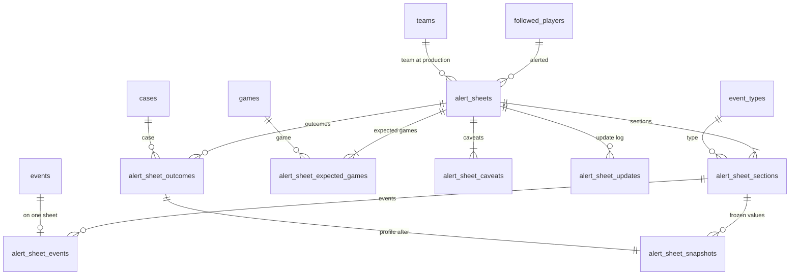

# Domain model — alert sheets (Lot 2)

Alert sheets, their dated sections, frozen profile and trend snapshots, expected-game history, caveats, update log and outcome: file 09 (ALE-01 to ALE-31) as ruled by `CL-ALE-01` to `CL-ALE-14`, with ADR 0015 and ADR 0016. Events, cases, profiles, games, teams and players belong to the core model; tracked cases and forecasts are in [tracking-and-validation.md](tracking-and-validation.md); the alert message's data is in [notifications.md](notifications.md).

**Conventions.** As in [collection.md](collection.md). Volumes are small — a few sheets a week (H-TRV-04) — so indexes are named only where a list or a task's read needs them.

**Sensitive-data classes:** the core model's (`—`, `PI`, `EV`, `TX`, `PR`; README §3) and the two Lot 2 classes `EX` and `OW`, as the top of [collection.md](collection.md) says. A sheet exists only because of its events, so its rows are erased by their withdrawal (ALE-30); no column of this file holds an article's title, excerpt or an event's description (09 "Données manipulées").

## 1. Entities

### 1.1 Alert sheet — `alert_sheets`

The sourced write-up produced when a profiled player has a new detected event, or for an upcoming calendar-derived event (ALE-01, `CL-ALE-13`). Its identifier is its sheet number.

| Column | Type | Null | Default | Constraint or reference | Class | Spec |
| --- | --- | --- | --- | --- | --- | --- |
| `id` | integer identity | no | — | primary key; also the sheet number shown ("Sheet no. {n}"): production order, never reused, gaps accepted | — | ALE-06, ALE-30, CL-ALE-11 |
| `player_id` | uuid | no | — | → core `followed_players.id` `ON DELETE RESTRICT` | PI EV | ALE-01, ALE-07 |
| `team_id_at_production` | integer | no | — | → core `teams.id` `ON DELETE RESTRICT`; kept after a trade | — | ALE-07 |
| `produced_at` | timestamptz | no | — | | — | ALE-02, ALE-05, ALE-06 |
| `profile_values_entered_at` | timestamptz | yes | null | for a sheet produced while its profile was being computed (ALE-05), the instant its values entered; with `produced_at`, it gives the timing instant of `CL-ALE-04` | — | ALE-05, CL-ALE-04 |
| `status` | text | no | `'open'` | `CHECK (status IN ('open','closed','canceled'))` (`AlertSheetStatus`) | — | ALE-26 |
| `cancellation_reason` | text | yes | null | `CHECK (cancellation_reason IN ('all_events_dismissed','attachment_corrected','event_no_longer_applies'))` (`AlertSheetCancellationReason`); `CHECK ((status = 'canceled') = (cancellation_reason IS NOT NULL))` | — | ALE-22, ALE-31, CL-ALE-13 |
| `is_late` | boolean | no | false | the « tardive » mark: timing instant at or after the expected game's scheduled start, then, once the measured game is established, at or after that game's | — | ALE-24, CL-ALE-04 |
| `caveats_frozen_at` | timestamptz | yes | null | instant the caveats froze: the scheduled start of the expected game | — | CL-ALE-07 |

- **Unique and indexes:** `alert_sheets_player_idx` `(player_id, produced_at)` — the alert history by player and period (ALE-28, IHM-33); `alert_sheets_status_idx` `(status, produced_at)` — the open, closed and canceled sections of IHM-33; `alert_sheets_late_idx` `(produced_at) WHERE is_late` — the "late sheets" filter.
- **Deletion cascades to:** every table below. A sheet is deleted only by the withdrawal of its only event (ALE-30, §1.9).
- **TypeScript:** `id: AlertSheetId`, exposed as the glossary's `number` on screens and in messages; `type AlertSheetState = { status: 'open' | 'closed' } | { status: 'canceled'; cancellationReason: AlertSheetCancellationReason }`; `isLate` gives the `AlertSheetTiming` `late` or `produced_before_tip_off`.

### 1.2 Section — `alert_sheet_sections`

The block of one event type on a sheet: the initial content, a dated section for a later event of another type (ALE-20) or for a type correction (ALE-31), each with its own frozen profile.

| Column | Type | Null | Default | Constraint or reference | Class | Spec |
| --- | --- | --- | --- | --- | --- | --- |
| `id` | integer identity | no | — | primary key | — | ALE-20 |
| `alert_sheet_id` | integer | no | — | → `alert_sheets.id` `ON DELETE CASCADE` | — | ALE-20 |
| `kind` | text | no | — | `CHECK (kind IN ('initial','later_event','type_change'))` (`AlertSheetSectionKind`) | — | ALE-20, ALE-31 |
| `event_type_id` | text | no | — | → core `event_types.id` `ON DELETE RESTRICT` | EV | ALE-09, ALE-20 |
| `added_at` | timestamptz | no | — | | — | ALE-20, ALE-31 |
| `profile_state` | text | no | — | `CHECK (profile_state IN ('pending','frozen'))` (`ProfileSnapshotState`); `pending` shows "Profile being computed" | — | ALE-05, ALE-19 |
| `frozen_at` | timestamptz | yes | null | `CHECK ((profile_state = 'frozen') = (frozen_at IS NOT NULL))` | — | ALE-19 |
| `profile_status_notice` | text | yes | null | `CHECK (profile_status_notice IN ('recalculation_in_progress','no_measured_case_yet'))`; only on a frozen section | — | ALE-05, 09 edge cases |
| `type_not_covered` | boolean | no | false | the player's coverage lacked the type when the section was added | — | ALE-14, DET-40 |
| `profile_changed_since_issue_at` | timestamptz | yes | null | the calculation instant of the first default-view profile found to differ from the frozen values, set by `game-tracking` after a recalculation | — | ALE-19, CL-ALE-07 |

- **Unique and indexes:** `alert_sheet_sections_uq` unique `(alert_sheet_id, event_type_id)` — two events of the same type share one section (ALE-20); `alert_sheet_sections_type_idx` `(event_type_id)` — the history filtered by type (IHM-33) and the "profile changed" read of `game-tracking` after a recalculation.
- **Deletion cascades to:** `alert_sheet_snapshots`, `alert_sheet_events`, and update entries of the section.
- **TypeScript:** `type AlertSheetSection = { profileState: 'pending' } | { profileState: 'frozen'; frozenAt: EpochMs; profileStatusNotice: ProfileStatusNotice | null; profile: ProfileSnapshot; trend: TrendSnapshot | null }`.

### 1.3 Snapshot — `alert_sheet_snapshots`

Profile and trend values copied as they are, in the default view, when they enter the sheet, never rewritten (ALE-09, ALE-19): the section's profile (`ProfileSnapshot`), the type's general trend (`TrendSnapshot`), and the outcome's profile after the case (`CL-ALE-12`).

| Column | Type | Null | Default | Constraint or reference | Class | Spec |
| --- | --- | --- | --- | --- | --- | --- |
| `id` | integer identity | no | — | primary key | — | ALE-19 |
| `alert_sheet_section_id` | integer | yes | null | → `alert_sheet_sections.id` `ON DELETE CASCADE` | — | ALE-09, ALE-11, ALE-12 |
| `alert_sheet_outcome_id` | integer | yes | null | → `alert_sheet_outcomes.id` `ON DELETE CASCADE`; `CHECK (num_nonnulls(alert_sheet_section_id, alert_sheet_outcome_id) = 1)` | — | ALE-27, CL-ALE-12 |
| `kind` | text | no | — | `CHECK (kind IN ('profile','trend'))` (`SnapshotKind`); an outcome snapshot is a `profile` | — | ALE-09, ALE-11 |
| `mean_gap` | double precision | yes | null | null when there is no valid case | — | ALE-09, SEN-20 |
| `range_low` | double precision | yes | null | plausible range (SEN-22) | — | ALE-09, SEN-38 |
| `range_high` | double precision | yes | null | `CHECK (range_high >= range_low)` | — | ALE-09, SEN-38 |
| `valid_count` | integer | no | — | `CHECK (valid_count >= 0)` | — | ALE-09 |
| `historical_count` | integer | yes | null | profile only | — | ALE-09, SEN-21 |
| `tracked_count` | integer | yes | null | profile only | — | ALE-09, SEN-21 |
| `excluded_count` | integer | yes | null | profile only | — | ALE-09 |
| `player_count` | integer | yes | null | trend only | — | ALE-12, SEN-29 |
| `verdict_level` | text | no | — | `CHECK (verdict_level IN ('inconclusive','possible','probable'))` | — | ALE-09, SEN-23 |
| `verdict_direction` | text | yes | null | `CHECK (verdict_direction IN ('increase','decrease'))`; `CHECK ((verdict_level = 'inconclusive') = (verdict_direction IS NULL))` | — | ALE-10, SEN-24 |
| `profile_confidence` | text | no | — | `CHECK (profile_confidence IN ('low','medium','high'))` | — | ALE-09, SEN-25 |
| `fragile` | boolean | yes | null | profile only | — | ALE-09, SEN-26 |
| `valid_case_threshold` | integer | yes | null | profile only: threshold in force | — | ALE-09, ALE-12 |
| `computed_at` | timestamptz | no | — | the profile's calculation date | — | ALE-09 |
| `detail` | jsonb | no | `'{}'` | immutable display detail read back whole: confidence-drop reasons, coverage and version warnings (SEN-46), the confounder warning (ADR 0016), excluded-case reasons | — | ALE-09, SEN-46, ADR 0016 |

- **Unique and indexes:** `alert_sheet_snapshots_section_uq` unique `(alert_sheet_section_id, kind) WHERE alert_sheet_section_id IS NOT NULL`; `alert_sheet_snapshots_outcome_uq` unique `(alert_sheet_outcome_id) WHERE alert_sheet_outcome_id IS NOT NULL`.
- **Deletion:** with its section or outcome; cascades to nothing.
- **TypeScript:** `ProfileSnapshot` and `TrendSnapshot` are two types over this table, discriminated by `kind`; a below-threshold profile is a `ProfileSnapshot` with `validCount < validCaseThreshold`, shown "indicative" after the trend (ALE-12).

### 1.4 Sheet event — `alert_sheet_events`

An event placed on a sheet. Its type, description, reference date, sources, marks, context and state are read from the event itself; only the detection confidence is kept as issued, since a later source must change nothing else (ALE-21).

| Column | Type | Null | Default | Constraint or reference | Class | Spec |
| --- | --- | --- | --- | --- | --- | --- |
| `id` | integer identity | no | — | primary key | — | ALE-08 |
| `alert_sheet_section_id` | integer | no | — | → `alert_sheet_sections.id` `ON DELETE CASCADE`; the section of the event's type | — | ALE-20 |
| `player_event_id` | integer | no | — | → core `events.id` `ON DELETE RESTRICT`; unique | EV | ALE-03, ALE-08 |
| `added_at` | timestamptz | no | — | | — | ALE-20 |
| `detection_confidence_at_issue` | smallint | yes | null | `CHECK (detection_confidence_at_issue BETWEEN 0 AND 100)`; null for an event of origin user or calendar-derived | — | ALE-08, ALE-21, CL-ALE-13 |

- **Unique and indexes:** `alert_sheet_events_event_uq` unique `(player_event_id)` — an event belongs to one sheet only (ALE-03); the sheet of an event (IHM-32 "what the event triggered").
- **Deletion:** with its section; by the withdrawal step (§1.9); moved to the new player's sheet on a player correction (ALE-31); the absorbed event's row at a merge (§1.9).
- **TypeScript:** `{ playerEventId: PlayerEventId; detectionConfidenceAtIssue: number | null }`, joined at read time with the event's `PlayerEvent` view.

### 1.5 Expected-game entry — `alert_sheet_expected_games`

The expected game shown by the sheet, and every game it replaced, struck through with the reason (ALE-15, ALE-23).

| Column | Type | Null | Default | Constraint or reference | Class | Spec |
| --- | --- | --- | --- | --- | --- | --- |
| `id` | integer identity | no | — | primary key | — | ALE-15 |
| `alert_sheet_id` | integer | no | — | → `alert_sheets.id` `ON DELETE CASCADE` | — | ALE-15 |
| `state` | text | no | — | `CHECK (state IN ('current','superseded','unknown'))` (`ExpectedGameState`) | — | ALE-15, ALE-23 |
| `game_id` | integer | yes | null | → core `games.id` `ON DELETE RESTRICT`; `CHECK ((state = 'unknown') = (game_id IS NULL))` | — | ALE-15, SUI-03, STA-27 |
| `scheduled_start_at` | timestamptz | yes | null | the game's scheduled start when the entry was recorded, so a superseded game shows its old time; null when unknown | — | ALE-15, ALE-23 |
| `opponent_team_id` | integer | yes | null | → core `teams.id` `ON DELETE RESTRICT`; null when unknown | — | ALE-15 |
| `is_home` | boolean | yes | null | null when unknown or when the schedule does not say | — | ALE-15, STA-26 |
| `passed_game_id` | integer | yes | null | → core `games.id` `ON DELETE RESTRICT`; the team game, on the US date of the reference date, whose tip-off the cautious reference instant follows, named by ALE-15's explanation | — | ALE-15, CL-ALE-02 |
| `unknown_reason` | text | yes | null | `CHECK (unknown_reason IN ('offseason','schedule_not_published','stats_source_unavailable'))` (`ExpectedGameUnknownReason`); `CHECK ((state = 'unknown') = (unknown_reason IS NOT NULL))` | — | ALE-15, ALE-23 |
| `recorded_at` | timestamptz | no | — | | — | ALE-23 |
| `superseded_at` | timestamptz | yes | null | `CHECK ((state = 'superseded') = (superseded_at IS NOT NULL))` | — | ALE-23 |
| `supersession_reason` | text | yes | null | `CHECK (supersession_reason IN ('postponed','brought_forward','canceled','player_did_not_play','reference_date_moved'))` (`ExpectedGameChangeReason`); `CHECK ((state = 'superseded') = (supersession_reason IS NOT NULL))` | — | ALE-21, ALE-23, SUI-18 |

- **Unique and indexes:** `alert_sheet_expected_games_live_uq` unique `(alert_sheet_id) WHERE state IN ('current','unknown')` — one live block per sheet; `alert_sheet_expected_games_game_idx` `(game_id) WHERE state = 'current'` — the sheet of a player and game when an event arrives (ALE-03), schedule changes of a game (ALE-23), Home's order (CL-IHM-22).
- **Deletion:** with its sheet; an `unknown` entry is deleted when a game becomes known (the update log keeps the change).
- **TypeScript:** `type ExpectedGameEntry = { state: 'current' | 'superseded'; game: GameRef; supersession?: { at: EpochMs; reason: ExpectedGameChangeReason } } | { state: 'unknown'; unknownReason: ExpectedGameUnknownReason }`.

### 1.6 Caveat — `alert_sheet_caveats`

One caveat the sheet shows, every applicable one, none hidden (ALE-16); recomputed until the expected game's scheduled start, frozen afterwards (`CL-ALE-07`).

| Column | Type | Null | Default | Constraint or reference | Class | Spec |
| --- | --- | --- | --- | --- | --- | --- |
| `id` | integer identity | no | — | primary key | — | ALE-16 |
| `alert_sheet_id` | integer | no | — | → `alert_sheets.id` `ON DELETE CASCADE` | — | ALE-16 |
| `kind` | text | no | — | `CHECK (kind IN ('small_sample','effect_direction','known_context','several_events','confidence_near_threshold','dating_to_verify','incomplete_or_earlier_version','late_sheet','type_not_covered','confounder_not_separable'))` (`CaveatKind`) | — | ALE-16, ADR 0016 |
| `event_type_id` | text | yes | null | → core `event_types.id` `ON DELETE RESTRICT`; the section's type for `small_sample`, `effect_direction`, `incomplete_or_earlier_version`, `type_not_covered`, `confounder_not_separable` | — | ALE-16 |
| `player_event_id` | integer | yes | null | → core `events.id` `ON DELETE RESTRICT`; the event for `confidence_near_threshold` and `dating_to_verify` | EV | ALE-16 |
| `known_context_reasons` | text[] | yes | null | `CHECK (known_context_reasons <@ ARRAY['high_stakes','injury_return_flagged','opponent_strength'])` (`KnownContextReason`); `CHECK ((kind = 'known_context') = (known_context_reasons IS NOT NULL))` | — | ALE-16, D-19 |
| `computed_at` | timestamptz | no | — | | — | CL-ALE-07 |

- **Unique and indexes:** `alert_sheet_caveats_uq` unique `NULLS NOT DISTINCT (alert_sheet_id, kind, event_type_id, player_event_id)`.
- **Deletion:** with its sheet; replaced as a set at each recomputation (§2.4); the absorbed event's rows at a merge (§1.9).
- **TypeScript:** a union on `kind`; the two forms of the direction caveat (`CL-ALE-03`) follow the section's `verdict_level`.

### 1.7 Update — `alert_sheet_updates`

The append-only update log: every dated change the sheet records (ALE-20 to ALE-25, ALE-31, `CL-ALE-07`).

| Column | Type | Null | Default | Constraint or reference | Class | Spec |
| --- | --- | --- | --- | --- | --- | --- |
| `id` | integer identity | no | — | primary key | — | ALE-31 |
| `alert_sheet_id` | integer | no | — | → `alert_sheets.id` `ON DELETE CASCADE` | — | ALE-31 |
| `occurred_at` | timestamptz | no | — | | — | ALE-20 to ALE-25 |
| `kind` | text | no | — | `CHECK (kind IN ('event_added','source_added','event_dismissed','event_reinstated','expected_game_changed','late_mark_changed','context_corrected','attachment_corrected','profile_values_entered','profile_changed_since_issue','caveats_changed','status_changed','outcome_recorded','outcome_value_changed','event_no_longer_applies'))` (`AlertSheetUpdateKind`) | — | ALE-20 to ALE-31, CL-ALE-04, CL-ALE-07, CL-ALE-12, CL-ALE-13 |
| `player_event_id` | integer | yes | null | → core `events.id` `ON DELETE RESTRICT`; the event the entry concerns | EV | ALE-20 to ALE-22, ALE-25, ALE-31 |
| `alert_sheet_section_id` | integer | yes | null | → `alert_sheet_sections.id` `ON DELETE CASCADE`; the section concerned | — | ALE-05, ALE-19, ALE-20 |
| `detail` | jsonb | no | `'{}'` | immutable values of the entry, read back whole (shapes below); identifiers and closed values only, never a text of an event or an article | — | ALE-31, CL-ALE-12 |

- **Detail by kind:** `source_added` `{ articleId }`; `expected_game_changed` `{ fromEntryId, toEntryId, reason }`; `late_mark_changed` `{ isLate }`; `attachment_corrected` `{ correction: 'player' | 'type' | 'merge', newSheetId? }`; `status_changed` `{ from, to, cancellationReason? }`; `outcome_recorded` `{ caseId }`; `outcome_value_changed` `{ caseId, field: 'gap' | 'baseline' | 'category', previous }`; `event_no_longer_applies` `{ eventTypeId, gameId, reason }`; the other kinds `{}`.
- **Unique and indexes:** `alert_sheet_updates_sheet_idx` `(alert_sheet_id, occurred_at)` — the log in order; `alert_sheet_updates_event_idx` `(player_event_id) WHERE player_event_id IS NOT NULL` — the withdrawal step.
- **Deletion:** with its sheet; entries about a withdrawn event by the withdrawal step; entries about an absorbed event are repointed to the kept event at a merge (§1.9). A notification message that names an entry blocks its deletion (notifications.md).
- **TypeScript:** a union on `kind` with the detail shapes above.

### 1.8 Outcome — `alert_sheet_outcomes`

The outcome of one case of the sheet at closure (ALE-27). Its profile after the case is frozen in `alert_sheet_snapshots`; the measured game, index, baseline, gap, case status, category and frozen forecast are read live from the case and its tracked case, marked provisional while they are (`CL-ALE-12`).

| Column | Type | Null | Default | Constraint or reference | Class | Spec |
| --- | --- | --- | --- | --- | --- | --- |
| `id` | integer identity | no | — | primary key | — | ALE-27 |
| `alert_sheet_id` | integer | no | — | → `alert_sheets.id` `ON DELETE CASCADE` | — | ALE-27 |
| `case_id` | integer | no | — | → core `cases.id` `ON DELETE RESTRICT` | EV | ALE-27, ALE-29 |
| `recorded_at` | timestamptz | no | — | the closure that recorded it | — | ALE-27 |

- **Unique and indexes:** `alert_sheet_outcomes_uq` unique `(alert_sheet_id, case_id)`; `alert_sheet_outcomes_case_idx` `(case_id)` — `moveCaseReferences` and the erasers.
- **Case merge** (core events-and-cases.md §2.5): `case_id` stays `ON DELETE RESTRICT`, and `alerts.moveCaseReferences(fromCaseId, intoCaseId)`, run by the recalculation's regrouping reactions (module map §1.10) before the emptied case is deleted and before notifications' own, moves its outcome rows to the surviving case, or deletes them with their snapshot when the sheet already has an outcome for the surviving case. Both cases' events end on the same measured game, so the outcome describes the same game; any other path that deletes a case still referenced here fails instead of silently losing a sheet's outcome.
- **Deletion cascades to:** its snapshot.
- **TypeScript:** `AlertSheetOutcome = { caseId; recordedAt; profileAfter: ProfileSnapshot }` joined with the case's live values.

### 1.9 Withdrawal, other erasures, purge, export and backup

**Withdrawal of an event E** (ALE-30, DSN-27). The alerts eraser runs after the notifications eraser, which has already deleted every message about E's sheet that names E (notifications.md §1.8), and before the tracking eraser. In the withdrawal's transaction:

1. if E is the only event of its sheet, the sheet is deleted with everything below it; its number is never reused;
2. otherwise E's sheet-event row, its update entries and its per-event caveats are deleted, its section too if no other event remains in it, and the caveats are recomputed even when frozen; the outcome of E's case is deleted when that case is erased;
3. the outbox facts of every deleted sheet and update entry (`outbox_facts.lot2_subject_id`, kinds `alert_sheet_produced` and `alert_sheet_updated`) are deleted, and journal entries naming a deleted sheet (`lot2_object_kind = 'alert_sheet'`) get the pair set to null (`CL-TRV-10`);
4. no update entry and no message records the withdrawal.

What may remain: the sheet of the other events, with its other sections, snapshots, outcomes and log entries.

**Other erasures.** An erasure by requalification or split (CL-TAX-09) follows the same steps. A player-data deletion (CL-JOU-06) erases every sheet of the player through the withdrawal of each of his events, then deletes any sheet of his left without events, such as one canceled by an attachment correction. A merge of two detected events follows the rules below. An upcoming calendar-derived event dropped before tip-off (`CL-SUI-14`) is not an erasure (`alerts.onCalendarEventDropped`, in the derivation reactions of module map §1.10): its sheet-event row goes, an `event_no_longer_applies` entry records its type, game and reason, the sheet is canceled with that reason when no other non-dismissed event remains (`CL-ALE-13`), and its sections and snapshots stay. A calendar-derived event dropped after its game started (`CL-TAX-19`, `CL-SEN-25`) goes the same way, its case's outcome row deleted with its snapshot; no message follows (`CL-TEL-21` only covers drops known before the scheduled start), and the core journals the drop and counts it in the profile's tally as `no_longer_derived`. A case merge moves or deletes outcome rows as §1.8 says.

**Merge of two detected events** (DET-47). `alerts.onAttachmentCorrected`, called by `detection.correct` before the absorbed event is erased (module map §1.7), leaves nothing that points at the absorbed event, table by table:

- `alert_sheet_events` (state): the absorbed event's row is deleted, never moved — the unique index keeps an event on one sheet and the kept event keeps its own membership (ALE-03); an `attachment_corrected` entry (`correction: 'merge'`, `newSheetId` the kept event's sheet when it has one) records it on the absorbed event's sheet, which is canceled with reason `attachment_corrected` when no other non-dismissed event remains (ALE-31);
- `alert_sheet_updates` (history): every entry about the absorbed event is repointed to the kept event, which no index forbids, so each sheet's log stays true;
- `alert_sheet_caveats` (state): the absorbed event's per-event caveats are deleted, then the caveats of each sheet concerned are recomputed for the kept event, with a `caveats_changed` entry when the set changes, after `caveats_frozen_at` too, as after a withdrawal (ALE-30);
- `alert_sheet_expected_games` (state, no event reference): recomputed from the sheet's remaining events when the merge moves the kept event's reference date (ALE-23);
- `alert_sheet_outcomes` (no event reference): the outcome of the absorbed event's case is deleted when that case is erased with it; a surviving case keeps its outcome, and a regrouping that follows goes through `moveCaseReferences` (§1.8);
- sections and snapshots reference no event and stay as issued.

**Purge.** None: the alert history is kept (ALE-28).

**Export and backup** (`CL-TRV-05`). Every table of this file is in each backup and in the full export; none feeds a spreadsheet export.

## 2. Lifecycles

### 2.1 Sheet status (`AlertSheetStatus`)

| From | To | Trigger | Guard | Side effects | Spec |
| --- | --- | --- | --- | --- | --- |
| — | `open` | end of the detection pass that recorded the event; an import before tip-off (ALE-05); the owner's classification, rescue or detachment (`CL-ALE-09`); an upcoming calendar-derived event (`CL-ALE-13`) | event not dismissed, player active, type validated; player profiled (DET-39, DET-40) unless the event is calendar-derived; no sheet of the player whose current expected game is the event's — otherwise the event joins it (ALE-03) | initial section, snapshots or `pending`, sheet event, expected-game entry, caveats; `is_late` from the timing instant; an `alert_sheet_produced` outbox fact, except after an owner action whose values are already in (`CL-ALE-09`) | ALE-01 to ALE-06, CL-ALE-09, CL-ALE-13 |
| — | `closed` | production of a sheet whose cases have all left awaiting their game | — | born closed with its outcomes (ALE-24) | ALE-24 |
| `open` | `closed` | every non-dismissed event's case is measured, excluded or not measurable | — | one outcome per case with its profile-after snapshot; `outcome_recorded`, `status_changed` entries | ALE-26, ALE-27, CL-ALE-12 |
| `open`, `closed` | `canceled` (`all_events_dismissed`) | the owner dismisses the last non-dismissed event | — | `event_dismissed`, `status_changed` entries; outcomes unchanged; no message | ALE-22, CL-ALE-06 |
| `open`, `closed` | `canceled` (`attachment_corrected`) | a player correction or a merge leaves the sheet no event | — | `attachment_corrected` entry; a new sheet for the new player when ALE-01 applies | ALE-31 |
| `open` | `canceled` (`event_no_longer_applies`) | an upcoming calendar-derived event is dropped before tip-off and no other non-dismissed event remains | — | `event_no_longer_applies` entry; an `alert_sheet_updated` fact when the sheet was notified and the drop does not follow the owner's own change, such as a corrected birthday (CL-TEL-21, CL-JOU-16) | CL-ALE-13, CL-TEL-21 |
| `canceled` | `open` or `closed` | an event is reinstated (DET-45), or a new event arrives for the same game (`CL-ALE-14`) | the state ALE-26 gives | reinstatement: entry, no message; new event: a dated section and an `alert_sheet_updated` fact if the sheet was notified, else `alert_sheet_produced` | ALE-22, ALE-26, CL-ALE-14 |
| any | (deleted) | withdrawal of its only event | — | §1.9 | ALE-30 |

**Late mark.** `is_late` is recomputed when the expected game changes, when the profile values enter (`CL-ALE-04`) and once file 08 establishes the measured game, after which it keeps its value; each change is a `late_mark_changed` entry; none sends a message.

### 2.2 Section profile state (`ProfileSnapshotState`)

| From | To | Trigger | Guard | Side effects | Spec |
| --- | --- | --- | --- | --- | --- |
| — | `pending` | a section is added while its profile is being computed | — | shows "Profile being computed" | ALE-05 |
| — | `frozen` | a section is added with its values available | — | profile and trend snapshots copied as they are, `frozen_at = now`; during a recalculation the last complete values with `recalculation_in_progress` | ALE-09, ALE-19 |
| `pending` | `frozen` | the profile values become available | — | snapshots; `profile_values_entered_at` on the sheet; `profile_values_entered` entry; `is_late` recomputed; the alert fact is emitted now (TEL-11, CL-TEL-13) | ALE-05, CL-ALE-04 |

A frozen snapshot never changes; a later change of the profile sets `profile_changed_since_issue_at` once, with a `profile_changed_since_issue` entry (ALE-19).

The triggers of this section's rules that come from Lot 1 work — profile values that become available, a changed profile, a case that leaves awaiting its game or whose gap, baseline or category changes — are read, not pushed: `game-tracking`, chained after the statistics tasks, `calendar-derivation` and `recalculation` (module map §4, §1.10), applies these rules from what the core then holds. No Lot 1 module calls `alerts`.

### 2.3 Expected-game entry (`ExpectedGameState`)

| From | To | Trigger | Guard | Side effects | Spec |
| --- | --- | --- | --- | --- | --- |
| — | `current` | the sheet is produced, or a new game replaces the current one | the first official game of the player's team with a scheduled start strictly after the reference date (CL-ALE-02); for a calendar-derived event, its derived game | `passed_game_id` set when the reference instant follows a game of that US date | ALE-15, CL-ALE-02, CL-SUI-12 |
| — | `unknown` | no game is known | — | the reason | ALE-15 |
| `current` | `superseded` | the game is postponed, brought forward or canceled, the player does not play it, or the reference date moves | the event's case still awaits its game | the new entry; an `expected_game_changed` entry; an `alert_sheet_updated` fact when known before the new game's tip-off (ALE-23, TEL-12) | ALE-21, ALE-23, SUI-18 |
| `unknown` | (deleted) | a game becomes known | — | a `current` entry; an `expected_game_changed` entry | ALE-23 |

### 2.4 Caveats

The caveat set is recomputed as a whole whenever one of its inputs changes before `caveats_frozen_at` — a context correction (ALE-25), a new event (ALE-20), an expected-game change (ALE-23), a dating mark, the late mark — with a `caveats_changed` entry; at the expected game's scheduled start `caveats_frozen_at` is set and the set no longer changes, except once more after a withdrawal (ALE-30) or a merge of two detected events (DET-47). The `effect_direction` caveat is always present (ALE-16). For a calendar-derived event, `confidence_near_threshold`, `dating_to_verify` and `type_not_covered` never apply (`CL-ALE-13`).

## 3. Invariants

| Rule | Spec | Enforced by |
| --- | --- | --- |
| An event belongs to one sheet only. | ALE-03 | unique `alert_sheet_events_event_uq` |
| A sheet holds the events of one player whose expected game was the same at their detection. | ALE-03, H-ALE-02 | alerts service at production and addition |
| No sheet for a paused or withdrawn player, a non-validated type, or a non-profiled player's researched type. | ALE-01 | alerts service at production |
| A sheet is canceled exactly when it has a cancellation reason. | ALE-26 | `CHECK` on `alert_sheets` |
| A sheet has one live expected-game entry. | ALE-15 | partial unique index |
| Frozen snapshots, the issued detection confidence and outcome profiles are never rewritten. | ALE-19, CL-ALE-07 | alerts service: no update path for these rows |
| The sheet computes nothing: snapshot values are the core profile's values at that instant. | ALE-09 | alerts service copies the core's read model |
| No article text or event description is stored on a sheet. | 09 "Données manipulées", DSN-06 | no column holds one |
| The direction caveat is always present; caveats change only before they freeze, or after a withdrawal. | ALE-16, CL-ALE-07, ALE-30 | alerts service |
| A sheet's number is never reassigned. | ALE-30, CL-ALE-11 | identity column, never reset |
| A sheet is deleted only by the withdrawal of its only event. | ALE-28, ALE-30 | alerts service: no other delete path |
| Snapshots belong to exactly one section or one outcome. | ALE-19, CL-ALE-12 | `CHECK` on `alert_sheet_snapshots` |
| No message for a new source, a dismissal, a reinstatement, a withdrawal or a late-mark change. | ALE-21, ALE-22, ALE-30, CL-ALE-04 | alerts service emits no outbox fact for them |

## 4. Stored or derived

| Item | Stored or derived | Recalculation |
| --- | --- | --- |
| Header summary sentence | derived from frozen data: the initial section's type and profile snapshot (verdict and valid cases, or the below-threshold label) and the first expected-game entry | — |
| Event block | read live from the event, its attachments and owner-supplied sources (type, description, reference date and precision, sources with titles and links, marks, context with origin, state and dismissal); `detection_confidence_at_issue` stored | — |
| Lead time | derived: reference date to the current expected game's scheduled start | — |
| Status | stored | recomputed by the alerts service when an event's state, a case's state or an attachment changes (§2.1) |
| Late mark | stored | §2.1 |
| Caveats | stored | §2.4 |
| "Profile changed since issue" | stored instant | set by `game-tracking`, chained after `recalculation`, which compares each open sheet's frozen sections with the current default-view profiles; dated with the profile's calculation instant |
| Related sheets ("see also") | derived: other sheets of the player whose current expected game is the same game | — |
| Subject notices (player paused or withdrawn, type withdrawn) | derived from the player's and the type's current state | — |
| Outcome block | profile after the case stored (snapshot); measured game, index, baseline, gap, case status and reason, category, frozen forecast and source, "recorded after tip-off" and "late forecast" read live; each later change of gap, baseline or category is an `outcome_value_changed` entry keeping the earlier value | entry written by `game-tracking` when it finds that a closed sheet's case changed (CL-ALE-12) |
| Hand-off to validation | derived: the validation table reads cases and tracked cases, never the sheet's values (ALE-29) | — |
| Time remaining | derived at display | — |

## 5. Exchange formats

None is owned here. The data an alert or an alert update needs is defined in [notifications.md](notifications.md) §5.

## 6. Rulings applied

- `CL-ALE-01`: acceptance criteria are `CA-ALE-01` to `CA-ALE-22`.
- `CL-ALE-02`, `CL-SUI-12`: the expected game is the first game strictly after the reference date as file 04 records it; `passed_game_id` names the game the explanation cites.
- `CL-ALE-03`: two forms of the direction caveat, chosen from the section's verdict.
- `CL-ALE-04`: the late mark against the expected game, then the measured game; its changes logged, never notified.
- `CL-ALE-05`: the small-sample caveat's thresholds for a profile and for a trend.
- `CL-ALE-06`: a closed sheet can become canceled; its outcome stays.
- `CL-ALE-07`: the frozen and updated parts of a sheet.
- `CL-ALE-08`: sheet values and frozen forecast differ on purpose.
- `CL-ALE-09`: sheets after owner actions, produced at once and not notified unless values arrive later.
- `CL-ALE-10`: every source line shows its title, read from the article.
- `CL-ALE-11`: one sequence, gaps accepted.
- `CL-ALE-12`: the outcome's frozen profile and live values with logged changes.
- `CL-ALE-13`: sheets of upcoming calendar-derived events, their event block "derived from the calendar" and the cancellation reason `event_no_longer_applies`.
- `CL-SUI-14`, `CL-TAX-20`: a withdrawn type deletes nothing; an upcoming event of that type keeps its sheet event, its sheet shows the type-withdrawn notice, and the type's later events get no sheet, the production guard requiring a validated type.
- `CL-ALE-15`: the tip-off an import is compared with is the scheduled start of the event's expected game as known at the import; an import saved at or after it produces no sheet.
- `CL-ALE-14`: a new event revives a canceled sheet of the same game.
- ADR 0016: the caveat `confounder_not_separable`.

Modeling choices of this file:

1. **The sheet stores no copy of an event's description or of its sources' titles and links**; it reads them from the event. A copy would keep an earlier text that the owner corrected, which DET-52 and `CL-DSN-15` forbid keeping, and a second copy of press references for the withdrawal to find. What `CL-ALE-07` freezes and could change by itself — profile and trend values, the issued detection confidence, the expected game as issued, the caveats after tip-off — is stored.
2. **The sheet's number is its primary key**: an identity is already unique, in production order and never reused (ALE-06, ALE-30).
3. **Snapshots are structured columns** because the alert list filters and shows the verdict and case count at issue (IHM-33); only display-only details are an immutable `jsonb`.
4. **New enumerations, to add to the glossary:** `AlertSheetSectionKind`, `SnapshotKind`, `AlertSheetUpdateKind`, `ExpectedGameChangeReason`, `ExpectedGameUnknownReason`, `KnownContextReason`; new values `confounder_not_separable` for `CaveatKind` (glossary §10 already names it) and `event_no_longer_applies` for `AlertSheetCancellationReason` (`CL-ALE-13`).
5. **The `known_context` caveat is sheet-level**, listing its reasons: stakes and opponent concern the game, not one event.
6. **An `unknown` expected-game entry is deleted, not struck through,** when a game becomes known: there is no game to strike through; the log keeps the change.

## 7. Entity-relationship diagram

`followed_players`, `teams`, `event_types`, `events`, `games` and `cases` belong to the core model.

## 8. Requests to the core model

1. **Profile read model at freeze time** (default view, SEN-21): for a player and type, the values ALE-09 lists — mean gap, plausible range, valid cases split historical and tracked, excluded cases with reasons, verdict level and direction, profile confidence with its reasons, the fragile flag, coverage and version warnings (SEN-46), the confounder warning (ADR 0016), the threshold in force, the calculation date and the "recalculating" state (SEN-36); for a type, the general trend with its player count (SEN-28, SEN-29).
2. **Profile reads, no hook** (ALE-05, ALE-19): the current default-view profile of a pair with its calculation instant, which `game-tracking`, chained after the statistics tasks, `calendar-derivation` and `recalculation` (module map §4, §1.10), reads to complete the profile values of the sheets waiting for them and to mark "profile changed since issue"; the core keeps no `alerts.onProfileChanged` side effect.
3. **Events**: their state and dismissal data, marks, context indications with origin, description and sources (the read view of DSN-06); for a calendar-derived event, its `derived_game_id` (`CL-DSN-20`).
4. **Cases**: read access to the case of an event — measured game, status and reason, gap and its status, baseline used, performance index — read by `game-tracking` after each statistics task and recalculation, which records closures and outcome changes (`outcome_recorded`, `outcome_value_changed`) from what the core then holds; no hook (ALE-26, CL-ALE-12).
5. **Games and teams**: scheduled start as last known, US date, opponent, home or away, status (postponed, canceled), and the schedule changes since a given instant (STA-28), for ALE-23; the player's current team at production.
6. **Backtests**: whether the player is profiled and whether his coverage includes the type (BKT-10), and the complementary request a detection created or found (BKT-04, BKT-07, ALE-14).
7. **Glossary**: add the enumerations and values of modeling choice 4.
8. **Regrouping reactions** (module map §1.10, events-and-cases.md §2.5): inside `sensitivity.processRecalculationJobs`, before a case emptied by a regrouping is deleted, `alerts.moveCaseReferences(fromCaseId, intoCaseId)` (§1.8), then `notifications.moveCaseReferences` (notifications.md §1.4), then `tracking.moveCaseReferences`, which records a regrouping exit and moves the decisions (tracking-and-validation.md §1.8) before tracking's other rows cascade.
