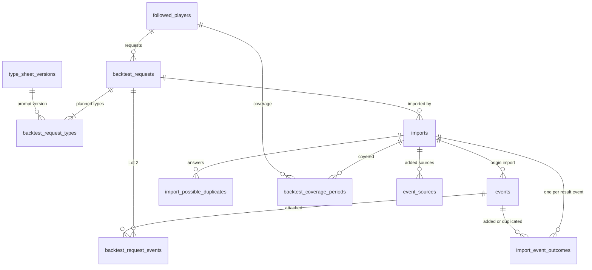

# Backtest requests and import

Backtest requests and their research prompt (`docs/05-demande-de-backtest-et-prompt.md`), the
player's backtest coverage, and the import of research results with its trace
(`docs/06-import-des-resultats-de-recherche.md`). The research-result format 1.0 is in section 5.
The pasted text lives only in the import draft ([operations.md](operations.md), `drafts`); the
historical events an import saves are in [events-and-cases.md](events-and-cases.md). Conventions are
in the [README](README.md).

In this area "validated type" reads "research type": a validated type whose sheet is not derived
from the calendar (CL-BKT-03). Calendar-derived types never appear in a request, a prompt or a
coverage.

## 1. Entities

### 1.1 `backtest_requests` — `BacktestRequest`

A request to the owner to run a deep research for one player; at most one to do per player
(BKT-01, BKT-07, BKT-12).

| column                     | type        | null | default   | constraint or reference                                                                                                     | class | spec IDs                          |
| -------------------------- | ----------- | ---- | --------- | --------------------------------------------------------------------------------------------------------------------------- | ----- | --------------------------------- |
| `id`                       | integer     | no   | identity  | primary key                                                                                                                 | PI    | —                                 |
| `reference`                | text        | no   | —         | unique; `CHECK (reference ~ '^REQ-[0-9]{4}-[0-9]{4,}$')`; from the per-year counter, never changed or reused                | PI    | BKT-12, CL-BKT-11                 |
| `player_id`                | uuid        | no   | —         | `REFERENCES followed_players(id) ON DELETE CASCADE`                                                                         | PI    | BKT-01                            |
| `kind`                     | text        | no   | —         | `CHECK (kind IN ('initial','supplement','full_redo'))`                                                                      | PI    | BKT-01, BKT-08, BKT-09            |
| `trigger`                  | text        | no   | —         | `CHECK (trigger IN ('manual_action','detection','type_validated','type_reactivated','type_broadened','incomplete_import'))` | PI    | BKT-01, BKT-03 to BKT-06          |
| `trigger_event_type_id`    | text        | yes  | —         | `REFERENCES event_types(id) ON DELETE RESTRICT`; the type of a validation, reactivation or broadening                       | PI    | BKT-05, 05 « Données manipulées » |
| `trigger_import_id`        | integer     | yes  | —         | `REFERENCES imports(id) ON DELETE SET NULL`; the import an incomplete-import supplement stems from                          | PI    | BKT-06                            |
| `status`                   | text        | no   | `'to_do'` | `CHECK (status IN ('to_do','imported','canceled'))`                                                                         | PI    | BKT-13                            |
| `created_at`               | timestamptz | no   | `now()`   | —                                                                                                                           | PI    | BKT-17                            |
| `created_on`               | date        | no   | —         | the owner's calendar date at creation, in his time zone; ends the periods of a new request                                  | PI    | BKT-08, CL-BKT-10                 |
| `imported_at`              | timestamptz | yes  | —         | —                                                                                                                           | PI    | BKT-13                            |
| `canceled_at`              | timestamptz | yes  | —         | kept if a canceled request is imported later                                                                                | PI    | BKT-14, IMP-08                    |
| `cancellation_reason_code` | text        | yes  | —         | `CHECK (cancellation_reason_code IN ('player_withdrawn'))`                                                                  | PI    | BKT-14                            |
| `cancellation_reason_text` | text        | yes  | —         | the owner's optional reason                                                                                                 | PI TX | BKT-14, DSN-10                    |
| `prompt_text`              | text        | no   | —         | the research prompt as produced, every placeholder filled                                                                   | PI    | BKT-20, BKT-22                    |
| `prompt_produced_at`       | timestamptz | no   | —         | —                                                                                                                           | PI    | BKT-20                            |
| `last_copied_at`           | timestamptz | yes  | —         | set by a successful Copy or Share; also the "prompt copied" indication of IHM-39 (`promptCopiedAt`)                         | PI    | BKT-20, IHM-39, IHM-40, CL-BKT-12 |
| `row_version`              | integer     | no   | `1`       | incremented by every save                                                                                                   | —     | CL-IHM-18                         |

Row checks: `(status = 'imported') = (imported_at IS NOT NULL)`;
`status = 'canceled'` implies `canceled_at IS NOT NULL`;
`cancellation_reason_code IS NULL OR canceled_at IS NOT NULL`, and the same for the text;
`(trigger_event_type_id IS NOT NULL) = (trigger IN ('type_validated','type_reactivated','type_broadened'))`;
`trigger_import_id IS NULL OR trigger = 'incomplete_import'`.

Unique: `backtest_requests_reference_key (reference)`;
`backtest_requests_one_to_do_key (player_id) WHERE status = 'to_do'` (BKT-07).

Indexes: `backtest_requests_to_do_idx (created_at) WHERE status = 'to_do'` — the to-do list,
oldest first (BKT-17, CL-IHM-16); `backtest_requests_copied_idx (last_copied_at) WHERE status = 'to_do'`
— the "backtest in progress" banner, most recent copy first (IHM-40, CL-IHM-13);
`backtest_requests_player_idx (player_id, created_at)` — the player's requests (JOU-25).

Deletion: only with the player (CL-JOU-06). It cascades to its types, its event links and its
imports.

```ts
type BacktestRequestId = Brand<number, 'BacktestRequestId'>;
type BacktestRequestStatus = 'to_do' | 'imported' | 'canceled';
type BacktestRequestOrigin = 'from_detection' | 'manual' | 'supplementary'; // derived from trigger and kind
```

### 1.2 `backtest_request_types` — planned and requested types

Each type of a request with the sheet version its prompt was produced under and its requested
period (BKT-08, BKT-09, BKT-15). Every row is a planned type; a reduction leaves the row but stops requesting it, so
that the post-import supplement can cover it again (CL-BKT-07).

| column                 | type     | null | default  | constraint or reference                                                                                                                                                                                  | class | spec IDs                             |
| ---------------------- | -------- | ---- | -------- | -------------------------------------------------------------------------------------------------------------------------------------------------------------------------------------------------------- | ----- | ------------------------------------ |
| `id`                   | integer  | no   | identity | primary key                                                                                                                                                                                              | PI    | —                                    |
| `backtest_request_id`  | integer  | no   | —        | `REFERENCES backtest_requests(id) ON DELETE CASCADE`                                                                                                                                                     | PI    | BKT-08                               |
| `event_type_id`        | text     | no   | —        | a research type                                                                                                                                                                                          | PI    | BKT-08, CL-BKT-03                    |
| `sheet_version_number` | smallint | no   | —        | with `event_type_id`, `REFERENCES type_sheet_versions(event_type_id, version_number) ON DELETE RESTRICT`; the type's current version number when the prompt was produced or last regenerated (CL-TAX-06) | PI    | BKT-15, TAX-23, CL-TAX-06            |
| `period_start_on`      | date     | yes  | —        | null means "from his first NBA game", its date unknown; otherwise the first NBA game's US date or a first uncovered day                                                                                  | PI    | BKT-08, BKT-09, CL-BKT-05            |
| `period_end_on`        | date     | no   | —        | the owner's calendar date of the creation or the last update, or a season's end after a reduction                                                                                                        | PI    | BKT-08, BKT-15, CL-BKT-09, CL-BKT-10 |
| `is_requested`         | boolean  | no   | `true`   | false once a reduction removed it from the prompt                                                                                                                                                        | PI    | BKT-15, CL-BKT-07                    |

Row check: `period_start_on IS NULL OR period_start_on <= period_end_on`.

Unique: `backtest_request_types_key (backtest_request_id, event_type_id)`.

Period dates are calendar dates compared as written with the research's dates (CL-IMP-09).

### 1.3 `backtest_request_events` — detected events attached to a request (Lot 2)

| column                | type        | null | default | constraint or reference                              | class | spec IDs       |
| --------------------- | ----------- | ---- | ------- | ---------------------------------------------------- | ----- | -------------- |
| `backtest_request_id` | integer     | no   | —       | `REFERENCES backtest_requests(id) ON DELETE CASCADE` | EV    | BKT-03, BKT-07 |
| `player_event_id`     | integer     | no   | —       | `REFERENCES events(id) ON DELETE CASCADE`            | EV    | BKT-07, BKT-18 |
| `attached_at`         | timestamptz | no   | `now()` | —                                                    | EV    | BKT-07         |

Primary key `(backtest_request_id, player_event_id)`. A dismissal keeps the link (only the urgency it
carried goes); a withdrawal erases it, the request staying with its trigger `detection`
(BKT-14, CL-DSN-05).

### 1.4 `backtest_coverage_periods` — `BacktestCoverage`

Per player and research type, the periods covered by an imported result, even an empty one, each
with the sheet version it was researched under (BKT-10). Coverage is a union per player and type
(CL-BKT-20).

| column                 | type        | null | default  | constraint or reference                                                        | class | spec IDs                  |
| ---------------------- | ----------- | ---- | -------- | ------------------------------------------------------------------------------ | ----- | ------------------------- |
| `id`                   | integer     | no   | identity | primary key                                                                    | PI    | —                         |
| `player_id`            | uuid        | no   | —        | `REFERENCES followed_players(id) ON DELETE CASCADE`                            | PI    | BKT-10                    |
| `event_type_id`        | text        | no   | —        | `REFERENCES event_types(id) ON DELETE RESTRICT`; never a calendar-derived type | PI    | BKT-10, CL-BKT-03         |
| `start_on`             | date        | no   | —        | —                                                                              | PI    | BKT-10, IMP-10            |
| `end_on`               | date        | no   | —        | `CHECK (start_on <= end_on)`                                                   | PI    | BKT-10, IMP-10            |
| `sheet_version_number` | smallint    | no   | —        | `CHECK (sheet_version_number >= 0)`; 0 for a period a split type inherited     | PI    | BKT-10, TAX-23, CL-BKT-06 |
| `origin`               | text        | no   | —        | `CHECK (origin IN ('import','merge','split'))`                                 | PI    | BKT-10, CL-BKT-06         |
| `import_id`            | integer     | yes  | —        | `REFERENCES imports(id) ON DELETE CASCADE`; the import that brought it         | PI    | BKT-10, IMP-30            |
| `recorded_at`          | timestamptz | no   | `now()`  | the import's date, or the merge or split's                                     | PI    | BKT-10                    |

Row check: `(origin = 'import') = (import_id IS NOT NULL)`.

Indexes: `backtest_coverage_periods_player_type_idx (player_id, event_type_id, start_on)` serves
"coverage includes the type", the first uncovered day of CL-BKT-05, the profile warnings of SEN-46
and the Lot 2 routing of BKT-30.

The absorbed types' periods are kept as history and never consulted (CL-BKT-06).

### 1.5 `imports` — `Import` and its `ImportTrace`

A saved import: what it did, for which request, and what it kept of the result (IMP-31, DSN-32).
A result refused in full creates no row; the journal records it (IMP-31, CL-IMP-33).

| column                         | type        | null | default  | constraint or reference                                                                                                                                              | class | spec IDs                       |
| ------------------------------ | ----------- | ---- | -------- | -------------------------------------------------------------------------------------------------------------------------------------------------------------------- | ----- | ------------------------------ |
| `id`                           | integer     | no   | identity | primary key                                                                                                                                                          | PI    | —                              |
| `sequence_number`              | integer     | no   | —        | unique; from the gapless counter `import_sequence`                                                                                                                   | PI    | IMP-31                         |
| `backtest_request_id`          | integer     | no   | —        | `REFERENCES backtest_requests(id) ON DELETE CASCADE`                                                                                                                 | PI    | IMP-01, IMP-07                 |
| `player_id`                    | uuid        | no   | —        | `REFERENCES followed_players(id) ON DELETE CASCADE`; the request's player                                                                                            | PI    | IMP-07                         |
| `imported_at`                  | timestamptz | no   | `now()`  | —                                                                                                                                                                    | PI    | IMP-31                         |
| `mode`                         | text        | no   | —        | `CHECK (mode IN ('first_import','addition','replacement'))`                                                                                                          | PI    | IMP-22, IMP-28, IMP-29         |
| `format_version`               | text        | no   | `'1.0'`  | `CHECK (format_version IN ('1.0'))`                                                                                                                                  | —     | IMP-06, BKT-24                 |
| `truncation_recovered`         | boolean     | no   | `false`  | the IMP-05 recovery was used                                                                                                                                         | PI    | IMP-05, CL-IMP-18              |
| `recovered_event_count`        | smallint    | yes  | —        | required when recovered                                                                                                                                              | PI    | CL-IMP-18                      |
| `declared_limitations`         | text[]      | no   | `'{}'`   | the AI's limitations kept as text, each within `events.maxDescriptionLength`, no quotation mark                                                                      | PI TX | H-IMP-10, DSN-10, DSN-32       |
| `unverified_lead_counts`       | jsonb       | no   | `'{}'`   | immutable snapshot: `{"<type id>": n, "none": n}`; lead texts are never kept                                                                                         | PI    | H-IMP-10, CL-IMP-23, DSN-32    |
| `result_warnings`              | jsonb       | no   | `'[]'`   | immutable snapshot of the whole-result warnings (shape below)                                                                                                        | PI    | IMP-06, IMP-09, IMP-10, IMP-16 |
| `coverage_gaps`                | jsonb       | no   | `'[]'`   | immutable snapshot: `[{"event_type_id": "...", "start_on": "YYYY-MM-DD", "end_on": "YYYY-MM-DD"}]`, a type with no declared period having the whole requested period | PI    | IMP-10, BKT-06                 |
| `deleted_by_replacement_count` | integer     | no   | `0`      | historical events a replacement deleted                                                                                                                              | PI    | IMP-29, IMP-31                 |
| `deleted_corrected_count`      | integer     | no   | `0`      | of which manually corrected                                                                                                                                          | PI    | IMP-29, CA-IMP-16              |

`result_warnings` items: `{"kind": "...", "detail": ...}` with `kind` among the result-scope values of
the glossary's `ImportWarningKind`: `player_name_differs`, `format_or_version_missing`,
`version_normalized`, `lists_missing`, `declared_type_not_requested` (detail: the slugs as read),
`covered_period_clamped`, `covered_period_time_ignored`, `covered_type_repeated`, `unknown_fields`
(detail: their count), `events_not_sorted` (detail: the rank of the first one out of order),
`lead_ignored` and `limitation_ignored` (detail: the item's position),
`limitation_citation_marker` (detail: the position) and `other_request_to_do` (detail: that
request's reference, CL-BKT-20). No warning quotes a free text (CL-IMP-02).

Row check: `truncation_recovered = (recovered_event_count IS NOT NULL)`.

Unique: `imports_sequence_number_key (sequence_number)`.

Indexes: `imports_player_idx (player_id, imported_at)` — the player's import history (IMP-31) and
"profiled"; `imports_request_idx (backtest_request_id, imported_at)` — a request's last import,
which gives its remaining refusals (CL-IMP-24).

Deletion: only with its request or player. A withdrawal reduces the trace through its outcome rows
and sources (section 2 of [sensitive-data.md](sensitive-data.md)); the trace's stored counts concern
deleted events only, which can no longer be withdrawn.

```ts
type ImportId = Brand<number, 'ImportId'>;
type ImportMode = 'first_import' | 'addition' | 'replacement';
interface ImportTally {
  added: number;
  addedWithWarning: number;
  duplicatesNotAdded: number;
  sourcesAttached: number;
  ignored: number;
  refused: number;
  deletedByReplacement: number;
} // derived
```

### 1.6 `import_event_outcomes` — the outcome of each result event

Exactly one outcome per event of the result (IMP-19), except an event the owner declines for
sensitive data, of which nothing is kept but the counter (IMP-37, DSN-29). Its outcome
`not_recorded_sensitive_data` exists in the preview and the save summary only, never in a row. Refused and ignored
events keep their rank, type and date as read and their reason, nothing else.

| column               | type    | null | default  | constraint or reference                                                                                                                                                                                                                                                                                                                                                                                                                                                                    | class | spec IDs                    |
| -------------------- | ------- | ---- | -------- | ------------------------------------------------------------------------------------------------------------------------------------------------------------------------------------------------------------------------------------------------------------------------------------------------------------------------------------------------------------------------------------------------------------------------------------------------------------------------------------------ | ----- | --------------------------- |
| `id`                 | integer | no   | identity | primary key                                                                                                                                                                                                                                                                                                                                                                                                                                                                                | PI    | —                           |
| `import_id`          | integer | no   | —        | `REFERENCES imports(id) ON DELETE CASCADE`                                                                                                                                                                                                                                                                                                                                                                                                                                                 | PI    | IMP-31                      |
| `position`           | integer | no   | —        | `CHECK (position >= 1)`; the 1-based rank in the events list as pasted                                                                                                                                                                                                                                                                                                                                                                                                                     | PI    | IMP-20, CL-IMP-02           |
| `outcome`            | text    | no   | —        | `CHECK (outcome IN ('added','added_with_warning','duplicate_not_added','ignored','refused'))`                                                                                                                                                                                                                                                                                                                                                                                              | PI    | IMP-19                      |
| `player_event_id`    | integer | yes  | —        | `REFERENCES events(id) ON DELETE SET NULL`; the event added, or the existing event it duplicated                                                                                                                                                                                                                                                                                                                                                                                           | EV    | IMP-26, IMP-27, IMP-31      |
| `event_type_as_read` | text    | yes  | —        | ignored and refused only                                                                                                                                                                                                                                                                                                                                                                                                                                                                   | PI    | 06 « Données manipulées »   |
| `date_as_read`       | text    | yes  | —        | ignored and refused only                                                                                                                                                                                                                                                                                                                                                                                                                                                                   | PI    | 06 « Données manipulées »   |
| `reason`             | text    | yes  | —        | ignored: `CHECK` among the glossary's `ImportIgnoreReason` — `type_not_validated`, `type_not_requested`, `outside_requested_period`, `before_first_nba_game`, `calendar_derived_type`, `split_type_ignored`; refused: among `ImportRefusalReason` — `type_missing`, `type_unknown`, `public_date_missing`, `public_date_malformed`, `public_date_nonexistent`, `description_missing`, `description_too_long`, `description_quotation_mark`, `no_valid_source`, `source_before_public_date` | PI    | IMP-11 to IMP-14, CL-IMP-29 |

Row checks: `outcome IN ('ignored','refused')` iff `reason IS NOT NULL`, and then `player_event_id IS NULL`;
`outcome IN ('added','added_with_warning','duplicate_not_added')` implies `event_type_as_read`,
`date_as_read` and `reason` are null.

Unique: `import_event_outcomes_position_key (import_id, position)`.

Indexes: `import_event_outcomes_event_idx (player_event_id)` serves the withdrawal step, which deletes
every row designating the withdrawn event (IMP-37).

### 1.7 `import_possible_duplicates` — the owner's answers

For each possible duplicate, the existing event concerned and the owner's answer, and each
`keep_as_distinct` override of a duplicate (IMP-25, IMP-26, 06 « Données manipulées »).

| column                     | type    | null | default  | constraint or reference                                               | class | spec IDs       |
| -------------------------- | ------- | ---- | -------- | --------------------------------------------------------------------- | ----- | -------------- |
| `id`                       | integer | no   | identity | primary key                                                           | PI    | —              |
| `import_id`                | integer | no   | —        | `REFERENCES imports(id) ON DELETE CASCADE`                            | PI    | IMP-25         |
| `position`                 | integer | no   | —        | the result event's rank                                               | PI    | IMP-25         |
| `existing_player_event_id` | integer | yes  | —        | `REFERENCES events(id) ON DELETE SET NULL`                            | EV    | IMP-25         |
| `answer`                   | text    | no   | —        | `CHECK (answer IN ('same_fact','distinct_facts','keep_as_distinct'))` | PI    | IMP-25, IMP-26 |

Index: `import_possible_duplicates_event_idx (existing_player_event_id)` for the withdrawal step.

## 2. Lifecycles

### 2.1 Request status (BKT-13, BKT-14)

| from     | to       | trigger                                                      | guard                                                                                                                                 | side effects                                                                                                                       |
| -------- | -------- | ------------------------------------------------------------ | ------------------------------------------------------------------------------------------------------------------------------------- | ---------------------------------------------------------------------------------------------------------------------------------- |
| (none)   | to_do    | owner's request, an accepted proposal, or detection (Lot 2)  | a research type validated (BKT-02); player active or paused, active for detection (BKT-01, BKT-03); no to-do request for him (BKT-07) | reference from the counter; types and periods (BKT-08, BKT-09, CL-BKT-05); prompt produced and stored (BKT-20)                     |
| to_do    | to_do    | update (BKT-15, CL-BKT-08) or reduction (CL-BKT-09)          | a reduction leaving no type is refused                                                                                                | types, versions and periods changed; prompt regenerated under the same reference; the stale-copy warning if copied before (BKT-20) |
| to_do    | imported | an import is saved                                           | —                                                                                                                                     | `imported_at` set (IMP-30)                                                                                                         |
| to_do    | canceled | owner cancels; or the player is withdrawn                    | —                                                                                                                                     | `canceled_at`; reason optional, or `player_withdrawn` (BKT-14); a new trigger may create a new request                             |
| canceled | imported | an import is saved after the explicit confirmation of IMP-08 | —                                                                                                                                     | `imported_at` set; another to-do request of the player stays open (CL-BKT-20)                                                      |

`imported` is final; `canceled → to_do` does not exist; pausing the player changes nothing
(H-BKT-10).

### 2.2 Import session (IMP-01 to IMP-35)

Only the draft and the saved import are stored; the preview, the outcomes before saving, the
fingerprint flags and the correction message are computed and discarded (06 « Ce qui n'est pas
conservé »).

| from             | to             | trigger                      | guard                                                                                                                                                                                        | side effects                                                                                                                                                                                                                                                                                            |
| ---------------- | -------------- | ---------------------------- | -------------------------------------------------------------------------------------------------------------------------------------------------------------------------------------------- | ------------------------------------------------------------------------------------------------------------------------------------------------------------------------------------------------------------------------------------------------------------------------------------------------------- |
| (none)           | draft          | owner pastes or picks a file | at most `imports.maxPastedTextMegabytes` bytes (CL-IMP-27)                                                                                                                                   | the request's draft row written (CL-DSN-17)                                                                                                                                                                                                                                                             |
| draft            | blocking_error | Check                        | a whole-result check fails (IMP-04 to IMP-09)                                                                                                                                                | journal entry with date, reference, refusal category (a `BlockingErrorKind` value) and size only (CL-IMP-33); nothing saved                                                                                                                                                                             |
| draft            | preview        | Check                        | —                                                                                                                                                                                            | outcomes computed; each accepted event checked against the live fingerprints for every day within `imports.duplicateMaxDateGapDays` of its day (CL-DSN-06, CL-IMP-28, CL-IMP-34)                                                                                                                        |
| preview          | summary        | Save                         | every possible duplicate answered; the partial-import, canceled-request and replacement confirmations given; the save confirmation says how many flagged events will be recorded (CL-IMP-28) | one transaction (IMP-30): events, sources, coverage, outcome rows, trace, request status; each "don't record — sensitive data" adds one to the counter and stores nothing; recording a flagged event erases the fingerprints it matched (CL-DSN-06); draft erased; recalculation job, cause "new cases" |
| draft or preview | (discarded)    | Discard                      | —                                                                                                                                                                                            | draft erased (IMP-03)                                                                                                                                                                                                                                                                                   |

### 2.3 Player coverage situation (BKT-10) — `PlayerCoverageSituation`, derived

| from       | to       | trigger                                                       | guard | side effects                                                                                             |
| ---------- | -------- | ------------------------------------------------------------- | ----- | -------------------------------------------------------------------------------------------------------- |
| unprofiled | profiled | the first saved import of the player, even of an empty result | —     | Lot 2 routing of his detected events changes (BKT-30); calendar-derived profiles never count (CL-VUE-06) |

## 3. Invariants

| rule                                                                                                                                  | spec IDs                    | enforced by                                                                         |
| ------------------------------------------------------------------------------------------------------------------------------------- | --------------------------- | ----------------------------------------------------------------------------------- |
| At most one to-do request per player                                                                                                  | BKT-07                      | partial unique index                                                                |
| No request for a withdrawn player; none while no research type is validated                                                           | BKT-01, BKT-02, CL-BKT-03   | request service                                                                     |
| A reference is unique, never changes and is never reused, canceled requests included                                                  | BKT-12, CL-BKT-11           | unique index; the per-year counter in `sequence_counters`, which survives deletions |
| A request, its prompt and a coverage never hold a calendar-derived type                                                               | ADR 0015, CL-BKT-03         | request and import services                                                         |
| `imported` is final; a canceled request never returns to to do                                                                        | BKT-13                      | request service                                                                     |
| No placeholder remains in a stored prompt                                                                                             | BKT-22                      | prompt builder                                                                      |
| Saving an import is all or nothing                                                                                                    | IMP-30                      | one transaction                                                                     |
| Each result event has exactly one outcome; a sensitive-data decline leaves no row                                                     | IMP-19, IMP-37, DSN-29      | import service                                                                      |
| Retained coverage is a requested type's requested period intersected with the declared period                                         | IMP-10                      | import service                                                                      |
| Historical events take the sheet version of the request's prompt, except attachments after a merge or split                           | IMP-30, CL-IMP-21           | import service                                                                      |
| A replacement deletes only historical events of earlier imports, per type, inside that type's retained period; never a detected event | IMP-29, CL-IMP-20           | import service                                                                      |
| The import never modifies a detected event                                                                                            | IMP-27, CL-IMP-30           | import service                                                                      |
| The pasted text is never stored outside the draft                                                                                     | IMP-03, DSN-32              | no column holds it; the draft store is excluded from backups and exports            |
| A request's remaining refusals are those of its last saved import                                                                     | IMP-24, H-IMP-12, CL-IMP-24 | derived from the latest `imports` row of the request                                |

## 4. Stored or derived

| item                                                                                                     | stored or derived | recalculated when                                                                                                                                                                                                                                        | spec IDs                                       |
| -------------------------------------------------------------------------------------------------------- | ----------------- | -------------------------------------------------------------------------------------------------------------------------------------------------------------------------------------------------------------------------------------------------------- | ---------------------------------------------- |
| Prompt text                                                                                              | stored            | at creation, each update and reduction                                                                                                                                                                                                                   | BKT-20                                         |
| Origin of a request                                                                                      | derived           | trigger and kind                                                                                                                                                                                                                                         | 05 « Données manipulées »                      |
| Overall period                                                                                           | derived           | earliest start to latest end of the requested types                                                                                                                                                                                                      | 05 « Données manipulées »                      |
| Deadline, urgency, rank                                                                                  | derived           | on read, never stored                                                                                                                                                                                                                                    | BKT-16 to BKT-18, CL-BKT-23, CL-BKT-24         |
| "In progress", stale copy, outdated sheet version                                                        | derived           | `last_copied_at` against status, `prompt_produced_at` and the types' current versions                                                                                                                                                                    | BKT-15, BKT-20, IHM-40                         |
| Profiled, uncovered types, first uncovered day, covers the type                                          | derived           | from `imports` and `backtest_coverage_periods` (CL-BKT-05)                                                                                                                                                                                               | BKT-10, H-VUE-02                               |
| Import tally                                                                                             | derived           | from outcome rows, sources added by the import, and the stored deletion counts                                                                                                                                                                           | IMP-22, IMP-31, IMP-37                         |
| Sources the spot check opened                                                                            | derived           | sources added by the import with a verdict                                                                                                                                                                                                               | IMP-23                                         |
| Remaining refusals per request and their sum per player                                                  | derived           | refused outcomes of each request's last import                                                                                                                                                                                                           | IMP-24, CL-IMP-24, CL-SEN-22                   |
| Supplement proposed after a type's validation, reactivation or broadening, or after an incomplete import | derived           | on read; nothing is created before the owner accepts, when an import's supplement takes the planned types with an uncovered day; for a player with a request to do the proposal is its update; the detection-born supplement of Lot 2 is created at once | BKT-04 to BKT-06, BKT-15, CL-BKT-07, CL-BKT-25 |

## 5. Exchange formats

### 5.1 Research result, format `egoscope-backtest` 1.0

The English contract of glossary section 6.1; the French-keyed form is never read (CL-BKT-02).
General rules: one UTF-8 JSON object; no field other than these (an unknown one is ignored, flagged
once and never stored, IMP-16); dates `YYYY-MM-DD` or `YYYY-MM-DDTHH:MM±HH:MM`; lowercase
enumerated values; an optional field without content is omitted and `null` is never written; free
texts in English under the wording rules of DSN-12 to DSN-23, without quotation marks, at most
`events.maxDescriptionLength` (200) code points; titles as published.

| key                                     | type             | required | limits and allowed values                                                                                                             |
| --------------------------------------- | ---------------- | -------- | ------------------------------------------------------------------------------------------------------------------------------------- |
| `format`                                | string           | yes      | `egoscope-backtest`; any other value is refused: "This text is not a backtest result."                                                |
| `format_version`                        | string           | yes      | `1.0`; an unknown version is refused with the advice to regenerate the prompt                                                         |
| `request_reference`                     | string           | yes      | the request's `REQ-YYYY-NNNN`; compared trimmed, ignoring case (CL-BKT-11)                                                            |
| `player`                                | object           | yes      | —                                                                                                                                     |
| `player.id`                             | string           | yes      | the player's UUID; must be the request's player (IMP-07)                                                                              |
| `player.name`                           | string           | yes      | a different name gives only a warning                                                                                                 |
| `covered_types`                         | array of strings | yes      | non-empty; slugs of types in the prompt; a repeat counts once with a warning (CL-IMP-23)                                              |
| `covered_period`                        | object           | yes      | —                                                                                                                                     |
| `covered_period.start`                  | string           | yes      | date without time; at most `covered_period.end`; clamped to the requested period with a warning                                       |
| `covered_period.end`                    | string           | yes      | date without time                                                                                                                     |
| `events`                                | array            | yes      | may be empty (BKT-23); sorted by the date part of `public_date` (CL-BKT-15)                                                           |
| `events[].event_type`                   | string           | yes      | slug of a covered type                                                                                                                |
| `events[].public_date`                  | string           | yes      | the event's reference date                                                                                                            |
| `events[].description`                  | string           | yes      | one factual sentence, 1 to `events.maxDescriptionLength` code points, no quotation mark (CL-IMP-05)                                   |
| `events[].sources`                      | array            | yes      | 1 to `backtests.maxSourcesPerEvent` (3) objects, oldest first; at least one published before the next game the player played          |
| `events[].sources[].url`                | string           | yes      | full article address starting `https://` or `http://`, not a home page (CL-IMP-15), not a disallowed domain                           |
| `events[].sources[].outlet`             | string           | yes      | a missing value gives a warning                                                                                                       |
| `events[].sources[].title`              | string           | yes      | as published; a missing value gives a warning                                                                                         |
| `events[].sources[].publication_date`   | string           | yes      | same formats as `public_date`; not after the import day; not more than `imports.maxSourceLeadDays` before the public date (CL-IMP-11) |
| `events[].context`                      | object           | yes      | the first NBA game the player played after the event                                                                                  |
| `events[].context.injury_return`        | string           | yes      | `yes`, `no`, `unknown`; another value becomes `unknown` with a warning                                                                |
| `events[].context.game_stakes`          | string           | yes      | `high`, `normal`, `unknown`; same default                                                                                             |
| `events[].context.detail`               | string           | no       | shown in the preview, never stored (DSN-07)                                                                                           |
| `events[].confidence`                   | string           | yes      | `high`, `medium`, `low`; missing or another value becomes `low` with a warning                                                        |
| `events[].unverified_note`              | string           | no       | within the description length, no quotation mark, else ignored with a warning                                                         |
| `unverified_leads`                      | array            | yes      | may be empty; a missing list is read as empty with a warning                                                                          |
| `unverified_leads[].event_type`         | string           | no       | counted under "none" when missing, unknown or not requested (CL-IMP-23)                                                               |
| `unverified_leads[].approximate_period` | string           | no       | free text, for example "2020-21 season"                                                                                               |
| `unverified_leads[].description`        | string           | yes      | never stored; only the count per type is kept                                                                                         |
| `unverified_leads[].reason`             | string           | yes      | never stored                                                                                                                          |
| `limitations`                           | array of strings | yes      | may be empty; kept as text in `imports.declared_limitations`                                                                          |

Tolerances of the import, beyond these rules: surrounding text, code fences and invisible
characters are stripped; date variants (`Z`, seconds, compact offsets) are accepted with a warning,
a date-time without offset or at 00:00 is read as a date only; identifiers and enumerated values
are compared trimmed, ignoring case and diacritics, the stored value being the canonical one; a cut
result can be recovered (IMP-04 to IMP-06, CL-IMP-06, CL-IMP-08, CL-IMP-18, CL-IMP-22).

Mapping on save: an accepted event becomes an `events` row of origin `historical` with
`reference_date_on`, `reference_at` and `reference_offset_minutes` from `public_date`,
`research_confidence` from `confidence`, the context values with origin `research`, and its
sources as `event_sources` rows; `covered_types` and `covered_period` become
`backtest_coverage_periods` rows of origin `import`.

### 5.2 Values the research prompt receives

The prompt template is code (CL-BKT-02); a request fills its placeholders (glossary section 6.1):
`{{REFERENCE}}` the reference; `{{TODAY}}` the creation or update day, `YYYY-MM-DD`;
`{{PLAYER_NAME}}` the display name; `{{PLAYER_ID}}` the player's UUID; `{{PLAYER_MARKER}}` "first
NBA game on YYYY-MM-DD" or "first NBA game date to be established" (`player_indicators`);
`{{PERIOD}}` the overall period; per requested type `{{TYPE_ID}}`, `{{TYPE_NAME}}`,
`{{TYPE_PERIOD}}`, `{{TYPE_DEFINITION}}`, `{{TYPE_INCLUSION}}`, `{{TYPE_EXCLUSION}}`,
`{{TYPE_DATING_RULE}}` (with the coverage-threshold sentence of CL-TAX-14 when set) and
`{{TYPE_EXAMPLE}}`, taken from the type's current sheet content (`event_types`) under its current
version number, which the request type records — a formal change alters the content without a new
version (CL-TAX-06) — an empty item reading "not provided"; `{{TYPE_LIST}}`; `{{MAX_TEXT_LENGTH}}` from `events.maxDescriptionLength`; `{{MAX_SOURCES}}`
from `backtests.maxSourcesPerEvent`; `{{FORMAT_VERSION}}` `1.0`. The prompt never holds a calendar-derived
type, an event or a birthday (CL-DSN-21).

## 6. Rulings applied

- ADR 0010, CL-BKT-02: the English format 1.0, the only contract.
- ADR 0013, CL-IMP-06, CL-IMP-07: research-AI quirks and citation markers, as warnings.
- ADR 0015, CL-BKT-03, CL-IMP-29: research types only; `calendar_derived_type` ignores.
- ADR 0017, CL-IMP-28, CL-IMP-34, CL-DSN-06: the fingerprint flags of the preview, never stored,
  one window parameter for duplicates and fingerprints; a timed event's day is its date in the
  owner's time zone.
- CL-IMP-05, CL-DSN-03: the quotation-mark check of descriptions and reservations; an apostrophe
  always passes.
- ADR 0022: low-confidence events count; uncertain precedence shifts (in the cases area).
- CL-BKT-05, CL-BKT-06: counting periods, the broadening version, version 0 of a split.
- CL-BKT-07, CL-BKT-08, CL-BKT-09: planned and requested types, updates, reductions.
- CL-BKT-10: `created_on` in the owner's calendar.
- CL-BKT-11: the reference pattern and its per-year counter.
- CL-BKT-12: `last_copied_at` from Copy and Share.
- CL-BKT-20: a canceled request may still be imported; coverage is a union.
- CL-BKT-25: detection creates its supplement (Lot 2); validation, reactivation, broadening and an
  incomplete import only propose one, so a proposal is never a row.
- CL-TAX-06: the prompt sends each type's current sheet content under its current version number,
  recorded on the request type; a formal change creates no version.
- The glossary's import codes: `ImportRefusalReason`, `ImportIgnoreReason`, the result-scope
  `ImportWarningKind` values; `not_recorded_sensitive_data` is never stored (IMP-37, DSN-29).
- CL-IMP-02, CL-IMP-04: messages and the correction message, never stored, never quoting a free
  text.
- CL-IMP-09: calendar dates compared as written.
- CL-IMP-18: the recovery and its count in the trace.
- CL-IMP-20, CL-IMP-21: replacement scope and versions after a merge or split.
- CL-IMP-23, CL-IMP-24: lead counts, repeated types, remaining refusals per request.
- CL-IMP-33: the journal entry of a refused attempt.
- Own choice: the tally of an import is derived from one outcome row per result event, so that a
  withdrawal reduces the counts by deleting the rows that designate the event (IMP-37); only the
  replacement's deletion counts are stored numbers.
- Own choice: the coverage `origin` (`import`, `merge`, `split`) is a new code list for the
  glossary.

## 7. Diagram


