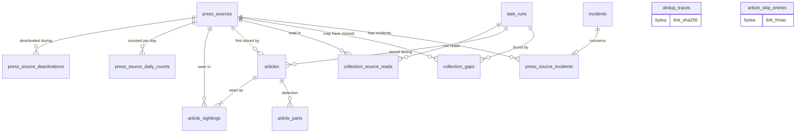

# Domain model — news collection (Lot 2)

Press sources, articles, deduplication, collection runs and possible collection gaps: file 03 (COL-01 to COL-50) as ruled by `CL-COL-01` to `CL-COL-22`, with ADR 0017, ADR 0019 and `CL-DSN-10`. Detection's use of articles (parts, results, attachments) is in [detection.md](detection.md); the shared entities this file points to (players, events, incidents, task runs, parameters, the withdrawal ledger) belong to the core model.

**Conventions.** Tables are snake_case plural, enumerations are `text` with a `CHECK` on the glossary's snake_case values, `id` is an `integer` identity primary key. An instant is `timestamptz` (`EpochMs` in code); a calendar date is `date` (`IsoDate` in code) and its calendar is stated on the column. Columns that reference core tables take the type of the referenced key (assumed `integer`, `event_types.id` a `text` slug). Parameter keys are the glossary's (§9.3).

**Sensitive-data classes** used in the column tables:

| Class | Meaning |
| --- | --- |
| `none` | Counts, states, settings, technical values; reveals nothing sensitive. |
| `press` | A public article's reference as published (title, outlet, link, feed identifier, publication instant): kept only as DSN-08 and DSN-09 allow; once the article is attached it designates an event and a withdrawal erases it. |
| `excerpt` | Feed text beyond the reference: serves detection only, erased on schedule (DSN-09). |
| `written` | Free text written under the wording rules of 13 (DSN-10). |
| `event` | Designates an event, or exists only because of one: erased by that event's withdrawal (DSN-27). |
| `owner` | Identifies the owner's Telegram account. |

## 1. Entities

### 1.1 Press source — `press_sources`

A public sports-press feed the owner registered after a trial read and the attestation (COL-02 to COL-10). Never deleted: withdrawal is a status (COL-10).

| Column | Type | Null | Default | Constraint or reference | Class | Spec |
| --- | --- | --- | --- | --- | --- | --- |
| `id` | integer identity | no | — | primary key | `none` | COL-02 |
| `outlet_name` | text | no | — | `CHECK (btrim(outlet_name) <> '')` | `none` | COL-06, COL-08 |
| `feed_url` | text | no | — | `CHECK (feed_url ~ '^https?://')`; the address as the owner entered it | `none` | COL-02, COL-08 |
| `feed_url_key` | text | no | — | comparison form of `feed_url` (CL-COL-18): scheme and host lower-cased, default port and fragment removed, ad-tracking parameters of COL-28 removed | `none` | COL-07, CL-COL-18 |
| `language` | text | no | — | `CHECK (language IN ('en','fr'))` | `none` | COL-05 |
| `outlet_time_zone` | text | yes | null | IANA zone name, checked by the service against the time-zone database | `none` | COL-04, COL-08, COL-20 |
| `silence_period_days` | smallint | yes | null | `CHECK (silence_period_days BETWEEN 1 AND 30)`; null means the parameter `silencePeriodDays` | `none` | COL-08, COL-42, CL-TRV-16 |
| `public_sports_press_attested_at` | timestamptz | no | — | set once, when the source is added | `none` | COL-03 |
| `activation_status` | text | no | `'active'` | `CHECK (activation_status IN ('active','deactivated','withdrawn'))` | `none` | COL-09, COL-10, COL-40 |
| `withdrawn_at` | timestamptz | yes | null | `CHECK ((activation_status = 'withdrawn') = (withdrawn_at IS NOT NULL))` | `none` | COL-10 |
| `health_status` | text | no | `'never_read'` | `CHECK (health_status IN ('never_read','working','down','silent'))` | `none` | COL-40 |
| `health_status_changed_at` | timestamptz | no | — | instant the current health status began ("down since …") | `none` | COL-40, CA-COL-28 |
| `first_successful_read_at` | timestamptz | yes | null | | `none` | CL-COL-06 |
| `last_successful_read_at` | timestamptz | yes | null | `CHECK (last_successful_read_at >= first_successful_read_at)` | `none` | COL-11, COL-45, COL-46 |
| `last_new_article_at` | timestamptz | yes | null | instant of the last read that stored a new article | `none` | COL-42, CL-COL-14 |
| `consecutive_failed_runs` | smallint | no | 0 | `CHECK (consecutive_failed_runs >= 0)`; runs in which every active source failed are not counted (CL-COL-05) | `none` | COL-41, CL-COL-05, CL-COL-14 |
| `failure_streak_started_at` | timestamptz | yes | null | instant of the first failed counted run of the current streak; `CHECK ((consecutive_failed_runs = 0) = (failure_streak_started_at IS NULL))` | `none` | COL-43, CL-COL-06 |
| `proposed_feed_url` | text | yes | null | address a permanent redirect announced (CL-COL-19); `CHECK (proposed_feed_url ~ '^https?://')` | `none` | CL-COL-19 |
| `version` | integer | no | 1 | incremented at every save; a save carrying another version is refused | `none` | CL-IHM-18 |

- **Unique and indexes:** `press_sources_feed_url_key_uq` unique `(feed_url_key) WHERE activation_status <> 'withdrawn'` — refuses an address already used by an active or deactivated source while freeing a withdrawn source's address (COL-07, COL-10). No other index: the table holds tens of rows.
- **Deletion:** never deleted; every reference to it is `ON DELETE RESTRICT`.
- **TypeScript:** `id: PressSourceId` (branded `number`); `language: Language`, `activationStatus: ActivationStatus`, `healthStatus: HealthStatus` are unions; instants are `EpochMs`; `feedUrlKey` is not exposed outside the module.

### 1.2 Deactivation period — `press_source_deactivations`

One period during which the owner had a source deactivated; never caught up (COL-09) and never counted as a collection gap (CL-COL-04).

| Column | Type | Null | Default | Constraint or reference | Class | Spec |
| --- | --- | --- | --- | --- | --- | --- |
| `id` | integer identity | no | — | primary key | `none` | COL-09 |
| `press_source_id` | integer | no | — | → `press_sources.id` `ON DELETE RESTRICT` | `none` | COL-09 |
| `deactivated_at` | timestamptz | no | — | | `none` | COL-09 |
| `reactivated_at` | timestamptz | yes | null | `CHECK (reactivated_at > deactivated_at)`; stays null if the source is withdrawn while deactivated | `none` | COL-09, CL-COL-04 |

- **Unique and indexes:** `press_source_deactivations_open_uq` unique `(press_source_id) WHERE reactivated_at IS NULL` — at most one open period; `press_source_deactivations_source_idx` `(press_source_id, reactivated_at)` — the last reactivation that enters the reference instant R (CL-COL-04) and the uncollected-period note of the next run.
- **Deletion:** never deleted.
- **TypeScript:** `reactivatedAt: EpochMs | null`.

### 1.3 Source daily counts — `press_source_daily_counts`

Numbers per source and day of first collection that keep the indicators of COL-11 correct after the purge (CL-COL-21).

| Column | Type | Null | Default | Constraint or reference | Class | Spec |
| --- | --- | --- | --- | --- | --- | --- |
| `id` | integer identity | no | — | primary key | `none` | CL-COL-21 |
| `press_source_id` | integer | no | — | → `press_sources.id` `ON DELETE RESTRICT`; the source whose read first stored the article | `none` | CL-COL-21 |
| `collected_on` | date | no | — | day of first collection, **owner's time zone** (parameter `timeZone`) at counting time | `none` | CL-COL-21 |
| `new_articles` | integer | no | 0 | `CHECK (new_articles >= 0)` | `none` | COL-11, CL-COL-21 |
| `prefilter_kept` | integer | no | 0 | `CHECK (prefilter_kept BETWEEN 0 AND new_articles)`; incremented by detection's prefilter through this module's API | `none` | COL-11, DET-06, CL-COL-21 |
| `exactly_dated` | integer | no | 0 | `CHECK (exactly_dated BETWEEN 0 AND new_articles)` | `none` | COL-11, CL-COL-21 |

- **Unique and indexes:** `press_source_daily_counts_uq` unique `(press_source_id, collected_on)` — the window sums of COL-11 and the upsert at collection.
- **Deletion:** deleted by the daily purge once `collected_on` is more than 90 days old, the largest allowed `sourceIndicatorWindowDays` (CL-TRV-16).
- **TypeScript:** `collectedOn: IsoDate`.

### 1.4 Article — `articles`

A stored feed item reduced to the COL-25 minimum, dated cautiously (COL-19 to COL-23). Its processing status is derived by detection (CL-DET-01) and written through this module's API.

| Column | Type | Null | Default | Constraint or reference | Class | Spec |
| --- | --- | --- | --- | --- | --- | --- |
| `id` | integer identity | no | — | primary key | `none` | COL-25 |
| `title` | text | no | — | `CHECK (btrim(title) <> '')`; as published, never changed by a later read | `press` | COL-18, COL-23, COL-25 |
| `title_key` | text | no | — | title normalized for COL-30: NFKD, diacritics removed, lower case, punctuation removed, white space collapsed; technical column for the title index | `press` | COL-30 |
| `outlet_name` | text | no | — | origin outlet of an aggregator item when the feed gives it, else the source's name at collection; never changed afterwards | `press` | COL-06, COL-25 |
| `link` | text | no | — | cleaned link (COL-28); unique | `press` | COL-25, COL-28, COL-30 |
| `retained_published_at` | timestamptz | no | — | retained publication instant, fixed at first collection; `CHECK (retained_published_at <= first_collected_at)` | `press` | COL-19 to COL-23, CL-COL-02, CL-COL-03 |
| `retained_published_at_precision` | text | no | — | `CHECK (... IN ('exact','approximate','none'))` (`DatePrecision`) | `none` | COL-20, COL-22, CL-COL-03 |
| `first_collected_at` | timestamptz | no | — | | `none` | COL-22 |
| `language` | text | no | — | `CHECK (language IN ('en','fr'))`; the item's declared language, else the source's | `none` | COL-17, CL-COL-11 |
| `excerpt` | text | yes | null | feed-supplied text without formatting, truncated to `excerptMaxLength`; `CHECK (char_length(excerpt) BETWEEN 1 AND 1000)`; null when the feed gave none or once erased | `excerpt` | COL-25, COL-27, COL-37, DSN-09 |
| `processing_status` | text | no | `'to_analyze'` | `CHECK (processing_status IN ('to_analyze','awaiting_classification','not_relevant','attached','linked_to_proposal'))` (`ArticleProcessingStatus`) | `none` | COL-35, CL-DET-01 |
| `not_relevant_reasons` | text[] | no | `'{}'` | every distinct non-relevance reason of the article's parts and facts (detection.md §4); `CHECK (not_relevant_reasons <@ ARRAY['no_followed_player','no_fact','below_threshold','old_fact','already_reported_by_backtest','type_rejected_or_withdrawn','proposal_rejected','detached_by_owner'])`; `CHECK (processing_status <> 'not_relevant' OR cardinality(not_relevant_reasons) > 0)` | `none` | DET-54, CL-DET-01, CL-DET-12 |
| `retention_clock_started_at` | timestamptz | yes | null | start of the not-relevant retention (CL-COL-08): `first_collected_at` when the prefilter found no followed player, else the instant the article last became not relevant; `CHECK ((processing_status = 'not_relevant') = (retention_clock_started_at IS NOT NULL))` | `none` | COL-36, COL-38, CL-COL-08, CL-COL-14 |
| `first_press_source_id` | integer | no | — | → `press_sources.id` `ON DELETE RESTRICT`; the source whose read first stored it | `none` | CL-COL-21 |
| `first_task_run_id` | integer | yes | null | → core `task_runs.id` `ON DELETE SET NULL`; the collection run that stored it | `none` | COL-49, CL-COL-14 |
| `version` | integer | no | 1 | incremented whenever the article, its parts or its results change | `none` | CL-IHM-18 |

- **Unique and indexes:**
  - `articles_link_uq` unique `(link)` — the same-link test of COL-30 at every item;
  - `articles_title_dedup_idx` `(outlet_name, title_key, retained_published_at)` — the same outlet, same title and instants under `titleDedupWindowHours` apart test of COL-30;
  - `articles_to_analyze_idx` `(first_collected_at) WHERE processing_status = 'to_analyze'` — the prefilter's input (DET-01);
  - `articles_not_relevant_idx` `(retention_clock_started_at) WHERE processing_status = 'not_relevant'` — the purge of COL-36 and the not-relevant list of IHM-71, oldest clock first;
  - `articles_reasons_gin` GIN `(not_relevant_reasons)` — the filter by reason of the not-relevant list (CL-DET-01);
  - `articles_excerpt_idx` `(first_collected_at) WHERE excerpt IS NOT NULL AND processing_status = 'attached'` — the excerpt erasure of COL-37;
  - `articles_source_collected_idx` `(first_press_source_id, first_collected_at)` — the attached share of COL-11 (CL-COL-21);
  - `articles_run_idx` `(first_task_run_id)` — the articles of a run (COL-49);
  - `articles_retained_idx` `(retained_published_at)` — the re-prefiltering of articles within the maximum age (DET-07).
- **Deletion cascades to:** `article_sightings`, and detection's `article_parts` (then `classification_results`, `classification_facts`). A row of `article_attachments` blocks the deletion (`ON DELETE RESTRICT`): an attached article is never deleted while attached (COL-37). Daily counts and exposure counts are numbers and stay (CL-COL-21, DET-57).
- **TypeScript:** `id: ArticleId`; `processingStatus: ArticleProcessingStatus`; `notRelevantReasons: readonly NotRelevantReason[]`; `retainedPublishedAtPrecision: DatePrecision`; `titleKey` is not exposed outside the module.

### 1.5 Article sighting — `article_sightings`

One source in which an article was seen, with the feed's item identifier when the item carries one (COL-31, CL-COL-01).

| Column | Type | Null | Default | Constraint or reference | Class | Spec |
| --- | --- | --- | --- | --- | --- | --- |
| `id` | integer identity | no | — | primary key | `none` | COL-31 |
| `article_id` | integer | no | — | → `articles.id` `ON DELETE CASCADE` | `none` | COL-25, COL-31 |
| `press_source_id` | integer | no | — | → `press_sources.id` `ON DELETE RESTRICT` | `none` | COL-25, COL-31 |
| `feed_item_id` | text | yes | null | RSS `guid` or Atom `id` as given, trimmed; `CHECK (feed_item_id <> '')`; compared character for character | `press` | COL-30, CL-COL-01 |
| `first_seen_at` | timestamptz | no | — | | `none` | COL-31 |

- **Unique and indexes:** `article_sightings_uq` unique `(article_id, press_source_id)` — one sighting per source; `article_sightings_item_uq` unique `(press_source_id, feed_item_id) WHERE feed_item_id IS NOT NULL` — the same-identifier test of COL-30.
- **Deletion:** cascades from its article; cascades to nothing.
- **TypeScript:** `feedItemId: string | null`.

### 1.6 Deduplication trace — `dedup_traces`

What remains of a purged article so that a feed still offering it does not bring it back (COL-34). Never created for an erased article (§1.11).

| Column | Type | Null | Default | Constraint or reference | Class | Spec |
| --- | --- | --- | --- | --- | --- | --- |
| `id` | integer identity | no | — | primary key | `none` | COL-34 |
| `link_sha256` | bytea | no | — | SHA-256 of the cleaned link; unique; `CHECK (octet_length(link_sha256) = 32)` | `press` | COL-34 |
| `first_collected_at` | timestamptz | no | — | | `none` | COL-34 |
| `article_deleted_at` | timestamptz | no | — | instant of the purge that deleted the article; the trace expires `dedupTraceRetentionDays` later | `none` | COL-34 |

- **Unique and indexes:** `dedup_traces_link_uq` unique `(link_sha256)` — the trace test at every item; `dedup_traces_deleted_idx` `(article_deleted_at)` — the purge of expired traces.
- **Deletion:** by the purge only; cascades to nothing.
- **TypeScript:** `linkSha256: Uint8Array`; the expiry instant is derived.

### 1.7 Collection run (derived) — `CollectionRun`

A collection run is the core's task run of task `news_collection` (TRV-26). It has no table of its own: its journal entry (COL-48) is the task run plus its source reads (§1.8), its gaps (§1.9) and the incidents it opened or closed (§4). Its origin is the task run's trigger: `on_demand`, otherwise `scheduled`, including the run TRV-31 starts after a missed run (CL-COL-07).

- **TypeScript:** `interface CollectionRun { taskRunId: TaskRunId; origin: CollectionRunOrigin /* 'scheduled' | 'on_demand' */; withCatchUp: boolean; startedAt: EpochMs; endedAt: EpochMs | null; reads: SourceRead[]; totals: CollectionCounters }`.

### 1.8 Source read — `collection_source_reads`

The per-source part of a collection journal entry: result, plain-language reason and counters (COL-48).

| Column | Type | Null | Default | Constraint or reference | Class | Spec |
| --- | --- | --- | --- | --- | --- | --- |
| `id` | integer identity | no | — | primary key | `none` | COL-48 |
| `task_run_id` | integer | no | — | → core `task_runs.id` `ON DELETE CASCADE` | `none` | COL-48, TRV-26 |
| `press_source_id` | integer | no | — | → `press_sources.id` `ON DELETE RESTRICT` | `none` | COL-48 |
| `read_at` | timestamptz | no | — | instant of the source's last attempt in this run | `none` | COL-13, CL-COL-13 |
| `feed_url_read` | text | no | — | the stored address that was read | `none` | CL-COL-19 |
| `outcome` | text | no | — | `CHECK (outcome IN ('success','failure'))` (`SourceReadOutcome`) | `none` | COL-48 |
| `failure_reason` | text | yes | null | `CHECK (failure_reason IN ('unreachable','error_response','requires_identification','unreadable','not_a_feed'))` (`SourceReadFailureReason`); `CHECK ((outcome = 'failure') = (failure_reason IS NOT NULL))` | `none` | COL-41, COL-48 |
| `attempts` | smallint | no | — | `CHECK (attempts BETWEEN 1 AND 5)`; reads of this source in this run, the first included | `none` | COL-13, CL-COL-09 |
| `items_read` | integer | no | 0 | `CHECK (items_read >= 0)` | `none` | COL-48 |
| `new_articles` | integer | no | 0 | `CHECK (new_articles >= 0)` | `none` | COL-48 |
| `duplicates` | integer | no | 0 | `CHECK (duplicates >= 0)`; includes items matching an article skip entry (CL-DSN-10) | `none` | COL-48, CL-DSN-10 |
| `too_old` | integer | no | 0 | `CHECK (too_old >= 0)` | `none` | COL-24, COL-48 |
| `incomplete` | integer | no | 0 | `CHECK (incomplete >= 0)` | `none` | COL-18, COL-48 |
| `unsupported_language` | integer | no | 0 | `CHECK (unsupported_language >= 0)` | `none` | COL-17, COL-48 |
| `date_anomalies` | integer | no | 0 | `CHECK (date_anomalies >= 0)` | `none` | COL-22, COL-48, CL-COL-03 |
| `catch_up_reference_at` | timestamptz | yes | null | the reference instant R from which items were admitted when COL-45 extended the admitted age; null without catch-up | `none` | COL-45, CL-COL-04, CL-COL-07 |
| `permanent_redirect_url` | text | yes | null | new address announced by a 301 or 308 answer and read for this run | `none` | CL-COL-19 |
| `uncollected_period_start_at` | timestamptz | yes | null | on the first run after a reactivation: the deactivation instant | `none` | COL-09, CL-COL-04 |
| `uncollected_period_end_at` | timestamptz | yes | null | the reactivation instant; `CHECK ((uncollected_period_start_at IS NULL) = (uncollected_period_end_at IS NULL))` | `none` | COL-09, CL-COL-04 |
| `interruption_started_at` | timestamptz | yes | null | on a read that ends a down or silent state: start of the interruption (first failed run of the streak; start of the silence count) | `none` | COL-43, CL-COL-06 |

- **Unique and indexes:** `collection_source_reads_uq` unique `(task_run_id, press_source_id)` — one read per source and run, and a resumed run never reads a source twice (COL-13, COL-15); `collection_source_reads_source_idx` `(press_source_id, read_at)` — the journal filtered by source and period (COL-49) and the "previous successful read" test of CL-COL-13.
- **Deletion:** by the purge after `journalRetentionDays` (COL-50), or with its task run; cascades to nothing.
- **TypeScript:** `type SourceRead = { outcome: 'success' } | { outcome: 'failure'; failureReason: SourceReadFailureReason }` merged with the counters as `CollectionCounters`.

### 1.9 Possible collection gap — `collection_gaps`

A period in which a source may have published items the app never saw; kept without limit because it shows where events may be missing (COL-46, H-01).

| Column | Type | Null | Default | Constraint or reference | Class | Spec |
| --- | --- | --- | --- | --- | --- | --- |
| `id` | integer identity | no | — | primary key | `none` | COL-46 |
| `press_source_id` | integer | no | — | → `press_sources.id` `ON DELETE RESTRICT` | `none` | COL-46 |
| `gap_start_at` | timestamptz | no | — | the source's reference instant R (CL-COL-04) | `none` | COL-46, CL-COL-13 |
| `gap_end_at` | timestamptz | no | — | earliest instant of the oldest dated item offered, before the first-collection cap; `CHECK (gap_end_at > gap_start_at)` | `none` | COL-46, CL-COL-13 |
| `detected_at` | timestamptz | no | — | | `none` | COL-46 |
| `task_run_id` | integer | yes | null | → core `task_runs.id` `ON DELETE SET NULL`; the run that found it | `none` | COL-48 |

- **Unique and indexes:** `collection_gaps_source_idx` `(press_source_id, detected_at)` — the gaps of a source on the sources screen (IHM-36); the run's gaps use `collection_gaps_run_idx` `(task_run_id)`.
- **Deletion:** never deleted (COL-46, COL-50).
- **TypeScript:** `taskRunId: TaskRunId | null`.

### 1.10 Source incident link — `press_source_incidents`

Which source a source-level incident or warning concerns, so that it closes on that source's recovery, its message names the source and two occurrences of the same cause are recognized (COL-41 to COL-43, COL-46, CL-TEL-08).

| Column | Type | Null | Default | Constraint or reference | Class | Spec |
| --- | --- | --- | --- | --- | --- | --- |
| `id` | integer identity | no | — | primary key | `none` | COL-41 |
| `incident_id` | integer | no | — | → core `incidents.id` `ON DELETE CASCADE`; unique | `none` | COL-41, COL-42, COL-46 |
| `press_source_id` | integer | no | — | → `press_sources.id` `ON DELETE RESTRICT` | `none` | COL-41, COL-42, COL-46 |

- **Unique and indexes:** `press_source_incidents_incident_uq` unique `(incident_id)`; `press_source_incidents_source_idx` `(press_source_id)` — the open incident of a source when its health changes.
- **Deletion:** cascades from the incident (the core purges closed incidents); cascades to nothing.
- **Incident kinds linked here:** `press_source_down`, `press_source_silent`, `feed_too_short`. `collection_impossible` concerns no source and has no link.

### 1.11 Withdrawal, other erasures, purge, export and backup

**Withdrawal of an event** (DSN-27, DSN-34, COL-37, `CL-DSN-10`, `CL-DSN-16`). Collection's eraser runs last among the Lot 2 erasers, after detection has removed the event's attachments and the facts that designate it (detection.md §1.9). In the withdrawal's transaction it then:

1. finds every article left with no role — no attachment to another event, no fact linked to a pending proposal, no pending part (CL-COL-16);
2. for each one whose `retained_published_at + maxArticleAgeDays` is still in the future, asks the core's withdrawal ledger to record an article skip entry (HMAC-SHA-256 of `link` with the fingerprint secret, expiring at that instant);
3. deletes the article at once, with no deduplication trace: its sightings, parts, results and facts go by cascade.

What may remain: the source rows, the daily counts and the run counters (numbers only), the gaps, and every article that keeps another role, with its own sightings and results.

**Other erasures.**

- A fact that matches a live withdrawal fingerprint (CL-COL-16, CL-DET-21): the same steps 1 to 3 for its article, the skip entry included.
- An event erased by a requalification or a split (CL-TAX-09): steps 1 and 3, no skip entry (no fingerprint exists).
- A player-data deletion (CL-JOU-06): after detection deletes the player's parts, steps 1 and 3 for every article left with no part and no role, no skip entry.

**Daily purge** (task `data_purge`, COL-39, CL-COL-08, CL-COL-12). Each run, in order:

1. deletes every article with `processing_status = 'not_relevant'` and `retention_clock_started_at + notRelevantRetentionDays <= now`, and inserts one deduplication trace per deleted article (`link_sha256`, its `first_collected_at`, `article_deleted_at = now`);
2. sets `excerpt` to null on every article with `processing_status = 'attached'` and `first_collected_at + notRelevantRetentionDays <= now`, unless a fact of the article is linked to a pending type proposal or a part of it is pending (detection.md §3);
3. deletes the deduplication traces with `article_deleted_at + dedupTraceRetentionDays <= now`;
4. deletes the source reads older than `journalRetentionDays`;
5. deletes the daily counts older than 90 days.

The run is recorded in the activity journal with three figures: articles deleted, excerpts erased, deduplication traces expired (CL-COL-12). Never purged: press sources, deactivation periods, gaps, and articles that are `to_analyze`, `awaiting_classification` or `linked_to_proposal` (COL-38) or attached (COL-37).

**Export and backup** (TRV-51, TRV-52, `CL-TRV-05`). Every table of this file is in each backup and in the full export, excerpts included while they exist. None feeds a spreadsheet export. The article skip entries, which belong to the core's withdrawal ledger, are in neither (`CL-DSN-08`).

## 2. Lifecycles

### 2.1 Activation status (`ActivationStatus`)

| From | To | Trigger | Guard | Side effects | Spec |
| --- | --- | --- | --- | --- | --- |
| — | `active` | owner adds the source after a trial read | feed readable without identification (COL-02); at least one item with a publication or update date (COL-04); `feed_url_key` not used by an active or deactivated source (COL-07); language `en` or `fr` (COL-05); attestation given (COL-03) | `health_status = 'never_read'`, `health_status_changed_at = now`; nothing of the trial read is stored (CL-COL-10) | COL-02 to COL-07, CL-COL-10, CL-COL-18 |
| `active` | `deactivated` | owner | — | opens a deactivation period; the source is no longer read; its articles keep their fate (CL-COL-15) | COL-09 |
| `deactivated` | `active` | owner | — | closes the period (`reactivated_at`); R becomes the reactivation instant, so the ordinary maximum age applies; the next read records the uncollected period | COL-09, CL-COL-04, CA-COL-22 |
| `active`, `deactivated` | `withdrawn` | owner | — | `withdrawn_at = now`; never read again; the address is free for a new source; an open deactivation period stays open; attached articles keep their outlet and link | COL-10, CL-COL-15, CA-COL-23 |

`withdrawn` is terminal (COL-10). An address change (COL-08) is an edit, not a transition: it needs a new trial read and clears `proposed_feed_url`.

### 2.2 Health status (`HealthStatus`)

After each source read the status is the first of these that applies (`CL-COL-06`); each change sets `health_status_changed_at`.

| From | To | Trigger | Guard | Side effects | Spec |
| --- | --- | --- | --- | --- | --- |
| any | `down` | a failed read in a counted run | `consecutive_failed_runs` reaches `failedRunsBeforeDown`; a run in which every one of at least two active sources failed is not counted (CL-COL-05) | opens `press_source_down`, linked to the source | COL-41, CL-COL-05 |
| `never_read` | `working` | first successful read | rule 3 below does not apply | `first_successful_read_at = now` | CL-COL-06 |
| `down` | `working` | successful read | rule 3 does not apply | closes `press_source_down`; the read records `interruption_started_at = failure_streak_started_at`; the streak resets | COL-43, CL-COL-06 |
| `down` | `silent` | successful read | no new article within the silence period | closes `press_source_down`, opens `press_source_silent` | CL-COL-06 |
| `working` | `silent` | successful read | no new article since the latest of `last_new_article_at`, `first_successful_read_at` and the last reactivation, for the source's silence period | opens `press_source_silent` | COL-42, CL-COL-06 |
| `silent` | `working` | a read that stores a new article | — | closes `press_source_silent`; the read records the interruption start | COL-43 |

A failed read below the threshold changes no status. A run in which every active source failed (at least two) opens or keeps one `collection_impossible` incident, counts in no streak and changes no status; the first later run with one successful read closes it (CL-COL-05).

### 2.3 Article processing status

Collection creates every article with `processing_status = 'to_analyze'`. Every other transition is derived by detection from the article's parts (detection.md §2.3, CL-DET-01) and written through collection's API, which also maintains `not_relevant_reasons` and `retention_clock_started_at` in the same update.

### 2.4 Collection run

A collection run has no status of its own: the core's task-run status applies (`TaskRunStatus`). A run requested on demand during a pass is recorded once by the scheduler and starts when the pass ends (CL-COL-20).

## 3. Invariants

| Rule | Spec | Enforced by |
| --- | --- | --- |
| The retained publication instant never follows the first collection. | COL-22 | `CHECK` on `articles` |
| Title, outlet, link, retained instant, precision and language never change after the first collection. | COL-23 | collection service: no update path for these columns |
| One article per cleaned link. | COL-30 | unique `articles_link_uq` |
| One article per source and feed identifier. | COL-30, CL-COL-01 | unique `article_sightings_item_uq` |
| No two articles share outlet and title key with retained instants less than `titleDedupWindowHours` apart. | COL-30 | collection service, in the transaction that stores the item |
| An item whose cleaned link matches a deduplication trace or a live article skip entry is not stored. | COL-34, CL-DSN-10 | collection service, before any storage |
| An item without link or title, in another language, or older than the admitted age is not stored, only counted. | COL-17, COL-18, COL-24 | collection service |
| The excerpt is plain text of at most `excerptMaxLength` characters. | COL-27 | collection service; `CHECK` at the bound of 1,000 |
| An article is not relevant exactly when its retention clock is set, and then has at least one reason. | COL-36, CL-DET-01 | `CHECK` on `articles` |
| An article that is to analyze, awaiting classification, linked to a proposal or attached is never deleted. | COL-37, COL-38 | purge selection; `ON DELETE RESTRICT` from `article_attachments` |
| An excerpt is not erased while a fact of the article is linked to a pending proposal or a part of it is pending. | DSN-09, CL-COL-08 | purge selection |
| No deduplication trace is left for an erased article. | DSN-34, CL-COL-16 | collection service: only the purge inserts traces |
| An address is used by at most one non-withdrawn source. | COL-07 | unique `press_sources_feed_url_key_uq` |
| A withdrawn source has its withdrawal instant and never changes status again. | COL-10 | `CHECK`; collection service |
| A source has at most one open deactivation period. | COL-09 | unique `press_source_deactivations_open_uq` |
| One read per source and run; a failure carries its reason. | COL-13, COL-15, COL-48 | unique and `CHECK` on `collection_source_reads` |
| Each health change is dated. | COL-40 | collection service sets `health_status_changed_at` in the same update |
| Gaps are never deleted. | COL-46, COL-50 | no purge step; `ON DELETE SET NULL` toward task runs |
| `first_press_source_id` is the source of the article's earliest sighting. | CL-COL-21 | collection service: article and first sighting inserted together |
| Daily counts never exceed the day's new articles. | CL-COL-21 | `CHECK` on `press_source_daily_counts` |

## 4. Stored or derived

| Item | Stored or derived | Recalculation |
| --- | --- | --- |
| Source's health, failure streak, last reads, last new article | stored | updated after each read of the source (§2.2) |
| Reference instant R of a source | derived: the later of `last_successful_read_at` and the last `reactivated_at` | — |
| Admitted age of a read | derived: run start minus R when it exceeds `maxArticleAgeDays`, else `maxArticleAgeDays` (CL-COL-04) | — |
| Collection run entry (origin, catch-up mark, totals, gaps, incidents) | derived from the task run, its reads, its gaps, and the incidents of kinds `press_source_down`, `press_source_silent`, `feed_too_short`, `collection_impossible` opened or closed between its start and end (runs never overlap, TRV-28) | — |
| "Add a collection time" warning | stored as a `feed_too_short` incident, opened when a gap is found and the previous successful read of the source was in the previous run, with no missed or failed run between (CL-COL-13) | — |
| Source indicators (COL-11) | derived: daily averages and shares from `press_source_daily_counts` over `sourceIndicatorWindowDays`; attached share from `articles` first collected in the window that are now attached, divided by the window's new articles (CL-COL-21) | — |
| Article processing status, reasons, retention clock | stored cache of detection's derivation (CL-DET-01) | recomputed in the transaction of every change to the article's parts, results, attachments or proposal links |
| Scheduled deletion of a not-relevant article | derived: first purge run at or after `retention_clock_started_at + notRelevantRetentionDays` | — |
| Expiry of a deduplication trace | derived: `article_deleted_at + dedupTraceRetentionDays` | — |
| "Down since", "silent since" | derived: `health_status_changed_at` | — |
| Whether a run was one in which every source failed | derived from the run's reads (at least two active sources, all failed) | — |

## 5. Exchange formats

None is owned here. Feed items arrive through the `press-feeds` port, whose contract the module map defines; before storage an item is reduced to the columns of `articles` and `article_sightings` and nothing else of it is kept (COL-25, COL-26).

## 6. Rulings applied

- `CL-COL-01`: the feed's item identifier is kept per source on `article_sightings`, erased with the article, never in the deduplication trace.
- `CL-COL-02`, `CL-COL-03`: the retained instant and its precision are computed by these rules; date anomalies are counted on the read.
- `CL-COL-04`: R drives catch-up and gaps; the uncollected period is written on the first read after a reactivation.
- `CL-COL-05`: runs in which every active source failed count in no streak and open one `collection_impossible`.
- `CL-COL-06`: order of the health rules; hence `first_successful_read_at` and `failure_streak_started_at`.
- `CL-COL-07`: origin `scheduled` or `on_demand` plus a separate catch-up mark, both derived.
- `CL-COL-08`: retention clocks of not-relevant articles and of attached excerpts.
- `CL-COL-09`: `attempts` counts every read of the run, the first included.
- `CL-COL-12`: the purge is journaled in the activity journal with three figures.
- `CL-COL-13`: gap computation and the `feed_too_short` warning.
- `CL-COL-14`: the operational values kept on articles and sources.
- `CL-COL-15`: a withdrawn or deactivated source's articles keep their fate.
- `CL-COL-16`, `CL-DSN-10`: articles of a fingerprint match or a withdrawal are erased at once, with an article skip entry.
- `CL-COL-17`, ADR 0019: two default collection times, thresholds counted in runs.
- `CL-COL-18`: `feed_url_key`.
- `CL-COL-19`: `proposed_feed_url` and `permanent_redirect_url`.
- `CL-COL-20`: the on-demand deferral is the scheduler's, not a collection table.
- `CL-COL-21`: daily counts per source; each article counts for its first source.
- `CL-JOU-06`, `CL-TAX-09`: erasure scopes for player-data deletion and requalification.

Modeling choices of this file:

1. **The deduplication trace keeps a SHA-256 of the cleaned link, not the link.** It is only ever compared, never displayed; the digest serves COL-34 equally, stores less, and keeps the largest table (about 180,000 rows at 1,000 articles a day, H-TRV-04) small.
2. **No collection-run table.** The core's task run already holds start, end, trigger and result; source reads hang off it, so nothing is duplicated.
3. **Daily counts are kept 90 days**, the largest allowed indicator window (CL-TRV-16): they serve only COL-11.
4. **`proposed_feed_url` is overwritten at each run that meets a permanent redirect and cleared when the owner changes the address or when a run reads the stored address without one**, so the proposal shows only what the feed currently announces.
5. **`SourceReadFailureReason`** names the closed list of COL-41 (`unreachable`, `error_response`, `unreadable`, `not_a_feed`) plus `requires_identification`, which the `press-feeds` port reports and which never resolves on its own; these values are new to the glossary.
6. **`press_source_incidents`** keeps the source of a source incident on this side, so no core table references a Lot 2 table.
7. **`title_key` is stored** so that the COL-30 title test is one index lookup.
8. **An excerpt waits while a part of its article is pending**, since detection still needs it (DSN-09), even past its term.

## 7. Entity-relationship diagram

`task_runs`, `incidents` and `article_skip_entries` belong to the core model; `article_parts` is detection's. Deduplication traces and skip entries are matched by link digest, not by key.

## 8. Requests to the core model

1. **Task runs** (`task_runs`): one row per run of `news_collection`, with `id`, `task_key`, trigger (`scheduled`, `on_demand`; the run TRV-31 starts after a missed run is reported as `scheduled` to this module), `started_at`, `ended_at`, status (`TaskRunStatus`) and the pass identifier; rows kept at least `journalRetentionDays`, since `collection_source_reads` cascades from them and `articles.first_task_run_id` and `collection_gaps.task_run_id` are set to null when they go.
2. **Incidents** (`incidents`): kinds `press_source_down` and `collection_impossible` (level incident), `press_source_silent` and `feed_too_short` (level warning), with `opened_at` and `closed_at`; the "once per cause" key of a source-level kind includes the press source's identifier (this module links the source through `press_source_incidents`); `collection_impossible` closes at the end of the first later run in which one active source is read (CL-COL-05).
3. **Withdrawal ledger — article skip entries** (`CL-DSN-10`): table `article_skip_entries` with `link_hmac bytea NOT NULL UNIQUE` (HMAC-SHA-256 of the cleaned link with the fingerprint secret, `CHECK (octet_length(link_hmac) = 32)`) and `expires_at timestamptz NOT NULL`, index on `expires_at` for the purge; a check function `isArticleSkipped(cleanedLink)` and a recorder `recordArticleSkip(cleanedLink, expiresAt)`; excluded from backups, exports, the journal and every screen.
4. **Withdrawal composition** (`CL-DSN-16`): run the Lot 2 erasers inside the withdrawal's transaction in the order notifications, alerts, tracking, detection, collection, all of them before the core erases the event's case, sources and row; apply the same order to an erasure by requalification or split (CL-TAX-09) and to a player-data deletion (CL-JOU-06).
5. **Purge task**: call this module's purge steps of §1.11 in the daily `data_purge` run and journal their three figures.
6. **Parameters**: none new for this file; the keys of glossary §9.3 family 03 are used as named, with `silencePeriodDays` overridable per source.
