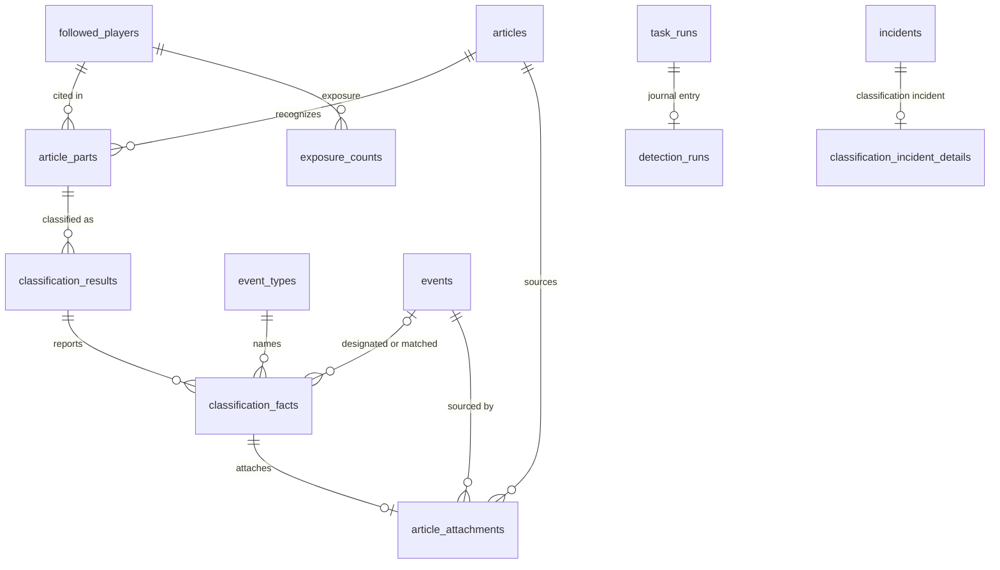

# Domain model — event detection (Lot 2)

The classification queue, what the language model receives and returns, the facts it reports and their outcomes, the links between articles and events, exposure counts and the detection journal: file 04 (DET-01 to DET-58) as ruled by `CL-DET-01` to `CL-DET-28`, with ADR 0015, ADR 0017, `CL-COL-16`, `CL-DSN-06` and the detection-model service sheet. Articles themselves are in [collection.md](collection.md). Events, their sources, marks, corrections and cases, event types, proposals and occurrences belong to the core model: this file references them and lists in §8 what it needs from them.

**Conventions.** As in [collection.md](collection.md): snake_case plural tables, `integer` identity keys, enumerations as `text` with a `CHECK` on the glossary's values, instants as `timestamptz` (`EpochMs`), calendar dates as `date` (`IsoDate`) with their calendar stated. The code type of an event is `PlayerEvent` (table `events`, key `playerEventId`).

**Sensitive-data classes:** the core model's (`—`, `PI`, `EV`, `TX`, `PR`; README §3) and the two Lot 2 classes `EX` and `OW`, as the top of [collection.md](collection.md) says.

## 1. Entities

### 1.1 Article part — `article_parts`

One recognized player of one article: the unit that the queue holds and that classification answers (a "part", `CL-DET-01`).

| Column | Type | Null | Default | Constraint or reference | Class | Spec |
| --- | --- | --- | --- | --- | --- | --- |
| `id` | integer identity | no | — | primary key | — | CL-DET-01 |
| `article_id` | integer | no | — | → `articles.id` `ON DELETE CASCADE` | — | DET-06, CL-DET-01 |
| `player_id` | uuid | no | — | → core `followed_players.id` `ON DELETE RESTRICT`; a player-data deletion runs detection's eraser first (§1.9) | PI | DET-06, DET-17 |
| `recognized_by` | text | no | — | `CHECK (recognized_by IN ('prefilter','owner'))` (`PartRecognition`): the prefilter, or the owner's rescue or added player | — | DET-49, DET-54, CL-DET-14 |
| `recognized_at` | timestamptz | no | — | first prefilter, DET-07 re-prefilter, or the owner's action | — | DET-06, DET-07, CL-DET-13 |
| `status` | text | no | `'pending'` | `CHECK (status IN ('pending','classified','closed'))` (`ArticlePartStatus`) | — | CL-DET-01, CL-DET-23 |
| `queue_entry_kind` | text | yes | null | `CHECK (queue_entry_kind IN ('first_classification','automatic_reclassification','owner_request'))` (`QueueEntryKind`); `CHECK ((status = 'pending') = (queue_entry_kind IS NOT NULL))` | — | DET-09, CL-DET-13 |
| `queued_at` | timestamptz | yes | null | instant of the trigger that queued the part (the queue item's entry instant); `CHECK ((status = 'pending') = (queued_at IS NOT NULL))` | — | DET-09, CL-DET-13 |
| `cycle_attempts` | smallint | no | 0 | `CHECK (cycle_attempts BETWEEN 0 AND 5)`: submissions of the current cycle, the first included | — | DET-22, CL-DET-03 |
| `classification_failed_at` | timestamptz | yes | null | the « classification en échec » mark; `CHECK (classification_failed_at IS NULL OR status = 'pending')` | — | DET-22, CL-DET-03, CL-DET-04 |
| `not_relevant_reason` | text | yes | null | part-level reason: `CHECK (not_relevant_reason IN ('no_fact','no_followed_player'))`; `CHECK (status <> 'closed' OR not_relevant_reason = 'no_followed_player')`; `CHECK (status <> 'pending' OR not_relevant_reason IS NULL)` | — | DET-16, CL-DET-01, CL-DET-23 |

- **Unique and indexes:**
  - `article_parts_uq` unique `(article_id, player_id)` — one part per player and article, so an article never counts twice in a player's exposure (CL-DET-14);
  - `article_parts_eligible_idx` `(queued_at) WHERE status = 'pending' AND classification_failed_at IS NULL` — the eligible items of the queue and "is the queue empty" (CL-DET-04);
  - `article_parts_failed_idx` `(article_id) WHERE classification_failed_at IS NOT NULL` — the failed items shown in the queue view (IHM-71) and on the status screen (TRV-46);
  - `article_parts_player_idx` `(player_id, status)` — closing the pending parts of a paused or withdrawn player (CL-DET-23), re-prefiltering (DET-07), player-data deletion.
- **Deletion cascades to:** `classification_results` (then `classification_facts`).
- **TypeScript:** `id: ArticlePartId`; `type ArticlePart = { status: 'pending'; queueEntryKind: QueueEntryKind; queuedAt: EpochMs; cycleAttempts: number; classificationFailedAt: EpochMs | null } | { status: 'classified'; notRelevantReason: 'no_fact' | null } | { status: 'closed'; notRelevantReason: 'no_followed_player' }`, each with `articleId`, `playerId`, `recognizedBy`, `recognizedAt`.

### 1.2 Classification result — `classification_results`

One usable answer for one part: the model's (after a submission whose answer passed the checks for that part) or the owner's (DET-13, DET-49). Unusable answers are not stored.

| Column | Type | Null | Default | Constraint or reference | Class | Spec |
| --- | --- | --- | --- | --- | --- | --- |
| `id` | integer identity | no | — | primary key | — | DET-53 |
| `article_part_id` | integer | no | — | → `article_parts.id` `ON DELETE CASCADE` | — | DET-16, CL-DET-01 |
| `origin` | text | no | — | `CHECK (origin IN ('model','user'))` (`ClassificationOrigin`) | — | DET-13, DET-53 |
| `user_action` | text | yes | null | `CHECK (user_action IN ('manual_classification','rescue','own_event','added_player'))` (`UserClassificationAction`); `CHECK ((origin = 'user') = (user_action IS NOT NULL))` | — | DET-13, DET-47, DET-49, CL-DET-12 |
| `classified_at` | timestamptz | no | — | | — | DET-53 |
| `instructions_version` | text | yes | null | version of the model instructions (DET-23); `CHECK ((origin = 'model') = (instructions_version IS NOT NULL))` | — | DET-23, DET-53 |
| `model_id` | text | yes | null | provider and model identifier of the answer; `CHECK ((origin = 'model') = (model_id IS NOT NULL))` | — | DET-53, DET-56, detection-model service sheet rule 6 |
| `attempt_number` | smallint | yes | null | the submission of its cycle that produced it; `CHECK (attempt_number BETWEEN 1 AND 5)`; `CHECK ((origin = 'model') = (attempt_number IS NOT NULL))` | — | DET-22, DET-53 |
| `validated_types` | jsonb | no | — | immutable snapshot `[{ "eventTypeId": string, "sheetVersion": number }]` of the validated types at that instant | — | DET-53, CL-DET-07 |

- **Unique and indexes:** `classification_results_part_idx` `(article_part_id, classified_at)` — the successive results of an article (DET-54) and the latest result of a part.
- **Deletion cascades to:** `classification_facts`.
- **TypeScript:** `id: ClassificationResultId`; `type ClassificationResult = { origin: 'model'; instructionsVersion: string; modelId: string; attemptNumber: number } | { origin: 'user'; userAction: UserClassificationAction }`, plus `validatedTypes: readonly { eventTypeId: EventTypeId; sheetVersion: number }[]`.

### 1.3 Classification fact — `classification_facts`

One fact a result reports for its player, with its single outcome (`CL-DET-01`, `CL-DET-02`). A result with no fact means "no fact" for its part. Facts of the calendar list are dropped and never stored (`CL-DET-22`).

| Column | Type | Null | Default | Constraint or reference | Class | Spec |
| --- | --- | --- | --- | --- | --- | --- |
| `id` | integer identity | no | — | primary key | — | DET-16 |
| `classification_result_id` | integer | no | — | → `classification_results.id` `ON DELETE CASCADE` | — | DET-16 |
| `kind` | text | no | — | `CHECK (kind IN ('validated_type','known_entry','new_type'))` (`FactKind`) | — | DET-16, DET-34, CL-DET-02 |
| `event_type_id` | text | no | — | → core `event_types.id` `ON DELETE RESTRICT`: the validated type named (`validated_type`), the do-not-repropose entry named (`known_entry`), or the proposal created from the fact (`new_type`) | — | DET-15, DET-16, DET-34 |
| `detection_confidence` | smallint | yes | null | `CHECK (detection_confidence BETWEEN 0 AND 100)`; the model's value rounded half up; set exactly for a model fact of kind `validated_type` | — | DET-16, DET-24, CL-DET-02 |
| `description` | text | yes | null | the model's description when it passed the DSN-24 checks; null when it was replaced by the template, and for every other kind or an owner fact | EV TX | DET-16, DET-21 |
| `novelty` | text | yes | null | `CHECK (novelty IN ('new_fact','old_fact','known_event'))` (`FactNovelty`); set exactly for a model fact of kind `validated_type` | — | DET-16, DET-20, DET-28 |
| `designated_event_id` | integer | yes | null | → core `events.id` `ON DELETE SET NULL`; the event sent to the model that the fact designates; `CHECK (designated_event_id IS NULL OR novelty = 'known_event')` | EV | DET-28, DET-58, CL-DET-11 |
| `timing_hint_on` | date | yes | null | the timing hint: day the article places the fact on, in **the article's own frame** (outlet zone when known, else US Eastern, `America/New_York`, for the comparison of CL-DET-06); null when none | EV | DET-16, DET-32, CL-DET-06 |
| `injury_return` | text | yes | null | `CHECK (injury_return IN ('yes','no','unknown'))`; set exactly for a model fact of kind `validated_type` | — | DET-16, DSN-07 |
| `game_stakes` | text | yes | null | `CHECK (game_stakes IN ('high','normal','unknown'))`; same rule | — | DET-16 |
| `justification` | text | yes | null | null when replaced by « texte non conservé » or for an owner fact | EV TX | DET-16, DET-21, CL-DET-18 |
| `suggested_type_name` | text | yes | null | kind `new_type` only; null when replaced | TX | DET-16, DET-34, CL-DET-18 |
| `suggested_type_definition` | text | yes | null | kind `new_type` only; null when replaced | TX | DET-16, DET-34, CL-DET-18 |
| `outcome` | text | no | — | `CHECK (outcome IN ('attached','linked_to_proposal','not_relevant','superseded'))` (`FactOutcome`); `attached` only for kind `validated_type`, `linked_to_proposal` only for `known_entry` or `new_type` | — | CL-DET-01, CL-DET-03 |
| `not_relevant_reason` | text | yes | null | `CHECK (not_relevant_reason IN ('below_threshold','below_coverage_threshold','old_fact','already_reported_by_backtest','type_rejected_or_withdrawn','proposal_rejected','detached_by_user'))`; `CHECK ((outcome = 'not_relevant') = (not_relevant_reason IS NOT NULL))` | — | DET-20, DET-24, DET-34, DET-36, DET-58, CL-DET-12, CL-DET-27 |
| `matched_historical_event_id` | integer | yes | null | → core `events.id` `ON DELETE SET NULL`; the historical event that already reports the fact; `CHECK (matched_historical_event_id IS NULL OR not_relevant_reason = 'already_reported_by_backtest')` | EV | DET-58 |

- **Kind checks:** for kind `known_entry` or `new_type`: `detection_confidence`, `description`, `novelty`, `designated_event_id`, `timing_hint_on`, `injury_return`, `game_stakes` are null; for kinds other than `new_type`: `suggested_type_name` and `suggested_type_definition` are null.
- **Unique and indexes:**
  - `classification_facts_result_idx` `(classification_result_id)`;
  - `classification_facts_designated_idx` `(designated_event_id) WHERE designated_event_id IS NOT NULL` — the withdrawal step (§1.9);
  - `classification_facts_matched_idx` `(matched_historical_event_id) WHERE matched_historical_event_id IS NOT NULL` — the articles that point to a historical event (DET-58) and the withdrawal step;
  - `classification_facts_linked_idx` `(event_type_id) WHERE outcome = 'linked_to_proposal'` — the articles of a pending proposal, reclassified on validation or made not relevant on rejection (DET-36), and the excerpt rule of CL-COL-08;
  - `classification_facts_coverage_idx` `(event_type_id) WHERE not_relevant_reason = 'below_coverage_threshold'` — the waiting facts a new fact of a coverage-threshold type is grouped with (CL-DET-27).
- **Deletion:** cascades from its result. A row of `article_attachments` that names the fact blocks its deletion (`ON DELETE RESTRICT`).
- **TypeScript:** `id: ClassificationFactId`; a union on `kind`: `{ kind: 'validated_type'; eventTypeId; detectionConfidence: number | null; description: string | null; novelty: FactNovelty | null; designatedEventId: PlayerEventId | null; timingHintOn: IsoDate | null; context: ContextIndications | null; justification: string | null }`, `{ kind: 'known_entry'; eventTypeId; justification: string | null }`, `{ kind: 'new_type'; eventTypeId; suggestedTypeName: string | null; suggestedTypeDefinition: string | null; justification: string | null }`, each with `outcome: FactOutcome` and `notRelevantReason: FactNotRelevantReason | null`.

### 1.4 Article attachment — `article_attachments`

An article that sources a detected event, with the fact that attached it (DET-27, DET-53). The attached articles of an event are its press sources.

| Column | Type | Null | Default | Constraint or reference | Class | Spec |
| --- | --- | --- | --- | --- | --- | --- |
| `id` | integer identity | no | — | primary key | — | DET-27 |
| `article_id` | integer | no | — | → `articles.id` `ON DELETE RESTRICT` | EV | DET-27, DET-53, COL-37 |
| `player_event_id` | integer | no | — | → core `events.id` `ON DELETE RESTRICT`; a detected event (origin `detected`) | EV | DET-27, DET-30 |
| `classification_fact_id` | integer | no | — | → `classification_facts.id` `ON DELETE RESTRICT`; unique; its fact has `outcome = 'attached'` | EV | DET-53 |
| `attached_at` | timestamptz | no | — | | — | DET-53 |
| `is_reference` | boolean | no | false | the attachment whose article gives the event's reference date (the reference article); at most one per event, none while an owner-supplied source is earlier; set again at every attachment, detachment, merge and source addition, following the event's `reference_date_rule` (§4) | EV | DET-30, DET-31, CL-DET-27 |

- **Unique and indexes:** `article_attachments_uq` unique `(article_id, player_event_id)`; `article_attachments_fact_uq` unique `(classification_fact_id)`; `article_attachments_reference_uq` unique `(player_event_id) WHERE is_reference` — one reference article per event, the event's reference source on its page and sheet; `article_attachments_event_idx` `(player_event_id)` — the sources of an event (IHM-67, ALE-08), its reference date, the withdrawal step.
- **Deletion:** by detachment, merge or erasure only (§2.2, §1.9); cascades to nothing.
- **TypeScript:** `{ articleId: ArticleId; playerEventId: PlayerEventId; classificationFactId: ClassificationFactId; attachedAt: EpochMs; isReference: boolean }`.

### 1.5 Classification queue item (derived) — `ClassificationQueueItem`

The queue item of DET-09 is the article with its pending parts; it has no table. An item is **eligible** when at least one of its parts is pending and not marked « classification en échec » (`CL-DET-04`). Items are ordered at each run (`CL-DET-13`):

1. owner requests (`queue_entry_kind = 'owner_request'`), the most recent `queued_at` first;
2. automatic reclassifications (`automatic_reclassification`), the oldest `queued_at` first;
3. items with an active recognized player whose next game (STA-26) starts within `detection.priorityHorizonHours` of the run, the earliest such game first (an article with several players takes its earliest);
4. all others, the oldest `retained_published_at` first.

Ties go to the older retained instant, then the older first collection, then the lower article identifier.

**When the queue resumes** (DET-10, `CL-DET-04`). The `classification-resume` task is due `detection.queueResumeIntervalHours` (6 hours by default) after the end of the last run that processed the queue, or at the provider's quota reset instant (the core's `quota_usage.resets_at`, from its declared boundary or the rate-limit headers of its refusal) when that comes first; an owner's retry or reclassification request that makes an item eligible makes it due at once, within the quota. Nothing is stored here for it: the scheduler computes the due instant from `task_runs` and `quota_usage`.

- **TypeScript:** `interface ClassificationQueueItem { articleId: ArticleId; pendingPartIds: readonly ArticlePartId[]; entryKind: QueueEntryKind; queuedAt: EpochMs; failedPartIds: readonly ArticlePartId[] }`.

### 1.6 Exposure count — `exposure_counts`

Per player and day, the number of collected articles that cited him; numbers only, they survive the article purge and feed the exposure indicator (DET-57, JOU-03).

| Column | Type | Null | Default | Constraint or reference | Class | Spec |
| --- | --- | --- | --- | --- | --- | --- |
| `id` | integer identity | no | — | primary key | — | DET-57 |
| `player_id` | uuid | no | — | → core `followed_players.id` `ON DELETE CASCADE` | PI | DET-57, CL-JOU-06 |
| `counted_on` | date | no | — | the article's first-collection day, **owner's time zone** | — | DET-57, CL-DET-14, CL-JOU-19 |
| `article_count` | integer | no | 0 | `CHECK (article_count >= 0)` | — | DET-57 |

- **Unique and indexes:** `exposure_counts_uq` unique `(player_id, counted_on)` — the window sum of JOU-03 and the upsert at prefilter time.
- **Deletion:** deleted by the daily purge once `counted_on` is more than 90 days old, the largest allowed `players.exposureWindowDays` (CL-JOU-19, CL-TRV-16); cascades from a player-data deletion (CL-JOU-06).
- **TypeScript:** `countedOn: IsoDate`.

### 1.7 Detection run — `detection_runs`

The detection-journal entry of one run of `detection` or `classification-resume` (DET-55), with the units of `CL-DET-25`.

| Column | Type | Null | Default | Constraint or reference | Class | Spec |
| --- | --- | --- | --- | --- | --- | --- |
| `id` | integer identity | no | — | primary key | — | DET-55 |
| `task_run_id` | integer | no | — | → core `task_runs.id` `ON DELETE CASCADE`; unique | — | DET-55, TRV-26 |
| `articles_received` | integer | no | 0 | per article; new articles handed by collection (0 for a resumption run) | — | DET-55, CL-DET-25 |
| `articles_not_prefiltered_in` | integer | no | 0 | per article | — | DET-55 |
| `articles_classified` | integer | no | 0 | per article | — | DET-55 |
| `articles_classified_without_fact` | integer | no | 0 | per article | — | DET-55 |
| `articles_failed` | integer | no | 0 | per article, marked « classification en échec » in this run | — | DET-55 |
| `articles_still_queued` | integer | no | 0 | per article, eligible at the end of the run | — | DET-55 |
| `facts_attached_to_existing_event` | integer | no | 0 | per fact | — | DET-55 |
| `facts_below_threshold` | integer | no | 0 | per fact | — | DET-55 |
| `facts_below_coverage_threshold` | integer | no | 0 | per fact, waiting for a coverage threshold | — | DET-55, CL-DET-27 |
| `facts_old` | integer | no | 0 | per fact | — | DET-55 |
| `facts_already_reported_by_backtest` | integer | no | 0 | per fact | — | DET-55 |
| `proposals_submitted` | integer | no | 0 | per fact | — | DET-55 |
| `occurrences_added` | integer | no | 0 | per fact | — | DET-55 |
| `descriptions_replaced` | integer | no | 0 | per fact | — | DET-21, DET-55 |
| `events_created` | integer | no | 0 | per fact | — | DET-55 |
| `quota_calls_used` | integer | no | 0 | calls made in this run | — | DET-55 |
| `quota_calls_left` | integer | yes | null | calls left in the current period, null while no limit is declared | — | DET-55, TRV-03 |

Every counter has `CHECK (… >= 0)`.

- **Unique and indexes:** `detection_runs_task_run_uq` unique `(task_run_id)`.
- **Deletion:** by the purge after `journal.retentionDays`, or with its task run; cascades to nothing.
- **TypeScript:** `type DetectionCounters = Record<'articlesReceived' | … | 'eventsCreated', number> & { quotaCallsUsed: number; quotaCallsLeft: number | null }`.

### 1.8 Classification incident detail — `classification_incident_details`

What the classification incident must state besides what the core incident holds: its current cause (`CL-DET-04`, `CL-DET-05`). The core's `incidents.quota_causes` keeps every cause the incident has had and its `details` the number of waiting articles at opening (DET-11), so neither is repeated here.

| Column | Type | Null | Default | Constraint or reference | Class | Spec |
| --- | --- | --- | --- | --- | --- | --- |
| `id` | integer identity | no | — | primary key | — | DET-11 |
| `incident_id` | integer | no | — | → core `incidents.id` `ON DELETE CASCADE`; unique; an incident of kind `quota_reached` whose `service_role` is `language_model` | — | DET-11, CL-DET-04 |
| `cause` | text | no | — | `CHECK (cause IN ('limit_reached','refused_before_limit','not_answering'))` (`QuotaIncidentCause`); updated, without a new message, when the cause changes | — | CL-DET-04 |

- **Deletion:** cascades from its incident.
- **TypeScript:** `cause: QuotaIncidentCause`.

### 1.9 Withdrawal, other erasures, purge, export and backup

**Withdrawal of an event E** (DSN-27, DET-51, `CL-DSN-16`). Detection's eraser runs after the notifications, alerts and tracking erasers and before collection's (collection.md §8 request 3). In the withdrawal's transaction it:

1. deletes every attachment to E and the fact that made it;
2. deletes every fact whose `designated_event_id` or `matched_historical_event_id` is E;
3. deletes every result that held only facts deleted in steps 1 and 2, and every part left with no result that is not pending;
4. recomputes the processing status, reasons and retention clock of every article touched (§2.3);
5. hands collection the articles left with no role, which it erases with no trace (collection.md §1.11).

What may remain: exposure counts and run counters (numbers, no event), and the results and facts of other events and players on articles kept for another role.

**A fact matching a live withdrawal fingerprint** (`CL-DET-21`, `CL-COL-16`): the matching part's answer is never stored and the part is deleted with its earlier results; nothing about the match is logged beyond the run's generic counts; collection erases the article if it has no other role, and a feed that still offers it brings it back to be classified and matched again (`CL-DSN-10`).

**Other erasures.** An event erased by a requalification or a split (CL-TAX-09) follows steps 1 to 5. A player-data deletion (CL-JOU-06), after the withdrawal of each of the player's events, deletes the player's remaining parts with their results and facts, then steps 4 and 5; his exposure counts go by cascade.

**Merge of two detected events** (DET-47, module map §1.7). The route first calls `notifications.moveEventReferences(absorbedEventId, keptEventId)` (notifications.md §1.8). Then `detection.correct`, in one transaction and before the absorbed event is erased:

1. moves every attachment of the absorbed event to the kept event, or deletes it and gives its fact `outcome = 'superseded'` when the article already sources the kept event (`article_attachments_uq`); repoints the facts whose `designated_event_id` is the absorbed event to the kept event; recomputes the kept event's reference date, `is_reference` and `events.detection_confidence` (§4); the core traces the merge in `event_corrections` (DET-52);
2. calls `tracking.moveEventReferences(absorbedEventId, keptEventId)` (tracking-and-validation.md §1.8);
3. calls `alerts.onAttachmentCorrected` for the merge (alert-sheets.md §1.9);
4. erases the absorbed event through the erasers below it: `collection.eraseArticlesWithoutRole`, which finds no article without a role since each moved with its attachment, then the core's erasure step in its merge variant (tally exit `merged`, no fingerprint, no counter), which also deletes the absorbed event's case when it goes with it.

Each operation works out by itself whether the absorbed event's case goes: it goes when the absorbed event is its only event and the kept event belongs to another case. No table of this file references a case.

**Purge.** The daily purge deletes detection runs older than `journal.retentionDays` and exposure counts older than 90 days. Parts, results and facts are deleted with their article by collection's purge (DET-54).

**Export and backup** (`CL-TRV-05`). Every table of this file is in each backup and in the full export; none feeds a spreadsheet export.

## 2. Lifecycles

### 2.1 Article part (`ArticlePartStatus`, with the queue fields)

| From | To | Trigger | Guard | Side effects | Spec |
| --- | --- | --- | --- | --- | --- |
| — | `pending` (`first_classification`) | the prefilter recognizes an active player in an article to analyze | variants matched as whole words; an ambiguous variant needs a corroborating clue (DET-03, DET-04); no part yet for that player | `recognized_by = 'prefilter'`; exposure count +1 on the article's first-collection day; the source's `prefilter_kept` +1 once per article | DET-02 to DET-06, DET-57, CL-DET-14 |
| — | `pending` (`automatic_reclassification`) | DET-07 re-prefilter after a player is added or reactivated or a variant added | the article is kept and its retained instant within `collection.maxArticleAgeDays`; no part yet for that player | exposure count +1; the source's `prefilter_kept` +1 if the article was not kept before; a not-relevant article becomes awaiting classification and its clock stops | DET-07, CL-DET-14, CL-COL-21 |
| `closed` | `pending` (`automatic_reclassification`) | the re-prefilter of a reactivated player | same | no new exposure count | CL-DET-14, CL-DET-23 |
| `classified` | `pending` (`automatic_reclassification`) | the proposal a fact of the part is linked to is validated | — | that fact's outcome becomes `superseded` | DET-36, CL-DET-13 |
| `classified`, `closed`, `pending` | `pending` (`owner_request`) | the owner asks for a new classification of the article, or a new attempt for a failed item | the player is active | every active part of the article is queued; `cycle_attempts = 0`; failed mark cleared | DET-22, DET-50, CL-DET-03 |
| `pending` | `pending` | a submission whose answer is unusable for the part | `cycle_attempts < detection.classificationAttempts` | `cycle_attempts` +1; the same input, refreshed, is resubmitted | DET-22, CL-DET-03 |
| `pending` | `pending`, marked | the last allowed submission is unusable for the part | — | `classification_failed_at = now`; never resubmitted automatically | DET-22, CL-DET-03, CL-DET-04 |
| `pending` | `pending` | a call refused for quota or not answered | — | no attempt counted; the item waits | DET-08, CL-DET-03 |
| `pending` | `classified` | a usable answer for the part, or the owner's classification | — | a result and its facts are stored and their outcomes applied (§2.2); queue fields cleared; `not_relevant_reason = 'no_fact'` when the result has no fact | DET-13, DET-16, CL-DET-02 |
| `pending` | `closed` | at submission time the player is paused or withdrawn | — | `not_relevant_reason = 'no_followed_player'`; no call | CL-DET-23 |
| `classified`, `closed` | `classified` | the owner rescues the part, makes a detached article its own event, or adds a player touched by the fact | — | a result of origin `user` with one fact; the part's non-relevance outcomes become `superseded`; for an added player, a new part with `recognized_by = 'owner'` | DET-47, DET-49, CL-DET-01, CL-DET-12 |

### 2.2 Fact outcome (`FactOutcome`)

A model fact of kind `validated_type` is evaluated in this order: threshold; old fact; designated event (detected: attach; historical: already reported); for a new fact of a type whose sheet carries a coverage threshold, the wait of `CL-DET-27`; for any other new fact, the withdrawal fingerprints (`CL-DET-21`), then the historical match (DET-58), then a new event. An owner fact skips the threshold, the coverage wait and the fingerprints (`CL-DET-07`, `CL-DET-21`, `CL-DET-27`) and asks the owner to confirm a historical match (DET-58).

| From | To | Trigger | Guard | Side effects | Spec |
| --- | --- | --- | --- | --- | --- |
| — | `not_relevant` (`below_threshold`) | model fact | `detection_confidence < detection.threshold` | answer kept visible while the article is kept | DET-24, DET-26 |
| — | `not_relevant` (`old_fact`) | model fact | `novelty = 'old_fact'` | — | DET-20 |
| — | `attached` | fact designating a detected event, dismissed included | at or above the threshold | attachment row; the event's reference date becomes the earliest of its sources (DET-31); a dismissed event stays dismissed (DET-44); no new routing (DET-41) | DET-28, DET-31, DET-41, DET-44 |
| — | `not_relevant` (`already_reported_by_backtest`) | fact designating a historical event, or matching one by IMP-25 (same type, public dates within `imports.duplicateMaxDateGapDays`, or a shared cleaned link) | for an owner fact, the owner did not confirm a distinct fact | `matched_historical_event_id` set | DET-58 |
| — | `not_relevant` (`below_coverage_threshold`) | new model fact of a type whose sheet has a coverage threshold of N outlets within D days | — | waits, grouped with the waiting facts of the same player and type whose articles' retained instants lie within D days; the article follows the ordinary retention | CL-DET-27, CL-TAX-14 |
| `not_relevant` (`below_coverage_threshold`) | `attached` | the group's articles come from at least N distinct outlets within D days | no live fingerprint match, no historical match, both checked now | the event is created, its reference date being the retained instant of the article that brings the N-th outlet (its reference article); every fact of the group is attached; routing | CL-DET-27 |
| — | (part deleted) | new fact matching a live withdrawal fingerprint over the window | model fact | nothing stored; the article may be erased (§1.9) | CL-DET-21, CL-COL-16 |
| — | `attached` | new fact otherwise | — | new detected event: reference date = the article's retained instant; template description and the `description_to_review` mark if the description failed; `possible_historical_duplicate` mark if another type's historical event of the player lies within the window (CL-DET-10); case created awaiting its game, tracked case, routing (DET-37 to DET-40) | DET-21, DET-24, DET-30, DET-37, CL-DET-10 |
| — | `linked_to_proposal` | `new_type` fact, or `known_entry` naming a pending proposal | — | a new proposal (only then a Telegram fact, TEL-14), or an occurrence of the entry | DET-34, TAX-18 |
| — | `not_relevant` (`type_rejected_or_withdrawn`) | `known_entry` naming a rejected or withdrawn type | — | an occurrence of that type | DET-34 |
| `linked_to_proposal` | `not_relevant` (`proposal_rejected`) | the proposal is rejected | — | the article's clock may start (§2.3) | DET-36 |
| `linked_to_proposal` | `superseded` | the proposal is validated | — | the part is queued for reclassification (§2.1) | DET-36 |
| `attached` | `not_relevant` (`detached_by_user`) | the owner detaches the article | — | attachment deleted; the reference date is recomputed and may move later; the detachment is traced on the event | DET-31, DET-47, CL-DET-12 |
| `attached` | `superseded` | two events of a player are merged and the article sources both | — | the absorbed event's attachment is deleted | DET-47 |
| `not_relevant` | `superseded` | a later result of the same part (new classification or rescue) | — | — | DET-49, CL-DET-03 |

### 2.3 Article processing status (derived by detection)

After every change of a part, a fact outcome, an attachment or a proposal link, detection recomputes the article's status in this order (`CL-DET-01`) and writes it through collection's API:

1. `attached` if a fact of the article has outcome `attached`;
2. else `linked_to_proposal` if a fact has outcome `linked_to_proposal`;
3. else `awaiting_classification` if a part is pending;
4. else `not_relevant`; an article in which the prefilter recognized nobody is `not_relevant` with `no_followed_player`.

`not_relevant_reasons` is the set of the part-level reasons and of the reasons of facts with outcome `not_relevant`. The retention clock starts when the article enters `not_relevant` — at `first_collected_at` when it never waited, otherwise at that instant, a detachment included — and is cleared when it leaves it (CL-COL-08).

| From | To | Trigger | Spec |
| --- | --- | --- | --- |
| `to_analyze` | `not_relevant` | the prefilter recognizes no active player; reason `no_followed_player`, clock at first collection | DET-06, CL-COL-08 |
| `to_analyze` | `awaiting_classification` | the prefilter recognizes at least one active player | DET-06 |
| `awaiting_classification` | `attached`, `linked_to_proposal`, `not_relevant` | the parts' results are applied | DET-16, DET-24, DET-34 |
| `not_relevant` | `awaiting_classification` | a new or reopened pending part (DET-07, DET-50) | CL-DET-14 |
| `not_relevant` | `attached` | a rescue | DET-49 |
| `linked_to_proposal` | `not_relevant`, `awaiting_classification` | the proposal is rejected, or validated | DET-36 |
| `attached` | `not_relevant` | its last attachment is detached and nothing else holds it | DET-47, CL-DET-12 |

### 2.4 Transitions detection triggers on core entities

| Entity and set | From | To | Trigger | Side effects in Lot 2 tables | Spec |
| --- | --- | --- | --- | --- | --- |
| Event, `DetectedEventStatus` | — | `detected` | a fact creates an event (§2.2) | attachment; case awaiting its game and its tracked case (tracking-and-validation.md); routing: backtest need, or alert sheet, or both (DET-37 to DET-40) | DET-24, DET-37 |
| Event, `DetectedEventStatus` | `detected` | `dismissed` | the owner dismisses with a reason (a comment for `other`) | pending messages that designate it are discarded as moot (TEL-38); a tracked-case decision is recorded (tracking); the alert sheet follows ALE-22; recalculation | DET-43 to DET-46, CL-DET-15 |
| Event, `DetectedEventStatus` | `dismissed` | `detected` | the owner reinstates | tracked-case decision (entry); ALE-22; recalculation | DET-45 |
| Event mark `dating_to_verify` | — | `set` | the earliest timing hint of the attached facts and an official team game at or after 00:00 of that day and strictly before the reference date | the case stays awaiting (SEN-45) | DET-32, CL-DET-06 |
| Event mark `dating_to_verify` | `set` | `lifted` | the owner lifts it, or moves the reference date earlier (DET-48) | tracked-case decision when it changes the counts; never set again for that event | DET-32, CL-DET-06 |
| Event mark `possible_historical_duplicate` | `set` | `lifted` | the owner states "not the same fact" | none: the counts never changed | DET-58, CL-DET-10 |
| Event mark `description_to_review` | `set` | `lifted` | the owner corrects the description | — | DET-21, DET-47 |

The mark `detected_after_tip_off` is not stored: it is derived (§4).

## 3. Invariants

| Rule | Spec | Enforced by |
| --- | --- | --- |
| One part per player and article; an article counts once in a player's exposure. | DET-57, CL-DET-14 | unique `article_parts_uq`; prefilter service |
| A pending part has its queue fields; only a pending part can be marked failed. | DET-09, DET-22 | `CHECK` on `article_parts` |
| An article is submitted only for its pending parts of active players, at most `detection.classificationAttempts` times per cycle; a call refused or unanswered is no attempt. | DET-12, DET-22, CL-DET-03, CL-DET-23 | detection service |
| A failed item is never resubmitted automatically; "the queue is empty" means no eligible part. | CL-DET-04 | detection service, through `article_parts_eligible_idx` |
| Only validated, non-calendar types give rise to an event. | DET-15, ADR 0015 | answer checks (§5); detection service |
| A result of origin `model` has its instructions version, model and attempt number; a result of origin `user` has none of them. | DET-53, CL-DET-07 | `CHECK` on `classification_results` |
| A fact's columns match its kind; a not-relevant fact has its reason. | CL-DET-02 | `CHECK` on `classification_facts` |
| No text that failed the DSN-24 checks is stored: a failed description is replaced by the template on the event, any other text by « texte non conservé ». | DET-21, CL-DET-18 | answer checks |
| An attachment's fact has outcome `attached`, and a fact has outcome `attached` only through an attachment. | DET-53 | detection service, in the same transaction |
| An attached article is not deleted while attached. | COL-37 | `ON DELETE RESTRICT` |
| An event's reference date is the earliest instant among its attached articles' retained instants and its owner-supplied sources, with that source's precision — or, for an event created at a coverage threshold, the earliest instant at which its attached articles meet that threshold, never before; it moves later only by a detachment. | DET-30, DET-31, DET-48, CL-DET-27 | detection service at every attach, detach, merge or source addition, following the event's `reference_date_rule` (§8) |
| A threshold change alters no existing event. | DET-26 | outcomes are computed once, at classification |
| The article's processing status, reasons and clock follow the derivation of §2.3. | CL-DET-01 | detection service, through collection's API, in the same transaction |
| A model fact that would create an event is checked against the withdrawal fingerprints before the historical match; an owner fact is not. | CL-DET-21 | detection service |
| Calendar-derived events are never sent to the model and never matched. | CL-DET-11, ADR 0015 | detection service |
| A text that names the withdrawn event in a fact is gone once the withdrawal commits. | DSN-27 | eraser of §1.9; `ON DELETE RESTRICT` from `article_attachments` forces it to run before the event is deleted |

## 4. Stored or derived

| Item | Stored or derived | Recalculation |
| --- | --- | --- |
| Queue item and its order | derived from pending parts and next games, at each run (§1.5) | — |
| Article processing status, reasons, clock | stored on `articles` | §2.3, in every transaction that changes a part, an outcome, an attachment or a link |
| Reference date and precision of a detected event | stored on the core's `events` (`reference_at`, `reference_date_precision`) | by detection at every attach, detach, merge, owner-supplied source; file 08 then re-evaluates the measured game (DET-31) |
| Reference article | stored: `article_attachments.is_reference` — the attached article with the earliest retained instant (ties: earliest attachment), none when an owner-supplied source is earlier; for an event created at a coverage threshold, the article that brings the N-th outlet at the earliest instant the threshold is met (CL-DET-27) | in the transaction of every attach, detach, merge and owner-supplied source, with the reference date |
| Detection confidence of an event | stored on the core's `events.detection_confidence`: the highest `detection_confidence` among its attached facts whose result has origin `model`; null when all are `user` (CL-DET-07) | by detection in the transaction of every attachment change |
| Classification origin shown for an event | derived: `model` if an attached fact comes from a model result, else `user` | — |
| `detected_after_tip_off` | derived (CL-DET-16): once the measured game is established, set when its scheduled start is at or before the event's creation instant; before that, the same test against the expected game; otherwise not set | — |
| `dating_to_verify` input | derived from the attached facts' `timing_hint_on`; the mark itself is stored on the core's event marks | recomputed when the reference date moves; never re-set once lifted |
| Exposure indicator | derived: sum of `exposure_counts` over `players.exposureWindowDays` | — |
| Dismissal shares by confidence band | derived from events, their dismissal instants and their stored `events.detection_confidence`, by bands of `detection.confidenceBandWidth`, plus a user-origin row (CL-DET-24) | — |
| Quality indicators (DET-56) | derived over the chosen period: events by creation instant, dismissals by dismissal instant, corrections by their trace instant, rescues by `classified_at` of results with `user_action = 'rescue'`, proposals by their transmission instant (CL-DET-24) | — |
| Article fate (DET-54) | derived from parts, results, facts and attachments | — |
| Nearest player and planned resume of the classification incident | derived at display and at message time (CL-DET-05) | — |

## 5. Exchange formats

The detection model receives one request per call and must return one answer in the shape below. The JSON schema of the answer is sent in the provider's strict structured-output mode, which requires every key and forbids others (detection-model service sheet, rule 2): every key is therefore present and an absent value is `null` — unlike the research and exploration formats, where `null` is never used. Keys are snake_case; enumerated values are the glossary's. The instructions (DET-23) travel as the system message; the static part of the request comes first, byte for byte identical across calls, so prompt caching applies (service sheet, rule 4).

### 5.1 Request

| Key | Type | Limits and allowed values | Spec |
| --- | --- | --- | --- |
| `instructions_version` | string | the version stored on each result | DET-23, DET-53 |
| `validated_types[]` | array | current version of every validated type, calendar-derived types excluded | DET-14, TAX-33, ADR 0015 |
| `validated_types[].id` | string | the type's slug | TAX-02 |
| `validated_types[].name` | string | | TAX-01 |
| `validated_types[].definition` | string | | TAX-33 |
| `validated_types[].inclusion_criteria` | string | | TAX-33 |
| `validated_types[].exclusion_criteria` | string | | TAX-33 |
| `validated_types[].dating_rule` | string | ends with "Coverage threshold: N distinct outlets within D days." when the sheet has one | TAX-33, CL-TAX-14 |
| `validated_types[].known_in_advance` | boolean | | TAX-33 |
| `validated_types[].generic_example` | string | | TAX-33 |
| `do_not_repropose[]` | array of `{ id, name, definition }` | pending proposals, rejected and withdrawn types, never calendar-derived ones | DET-14, TAX-18, CL-TAX-10 |
| `calendar_types[]` | array of `{ id, name, definition }` | every type whose dating rule is "derived from the calendar", whatever its state | CL-DET-22 |
| `articles[]` | array, 1 to `articlesPerCall` | engineering constant, 1 by default; each article gets its own result | DET-12 |
| `articles[].article_id` | string | the article's identifier, as a string | DET-12 |
| `articles[].title` | string | as stored | DET-14 |
| `articles[].excerpt` | string or null | null when the feed gave none | DET-14, COL-27 |
| `articles[].outlet` | string | | DET-14 |
| `articles[].published_at` | string | ISO 8601 with the offset of the outlet's zone when known, else `+00:00` | DET-14, CL-DET-06 |
| `articles[].published_precision` | `exact`, `approximate`, `none` | | CL-DET-06 |
| `articles[].players[]` | array, at least 1 | the article's pending parts of active players | DET-14, CL-DET-23 |
| `articles[].players[].player_id` | string | the player's identifier, as a string | DET-14 |
| `articles[].players[].names` | array of strings, at least 1 | display name first, then spelling variants and nicknames | DET-02, DET-14 |
| `articles[].players[].events[]` | array | his detected events, dismissed included, and his historical events, whose reference date is at or after `published_at` minus `detection.groupingWindowHours`; never a calendar-derived event | DET-14, CL-DET-11 |
| `articles[].players[].events[].player_event_id` | string | the event's identifier, as a string | DET-28 |
| `articles[].players[].events[].event_type` | string | slug | DET-14 |
| `articles[].players[].events[].reference_date` | string | `YYYY-MM-DD` for a date-only historical event, otherwise ISO 8601 with offset | DET-14 |
| `articles[].players[].events[].description` | string | the event's current description | DET-14, DSN-05 |

Nothing else is sent: no team, no source of an event, nothing about the owner (DET-14, DSN-05).

### 5.2 Answer

| Key | Type | Limits and allowed values | Spec |
| --- | --- | --- | --- |
| `results[]` | array | exactly one per submitted article | DET-12, CL-DET-02 |
| `results[].article_id` | string | a submitted `article_id` | CL-DET-02 |
| `results[].players[]` | array | exactly one per submitted player of that article | CL-DET-02 |
| `results[].players[].player_id` | string | a submitted `player_id` of that article | DET-22 |
| `….validated_type_facts[]` | array, possibly empty | | DET-16 |
| `….validated_type_facts[].event_type` | string | a `validated_types[].id` | DET-15, DET-22 |
| `….validated_type_facts[].detection_confidence` | number | 0 to 100; rounded half up to an integer | DET-16, CL-DET-02 |
| `….validated_type_facts[].description` | string | one factual sentence in English, at most `events.maxDescriptionLength` characters, no quotation mark (CL-DSN-03) | DET-21, DSN-19 to DSN-23 |
| `….validated_type_facts[].novelty` | `new_fact`, `old_fact`, `known_event` | | DET-16, DET-20, DET-28 |
| `….validated_type_facts[].player_event_id` | string or null | not null exactly when `novelty` is `known_event`; one of that player's `events[].player_event_id` | DET-16, DET-28 |
| `….validated_type_facts[].timing_hint` | string or null | `YYYY-MM-DD`: the day the article places the fact on when it places it before its own publication; a day after the date of `published_at` counts as null | DET-32, CL-DET-06 |
| `….validated_type_facts[].context.injury_return` | `yes`, `no`, `unknown` | `unknown` when the article says nothing | DET-16, SEN-13 |
| `….validated_type_facts[].context.game_stakes` | `high`, `normal`, `unknown` | `unknown` when the article says nothing | DET-16, SEN-14 |
| `….validated_type_facts[].justification` | string | one sentence citing the satisfied criterion; same text rules | DET-16, CL-DET-18 |
| `….known_entry_facts[]` | array, possibly empty | | DET-16, DET-34 |
| `….known_entry_facts[].entry_id` | string | a `do_not_repropose[].id` | DET-34 |
| `….known_entry_facts[].justification` | string | same text rules; stored with the occurrence | CL-DET-19 |
| `….new_type_facts[]` | array, possibly empty | | DET-16, DET-34 |
| `….new_type_facts[].suggested_name` | string | same text rules | DET-34, CL-DET-18 |
| `….new_type_facts[].suggested_definition` | string | one sentence; same text rules | DET-34, CL-DET-18 |
| `….new_type_facts[].justification` | string | why no validated type fits; becomes the proposal's no-fit reason | CL-DET-19 |
| `….calendar_facts[]` | array, possibly empty | | CL-DET-22 |
| `….calendar_facts[].calendar_type` | string | a `calendar_types[].id`; the fact is dropped | CL-DET-22 |

**Unusable for the part concerned** (resubmitted within the cycle, DET-22, `CL-DET-02`): a player, type, event, entry or calendar identifier that was not sent for it; a proposed, rejected, withdrawn or calendar-derived type used as `event_type`; a missing key or a value of the wrong type; a confidence outside 0 to 100; a context value outside its list; `novelty` and `player_event_id` that disagree. A submitted article with no result makes all its parts unusable. A text that fails the length or quotation-mark check is never a reason to resubmit: it is replaced (DET-21).

**Mapping to storage.** Each usable part becomes one `classification_results` row of origin `model`. Each element of `validated_type_facts`, `known_entry_facts` and `new_type_facts` becomes one `classification_facts` row of the matching kind (`player_event_id` → `designated_event_id`, `timing_hint` → `timing_hint_on`, `context.*` → `injury_return` and `game_stakes`, `entry_id` → `event_type_id`). `calendar_facts` are not stored; a part left without facts gets `no_fact`.

**Example answer** (one article, one player, invented data):

```json
{
  "results": [
    {
      "article_id": "1024",
      "players": [
        {
          "player_id": "7",
          "validated_type_facts": [
            {
              "event_type": "public-humiliation",
              "detection_confidence": 86,
              "description": "At a press conference, team X's coach questioned player A's ability to decide a game.",
              "novelty": "new_fact",
              "player_event_id": null,
              "timing_hint": null,
              "context": { "injury_return": "unknown", "game_stakes": "unknown" },
              "justification": "An identified coach publicly belittled the player at a press conference."
            }
          ],
          "known_entry_facts": [],
          "new_type_facts": [],
          "calendar_facts": []
        }
      ]
    }
  ]
}
```

## 6. Rulings applied

- `CL-DET-01`: results per part, one outcome per fact, the article status derived in a fixed order; rescue on any article with a non-relevance outcome.
- `CL-DET-02`: the answer's contents and the line between unusable and replaced texts; this file names the keys.
- `CL-DET-03`: attempts per cycle, resubmission with the same input, owner requests as new cycles; earlier results kept.
- `CL-DET-04`, `CL-DET-05`: eligibility, the classification incident, its cause and content.
- `CL-DET-06`: the published instant sent with its precision; the timing hint is a date; the dating mark's computation.
- `CL-DET-07`: owner results without confidence, justification or version; the event's confidence from model results only; the user-origin band.
- `CL-DET-10`: the possible-duplicate mark and its lifting.
- `CL-DET-11`: which events are sent.
- `CL-DET-12`: the reason « détaché par l'utilisateur », coded `detached_by_user` as the glossary has it; a detached article made its own event.
- `CL-DET-13`: queue order; `QueueEntryKind`.
- `CL-DET-14`: exposure counted once per pair; reopened parts.
- `CL-DET-15`, `CL-DET-16`: dismissal position and late-detection mark derived, not stored.
- `CL-DET-18`, `CL-DET-19`: text checks on every model text; the justification of a new-type fact is the no-fit reason.
- `CL-DET-21`, `CL-COL-16`, `CL-DSN-06`: fingerprint check before the historical match, over the IMP-25 window, model facts only.
- `CL-DET-22`, `CL-TAX-21`: the calendar list — every calendar-derived type, whatever its state — and dropped calendar facts.
- `CL-DET-23`: parts of paused or withdrawn players closed without a call.
- `CL-DET-24`, `CL-DET-25`: bands and period filters; counter units.
- `CL-DET-26`: owner-supplied sources dated cautiously (on the core's event sources).
- `CL-DET-27`: facts of a coverage-threshold type wait with the reason `below_coverage_threshold` until their group reaches N distinct outlets within D days; the event is dated at the article that brings the N-th outlet.
- `CL-DET-28`: one event per record approach rests on the sheet's exclusion criterion and the owner's merge; nothing is stored for it.
- Detection-model service sheet: `model_id` on each result; strict-mode schema; static part first.

Modeling choices of this file:

1. **`novelty` has three values, `new_fact`, `old_fact` and `known_event`.** `CL-DET-02` lists "new fact" or a designated event, but DET-20, DET-55 and the reason `old_fact` need the model to say that an article rehashes a fact public before the grouping window; nothing else in the answer could carry it (glossary: `isNewFact`, "New fact; Old fact"). Flagged for the orchestrator.
2. **One array per fact kind** in the answer instead of a field that switches the kind: strict mode needs no `anyOf`, and "a fact mixing kinds" (CL-DET-02) cannot be expressed.
3. **Identifiers sent as strings of the application's own identifiers**, so the checks of DET-22 are lookups in the request.
4. **The queue item is derived from pending parts**, not a table: the parts already hold the entry kind, instant, attempts and failed mark, and two copies would drift.
5. **Unusable answers are not stored**: nothing of them is needed later, and they may hold non-compliant text.
6. **`outcome = 'superseded'`** marks a non-relevance outcome replaced by a later result, a proposal link ended by a validation, or an attachment absorbed by a merge, so the article's live reasons are exactly the facts still `not_relevant`.
7. **`user_action`** tells manual classification, rescue, own event and added player apart: DET-56 counts rescues, DET-54 shows each result's origin.
8. **`detected_after_tip_off` is derived; the detection confidence and the reference article are stored**, on the core's `events` and on `article_attachments`, and rewritten in the transaction of every attachment change, so that they cannot disagree with the attachments while lists and sheets read them without a scan. The reference article is a flag on the attachment because no core table may reference a Lot 2 table.
9. **A withdrawal also erases the facts that designate or match the withdrawn event** on articles kept for another role: their description and justification describe the withdrawn fact (DSN-27, "every trace").
10. **Exposure counts are kept 90 days**, the largest allowed exposure window (CL-TRV-16).
11. **`facts_below_coverage_threshold`** is added to the DET-55 counters, so the journal accounts for every fact of the run (`CL-DET-27` creates the outcome).
12. **New enumerations, to add to the glossary:** `PartRecognition`, `ArticlePartStatus`, `QueueEntryKind`, `UserClassificationAction`, `FactKind`, `FactNovelty`, `FactOutcome`; the incident's cause takes the glossary's `QuotaIncidentCause`. `timingHintOn` applies the glossary's date-suffix rule to its `timingHint`; `detection_runs` rows are the glossary's `DetectionJournalEntry`.

## 7. Entity-relationship diagram



`followed_players`, `events`, `event_types`, `task_runs` and `incidents` belong to the core model; `articles` to collection.

## 8. Requests to the core model

Requests 1 to 8 and 10 are met by the core model as of `da6c8fa` (events-and-cases.md, event-types.md, sensitive-data.md); they stay listed as what this file relies on, in the core's names.

1. **Events of origin `detected`** (`events`): `detected_status` with `CHECK (detected_status IN ('detected','dismissed'))`, null for other origins; `dismissal_reason` (`DismissalReason`), `dismissal_comment` (required for `other`, wording rules of 13), `dismissed_at` — only the instant is stored, its position is derived (CL-DET-15); `created_at` immutable (DET-33, SUI-01); the reference date `reference_at` — always an instant for a detected event (CL-COL-02, CL-SEN-02) — with `reference_date_precision` (`DatePrecision`), written by detection (§4); the event's context indications with origin `classification` from the creating fact; `detection_confidence`, `classification_origin` and `reference_date_rule`, maintained by detection at every attachment change (§4).
2. **Reference-date rule**: on a detected event, `reference_date_rule` `CHECK (reference_date_rule IN ('earliest_source','coverage_threshold'))`, set at creation — `coverage_threshold` for an event the model's facts created at a coverage threshold (CL-DET-27), `earliest_source` otherwise, the owner's events included (DET-30) — so that every later recomputation applies the right rule; and, on the type sheet version, its coverage threshold (outlets N, days D) readable (CL-TAX-14). The reference article itself is this file's `article_attachments.is_reference`, since no core column may reference a Lot 2 row.
3. **Event marks** (`event_marks`, `EventMark`, `EventMarkStatus`): `dating_to_verify`, `possible_historical_duplicate` and `description_to_review` stored per event with the glossary's statuses and their instants, a lifted `dating_to_verify` never set again; `detected_after_tip_off` not stored (derived, CL-DET-16).
4. **Event sources** (`PlayerEventSource`, table `event_sources`): accept, for a detected event, an owner-supplied dated public source (DET-48) with `url`, `outlet`, publication instant and precision (CL-DET-26) and an optional title; the press sources of a detected event are this file's `article_attachments` plus these rows.
5. **Event corrections** (DET-52): traced entries, with instant, changed fields, before and after values (never an old description), for dismissal, reinstatement, detachment, merge, player, type, description and context corrections, an added player, a rescue and a reference date moved earlier.
6. **Event types** (`event_types`): a readable "derived from the calendar" flag (CL-DET-22); detection-born proposals created with origin `detection`, the suggested name and definition (or the « texte non conservé » mention, CL-DET-18), the no-fit reason, the followed player, the transmission instant and the originating article's reference (link, outlet, title, retained publication instant and precision); occurrences (`TypeOccurrence`) with type, player, instant, justification (CL-DET-19) and one article reference, both kept after the article's purge (DSN-09).
7. **Cases**: for every detected event, in the same transaction, a case of origin `tracked`, status `awaiting_game` with reason `game_not_played_yet`, `created_at` equal to the event's creation instant (DET-37, SUI-01).
8. **Withdrawal fingerprints**: a check `matchesWithdrawalFingerprint(playerId, eventTypeId, referenceDate)` that computes the day as `CL-DSN-06` rules (the date as written without a time, else the calendar date of the instant in the owner's time zone) and tests every day within `imports.duplicateMaxDateGapDays` of it (CL-DET-21, CL-IMP-34).
9. **Read APIs**: next game per player (STA-26) for the queue order and the incident's nearest player; expected game (STA-27); historical events of a player matching a fact by IMP-25; the validated sheets, the do-not-repropose list and the calendar list; whether a player is profiled and his coverage (BKT-10, routing BKT-30).
10. **Parameters**: `detection.confidenceBandWidth` (integer points, default 10, bounds 1 to 50, family `detection`, CL-DET-24, CL-TRV-16), which replaces the module map's former "10-point bands" engineering constant; `detection.queueResumeIntervalHours` for the resume task (§1.5).
11. **Incidents**: kind `quota_reached` with `service_role = 'language_model'` closes at the end of the first run after which no part is eligible (CL-DET-04); every cause it has had in `incidents.quota_causes`, the waiting articles at opening in `incidents.details` (DET-11), its current cause in `classification_incident_details`.
12. **Quotas**: the declared limits of each language-model provider (primary and fallback), the refusal reported by `withQuota`, so a refusal before the declared limit is told apart, and the provider's reset instant `quota_usage.resets_at`, from its declared boundary or the rate-limit headers of its refusal, which the resume task waits for (CL-DET-04, §1.5). This file stores no reset instant of its own.
13. **Withdrawal composition**: the order of Lot 2 erasers in collection.md §8 request 3.
