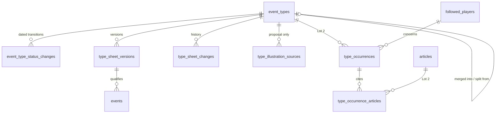

# Event types

The taxonomy (`docs/02-taxonomie-des-evenements.md`): event types and their sheets, the versions
events are qualified under, the change history, merges and splits, illustration sources, and the
occurrences detection attaches to proposals (Lot 2). The exploration response, the area's exchange
format, is in section 5. Conventions are in the [README](README.md).

Two seeded types are derived from the calendar (`birthday`, `former-team`, ADR 0015): their mark is
fixed at seeding, they never enter a request, a coverage, a merge or a split, and their events are
created by the derivation of [events-and-cases.md](events-and-cases.md) (CL-TAX-18 to CL-TAX-20).
The other types are "research types" (CL-BKT-03).

## 1. Entities

### 1.1 `event_types` — `EventType` and its current `TypeSheet`

One category of event defined by a sheet; only validated types serve the prompt, the import, the
calculation and the classification (TAX-01, TAX-11). The row holds the type's state and its current
sheet content; versions and history are separate tables. Types are never deleted, so identifiers
are never reused (TAX-02).

| column                       | type        | null | default      | constraint or reference                                                                                                                  | class | spec IDs                              |
| ---------------------------- | ----------- | ---- | ------------ | ---------------------------------------------------------------------------------------------------------------------------------------- | ----- | ------------------------------------- |
| `id`                         | text        | no   | —            | primary key; `CHECK (id ~ '^[a-z0-9]+(-[a-z0-9]+)*$' AND char_length(id) <= 50)`; the slug of CL-TAX-02, immutable                       | —     | TAX-02, CL-TAX-02, glossary section 5 |
| `status`                     | text        | no   | `'proposed'` | `CHECK (status IN ('proposed','validated','rejected','withdrawn'))`                                                                      | —     | TAX-10                                |
| `origin`                     | text        | no   | —            | `CHECK (origin IN ('scoping','exploration','detection'))`                                                                                | —     | TAX-15                                |
| `created_at`                 | timestamptz | no   | `now()`      | —                                                                                                                                        | —     | TAX-15                                |
| `name`                       | text        | no   | —            | `CHECK (btrim(name) <> '')`                                                                                                              | TX    | TAX-01, TAX-22                        |
| `definition`                 | text        | yes  | —            | required to validate                                                                                                                     | TX    | TAX-01, D-12                          |
| `inclusion_criteria`         | text        | yes  | —            | required to validate                                                                                                                     | TX    | TAX-01, TAX-04                        |
| `exclusion_criteria`         | text        | yes  | —            | required to validate                                                                                                                     | TX    | TAX-01, TAX-06                        |
| `dating_rule`                | text        | yes  | —            | required to validate                                                                                                                     | TX    | TAX-01, TAX-05, H-TAX-01              |
| `known_in_advance`           | boolean     | no   | `false`      | the "known in advance" mark of the dating rule (SEN-02)                                                                                  | —     | TAX-01, TAX-33, SEN-02                |
| `schedule_derivation`        | text        | yes  | —            | `CHECK (schedule_derivation IN ('birthday','former_team'))`; set at seeding on the two calendar-derived types only, never changed        | —     | ADR 0015, CL-TAX-18, CL-TAX-20        |
| `generic_example`            | text        | yes  | —            | required to validate; names no real person                                                                                               | TX    | TAX-01, TAX-03                        |
| `documentation_difficulty`   | text        | yes  | —            | `CHECK (documentation_difficulty IN ('easy','medium','hard'))`; required to validate                                                     | —     | TAX-01, TAX-08                        |
| `caution_notes`              | text        | yes  | —            | optional                                                                                                                                 | TX    | TAX-01                                |
| `is_intimate_subject`        | boolean     | no   | `false`      | the « sujet intime » mark: Telegram never names the type                                                                                 | —     | TAX-01, DSN-35                        |
| `coverage_threshold_outlets` | smallint    | yes  | —            | `CHECK (coverage_threshold_outlets BETWEEN 2 AND 10)`                                                                                    | —     | CL-TAX-14, TRV-38                     |
| `coverage_threshold_days`    | smallint    | yes  | —            | `CHECK (coverage_threshold_days BETWEEN 1 AND 7)`                                                                                        | —     | CL-TAX-14                             |
| `switched_off_criterion`     | text        | yes  | —            | `CHECK (switched_off_criterion IN ('playing_time_too_low','injury_return','unusual_stakes','opponent_strength','co_occurring'))`         | —     | ADR 0016, CL-TAX-17, CL-SEN-13        |
| `current_version_number`     | smallint    | yes  | —            | `CHECK (current_version_number >= 1)`; null until the first validation                                                                   | —     | TAX-20, TAX-22, CL-TAX-06             |
| `rejection_reason`           | text        | yes  | —            | `CHECK (rejection_reason IN ('not_clean','not_datable','duplicate_of_existing_type','out_of_scope','other'))`                            | —     | TAX-13, H-TAX-04                      |
| `rejection_comment`          | text        | yes  | —            | optional; 1 to `maxDescriptionLength` characters; never sent to the exploration prompt (CL-TAX-10)                                       | TX    | TAX-13, CL-TAX-11                     |
| `withdrawal_reason_kind`     | text        | yes  | —            | `CHECK (withdrawal_reason_kind IN ('entered','merged_into','split_into'))`                                                               | —     | TAX-27, TAX-29, TAX-31                |
| `withdrawal_reason`          | text        | yes  | —            | the owner's text for `entered`, 1 to `maxDescriptionLength` characters; null for a merge or a split, whose label is built from the links | TX    | TAX-31, CL-TAX-11                     |
| `merged_into_type_id`        | text        | yes  | —            | `REFERENCES event_types(id) ON DELETE RESTRICT`; the surviving type of the merge that absorbed this one                                  | —     | TAX-27, TAX-28                        |
| `split_from_type_id`         | text        | yes  | —            | `REFERENCES event_types(id) ON DELETE RESTRICT`; the type this one was split from                                                        | —     | TAX-29, TAX-30                        |
| `no_fit_reason`              | text        | yes  | —            | detection proposals: why no validated type fits                                                                                          | TX    | TAX-18, DET-34                        |
| `row_version`                | integer     | no   | `1`          | incremented by every save                                                                                                                | —     | CL-IHM-18                             |

Row checks:

- `status IN ('validated','withdrawn')` implies `current_version_number`, `definition`,
  `inclusion_criteria`, `exclusion_criteria`, `dating_rule`, `generic_example` and
  `documentation_difficulty` are not null (TAX-01, TAX-12).
- `status = 'rejected'` iff `rejection_reason IS NOT NULL`; `rejection_comment IS NULL OR rejection_reason IS NOT NULL`.
- `status = 'withdrawn'` iff `withdrawal_reason_kind IS NOT NULL`;
  `(withdrawal_reason_kind = 'merged_into') = (merged_into_type_id IS NOT NULL)`;
  `(withdrawal_reason_kind = 'entered') = (withdrawal_reason IS NOT NULL)`.
- `(coverage_threshold_outlets IS NULL) = (coverage_threshold_days IS NULL)`.
- `schedule_derivation IS NULL OR (origin = 'scoping' AND known_in_advance)`.
- `no_fit_reason IS NULL OR origin = 'detection'`.

Indexes: the table holds a few dozen rows; the primary key serves every lookup.

Seed (first start-up, TAX-15): the nine types of glossary section 5 with their English starter
sheets from `data/`, status proposed, origin scoping. `birthday` and `former-team` carry
`schedule_derivation` (`birthday`, `former_team`) and `known_in_advance`; their drafts drop the
press-article criterion and `former-team` counts the first meeting only (ADR 0015, CL-TAX-15);
`racist-abuse` and `bereavement` carry the intimate-subject mark; `media-storm` carries a coverage
threshold of 3 outlets within 2 days (CL-TAX-14); no seeded sheet switches a criterion off
(ADR 0016). The « Statut particulier » line is not seeded (CL-TAX-15).

Deletion: never.

```ts
type EventTypeId = Brand<string, 'EventTypeId'>; // kebab-case slug
type EventTypeStatus = 'proposed' | 'validated' | 'rejected' | 'withdrawn';
type ScheduleDerivation = 'birthday' | 'former_team'; // set only on the two calendar-derived types
```

### 1.2 `event_type_status_changes` — the dated transitions

Every transition of TAX-10 is dated, reopenings and reactivations included (TAX-10, 02 « Données
manipulées »).

| column          | type        | null | default  | constraint or reference                                                  | class | spec IDs |
| --------------- | ----------- | ---- | -------- | ------------------------------------------------------------------------ | ----- | -------- |
| `id`            | integer     | no   | identity | primary key                                                              | —     | —        |
| `event_type_id` | text        | no   | —        | `REFERENCES event_types(id) ON DELETE RESTRICT`                          | —     | TAX-10   |
| `changed_at`    | timestamptz | no   | `now()`  | —                                                                        | —     | TAX-10   |
| `from_status`   | text        | no   | —        | `CHECK (from_status IN ('proposed','validated','rejected','withdrawn'))` | —     | TAX-10   |
| `to_status`     | text        | no   | —        | same values; `(from_status, to_status)` is one of the five pairs of 2.1  | —     | TAX-10   |

Indexes: `event_type_status_changes_type_idx (event_type_id, changed_at)` serves the type page.

### 1.3 `type_sheet_versions` — `TypeSheetVersion`

The dated full content of a sheet at each version; every event keeps the version it was qualified
under (TAX-20 to TAX-23, CL-TAX-06).

| column                                  | type        | null | default  | constraint or reference                                                                                   | class | spec IDs                     |
| --------------------------------------- | ----------- | ---- | -------- | --------------------------------------------------------------------------------------------------------- | ----- | ---------------------------- |
| `id`                                    | integer     | no   | identity | primary key                                                                                               | —     | —                            |
| `event_type_id`                         | text        | no   | —        | `REFERENCES event_types(id) ON DELETE RESTRICT`                                                           | —     | TAX-20                       |
| `version_number`                        | smallint    | no   | —        | `CHECK (version_number >= 1)`                                                                             | —     | TAX-20, TAX-22               |
| `created_at`                            | timestamptz | no   | `now()`  | the version's date                                                                                        | —     | TAX-21                       |
| `kind`                                  | text        | no   | —        | `CHECK (kind IN ('validation','substantive_change','merge'))`                                             | —     | CL-TAX-06, TAX-27            |
| `substantive_scope`                     | text        | yes  | —        | `CHECK (substantive_scope IN ('broadens','narrows','both'))`; required when `kind = 'substantive_change'` | —     | TAX-22, CL-TAX-07            |
| `merge_covers_union`                    | boolean     | yes  | —        | required when `kind = 'merge'`: the owner's answer to "covers at least the union"                         | —     | TAX-27, CL-TAX-08            |
| `is_broadening`                         | boolean     | no   | `false`  | TAX-24 applies to this version: a broadening or "both", a merge or a split covering more                  | —     | TAX-24, CL-BKT-05, CL-BKT-06 |
| `reason`                                | text        | yes  | —        | the owner's reason                                                                                        | TX    | TAX-21                       |
| `content`                               | jsonb       | no   | —        | immutable snapshot of the sheet (shape below)                                                             | TX    | TAX-20, TAX-33               |
| `requalified_conforming_count`          | integer     | no   | `0`      | events found conforming against this version                                                              | —     | TAX-26                       |
| `reassigned_count`                      | integer     | no   | `0`      | events reassigned to another type                                                                         | —     | TAX-26                       |
| `erased_count`                          | integer     | no   | `0`      | events erased as non-conforming, or left out of a split (counted on the split type's last version)        | —     | TAX-25, TAX-26, CL-TAX-09    |
| `supplementary_requests_proposed_count` | integer     | no   | `0`      | supplements proposed by this version                                                                      | —     | TAX-24, TAX-26               |

`content` holds `name`, `definition`, `inclusion_criteria`, `exclusion_criteria`, `dating_rule`,
`known_in_advance`, `generic_example`, `documentation_difficulty`, `caution_notes`,
`is_intimate_subject`, `coverage_threshold_outlets`, `coverage_threshold_days`, each as on
`event_types`. The switched-off criterion is not part of a version (ADR 0016).

Unique: `type_sheet_versions_type_number_key (event_type_id, version_number)`; it is the target of
the composite foreign key of an event's qualification and of request types.

Row checks: `(kind = 'substantive_change') = (substantive_scope IS NOT NULL)`;
`(kind = 'merge') = (merge_covers_union IS NOT NULL)`.

Deletion: never; the counts stay visible so that edits cannot hide erased cases (TAX-26).

```ts
type TypeSheetVersionKind = 'validation' | 'substantive_change' | 'merge';
type SubstantiveChangeScope = 'broadens' | 'narrows' | 'both';
interface EventQualification {
  sheetEventTypeId: EventTypeId;
  sheetVersionNumber: number;
} // CL-TAX-08: may name another type's sheet
```

### 1.4 `type_sheet_changes` — `TypeSheetChange`

The modification history of validated sheets: every saved change, formal or substantive, and every
change of the criterion switch, with the content before and after (TAX-21, CL-TAX-06, CL-TAX-17).
A merge writes one substantive entry on the surviving type.

| column                     | type        | null | default  | constraint or reference                                              | class | spec IDs                     |
| -------------------------- | ----------- | ---- | -------- | -------------------------------------------------------------------- | ----- | ---------------------------- |
| `id`                       | integer     | no   | identity | primary key                                                          | —     | —                            |
| `event_type_id`            | text        | no   | —        | `REFERENCES event_types(id) ON DELETE RESTRICT`                      | —     | TAX-21                       |
| `changed_at`               | timestamptz | no   | `now()`  | —                                                                    | —     | TAX-21                       |
| `change_kind`              | text        | no   | —        | `CHECK (change_kind IN ('formal','substantive','criterion_switch'))` | —     | TAX-22, CL-TAX-06, CL-TAX-17 |
| `substantive_scope`        | text        | yes  | —        | `CHECK (substantive_scope IN ('broadens','narrows','both'))`         | —     | TAX-22                       |
| `reason`                   | text        | yes  | —        | the owner's reason                                                   | TX    | TAX-21                       |
| `content_before`           | jsonb       | no   | —        | snapshot: the version content shape plus `switched_off_criterion`    | TX    | TAX-21                       |
| `content_after`            | jsonb       | no   | —        | same shape                                                           | TX    | TAX-21                       |
| `resulting_version_number` | smallint    | yes  | —        | the version a substantive change or a merge created                  | —     | TAX-22, TAX-27               |

Row check: `(change_kind = 'substantive') = (resulting_version_number IS NOT NULL)`;
`substantive_scope IS NULL OR change_kind = 'substantive'`.

Indexes: `type_sheet_changes_type_idx (event_type_id, changed_at)` serves the history on the type
page; `type_sheet_changes_switch_idx (changed_at) WHERE change_kind = 'criterion_switch'` serves the
date of the last change that affects calculations (CL-TRV-17, IHM-51).

```ts
type TypeSheetChangeKind = 'formal' | 'substantive' | 'criterion_switch';
```

### 1.5 `type_illustration_sources` — `IllustrationSource`

Real articles an AI cites to justify a proposal, kept apart from the sheet and shown only on the
proposal's page (TAX-03, CL-TAX-16).

| column                       | type        | null | default  | constraint or reference                        | class | spec IDs          |
| ---------------------------- | ----------- | ---- | -------- | ---------------------------------------------- | ----- | ----------------- |
| `id`                         | integer     | no   | identity | primary key                                    | —     | —                 |
| `event_type_id`              | text        | no   | —        | `REFERENCES event_types(id) ON DELETE CASCADE` | —     | TAX-03            |
| `position`                   | smallint    | no   | —        | order of the response                          | —     | TAX-17            |
| `url`                        | text        | no   | —        | passed the source checks of IMP-14             | PR    | TAX-03, CL-TAX-16 |
| `outlet`                     | text        | yes  | —        | as published                                   | PR    | TAX-03            |
| `title`                      | text        | yes  | —        | as published                                   | PR    | TAX-03, DSN-08    |
| `publication_date_on`        | date        | no   | —        | calendar date as written (CL-IMP-09)           | —     | TAX-03            |
| `publication_at`             | timestamptz | yes  | —        | when the value had a time                      | —     | CL-IMP-09         |
| `publication_offset_minutes` | smallint    | yes  | —        | the original offset; set with `publication_at` | —     | CL-IMP-09, TRV-68 |

Lifetime: erased when the proposal is validated or rejected; a reopened type has none until a new
exploration brings some (CL-TAX-16). Never sent to a prompt or the classifier.

### 1.6 `type_occurrences` and `type_occurrence_articles` — `TypeOccurrence` (Lot 2)

The facts detection attaches to a pending proposal, a rejected or a withdrawn type: the fact that
created a detection proposal, and every later fact matching an entry of the do-not-repropose list
(TAX-18, DET-34). Written by detection (`detection.md`), owned here because they belong to a type.

`type_occurrences`:

| column                | type        | null | default  | constraint or reference                             | class | spec IDs          |
| --------------------- | ----------- | ---- | -------- | --------------------------------------------------- | ----- | ----------------- |
| `id`                  | integer     | no   | identity | primary key                                         | —     | —                 |
| `event_type_id`       | text        | no   | —        | `REFERENCES event_types(id) ON DELETE RESTRICT`     | —     | TAX-18            |
| `player_id`           | uuid        | no   | —        | `REFERENCES followed_players(id) ON DELETE CASCADE` | PI    | TAX-18, CL-JOU-06 |
| `recorded_at`         | timestamptz | no   | `now()`  | the occurrence's date                               | —     | TAX-18            |
| `is_originating_fact` | boolean     | no   | `false`  | the fact that created a detection proposal          | —     | TAX-18            |

`type_occurrence_articles`: `occurrence_id integer NOT NULL REFERENCES type_occurrences(id) ON DELETE CASCADE`,
`article_id integer NOT NULL REFERENCES articles(id) ON DELETE CASCADE`, primary key
`(occurrence_id, article_id)`. The article's link, outlet, title and publication date stay in
`articles` (`collection.md`), kept while linked to a proposal (DSN-09).

Indexes: `type_occurrences_type_idx (event_type_id)` serves the occurrence count on the sheet.

Attaching a proposal P as an occurrence of an entry Q moves P's rows to Q with
`is_originating_fact = false` and rejects P with `duplicate_of_existing_type`; detaching an
occurrence into a distinct proposal creates the proposal and moves the row with
`is_originating_fact = true` (TAX-18, H-TAX-12).

```ts
// derived: occurrenceCount = rows of the type where isOriginatingFact is false
```

## 2. Lifecycles

### 2.1 Event-type status (TAX-10)

| from      | to        | trigger                                | guard                                                                                                                              | side effects                                                                                                                                                                                                                                                                                                                            |
| --------- | --------- | -------------------------------------- | ---------------------------------------------------------------------------------------------------------------------------------- | --------------------------------------------------------------------------------------------------------------------------------------------------------------------------------------------------------------------------------------------------------------------------------------------------------------------------------------- |
| (none)    | proposed  | seed, exploration, detection           | —                                                                                                                                  | origin and creation date; the slug of CL-TAX-02; a new detection proposal is notified (TAX-18, Lot 2)                                                                                                                                                                                                                                   |
| proposed  | validated | owner validates                        | the TAX-01 items present; the eight TAX-12 points confirmed one by one ("established by the schedule" for a calendar-derived type) | version 1 (`kind = 'validation'`); illustration sources erased; research type: supplements proposed to profiled players (TAX-20, BKT-05); calendar-derived type: a full derivation for every active or paused player (CL-TAX-19); full recalculation, cause "taxonomy changed" (CL-SEN-17); Lot 2 reclassifies linked articles (TAX-19) |
| proposed  | rejected  | owner rejects                          | a reason from the closed list                                                                                                      | illustration sources erased; joins the do-not-repropose list; Lot 2 linked articles become not relevant (TAX-19)                                                                                                                                                                                                                        |
| rejected  | proposed  | owner reopens                          | —                                                                                                                                  | back with the sheet it had; rejection fields cleared (TAX-14)                                                                                                                                                                                                                                                                           |
| validated | withdrawn | owner withdraws, or a merge or a split | a typed reason, or the automatic one                                                                                               | no event erased; profiles and trend archived (SEN-19); research events of its id ignored at import outside merge and split (TAX-31); a calendar-derived type stops deriving and keeps its events, upcoming ones included (CL-TAX-20); full recalculation                                                                                |
| withdrawn | validated | owner reactivates                      | the TAX-12 checklist confirmed again on the current content; not a type absorbed by a merge or withdrawn by a split                | no version (CL-TAX-11); withdrawal fields cleared; supplements proposed (TAX-32); a calendar-derived type gets a full derivation, creating what was missed (CL-TAX-20); full recalculation                                                                                                                                              |

`proposed → withdrawn`, `rejected → validated` and every transition back to proposed or rejected
from validated or withdrawn do not exist.

### 2.2 A change of a validated sheet (TAX-21 to TAX-26, CL-TAX-07, CL-TAX-17)

| change                             | guard                                                                         | effects                                                                                                                                                                   |
| ---------------------------------- | ----------------------------------------------------------------------------- | ------------------------------------------------------------------------------------------------------------------------------------------------------------------------- |
| formal                             | owner qualifies it formal                                                     | current content updated; history entry; no version; prompts and classification send the new content under the current number (CL-TAX-06)                                  |
| substantive, broadens              | definition, criteria or dating rule changes are preset substantive (H-TAX-08) | new version with `is_broadening`; supplements proposed (TAX-24, BKT-05), profiles marked incomplete until imported; to-do requests on an earlier version flagged (TAX-23) |
| substantive, narrows               | as above                                                                      | new version; every event qualified under an earlier version marked `to_requalify` (TAX-25); they keep counting                                                            |
| substantive, both                  | as above                                                                      | both effects at once (CL-TAX-07)                                                                                                                                          |
| substantive, calendar-derived type | —                                                                             | new version; a full derivation gives every event the new version; nothing is "to requalify" (CL-TAX-20, CL-TAX-22)                                                        |
| criterion switch                   | `co_occurring` only while SEN-06's parameter is on (CL-TAX-17)                | history entry with before and after; no version; full recalculation with cause "parameter change"; journal entry; date of the last calculation change moves (CL-TRV-17)   |

### 2.3 Merge and split (TAX-27 to TAX-30, CL-TAX-08, CL-BKT-06)

| operation | guard                                                                                          | effects                                                                                                                                                                                                                                                                                                                                                                                |
| --------- | ---------------------------------------------------------------------------------------------- | -------------------------------------------------------------------------------------------------------------------------------------------------------------------------------------------------------------------------------------------------------------------------------------------------------------------------------------------------------------------------------------- |
| merge     | two or more validated research types, one designated surviving; the merged sheet passes TAX-12 | survivor: new version `kind = 'merge'` and a substantive history entry; absorbed types withdrawn with `merged_into` and `merged_into_type_id`; their events move to the survivor; covers the union: every event of the survivor takes the merge version (and TAX-24 if it covers more), otherwise every one is `to_requalify`; coverage periods merged (CL-BKT-06); full recalculation |
| split     | one validated research type; two or more new sheets validated in the same act                  | new types created validated with `split_from_type_id`, version 1 (broadening when they cover more); origin withdrawn with `split_into`; its events marked `to_distribute`, counting in no profile of the new types until distributed; coverage inherited under version 0 (CL-BKT-06); full recalculation                                                                               |

### 2.4 Requalification marks on events — `EventTypeLinkMark` (TAX-25, TAX-29)

| from          | to            | trigger                                                | guard                                    | side effects                                                                                                                                          |
| ------------- | ------------- | ------------------------------------------------------ | ---------------------------------------- | ----------------------------------------------------------------------------------------------------------------------------------------------------- |
| (none)        | to_requalify  | a narrowing, "both", or a merge not covering the union | event qualified under an earlier version | to-do item; counted in "cases on an earlier sheet version" (SEN-46, CL-TAX-07)                                                                        |
| to_requalify  | (none)        | owner: conforms                                        | —                                        | the event takes the type's current version; `requalified_conforming_count` + 1; recalculation                                                         |
| to_requalify  | (none)        | owner: reassigned                                      | target type validated                    | the event takes the target type and its current version; `reassigned_count` + 1                                                                       |
| to_requalify  | (erased)      | owner: does not conform                                | —                                        | the event erased with the scope of a withdrawal, no fingerprint, no counter (CL-TAX-09); `erased_count` + 1 on the new version; a tally exit `erased` |
| (none)        | to_distribute | a split                                                | —                                        | to-do item                                                                                                                                            |
| to_distribute | (none)        | owner distributes the event                            | target among the split's types           | the target's version in force at distribution (CL-IMP-21's handling)                                                                                  |
| to_distribute | (erased)      | owner: fits none                                       | —                                        | as "does not conform"; counted on the split type's last version                                                                                       |

## 3. Invariants

| rule                                                                                                       | spec IDs                     | enforced by                                                  |
| ---------------------------------------------------------------------------------------------------------- | ---------------------------- | ------------------------------------------------------------ |
| A type identifier never changes and is never reused                                                        | TAX-02, CL-TAX-02            | primary key; no update or delete of `event_types.id`         |
| Only validated types serve the prompt, the import, the calculation and the classification                  | TAX-11, TAX-33               | each consuming service filters on `status`                   |
| A validated or withdrawn type has a complete sheet                                                         | TAX-01, TAX-12               | row check                                                    |
| Only validation, a substantive change and a merge create a version; version numbers follow one another     | TAX-20, TAX-22, CL-TAX-06    | taxonomy service; unique `(event_type_id, version_number)`   |
| The calendar-derived mark exists on the two seeded types only and never changes; they never merge or split | CL-TAX-20                    | row check (`origin = 'scoping'`); taxonomy service           |
| At most one doubtful-case criterion is switched off per type                                               | ADR 0016                     | one column                                                   |
| Every event names an existing sheet version                                                                | TAX-23, CL-TAX-08            | composite foreign key from `events`                          |
| Requalification and split erasures never touch the withdrawn-events counter and leave no fingerprint       | TAX-25, CL-TAX-09, CL-DSN-06 | taxonomy service calling the erasure step of sensitive data  |
| Illustration sources never outlive the decision on their proposal                                          | CL-TAX-16                    | taxonomy service, in the validating or rejecting transaction |

## 4. Stored or derived

| item                                                                                  | stored or derived | recalculated when                                                             | spec IDs                     |
| ------------------------------------------------------------------------------------- | ----------------- | ----------------------------------------------------------------------------- | ---------------------------- |
| Current sheet content and current version number                                      | stored            | each saved change                                                             | TAX-21, CL-TAX-06            |
| Version content and effect counts                                                     | stored            | counts incremented by requalification, split, proposals                       | TAX-26                       |
| "Split into {types}"                                                                  | derived           | types whose `split_from_type_id` is this one                                  | TAX-29                       |
| Do-not-repropose list (name, definition, rejection reason for the exploration prompt) | derived           | on read: proposed, rejected and withdrawn types, never a calendar-derived one | TAX-11, CL-TAX-10, CL-TAX-21 |
| "Handled by the calendar" list for the classifier (Lot 2)                             | derived           | every type with `schedule_derivation`, whatever its status                    | CL-TAX-21                    |
| Occurrence count                                                                      | derived           | from `type_occurrences`                                                       | TAX-18                       |
| Possible duplicates between types                                                     | derived           | on read, by the name rule of CL-TAX-05                                        | TAX-17, TAX-18, CL-TAX-05    |
| Broadening version of a type (latest `is_broadening`)                                 | derived           | on read                                                                       | CL-BKT-05                    |
| Cases on an earlier sheet version                                                     | derived           | events marked `to_requalify`                                                  | SEN-46, CL-TAX-07            |
| Exploration prompt                                                                    | derived           | produced on request, never stored                                             | TAX-16                       |

## 5. Exchange format: the exploration response

Format `egoscope-exploration`, version `1.0`, with the keys of glossary section 6.2 and the shape of
CL-TAX-04, which takes those keys (`format_version`, `possible_overlaps`) from the glossary. It
follows the general rules of the research-result format: one
UTF-8 JSON object, lowercase enumerated values, an optional field omitted rather than empty, never
`null`, dates `YYYY-MM-DD` or `YYYY-MM-DDTHH:MM±HH:MM`.

| key                                         | type             | required | limits and allowed values                                                                                                                                                                             |
| ------------------------------------------- | ---------------- | -------- | ----------------------------------------------------------------------------------------------------------------------------------------------------------------------------------------------------- |
| `format`                                    | string           | yes      | `egoscope-exploration`; any other value is refused with "This text is not an exploration response." (CA-TAX-17)                                                                                       |
| `format_version`                            | string           | yes      | `1.0`; an unknown version is refused with the advice to regenerate the prompt                                                                                                                         |
| `proposed_types`                            | array            | yes      | may be empty: the preview says no type was proposed                                                                                                                                                   |
| `proposed_types[].name`                     | string           | yes      | non-empty; becomes `event_types.name`                                                                                                                                                                 |
| `proposed_types[].definition`               | string           | no       | becomes `definition`                                                                                                                                                                                  |
| `proposed_types[].inclusion_criteria`       | string           | no       | becomes `inclusion_criteria`                                                                                                                                                                          |
| `proposed_types[].exclusion_criteria`       | string           | no       | becomes `exclusion_criteria`                                                                                                                                                                          |
| `proposed_types[].dating_rule`              | string           | no       | becomes `dating_rule`                                                                                                                                                                                 |
| `proposed_types[].known_in_advance`         | boolean          | no       | sets `known_in_advance` only, never `schedule_derivation` (CL-TAX-20)                                                                                                                                 |
| `proposed_types[].generic_example`          | string           | no       | becomes `generic_example`                                                                                                                                                                             |
| `proposed_types[].documentation_difficulty` | string           | no       | `easy`, `medium`, `hard`                                                                                                                                                                              |
| `proposed_types[].possible_overlaps`        | array of strings | no       | one sentence per possible overlap; shown in the preview, not stored                                                                                                                                   |
| `proposed_types[].illustration_sources`     | array            | no       | each item a source object as the research result defines it (`url`, `outlet`, `title`, `publication_date`); one failing IMP-14 is dropped with a warning; kept ones go to `type_illustration_sources` |

Text values are not capped by the description length (CL-TAX-04); only the maximum pasted size
bounds the whole. Reading follows the research import: text around the object, code fences and
invisible characters are ignored; a syntax error is reported with its approximate location; a cut
response is refused with the advice to ask for fewer types; a missing `format` or version with a
recognized structure is read with a warning; unknown fields are ignored, flagged once and never
stored (IMP-04, IMP-06, IMP-16). Only the ticked types become proposals of origin `exploration`
(TAX-17); the pasted text lives only in the exploration draft
([operations.md](operations.md), `drafts`).

## 6. Rulings applied

- ADR 0015, CL-TAX-18 to CL-TAX-21: `schedule_derivation`, the derivation triggers and the
  calendar-derived lifecycle; a withdrawn calendar-derived type deletes nothing and keeps every
  event and case, upcoming ones included (CL-TAX-20, CL-SUI-14); the "handled by the calendar" list
  holds these types in every state.
- CL-TAX-22: the version an event keeps, replaced at a correction of its type, a requalification or
  reassignment, a merge whose sheet covers the union, its distribution after a split and the full
  derivation after a substantive change; an event imported after a merge or split takes CL-IMP-21's.
- ADR 0016, CL-TAX-17, CL-SEN-13: `switched_off_criterion`, its history entry and recalculation.
- CL-TAX-02: the slug rule and its check.
- CL-TAX-04: the exploration response.
- CL-TAX-05: possible duplicates by name, derived.
- CL-TAX-06: current content, versions and history are three things; `kind` of a version.
- CL-TAX-07, CL-TAX-08: "both", the pair (sheet type, version) and the merge cases.
- CL-TAX-09: erasure counts on the version.
- CL-TAX-10, CL-TAX-11: the do-not-repropose list, the withdrawal and comment bounds; no version at
  reactivation.
- CL-TAX-14: the coverage threshold columns.
- CL-TAX-15: no « Statut particulier » field.
- CL-TAX-16: illustration sources and their erasure.
- CL-BKT-05, CL-BKT-06: `is_broadening` and the version 0 of split-inherited coverage.
- Own choice: the version's `kind` (`validation`, `substantive_change`, `merge`) and the history's
  `change_kind` (`formal`, `substantive`, `criterion_switch`) are new enumerations: the glossary's
  `SheetChangeQualification` has only formal and substantive, and CL-TAX-06 asks for both lists.
- Own choice: a proposal attached as an occurrence of another entry is rejected as a duplicate
  rather than deleted, so its identifier stays taken (TAX-02).
- Own choice: the AI's `possible_overlaps` are shown in the preview and not stored (store less);
  close types are recomputed by CL-TAX-05 on the proposal's page.

## 7. Diagram


