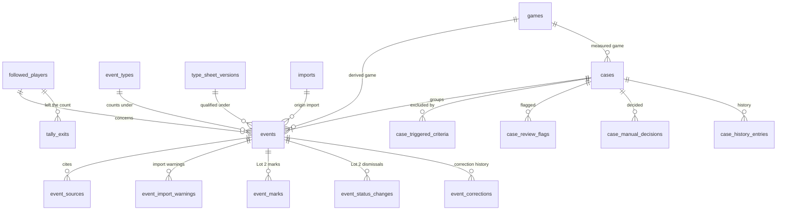

# Events and cases

The events of every origin and the cases that measure them: `docs/00-vue-d-ensemble.md` (objects),
`docs/13-donnees-sensibles.md` (DSN-06, the exhaustive list of what an event holds),
`docs/06-import-des-resultats-de-recherche.md` (historical events),
`docs/04-detection-des-evenements.md` (detected events, Lot 2) and
`docs/08-sensibilite-et-verdict.md` (cases). Both lots share these tables: detection creates
detected events and their tracked cases here; the Lot 2 files add their own tables around them.
Conventions are in the [README](README.md).

An event has one of three origins (CL-VUE-12): `detected` (Lot 2, from articles), `historical`
(saved by an import) and `schedule` (created by the calendar derivation, ADR 0015; "derived from
the schedule" on screen). Only detected events have a status (CL-VUE-07). The code type is
`PlayerEvent`, so that it never shadows the DOM's `Event`; the table is `events`.

## 1. Entities

### 1.1 `events` — `PlayerEvent`

A public, dated fact about one followed player, of one event type (VUE-04, DSN-06). Columns are
the DSN-06 list and nothing else; the row checks of each origin say which apply.

| column                     | type        | null | default     | constraint or reference                                                                                                      | class | spec IDs                                     |
| -------------------------- | ----------- | ---- | ----------- | ---------------------------------------------------------------------------------------------------------------------------- | ----- | -------------------------------------------- |
| `id`                       | integer     | no   | identity    | primary key; never reused                                                                                                    | EV    | DSN-06, CL-IHM-19                            |
| `player_id`                | uuid        | no   | —           | `REFERENCES followed_players(id) ON DELETE RESTRICT`                                                                         | EV    | VUE-04, DSN-06                               |
| `event_type_id`            | text        | no   | —           | `REFERENCES event_types(id) ON DELETE RESTRICT`; the type it counts under                                                    | EV    | DSN-06, TAX-23                               |
| `sheet_event_type_id`      | text        | no   | —           | with `sheet_version_number`, `REFERENCES type_sheet_versions(event_type_id, version_number) ON DELETE RESTRICT`              | EV    | TAX-23, CL-TAX-08, IMP-30, DET-53            |
| `sheet_version_number`     | smallint    | no   | —           | the version it was qualified under; may name an absorbed type's sheet (CL-TAX-08)                                           | EV    | TAX-23, CL-TAX-08                            |
| `origin`                   | text        | no   | —           | `CHECK (origin IN ('detected','historical','schedule'))`; fixed at creation                                                 | EV    | DSN-06, IMP-27, CL-VUE-12                    |
| `type_link_mark`           | text        | yes  | —           | `CHECK (type_link_mark IN ('to_requalify','to_distribute'))`                                                                | EV    | TAX-25, TAX-29, DSN-06                       |
| `reference_date_on`        | date        | yes  | —           | historical: the public date's calendar date as written; schedule: the derived game's US date; detected: null               | EV    | TAX-05, IMP-12, CL-IMP-09, CL-VUE-12         |
| `reference_at`             | timestamptz | yes  | —           | historical: the instant of a timed public date; detected: always, the reference date of DET-30; schedule: null              | EV    | DET-30, CL-IMP-09, TRV-68                    |
| `reference_offset_minutes` | smallint    | yes  | —           | historical: the offset the date-time was written with                                                                       | EV    | CL-IMP-09, TRV-68                            |
| `reference_date_precision` | text        | yes  | —           | `CHECK (reference_date_precision IN ('exact','approximate','none'))`; detected: the reference article's (COL-20); historical: `exact` when timed, `approximate` when date only; schedule: null | EV    | DSN-06, COL-20, DET-30                       |
| `description`              | text        | no   | —           | one factual sentence; length and quotation marks checked by the writing service (`maxDescriptionLength`, CL-DSN-03); schedule: the application's template | EV TX | DSN-19 to DSN-24, IMP-13, CL-DSN-20          |
| `injury_return`            | text        | no   | `'unknown'` | `CHECK (injury_return IN ('yes','no','unknown'))`                                                                           | EV    | DSN-07, SEN-13, H-09                         |
| `injury_return_origin`     | text        | yes  | —           | `CHECK (injury_return_origin IN ('research','classification','user'))`                                                      | EV    | SEN-18, H-09                                 |
| `game_stakes`              | text        | no   | `'unknown'` | `CHECK (game_stakes IN ('high','normal','unknown'))`                                                                        | EV    | DSN-07, SEN-14, H-09                         |
| `game_stakes_origin`       | text        | yes  | —           | as `injury_return_origin`                                                                                                   | EV    | SEN-18, H-09                                 |
| `case_id`                  | integer     | yes  | —           | with `player_id` and `event_type_id`, `REFERENCES cases(id, player_id, event_type_id) ON DELETE SET NULL (case_id)`         | EV    | SEN-05, SEN-32, CL-VUE-03                    |
| `recorded_at`              | timestamptz | no   | `now()`     | creation instant                                                                                                            | EV    | DSN-06, SUI-01, DET-33                       |
| `updated_at`               | timestamptz | no   | `now()`     | modification instant                                                                                                        | EV    | DSN-06                                       |
| `row_version`              | integer     | no   | `1`         | incremented by every save                                                                                                   | —     | CL-IHM-18                                    |
| `research_confidence`      | text        | yes  | —           | historical only; `CHECK (research_confidence IN ('high','medium','low'))`                                                   | EV    | IMP-15, CL-VUE-08, ADR 0022                  |
| `unverified_note`          | text        | yes  | —           | historical only; within the description length, no quotation mark (CL-IMP-05)                                              | EV TX | IMP-15, DSN-06, DSN-10                       |
| `precedence`               | text        | yes  | —           | historical only; `CHECK (precedence IN ('established','uncertain','not_established','to_verify'))`                          | EV    | IMP-18, SEN-44, CL-IMP-17                    |
| `origin_import_id`         | integer     | yes  | —           | historical only; `REFERENCES imports(id) ON DELETE RESTRICT`                                                                 | EV    | IMP-31                                       |
| `status`                   | text        | yes  | —           | detected only; `CHECK (status IN ('detected','dismissed'))`                                                                 | EV    | DET-43, DET-45, CL-VUE-07                    |
| `dismissal_reason`         | text        | yes  | —           | `CHECK (dismissal_reason IN ('not_an_event','no_validated_type_fits','old_fact','non_public_or_unverifiable','duplicate_of_historical_event','other'))` | EV    | DET-43                                       |
| `dismissal_comment`        | text        | yes  | —           | required for `other`                                                                                                        | EV TX | DET-43, DSN-10                               |
| `dismissed_at`             | timestamptz | yes  | —           | —                                                                                                                           | EV    | DET-46                                       |
| `dismissal_timing`         | text        | yes  | —           | `CHECK (dismissal_timing IN ('before_tip_off','after_tip_off'))`                                                            | EV    | DET-46                                       |
| `detection_confidence`     | smallint    | yes  | —           | detected only; `CHECK (detection_confidence BETWEEN 0 AND 100)`; the highest among its articles                            | EV    | DET-16, DET-25, CL-VUE-08                    |
| `reference_article_id`     | integer     | yes  | —           | detected only; `REFERENCES articles(id) ON DELETE RESTRICT` (`collection.md`); null when an owner-added source gives the date (DET-48) | EV    | DET-30, DSN-06                               |
| `classification_origin`    | text        | yes  | —           | detected only; `CHECK (classification_origin IN ('model','user'))`                                                          | EV    | DET-13, DET-49                               |
| `derived_game_id`          | integer     | yes  | —           | schedule only; `REFERENCES games(id) ON DELETE RESTRICT`                                                                    | EV    | CL-VUE-12, CL-DSN-20, CL-TAX-18              |

Row checks:

- Historical: `reference_date_on`, `reference_date_precision`, `research_confidence`, `precedence`
  and `origin_import_id` are not null; `(reference_at IS NULL) = (reference_offset_minutes IS NULL)`;
  `reference_date_precision = CASE WHEN reference_at IS NULL THEN 'approximate' ELSE 'exact' END`;
  every detected-only and schedule-only column is null.
- Detected: `status`, `reference_at`, `reference_date_precision`, `detection_confidence` and
  `classification_origin` are not null; `reference_date_on`, `reference_offset_minutes` and the
  historical-only and schedule-only columns are null; `(status = 'dismissed') = (dismissal_reason IS NOT NULL AND dismissed_at IS NOT NULL AND dismissal_timing IS NOT NULL)`;
  `dismissal_comment IS NOT NULL` when `dismissal_reason = 'other'`.
- Schedule: `derived_game_id` and `reference_date_on` are not null; `reference_at`,
  `reference_offset_minutes`, `reference_date_precision`, and the historical-only and
  detected-only columns are null; `type_link_mark` is null.
- Every origin: `injury_return = 'unknown' OR injury_return_origin IS NOT NULL`, and the same for
  `game_stakes`.

Unique: `events_schedule_game_key (player_id, event_type_id, derived_game_id) WHERE origin = 'schedule'`
— one derived event per player, type and game (CL-TAX-18).

Indexes, with the query each serves:

- `events_case_idx (case_id)` — the events of a case (SEN-05, SEN-40).
- `events_player_type_idx (player_id, event_type_id)` — the events of a profile, its tally, the
  derivation of one player and type (SEN-20, SEN-32, CL-TAX-19).
- `events_type_idx (event_type_id) WHERE type_link_mark IS NOT NULL` — the to-do items "to
  requalify" and "to distribute" (TAX-25, TAX-29, IHM-20).
- `events_player_reference_date_idx (player_id, reference_date_on)` and
  `events_player_reference_at_idx (player_id, reference_at)` — the matching windows of the import
  and of detection (IMP-25, DET-58, CL-IMP-12).
- `events_origin_import_idx (origin_import_id)` — a replacement's scope and an import trace
  (IMP-29, IMP-31).
- `events_reference_article_idx (reference_article_id)` — detection (Lot 2).

Deletion: an event row is deleted only by the erasure step of
[sensitive-data.md](sensitive-data.md) section 2.1, called by a withdrawal (DSN-27), a manual
deletion (IMP-33), a replacement (IMP-29), a requalification or split erasure (TAX-25, TAX-29), a
derivation drop (CL-TAX-19), a merge of detected events (DET-47, Lot 2) and a player-data deletion
(JOU-24). The row's deletion cascades to `event_sources`, `event_import_warnings`, `event_marks`,
`event_status_changes`, `event_corrections` and `backtest_request_events`, and sets to null the
import outcomes, possible-duplicate answers and journal references that point to it; a withdrawal
deletes those designating rows first, so that no trace keeps the event (DSN-27, IMP-37,
CL-TRV-10). The step deletes the case when the event was its last one, and writes a tally exit for
every reason but a withdrawal (SEN-33).

```ts
type EventId = Brand<number, 'EventId'>;
type EventOrigin = 'detected' | 'historical' | 'schedule';
type DateOrInstant = { on: IsoDate; at: null } | { on: IsoDate; at: EpochMs; offsetMinutes: number }; // a historical public date
type PlayerEvent = HistoricalEvent | DetectedEvent | ScheduleEvent; // discriminated by origin; see the row checks
```

### 1.2 `event_sources` — `EventSource`

A press article cited for an event, reduced to link, outlet, title and publication date (DSN-06,
DSN-08). Historical events get theirs from imports and corrections; a detected event's articles
are attached through `event_articles` (`detection.md`), and the sources the owner adds to move its
date earlier (DET-48) are rows here. Schedule events have none (CL-DSN-20).

| column                       | type        | null | default  | constraint or reference                                                                  | class    | spec IDs                     |
| ---------------------------- | ----------- | ---- | -------- | ---------------------------------------------------------------------------------------- | -------- | ---------------------------- |
| `id`                         | integer     | no   | identity | primary key                                                                              | EV       | —                            |
| `event_id`                   | integer     | no   | —        | `REFERENCES events(id) ON DELETE CASCADE`                                                | EV       | DSN-06                       |
| `position`                   | smallint    | no   | —        | order of CL-IMP-16 (calendar date, timed first, instant)                                 | EV       | IMP-14, CL-IMP-16            |
| `url`                        | text        | no   | —        | exactly as published, never rewritten                                                    | EV PR    | DSN-08, H-DSN-04             |
| `cleaned_url`                | text        | no   | —        | technical: the link after the cleaning of CL-IMP-14, for the shared-link match           | EV PR    | IMP-25, CL-IMP-14            |
| `outlet`                     | text        | yes  | —        | a missing outlet is only a warning                                                       | EV PR    | DSN-08, IMP-14               |
| `title`                      | text        | yes  | —        | as published, in its own language                                                        | EV PR    | DSN-08, IMP-14               |
| `publication_date_on`        | date        | no   | —        | calendar date as written                                                                 | EV       | DSN-08, CL-IMP-09            |
| `publication_at`             | timestamptz | yes  | —        | when the value had a time                                                                | EV       | CL-IMP-09                    |
| `publication_offset_minutes` | smallint    | yes  | —        | set with `publication_at`                                                                | EV       | CL-IMP-09, TRV-68            |
| `added_by_import_id`         | integer     | yes  | —        | `REFERENCES imports(id) ON DELETE SET NULL`; null for a source the owner added           | EV       | IMP-26, IMP-31, IMP-32       |
| `added_at`                   | timestamptz | no   | `now()`  | —                                                                                        | EV       | IMP-31                       |
| `link_status`                | text        | yes  | —        | `CHECK (link_status IN ('not_found'))`; null: nothing wrong, or not checked              | EV       | IMP-17, CL-IMP-25            |
| `link_checked_at`            | timestamptz | yes  | —        | technical: the link check runs once per new or corrected link                            | —        | CL-IMP-25                    |
| `spot_check_verdict`         | text        | yes  | —        | `CHECK (spot_check_verdict IN ('consistent','inconsistent','inaccessible'))`             | EV       | IMP-23                       |

Row check: `(publication_at IS NULL) = (publication_offset_minutes IS NULL)`.

Indexes: `event_sources_event_idx (event_id, position)` — an event's sources;
`event_sources_cleaned_url_idx (cleaned_url)` — the shared-link match (IMP-25, CL-IMP-13);
`event_sources_unchecked_idx (id) WHERE link_checked_at IS NULL` — the link-check job (CL-IMP-25).

```ts
type SpotCheckVerdict = 'consistent' | 'inconsistent' | 'inaccessible';
```

### 1.3 `event_import_warnings` — `ImportWarning`

A warning received at import, kept on the saved event and visible on its page (IMP-19, DSN-06).

| column            | type     | null | default  | constraint or reference                                                 | class | spec IDs                     |
| ----------------- | -------- | ---- | -------- | ----------------------------------------------------------------------- | ----- | ---------------------------- |
| `id`              | integer  | no   | identity | primary key                                                             | EV    | —                            |
| `event_id`        | integer  | no   | —        | `REFERENCES events(id) ON DELETE CASCADE`                               | EV    | IMP-19                       |
| `import_id`       | integer  | yes  | —        | `REFERENCES imports(id) ON DELETE SET NULL`                             | EV    | IMP-19, IMP-31               |
| `kind`            | text     | no   | —        | `CHECK (kind IN ('merged_type_attached','type_not_in_covered_types','public_date_outside_declared_period','may_contain_statistics','source_dropped_incomplete_address','source_dropped_disallowed_domain','source_dropped_bad_publication_date','source_outlet_missing','source_title_missing','same_link_several_events','research_confidence_defaulted','context_defaulted','unverified_note_ignored','date_non_standard_form','time_ignored','possible_citation_marker'))` | EV    | IMP-11 to IMP-17, CL-IMP-03, CL-IMP-07, CL-IMP-08 |
| `field`           | text     | yes  | —        | the format 1.0 key concerned, for example `description`                 | EV    | CL-IMP-02, CL-IMP-07         |
| `source_position` | smallint | yes  | —        | the 1-based position of the source concerned                            | EV    | CL-IMP-02                    |

A warning never quotes a free text of the result (CL-IMP-02). Index:
`event_import_warnings_event_idx (event_id)`.

### 1.4 `event_marks` — `EventMark` (Lot 2)

A flag set on a detected event, later lifted or upheld (DET-21, DET-32, DET-33, DET-58).

| column        | type        | null | default  | constraint or reference                                                                                              | class | spec IDs                      |
| ------------- | ----------- | ---- | -------- | -------------------------------------------------------------------------------------------------------------------- | ----- | ----------------------------- |
| `id`          | integer     | no   | identity | primary key                                                                                                          | EV    | —                             |
| `event_id`    | integer     | no   | —        | `REFERENCES events(id) ON DELETE CASCADE`                                                                            | EV    | DSN-06                        |
| `mark`        | text        | no   | —        | `CHECK (mark IN ('dating_to_verify','detected_after_tip_off','possible_historical_duplicate','description_to_review'))` | EV    | DET-21, DET-32, DET-33, DET-58 |
| `status`      | text        | no   | `'set'`  | `CHECK (status IN ('set','lifted','upheld'))`                                                                        | EV    | DET-32, DET-33, DET-58        |
| `set_at`      | timestamptz | no   | `now()`  | —                                                                                                                    | EV    | DET-32                        |
| `resolved_at` | timestamptz | yes  | —        | when lifted or upheld                                                                                                | EV    | DET-32, SUI-17                |

Unique: `event_marks_event_mark_key (event_id, mark)`. Detected events only (service).

### 1.5 `event_status_changes` — dismissals and reinstatements (Lot 2)

Every dismissal and reinstatement of a detected event, with its reason and its position against
tip-off (DET-43 to DET-46, DET-52).

| column              | type        | null | default  | constraint or reference                                         | class | spec IDs        |
| ------------------- | ----------- | ---- | -------- | --------------------------------------------------------------- | ----- | --------------- |
| `id`                | integer     | no   | identity | primary key                                                     | EV    | —               |
| `event_id`          | integer     | no   | —        | `REFERENCES events(id) ON DELETE CASCADE`                       | EV    | DET-52          |
| `changed_at`        | timestamptz | no   | `now()`  | —                                                               | EV    | DET-46, DET-52  |
| `to_status`         | text        | no   | —        | `CHECK (to_status IN ('detected','dismissed'))`                 | EV    | DET-43, DET-45  |
| `dismissal_reason`  | text        | yes  | —        | the values of `events.dismissal_reason`; required when dismissed | EV    | DET-43          |
| `dismissal_comment` | text        | yes  | —        | required for `other`                                            | EV TX | DET-43          |
| `timing`            | text        | no   | —        | `CHECK (timing IN ('before_tip_off','after_tip_off'))`          | EV    | DET-46, SUI-17  |

### 1.6 `event_corrections` — the correction history

What changed and when (IMP-32, DET-47, DET-48, DET-52). Old values are never kept for free texts,
nor for any field of a historical event (D-20, IMP-32, CL-DSN-15); for a detected event's
structured fields DET-52 keeps before and after (CA-DET-27).

| column         | type        | null | default  | constraint or reference                                                                                                         | class    | spec IDs                          |
| -------------- | ----------- | ---- | -------- | ------------------------------------------------------------------------------------------------------------------------------- | -------- | --------------------------------- |
| `id`           | integer     | no   | identity | primary key                                                                                                                     | EV       | —                                 |
| `event_id`     | integer     | no   | —        | `REFERENCES events(id) ON DELETE CASCADE`                                                                                       | EV       | IMP-32, DET-52                    |
| `corrected_at` | timestamptz | no   | `now()`  | —                                                                                                                               | EV       | IMP-32, DET-52                    |
| `field`        | text        | no   | —        | `CHECK (field IN ('player','event_type','reference_date','description','sources','injury_return','game_stakes','research_confidence','unverified_note','reference_article'))` | EV       | IMP-32, DET-47, DET-48            |
| `before_value` | text        | yes  | —        | detected events only, never for `description`, `unverified_note` or `sources`                                                   | EV PI    | DET-52, CA-DET-27                 |
| `after_value`  | text        | yes  | —        | as `before_value`                                                                                                               | EV PI    | DET-52                            |

Row check: `field NOT IN ('description','unverified_note','sources') OR (before_value IS NULL AND after_value IS NULL)`.
The service writes the values only for detected events. Index:
`event_corrections_event_idx (event_id, corrected_at)`.

### 1.7 `cases` — `Case`

One measured game for one player and one type, holding one or more events of that type attached to
that game; the unit of calculation (SEN-05, SEN-07, CL-VUE-03). Every column but the identity,
origin and creation instant is a stored result of the last recalculation (CL-SEN-05).

| column                            | type             | null | default  | constraint or reference                                                                                                                                                       | class | spec IDs                                   |
| --------------------------------- | ---------------- | ---- | -------- | ----------------------------------------------------------------------------------------------------------------------------------------------------------------------------- | ----- | ------------------------------------------ |
| `id`                              | integer          | no   | identity | primary key; unique `(id, player_id, event_type_id)` is the target of the events' foreign key                                                                                | EV    | SEN-07                                     |
| `player_id`                       | uuid             | no   | —        | `REFERENCES followed_players(id) ON DELETE CASCADE`                                                                                                                           | EV    | SEN-19                                     |
| `event_type_id`                   | text             | no   | —        | `REFERENCES event_types(id) ON DELETE RESTRICT`                                                                                                                               | EV    | SEN-19                                     |
| `origin`                          | text             | no   | —        | `CHECK (origin IN ('historical','tracked'))`; set by the first event recorded, never changed                                                                                  | EV    | SEN-21, SUI-07, CL-VUE-03, CL-VUE-13       |
| `created_at`                      | timestamptz      | no   | `now()`  | creation instant; a tracked case is recorded in time when it precedes its measured game's scheduled start                                                                    | EV    | SUI-01, SUI-04, SUI-06                     |
| `status`                          | text             | no   | —        | `CHECK (status IN ('awaiting_game','measured','excluded','not_measurable'))`                                                                                                  | EV    | SEN-07                                     |
| `status_reason`                   | text             | yes  | —        | `CHECK (status_reason IN ('game_not_played_yet','statistics_pending','mapping_not_established','baseline_building','precedence_to_verify','dating_to_verify','no_game_within_window','box_score_incomplete','box_score_suspect','box_score_unavailable','insufficient_baseline','season_not_covered','precedence_not_established','scheduled_game_missed'))` | EV    | SEN-07, SEN-47, CL-SEN-03, CL-SEN-05       |
| `reference_instant_at`            | timestamptz      | yes  | —        | the earliest reference instant of its events (CL-SEN-02); null for a type known in advance                                                                                   | EV    | SEN-01, SEN-05, CL-SEN-02                  |
| `reference_instant_origin`        | text             | no   | —        | `CHECK (reference_instant_origin IN ('known_instant','date_only','known_in_advance','uncertain_precedence_shift'))`                                                           | EV    | SEN-01, SEN-02, SEN-44, CL-SEN-07          |
| `measured_game_id`                | integer          | yes  | —        | `REFERENCES games(id) ON DELETE RESTRICT`; the game at which the attachment walk stopped: the first game played, or the game that blocks it (not yet final, participation unknown) | EV    | SEN-03, CL-SEN-05, CL-SEN-06               |
| `team_games_missed_before`        | smallint         | yes  | —        | the run of team games missed right before the measured game, within its season                                                                                               | EV    | SEN-03, SEN-13, CL-SEN-09                  |
| `playing_time_threshold_minutes`  | double precision | yes  | —        | the threshold applied to the season (CL-STA-07)                                                                                                                               | EV    | STA-14, SEN-12                             |
| `measured_minutes`                | double precision | yes  | —        | decimal minutes of the measured game                                                                                                                                          | EV    | SEN-40, STA-12                             |
| `has_rounded_minutes`             | boolean          | yes  | —        | the line's notice                                                                                                                                                             | EV    | STA-12, CL-STA-06                          |
| `measured_game_score`             | double precision | yes  | —        | Game Score of the measured game                                                                                                                                               | EV    | STA-11                                     |
| `performance_index`               | double precision | yes  | —        | never rounded                                                                                                                                                                 | EV    | SEN-08, STA-12                             |
| `baseline_season`                 | text             | yes  | —        | season of the baseline used                                                                                                                                                   | EV    | SEN-08, STA-16                             |
| `baseline_phase`                  | text             | yes  | —        | `CHECK (baseline_phase IN ('regular_season','postseason'))`                                                                                                                   | EV    | STA-16, STA-18, CL-STA-02                  |
| `baseline_game_count`             | smallint         | yes  | —        | usable games retained, measured game excluded                                                                                                                                 | EV    | STA-16, STA-19                             |
| `baseline_mean`                   | double precision | yes  | —        | —                                                                                                                                                                             | EV    | STA-16                                     |
| `baseline_standard_deviation`     | double precision | yes  | —        | sample deviation                                                                                                                                                              | EV    | STA-16, H-STA-04                           |
| `baseline_status`                 | text             | yes  | —        | `CHECK (baseline_status IN ('final','provisional','building','insufficient'))`                                                                                                | EV    | STA-19 to STA-22                           |
| `baseline_is_partial`             | boolean          | yes  | —        | the « partielle » notice                                                                                                                                                      | EV    | STA-24                                     |
| `normalized_gap`                  | double precision | yes  | —        | (index − mean) ÷ deviation, never rounded; also computed for an excluded case                                                                                                | EV    | SEN-08, SEN-09, SEN-10                     |
| `gap_status`                      | text             | yes  | —        | `CHECK (gap_status IN ('provisional','final'))`                                                                                                                               | EV    | SEN-09                                     |
| `opponent_strength_not_evaluable` | boolean          | no   | `false`  | the « non évaluable » notice of SEN-15                                                                                                                                        | EV    | SEN-15, H-SEN-07                           |
| `stakes_not_evaluable`            | boolean          | no   | `false`  | the calculated stakes condition could not be evaluated                                                                                                                        | EV    | CL-SEN-10, CL-STA-18                       |
| `computed_at`                     | timestamptz      | no   | `now()`  | the recalculation that last wrote the row                                                                                                                                     | EV    | SEN-20, SEN-36                             |
| `row_version`                     | integer          | no   | `1`      | incremented by every save of a manual decision                                                                                                                                | —     | CL-IHM-18                                  |

Row checks:

- `status IN ('awaiting_game','not_measurable')` iff `status_reason IS NOT NULL`; awaiting
  reasons are `game_not_played_yet`, `statistics_pending`, `mapping_not_established`,
  `baseline_building`, `precedence_to_verify` and `dating_to_verify`; the other eight belong to
  `not_measurable`.
- `status IN ('measured','excluded')` implies `measured_game_id`, `performance_index`, every
  `baseline_*` column, `normalized_gap` and `gap_status` are not null.
- `status_reason IN ('season_not_covered','no_game_within_window','precedence_not_established','mapping_not_established','precedence_to_verify','dating_to_verify')`
  implies `measured_game_id IS NULL`; `status_reason IN ('box_score_incomplete','box_score_suspect','box_score_unavailable','insufficient_baseline','scheduled_game_missed','baseline_building')`
  implies `measured_game_id IS NOT NULL`.
- `(reference_instant_origin = 'known_in_advance') = (reference_instant_at IS NULL)`.

Unique: `cases_player_type_game_key (player_id, event_type_id, measured_game_id) WHERE measured_game_id IS NOT NULL`
— same-type events on one game form one case (SEN-05, CL-VUE-03, SUI-04); an event whose walk
reaches no game is its own case (CL-SEN-06).

Indexes, with the recalculation path each serves:

- `cases_player_type_idx (player_id, event_type_id)` — a profile and its case list (SEN-20, SEN-40).
- `cases_type_status_idx (event_type_id, status)` — a general trend (SEN-28).
- `cases_player_game_idx (player_id, measured_game_id)` — co-occurring cases of one game (SEN-06)
  and the cases a new or corrected line touches (SEN-34 b).
- `cases_player_baseline_season_idx (player_id, baseline_season)` — every case of a player whose
  provisional baseline a new game changes (STA-21, SEN-34 b).
- `cases_awaiting_idx (status_reason) WHERE status = 'awaiting_game'` — the pending cases each
  statistics update re-evaluates, the to-do list and Lot 2 game tracking (SEN-47, SUI-12).

Deletion: when its last event leaves it (CL-VUE-03), by the regrouping of section 2.5, and with
the player. It cascades to the four child tables below; the events' `case_id` becomes null.

```ts
type CaseId = Brand<number, 'CaseId'>;
type CaseStatus = 'awaiting_game' | 'measured' | 'excluded' | 'not_measurable';
interface SeasonBaselineUsed { season: Season; phase: BaselinePhase; gameCount: number; mean: number; standardDeviation: number; status: SeasonBaselineStatus; isPartial: boolean }
```

### 1.8 `case_triggered_criteria` — the triggered criteria with their values

The doubtful-case criteria that apply to an excluded case, each with its triggering values
(SEN-11 to SEN-15, SEN-17). Rewritten whole at each recalculation of the case.

| column              | type    | null | default  | constraint or reference                                                                                                   | class | spec IDs                 |
| ------------------- | ------- | ---- | -------- | ------------------------------------------------------------------------------------------------------------------------- | ----- | ------------------------ |
| `id`                | integer | no   | identity | primary key                                                                                                               | EV    | —                        |
| `case_id`           | integer | no   | —        | `REFERENCES cases(id) ON DELETE CASCADE`                                                                                  | EV    | SEN-11                   |
| `criterion`         | text    | no   | —        | `CHECK (criterion IN ('playing_time_too_low','injury_return','unusual_stakes','opponent_strength','co_occurring','manual'))` | EV    | SEN-11 to SEN-17         |
| `condition`         | text    | yes  | —        | `CHECK (condition IN ('flagged','calculated'))`; for `injury_return` and `unusual_stakes` only                           | EV    | SEN-13, SEN-14           |
| `triggering_values` | jsonb   | no   | —        | immutable snapshot, for example `{"minutes": 14, "threshold": 17.5}` or `{"runLength": 5, "gamesWithoutBoxScore": 1}`      | EV    | SEN-11, SEN-18, CL-SEN-09 |

Unique: `case_triggered_criteria_key (case_id, criterion, condition) NULLS NOT DISTINCT`.

### 1.9 `case_review_flags` — `ReviewFlag`

Situations shown to the owner without automatic exclusion (SEN-16, CL-SEN-11, CL-SEN-12).

| column             | type        | null | default  | constraint or reference                                                                     | class | spec IDs                     |
| ------------------ | ----------- | ---- | -------- | ------------------------------------------------------------------------------------------- | ----- | ---------------------------- |
| `id`               | integer     | no   | identity | primary key                                                                                 | EV    | —                            |
| `case_id`          | integer     | no   | —        | `REFERENCES cases(id) ON DELETE CASCADE`                                                    | EV    | SEN-16                       |
| `flag`             | text        | no   | —        | `CHECK (flag IN ('first_game_with_new_team','ejection','manual_decision_to_review'))`       | EV    | SEN-16, CL-SEN-11, CL-SEN-12 |
| `measured_game_id` | integer     | no   | —        | `REFERENCES games(id) ON DELETE RESTRICT`; the game the flag is about                       | EV    | SEN-16, CL-SEN-12            |
| `raised_at`        | timestamptz | no   | `now()`  | —                                                                                           | EV    | SEN-16                       |
| `acknowledged_at`  | timestamptz | yes  | —        | the owner has looked at it; the flag stays on the case, the to-do item goes                 | EV    | SEN-16, IHM-20               |

Unique: `case_review_flags_key (case_id, flag)`. A flag about another game than the case's is
deleted by the next recalculation.

### 1.10 `case_manual_decisions` — `ManualDecision`

The owner's exclusion of a measured case or reinstatement of an excluded one, with a closed-list
reason (SEN-17). Append-only; a decision belongs to the game it was made on (CL-SEN-12).

| column                 | type        | null | default  | constraint or reference                                                                                                  | class | spec IDs                     |
| ---------------------- | ----------- | ---- | -------- | ------------------------------------------------------------------------------------------------------------------------ | ----- | ---------------------------- |
| `id`                   | integer     | no   | identity | primary key                                                                                                              | EV    | —                            |
| `case_id`              | integer     | no   | —        | `REFERENCES cases(id) ON DELETE CASCADE`                                                                                 | EV    | SEN-17                       |
| `decided_at`           | timestamptz | no   | `now()`  | —                                                                                                                        | EV    | SEN-17, SUI-17               |
| `kind`                 | text        | no   | —        | `CHECK (kind IN ('exclude','reinstate'))`                                                                                | EV    | SEN-17                       |
| `exclusion_reason`     | text        | yes  | —        | `CHECK (exclusion_reason IN ('playing_time','injury_return','unusual_stakes','opponent_strength','other_confounding_factor'))` | EV    | SEN-17                       |
| `reinstatement_reason` | text        | yes  | —        | `CHECK (reinstatement_reason IN ('incorrect_context_indication','criterion_unsuited_to_case'))`                          | EV    | SEN-17                       |
| `comment`              | text        | yes  | —        | required for `other_confounding_factor` and `criterion_unsuited_to_case`                                                 | EV TX | SEN-17, DSN-10               |
| `previous_status`      | text        | no   | —        | `CHECK (previous_status IN ('measured','excluded'))`                                                                     | EV    | SEN-17                       |
| `measured_game_id`     | integer     | no   | —        | `REFERENCES games(id) ON DELETE RESTRICT`                                                                                | EV    | CL-SEN-12                    |

Row checks: `kind = 'exclude'` iff (`exclusion_reason IS NOT NULL AND reinstatement_reason IS NULL AND previous_status = 'measured'`);
`kind = 'reinstate'` iff (`reinstatement_reason IS NOT NULL AND exclusion_reason IS NULL AND previous_status = 'excluded'`);
`comment IS NOT NULL` when the reason is `other_confounding_factor` or `criterion_unsuited_to_case`.

Index: `case_manual_decisions_case_idx (case_id, decided_at)`.

```ts
// derived: the effective decision is the latest one whose measuredGameId equals the case's;
// Lot 2 "after tip-off" is decidedAt >= the game's scheduled start (SUI-17)
```

### 1.11 `case_history_entries` — `CaseHistoryEntry`

The append-only history of a case's status, measured game and gap (08 « Données manipulées »,
« Cas limites »). A row is written only when one of these values changes.

| column             | type             | null | default  | constraint or reference                                                  | class | spec IDs           |
| ------------------ | ---------------- | ---- | -------- | ------------------------------------------------------------------------ | ----- | ------------------ |
| `id`               | integer          | no   | identity | primary key                                                              | EV    | —                  |
| `case_id`          | integer          | no   | —        | `REFERENCES cases(id) ON DELETE CASCADE`                                 | EV    | SEN-08             |
| `recorded_at`      | timestamptz      | no   | `now()`  | —                                                                        | EV    | SEN-08             |
| `status`           | text             | no   | —        | the values of `cases.status`                                             | EV    | SEN-07             |
| `status_reason`    | text             | yes  | —        | the values of `cases.status_reason`                                      | EV    | SEN-07             |
| `measured_game_id` | integer          | yes  | —        | `REFERENCES games(id) ON DELETE RESTRICT`                                | EV    | SEN-03             |
| `normalized_gap`   | double precision | yes  | —        | —                                                                        | EV    | SEN-08             |
| `gap_status`       | text             | yes  | —        | the values of `cases.gap_status`                                         | EV    | SEN-09             |
| `cause`            | text             | no   | —        | the recalculation job's cause (`VerdictChangeCause`, CL-SEN-17)          | EV    | SEN-37, CL-SEN-17  |

Index: `case_history_entries_case_idx (case_id, recorded_at)`.

### 1.12 `tally_exits` — `TallyExit`, and the deletion trace

One row per event that left the count, by reason, so that a profile shows its exits after the
event is gone (SEN-33, CL-SEN-25, CL-SEN-26). The row of a manual deletion is the deletion trace of
IMP-33 (`EventDeletionTrace`). A dismissal leaves the event in place and is counted from `events`;
a withdrawal never leaves a row (SEN-33, DSN-29).

| column             | type        | null | default  | constraint or reference                                                                                     | class | spec IDs                   |
| ------------------ | ----------- | ---- | -------- | ----------------------------------------------------------------------------------------------------------- | ----- | -------------------------- |
| `id`               | integer     | no   | identity | primary key                                                                                                 | PI    | —                          |
| `player_id`        | uuid        | no   | —        | `REFERENCES followed_players(id) ON DELETE CASCADE`                                                         | PI    | SEN-33                     |
| `event_type_id`    | text        | no   | —        | `REFERENCES event_types(id) ON DELETE RESTRICT`                                                             | PI    | SEN-33, IMP-33             |
| `exit_reason`      | text        | no   | —        | `CHECK (exit_reason IN ('merged','deleted','replaced_at_import','erased','no_longer_derived'))`             | PI    | SEN-33, CL-SEN-25          |
| `exited_at`        | timestamptz | no   | `now()`  | —                                                                                                           | PI    | IMP-33, SEN-33             |
| `import_id`        | integer     | yes  | —        | `REFERENCES imports(id) ON DELETE SET NULL`; the replacing import                                           | PI    | IMP-29                     |
| `deletion_reason`  | text        | yes  | —        | `CHECK (deletion_reason IN ('inaccurate_fact_or_false_source','outside_type_criteria','duplicate','other'))` | PI    | IMP-33                     |
| `deletion_detail`  | text        | yes  | —        | the short precision required for `other`                                                                    | PI TX | IMP-33, DSN-10             |
| `public_date_on`   | date        | yes  | —        | the deleted event's public date                                                                             | PI    | IMP-33                     |
| `public_at`        | timestamptz | yes  | —        | when that date had a time                                                                                   | PI    | IMP-33                     |

Row checks: `(exit_reason = 'deleted') = (deletion_reason IS NOT NULL AND public_date_on IS NOT NULL)`;
`deletion_detail IS NOT NULL` iff `deletion_reason = 'other'`; `import_id IS NULL OR exit_reason = 'replaced_at_import'`.

Indexes: `tally_exits_player_type_idx (player_id, event_type_id)` — a profile's tally (SEN-20);
`tally_exits_type_idx (event_type_id)` — a trend's tally.

```ts
type TallyExitReason = 'dismissed' | 'merged' | 'deleted' | 'replaced_at_import' | 'erased' | 'no_longer_derived'; // dismissed is counted from events
```

## 2. Lifecycles

### 2.1 Detected-event status (Lot 2; DET-43 to DET-46, SEN-48)

| from      | to        | trigger                                      | guard                                                             | side effects                                                                                                                                                         |
| --------- | --------- | -------------------------------------------- | ----------------------------------------------------------------- | -------------------------------------------------------------------------------------------------------------------------------------------------------------------- |
| (none)    | detected  | classification at or above the threshold, or the owner's classification or rescue | no matching historical event (DET-58); no live withdrawal fingerprint (ADR 0017, CL-DSN-06) | event and its tracked case created pending (SUI-01); routing (DET-37 to DET-40)                                                                                     |
| detected  | dismissed | owner dismisses                              | a reason; a comment for `other`                                   | status change row with its timing; event and case leave every calculation, the case keeping its values (SEN-48); recalculation, cause "event dismissed"              |
| dismissed | detected  | owner reinstates                             | —                                                                 | back into the calculations; recalculation, cause "event reinstated" (CL-SEN-17)                                                                                      |

Historical and schedule events have no status (CL-VUE-07): they exist until erased.

### 2.2 Precedence of a historical event (IMP-18, SEN-44, CL-IMP-17)

| from      | to                                         | trigger                                                                   | guard | side effects                                                                         |
| --------- | ------------------------------------------ | ------------------------------------------------------------------------- | ----- | ------------------------------------------------------------------------------------ |
| (none)    | to_verify                                  | saved before its games are known                                          | —     | the case waits, `precedence_to_verify`                                               |
| (none) or to_verify | established, uncertain or not_established | a source precedes the first team game after the reference instant, or the measured game G is known | — | classified against G before any shift; `uncertain` shifts once (CL-SEN-07)            |
| any       | any                                        | sources, public date, schedule or participation change (IMP-26, IMP-32)   | —     | classified again, before any calculation                                             |

### 2.3 Schedule events — the calendar derivation (CL-TAX-18, CL-TAX-19, CL-STA-25)

| from     | to        | trigger                                                                                                         | guard                                                                                         | side effects                                                                                                                                     |
| -------- | --------- | --------------------------------------------------------------------------------------------------------------- | --------------------------------------------------------------------------------------------- | ------------------------------------------------------------------------------------------------------------------------------------------------ |
| (none)   | (exists)  | a derivation run: type validated or reactivated, statistics update, stored season, birthday or mapping change, player active or paused, schedule change, substantive sheet change | validated calendar-derived type; active or paused player with an established mapping; official final game of a covered season (Lot 1), or the player's next game (Lot 2) | event with its template description; its case is tracked if created before the game's scheduled start, else historical (CL-VUE-13); journal entry |
| (exists) | (exists)  | a substantive change of the type's sheet                                                                        | —                                                                                             | takes the new version (CL-TAX-20)                                                                                                                |
| (exists) | (dropped) | a derivation run no longer produces it                                                                          | before tip-off: game postponed, canceled, moved, or no longer his team's; after: a correction of the birthday or the box scores | erased with its case, no fingerprint, no counter; tally exit `no_longer_derived` (CL-SEN-25); journal entry                                    |

A withdrawn player's or a withdrawn type's events are neither created nor dropped (CL-JOU-05,
CL-TAX-20). These events are never withdrawn one by one (CL-DSN-09) and never take part in duplicate
matching (CL-IMP-29).

### 2.4 Case status (SEN-07, CL-SEN-05)

The state comes from the ordered rules of CL-SEN-05, re-run at every recalculation; the table lists
the transitions that rules produce.

| from                                  | to                                            | trigger                                                          | guard                                                                         | side effects                                                     |
| ------------------------------------- | --------------------------------------------- | ---------------------------------------------------------------- | ----------------------------------------------------------------------------- | ---------------------------------------------------------------- |
| (none)                                | any                                           | an event recorded (import, detection, derivation)                | —                                                                             | case created or event grouped (2.5); history entry               |
| awaiting_game (`game_not_played_yet`) | measured or excluded                          | the first game he plays is final with a usable line and baseline | —                                                                             | gap computed; criteria applied                                   |
| awaiting_game (`game_not_played_yet`) | not_measurable (`no_game_within_window`)      | no game played within `attachmentWindowDays` (240 hours)         | not a calendar-derived event                                                  | —                                                                |
| awaiting_game (`statistics_pending`)  | not_measurable (`box_score_unavailable`)      | the sheet becomes unavailable (STA-35)                           | —                                                                             | never slides to a later game (CL-STA-04)                         |
| awaiting_game (`statistics_pending`)  | not_measurable (`box_score_incomplete` or `box_score_suspect`) | the game is consolidated with that sheet          | —                                                                             | —                                                                |
| awaiting_game (`baseline_building`)   | measured or excluded, or not_measurable (`insufficient_baseline`) | the minimum is reached, or the phase ends without it | —                                                                         | —                                                                |
| awaiting_game (`precedence_to_verify`) | per the precedence (2.2)                     | the schedule becomes known                                       | historical event                                                              | `not_established`: not measurable                                |
| awaiting_game (`dating_to_verify`)    | re-attached                                   | the mark lifted or the reference date moved earlier (Lot 2)      | detected event                                                                | measured game may change (CL-SEN-12)                             |
| awaiting_game (`mapping_not_established`) | re-attached                               | the mapping is established                                       | —                                                                             | may wait without limit (SEN-47)                                  |
| any (calendar-derived)                | not_measurable (`scheduled_game_missed`)      | the derived game is final and he did not play it                 | —                                                                             | no skipping, no window (CL-SEN-03)                               |
| measured                              | excluded                                      | a criterion now applies, or a manual exclusion                   | —                                                                             | criterion rows; recalculation of profiles                        |
| excluded                              | measured                                      | manual reinstatement, or no criterion applies any more           | —                                                                             | —                                                                |
| not_measurable (`box_score_unavailable`) | measured, excluded or pending              | a manual refetch supplies the sheet                              | —                                                                             | (STA-35)                                                         |
| any                                   | re-attached                                   | a corrected date, an older source, a new derivation              | —                                                                             | measured-game change in the history; decisions on the old game stop applying and flag `manual_decision_to_review` (CL-SEN-12) |

A season not covered by the source gives `not_measurable` (`season_not_covered`) before any
attachment (CL-SEN-05 step 2). An outage alone never changes a status (STA-36).

### 2.5 Case grouping (SEN-05, SEN-06, CL-VUE-03, CL-SEN-06, SUI-04)

Each event is attached on its own (its own window, precedence and shift). After each attachment
run, for each player and type:

1. Events whose walk ended on the same `measured_game_id` form one case; an event whose walk
   reached no game is a case of its own.
2. A group keeps the existing case that already has that measured game; if none has it, the case
   of the group's earliest-recorded event; otherwise a new case with the origin of the group's
   earliest-recorded event (CL-VUE-03).
3. Cases left without events are deleted with their history, criteria, flags and decisions; their
   events now belong to the surviving case, whose `created_at` and origin do not change (SUI-04,
   CL-VUE-03).
4. Events of other types on the same game keep their own cases, co-occurring (SEN-06).

## 3. Invariants

| rule                                                                                                          | spec IDs                          | enforced by                                                                     |
| ------------------------------------------------------------------------------------------------------------- | --------------------------------- | ------------------------------------------------------------------------------- |
| An event concerns exactly one followed player and one type, and names an existing sheet version               | VUE-04, TAX-23, CL-TAX-08         | not-null foreign keys                                                           |
| An event holds the DSN-06 items of its origin and no other                                                     | DSN-06, CL-DSN-20                 | table shape; per-origin row checks                                              |
| No event is ever stored with a "withdrawn" state; a withdrawal erases the row                                 | DSN-26, glossary 4.2              | no such value in `status`                                                       |
| A description is one sentence within `maxDescriptionLength` with no quotation mark                            | DSN-20, DSN-21, CL-DSN-03         | writing services (import, detection, correction, derivation template)           |
| A historical event produces no counted case while its precedence is to verify or not established              | IMP-18, SEN-44, CL-SEN-08         | engine (CL-SEN-05 steps 5 and 7)                                                |
| An event belongs to at most one case, of its own player and type                                              | CL-VUE-03, SEN-05                 | `case_id` column with the composite foreign key                                 |
| One case per player, type and measured game; a case always holds at least one event                           | SEN-05, CL-VUE-03                 | partial unique index; recalculation service deletes empty cases in the same transaction |
| A case's origin and creation instant never change                                                             | SUI-04, SUI-07, CL-VUE-03         | recalculation service (no update of these columns)                              |
| A measured case is a valid case: it carries no triggered criterion                                            | SEN-07, CL-SEN-27                 | recalculation service                                                            |
| A manual decision applies only to the game it was made on                                                      | CL-SEN-12                         | engine reads `case_manual_decisions.measured_game_id`                           |
| Only cases of non-dismissed, non-erased events of validated or archived types count                           | SEN-19, SEN-48                    | engine                                                                          |
| One schedule event per player, type and game; its player, type and date are never edited                      | CL-TAX-18, ADR 0015               | partial unique index; event service                                             |
| A detected event's reference date moves earlier by itself, never later except by detaching its reference article | DET-31                        | detection service (Lot 2)                                                       |
| Every exit from the count but a withdrawal leaves a tally exit                                                 | SEN-33, CL-SEN-25                 | the erasure step                                                                |
| No rule and no action selects cases by their gap                                                              | SEN-33, SEN-11                    | no reason value refers to performance                                           |

## 4. Stored or derived

| item                                                         | stored or derived | recalculated when                                                                     | spec IDs                     |
| ------------------------------------------------------------ | ----------------- | ------------------------------------------------------------------------------------- | ---------------------------- |
| Every case column but identity, origin and `created_at`      | stored            | each recalculation job covering the case (SEN-34)                                     | SEN-07 to SEN-17, CL-SEN-16  |
| Triggered criteria, review flags                             | stored            | same; acknowledgments kept while the flag's game is unchanged                        | SEN-11, SEN-16               |
| Reference instant of a case and its origin                   | stored            | same, from its events (CL-SEN-02)                                                     | SEN-01, SEN-05               |
| Valid case                                                   | derived           | `status = 'measured'`                                                                 | SEN-07, CL-SEN-27            |
| Co-occurring mark and the other types                        | derived           | cases of the same player and measured game, other types                               | SEN-06                       |
| Uncertain-precedence mention                                 | derived           | `reference_instant_origin = 'uncertain_precedence_shift'`                             | SEN-44                       |
| Effective manual decision, "after tip-off"                   | derived           | on read                                                                               | SEN-17, SUI-17, CL-SEN-12    |
| Recording timing of a tracked case (Lot 2)                   | derived           | `created_at` against the measured game's scheduled start                              | SUI-06                       |
| Grouped-event count of a case                                | derived           | its events minus one                                                                  | SEN-20, SEN-32               |
| Expected game of a detected event (Lot 2)                    | derived           | first team game after the reference instant                                           | SUI-03, ALE-15, CL-BKT-23    |
| Basis of a schedule event (birthday, last game for the former team) | derived    | on read, from the player's birthday and box scores                                    | CL-VUE-15                    |

## 5. Exchange formats

None of this area's own: historical events arrive through the research result
([backtest-and-import.md](backtest-and-import.md) section 5), detected events through detection
(`detection.md`).

## 6. Rulings applied

- ADR 0015, CL-VUE-12, CL-DSN-20: the third origin `schedule` (glossary section 10), its reduced
  data and its game.
- CL-VUE-03, CL-SEN-06, SUI-04: the case key and the grouping rule of 2.5.
- CL-VUE-07: no status on historical and schedule events.
- CL-VUE-13: the origin of a calendar-derived case.
- CL-SEN-02, CL-SEN-07: the reference instant of each kind of event and the single shift.
- CL-SEN-03, CL-SEN-05: the ordered state rules and the reason `scheduled_game_missed`
  (glossary section 10).
- CL-SEN-09, CL-SEN-10: absence runs within the season, the not-evaluable stakes.
- CL-SEN-11, CL-SEN-12: the ejection flag stays empty with the chosen source; decisions bound to
  their game and the new flag `manual_decision_to_review`.
- CL-SEN-25, CL-SEN-26: the exit reason `no_longer_derived`; exits keep a profile alive.
- CL-IMP-09, CL-IMP-16, CL-IMP-25: dates stored as calendar date, instant and offset; the order of
  sources; the link check.
- CL-DSN-03, CL-DSN-15: the quotation-mark set; no old free text in corrections.
- DET-52 keeps before and after values of a detected event's corrections (CA-DET-27), while
  CL-DSN-15 reads as if no old value were kept; the model keeps them for structured fields only, so
  that no earlier free text survives, which is CL-DSN-15's stated aim. Flagged.
- Glossary section 11 point 5: a historical date-only public date has the precision
  `approximate`, a timed one `exact` (COL-20's definitions applied to the research's dates).
- Own choice: `measured_game_id` also holds the blocking game while a case waits for it, so that a
  second same-type event before the same game joins the pending case (SUI-04) and tracked cases
  keep a stable identity.
- Own choice: when the grouped events' context indications disagree, the flagged conditions of
  SEN-13 and SEN-14 hold if any counted event of the case carries `yes` or `high`, the cautious
  reading of SEN-11. To be confirmed by the orchestrator.
- Own choice: `event_import_warnings.kind` and `event_corrections.field` are new code lists; the
  glossary names the warnings only in prose (CL-IMP-03 to CL-IMP-08).
- Own choice: `acknowledged_at` on review flags gives the SEN-16 to-do item an end when the owner
  keeps the case as it is.
- Own choice: the composite foreign key of `events.case_id` uses `ON DELETE SET NULL (case_id)`
  (PostgreSQL 15 and later); if the migration tool cannot express it, the recalculation service
  enforces the same rule.

## 7. Diagram


