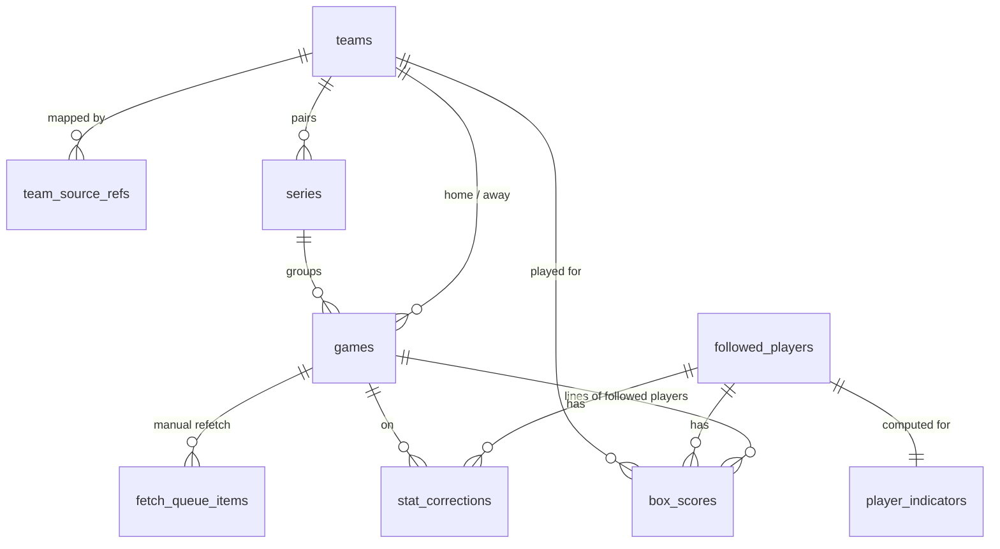

# Games and statistics

Schedules, results and box scores fetched from the statistics source (`docs/07-statistiques-de-match.md`),
the fetch queue that brings them in under quota, and the indicators the player page shows. The
chosen source is the SportsDataverse release of ESPN data (`docs/services/statistics-source.md`):
season files from 1993-94, whole minutes, no ejection data, no score columns used for records.
Everything computed from these rows — Game Score, index, usable status, season baselines, team
records, next game — is derived by the pure engine at recalculation (STA-43); what a case used is
stored on the case ([events-and-cases.md](events-and-cases.md)).

## 1. Entities

### 1.1 `teams` — `Team`

An NBA franchise with the application's own identifier, mapped from each statistics source by a
fixed table, so that team history and opponents run across sources (CL-STA-23). Seeded from
`data/` with the thirty franchises; never edited in the app, never deleted. A franchise that moved
or was renamed stays one team when the source keeps its identifier (CL-JOU-18).

| column         | type    | null | default  | constraint or reference                  | class | spec IDs                    |
| -------------- | ------- | ---- | -------- | ---------------------------------------- | ----- | --------------------------- |
| `id`           | integer | no   | identity | primary key                              | —     | CL-STA-23                   |
| `abbreviation` | text    | no   | —        | unique; NBA.com style, for example `BOS` | —     | JOU-08 (choice among teams) |
| `name`         | text    | no   | —        | the franchise's current name             | —     | JOU-08, STA-26              |

Unique: `teams_abbreviation_key (abbreviation)`.

```ts
type TeamId = Brand<number, 'TeamId'>;
```

### 1.2 `team_source_refs` — the fixed mapping table

| column            | type    | null | default | constraint or reference                            | class | spec IDs          |
| ----------------- | ------- | ---- | ------- | -------------------------------------------------- | ----- | ----------------- |
| `team_id`         | integer | no   | —       | `REFERENCES teams(id) ON DELETE RESTRICT`          | —     | CL-STA-23         |
| `stats_source`    | text    | no   | —       | `CHECK (stats_source IN ('sportsdataverse_espn'))` | —     | STA-02, CL-STA-23 |
| `source_team_ref` | text    | no   | —       | the source's stable franchise identifier           | —     | STA-02            |

Primary key `(stats_source, source_team_ref)`: one application team per source identifier. Seeded
with `teams`; a replacement source adds its rows (CL-TRV-14).

### 1.3 `games` — `Game`

A dated official NBA game: regular season, play-in or playoffs (STA-04, STA-05). The whole league
schedule of each fetched season is stored once, shared by every player (STA-42), because team
records and the opponent criterion need every team's results (STA-06, SEN-15). Games that never
count — All-Star games, the NBA Cup final, preseason and exhibition games — are dropped by the
adapter and never stored (STA-04, CL-STA-16). Canceled games are stored with their status and
ignored by every rule.

| column                    | type        | null | default  | constraint or reference                                                                                                                                                                 | class | spec IDs                                                |
| ------------------------- | ----------- | ---- | -------- | --------------------------------------------------------------------------------------------------------------------------------------------------------------------------------------- | ----- | ------------------------------------------------------- |
| `id`                      | integer     | no   | identity | primary key                                                                                                                                                                             | —     | —                                                       |
| `stats_source`            | text        | no   | —        | `CHECK (stats_source IN ('sportsdataverse_espn'))`; the source the season is assigned to                                                                                                | —     | STA-02, CL-STA-23                                       |
| `source_game_ref`         | text        | no   | —        | the source's stable game identifier                                                                                                                                                     | —     | STA-02                                                  |
| `make_up_source_game_ref` | text        | yes  | —        | identifier of the make-up game folded into this postponed game                                                                                                                          | —     | CL-STA-17                                               |
| `season`                  | text        | no   | —        | `CHECK (season ~ '^[0-9]{4}-[0-9]{2}$')`, the second year following the first (`2024-25`); assigned from the date, never from the file                                                  | —     | STA-05, STA-48, CL-STA-28                               |
| `phase`                   | text        | no   | —        | `CHECK (phase IN ('regular_season','play_in','playoffs'))`                                                                                                                              | —     | STA-04, STA-05, CL-STA-02                               |
| `status`                  | text        | no   | —        | `CHECK (status IN ('scheduled','in_progress','final','postponed','canceled'))`                                                                                                          | —     | STA-05                                                  |
| `scheduled_start_at`      | timestamptz | no   | —        | the latest known scheduled start; for a time to be determined, the deemed start: 00:00 New York time on `game_day_on`                                                                   | —     | STA-05, STA-29, STA-31, CL-STA-14, CL-TRV-03, CL-SEN-23 |
| `is_start_time_tbd`       | boolean     | no   | `false`  | the source flags the time as not valid                                                                                                                                                  | —     | STA-31, CL-STA-14                                       |
| `game_day_on`             | date        | no   | —        | the day of the game: the calendar date of its scheduled start in `America/New_York`, the source's league date; it also stands for the venue's local date (SEN-02, STA-31, the birthday) | —     | TRV-72, CL-TRV-03, CL-IHM-07, STA-32, ADR 0015          |
| `home_team_id`            | integer     | yes  | —        | `REFERENCES teams(id) ON DELETE RESTRICT`; null only for a placeholder whose teams are still to be determined                                                                           | —     | STA-05, CL-STA-14                                       |
| `away_team_id`            | integer     | yes  | —        | as `home_team_id`                                                                                                                                                                       | —     | STA-05, CL-STA-14                                       |
| `home_score`              | smallint    | yes  | —        | final score; stored, never a measure                                                                                                                                                    | —     | STA-05, VUE-03                                          |
| `away_score`              | smallint    | yes  | —        | as `home_score`                                                                                                                                                                         | —     | STA-05, VUE-03                                          |
| `overtime_count`          | smallint    | yes  | —        | `CHECK (overtime_count >= 0)`; null when the final period is missing                                                                                                                    | —     | STA-09, CL-STA-03                                       |
| `series_id`               | integer     | yes  | —        | `REFERENCES series(id) ON DELETE RESTRICT`; play-in and playoff games only                                                                                                              | —     | STA-05, CL-STA-18                                       |
| `game_number`             | smallint    | yes  | —        | `CHECK (game_number >= 1)`; rank in its series                                                                                                                                          | —     | STA-05, CL-STA-18                                       |
| `home_series_wins_before` | smallint    | yes  | —        | `CHECK (home_series_wins_before >= 0)`                                                                                                                                                  | —     | STA-05, CL-STA-18                                       |
| `away_series_wins_before` | smallint    | yes  | —        | `CHECK (away_series_wins_before >= 0)`                                                                                                                                                  | —     | STA-05, CL-STA-18                                       |
| `is_elimination_game`     | boolean     | yes  | —        | a loss eliminates one of the teams; null when unknown or outside the playoffs                                                                                                           | —     | STA-07, CL-STA-18, CL-SEN-10                            |
| `home_lines_published`    | boolean     | no   | `false`  | the source holds player lines for the home team in this game                                                                                                                            | —     | CL-STA-04, CL-STA-22                                    |
| `away_lines_published`    | boolean     | no   | `false`  | as `home_lines_published`, away team                                                                                                                                                    | —     | CL-STA-04, CL-STA-22                                    |
| `consolidated_at`         | timestamptz | yes  | —        | set by the first statistics update after the correction window of the game; never cleared                                                                                               | —     | STA-33, STA-42                                          |
| `last_fetched_at`         | timestamptz | no   | —        | —                                                                                                                                                                                       | —     | STA-42                                                  |

Row checks:

- `phase = 'regular_season'` implies `series_id`, `game_number`, both wins and
  `is_elimination_game` are null.
- `home_team_id IS NULL OR away_team_id IS NULL` implies `status = 'scheduled'`.
- `home_team_id IS DISTINCT FROM away_team_id OR home_team_id IS NULL`.
- `status = 'final'` implies both scores are not null.

Unique: `games_source_ref_key (stats_source, source_game_ref)`;
`games_make_up_ref_key (stats_source, make_up_source_game_ref) WHERE make_up_source_game_ref IS NOT NULL`.

Indexes, with the query each serves:

- `games_home_team_start_idx (home_team_id, scheduled_start_at)` and
  `games_away_team_start_idx (away_team_id, scheduled_start_at)` — a team's games in time order:
  the next game (STA-26), the attachment walk over the player's team games (SEN-03, CL-SEN-05),
  the absence counts (STA-46, SEN-13), the calendar derivation (CL-TAX-18) and team records.
- `games_season_phase_idx (season, phase)` — every game of a season and phase: baselines through
  `box_scores`, team records (STA-06, CL-STA-19), the phase-finished test (CL-STA-02), series
  rebuilding (CL-STA-18), season coverage (CL-STA-22), filing a date by season (CL-STA-28).
- `games_game_day_idx (game_day_on)` — the games of competition day D for the daily update
  (STA-32, CL-STA-10) and the 30 counted days of STA-35.
- `games_open_status_idx (scheduled_start_at) WHERE status IN ('scheduled','in_progress','postponed')`
  — the upcoming schedule (STA-26, STA-28) and "is a phase still under way" (CL-STA-02, CL-STA-20).

Deletion: never. At a source replacement, stored seasons keep the rows and identifiers of the
source they came from; the season in progress is fetched again whole from the new source, its games
matched to the stored rows by date, home team and away team, which then take the new source's
identifiers, so that no season mixes two sources (CL-STA-23, CL-TRV-14). No venue time zone is
stored (CL-TRV-03).

```ts
type GameId = Brand<number, 'GameId'>;
type Season = Brand<string, 'Season'>; // '2024-25'
type GameConsolidation = 'in_correction_window' | 'consolidated'; // derived from consolidatedAt
interface Game {
  id: GameId;
  season: Season;
  phase: GamePhase;
  status: GameStatus;
  scheduledStartAt: EpochMs;
  gameDayOn: IsoDate;
  finalScore: { home: number; away: number } | null;
}
```

### 1.4 `series` — a play-in or playoff pairing

The set of a season's postseason games between the same two teams, rebuilt from the schedule
because the source labels rounds only from 2003-04 and game numbers only from 2008-09 (STA-05,
CL-STA-18).

| column        | type     | null | default  | constraint or reference                                                                                                                                  | class | spec IDs             |
| ------------- | -------- | ---- | -------- | -------------------------------------------------------------------------------------------------------------------------------------------------------- | ----- | -------------------- |
| `id`          | integer  | no   | identity | primary key                                                                                                                                              | —     | —                    |
| `season`      | text     | no   | —        | same check as `games.season`                                                                                                                             | —     | STA-05               |
| `phase`       | text     | no   | —        | `CHECK (phase IN ('play_in','playoffs'))`                                                                                                                | —     | STA-05               |
| `round`       | text     | no   | —        | `CHECK (round IN ('first_round','conference_semifinals','conference_finals','finals','play_in_7_vs_8','play_in_9_vs_10','play_in_8th_seed'))`            | —     | STA-05, CL-STA-18    |
| `team_a_id`   | integer  | no   | —        | `REFERENCES teams(id) ON DELETE RESTRICT`; the lower team id                                                                                             | —     | STA-05               |
| `team_b_id`   | integer  | no   | —        | `REFERENCES teams(id) ON DELETE RESTRICT`; `CHECK (team_a_id < team_b_id)`                                                                               | —     | STA-05               |
| `wins_needed` | smallint | no   | —        | `CHECK (wins_needed >= 1)`; from the fixed round-length table (best of five in the first round up to 2001-02, best of seven otherwise; 1 for play-in)    | —     | CL-STA-18            |
| `is_rebuilt`  | boolean  | no   | —        | false when a game is missing, numbers disagree or the series ends without a team reaching `wins_needed`; its games then have an unknown elimination flag | —     | CL-STA-18, CL-SEN-10 |

Unique: `series_season_teams_key (season, phase, team_a_id, team_b_id)` — two teams meet at most
once in a postseason (CL-STA-18).

### 1.5 `box_scores` — `BoxScore`

One followed player's line for one official game in which he played, or the placeholder that marks
his sheet unavailable (STA-08, STA-35). A did-not-play line, a missing line while his team's lines
are published, and a line with zero minutes and no non-zero element all mean "not played" and are
not stored (CL-STA-04). The did-not-play reason is dropped by the adapter (JOU-21, DSN-15).

| column                  | type        | null | default  | constraint or reference                                                                                                                                                 | class | spec IDs                  |
| ----------------------- | ----------- | ---- | -------- | ----------------------------------------------------------------------------------------------------------------------------------------------------------------------- | ----- | ------------------------- |
| `id`                    | integer     | no   | identity | primary key                                                                                                                                                             | —     | —                         |
| `player_id`             | uuid        | no   | —        | `REFERENCES followed_players(id) ON DELETE CASCADE`                                                                                                                     | PI    | STA-08, CL-JOU-06         |
| `game_id`               | integer     | no   | —        | `REFERENCES games(id) ON DELETE RESTRICT`                                                                                                                               | PI    | STA-08                    |
| `stats_source`          | text        | no   | —        | `CHECK (stats_source IN ('sportsdataverse_espn'))`; equals the game's                                                                                                   | —     | CL-STA-23                 |
| `source_player_ref`     | text        | no   | —        | the identity the line came from; lets a mapping change delete the former identity's lines                                                                               | PI    | STA-03, CL-JOU-11         |
| `status`                | text        | no   | —        | `CHECK (status IN ('complete','incomplete','suspect','unavailable'))`                                                                                                   | PI    | STA-09, STA-10, STA-35    |
| `team_id`               | integer     | yes  | —        | `REFERENCES teams(id) ON DELETE RESTRICT`; the team he played for; null only on an unavailable placeholder                                                              | PI    | STA-08, JOU-13, CL-STA-05 |
| `minutes`               | smallint    | yes  | —        | as the source gives it; whole minutes for the chosen source; no range check here (STA-09 marks the sheet instead)                                                       | PI    | STA-08, STA-12, CL-STA-06 |
| `seconds`               | smallint    | yes  | —        | null when the source gives whole minutes                                                                                                                                | PI    | STA-08, CL-STA-06         |
| `has_rounded_minutes`   | boolean     | no   | —        | the « minutes arrondies » notice                                                                                                                                        | PI    | STA-12, CL-STA-06         |
| `points`                | smallint    | yes  | —        | null means not provided, never zero-filled; no sign check (a negative value makes the sheet suspect)                                                                    | PI    | STA-08, STA-10            |
| `field_goals_made`      | smallint    | yes  | —        | as `points`                                                                                                                                                             | PI    | STA-08                    |
| `field_goals_attempted` | smallint    | yes  | —        | as `points`                                                                                                                                                             | PI    | STA-08                    |
| `three_pointers_made`   | smallint    | yes  | —        | used only by the points check                                                                                                                                           | PI    | STA-08, STA-09            |
| `free_throws_made`      | smallint    | yes  | —        | as `points`                                                                                                                                                             | PI    | STA-08                    |
| `free_throws_attempted` | smallint    | yes  | —        | as `points`                                                                                                                                                             | PI    | STA-08                    |
| `offensive_rebounds`    | smallint    | yes  | —        | as `points`                                                                                                                                                             | PI    | STA-08                    |
| `defensive_rebounds`    | smallint    | yes  | —        | as `points`                                                                                                                                                             | PI    | STA-08                    |
| `assists`               | smallint    | yes  | —        | as `points`                                                                                                                                                             | PI    | STA-08                    |
| `steals`                | smallint    | yes  | —        | as `points`                                                                                                                                                             | PI    | STA-08                    |
| `blocks`                | smallint    | yes  | —        | as `points`                                                                                                                                                             | PI    | STA-08                    |
| `turnovers`             | smallint    | yes  | —        | as `points`                                                                                                                                                             | PI    | STA-08                    |
| `personal_fouls`        | smallint    | yes  | —        | as `points`                                                                                                                                                             | PI    | STA-08                    |
| `ejected`               | boolean     | yes  | —        | null when the source does not say, which the chosen source never does; never inferred                                                                                   | PI    | SEN-16, CL-SEN-11         |
| `failed_checks`         | text[]      | no   | `'{}'`   | `CHECK (failed_checks <@ ARRAY['negative_value','made_above_attempted','points_mismatch','minutes_above_game_length','statistic_without_minutes'])`; the traced anomaly | PI    | STA-09                    |
| `fetched_at`            | timestamptz | no   | —        | last write by ingestion                                                                                                                                                 | —     | STA-42                    |

Row checks:

- `status = 'unavailable'` implies `team_id`, `minutes`, `seconds` and every element are null and
  `failed_checks = '{}'`; any other status implies `team_id IS NOT NULL`.
- `status = 'suspect'` iff `failed_checks <> '{}'`.

Unique: `box_scores_player_game_key (player_id, game_id)`.

Indexes:

- `box_scores_player_game_key` serves every per-player read: the season's lines of one player
  joined to `games` for his baselines, threshold and absence runs (STA-14 to STA-24, SEN-13), the
  indicators (STA-46) and the derivation (CL-TAX-18).
- `box_scores_game_idx (game_id)` serves ingestion and corrections by game (STA-32, STA-33).

Deletion: with the player (CL-JOU-06); the lines of a former identity when a mapping changes
(CL-JOU-11); a stored line that a correction turns into "not played". Each change of an element is
traced in `stat_corrections` first.

```ts
type BoxScoreStatus = 'complete' | 'incomplete' | 'suspect' | 'unavailable';
type GamePlayClassification = 'not_played' | 'played_not_usable' | 'usable'; // derived per season threshold
type Participation = 'played' | 'not_played' | 'unknown'; // derived (CL-STA-04): row, or the team's lines flag
```

### 1.6 `stat_corrections` — `StatCorrection`

The statistics correction journal: every changed element with its old and new values. Unlike
event corrections, old values are kept, because statistics are not sensitive (STA-33, STA-34,
CL-STA-26).

| column         | type        | null | default  | constraint or reference                                                                                                                                                                                                                                                   | class | spec IDs       |
| -------------- | ----------- | ---- | -------- | ------------------------------------------------------------------------------------------------------------------------------------------------------------------------------------------------------------------------------------------------------------------------- | ----- | -------------- |
| `id`           | integer     | no   | identity | primary key                                                                                                                                                                                                                                                               | —     | —              |
| `player_id`    | uuid        | no   | —        | `REFERENCES followed_players(id) ON DELETE CASCADE`                                                                                                                                                                                                                       | PI    | STA-33         |
| `game_id`      | integer     | no   | —        | `REFERENCES games(id) ON DELETE RESTRICT`                                                                                                                                                                                                                                 | PI    | STA-33         |
| `element`      | text        | no   | —        | `CHECK (element IN ('team','minutes','seconds','points','field_goals_made','field_goals_attempted','three_pointers_made','free_throws_made','free_throws_attempted','offensive_rebounds','defensive_rebounds','assists','steals','blocks','turnovers','personal_fouls'))` | PI    | STA-33         |
| `old_value`    | integer     | yes  | —        | null means absent (no line, or element not provided); for `team`, a team id                                                                                                                                                                                               | PI    | STA-33         |
| `new_value`    | integer     | yes  | —        | as `old_value`                                                                                                                                                                                                                                                            | PI    | STA-33         |
| `corrected_at` | timestamptz | no   | `now()`  | —                                                                                                                                                                                                                                                                         | —     | STA-33         |
| `origin`       | text        | no   | —        | `CHECK (origin IN ('correction_window','manual_refetch'))`                                                                                                                                                                                                                | —     | STA-33, STA-34 |

Indexes: `stat_corrections_player_game_idx (player_id, game_id)` serves the correction list of a
case's game and the cause "statistics correction" of a recalculation (CL-SEN-17).

It references the player and the game rather than the line, so the trace survives a line that a
correction removes.

### 1.7 `player_indicators` — the indicators provided to the player page

Stored results recomputed from stored lines at each statistics update (STA-46, STA-47); one row
per followed player with an established mapping.

| column                          | type             | null | default | constraint or reference                                                                                                                       | class | spec IDs                          |
| ------------------------------- | ---------------- | ---- | ------- | --------------------------------------------------------------------------------------------------------------------------------------------- | ----- | --------------------------------- |
| `player_id`                     | uuid             | no   | —       | primary key; `REFERENCES followed_players(id) ON DELETE CASCADE`                                                                              | PI    | STA-46                            |
| `indicator_season`              | text             | no   | —       | the season the two next columns cover: the season in progress, or between seasons the last season played                                      | PI    | JOU-02, CL-STA-21, CL-JOU-15      |
| `games_played_this_season`      | smallint         | no   | —       | official games played in `indicator_season`                                                                                                   | PI    | JOU-02, STA-46                    |
| `average_minutes_this_season`   | double precision | yes  | —       | mean minutes per game played; null with no game                                                                                               | PI    | JOU-02, STA-46                    |
| `last_game_played_id`           | integer          | yes  | —       | `REFERENCES games(id) ON DELETE RESTRICT`                                                                                                     | PI    | JOU-21, STA-46                    |
| `last_game_played_on`           | date             | yes  | —       | US date of that game                                                                                                                          | PI    | JOU-21, STA-26                    |
| `consecutive_team_games_missed` | smallint         | no   | `0`     | his team games missed since his last game played, across seasons and trades (CL-STA-05)                                                       | PI    | JOU-21, JOU-22, STA-46, CL-JOU-15 |
| `first_nba_game_id`             | integer          | yes  | —       | `REFERENCES games(id) ON DELETE RESTRICT`                                                                                                     | PI    | STA-47                            |
| `first_nba_game_on`             | date             | yes  | —       | US date; null means « date inconnue » until the earliest season listing him is stored, and when that season is the source's first (CL-STA-12) | PI    | STA-47, CL-STA-12, BKT-08, IMP-12 |
| `computed_at`                   | timestamptz      | no   | —       | —                                                                                                                                             | —     | STA-46                            |

```ts
interface PlayerIndicators {
  playerId: PlayerId;
  gamesPlayedThisSeason: number;
  averageMinutesThisSeason: number | null;
  lastGamePlayedOn: IsoDate | null;
  consecutiveTeamGamesMissed: number;
  firstNbaGameOn: IsoDate | null;
}
```

### 1.8 `fetch_queue_items` — `FetchQueueItem`

Pending source requests with their priority, attempts and waiting reason (STA-36, STA-39, STA-40),
as resumable units of work (TRV-30; statistics-source evaluation, section 12). A unit is deleted
once done; runs are in the journal.

| column              | type        | null | default  | constraint or reference                                                                     | class | spec IDs               |
| ------------------- | ----------- | ---- | -------- | ------------------------------------------------------------------------------------------- | ----- | ---------------------- |
| `id`                | integer     | no   | identity | primary key                                                                                 | —     | —                      |
| `stats_source`      | text        | no   | —        | `CHECK (stats_source IN ('sportsdataverse_espn'))`                                          | —     | STA-02                 |
| `kind`              | text        | no   | —        | `CHECK (kind IN ('publication_probe','season_games','season_lines','player_index'))`        | —     | STA-32, STA-41, STA-44 |
| `season`            | text        | yes  | —        | required for `season_games` and `season_lines`                                              | —     | STA-40, STA-41         |
| `game_id`           | integer     | yes  | —        | `REFERENCES games(id) ON DELETE CASCADE`; narrows a manual refetch to one game              | —     | STA-44                 |
| `is_manual_refetch` | boolean     | no   | `false`  | forces consolidated data and traces corrections as `manual_refetch`                         | —     | STA-34, STA-44         |
| `priority`          | smallint    | no   | —        | `CHECK (priority BETWEEN 1 AND 5)`; the highest need among the cases and players it serves  | —     | STA-40, H-STA-15       |
| `attempts`          | smallint    | no   | `0`      | —                                                                                           | —     | STA-36                 |
| `next_attempt_at`   | timestamptz | no   | `now()`  | —                                                                                           | —     | STA-36, CL-STA-15      |
| `wait_reason`       | text        | yes  | —        | `CHECK (wait_reason IN ('outage','quota'))`                                                 | —     | STA-36, STA-39         |
| `lease_expires_at`  | timestamptz | yes  | —        | technical: an invocation holds the unit until then; an expired lease is free again (TRV-30) | —     | TRV-29, TRV-30         |
| `cursor`            | text        | yes  | —        | technical: the port's resume point for a paged source                                       | —     | TRV-30                 |
| `requested_at`      | timestamptz | no   | `now()`  | —                                                                                           | —     | STA-41                 |

Row check: `kind IN ('season_games','season_lines')` iff `season IS NOT NULL`;
`game_id IS NOT NULL` implies `kind = 'season_lines' AND is_manual_refetch`.

Unique: `fetch_queue_items_scope_key (stats_source, kind, season, game_id, is_manual_refetch) NULLS NOT DISTINCT`
— one pending unit per scope; a new need raises its priority instead of adding a row.

Indexes: `fetch_queue_items_due_idx (priority, next_attempt_at)` serves the leasing query "due
units in STA-40 order" (STA-39, STA-40).

```ts
type FetchPriority = 1 | 2 | 3 | 4 | 5;
type FetchWaitReason = 'outage' | 'quota';
type FetchUnitKind = 'publication_probe' | 'season_games' | 'season_lines' | 'player_index';
```

### 1.9 `stats_source_files` — what was read from each source file

The version and fetch date of every source file read, so that requests are conditional and
consolidated data is never requested again (STA-42; service sheet, "How it is called").

| column                | type        | null | default  | constraint or reference                                                       | class | spec IDs             |
| --------------------- | ----------- | ---- | -------- | ----------------------------------------------------------------------------- | ----- | -------------------- |
| `id`                  | integer     | no   | identity | primary key                                                                   | —     | —                    |
| `stats_source`        | text        | no   | —        | `CHECK (stats_source IN ('sportsdataverse_espn'))`                            | —     | STA-02               |
| `file_key`            | text        | no   | —        | the source file, for example `player_box:2027`, `schedule:2027`, `timestamp`  | —     | STA-42               |
| `season`              | text        | yes  | —        | the season the file holds, when it holds one                                  | —     | STA-42, CL-STA-22    |
| `version`             | text        | yes  | —        | technical: the ETag sent back as `If-None-Match`                              | —     | STA-42               |
| `source_refreshed_at` | timestamptz | yes  | —        | the source's refresh instant (`Last-Modified`), read by the publication probe | —     | CL-STA-10, CL-TRV-23 |
| `fetched_at`          | timestamptz | no   | —        | —                                                                             | —     | STA-42               |

Unique: `stats_source_files_key (stats_source, file_key)`.

## 2. Lifecycles

### 2.1 Game status (STA-05, CL-STA-17)

| from        | to          | trigger                                 | guard                                          | side effects                                                                                                                   |
| ----------- | ----------- | --------------------------------------- | ---------------------------------------------- | ------------------------------------------------------------------------------------------------------------------------------ |
| (none)      | scheduled   | schedule ingested                       | an official game (CL-STA-16)                   | stored with its season from its date (CL-STA-28)                                                                               |
| scheduled   | scheduled   | time published, or a later time         | —                                              | `scheduled_start_at` replaced, `is_start_time_tbd` false; next game and dependent cases recalculated (STA-28, STA-31)          |
| scheduled   | in_progress | source                                  | —                                              | —                                                                                                                              |
| in_progress | final       | source                                  | —                                              | scores set; the game day's update fetches lines (STA-32)                                                                       |
| scheduled   | postponed   | source                                  | —                                              | not a team game, absence or next game while postponed (CL-STA-17)                                                              |
| postponed   | scheduled   | the adapter links the make-up game      | same two teams, same season, the make-up label | takes the make-up's date, instant and status; `make_up_source_game_ref` stored; upcoming derived events re-checked (CL-TAX-19) |
| scheduled   | canceled    | source                                  | —                                              | ignored by every rule; upcoming derived events on it dropped (CL-TAX-19)                                                       |
| final       | final       | a correction of the score in the window | not consolidated, or a manual refetch          | team records and the opponent criterion recalculated                                                                           |

### 2.2 Game consolidation (STA-33)

| from                 | to           | trigger                                  | guard                                         | side effects                                          |
| -------------------- | ------------ | ---------------------------------------- | --------------------------------------------- | ----------------------------------------------------- |
| in_correction_window | consolidated | first statistics update after the window | `correctionWindowDays` elapsed since the game | `consolidated_at` set; never requested again (STA-42) |

### 2.3 Box-score status (STA-09, STA-10, STA-35, CL-STA-04, CL-STA-11)

| from                            | to                              | trigger                                                                                                                                                           | guard                                                                                           | side effects                                                              |
| ------------------------------- | ------------------------------- | ----------------------------------------------------------------------------------------------------------------------------------------------------------------- | ----------------------------------------------------------------------------------------------- | ------------------------------------------------------------------------- |
| (no row, participation unknown) | complete, incomplete or suspect | a fetch brings a played line                                                                                                                                      | mapping established                                                                             | checks run before any calculation; the case recalculated                  |
| (no row, participation unknown) | (no row, not played)            | a fetch brings his team's lines without a played line for him                                                                                                     | —                                                                                               | `*_lines_published` set; the walk skips the game as an absence            |
| (no row, participation unknown) | unavailable                     | first statistics update after more than `boxScoreUnavailableAfterDays` counted days since the game's US date; at once for a past-season game listed without lines | a day counts unless a `stats_source_unavailable` or `quota_reached` incident was open during it | placeholder row; the case becomes not measurable, `box_score_unavailable` |
| incomplete or suspect           | complete                        | a later fetch makes it complete and consistent                                                                                                                    | in the window, or a manual refetch                                                              | corrections traced; recalculation                                         |
| complete                        | incomplete or suspect           | a correction                                                                                                                                                      | as above                                                                                        | corrections traced; recalculation                                         |
| unavailable                     | complete, incomplete or suspect | a manual refetch supplies the line                                                                                                                                | —                                                                                               | the case can become measurable again (STA-35)                             |

### 2.4 Fetch queue item (STA-36, STA-39, STA-40)

| from    | to      | trigger                                                                    | guard                                                          | side effects                                                                                                                               |
| ------- | ------- | -------------------------------------------------------------------------- | -------------------------------------------------------------- | ------------------------------------------------------------------------------------------------------------------------------------------ |
| (none)  | pending | a need appears (mapping established, import, daily update, manual refetch) | no unit with the same scope (unique index)                     | priority set; an existing unit takes the higher need                                                                                       |
| pending | leased  | an invocation leases it                                                    | due, quota left (the 10 % reserve kept for priorities 1 and 2) | `lease_expires_at` set                                                                                                                     |
| leased  | (done)  | the port returns `next = null`                                             | —                                                              | rows upserted and the unit deleted in one transaction (TRV-29)                                                                             |
| leased  | pending | outage answer                                                              | —                                                              | `attempts` + 1; `next_attempt_at` per `fetchRetryDelaysHours`; `wait_reason = 'outage'`; incident after `statsIncidentAfterHours` (STA-37) |
| leased  | pending | quota answer or ceiling reached                                            | —                                                              | `wait_reason = 'quota'`; `next_attempt_at` = the quota reset; `quota_reached` incident (STA-39, CL-STA-15)                                 |
| leased  | pending | lease expires (crashed run)                                                | —                                                              | resumes from `cursor` (TRV-30)                                                                                                             |

## 3. Invariants

| rule                                                                                                        | spec IDs             | enforced by                                         |
| ----------------------------------------------------------------------------------------------------------- | -------------------- | --------------------------------------------------- |
| Only official games are stored; All-Star games and the NBA Cup final are flagged by the adapter and dropped | STA-04, CL-STA-16    | statistics adapter and ingestion service            |
| One row per source game, a make-up folded into its postponed original                                       | STA-05, CL-STA-17    | unique indexes on `games`                           |
| A game's season comes from its date and the seasons' start dates, never from the file                       | STA-48, CL-STA-28    | ingestion service                                   |
| All data of a season — schedule, results, series, lines — comes from the one source assigned to it          | CL-STA-23            | ingestion service; `stats_source` on every row      |
| No missing value is replaced by zero, an average or an estimate                                             | STA-10               | adapter; nullable element columns                   |
| A sheet failing a check is suspect, and a suspect or incomplete sheet enters no calculation                 | STA-09, STA-10       | row check on `failed_checks`; engine reads `status` |
| Lines exist only for followed players with an established mapping of that source                            | JOU-10, STA-03       | ingestion service                                   |
| Consolidated games are never requested again, except by a manual refetch                                    | STA-42, STA-44       | fetch-queue service                                 |
| Recalculations never call the source                                                                        | STA-43, SEN-36       | engine purity (`src/lib/stats-engine` is pure)      |
| A late source is not an outage: only failed requests count toward STA-36 and STA-37                         | CL-STA-10, CL-TRV-23 | statistics update service                           |
| A placeholder game with undetermined teams is no team's game                                                | CL-STA-14            | row check (status scheduled); engine                |
| The did-not-play reason is never stored                                                                     | JOU-21, DSN-15       | adapter; no column                                  |

## 4. Stored or derived

| item                                                                          | stored or derived                              | recalculated when                                                                                     | spec IDs                  |
| ----------------------------------------------------------------------------- | ---------------------------------------------- | ----------------------------------------------------------------------------------------------------- | ------------------------- |
| Series, game numbers, wins before, elimination flag                           | stored on `series` and `games`                 | each ingestion of a season's postseason games                                                         | STA-05, STA-07, CL-STA-18 |
| Box-score status and failed checks                                            | stored                                         | each write of the line; `unavailable` at the daily update                                             | STA-09, STA-10, STA-35    |
| US date (the day of the game) and the deemed start of a time to be determined | stored on `games`                              | each schedule ingestion                                                                               | CL-STA-14, CL-TRV-03      |
| Participation in a game (played, not played, unknown)                         | derived                                        | on read, from `box_scores` and the team's `*_lines_published`                                         | CL-STA-04                 |
| Team membership at a date                                                     | derived                                        | from played lines and `player_team_changes`                                                           | CL-STA-05                 |
| Game Score, decimal minutes, performance index                                | derived (engine)                               | each recalculation                                                                                    | STA-11, STA-12, H-13      |
| Playing-time threshold per player and season, usable classification           | derived (engine)                               | each recalculation of the season (CL-STA-07)                                                          | STA-14, STA-15, CL-STA-07 |
| Season baseline                                                               | derived (engine); the case stores what it used | each recalculation                                                                                    | STA-16 to STA-24          |
| Team win-loss record                                                          | derived (engine)                               | each recalculation, from stored final regular-season scores                                           | STA-06, CL-STA-19         |
| Phase finished (league-wide regular season; per team postseason)              | derived                                        | on read                                                                                               | STA-20, CL-STA-02         |
| Next game, or « aucun match prévu » with its reason                           | derived                                        | on read; never copied (STA-28)                                                                        | STA-26, STA-28, CL-STA-20 |
| Season covered by the source                                                  | derived                                        | first covered season of the service sheet (a code constant), `stats_source_files` and the lines flags | STA-45, CL-STA-22         |
| Counted days before "unavailable"                                             | derived                                        | from stored incident periods (`incidents`)                                                            | STA-35, CL-STA-11         |
| Long-fetch progress « 9 sur 14 saisons »                                      | derived                                        | from the player's career seasons, `stats_source_files` and the queue                                  | STA-41                    |
| Indicators of the player page                                                 | stored in `player_indicators`                  | each statistics update; each stored season (first NBA game)                                           | STA-46, STA-47, CL-STA-12 |
| Indicative comparison (Lot 2)                                                 | derived                                        | on read; never stored as a gap                                                                        | STA-23, CL-STA-13         |

## 5. Exchange formats

No format of the application's own. The source's season files enter through the port of the
statistics-source evaluation (section 12): `Game` maps to `games` (`tipoff.instant` to
`scheduled_start_at`, `tipoff.leagueDate` to `game_day_on`, `tipoff.timeKnown` to
`NOT is_start_time_tbd`, `overtimes`, `series`, `makeUpOf`; the port's `venue` and
`tipoff.venueDate` are not stored, CL-TRV-03); `PlayerLine` maps to `box_scores` (`participation = 'did_not_play'` lines are not
stored; `ejected: null` stays null); `PlayerCandidate` to `mapping_candidates`; `PlayerProfile` to
the birthday and current-team observations of [players.md](players.md); `SeasonCoverage` and
`Publication` to `stats_source_files`. The port's `SeasonStart` year number is converted to the
`Season` label at the adapter boundary.

## 6. Rulings applied

- ADR 0012: coverage gives way; uncovered seasons make cases not measurable (CL-STA-22).
- CL-STA-02: two phases, `GamePhase` on games, `BaselinePhase` on cases.
- CL-STA-03: `overtime_count`, null when unknown.
- CL-STA-04, CL-STA-11: the lines-published flags, the unavailable placeholder, the counted days.
- CL-STA-06: whole minutes, `seconds` null, the rounded-minutes notice.
- CL-STA-10, CL-TRV-23: `stats_source_files.source_refreshed_at` holds the probe's answer.
- CL-STA-12: `first_nba_game_on` stays null until it is certain.
- CL-TRV-03, CL-IHM-07: the day of a game is its US date for every rule and display, the venue's
  local date included; no venue time zone is stored. The lot-1 text of CL-STA-14 still describes a
  venue table with a deemed start at 00:00 at the venue; the model follows CL-TRV-03, which file 14
  owns and CL-STA-14 itself defers to: the deemed start is 00:00 New York time on the game's day.
  Flagged.
- CL-STA-16: excluded games are never stored.
- CL-STA-17: one game, with the make-up identifier as an alias.
- CL-STA-18: `series` and the nullable elimination flag.
- CL-STA-19: records from stored scores only.
- CL-STA-21, CL-JOU-15: the indicators cover the season in progress, or between seasons the last
  season played, and name it.
- CL-STA-23, CL-TRV-14: application team ids, `team_source_refs`, `stats_source` on every row, one
  source per season, the season in progress fetched again at a replacement.
- CL-STA-26: `stat_corrections` keeps old values; event corrections never do.
- CL-STA-28 asks for seasons written "2024-2025" in data; the glossary's code value is `2024-25`.
  The model stores the glossary's form, so data and display share one spelling. Flagged.
- Own choice: lines for "not played" are not stored; participation is derived from the published
  flags, which is all CL-STA-04 needs (store less).
- Own choice: `failed_checks` keeps the STA-09 anomaly on the line itself, so the case can say why
  its sheet is suspect after the journal's 90 days; its five values are new code names for the
  glossary.
- Own choice: `fetch_queue_items.kind` uses the unit names of the evaluation's port;
  `series.round` uses its `Round` values. Both lists are new to the glossary.

## 7. Diagram


