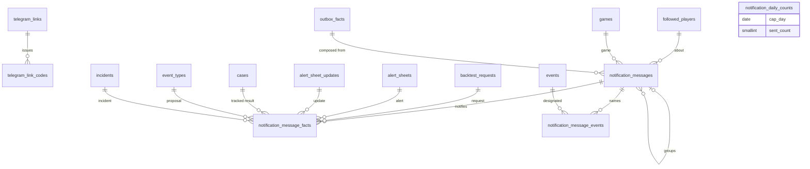

# Domain model — Telegram notifications (Lot 2)

The link with the owner's private chat, its one-time codes, messages and their statuses, the facts and events each message concerns, the daily sent counts behind the cap, the incident cycle (derived), and the data every message template needs: file 11 (TEL-01 to TEL-38) as ruled by `CL-TEL-01` to `CL-TEL-23`, with `CL-DSN-13`, `CL-TRV-05` and ADR 0019. Messages are composed from facts other modules record in the core's outbox (module map choice 7); incidents, the activity journal and parameters (the notification settings among them) belong to the core model.

**Conventions.** As in [collection.md](collection.md). A message's "day" for the cap is the owner's day (parameter `display.timeZone`), 00:00 to 24:00 (`CL-TEL-07`).

**Sensitive-data classes:** the core model's (`—`, `PI`, `EV`, `TX`, `PR`; README §3) and the two Lot 2 classes `EX` and `OW`, as the top of [collection.md](collection.md) says. A sent message's text is `EV` and `TX`: it designates events by player, type and source (TEL-06), so a withdrawal erases it and asks Telegram to delete it (TEL-38, `CL-TEL-09`).

## 1. Entities

### 1.1 Telegram link — `telegram_links`

The single link between the app and one private chat (TEL-01, TEL-28 to TEL-32). One row, created at installation with `not_linked`.

| Column | Type | Null | Default | Constraint or reference | Class | Spec |
| --- | --- | --- | --- | --- | --- | --- |
| `id` | smallint | no | 1 | primary key; `CHECK (id = 1)` — the only row | — | TEL-01, TEL-30 |
| `status` | text | no | `'not_linked'` | `CHECK (status IN ('not_linked','awaiting_confirmation','linked','broken'))` (`TelegramLinkStatus`) | — | TEL-28, TEL-32, TEL-37 |
| `status_changed_at` | timestamptz | no | — | "linked since", "broken since" | — | TEL-32 |
| `chat_id` | bigint | yes | null | the linked private chat; `CHECK ((status IN ('linked','broken')) = (chat_id IS NOT NULL))` | OW | TEL-01, TEL-29 |
| `linked_at` | timestamptz | yes | null | `CHECK ((chat_id IS NULL) = (linked_at IS NULL))` | — | TEL-32 |
| `last_successful_send_at` | timestamptz | yes | null | | — | TEL-32 |
| `inbound_mode` | text | no | `'webhook'` | `CHECK (inbound_mode IN ('webhook','polling'))`; written by the webhook registration of the installation check (`notifications.registerWebhook`): `polling` when Telegram refuses the webhook or reports a delivery error, `webhook` once one is registered with `max_connections` 1 | — | TEL-29, TEL-30 |
| `last_update_id` | bigint | yes | null | technical: the highest Telegram `update_id` handled, by webhook or by polling; an update at or below it is a redelivery and is ignored, and polling asks for `last_update_id + 1` onward; set in the transaction that handles the update, and it only moves forward. Telegram numbers a bot's updates in increasing order, and the webhook is registered with `max_connections` 1 so that they arrive in that order | — | TEL-31, CL-TRV-21 |
| `row_version` | integer | no | 1 | incremented at every save | — | CL-IHM-18 |

- **Deletion:** never deleted; unlinking empties it, except `last_update_id`, which keeps counting the bot's updates.
- **TypeScript:** `type TelegramLink = { status: 'not_linked' | 'awaiting_confirmation' } | { status: 'linked' | 'broken'; chatId: TelegramChatId; linkedAt: EpochMs }`, with `statusChangedAt`, `lastSuccessfulSendAt`, `inboundMode: 'webhook' | 'polling'` and `lastUpdateId: number | null`; the failed-message count is derived.

### 1.2 Link code — `telegram_link_codes`

The one-time code carried by "Open Telegram" (TEL-29, TEL-31). Only its digest is stored: the code itself lives only in the link the owner taps.

| Column | Type | Null | Default | Constraint or reference | Class | Spec |
| --- | --- | --- | --- | --- | --- | --- |
| `id` | integer identity | no | — | primary key | — | TEL-29 |
| `code_sha256` | bytea | no | — | SHA-256 of the code; unique; `CHECK (octet_length(code_sha256) = 32)` | OW | TEL-29, CL-TEL-23 |
| `created_at` | timestamptz | no | — | | — | TEL-29 |
| `expires_at` | timestamptz | no | — | `created_at + notifications.linkCodeValidityMinutes`; set to the issue instant of a newer code, which supersedes it; `CHECK (expires_at >= created_at)` | — | TEL-29, TEL-31 |
| `used_at` | timestamptz | yes | null | single use | — | TEL-31 |

- **Unique and indexes:** `telegram_link_codes_code_uq` unique `(code_sha256)` — the lookup of an incoming `/start` code, which tells "expired", "already used" and "unknown" apart (TEL-31).
- **Deletion:** by the daily purge once expired or used; excluded from backups and exports (§1.8).
- **TypeScript:** `{ createdAt: EpochMs; expiresAt: EpochMs; usedAt: EpochMs | null }`; the code is never exposed.

### 1.3 Message — `notification_messages`

One Telegram message of the catalogue (TEL-09 to TEL-16), a digest, or a service message, with its status (TEL-33). Its text is composed at send time from the current state of its facts (TEL-23) and kept only once sent.

| Column | Type | Null | Default | Constraint or reference | Class | Spec |
| --- | --- | --- | --- | --- | --- | --- |
| `id` | integer identity | no | — | primary key | — | TEL-33 |
| `kind` | text | no | — | `CHECK (kind IN ('backtest_request_to_do','deadline_changed','deadline_reminder','alert','alert_update','tracked_game_result','new_type_proposal','incident_start','incident_reminder','incident_end','export_reminder','link_confirmation','test_message','pass_digest','quiet_hours_digest','catch_up','daily_cap_reached','chat_unlinked_notice'))` (`NotificationKind`) | — | TEL-09 to TEL-16, TEL-36 |
| `status` | text | no | `'to_send'` | `CHECK (status IN ('to_send','deferred','sent','grouped','discarded','failed'))` (`NotificationMessageStatus`) | — | TEL-33 |
| `is_urgent` | boolean | no | false | `CHECK (NOT is_urgent OR kind IN ('backtest_request_to_do','deadline_changed','deadline_reminder','alert','alert_update'))` | — | TEL-21, CL-TEL-18 |
| `pass_id` | uuid | yes | null | the pass that produced the fact (core task runs); null for a fact born of an owner action or for a service message | — | TEL-19, TRV-26 |
| `player_id` | uuid | yes | null | → core `followed_players.id` `ON DELETE RESTRICT`; the player the message names | PI EV | TEL-06, CL-JOU-06 |
| `game_id` | integer | yes | null | → core `games.id` `ON DELETE RESTRICT`; the game the message is about: a request's deadline, a sheet's expected game | — | TEL-21, TEL-23 |
| `created_at` | timestamptz | no | — | | — | TEL-33 |
| `scheduled_send_at` | timestamptz | yes | null | planned send: end of quiet hours, next retry, slow-down delay, end of the recurrence window for an `incident_end` (§1.7), next catch-up try | — | TEL-20, TEL-35, CL-TEL-08, CL-TEL-12 |
| `sent_at` | timestamptz | yes | null | `CHECK ((status = 'sent') = (sent_at IS NOT NULL))` | — | TEL-33, TEL-22 |
| `text` | text | yes | null | the text as sent, links included; `CHECK ((status = 'sent') = (text IS NOT NULL))`; `CHECK (char_length(text) <= 4096)` | EV TX | TEL-04 to TEL-08, CL-TEL-14 |
| `chat_id` | bigint | yes | null | the chat it was sent to; `CHECK ((status = 'sent') = (chat_id IS NOT NULL))` | OW | CL-TEL-09 |
| `telegram_message_id` | bigint | yes | null | Telegram's identifier, to delete it after a withdrawal; same rule | OW | TEL-38, CL-TEL-09 |
| `attempt_count` | smallint | no | 0 | failed attempts; `CHECK (attempt_count >= 0)` | — | TEL-35 |
| `first_failure_at` | timestamptz | yes | null | the first failed attempt; the earliest one among the messages a catch-up covers starts its period (`CL-TEL-12`); `CHECK ((attempt_count = 0) = (first_failure_at IS NULL))` | — | TEL-36, CL-TEL-12 |
| `last_failure_at` | timestamptz | yes | null | the last failed attempt: the base of the next retry interval and, for a catch-up, of the catch-up interval (`CL-TEL-12`); `CHECK ((attempt_count = 0) = (last_failure_at IS NULL))`; `CHECK (last_failure_at >= first_failure_at)` | — | TEL-35, CL-TEL-12 |
| `last_failure_kind` | text | yes | null | `CHECK (last_failure_kind IN ('temporary','permanent'))` (`SendFailureKind`); `CHECK ((attempt_count = 0) = (last_failure_kind IS NULL))` | — | TEL-35, TEL-37 |
| `last_failure_reason` | text | yes | null | the code and message of Telegram's error object, at most 300 characters (`CL-DSN-11`); `CHECK (char_length(last_failure_reason) <= 300)` | — | TEL-34, TEL-36 |
| `discard_reason` | text | yes | null | `CHECK (discard_reason IN ('moot','category_disabled','notifications_suspended','unlinked','daily_cap'))` (`NotificationDiscardReason`); `CHECK ((status = 'discarded') = (discard_reason IS NOT NULL))` | — | TEL-22, TEL-23, TEL-26, CL-TEL-07, CL-TEL-20 |
| `grouped_into_message_id` | integer | yes | null | → `notification_messages.id` `ON DELETE SET NULL`; the digest or catch-up that carried it; `CHECK (grouped_into_message_id IS NULL OR status = 'grouped')` | — | TEL-19, TEL-36, CL-TEL-12 |
| `cap_day` | date | yes | null | for `daily_cap_reached` only: the owner's day it closes, the `cap_day` of its daily count (§1.6); `CHECK ((kind = 'daily_cap_reached') = (cap_day IS NOT NULL))` | — | TEL-22, CL-TEL-07 |

- **Unique and indexes:**
  - `notification_messages_due_idx` `(scheduled_send_at) WHERE status IN ('to_send','deferred')` — the `notification-dispatch` task's due messages;
  - `notification_messages_failed_idx` `(created_at) WHERE status = 'failed'` — the Home banner, the failed count of TEL-32 and the catch-up (`CL-TEL-12`);
  - `notification_messages_created_idx` `(created_at)` — the purge;
  - `notification_messages_pass_uq` unique `(pass_id) WHERE kind = 'pass_digest'` — one digest per pass (TEL-19);
  - `notification_messages_quiet_uq` unique `(scheduled_send_at) WHERE kind = 'quiet_hours_digest'` — one digest per end of quiet hours (TEL-20);
  - `notification_messages_cap_uq` unique `(cap_day) WHERE kind = 'daily_cap_reached'` — one cap message a day, even when `notifications.dailyCap` is raised and reached again that day;
  - `notification_messages_catch_up_uq` unique `(kind) WHERE kind = 'catch_up' AND status IN ('to_send','deferred')` — one pending catch-up at a time;
  - `notification_messages_player_idx` `(player_id) WHERE player_id IS NOT NULL` — a player-data deletion.
- **Deletion cascades to:** `notification_message_facts`, `notification_message_events`; the messages it grouped keep their status with `grouped_into_message_id` set to null.
- **TypeScript:** `id: NotificationMessageId`; the category is derived from the kind (§4); `type MessageDelivery = { status: 'sent'; sentAt: EpochMs; text: string; chatId: TelegramChatId; telegramMessageId: TelegramMessageId } | { status: 'discarded'; discardReason: NotificationDiscardReason } | { status: 'grouped'; groupedIntoMessageId: NotificationMessageId | null } | { status: 'to_send' | 'deferred' | 'failed' }`.

### 1.4 Message fact — `notification_message_facts`

The fact a message notifies (TEL-02, TEL-34), one row per fact; an incident message may carry several incidents of the same nature (TEL-15). Its partial unique indexes make "one fact, one message" a database rule (TEL-17, `CL-TEL-05`).

| Column | Type | Null | Default | Constraint or reference | Class | Spec |
| --- | --- | --- | --- | --- | --- | --- |
| `id` | integer identity | no | — | primary key | — | TEL-02 |
| `message_id` | integer | no | — | → `notification_messages.id` `ON DELETE CASCADE` | — | TEL-02 |
| `message_kind` | text | no | — | the message's `kind`, copied at insert for the unique indexes; immutable | — | TEL-17 |
| `backtest_request_id` | integer | yes | null | → core `backtest_requests.id` `ON DELETE RESTRICT` | EV | TEL-09, TEL-10 |
| `deadline_game_id` | integer | yes | null | → core `games.id` `ON DELETE RESTRICT`; the request's deadline game, for `deadline_changed` and `deadline_reminder` | — | TEL-10, CL-TEL-18 |
| `alert_sheet_id` | integer | yes | null | → `alert_sheets.id` `ON DELETE RESTRICT` | EV | TEL-11 |
| `alert_sheet_update_id` | integer | yes | null | → `alert_sheet_updates.id` `ON DELETE RESTRICT` | EV | TEL-12 |
| `case_id` | integer | yes | null | → core `cases.id` `ON DELETE CASCADE`: a regrouping or a merge moves the fact first (below); any other deletion of the case — a manual deletion or a replacement at import of its last event (IMP-29, IMP-33), a derivation drop — takes the fact with it | EV | TEL-13 |
| `event_type_id` | text | yes | null | → core `event_types.id` `ON DELETE RESTRICT`; a new proposal | — | TEL-14 |
| `incident_id` | integer | yes | null | → core `incidents.id` `ON DELETE CASCADE`; for a start or a reminder, the first incident of the cycle; for an end, the incident whose closing it follows (§1.7) | — | TEL-15, CL-TEL-08 |
| `reminder_number` | smallint | yes | null | `incident_reminder` only: 1, 2, …; `CHECK ((message_kind = 'incident_reminder') = (reminder_number IS NOT NULL))` | — | TEL-15 |

- **Check:** `CHECK (num_nonnulls(backtest_request_id, alert_sheet_id, alert_sheet_update_id, case_id, event_type_id, incident_id) = 1)`; `deadline_game_id` only with `backtest_request_id`.
- **Unique and indexes (one fact, one message):**

  | Index | Columns | Where |
  | --- | --- | --- |
  | `notification_facts_request_uq` | `(backtest_request_id)` | `message_kind = 'backtest_request_to_do'` |
  | `notification_facts_deadline_changed_uq` | `(backtest_request_id, deadline_game_id)` | `message_kind = 'deadline_changed'` |
  | `notification_facts_reminder_uq` | `(backtest_request_id, deadline_game_id)` | `message_kind = 'deadline_reminder'` |
  | `notification_facts_alert_uq` | `(alert_sheet_id)` | `message_kind = 'alert'` |
  | `notification_facts_alert_update_uq` | `(alert_sheet_update_id)` | `message_kind = 'alert_update'` |
  | `notification_facts_result_uq` | `(case_id)` | `message_kind = 'tracked_game_result'` |
  | `notification_facts_proposal_uq` | `(event_type_id)` | `message_kind = 'new_type_proposal'` |
  | `notification_facts_incident_start_uq` | `(incident_id)` | `message_kind = 'incident_start'` |
  | `notification_facts_incident_reminder_uq` | `(incident_id, reminder_number)` | `message_kind = 'incident_reminder'` |
  | `notification_facts_incident_end_uq` | `(incident_id)` | `message_kind = 'incident_end'` |
  | `notification_facts_export_reminder_uq` | `(incident_id)` | `message_kind = 'export_reminder'` |

  Plus `notification_facts_message_idx` `(message_id)` and `notification_facts_case_idx` `(case_id) WHERE case_id IS NOT NULL` — `moveCaseReferences`.
- **Case merge** (core events-and-cases.md §2.5): `notifications.moveCaseReferences(fromCaseId, intoCaseId)`, run first by the recalculation's regrouping reactions (module map §1.10), before tracking's and before the emptied case is deleted, moves its `tracked_game_result` fact to the surviving case when that case has none — both cases end on the same measured game, so one result was already notified for it — and otherwise deletes the emptied case's fact, discarding its message as moot if it is unsent. One result per case still holds. Any other path that deletes a case deletes its fact by `ON DELETE CASCADE`: the case being gone, one result per case has nothing left to protect; a sent message keeps its text, and an unsent one left without facts is discarded as moot when it is due. A merge of two detected events applies the same code to the absorbed event's case when that case goes with it (§1.8).
- **Deletion:** with its message; with its incident when the core purges it; with its case when the core deletes it otherwise than by a regrouping or a merge (§1.4).
- **TypeScript:** `type MessageFact = { requestId: BacktestRequestId; deadlineGameId?: GameId } | { alertSheetId: AlertSheetId } | { alertSheetUpdateId: AlertSheetUpdateId } | { caseId: CaseId } | { eventTypeId: EventTypeId } | { incidentId: IncidentId; reminderNumber?: number }`.

### 1.5 Message event — `notification_message_events`

Every event a message designates (TEL-06): the events of the alert's sheet at composition, the event of an update, of a request or of a tracked result. It is how a dismissal abandons pending messages and how a withdrawal finds the messages to delete (TEL-38).

| Column | Type | Null | Default | Constraint or reference | Class | Spec |
| --- | --- | --- | --- | --- | --- | --- |
| `id` | integer identity | no | — | primary key | — | TEL-38 |
| `message_id` | integer | no | — | → `notification_messages.id` `ON DELETE CASCADE` | — | TEL-38 |
| `player_event_id` | integer | no | — | → core `events.id` `ON DELETE RESTRICT`; an event of origin `detected` or `calendar` only, never a historical one — a tracked result names its case's detected and calendar events — so that no deletion at import (IMP-29, IMP-33) meets it | EV | TEL-06, TEL-38 |

- **Unique and indexes:** `notification_message_events_uq` unique `(message_id, player_event_id)`; `notification_message_events_event_idx` `(player_event_id)` — dismissal and withdrawal lookups.
- **Deletion:** with its message; at a merge of two detected events, repointed to the kept event, or deleted when the message already names it (§1.8).
- **TypeScript:** `{ messageId: NotificationMessageId; playerEventId: PlayerEventId }`.

### 1.6 Daily sent count — `notification_daily_counts`

The number of messages sent in one day of the owner's zone, which the cap is checked against (TEL-22, `CL-TEL-07`). It is stored, not counted from the messages, because a withdrawal erases sent messages (§1.8) that were sent all the same: a derived count would drop and reopen the cap.

| Column | Type | Null | Default | Constraint or reference | Class | Spec |
| --- | --- | --- | --- | --- | --- | --- |
| `id` | integer identity | no | — | primary key | — | TEL-22 |
| `cap_day` | date | no | — | the owner's day (`display.timeZone` at send time), 00:00 to 24:00 | — | TEL-22, CL-TEL-07 |
| `sent_count` | smallint | no | 0 | messages sent that day that count: every sent message, a digest once, the test message included, `link_confirmation` and `daily_cap_reached` excluded; `CHECK (sent_count >= 0)` | — | TEL-22, CL-TEL-07, CL-TEL-19 |

- **Unique and indexes:** `notification_daily_counts_day_uq` unique `(cap_day)` — the cap check of every send.
- **Writes:** created by the day's first counted send and incremented in the transaction that records each counted message as `sent`; never decremented. Every sender — the `notification-dispatch` task, a test message — takes the day's row `FOR UPDATE` (inserting it when missing) from the cap check until the send is recorded, so two of them cannot both take the last slot.
- **The cap:** reached for a day once `sent_count >= dailyCap`. The first message that would then leave is replaced by the `daily_cap_reached` message of that `cap_day`, which leaves when it would have left (`notification_messages_cap_uq`: once a day); that message and every later one of the day, urgent ones included, take `discarded` with reason `daily_cap`, and the test message is refused (`CL-TEL-19`).
- **Deletion:** the daily purge deletes the rows whose `cap_day` is before the owner's previous day.
- **TypeScript:** `interface DailySentCount { capDay: IsoDate; sentCount: number }`; `capReached = sentCount >= dailyCap`, derived.

### 1.7 Incident notification cycle (derived) — `IncidentNotificationCycle`

One notified interruption (TEL-15, `CL-TEL-08`), computed from the core's incidents and this file's message facts; it has no table, and its only stored part is its pending end message.

- A **cycle** is a chain of incidents of the same kind and subject — the same press source for source kinds (collection's `press_source_incidents`), the same `service_role` for `quota_reached`, none otherwise — each opened within `notifications.incidentRecurrenceGraceHours` of the previous one's closing. Its first incident identifies it.
- **Start:** when the first incident opens, an `incident_start` message; several cycles of the same kind starting in one pass share one message, one fact row each. If the incident closes before the message leaves, the message is discarded as moot (TEL-23).
- **Reminder:** every `notifications.incidentReminderDays` after the start while an incident of the cycle is open, an `incident_reminder` numbered from 1.
- **End:** when an incident of a cycle whose start was sent closes, the `incident_end` sub-option being on, an `incident_end` message is created at once: `to_send`, `scheduled_send_at` = the closing + `notifications.incidentRecurrenceGraceHours`, no `pass_id` (it joins no pass digest), its fact the closing incident. If an incident of the same kind and subject opens before it leaves, it is discarded as moot and the cycle goes on; the next closing creates the next one. The one that leaves covers the first start to the final end; quiet hours apply as usual. Incidents close only automatically; hiding one on Home changes nothing here (`CL-IHM-20`, `CL-TRV-11`).
- **Kinds notified:** those of TEL-15, the `press_source_silent` warning and `export_reminder` (one message per reminder, `CL-TRV-22`). Not notified: `quota_warning`, `database_volume_warning`, `feed_too_short` (`CL-TEL-17`) and `telegram_link_broken`, which only Home and the to-do list show (TEL-37).

### 1.8 Withdrawal, dismissal, other erasures, purge, export and backup

**Withdrawal of an event E** (TEL-38, DSN-27, `CL-TEL-09`, `CL-DSN-13`). Before confirmation the withdrawal screen gets the number of sent messages concerned (`countSentAbout`). **Messages concerned** are those with E in `notification_message_events`, those whose fact is E's case, and those whose fact is a sheet that will be erased (its only event is E) or an update of such a sheet; plus every digest or catch-up that grouped one of them. On confirmation, in this order:

1. **A first step, committed on its own** (`discardPendingFor`): the unsent messages concerned (`to_send`, `deferred`, `failed`) are discarded with reason `moot`, so that nothing more about E can be sent, and the chat identifier, Telegram identifier, send instant and digest flag of each sent message concerned are read into the withdrawal's memory.
2. **Outside any transaction** (`deleteMessagesAbout(identifiers)`): the app asks Telegram once to delete each sent message, in the chat it was sent to, whatever its age and even in a chat no longer linked.
3. **The erasure's transaction**, where the notifications eraser runs first among the Lot 2 erasers: every message concerned is deleted, the sent ones with their text and identifiers whatever Telegram answered; a digest is deleted whole, its grouped rows that concern E with it, the others keeping `grouped` with no digest and never sent again; journal entries naming a deleted message (`lot2_object_kind = 'notification_message'`) get the pair set to null, and the core removes their mention of E (`CL-TRV-10`).
4. **The result screen** gives the number of messages deleted and lists, from memory, those Telegram refused or could not reach — send date and time with the zone, digest or not; the list is never stored.

If the process stops after step 1 or 2, E still exists and the owner withdraws again; a message Telegram no longer finds then counts as deleted. Erasing first would leave messages in the chat with no record of them if the process stopped before the requests went out. After step 3 nothing about E remains in these tables.

**Dismissal of an event** (TEL-38). Every unsent message that designates it is discarded with reason `moot`; sent messages are left as they are.

**Merge of two detected events** (DET-47). `notifications.moveEventReferences(fromEventId, intoEventId)`, which the route calls first, before `detection.correct` and before the absorbed event is erased (module map §1.7):

1. the absorbed event's `notification_message_events` rows are repointed to the kept event, or deleted when the message already names it (`notification_message_events_uq`); an unsent message is composed at send time, so it then names the kept event;
2. when the absorbed event's case goes with it — it goes when the absorbed event is its only event and the kept event belongs to another case — the same code as `moveCaseReferences(absorbedCaseId, keptCaseId)` moves that case's `tracked_game_result` fact to the kept event's case, or deletes it, discarding an unsent message as moot, when that case already has one (§1.4).

Sent messages keep their text, and nothing is asked of Telegram.

**Other erasures.** An erasure by requalification or split (CL-TAX-09) follows the withdrawal steps. A player-data deletion (CL-JOU-06), after the withdrawal of each of his events, applies the same four steps to every remaining message with his `player_id` (backtest requests, reminders). An upcoming calendar-derived event dropped before tip-off (`CL-SUI-14`) is no erasure: unsent messages that name it are discarded as moot, its `notification_message_events` rows are deleted and sent messages keep their text, which holds no press content (`CL-DSN-20`); the alert update of `CL-TEL-21` follows. One dropped after its game started goes the same way through `discardPendingFor` in the derivation reactions, with no alert update; its case's result fact goes with the case.

**Daily purge.** Deletes the messages created more than `journal.retentionDays` ago whose status is final (`sent`, `grouped`, `discarded`, `failed`), the text being kept for the journal's retention (11 "Données manipulées"), the link codes that are expired or used, and the daily counts of days before the owner's previous day (§1.6).

**Export and backup** (`CL-TRV-05`). The link (chat included), the messages with their texts and the daily counts are in each backup and in the full export. Link codes are in neither: like sessions, they are one-time credentials.

## 2. Lifecycles

### 2.1 Telegram link (`TelegramLinkStatus`)

| From | To | Trigger | Guard | Side effects | Spec |
| --- | --- | --- | --- | --- | --- |
| `not_linked`, `broken` | `awaiting_confirmation` | the owner taps "Link Telegram" | — | a new code, valid `notifications.linkCodeValidityMinutes`; earlier unused codes expire | TEL-29 |
| `linked` | `linked` | the owner taps "Link Telegram" to link another chat | — | a new code; messages keep going to the linked chat until another one confirms | TEL-29, TEL-30 |
| `awaiting_confirmation`, `linked` | `linked` | `/start` with a code from a private chat | the code exists, is unexpired and unused | `used_at`; `chat_id`, `linked_at`; a `link_confirmation` message; a replaced chat gets a `chat_unlinked_notice`; pending messages go to the new chat; the core closes `telegram_link_broken` | TEL-29, TEL-30, CL-TEL-20 |
| any | (unchanged) | a refused code, a group or channel, any other message | its `update_id` is above `last_update_id`, else it is a redelivery and nothing happens | `last_update_id` set; no reply to the sender; one activity-journal entry per update with the instant and the kind of chat, never the text or the code (`CL-TEL-06`, `CL-TEL-23`, `CL-TRV-21`) | TEL-31, CL-TRV-21 |
| `awaiting_confirmation` | `not_linked` | the code expires unused | — | — | TEL-29 |
| `linked`, `awaiting_confirmation` | `not_linked` | the owner unlinks | — | every unsent message discarded with reason `unlinked`; codes expire | TEL-30, CL-TEL-20 |
| `linked` | `broken` | a permanent send failure | — | retries stop; unsent messages become `failed`; the core opens `telegram_link_broken` | TEL-37, CL-TEL-20 |

The choice of the second row — relinking keeps `linked` until another chat confirms — is this model's (§6).

### 2.2 Message (`NotificationMessageStatus`)

A message is created only when the chat is linked, the master switch (`notifications.enabled`) is on, the category and its sub-option are on, and the fact has no message yet (TEL-17, TEL-24, TEL-25); the link confirmation needs only a private chat that just confirmed (TEL-16).

| From | To | Trigger | Guard | Side effects | Spec |
| --- | --- | --- | --- | --- | --- |
| — | `to_send` | an outbox fact of a pass or an owner-born import (ALE-05), a due reminder, a service event | the conditions above | fact rows, event rows, `player_id`, `game_id`; `is_urgent` when it is composed during quiet hours for a game that has not started and tips off before they end, the urgent exception being on and the message not a late alert | TEL-09 to TEL-16, TEL-21 |
| `to_send` | `deferred` | quiet hours are on | not urgent | `scheduled_send_at` = end of quiet hours (start included, end excluded) | TEL-20, CL-TEL-22 |
| `to_send` | `grouped` | the pass digest is composed | more than one message in the pass, or alerts beyond `notifications.alertGroupingThreshold` (`CL-TEL-11`); urgent ones leave alone | `grouped_into_message_id` | TEL-19, CL-TEL-11 |
| `deferred` | `grouped` | quiet hours end | — | into the `quiet_hours_digest` | TEL-20 |
| `to_send` | `sent` | Telegram confirms | the fact still holds (TEL-23); the day's `sent_count` is below `notifications.dailyCap`, or the kind is `link_confirmation` or `daily_cap_reached` (§1.6) | text composed now, with "after tip-off" when its game has started; `sent_at`, `chat_id`, `telegram_message_id`; the day's `sent_count` +1 for a counted kind; the link's `last_successful_send_at`; a journal entry (TEL-34); a failed message pending makes the catch-up due (`CL-TEL-12`) | TEL-17, TEL-22, TEL-23, TEL-34 |
| `to_send`, `deferred` | `discarded` | at send time; or as soon as its fact stops holding (a dismissal, a reopened incident cycle for a pending `incident_end`) | the fact no longer holds (`moot`); its category was disabled (`category_disabled`); master switch off (`notifications_suspended`); unlinked (`unlinked`); cap reached (`daily_cap`) | a journal entry; the fact stays in the app (TEL-02) | TEL-22, TEL-23, TEL-25, TEL-26, CL-TEL-07, CL-TEL-08, CL-TEL-20 |
| `to_send` | `to_send` | a temporary failure | intervals of `notifications.retryIntervalsMinutes` left, or a catch-up | `attempt_count` +1; `first_failure_at` on the first, `last_failure_at`, `last_failure_kind`, `last_failure_reason`; `scheduled_send_at` = next interval, or the delay Telegram asks for, or for a catch-up `last_failure_at` + `notifications.catchUpIntervalMinutes` | TEL-35, CL-TEL-12 |
| `to_send` | `failed` | the last interval fails | not a catch-up | Home banner (TEL-36) | TEL-36 |
| `failed` | `grouped` | a catch-up is sent | the fact still holds | `grouped_into_message_id` = the catch-up | TEL-36, CL-TEL-12 |
| `failed` | `discarded` | a catch-up is composed, or the master switch is turned off, or the chat unlinked | the fact no longer holds, or as for the other discard reasons | — | CL-TEL-12, CL-TEL-20 |
| `to_send`, `deferred` | `failed` | a permanent failure breaks the link | not a catch-up, which stays pending | the failing message's failure columns as for a temporary failure, with `permanent`; the other messages' are left as they are; covered by the catch-up once a chat is linked again | TEL-37, CL-TEL-20 |

**Special kinds.** The test message (`CL-TEL-19`) leaves at once, even in quiet hours, is never retried, counts toward the cap and is never covered by a catch-up. The link confirmation is always sent and never counted (`CL-TEL-07`). The catch-up (`CL-TEL-12`) is one pending row while a message is `failed`, tried only while a chat is linked, at most once per `notifications.catchUpIntervalMinutes` after its `last_failure_at` and right after any other successful send, deferred to the end of quiet hours where it leaves just before the quiet-hours digest, recomposed at each try, never `failed`; its period runs from the earliest `first_failure_at` of the messages it covers to its sending, and a failed digest is covered through the facts of the messages it grouped. When no failed message remains, it is discarded as moot.

## 3. Invariants

| Rule | Spec | Enforced by |
| --- | --- | --- |
| Messages go only to the one linked private chat; nothing is ever sent to a group, a channel or a stranger. | TEL-01, TEL-31, CL-TEL-06 | notifications service; `chat_id` taken from the link at send time |
| A fact is notified once per catalogue entry: one alert per sheet, one update per update entry, one result per case, one message per new proposal, one per request and deadline, one start, one end and numbered reminders per incident cycle. | TEL-17, CL-TEL-05, CL-SUI-09 | partial unique indexes on `notification_message_facts` |
| A message whose sending was confirmed is never sent again. | TEL-17 | `sent` is final; retries pick `to_send` rows only |
| Only backtest requests, reminders, deadline changes, alerts and alert updates can be urgent; a late alert never is. | TEL-21, CL-TEL-13 | `CHECK` on `is_urgent`; notifications service |
| A message carries no excerpt, quotation or event description; an intimate-subject type is named "sensitive event"; the first line holds only the category and the subject; no provider is named. | TEL-06, TEL-08, DSN-35 | composer, from the template data of §5 |
| A text is at most 4,096 characters, never cut inside a line. | CL-TEL-14 | `CHECK`; composer drops whole lines and adds "and N more" |
| Only a sent message keeps a text and Telegram identifiers. | CL-TEL-09 | `CHECK` on `notification_messages` |
| No message for the owner's own actions. | TEL-18 | producers emit no outbox fact for them |
| One digest per pass, one per end of quiet hours, one cap message a day, one pending catch-up. | TEL-19, TEL-20, TEL-22, CL-TEL-12 | partial unique indexes on `notification_messages` |
| A day's counted sends never exceed `notifications.dailyCap`, and erasing a sent message does not lower the count. | TEL-22, CL-TEL-07 | `notification_daily_counts`, locked by every sender from the cap check to the recorded send, never decremented |
| An incident cycle sends at most one end message, after its last incident has stayed closed for the recurrence window. | TEL-15, CL-TEL-08 | the pending `incident_end` discarded at a reopening (§1.7); `notification_facts_incident_end_uq` |
| A link code is single-use and expires; its value is never stored or journaled. | TEL-29, TEL-31, CL-TEL-23 | `code_sha256` only; `used_at`; the journal entry holds no code |
| A Telegram update is handled once, in `update_id` order; `last_update_id` only moves forward. | TEL-31, CL-TRV-21 | the webhook registered with `max_connections` 1; the handling transaction sets it with `WHERE last_update_id IS NULL OR last_update_id < :update_id` and ignores the update when no row changes |
| The link row is unique; a linked or broken link has its chat. | TEL-01, TEL-30 | `CHECK (id = 1)`; `CHECK` on `chat_id` |
| A withdrawn event leaves no message in the app. | TEL-38, DSN-27 | eraser of §1.8; `ON DELETE RESTRICT` from `notification_message_events` forces it to run first |

## 4. Stored or derived

| Item | Stored or derived | Recalculation |
| --- | --- | --- |
| Category of a message | derived from its kind: `backtest_requests` for `backtest_request_to_do`, `deadline_changed`, `deadline_reminder`; `alerts` for `alert`, `alert_update`; `tracked_results` for `tracked_game_result`; `type_proposals` for `new_type_proposal`; `incidents` for `incident_start`, `incident_reminder`, `incident_end`, `export_reminder`; none for the service kinds | — |
| Sub-option governing a message | derived: `deadline_reminder` for `deadline_reminder`; `inconclusive_alerts` for an alert whose sheet's verdict is inconclusive; `incident_end` for `incident_end` | — |
| Text | stored once sent; composed at send time from the template data (§5) | — |
| Urgency | stored at creation; re-checked at send time with the staleness check (TEL-23) | — |
| Daily sent count | stored (§1.6); whether the cap is reached is derived from it and `notifications.dailyCap` | incremented by each counted send; never recalculated |
| Incident cycle | derived (§1.7); its pending end message stored | the end message created at each closing, discarded at a reopening |
| Catch-up period | derived: the earliest `first_failure_at` of the messages covered, to the sending | at each try |
| Failed-message count, Home banner | derived from `failed` rows; the banner stays until a catch-up is sent or none is failed (`CL-TEL-12`) | — |
| Due deadline reminders | derived: requests still to do whose deadline game starts within `notifications.reminderLeadHours`, without a `deadline_reminder` fact for that request and game | checked by the `notification-dispatch` task |
| Link status "awaiting confirmation" with a pending code | stored status; the pending code's expiry derived from `telegram_link_codes` | — |

## 5. Exchange formats — the data of each template

The composer builds each text from one of the data shapes below, in English, with the fixed sentences of the glossary (§7.5, §8.1); it formats instants in the owner's zone, names the zone after every clock time, and adds a game's US date when it differs (`CL-TEL-03`, `CL-IHM-07`). URLs come from the navigation module, absolute, without any secret (TEL-07). Types are TypeScript; every field is required.

```ts
type MessageGame = {
  gameId: GameId;
  scheduledStartAt: EpochMs; // last known scheduled start (CL-SUI-13)
  usDate: IsoDate; // date in America/New_York (CL-IHM-07)
  opponentName: string;
  isHome: boolean | null; // null when the schedule does not say
};

// How a message designates an event: player, type, source; never its description (TEL-06).
// `origin` takes the glossary's EventOrigin values.
type EventDesignation =
  | {
      origin: 'detected';
      typeName: string | null; // null: intimate-subject type, written "sensitive event" (DSN-35)
      source: { outletName: string; publishedAt: EpochMs; precision: DatePrecision }; // the reference source
    }
  | { origin: 'calendar'; typeName: string; game: MessageGame }; // "from the calendar" and its game, in place of a source (CL-TEL-21)

type MessageProfile = {
  meanGap: number;
  rangeLow: number;
  rangeHigh: number;
  validCount: number;
  historicalCount: number;
  trackedCount: number;
  verdictLevel: 'possible' | 'probable' | 'inconclusive';
  direction: 'increase' | 'decrease' | null;
  profileConfidence: 'low' | 'medium' | 'high';
};

type MessageTrend = Omit<MessageProfile, 'historicalCount' | 'trackedCount'> & { playerCount: number };

type BacktestRequestToDoData = {
  kind: 'backtest_request_to_do';
  playerName: string;
  teamName: string;
  event: EventDesignation;
  deadline: MessageGame | null; // null: expected game unknown
  timeRemainingMs: number | null; // at send time
  tipOffPassed: boolean; // adds the TEL-09 sentence
  isUrgent: boolean;
  requestUrl: string;
};

type DeadlineChangedData = {
  kind: 'deadline_changed';
  playerName: string;
  event: EventDesignation; // the new event
  deadline: MessageGame;
  timeRemainingMs: number;
  previousDeadlineStartAt: EpochMs | null;
  typeNotInRequest: boolean; // updating the request would include it (BKT-07)
  tipOffPassed: boolean;
  isUrgent: boolean;
  requestUrl: string;
};

type DeadlineReminderData = {
  kind: 'deadline_reminder';
  playerName: string;
  deadline: MessageGame;
  leadHours: number; // notifications.reminderLeadHours
  isUrgent: boolean;
  requestUrl: string;
};

type AlertData = {
  kind: 'alert';
  sheetNumber: number;
  playerName: string;
  events: EventDesignation[];
  sections: Array<{
    typeName: string | null; // null: "sensitive event"
    values:
      | { kind: 'profile'; profile: MessageProfile } // frozen in the sheet
      | { kind: 'below_threshold'; validCount: number; threshold: number; trend: MessageTrend | null };
  }>;
  expectedGame: MessageGame | null;
  caveatKinds: CaveatKind[]; // titles only
  isLate: boolean;
  isUrgent: boolean;
  typeNotCovered: boolean;
  complementaryRequest: boolean; // ALE-14
  sheetUrl: string;
};

type AlertUpdateData = {
  kind: 'alert_update';
  sheetNumber: number;
  playerName: string;
  change:
    | { kind: 'new_event'; event: EventDesignation }
    | { kind: 'expected_game_changed'; previousGame: MessageGame | null; reason: ExpectedGameChangeReason; expectedGame: MessageGame | null }
    | { kind: 'event_no_longer_applies'; typeName: string; game: MessageGame; reason: string };
  sheetStatus: AlertSheetStatus;
  isUrgent: boolean;
  sheetUrl: string;
};

type TrackedGameResultData = {
  kind: 'tracked_game_result';
  playerName: string;
  game: { scheduledStartAt: EpochMs; usDate: IsoDate; opponentName: string } | null;
  result: TrackedGameResult; // tracking-and-validation.md §5.1
  statusReasonLabel: string | null; // the reason replacing the measurement
  belowThreshold: { validCount: number; threshold: number } | null; // SEN-31 label (CL-TEL-16)
  targetUrl: string; // the sheet and its outcome, else the case
  validationTableUrl: string;
};

type NewTypeProposalData = {
  kind: 'new_type_proposal';
  name: string | null; // null: « texte non conservé » (CL-DET-18)
  definition: string | null;
  articleCount: number;
  proposedAt: EpochMs; // start of the detection pass
  typeUrl: string;
};

type IncidentData = {
  kind: 'incident_start' | 'incident_reminder';
  incidentKind: IncidentKind;
  subjects: string[]; // outlet names of the sources, or the service role's label
  since: EpochMs;
  classification: {
    waitingArticles: number; // at opening, from the core incident's details (DET-11, CL-DET-05)
    nearestPlayer: { playerName: string; game: MessageGame } | null;
    plannedResumeAt: EpochMs | null;
    cause: QuotaIncidentCause;
  } | null; // the classification quota incident only
  url: string; // press sources, or the journal filtered on the incident (CL-TEL-02)
};

type IncidentEndData = {
  kind: 'incident_end';
  incidentKind: IncidentKind;
  subjects: string[];
  startedAt: EpochMs; // first start of the cycle
  endedAt: EpochMs; // final end (CL-TEL-08)
  url: string;
};

type ExportReminderData = { kind: 'export_reminder'; lastExportAt: EpochMs | null; exportUrl: string };

type DigestLine = { text: string; afterTipOff: boolean; url: string }; // one fact, one line

type DigestData = {
  kind: 'pass_digest' | 'quiet_hours_digest' | 'catch_up';
  title:
    | { kind: 'pass'; taskName: string; passStartedAt: EpochMs }
    | { kind: 'tracked_results'; count: number }
    | { kind: 'quiet_hours'; from: string; to: string } // local times of the setting
    | { kind: 'catch_up'; periodStartAt: EpochMs; periodEndAt: EpochMs }; // earliest first_failure_at covered, to the sending
  lines: DigestLine[]; // at most notifications.maxDetailedFacts detailed lines
  moreCount: number; // "and N more"
  homeUrl: string;
};

type ServiceMessageData =
  | { kind: 'link_confirmation'; settingsUrl: string }
  | { kind: 'test_message'; sentAt: EpochMs; settingsUrl: string }
  | { kind: 'daily_cap_reached'; sentCount: number; nextDayStartsAt: EpochMs; homeUrl: string }
  | { kind: 'chat_unlinked_notice' };
```

**First lines and fixed sentences.**

| Kind | First line | Required sentences | Spec |
| --- | --- | --- | --- |
| `backtest_request_to_do` | `Egoscope · Backtest to do — {player}` | "no backtest yet"; "the prompt is ready"; when `tipOffPassed`, "the game has started; the request is still useful for the profile" | TEL-09 |
| `deadline_changed` | `Egoscope · Backtest to do — {player} · Deadline changed` | as TEL-09, plus the previous deadline | CL-TEL-18 |
| `deadline_reminder` | `Egoscope · Reminder — {player}'s backtest still to do` | the consequence sentence of TEL-10 | TEL-10 |
| `alert` | `Egoscope · Alert — {player}`, or `Egoscope · Urgent alert — {player}` followed by "The game starts before your quiet hours end." | closing line "A measure of the past, not a forecast." | TEL-05, TEL-11, TEL-21 |
| `alert_update` | `Egoscope · Update — {player}'s alert` | the sheet's status | TEL-12 |
| `tracked_game_result` | `Egoscope · Results of {n} tracked games` (alone: n = 1) | "One case alone proves nothing."; "no backtest yet: this case already counts in his profile, which rests only on his tracked cases" when `result.noBacktestYet` | TEL-13, CL-TEL-16 |
| `new_type_proposal` | `Egoscope · New type proposed` | that a proposed type is used only once validated | TEL-14, CL-TEL-10 |
| `incident_start`, `incident_reminder` | `Egoscope · Incident — {nature}` | since when, what is affected, what the app does, what the owner can do | TEL-15 |
| `incident_end` | `Egoscope · Incident resolved — {nature}` | the whole interruption | TEL-15, CL-TEL-08 |
| `quiet_hours_digest` | `Egoscope · During quiet hours ({from} – {to})` | "Everything is in the app" with the home link | TEL-20 |
| `link_confirmation` | `Egoscope · {linked label}` | "Egoscope is linked to this chat." and the TEL-16 sentence; a link to the notification settings | TEL-16, CL-TEL-02 |
| `chat_unlinked_notice` | `Egoscope · {not linked label}` | "This chat is no longer linked to Egoscope" | TEL-30 |

The other service messages follow `CL-TEL-07` (cap), `CL-TEL-11` (pass digest), `CL-TEL-12` (catch-up) and `CL-TEL-19` (test).

## 6. Rulings applied

- `CL-TEL-01`: acceptance criteria are `CA-TEL-01` to `CA-TEL-21`.
- `CL-TEL-02`: every message, incident ends and the link confirmation included, has the standard first line and a link.
- `CL-TEL-03`: the zone named after every clock time, the US date when it differs.
- `CL-TEL-04`, `CL-DET-05`: the classification incident's content (`IncidentData.classification`).
- `CL-TEL-05`: the messages one fact may produce, enforced by the unique indexes of §1.4.
- `CL-TEL-06`, `CL-TRV-21`: no reply to anyone but the linked chat.
- `CL-TEL-07`: what the cap counts, the stored daily count, the cap message and the discards after it.
- `CL-TEL-08`: the end message waits for the recurrence window, stored pending from each closing; the derived cycle.
- `CL-TEL-09`, `CL-DSN-13`: chat and Telegram identifiers kept with each sent message, erased with its text; a committed first step that stops sending, then one deletion request per message outside any transaction, whatever its age, then the erasure's transaction; the list of failures shown once and never stored.
- `CL-TEL-10`: a detection-born proposal is sent with its name and definition.
- `CL-TEL-11`: alerts beyond the threshold join the pass digest; digest titles and line order.
- `CL-TEL-12`: the catch-up's tries, contents and statuses; `first_failure_at` and `last_failure_at`; the new parameter `notifications.catchUpIntervalMinutes`.
- `CL-TEL-13`: an alert whose values arrive after tip-off is sent, late and never urgent.
- `CL-TEL-14`: the 4,096-character limit.
- `CL-TEL-15`: English messages.
- `CL-TEL-16`, `CL-TEL-21`: result lines with profile values; a calendar-derived event designated "from the calendar" with its game; the alert update when one is dropped before tip-off, except after the owner's own change.
- `CL-TEL-17`: the warnings not notified.
- `CL-TEL-18`: the "deadline changed" message.
- `CL-TEL-19`: the test message.
- `CL-TEL-20`: master switch, unlinking and pending messages.
- `CL-TEL-22`: quiet hours include their start; the 23:00 pass (ADR 0019).
- `CL-TEL-23`: the code travels in the link; it is never journaled.
- `CL-IHM-20`, `CL-TRV-11`: the owner only hides incidents; every incident closes automatically, so every notified cycle ends with its end message when the sub-option is on.

Modeling choices of this file:

1. **Only a sent message keeps a text.** Pending messages are recomposed at send time anyway (TEL-23), so a pending text would be a second copy to erase.
2. **The daily count is stored, the incident cycle derived.** A withdrawal erases sent messages that were sent all the same, so a count taken from the messages would drop and reopen the cap; the cycle's inputs, the core's incidents and this file's facts, are not erased while it runs, and its pending end message is an ordinary `to_send` row due at the end of the recurrence window, with no timer of its own.
3. **The category is derived from the kind**, a fixed mapping, so a message cannot be filed under the wrong one.
4. **Facts and designated events are separate tables**: the first gives one message per fact by unique indexes; the second answers "which messages name this event" for dismissals and withdrawals.
5. **Link codes are stored as SHA-256 digests**, used once, and left out of backups and exports like sessions.
6. **Relinking from `linked` keeps `linked`** until another chat confirms: messages keep reaching the owner meanwhile; `awaiting_confirmation` is used only when no chat is linked.
7. **No message to the chat on unlinking**: TEL-30 sends the notice to a chat that another one replaces; unlinking "stops all sending".
8. **New enumeration `NotificationDiscardReason`** (`moot`, `category_disabled`, `notifications_suspended`, `unlinked`, `daily_cap`), to add to the glossary.
9. **An end message's fact is the closing incident**, not the cycle's first: each closing gets its own pending end message, so a reopening discards one without blocking the next under the one-fact-one-message index.
10. **An event designation's `origin` takes the glossary's `EventOrigin` values** (`detected`, `calendar`), and the composer writes the glossary's Telegram label "From the calendar" (`CL-TEL-21`).
11. **`last_update_id` on the link row**, not a table of processed updates: Telegram's update identifiers increase, so one number deduplicates webhook redeliveries and gives the polling offset; the webhook's `max_connections` 1 keeps them in order and the value only moves forward.
12. **A result fact's case is `ON DELETE CASCADE`**: regroupings and merges move or delete it first through `moveCaseReferences` (§1.4), so a result is never notified twice, and a Lot 1 deletion of a case (IMP-29, IMP-33) is never blocked by a notifications row.

## 7. Entity-relationship diagram



`followed_players`, `games`, `backtest_requests`, `cases`, `event_types`, `incidents`, `events` and `outbox_facts` belong to the core model; `alert_sheets` and `alert_sheet_updates` to [alert-sheets.md](alert-sheets.md). Messages do not reference outbox facts by key: the outbox is consumed and purged. `notification_daily_counts` stands alone: the cap message finds its day by `cap_day`.

## 8. Requests to the core model

Requests 2, 3, 5 and 7 are met by the core model as of `da6c8fa`, and request 1 by its reconciliation pass, which takes the glossary's kind values; they stay listed as what this file relies on.

1. **Outbox facts** (`outbox_facts`): the glossary's `OutboxFactKind` values — `backtest_request_to_do` (request), `backtest_request_deadline_changed` (request, the new deadline game and the new event), `alert_sheet_produced` (sheet), `alert_sheet_updated` (sheet update entry), `tracked_result_ready` (tracked game result), `type_proposal_new` (event type), `incident_opened` and `incident_closed` (incident) — each with its typed reference, the three Lot 2 kinds by `lot2_subject_id` without a foreign key, the uuid `pass_id`, `created_at` and `consumed_at`, unique per fact; consumed by `notification-dispatch` and purged once consumed; the Lot 2 erasers delete the facts of the objects they erase. The message kinds of `notification_messages` stay the glossary's `NotificationKind` values (`deadline_changed`, `tracked_game_result`, `new_type_proposal`, `incident_start`, …): a fact kind names what happened, a message kind what is sent.
2. **Pass identifier**: `task_runs.pass_id` (uuid), shared by a run and the runs chained to it (TRV-26), carried by each outbox fact.
3. **Incidents**: `kind`, `opened_at`, `closed_at` (always automatic, `CL-TRV-11`), and the `service_role` of `quota_reached`; source-level kinds linked through collection's `press_source_incidents`; kinds `telegram_link_broken` (opened on a permanent failure, closed when a chat is linked again) and `export_reminder` (one per reminder, `CL-TRV-22`), which reaches notifications through its `incident_opened` fact, with no outbox kind of its own. The failed-messages notice of TEL-36 is a banner derived from `failed` messages, not an incident.
4. **Parameters**: the keys of family `notifications` as the module map's section 6 writes them, `notifications.enabled` (the master switch, on by default, TEL-25), `notifications.incidentEnd`, `notifications.inconclusiveAlerts` and `notifications.reminderEnabled` (the three sub-options) among them; `notifications.catchUpIntervalMinutes` (integer, default 60, bounds 15 to 1,440, `CL-TEL-12`); the other bounds as `CL-TRV-16` sets them, `notifications.dailyCap` 1 to 200 and `notifications.incidentRecurrenceGraceHours` 0 to 48 among them.
5. **Activity journal**: entries of category `telegram_message` per message, naming it by `lot2_object_kind = 'notification_message'` (category, facts as references, status, dates, failure reason; never the text, TEL-34), one per refused code or stranger's update (instant and chat kind only, `CL-TRV-21`), per cap overflow (TEL-22) and per settings change (TEL-27); their event references and the pair of a deleted message set to null by a withdrawal (`CL-TRV-10`).
6. **Read APIs**: a request's player, team, triggering event and deadline game (BKT-18) and whether it is still to do; a sheet's verdict for the `inconclusive_alerts` sub-option; the type's intimate-subject mark (TAX-01); a game's scheduled start, US date and opponent; the last full export instant (TRV-54).
7. **Withdrawal screen**: before confirmation, ask notifications for the number of sent messages concerned; after it, show the list notifications returns, without storing it (`CL-TEL-09`).
