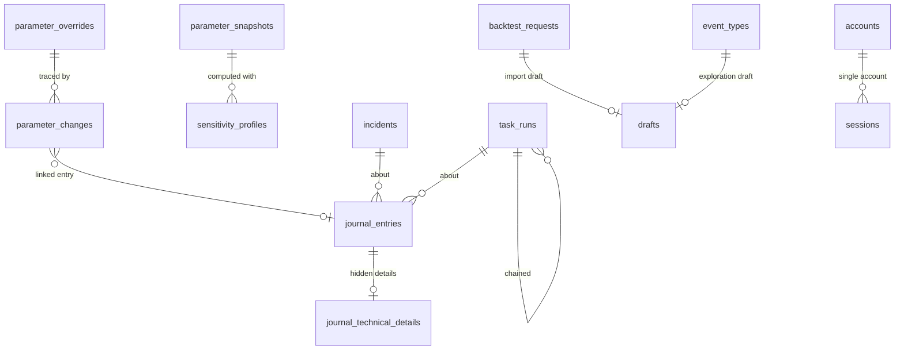

# Operations

The cross-cutting data of `docs/14-exigences-transverses.md` and `docs/12-interface-et-acces.md`:
parameters and their overrides, the activity journal, incidents, quota usage, scheduled-task runs,
backups and exports, the single account and its sessions, drafts and interface state, and the
counters that number requests and imports. Conventions are in the [README](README.md).

## 1. Entities

### 1.1 Parameters: the registry in code, the overrides in the database

The parameter registry (TRV-34, TRV-38) is typed code: for each key of glossary section 9.3 (plus
the three statistics-update settings of CL-TRV-23 and the coverage-threshold bounds of CL-TAX-14)
its name, purpose, unit, default value, allowed values (CL-TRV-16), owning document and defining
requirement, origin (`journal_decision`, `journal_hypothesis`, `local_hypothesis`) and whether it
affects calculations (CL-TRV-17). The database stores only the owner's overrides; "Restore default"
deletes the override (TRV-35). The time zone and the research tool address are parameters
(IHM-14, IHM-44).

#### `parameter_overrides`

| column          | type        | null | default | constraint or reference                                                                                        | class | spec IDs                 |
| --------------- | ----------- | ---- | ------- | -------------------------------------------------------------------------------------------------------------- | ----- | ------------------------ |
| `parameter_key` | text        | no   | —       | primary key; `CHECK` lists every registry key (generated from the registry)                                    | —     | TRV-34, TRV-38           |
| `value`         | jsonb       | no   | —       | the value, validated against the registry's schema and bounds for the key before saving                       | —     | TRV-34, TRV-35, CL-TRV-16 |
| `changed_at`    | timestamptz | no   | `now()` | —                                                                                                              | —     | TRV-34                   |
| `row_version`   | integer     | no   | `1`     | incremented by every save                                                                                      | —     | CL-IHM-18                |

`value` is a jsonb because values differ in type (integers, decimals, booleans, times of day, lists
of times, quiet-hours ranges, quota-limit lists, domain lists) and are always read whole; it is
replaced whole at each change.

#### `parameter_changes` — the dated changes, old and new values

Every change, kept beyond the journal's retention so that the date of the last change that affects
calculations and its old and new values stay available (TRV-35, SEN-37, IHM-51, CL-IHM-12).

| column                 | type        | null | default  | constraint or reference                                         | class | spec IDs                     |
| ---------------------- | ----------- | ---- | -------- | --------------------------------------------------------------- | ----- | ---------------------------- |
| `id`                   | integer     | no   | identity | primary key                                                     | —     | —                            |
| `parameter_key`        | text        | no   | —        | a registry key                                                  | —     | TRV-35                       |
| `changed_at`           | timestamptz | no   | `now()`  | —                                                               | —     | TRV-35, SEN-37               |
| `old_value`            | jsonb       | no   | —        | the value in force before, default included                     | —     | TRV-35                       |
| `new_value`            | jsonb       | no   | —        | the value in force after                                        | —     | TRV-35                       |
| `affects_calculations` | boolean     | no   | —        | copied from the registry                                        | —     | TRV-35, CL-TRV-17            |
| `journal_entry_id`     | integer     | yes  | —        | `REFERENCES journal_entries(id) ON DELETE SET NULL`             | —     | CL-IHM-12                    |

Index: `parameter_changes_calculation_idx (changed_at) WHERE affects_calculations` serves "last
parameter change" on profiles and the validation table (SEN-37, SUI-25, IHM-51).

#### `parameter_snapshots` — the values a result was computed with

| column        | type        | null | default  | constraint or reference                                                            | class | spec IDs       |
| ------------- | ----------- | ---- | -------- | ---------------------------------------------------------------------------------- | ----- | -------------- |
| `id`          | integer     | no   | identity | primary key                                                                        | —     | —              |
| `captured_at` | timestamptz | no   | `now()`  | —                                                                                  | —     | SEN-36         |
| `values`      | jsonb       | no   | —        | immutable: every parameter that affects calculations, key to value, defaults included | —   | SEN-36, TRV-35 |
| `values_hash` | text        | no   | —        | technical: unique; the SHA-256 of the canonical `values`, so one set is stored once | —    | —              |

Referenced by profiles, trends and recalculation jobs
([sensitivity-and-profiles.md](sensitivity-and-profiles.md)); never deleted while referenced.

```ts
type ParameterKey = Brand<string, 'ParameterKey'>; // camelCase keys of glossary section 9.3
type ParameterOrigin = 'journal_decision' | 'journal_hypothesis' | 'local_hypothesis'; // registry, in code
```

### 1.2 `journal_entries` — `JournalEntry`

The activity journal: every pass, recalculation, service failure, incident, data-changing action,
parameter change, refused login, lockout and, in Lot 2, Telegram message (TRV-41). An entry holds a
fixed message key and references by identifier; the text is built when it is displayed or exported,
so that an erased item's references disappear at once (CL-TRV-10).

| column                | type        | null | default  | constraint or reference                                                                                                                                         | class | spec IDs               |
| --------------------- | ----------- | ---- | -------- | --------------------------------------------------------------------------------------------------------------------------------------------------------------- | ----- | ---------------------- |
| `id`                  | integer     | no   | identity | primary key                                                                                                                                                     | —     | —                      |
| `occurred_at`         | timestamptz | no   | `now()`  | —                                                                                                                                                               | —     | TRV-41                 |
| `category`            | text        | no   | —        | `CHECK (category IN ('task_pass','profile_recalculation','service_failure','incident','user_action','import_refused','parameter_change','login_refused','login_lockout','telegram_message'))` | —     | TRV-41, TEL-34         |
| `level`               | text        | no   | —        | `CHECK (level IN ('info','warning','incident'))`                                                                                                                | —     | TRV-43                 |
| `message_key`         | text        | no   | —        | the fixed message (TRV-42's four answers), for example `event_withdrawn`                                                                                        | —     | TRV-42, CL-TRV-10      |
| `message_params`      | jsonb       | no   | `'{}'`   | counts, durations, service roles, task keys, a request reference; never a player, type, date, description, title, link or birthday value                       | —     | CL-TRV-10, DSN-11, CL-DSN-21 |
| `player_id`           | uuid        | yes  | —        | `REFERENCES followed_players(id) ON DELETE SET NULL`                                                                                                            | PI    | TRV-41, CL-TRV-10      |
| `event_id`            | integer     | yes  | —        | `REFERENCES events(id) ON DELETE SET NULL`                                                                                                                      | EV    | TRV-41, CL-TRV-10      |
| `event_type_id`       | text        | yes  | —        | `REFERENCES event_types(id) ON DELETE RESTRICT`                                                                                                                 | —     | TRV-41                 |
| `backtest_request_id` | integer     | yes  | —        | `REFERENCES backtest_requests(id) ON DELETE SET NULL`                                                                                                           | PI    | TRV-41                 |
| `import_id`           | integer     | yes  | —        | `REFERENCES imports(id) ON DELETE SET NULL`                                                                                                                     | PI    | TRV-41                 |
| `case_id`             | integer     | yes  | —        | `REFERENCES cases(id) ON DELETE SET NULL`                                                                                                                       | EV    | TRV-41                 |
| `incident_id`         | integer     | yes  | —        | `REFERENCES incidents(id) ON DELETE SET NULL`                                                                                                                   | —     | TRV-45, TRV-48         |
| `task_run_id`         | integer     | yes  | —        | `REFERENCES task_runs(id) ON DELETE SET NULL`                                                                                                                   | —     | TRV-26                 |

A reference the message key expects but finds null reads "an item that no longer exists" or "a
deleted player" (CL-TRV-10). Lot 2 modules add their own reference columns the same way (alert
sheet, press source, notification message). An entry never names an event otherwise; a withdrawal
is written as `event_withdrawn` with no reference (CL-TRV-10).

Indexes: `journal_entries_occurred_idx (occurred_at)` — the journal screen and the export of a
period (TRV-41, TRV-49); `journal_entries_category_idx (category, occurred_at)` — its filters;
`journal_entries_incident_idx (incident_id)` — retention of entries tied to an open incident
(TRV-48); `journal_entries_event_idx (event_id)` and `journal_entries_player_idx (player_id)` — the
erasure step's scrubbing.

Retention: deleted by the daily purge after `journalRetentionDays`, except while tied to an open
incident (TRV-48). Apart from that and the scrubbing, entries never change (CL-TRV-10).

#### `journal_technical_details`

Technical details stored apart and hidden by default (TRV-44), limited to the CL-DSN-11 allowlist:
service, operation, instant, duration, HTTP status or error code, an error object's code and message
(at most 300 characters, never from a successful response), request identifiers, sizes and counts,
and a structured response's validation outcome.

| column             | type    | null | default  | constraint or reference                                           | class | spec IDs              |
| ------------------ | ------- | ---- | -------- | ----------------------------------------------------------------- | ----- | --------------------- |
| `journal_entry_id` | integer | no   | —        | primary key; `REFERENCES journal_entries(id) ON DELETE CASCADE`   | —     | TRV-44                |
| `details`          | jsonb   | no   | —        | immutable; only the allowlisted keys                              | —     | TRV-44, DSN-11, CL-DSN-11 |

### 1.3 `incidents` — `Incident`

A function that no longer does its job, opened once per cause and closed when the cause disappears
(TRV-45); the kinds and their opening and closing rules are glossary section 9.2.

| column         | type        | null | default  | constraint or reference                                                                                                                                                                                       | class | spec IDs                     |
| -------------- | ----------- | ---- | -------- | ------------------------------------------------------------------------------------------------------------------------------------------------------------------------------------------------------------- | ----- | ---------------------------- |
| `id`           | integer     | no   | identity | primary key                                                                                                                                                                                                   | —     | —                            |
| `kind`         | text        | no   | —        | `CHECK (kind IN ('press_source_down','collection_impossible','press_source_silent','feed_too_short','quota_reached','quota_warning','database_volume_warning','stats_source_unavailable','task_not_run','backup_failed','logins_refused','telegram_link_broken','export_reminder'))` | —     | TRV-45, glossary 9.2         |
| `cause_key`    | text        | no   | `''`     | what makes two incidents of a kind different causes: the quota limit's key, the task key, the press source id, the backup failure cause                                                                     | —     | TRV-45, CL-TRV-04, CL-TRV-08 |
| `service_role` | text        | yes  | —        | `CHECK (service_role IN ('hosting','database','stats_source','language_model','news_feeds','notifications','trigger_service','backup_storage'))`; the "{service function}" of quota incidents             | —     | TRV-05, TRV-09               |
| `status`       | text        | no   | `'open'` | `CHECK (status IN ('open','closed'))`                                                                                                                                                                         | —     | TRV-45                       |
| `opened_at`    | timestamptz | no   | `now()`  | —                                                                                                                                                                                                             | —     | TRV-45                       |
| `closed_at`    | timestamptz | yes  | —        | —                                                                                                                                                                                                             | —     | TRV-45                       |
| `close_cause`  | text        | yes  | —        | `CHECK (close_cause IN ('cause_resolved','closed_by_owner'))`                                                                                                                                                | —     | TRV-45, CL-TRV-11            |
| `hidden_at`    | timestamptz | yes  | —        | hidden from Home and the to-do list by the owner; still open, journaled and counted among the hidden incidents                                                                                               | —     | IHM-20, CL-IHM-20            |
| `details`      | jsonb       | no   | `'{}'`   | counts only (pending requests, waiting articles), never a player or an event                                                                                                                                  | —     | STA-37, DET-11               |

Row check: `(status = 'closed') = (closed_at IS NOT NULL AND close_cause IS NOT NULL)`.

Unique: `incidents_open_cause_key (kind, cause_key) WHERE status = 'open'` — one open incident per
cause (TRV-45).

Indexes: `incidents_status_idx (status, opened_at)` — Home, the to-do list, the status screen; the
counted days of STA-35 read the periods of `stats_source_unavailable` and `quota_reached`
(CL-STA-11).

```ts
type IncidentKind = 'press_source_down' | 'collection_impossible' | 'press_source_silent' | 'feed_too_short' | 'quota_reached' | 'quota_warning' | 'database_volume_warning' | 'stats_source_unavailable' | 'task_not_run' | 'backup_failed' | 'logins_refused' | 'telegram_link_broken' | 'export_reminder';
// the level (incident, warning, reminder) is fixed per kind (glossary 9.2), never stored
```

### 1.4 `quota_usage` — `QuotaUsage`

The application's own count of its usage, per quota limit and period instance (TRV-03, TRV-04,
CL-TRV-12). The limits themselves are the `quotaLimits` parameter: per service, its unit, its
period (minute, day, month, or a rolling window) and, for a fixed period, its reset instant and
zone.

| column             | type        | null | default  | constraint or reference                                                                                       | class | spec IDs                   |
| ------------------ | ----------- | ---- | -------- | ------------------------------------------------------------------------------------------------------------- | ----- | -------------------------- |
| `id`               | integer     | no   | identity | primary key                                                                                                   | —     | —                          |
| `limit_key`        | text        | no   | —        | the limit's key in `quotaLimits`, for example `stats_source:downloads:day`                                    | —     | TRV-03, CL-TRV-12          |
| `period_start_at`  | timestamptz | no   | —        | start of the fixed period instance; for a rolling window, the start of a one-minute bucket                    | —     | TRV-04, CL-TRV-12          |
| `used`             | bigint      | no   | `0`      | calls, requests, tokens, bytes or files, per the limit's unit                                                 | —     | TRV-04                     |
| `warning_given_at` | timestamptz | yes  | —        | the 80 % warning, once per limit and period instance                                                          | —     | TRV-05, CL-TRV-12          |
| `reached_at`       | timestamptz | yes  | —        | the limit is reached for the period, or a refusal for quota came first                                        | —     | TRV-05, TRV-06             |

Unique: `quota_usage_key (limit_key, period_start_at)`.

### 1.5 `task_runs` — `TaskRun`

One execution of a scheduled task, or a due occurrence that was postponed or missed (TRV-26 to
TRV-33, CL-TRV-07, CL-TRV-08). Task definitions — key, name, owner, schedule parameter or parent —
are code (glossary section 9.1); a pass is a run plus the runs chained to it (TRV-26).

| column                | type        | null | default  | constraint or reference                                                                                                                     | class | spec IDs                    |
| --------------------- | ----------- | ---- | -------- | ------------------------------------------------------------------------------------------------------------------------------------------- | ----- | --------------------------- |
| `id`                  | integer     | no   | identity | primary key                                                                                                                                 | —     | —                           |
| `task_key`            | text        | no   | —        | `CHECK (task_key IN ('news_collection','event_detection','classification_queue_resumption','stats_update','game_tracking','stats_fetch_resumption','notification_sending','data_purge','backup','run_check'))` | —     | TRV-25, glossary 9.1        |
| `trigger`             | text        | no   | —        | `CHECK (trigger IN ('scheduled','on_demand'))`                                                                                              | —     | TRV-33                      |
| `status`              | text        | no   | —        | `CHECK (status IN ('postponed','running','succeeded','failed','interrupted','missed','source_late'))`                                       | —     | TRV-26 to TRV-31, CL-TRV-23 |
| `due_at`              | timestamptz | yes  | —        | the occurrence's due time; null for an on-demand run                                                                                        | —     | TRV-31, CL-TRV-08           |
| `started_at`          | timestamptz | yes  | —        | null while postponed and for a missed occurrence                                                                                            | —     | TRV-26                      |
| `progress_at`         | timestamptz | yes  | —        | the progress mark written at the end of each portion                                                                                        | —     | TRV-30, CL-TRV-07           |
| `finished_at`         | timestamptz | yes  | —        | —                                                                                                                                           | —     | TRV-26                      |
| `parent_run_id`       | integer     | yes  | —        | `REFERENCES task_runs(id) ON DELETE SET NULL`; the run this one is chained to                                                               | —     | TRV-26                      |
| `pass_id`             | integer     | yes  | —        | the id of the pass's first run (its own id for that run); groups Lot 2 messages (TEL-19)                                                    | —     | TRV-26, TEL-19              |
| `competition_day_on`  | date        | yes  | —        | `stats_update`: the competition day D it handles (US date)                                                                                   | —     | STA-32, CL-STA-10           |
| `cursor`              | text        | yes  | —        | technical: where an interrupted run resumes                                                                                                 | —     | TRV-30                      |
| `summary`             | jsonb       | no   | `'{}'`   | counts shown on the status screen; never content                                                                                            | —     | TRV-26, TRV-46              |

Unique: `task_runs_one_running_key (task_key) WHERE status = 'running'` — no overlap (TRV-28).

Indexes: `task_runs_task_started_idx (task_key, started_at)` — last run, last result and next run
on the status screen (TRV-26, TRV-46); `task_runs_task_due_idx (task_key, due_at)` — the missed-run
check (CL-TRV-08); `task_runs_day_idx (competition_day_on) WHERE task_key = 'stats_update'` — "once
per D" and the late-days count of CL-TRV-23.

```ts
type TaskKey = 'news_collection' | 'event_detection' | 'classification_queue_resumption' | 'stats_update' | 'game_tracking' | 'stats_fetch_resumption' | 'notification_sending' | 'data_purge' | 'backup' | 'run_check';
type TaskRunStatus = 'postponed' | 'running' | 'succeeded' | 'failed' | 'interrupted' | 'missed' | 'source_late';
```

### 1.6 `backups` — `Backup`, the backup register

Each backup attempt, the stored object it produced and its deletion by rotation (TRV-50, ADR 0018,
CL-TRV-04). The register also tells the fingerprint purge whether a stored backup is older than a
fingerprint (CL-DSN-07).

| column               | type        | null | default  | constraint or reference                                                                                                         | class | spec IDs                  |
| -------------------- | ----------- | ---- | -------- | ------------------------------------------------------------------------------------------------------------------------------- | ----- | ------------------------- |
| `id`                 | integer     | no   | identity | primary key                                                                                                                     | —     | —                         |
| `kind`               | text        | no   | —        | `CHECK (kind IN ('weekly','manual','before_update'))`                                                                           | —     | TRV-50, TRV-55, CL-TRV-04 |
| `status`             | text        | no   | —        | `CHECK (status IN ('done','failed'))`                                                                                           | —     | TRV-50                    |
| `started_at`         | timestamptz | no   | `now()`  | the backup's creation instant                                                                                                   | —     | TRV-50                    |
| `finished_at`        | timestamptz | yes  | —        | —                                                                                                                               | —     | TRV-50                    |
| `object_name`        | text        | yes  | —        | the stored object's name, holding only its creation instant in UTC and its kind                                                 | —     | CL-TRV-04                 |
| `size_bytes`         | bigint      | yes  | —        | —                                                                                                                               | —     | TRV-46                    |
| `failure_cause`      | text        | yes  | —        | `CHECK (failure_cause IN ('missing_key','missing_token','storage_unreachable','storage_not_private','upload_failed','verification_failed'))` | —     | CL-TRV-04                 |
| `deleted_at`         | timestamptz | yes  | —        | rotation deleted it and checked that no listing or address returns it                                                           | —     | TRV-50, CL-TRV-04         |
| `deletion_failed_at` | timestamptz | yes  | —        | a rotation deletion failed or could not be verified: the register is in doubt                                                   | —     | CL-TRV-04, CL-DSN-07      |

Row checks: `(status = 'done') = (object_name IS NOT NULL)`; `(status = 'failed') = (failure_cause IS NOT NULL)`.

Index: `backups_stored_idx (started_at) WHERE status = 'done' AND deleted_at IS NULL` — the stored
backups for rotation (`backupsKept`), the status screen and the fingerprint purge.

### 1.7 `export_downloads` — the exports downloaded

| column          | type        | null | default  | constraint or reference                                                    | class | spec IDs                 |
| --------------- | ----------- | ---- | -------- | -------------------------------------------------------------------------- | ----- | ------------------------ |
| `id`            | integer     | no   | identity | primary key                                                                | —     | —                        |
| `kind`          | text        | no   | —        | `CHECK (kind IN ('full','players','events','cases','profiles'))`           | —     | TRV-52                   |
| `downloaded_at` | timestamptz | no   | `now()`  | only a full export resets the export reminder                              | —     | TRV-54, CL-TRV-22        |

### 1.8 `installation` — first start

One row (`id smallint PRIMARY KEY CHECK (id = 1)`) with `first_started_at timestamptz NOT NULL`:
go-live, from which the withdrawn-events counter counts (DSN-29) and the export reminder starts when
no full export was ever downloaded (CL-TRV-22). Written at the first start, with the seeding of the
nine types (TAX-15).

### 1.9 `accounts` — the single account

One row (H-10, TRV-57); never in a backup or an export (CL-TRV-05).

| column                         | type        | null | default | constraint or reference                                                             | class | spec IDs                 |
| ------------------------------ | ----------- | ---- | ------- | ----------------------------------------------------------------------------------- | ----- | ------------------------ |
| `id`                           | smallint    | no   | `1`     | primary key; `CHECK (id = 1)`                                                       | —     | H-10                     |
| `password_hash`                | text        | no   | —       | a slow, salted password hash; never readable                                        | SE    | TRV-60                   |
| `password_status`              | text        | no   | —       | `CHECK (password_status IN ('initial','chosen'))`                                   | —     | TRV-57, TRV-63, IHM-06   |
| `initial_password_fingerprint` | text        | no   | —       | non-readable fingerprint of the configured initial password, to detect a reset     | SE    | TRV-63                   |
| `password_changed_at`          | timestamptz | no   | `now()` | —                                                                                   | —     | TRV-60                   |
| `login_locked_until`           | timestamptz | yes  | —       | while in the future, no password is examined                                        | —     | TRV-61, IHM-07           |

### 1.10 `sessions` — `Session`

| column         | type        | null | default  | constraint or reference                                                           | class | spec IDs                    |
| -------------- | ----------- | ---- | -------- | --------------------------------------------------------------------------------- | ----- | --------------------------- |
| `id`           | integer     | no   | identity | primary key                                                                       | —     | —                           |
| `token_hash`   | bytea       | no   | —        | unique; the session token is never stored in clear                               | SE    | IHM-10, TRV-64              |
| `device`       | text        | no   | —        | a short description of the device                                                 | —     | IHM-06, H-IHM-06            |
| `opened_at`    | timestamptz | no   | `now()`  | —                                                                                 | —     | IHM-06                      |
| `last_used_at` | timestamptz | no   | `now()`  | —                                                                                 | —     | TRV-62                      |
| `expires_at`   | timestamptz | no   | —        | `last_used_at` plus `sessionIdleDays`                                             | —     | TRV-62                      |
| `ended_at`     | timestamptz | yes  | —        | —                                                                                 | —     | IHM-08                      |
| `end_reason`   | text        | yes  | —        | `CHECK (end_reason IN ('expired','logged_out','password_changed','reset'))`       | —     | IHM-08, TRV-60, TRV-62, TRV-63 |

Row check: `(ended_at IS NULL) = (end_reason IS NULL)`. Never in a backup or an export; a restore
closes every session (CL-TRV-05, CL-TRV-06).

### 1.11 `login_failures` — `LoginFailure`

`id integer` identity, `occurred_at timestamptz NOT NULL DEFAULT now()`; index on `occurred_at`.
Five within `loginObservationMinutes` lock the login for `lockoutMinutes` (TRV-61). Never backed
up; purged once outside the observation period.

### 1.12 `drafts` — `ImportDraft` and the exploration draft

The only server copy of a pasted text, so that another device can resume it; at most one import
draft per request and one exploration draft for the general screen or per targeted proposal
(IHM-42, DSN-32, CL-DSN-17, CL-IHM-10). The store is excluded from backups and exports by name; no
journal entry holds a draft's text.

| column                      | type        | null | default  | constraint or reference                                                                    | class | spec IDs                      |
| --------------------------- | ----------- | ---- | -------- | ------------------------------------------------------------------------------------------ | ----- | ----------------------------- |
| `id`                        | integer     | no   | identity | primary key                                                                                | —     | —                             |
| `kind`                      | text        | no   | —        | `CHECK (kind IN ('import','exploration'))`                                                 | —     | IHM-42, TAX-17, CL-DSN-17     |
| `backtest_request_id`       | integer     | yes  | —        | `REFERENCES backtest_requests(id) ON DELETE CASCADE`; required for an import draft         | PI    | IHM-42                        |
| `exploration_event_type_id` | text        | yes  | —        | `REFERENCES event_types(id) ON DELETE CASCADE`; the targeted proposal, null for the general screen | —     | TAX-16, CL-DSN-17             |
| `text`                      | text        | no   | —        | the pasted text, at most `maxPastedSize`                                                   | DR    | IHM-42, DSN-32, CL-IMP-27     |
| `updated_at`                | timestamptz | no   | `now()`  | the last change; "draft saved at …"; the expiry counts from it                             | —     | IHM-42, CL-IHM-11             |
| `origin_device`             | text        | no   | —        | —                                                                                          | —     | IHM-42                        |

Row checks: `(kind = 'import') = (backtest_request_id IS NOT NULL)`;
`exploration_event_type_id IS NULL OR kind = 'exploration'`.

Unique: `drafts_import_key (backtest_request_id) WHERE kind = 'import'`;
`drafts_exploration_key (exploration_event_type_id) NULLS NOT DISTINCT WHERE kind = 'exploration'`.

Lifetime: erased when its import or its proposals are saved, when discarded, `draftRetentionDays`
after its last change, when its request, proposal or player disappears, and at every restore
(CL-DSN-17).

```ts
type ImportDraftStatus = 'kept' | 'request_already_imported'; // derived from the request's status
```

### 1.13 `ui_state` — interface state kept by the application

One row (`id = 1`) for the interface settings that are not parameters (IHM-20, IHM-40, IHM-53):

| column                         | type        | null | default | constraint or reference                                                        | class | spec IDs              |
| ------------------------------ | ----------- | ---- | ------- | ------------------------------------------------------------------------------ | ----- | --------------------- |
| `id`                           | smallint    | no   | `1`     | primary key; `CHECK (id = 1)`                                                  | —     | —                     |
| `onboarding_guide_hidden`      | boolean     | no   | `false` | the getting-started guide is hidden; its steps check themselves from the data  | —     | IHM-53                |
| `in_progress_banner_hidden_at` | timestamptz | yes  | —       | "Later" on the banner; hidden on every device until the next prompt copy       | —     | IHM-40, CL-IHM-13     |
| `row_version`                  | integer     | no   | `1`     | —                                                                              | —     | CL-IHM-18             |

Hidden incidents are `incidents.hidden_at`. The device keeps the rest on its own and never sends
it: the last screen and scroll positions (IHM-41), the cached screens replaced whole at each
refresh and erased at logout (IHM-57, DSN-33, CL-DSN-18), the declined offer to adopt the device's
time zone (CL-IHM-05), and the device copy of a draft.

### 1.14 `sequence_counters` — gapless numbers

| column       | type    | null | default | constraint or reference                                                              | class | spec IDs              |
| ------------ | ------- | ---- | ------- | ------------------------------------------------------------------------------------ | ----- | --------------------- |
| `name`       | text    | no   | —       | primary key; `import_sequence`, or `request_reference_` followed by the four-digit year | —     | IMP-31, CL-BKT-11     |
| `last_value` | integer | no   | `0`     | `CHECK (last_value >= 0)`; incremented in the transaction that uses the number       | —     | IMP-31, CL-BKT-11     |

The counters survive the deletion of the rows they numbered, so no reference or import number is
issued twice (BKT-12, CL-BKT-11).

## 2. Lifecycles

### 2.1 Incident (TRV-45, CL-TRV-11, CL-IHM-20)

| from   | to     | trigger                                             | guard                               | side effects                                                                                  |
| ------ | ------ | --------------------------------------------------- | ----------------------------------- | --------------------------------------------------------------------------------------------- |
| (none) | open   | the cause appears (glossary 9.2)                    | no open incident of the same cause  | journal entry `incident`; Lot 2 message (TEL-15)                                             |
| open   | open   | the owner hides it                                  | —                                   | `hidden_at` set; still open, counted as hidden                                                |
| open   | closed | the cause disappears                                | —                                   | `close_cause = 'cause_resolved'`; journal entry; Lot 2 end message (TEL-15)                    |
| open   | closed | the owner closes it, where the screen offers it     | see section 6                       | `close_cause = 'closed_by_owner'`; a later observation of the cause opens a new incident      |

### 2.2 Task run (TRV-26 to TRV-33, CL-TRV-07, CL-TRV-08, CL-TRV-23)

| from      | to          | trigger                                           | guard                                       | side effects                                                                                 |
| --------- | ----------- | ------------------------------------------------- | ------------------------------------------- | -------------------------------------------------------------------------------------------- |
| (none)    | running     | an occurrence is due at a wake-up, or on demand   | no run of the task running (unique index)   | `started_at`; the next scheduled occurrence is kept for an on-demand run (TRV-33)             |
| (none)    | postponed   | an occurrence is due while the previous run runs  | —                                           | one journal entry per postponed occurrence (CL-TRV-07)                                       |
| postponed | running     | the previous run ends                             | —                                           | —                                                                                            |
| running   | running     | a portion ends                                    | —                                           | `progress_at` and `cursor` written                                                           |
| running   | succeeded   | the work ends                                     | —                                           | chained tasks become due (CL-TRV-08); journal entry `task_pass`                              |
| running   | failed      | an error ends the run                             | —                                           | journal entry                                                                                |
| running   | source_late | `stats_update` reaches the cut-off without a refresh | —                                       | warning entry; after `statsLateDaysBeforeIncident` days, `stats_source_unavailable` (CL-TRV-23) |
| running   | interrupted | found stale at a wake-up (twice the host's maximum invocation time) | —                         | warning entry; the lock released; the next portion resumes from `cursor`                     |
| (none)    | missed      | no run started at or after the due time succeeded by due time plus `missedRunMarginHours` | — | journal entry per missed occurrence; one `task_not_run` incident per task; one catch-up run  |

### 2.3 Backup (TRV-50, TRV-55, CL-TRV-04, CL-TRV-19)

| from    | to      | trigger                                             | guard                                                      | side effects                                                                                              |
| ------- | ------- | --------------------------------------------------- | ---------------------------------------------------------- | --------------------------------------------------------------------------------------------------------- |
| (none)  | done    | weekly time, manual run, or before a structure change | key and token configured; the space private               | object stored and verified; rotation deletes every stored backup beyond `backupsKept`, most recent kept |
| (none)  | failed  | any check or the upload fails                       | —                                                          | `backup_failed` incident for that cause; before an update, no structure change is applied (CL-TRV-19)    |
| done    | deleted | rotation                                            | the deletion verified                                      | `deleted_at`                                                                                              |
| done    | done    | rotation fails or is unverified                     | —                                                          | `deletion_failed_at`; `backup_failed` incident; the fingerprint purge waits (CL-DSN-07)                   |

### 2.4 Account, login and sessions (TRV-57 to TRV-63, IHM-06 to IHM-09)

| state set       | transitions                                                                                                                                                                              |
| --------------- | ---------------------------------------------------------------------------------------------------------------------------------------------------------------------------------------- |
| password status | `initial` at the first start, from the configured initial password; `initial → chosen` on "Choose your password" (only screen open meanwhile); `chosen → initial` when the configured fingerprint differs from the stored one at start (a reset): every session ends with `reset`, the lockout lifts |
| login lockout   | `login_failures` within the observation period reach the limit → `login_locked_until` set, `logins_refused` incident opened; it closes at the next successful login                     |
| session         | open → ended with `expired` (idle beyond `sessionIdleDays`), `logged_out` (this device or all), `password_changed` (every other session), `reset`                                       |

### 2.5 Restore (TRV-53, CL-TRV-05, CL-TRV-06)

1. The documented command asks for the backup key, decrypts and verifies the file.
2. When the target is a new database and the previous one is reachable, it first copies the
   withdrawal ledger from it.
3. It replaces the application data (every table the backup holds), keeping the target's ledger and
   account data; with no account, it initializes one from the configured initial password.
4. It re-applies the ledger without changing the counter or creating a fingerprint: a restored
   player matching a deleted-player entry is deleted again (JOU-24 scope); for each live
   fingerprint, exactly one restored event of that player and type on its day is withdrawn again
   (DSN-27 scope, no new Telegram deletion); several on that day, or none but some within the
   window, are listed for the owner to check.
5. The counter keeps the larger of the ledger's value and the backup's.
6. Every draft is erased, every session closed; a full recalculation and the consistency check run;
   the summary shows the counts, the backup's date, the numbers re-applied, the events to check and
   the warnings of CL-TRV-06.

## 3. Invariants

| rule                                                                                                  | spec IDs                     | enforced by                                                      |
| ----------------------------------------------------------------------------------------------------- | ---------------------------- | ---------------------------------------------------------------- |
| A parameter value outside its allowed values is refused with the bounds                               | TRV-35, CL-TRV-16            | parameter service, against the registry                          |
| Every parameter change is traced with old and new values and the instant                              | TRV-35                       | `parameter_changes` and a journal entry, in one transaction      |
| Secrets — deployment values, password, tokens, keys — are never displayed, journaled or exported      | TRV-64                       | hashes only (`accounts`, `sessions`); journal allowlist          |
| One open incident per cause                                                                            | TRV-45                       | partial unique index                                             |
| No run of a task overlaps another                                                                      | TRV-28                       | partial unique index                                             |
| Each run is idempotent and resumable                                                                   | TRV-29, TRV-30               | task services; `cursor` and progress marks                       |
| A journal entry never copies an event's player, type, date, description or source                      | TRV-41, DSN-11, CL-TRV-10    | journal writer: message keys and references only                 |
| Rotation really deletes; a backup stays listed until its deletion is verified                         | TRV-50, CL-TRV-04            | backup service                                                   |
| Backups and full exports never hold drafts, ledger entries, account password data or sessions         | TRV-51, CL-TRV-05, CL-DSN-08 | the writers skip those tables by name                            |
| A structure change never runs without a stored backup first                                            | TRV-55, CL-TRV-19            | update procedure                                                 |
| Every owner-editable row carries a version, and a save sent with an older version is refused          | CL-IHM-18                    | `row_version` compare-and-set in every save                      |
| References and import numbers are never issued twice                                                   | BKT-12, IMP-31, CL-BKT-11    | `sequence_counters`, incremented in the using transaction        |

## 4. Stored or derived

| item                                                         | stored or derived | when                                                                                  | spec IDs                 |
| ------------------------------------------------------------ | ----------------- | ------------------------------------------------------------------------------------- | ------------------------ |
| Parameter values in force                                    | derived           | the override, else the registry default                                               | TRV-34                   |
| Date of the last change that affects calculations            | derived           | latest of `parameter_changes` (flagged) and criterion-switch changes                  | TRV-35, CL-TRV-17        |
| Service status (normal, degraded, unavailable)               | derived           | from open incidents, quota usage and the last runs                                    | TRV-46                   |
| Quota status (normal, warning, reached) and next reset       | derived           | from `quota_usage` and `quotaLimits`                                                  | TRV-04, TRV-46, CL-TRV-12 |
| Database volume and its warning                              | derived           | from the database's size against the free capacity; the warning is an incident       | TRV-07                   |
| Next scheduled run of each task                              | derived           | from the parameters and the runs                                                      | TRV-26, TRV-46           |
| Export reminder                                              | derived           | last full export, or `first_started_at`, against `exportReminderDays`; an incident    | TRV-54, CL-TRV-22        |
| "Request in progress" banner                                 | derived           | the request copied most recently, against `in_progress_banner_hidden_at`              | IHM-40, CL-IHM-13        |
| To-do list                                                   | derived           | on read, from the owning tables (IHM-20)                                              | IHM-20                   |
| Installation check results                                   | derived           | on request; journaled                                                                 | TRV-47                   |

## 5. Exchange formats

### 5.1 Full export, format `egoscope-export` 1.0

One UTF-8 JSON document, readable without the application (TRV-52, TRV-53):

```json
{
  "format": "egoscope-export",
  "format_version": "1.0",
  "exported_at": "2026-11-11T04:10:00.000Z",
  "withdrawn_event_count": 2,
  "tables": {
    "teams": [{ "id": 1, "abbreviation": "AAA", "name": "Team X" }],
    "followed_players": [{ "id": "6f1c…", "display_name": "Player A", "status": "active" }]
  }
}
```

| key                     | type    | rule                                                                                                                                                                                    |
| ----------------------- | ------- | --------------------------------------------------------------------------------------------------------------------------------------------------------------------------------------- |
| `format`                | string  | `egoscope-export`                                                                                                                                                                       |
| `format_version`        | string  | `1.0`; a new column, table or value changes the version                                                                                                                                 |
| `exported_at`           | string  | ISO 8601 instant in UTC with milliseconds                                                                                                                                               |
| `withdrawn_event_count` | integer | the counter's value (CL-DSN-08)                                                                                                                                                         |
| `tables`                | object  | one key per table, every table the backup holds (sensitive-data section 3), in foreign-key order so that a restore inserts them in sequence; each value an array of rows               |
| row                     | object  | one key per column, named as in this model; instants as ISO 8601 UTC strings; dates `YYYY-MM-DD`; jsonb columns embedded as JSON; arrays as JSON arrays; numbers with a plain decimal point; `null` for a null column |

Excluded tables: `accounts`, `sessions`, `login_failures`, `drafts`, `withdrawal_fingerprints`,
`deleted_player_entries`, `article_skip_entries`, and the counter row itself (its value is the
root key) (CL-TRV-05, CL-DSN-08).

### 5.2 Backup file

The full export document of 5.1 with one more root key, `"backup_kind": "weekly" | "manual" |
"before_update"`, compressed with gzip, then encrypted with AES-256-GCM under the backup key of the
deployment configuration (ADR 0018, CL-TRV-04). Layout: the 16 ASCII bytes `EGOSCOPE-BACKUP1`, a
12-byte random nonce, the ciphertext, the 16-byte authentication tag. Object name
`egoscope-backup-<YYYYMMDDTHHMMSSZ>-<kind>.bin`: only the creation instant in UTC and the kind. The
file never holds the key or the token.

### 5.3 Spreadsheet exports (TRV-52, CA-TRV-17)

CSV files in UTF-8 with a header row, comma separators and RFC 4180 quoting; numbers with a plain
decimal point, no thousands separator and the ASCII minus; instants as ISO 8601 UTC; dates
`YYYY-MM-DD`; enumerated values as their code (CL-IHM-03).

| file           | one row per | columns                                                                                                                                                                                                                                                                                 |
| -------------- | ----------- | --------------------------------------------------------------------------------------------------------------------------------------------------------------------------------------------------------------------------------------------------------------------------------------- |
| `players.csv`  | player      | `player_id`, `display_name`, `current_team`, `status`, `birthday` (`MM-DD`, empty when none), `backtest_status`, `valid_case_count`, `added_at`                                                                                                                                       |
| `events.csv`   | event       | `event_id`, `player_id`, `display_name`, `event_type_id`, `sheet_version_number`, `origin`, `status`, `reference_date`, `reference_at`, `reference_date_precision`, `description`, `injury_return`, `game_stakes`, `research_confidence`, `detection_confidence`, `precedence`, `source_urls` (space-separated), `case_id` |
| `cases.csv`    | case        | `case_id`, `player_id`, `display_name`, `event_type_id`, `origin`, `status`, `status_reason`, `event_ids` (space-separated), `reference_instant_at`, `measured_game_day`, `opponent`, `measured_minutes`, `performance_index`, `baseline_season`, `baseline_phase`, `baseline_game_count`, `baseline_mean`, `baseline_standard_deviation`, `baseline_status`, `normalized_gap`, `gap_status`, `triggered_criteria` (space-separated) |
| `profiles.csv` | profile     | `player_id`, `display_name`, `event_type_id`, `view`, `valid_count`, `mean_gap`, `range_low`, `range_high`, `verdict_level`, `verdict_direction`, `is_fragile`, `profile_confidence`, `computed_at`                                                                                   |

### 5.4 Journal export for a helper (TRV-49)

A UTF-8 text file of the chosen period, one block per entry: the instant in the owner's zone with
the zone named, the level, the category, the rendered message, then the allowlisted technical
details, if any, indented. It holds nothing DSN-11 forbids.

## 6. Rulings applied

- ADR 0002, CL-TRV-07, CL-TRV-08: runs on an external trigger; stale runs; due occurrences.
- ADR 0018, CL-TRV-04, CL-TRV-19: the encrypted backup, its register, real deletion, the backup
  before a structure change.
- CL-TRV-05, CL-TRV-06: what backups hold, and the restore.
- CL-TRV-10: references by identifier; the scrubbing.
- CL-TRV-11 lets the owner close an incident; CL-IHM-20 allows only hiding. `close_cause` admits
  both, and the model does not decide which screen offers closing. Flagged for the orchestrator.
- CL-TRV-12: quota limits as a parameter with periods and resets; usage per period instance.
- CL-TRV-16, CL-TRV-17: bounds in the registry; the flag "affects calculations".
- CL-TRV-22: the export reminder from the first start.
- CL-TRV-23: the result `source_late` and three new parameters (names to add to the glossary:
  `statsUpdateCutoffTime`, `statsUpdateProbeIntervalMinutes`, `statsLateDaysBeforeIncident`).
- CL-DSN-17, CL-IHM-10, CL-IHM-11: the draft store.
- CL-IHM-13, CL-IHM-18: the banner state; `row_version` everywhere the owner edits.
- Own choice: parameters are typed code with database overrides, and `parameter_changes` keeps every
  change for good, because the journal's 90 days would lose the date SEN-37 shows.
- Own choice: the export format name `egoscope-export`, the backup layout, the backup kinds and
  failure causes, and the export kinds are new names.

## 7. Diagram


