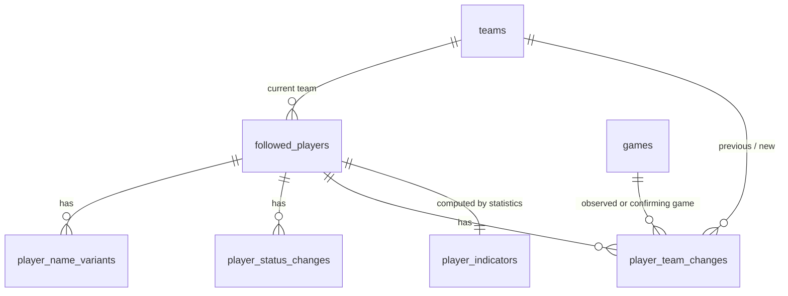

# Players

The followed players (`docs/01-joueurs-suivis.md`): identity, name variants, status and team
histories. The statistics-source mapping that gates every fetch, and its candidates, are
written by the statistics module and described with it
([games-and-statistics.md](games-and-statistics.md) sections 1.13, 1.14 and 2.5). The indicators shown on the
player page (games played, average minutes, last game played, consecutive games missed, first NBA
game) are computed by the statistics domain and stored in `player_indicators`
([games-and-statistics.md](games-and-statistics.md)). Former teams are never stored (CL-JOU-18).
Conventions, sensitive-data classes and the TypeScript brands are in the [README](README.md).

## 1. Entities

### 1.1 `followed_players` — `FollowedPlayer`

An NBA player the owner put on the follow list; every event concerns exactly one (JOU-08, VUE-04).
The app starts with no row (JOU-06, ADR 0020); seeds and fixtures never hold a real player.

| column                         | type        | null | default             | constraint or reference                                                                                                                       | class | spec IDs                            |
| ------------------------------ | ----------- | ---- | ------------------- | --------------------------------------------------------------------------------------------------------------------------------------------- | ----- | ----------------------------------- |
| `id`                           | uuid        | no   | `gen_random_uuid()` | primary key; a random UUID generated at addition, never derived from the name, never reused                                                   | PI    | JOU-08, CL-JOU-09, CA-JOU-17        |
| `display_name`                 | text        | no   | —                   | `CHECK (btrim(display_name) <> '')`                                                                                                           | PI    | JOU-08, JOU-12                      |
| `display_name_normalized`      | text        | no   | —                   | the display name normalized as CL-JOU-13 says (NFC, trim, inner spaces collapsed, case folded); written with it                               | PI    | CL-JOU-13, CL-JOU-04                |
| `current_team_id`              | integer     | yes  | —                   | `REFERENCES teams(id) ON DELETE RESTRICT`; required at addition (service); null means "without team"                                          | PI    | JOU-08, JOU-13, STA-25, CL-JOU-20   |
| `status`                       | text        | no   | `'active'`          | `CHECK (status IN ('active','paused','withdrawn'))`                                                                                           | PI    | JOU-15, JOU-16 to JOU-19            |
| `birthday_month`               | smallint    | yes  | —                   | `CHECK (birthday_month BETWEEN 1 AND 12)`                                                                                                     | BD    | JOU-08, JOU-11, CL-JOU-16, ADR 0015 |
| `birthday_day`                 | smallint    | yes  | —                   | `CHECK (birthday_day BETWEEN 1 AND (ARRAY[31,29,31,30,31,30,31,31,30,31,30,31])[birthday_month])`; 29 February allowed                        | BD    | CL-JOU-16, CL-JOU-17                |
| `birthday_origin`              | text        | yes  | —                   | `CHECK (birthday_origin IN ('stats_source','owner'))`                                                                                         | BD    | CL-JOU-16, CL-JOU-11                |
| `added_at`                     | timestamptz | no   | `now()`             | —                                                                                                                                             | PI    | 01 « Données manipulées »           |
| `pause_suggestion_declined_at` | timestamptz | yes  | —                   | set when the owner declines the pause suggestion; void once a later game is played (section 2.2)                                              | PI    | JOU-22, IHM-20                      |
| `last_calendar_derivation_at`  | timestamptz | yes  | —                   | technical: the instant of his previous regular derivation run, so the next run derives the games started since, a reactivation's gap included | —     | CL-TAX-19                           |
| `row_version`                  | integer     | no   | `1`                 | incremented by every save; a save that sends an older value is refused                                                                        | —     | CL-IHM-18                           |

Row checks: `(birthday_month IS NULL) = (birthday_day IS NULL)` and
`(birthday_month IS NULL) = (birthday_origin IS NULL)`. No column can hold a year of birth
(JOU-11, CL-DSN-21).

Indexes: `followed_players_display_name_normalized_idx (display_name_normalized)` serves the
shared-name warning at addition (CL-JOU-04, JOU-09). The list filter by status (JOU-28) scans at
most a few dozen rows and needs no index.

Deletion: only by the player-data deletion of JOU-24, which first erases every event of the player
with the scope of a withdrawal and then deletes the row; the order and the full scope are in
[sensitive-data.md](sensitive-data.md) section 2.2. `events.player_id` is `ON DELETE RESTRICT`, so a
plain delete fails while events remain. Every other player-owned table cascades: variants, status
and team histories, mappings and candidates, `player_indicators`, box scores, backtest requests
with their types, imports and coverage, profiles with their verdict history, tally exits.

```ts
type PlayerId = Brand<string, 'PlayerId'>; // a UUID, carried as player.id in the research prompt and result
type Birthday = { month: number; day: number }; // glossary: birthday ({ month, day }), never a year
interface FollowedPlayer {
  id: PlayerId;
  status: PlayerStatus;
  currentTeamId: TeamId | null;
  birthday: Birthday | null;
  birthdayOrigin: 'stats_source' | 'owner' | null;
}
```

### 1.2 `player_name_variants` — name variants

Spelling variants and nicknames searched by detection, each with its ambiguous mark (JOU-08,
JOU-09). The display name is the first name variant but lives on `followed_players`.

| column            | type    | null | default  | constraint or reference                                   | class | spec IDs       |
| ----------------- | ------- | ---- | -------- | --------------------------------------------------------- | ----- | -------------- |
| `id`              | integer | no   | identity | primary key                                               | —     | —              |
| `player_id`       | uuid    | no   | —        | `REFERENCES followed_players(id) ON DELETE CASCADE`       | PI    | JOU-08         |
| `kind`            | text    | no   | —        | `CHECK (kind IN ('spelling','nickname'))`                 | PI    | JOU-08         |
| `text`            | text    | no   | —        | `CHECK (btrim(text) <> '')`; stored as typed              | PI    | JOU-08, JOU-09 |
| `normalized_text` | text    | no   | —        | normalized as CL-JOU-13 says; accents and diacritics kept | PI    | CL-JOU-13      |
| `is_ambiguous`    | boolean | no   | `false`  | —                                                         | PI    | JOU-09, DET-04 |

Unique: `player_name_variants_player_normalized_key (player_id, normalized_text)` — a variant
appears only once per player (JOU-09, CL-JOU-13).

Indexes: `player_name_variants_normalized_idx (normalized_text)` serves the "shared with
{player}" warning at entry (JOU-09) and the CL-JOU-04 comparison of a typed name with every
player's variants.

Deletion: by the owner, or with the player. Nothing references a variant.

```ts
type NameVariantKind = 'spelling' | 'nickname';
interface NameVariant {
  id: NameVariantId;
  playerId: PlayerId;
  kind: NameVariantKind;
  text: string;
  isAmbiguous: boolean;
}
```

### 1.3 `player_status_changes` — `PlayerStatusChange`

The dated status history, with its optional reason (JOU-15).

| column        | type        | null | default  | constraint or reference                                                                              | class | spec IDs         |
| ------------- | ----------- | ---- | -------- | ---------------------------------------------------------------------------------------------------- | ----- | ---------------- |
| `id`          | integer     | no   | identity | primary key                                                                                          | —     | —                |
| `player_id`   | uuid        | no   | —        | `REFERENCES followed_players(id) ON DELETE CASCADE`                                                  | PI    | JOU-15           |
| `changed_at`  | timestamptz | no   | `now()`  | —                                                                                                    | PI    | JOU-15           |
| `from_status` | text        | no   | —        | `CHECK (from_status IN ('active','paused','withdrawn'))`                                             | PI    | JOU-15           |
| `to_status`   | text        | no   | —        | `CHECK (to_status IN ('active','paused','withdrawn'))`                                               | PI    | JOU-15           |
| `reason`      | text        | yes  | —        | `CHECK (reason IN ('prolonged_absence','end_of_career','left_nba','insufficient_exposure','other'))` | PI    | JOU-15, H-JOU-06 |

Row check: `(from_status, to_status)` is one of the five allowed pairs of section 2.1. Every
change, a reactivation included, may carry one of the five optional reasons (JOU-15, CL-JOU-12).

Indexes: `player_status_changes_player_changed_idx (player_id, changed_at)` serves the history
on the player page (JOU-25).

```ts
type PlayerStatus = 'active' | 'paused' | 'withdrawn';
type PlayerStatusChangeReason =
  'prolonged_absence' | 'end_of_career' | 'left_nba' | 'insufficient_exposure' | 'other';
```

### 1.4 `player_team_changes` — `PlayerTeamChange`

The team history from the day the player is followed: the team chosen at addition, observed
changes, entered changes and their confirmation (JOU-13, CL-JOU-02, CL-JOU-03). Its rows also bound
team membership, for absence counts and the calendar derivation alike (CL-STA-05, CL-TAX-18). An
observed row ends the old membership and starts the new one at `changed_at`. An entered row ends,
at `changed_at`, the membership of the team he leaves and, unless it is a release, starts that of
`new_team_id`; the first official game he plays after it then judges it (CL-JOU-03): for the team he
left, when that team is not `new_team_id`, the row is void and the walk skips it, and the observed
row that game records, back to that team from the current team the entry had set (JOU-13,
CA-JOU-09), starts no new membership, since the walk finds him still in that team; for
`new_team_id`, it is verified, and no change back is recorded, also when `new_team_id` is the team
he left (the addition, below); for any other team,
the observed row that game records follows it, and the membership it started ends unconfirmed, the
games of `new_team_id` in between counting neither as played nor as missed. An observed row whose
new team is the team the walk already gives him at its `changed_at` changes no membership. An
observed row read from the player file between the entry and that game is applied first, and the
game is compared with its `new_team_id`. The addition writes an entered row dated `added_at`, with
`previous_team_id` null, for the team chosen: his team before the addition is known only from his
box scores, which may not be stored yet, so for that row "the team he leaves" is his membership at
`added_at` as his box scores give it — the team of his last game played before it, none if he has
played none — and the first game played after the addition is compared with that membership, never
with `previous_team_id`. When that membership is `new_team_id` itself — he is added with the team
his box scores already give, before the player file answers for him — nothing can be void: his
first game for that team verifies the row, and no change back is recorded, so no void entry ever
records a change from a team to itself, which the row check
`previous_team_id IS DISTINCT FROM new_team_id` would refuse; a first game for a third team ends
the row's membership unconfirmed, as above. While it is his latest row and no game played since has judged it, a read
of the source's current-season player file that gives the same team makes its `origin` `observed`,
a change the source reports, so that membership starts at the addition with no first-game test
(CL-STA-05); one that gives another team is applied first, as above, unless it gives the team of his last game played, which records no change (CL-STA-27). An entered row other than the
addition's, and the game that makes an entered row void or ends its membership unconfirmed, each
request a full calendar derivation for the player, with the cause `team_history_changed`, in the
transaction that records them: the edit screen's, or the unit transaction of
`games.processFetchQueue`, through the hook its caller passes (CL-TAX-19; events-and-cases.md 1.13;
module map §4). The addition's row requests none of its own: the confirmation of his mapping and the storing of
his history request his derivations (causes `mapping_changed` and `history_stored`, CL-TAX-19).

| column             | type        | null | default  | constraint or reference                                                                                                                                                                               | class | spec IDs                                |
| ------------------ | ----------- | ---- | -------- | ----------------------------------------------------------------------------------------------------------------------------------------------------------------------------------------------------- | ----- | --------------------------------------- |
| `id`               | integer     | no   | identity | primary key                                                                                                                                                                                           | —     | —                                       |
| `player_id`        | uuid        | no   | —        | `REFERENCES followed_players(id) ON DELETE CASCADE`                                                                                                                                                   | PI    | JOU-13                                  |
| `changed_at`       | timestamptz | no   | —        | observed from a game: that game's scheduled start; observed from the source's player file: the read instant; entered: the entry instant; the team chosen at addition: `added_at`, whatever its origin | PI    | JOU-13, CL-JOU-03, CL-STA-05, CL-STA-27 |
| `previous_team_id` | integer     | yes  | —        | `REFERENCES teams(id) ON DELETE RESTRICT`; the current team the change replaced, null when he had none, and on the row of the addition, whose team left is his membership at `added_at` (above)       | PI    | JOU-13, CL-STA-05                       |
| `new_team_id`      | integer     | yes  | —        | `REFERENCES teams(id) ON DELETE RESTRICT`; null for a release (without team)                                                                                                                          | PI    | JOU-13, STA-25, CL-JOU-20               |
| `origin`           | text        | no   | —        | `CHECK (origin IN ('observed','entered'))`                                                                                                                                                            | PI    | JOU-13                                  |
| `game_id`          | integer     | yes  | —        | `REFERENCES games(id) ON DELETE RESTRICT`; observed: the first game played with the new team, null when read from the player file; entered: the verifying game, null while unverified                 | PI    | JOU-13, CL-JOU-03                       |

Row check: `previous_team_id IS DISTINCT FROM new_team_id`.

Indexes: `player_team_changes_player_changed_idx (player_id, changed_at)` serves the history
display and the membership walk of CL-STA-05 (latest change before a game's start, void entered
rows skipped, the entered team's games of an unconfirmed row counting for no team).

```ts
type TeamChangeOrigin = 'observed' | 'entered';
// derived, TeamChangeVerification: an entered change is "verified" (by the game of <date>) when gameId is set, otherwise "unverified"
```

## 2. Lifecycles

### 2.1 Player status (JOU-15)

| from      | to        | trigger                | guard                                                                                          | side effects                                                                                                                                                                       |
| --------- | --------- | ---------------------- | ---------------------------------------------------------------------------------------------- | ---------------------------------------------------------------------------------------------------------------------------------------------------------------------------------- |
| (none)    | active    | owner adds the player  | active players below `players.maxActive` (JOU-04, JOU-05); display name and current team given | creates the mapping row for the source (to establish) and runs the candidate search (JOU-10); creates no backtest request (JOU-07)                                                 |
| active    | paused    | owner                  | —                                                                                              | status change row; Lot 2 detection, detection-born requests and alert sheets stop (JOU-18); to-do requests stay (JOU-17); statistics, profiles and derivation go on (CL-JOU-05)    |
| active    | withdrawn | owner                  | —                                                                                              | status change row; the to-do request becomes canceled with `player_withdrawn` (BKT-14); profiles shown archived (SEN-19); derivation stops creating or dropping events (CL-JOU-05) |
| paused    | active    | owner reactivates      | active players below `players.maxActive` (JOU-20)                                              | status change row with its optional reason (CL-JOU-12); no request (JOU-20); Lot 2 re-prefilters recent articles (JOU-09)                                                          |
| paused    | withdrawn | owner                  | —                                                                                              | as active → withdrawn                                                                                                                                                              |
| withdrawn | active    | owner reactivates      | active players below `players.maxActive` (JOU-20)                                              | as paused → active; profiles no longer archived; the next regular derivation run covers the games since his previous run (CL-TAX-19)                                               |
| withdrawn | (deleted) | owner deletes the data | status withdrawn, double confirmation (JOU-24)                                                 | the erasure of [sensitive-data.md](sensitive-data.md) section 2.2; the counter grows by his events (CA-JOU-16)                                                                     |

The application never changes a status by itself (JOU-22). `withdrawn → paused` does not exist.

### 2.2 Pause suggestion (JOU-22) — derived, `PauseSuggestionStatus`

| from      | to        | trigger                                            | guard                                                                                                            | side effects                                   |
| --------- | --------- | -------------------------------------------------- | ---------------------------------------------------------------------------------------------------------------- | ---------------------------------------------- |
| none      | suggested | statistics update ends                             | active; `consecutive_team_games_missed ≥ players.prolongedAbsenceGames`; not declined since his last game played | to-do item "Suggest pausing {player}" (IHM-20) |
| suggested | declined  | owner declines                                     | —                                                                                                                | `pause_suggestion_declined_at` set             |
| suggested | none      | the player plays again, or he is paused            | —                                                                                                                | to-do item gone                                |
| declined  | none      | a game played after `pause_suggestion_declined_at` | —                                                                                                                | the refusal no longer applies                  |

### 2.3 Entered team change (JOU-13, CL-JOU-03)

| from       | to                             | trigger                                                                                                                            | guard                                 | side effects                                                                                                                                                                                                                                 |
| ---------- | ------------------------------ | ---------------------------------------------------------------------------------------------------------------------------------- | ------------------------------------- | -------------------------------------------------------------------------------------------------------------------------------------------------------------------------------------------------------------------------------------------- |
| (none)     | unverified                     | owner enters a team change, or adds the player                                                                                     | —                                     | row with origin `entered`, `changed_at` = entry instant (at addition, `added_at`, previous team null); current team set; for a change, a full derivation requested (CL-TAX-19)                                                               |
| unverified | verified                       | first official game played after the entry, for that team, also when it is the team he left (§1.4)                                 | —                                     | `game_id` set; no change back recorded                                                                                                                                                                                                       |
| unverified | unverified (void)              | first official game played after the entry, for the team he left — for the addition's row, his membership at `added_at` (§1.4)     | the team he left is not `new_team_id` | an observed change back to that team is recorded, dated by that game, and the current team set to it (JOU-13, CA-JOU-09); the membership walk skips the void row, so that observed row starts no new membership; a full derivation requested |
| unverified | unverified (ended unconfirmed) | first official game played after the entry, for any other team                                                                     | —                                     | an observed change to that team is recorded, dated by that game; the entered team's games in between count for no team; a full derivation requested                                                                                          |
| unverified | (observed)                     | the row of the addition, still his latest and judged by no game, when a read of the current-season player file gives the same team | —                                     | `origin` becomes `observed`: membership from the addition, no first-game test (CL-STA-05)                                                                                                                                                    |

## 3. Invariants

| rule                                                                                                                                                                                                                                                                   | spec IDs                     | enforced by                                                                      |
| ---------------------------------------------------------------------------------------------------------------------------------------------------------------------------------------------------------------------------------------------------------------------- | ---------------------------- | -------------------------------------------------------------------------------- |
| An addition or a reactivation never takes the active count above `players.maxActive`; lowering the parameter pauses no one                                                                                                                                             | JOU-04, JOU-05, CL-JOU-10    | player service, in the transaction that adds or reactivates                      |
| A variant appears once per player and differs from his display name, after CL-JOU-13 normalization                                                                                                                                                                     | JOU-09, CL-JOU-13            | unique index (variants); player service (display name)                           |
| A display-name change keeps the old name as a spelling variant                                                                                                                                                                                                         | JOU-12                       | player service, same transaction                                                 |
| No year of birth is ever stored, logged or shown; the adapter drops it before anything else                                                                                                                                                                            | JOU-11, CL-JOU-16, CL-DSN-21 | table shape (no column); statistics adapter                                      |
| Only the owner changes a status                                                                                                                                                                                                                                        | JOU-15, JOU-22               | player service (no scheduled job writes `status`)                                |
| A player id is never issued twice                                                                                                                                                                                                                                      | JOU-08, CL-JOU-09            | random UUID; no other source of ids                                              |
| The current team moves only on evidence more recent than the latest team-history change: his most recent game played, or the current-season player file refreshed after it, which never takes back an entered change by still giving the team of that game (CL-STA-27) | CL-JOU-02, CL-STA-27         | statistics ingestion service                                                     |
| Data deletion applies only to a withdrawn player, after two confirmations                                                                                                                                                                                              | JOU-24                       | player service; `events.player_id ON DELETE RESTRICT` forces the ordered erasure |

## 4. Stored or derived

| item                                                                                           | stored or derived             | recalculated when                                                 | spec IDs                       |
| ---------------------------------------------------------------------------------------------- | ----------------------------- | ----------------------------------------------------------------- | ------------------------------ |
| `display_name_normalized`, `normalized_text`                                                   | stored                        | written with the name or variant                                  | CL-JOU-13                      |
| Games played, average minutes, last game played, consecutive team games missed, first NBA game | stored in `player_indicators` | each statistics update and each stored season (STA-46, CL-STA-12) | JOU-02, JOU-21, STA-46, STA-47 |
| Former teams                                                                                   | derived                       | at each derivation, from box scores of covered seasons            | CL-JOU-18, CL-STA-24           |
| Team membership at a date                                                                      | derived                       | from box scores and `player_team_changes` (CL-STA-05)             | CL-STA-05                      |
| Backtest status (`PlayerBacktestStatus`)                                                       | derived                       | on read, from requests, imports and coverage                      | JOU-25, CL-JOU-14              |
| Pause suggestion state                                                                         | derived                       | on read, from indicators and `pause_suggestion_declined_at`       | JOU-22                         |
| Shared-variant warning, "already followed as {name}"                                           | derived                       | on read                                                           | JOU-09, CL-JOU-04              |
| Archived profiles of a withdrawn player                                                        | derived                       | on read, from `status`                                            | JOU-19, SEN-19                 |
| Total valid cases in the list                                                                  | derived                       | on read, from default-view profiles                               | JOU-28, CL-JOU-23              |

## 5. Exchange formats

The player id travels in the research prompt as `{{PLAYER_ID}}` and comes back as `player.id` of
the research result ([backtest-and-import.md](backtest-and-import.md) section 5): the UUID string,
compared per CL-IMP-22.

## 6. Rulings applied

- ADR 0015 and CL-JOU-16, CL-JOU-17: the optional day and month of birth with its origin; 29
  February is a valid value, whose birthday falls on 28 February in common years; a change of the
  birthday runs a full derivation of his birthday events.
- CL-TAX-19: `last_calendar_derivation_at`, the per-player instant of the previous regular run.
- ADR 0020, CL-JOU-22: no seeded player.
- CL-JOU-02, CL-STA-27: the current team follows only the most recent evidence.
- CL-JOU-03, CL-STA-05: the entered change and its confirming game in one `game_id` column; that a
  row is void or ended unconfirmed is read from the first game played after it, never stored as a
  mark, while the observed change that game records, back to the team he left or to a third team,
  is a row (JOU-13); the team chosen at addition is the first row of the history, judged against
  his membership at the addition.
- CL-JOU-04, CL-JOU-13: normalized names and the variants' unique index; an identity linked to one
  player only is the mapping's unique index ([games-and-statistics.md](games-and-statistics.md)
  1.13).
- CL-JOU-05: statistics run for every status; states gate only detection, requests, alerts,
  suggestions and the derivation.
- CL-JOU-06, CL-JOU-24: deletion scope and the deleted-player entry, in
  [sensitive-data.md](sensitive-data.md).
- CL-JOU-09: UUID primary key, the one exception to integer identity keys in this file.
- CL-JOU-12: every change, a reactivation included, may carry an optional reason.
- CL-JOU-18, CL-STA-24: former teams and his stints are derived from his own box-score lines of
  covered seasons (a team he played for, CL-STA-04), never from the player directory, and never
  stored.
- CL-JOU-19: the daily exposure counts are written by detection and modeled with it
  (`detection.md`, Lot 2).
- CL-JOU-20: a nullable current team.
- Own choice: `display_name_normalized` and `normalized_text` are stored so that the uniqueness
  and shared-name rules of CL-JOU-13 are an index lookup.
- Own choice: the declined pause suggestion is one instant on the player; the suggested state is
  derived, so `PauseSuggestionStatus` is a computed union.

## 7. Diagram


