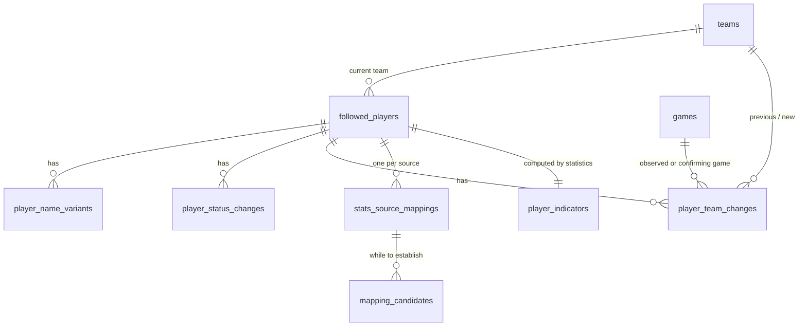

# Players

The followed players (`docs/01-joueurs-suivis.md`): identity, name variants, status and team
histories, and the statistics-source mappings that gate every fetch. The indicators shown on the
player page (games played, average minutes, last game played, consecutive games missed, first NBA
game) are computed by the statistics domain and stored in `player_indicators`
([games-and-statistics.md](games-and-statistics.md)). Former teams are never stored (CL-JOU-18).
Conventions, sensitive-data classes and the TypeScript brands are in the [README](README.md).

## 1. Entities

### 1.1 `followed_players` — `FollowedPlayer`

An NBA player the owner put on the follow list; every event concerns exactly one (JOU-08, VUE-04).
The app starts with no row (JOU-06, ADR 0020); seeds and fixtures never hold a real player.

| column                         | type        | null | default             | constraint or reference                                                                                                                       | class | spec IDs                            |
| ------------------------------ | ----------- | ---- | ------------------- | --------------------------------------------------------------------------------------------------------------------------------------------- | ----- | ----------------------------------- |
| `id`                           | uuid        | no   | `gen_random_uuid()` | primary key; a random UUID generated at addition, never derived from the name, never reused                                                   | PI    | JOU-08, CL-JOU-09, CA-JOU-17        |
| `display_name`                 | text        | no   | —                   | `CHECK (btrim(display_name) <> '')`                                                                                                           | PI    | JOU-08, JOU-12                      |
| `display_name_normalized`      | text        | no   | —                   | the display name normalized as CL-JOU-13 says (NFC, trim, inner spaces collapsed, case folded); written with it                               | PI    | CL-JOU-13, CL-JOU-04                |
| `current_team_id`              | integer     | yes  | —                   | `REFERENCES teams(id) ON DELETE RESTRICT`; required at addition (service); null means "without team"                                          | PI    | JOU-08, JOU-13, STA-25, CL-JOU-20   |
| `status`                       | text        | no   | `'active'`          | `CHECK (status IN ('active','paused','withdrawn'))`                                                                                           | PI    | JOU-15, JOU-16 to JOU-19            |
| `birthday_month`               | smallint    | yes  | —                   | `CHECK (birthday_month BETWEEN 1 AND 12)`                                                                                                     | BD    | JOU-08, JOU-11, CL-JOU-16, ADR 0015 |
| `birthday_day`                 | smallint    | yes  | —                   | `CHECK (birthday_day BETWEEN 1 AND (ARRAY[31,29,31,30,31,30,31,31,30,31,30,31])[birthday_month])`; 29 February allowed                        | BD    | CL-JOU-16, CL-JOU-17                |
| `birthday_origin`              | text        | yes  | —                   | `CHECK (birthday_origin IN ('stats_source','owner'))`                                                                                         | BD    | CL-JOU-16, CL-JOU-11                |
| `added_at`                     | timestamptz | no   | `now()`             | —                                                                                                                                             | PI    | 01 « Données manipulées »           |
| `pause_suggestion_declined_at` | timestamptz | yes  | —                   | set when the owner declines the pause suggestion; void once a later game is played (section 2.3)                                              | PI    | JOU-22, IHM-20                      |
| `last_schedule_derivation_at`  | timestamptz | yes  | —                   | technical: the instant of his previous regular derivation run, so the next run derives the games started since, a reactivation's gap included | —     | CL-TAX-19                           |
| `row_version`                  | integer     | no   | `1`                 | incremented by every save; a save that sends an older value is refused                                                                        | —     | CL-IHM-18                           |

Row checks: `(birthday_month IS NULL) = (birthday_day IS NULL)` and
`(birthday_month IS NULL) = (birthday_origin IS NULL)`. No column can hold a year of birth
(JOU-11, CL-DSN-21).

Indexes: `followed_players_display_name_normalized_idx (display_name_normalized)` serves the
shared-name warning at addition (CL-JOU-04, JOU-09). The list filter by status (JOU-28) scans at
most a few dozen rows and needs no index.

Deletion: only by the player-data deletion of JOU-24, which first erases every event of the player
with the scope of a withdrawal and then deletes the row; the order and the full scope are in
[sensitive-data.md](sensitive-data.md) section 2.2. `events.player_id` is `ON DELETE RESTRICT`, so a
plain delete fails while events remain. Every other player-owned table cascades: variants, status
and team histories, mappings and candidates, `player_indicators`, box scores, backtest requests
with their types, imports and coverage, profiles with their verdict history, tally exits.

```ts
type PlayerId = Brand<string, 'PlayerId'>; // a UUID, carried as player.id in the research prompt and result
type Birthday = { month: number; day: number }; // glossary: birthday ({ month, day }), never a year
interface FollowedPlayer {
  id: PlayerId;
  status: PlayerStatus;
  currentTeamId: TeamId | null;
  birthday: Birthday | null;
  birthdayOrigin: 'stats_source' | 'owner' | null;
}
```

### 1.2 `player_name_variants` — name variants

Spelling variants and nicknames searched by detection, each with its ambiguous mark (JOU-08,
JOU-09). The display name is the first name variant but lives on `followed_players`.

| column            | type    | null | default  | constraint or reference                                   | class | spec IDs       |
| ----------------- | ------- | ---- | -------- | --------------------------------------------------------- | ----- | -------------- |
| `id`              | integer | no   | identity | primary key                                               | —     | —              |
| `player_id`       | uuid    | no   | —        | `REFERENCES followed_players(id) ON DELETE CASCADE`       | PI    | JOU-08         |
| `kind`            | text    | no   | —        | `CHECK (kind IN ('spelling','nickname'))`                 | PI    | JOU-08         |
| `text`            | text    | no   | —        | `CHECK (btrim(text) <> '')`; stored as typed              | PI    | JOU-08, JOU-09 |
| `normalized_text` | text    | no   | —        | normalized as CL-JOU-13 says; accents and diacritics kept | PI    | CL-JOU-13      |
| `is_ambiguous`    | boolean | no   | `false`  | —                                                         | PI    | JOU-09, DET-04 |

Unique: `player_name_variants_player_normalized_key (player_id, normalized_text)` — a variant
appears only once per player (JOU-09, CL-JOU-13).

Indexes: `player_name_variants_normalized_idx (normalized_text)` serves the "shared with
{player}" warning at entry (JOU-09) and the CL-JOU-04 comparison of a typed name with every
player's variants.

Deletion: by the owner, or with the player. Nothing references a variant.

```ts
type NameVariantKind = 'spelling' | 'nickname';
interface NameVariant {
  id: NameVariantId;
  playerId: PlayerId;
  kind: NameVariantKind;
  text: string;
  isAmbiguous: boolean;
}
```

### 1.3 `player_status_changes` — `PlayerStatusChange`

The dated status history, with its optional reason (JOU-15).

| column        | type        | null | default  | constraint or reference                                                                              | class | spec IDs         |
| ------------- | ----------- | ---- | -------- | ---------------------------------------------------------------------------------------------------- | ----- | ---------------- |
| `id`          | integer     | no   | identity | primary key                                                                                          | —     | —                |
| `player_id`   | uuid        | no   | —        | `REFERENCES followed_players(id) ON DELETE CASCADE`                                                  | PI    | JOU-15           |
| `changed_at`  | timestamptz | no   | `now()`  | —                                                                                                    | PI    | JOU-15           |
| `from_status` | text        | no   | —        | `CHECK (from_status IN ('active','paused','withdrawn'))`                                             | PI    | JOU-15           |
| `to_status`   | text        | no   | —        | `CHECK (to_status IN ('active','paused','withdrawn'))`                                               | PI    | JOU-15           |
| `reason`      | text        | yes  | —        | `CHECK (reason IN ('prolonged_absence','end_of_career','left_nba','insufficient_exposure','other'))` | PI    | JOU-15, H-JOU-06 |

Row checks: `(from_status, to_status)` is one of the five allowed pairs of section 2.1;
`reason IS NULL OR to_status IN ('paused','withdrawn')` — a reactivation carries no reason
(CL-JOU-12).

Indexes: `player_status_changes_player_changed_idx (player_id, changed_at)` serves the history
on the player page (JOU-25).

```ts
type PlayerStatus = 'active' | 'paused' | 'withdrawn';
type PlayerStatusChangeReason =
  'prolonged_absence' | 'end_of_career' | 'left_nba' | 'insufficient_exposure' | 'other';
```

### 1.4 `player_team_changes` — `PlayerTeamChange`

The team history from the day the player is followed: observed changes, entered changes and
their confirmation (JOU-13, CL-JOU-02, CL-JOU-03). It also bounds team membership for absence
counts (CL-STA-05). The team chosen at addition is not a change.

| column             | type        | null | default  | constraint or reference                                                                                                                                                                 | class | spec IDs                                |
| ------------------ | ----------- | ---- | -------- | --------------------------------------------------------------------------------------------------------------------------------------------------------------------------------------- | ----- | --------------------------------------- |
| `id`               | integer     | no   | identity | primary key                                                                                                                                                                             | —     | —                                       |
| `player_id`        | uuid        | no   | —        | `REFERENCES followed_players(id) ON DELETE CASCADE`                                                                                                                                     | PI    | JOU-13                                  |
| `changed_at`       | timestamptz | no   | —        | observed from a game: that game's scheduled start; observed from the source's player file: the read instant; entered: the entry instant                                                 | PI    | JOU-13, CL-JOU-03, CL-STA-05, CL-STA-27 |
| `previous_team_id` | integer     | yes  | —        | `REFERENCES teams(id) ON DELETE RESTRICT`; null when he had no team                                                                                                                     | PI    | JOU-13                                  |
| `new_team_id`      | integer     | yes  | —        | `REFERENCES teams(id) ON DELETE RESTRICT`; null for a release (without team)                                                                                                            | PI    | JOU-13, STA-25, CL-JOU-20               |
| `origin`           | text        | no   | —        | `CHECK (origin IN ('observed','entered'))`                                                                                                                                              | PI    | JOU-13                                  |
| `game_id`          | integer     | yes  | —        | `REFERENCES games(id) ON DELETE RESTRICT`; observed: the first game played with the new team, null when read from the player file; entered: the confirming game, null while unconfirmed | PI    | JOU-13, CL-JOU-03                       |

Row check: `previous_team_id IS DISTINCT FROM new_team_id`.

Indexes: `player_team_changes_player_changed_idx (player_id, changed_at)` serves the history
display and the membership walk of CL-STA-05 (latest change before a game's start).

```ts
type TeamChangeOrigin = 'observed' | 'entered';
// derived: an entered change is "confirmed by the game of <date>" when gameId is set, otherwise "unconfirmed"
```

### 1.5 `stats_source_mappings` — `StatsSourceMapping`

The owner-confirmed link between a followed player and his identity in one statistics source; no
statistic is fetched for that source before it is established (JOU-10, STA-03). One row per player
and source in use (CL-JOU-21); with the chosen source there is one source (CL-STA-23).

| column              | type        | null | default          | constraint or reference                                                                   | class | spec IDs                     |
| ------------------- | ----------- | ---- | ---------------- | ----------------------------------------------------------------------------------------- | ----- | ---------------------------- |
| `id`                | integer     | no   | identity         | primary key                                                                               | —     | —                            |
| `player_id`         | uuid        | no   | —                | `REFERENCES followed_players(id) ON DELETE CASCADE`                                       | PI    | JOU-10                       |
| `stats_source`      | text        | no   | —                | `CHECK (stats_source IN ('sportsdataverse_espn'))`; a replacement source extends the list | —     | STA-02, CL-JOU-21, CL-STA-23 |
| `status`            | text        | no   | `'to_establish'` | `CHECK (status IN ('to_establish','established'))`                                        | PI    | JOU-10, STA-03               |
| `source_player_ref` | text        | yes  | —                | the source's stable player identifier                                                     | PI    | STA-02, STA-03               |
| `established_at`    | timestamptz | yes  | —                | date of the owner's confirmation                                                          | PI    | 07 « Données manipulées »    |
| `last_searched_at`  | timestamptz | yes  | —                | last candidate search (retried at each statistics update while to establish)              | —     | JOU-10, STA-03               |

Unique: `stats_source_mappings_player_source_key (player_id, stats_source)` (CL-JOU-21);
`stats_source_mappings_source_ref_key (stats_source, source_player_ref)` — an identity can be
linked to one followed player only, whatever his status (JOU-10, CL-JOU-04, CA-JOU-08); nulls do
not collide.

Row check: `(status = 'established') = (source_player_ref IS NOT NULL AND established_at IS NOT NULL)`.

Indexes: the two unique indexes serve every lookup (by player for the fetch gate, by source
reference when ingesting box-score lines).

```ts
type StatsSourceMappingStatus = 'to_establish' | 'established';
type StatsSourceKey = 'sportsdataverse_espn'; // the port's ProviderId values, snake_case
```

### 1.6 `mapping_candidates` — `MappingCandidate`

The source identities offered for confirmation while a mapping is to establish, with what tells
namesakes apart: name, teams, seasons played (JOU-10, STA-03, 07 « Données manipulées »).

| column              | type        | null | default  | constraint or reference                                           | class | spec IDs       |
| ------------------- | ----------- | ---- | -------- | ----------------------------------------------------------------- | ----- | -------------- |
| `id`                | integer     | no   | identity | primary key                                                       | —     | —              |
| `mapping_id`        | integer     | no   | —        | `REFERENCES stats_source_mappings(id) ON DELETE CASCADE`          | PI    | JOU-10         |
| `source_player_ref` | text        | no   | —        | the candidate's identifier in the source                          | PI    | STA-03         |
| `display_name`      | text        | no   | —        | as the source writes it                                           | PI    | JOU-10         |
| `current_team_id`   | integer     | yes  | —        | `REFERENCES teams(id) ON DELETE RESTRICT`                         | PI    | JOU-10         |
| `first_season`      | text        | yes  | —        | `CHECK (first_season ~ '^[0-9]{4}-[0-9]{2}$')`                    | PI    | JOU-10, STA-03 |
| `last_season`       | text        | yes  | —        | same check                                                        | PI    | JOU-10, STA-03 |
| `team_ids`          | integer[]   | no   | `'{}'`   | teams seen in the source's lines, most recent first; display only | PI    | JOU-10, STA-03 |
| `found_at`          | timestamptz | no   | `now()`  | —                                                                 | —     | JOU-10         |

Unique: `mapping_candidates_mapping_ref_key (mapping_id, source_player_ref)`.

Lifetime: replaced at each search; all rows of a mapping are deleted when it becomes established
(store less). Candidates may describe NBA players who are not followed; they never leave this
table. "Already followed as {name}" is derived by joining `source_player_ref` with established
mappings (CL-JOU-04).

## 2. Lifecycles

### 2.1 Player status (JOU-15)

| from      | to        | trigger                | guard                                                                                         | side effects                                                                                                                                                                       |
| --------- | --------- | ---------------------- | --------------------------------------------------------------------------------------------- | ---------------------------------------------------------------------------------------------------------------------------------------------------------------------------------- |
| (none)    | active    | owner adds the player  | active players below `maxActivePlayers` (JOU-04, JOU-05); display name and current team given | creates the mapping row for the source (to establish) and runs the candidate search (JOU-10); creates no backtest request (JOU-07)                                                 |
| active    | paused    | owner                  | —                                                                                             | status change row; Lot 2 detection, detection-born requests and alert sheets stop (JOU-18); to-do requests stay (JOU-17); statistics, profiles and derivation go on (CL-JOU-05)    |
| active    | withdrawn | owner                  | —                                                                                             | status change row; the to-do request becomes canceled with `player_withdrawn` (BKT-14); profiles shown archived (SEN-19); derivation stops creating or dropping events (CL-JOU-05) |
| paused    | active    | owner reactivates      | active players below `maxActivePlayers` (JOU-20)                                              | status change row without reason (CL-JOU-12); no request (JOU-20); Lot 2 re-prefilters recent articles (JOU-09)                                                                    |
| paused    | withdrawn | owner                  | —                                                                                             | as active → withdrawn                                                                                                                                                              |
| withdrawn | active    | owner reactivates      | active players below `maxActivePlayers` (JOU-20)                                              | as paused → active; profiles no longer archived; the next regular derivation run covers the games since his previous run (CL-TAX-19)                                               |
| withdrawn | (deleted) | owner deletes the data | status withdrawn, double confirmation (JOU-24)                                                | the erasure of [sensitive-data.md](sensitive-data.md) section 2.2; the counter grows by his events (CA-JOU-16)                                                                     |

The application never changes a status by itself (JOU-22). `withdrawn → paused` does not exist.

### 2.2 Statistics-source mapping (JOU-10, JOU-12, STA-03)

| from         | to           | trigger                                                                                               | guard                                                                         | side effects                                                                                                                                                                                                                                    |
| ------------ | ------------ | ----------------------------------------------------------------------------------------------------- | ----------------------------------------------------------------------------- | ----------------------------------------------------------------------------------------------------------------------------------------------------------------------------------------------------------------------------------------------- |
| (none)       | to_establish | player added                                                                                          | —                                                                             | candidate search; candidates stored                                                                                                                                                                                                             |
| to_establish | to_establish | statistics update, or the owner's search                                                              | —                                                                             | `last_searched_at` set; candidates replaced; new candidates shown in the to-do list (JOU-10)                                                                                                                                                    |
| to_establish | established  | owner confirms a candidate                                                                            | the reference is linked to no other followed player (unique index; CL-JOU-04) | candidates deleted; fetch units queued in STA-40 order; birthday filled from the source if empty (CL-JOU-16); current team observed (CL-STA-27); a full derivation for him (CL-TAX-19)                                                          |
| established  | to_establish | owner changes the mapping (JOU-12), or the source no longer knows the identifier (07 « Cas limites ») | —                                                                             | nothing fetched for the player; his cases wait with `mapping_not_established` (SEN-07)                                                                                                                                                          |
| to_establish | established  | owner confirms a different identity after a change                                                    | as above                                                                      | box-score lines of the former identity deleted; new lines fetched; every case of the player recalculated; a birthday from the source replaced, an owner-entered one kept; current team observed again; a full derivation (CL-JOU-11, CL-TAX-19) |

### 2.3 Pause suggestion (JOU-22) — derived, `PauseSuggestionStatus`

| from      | to        | trigger                                            | guard                                                                                                        | side effects                                   |
| --------- | --------- | -------------------------------------------------- | ------------------------------------------------------------------------------------------------------------ | ---------------------------------------------- |
| none      | suggested | statistics update ends                             | active; `consecutive_team_games_missed ≥ prolongedAbsenceThreshold`; not declined since his last game played | to-do item "Suggest pausing {player}" (IHM-20) |
| suggested | declined  | owner declines                                     | —                                                                                                            | `pause_suggestion_declined_at` set             |
| suggested | none      | the player plays again, or he is paused            | —                                                                                                            | to-do item gone                                |
| declined  | none      | a game played after `pause_suggestion_declined_at` | —                                                                                                            | the refusal no longer applies                  |

### 2.4 Entered team change (JOU-13, CL-JOU-03)

| from        | to          | trigger                                                      | guard | side effects                                                              |
| ----------- | ----------- | ------------------------------------------------------------ | ----- | ------------------------------------------------------------------------- |
| (none)      | unconfirmed | owner enters a team change                                   | —     | row with origin `entered`, `changed_at` = entry instant; current team set |
| unconfirmed | confirmed   | first official game played after the entry, for that team    | —     | `game_id` set                                                             |
| unconfirmed | unconfirmed | first official game played after the entry, for another team | —     | an observed change to that team is recorded, dated by that game           |

## 3. Invariants

| rule                                                                                                                                                                       | spec IDs                     | enforced by                                                                      |
| -------------------------------------------------------------------------------------------------------------------------------------------------------------------------- | ---------------------------- | -------------------------------------------------------------------------------- |
| An addition or a reactivation never takes the active count above `maxActivePlayers`; lowering the parameter pauses no one                                                  | JOU-04, JOU-05, CL-JOU-10    | player service, in the transaction that adds or reactivates                      |
| A statistics identity is linked to at most one followed player, whatever his status                                                                                        | JOU-10, CL-JOU-04            | unique index `stats_source_mappings_source_ref_key`                              |
| A player has one mapping per statistics source                                                                                                                             | CL-JOU-21                    | unique index `stats_source_mappings_player_source_key`                           |
| A variant appears once per player and differs from his display name, after CL-JOU-13 normalization                                                                         | JOU-09, CL-JOU-13            | unique index (variants); player service (display name)                           |
| A display-name change keeps the old name as a spelling variant                                                                                                             | JOU-12                       | player service, same transaction                                                 |
| No year of birth is ever stored, logged or shown; the adapter drops it before anything else                                                                                | JOU-11, CL-JOU-16, CL-DSN-21 | table shape (no column); statistics adapter                                      |
| Only the owner changes a status                                                                                                                                            | JOU-15, JOU-22               | player service (no scheduled job writes `status`)                                |
| A player id is never issued twice                                                                                                                                          | JOU-08, CL-JOU-09            | random UUID; no other source of ids                                              |
| The current team moves only on evidence more recent than the latest team-history change: his most recent game played, or the current-season player file refreshed after it | CL-JOU-02, CL-STA-27         | statistics ingestion service                                                     |
| Data deletion applies only to a withdrawn player, after two confirmations                                                                                                  | JOU-24                       | player service; `events.player_id ON DELETE RESTRICT` forces the ordered erasure |
| Nothing is fetched for a source whose mapping is not established                                                                                                           | JOU-10, STA-03               | fetch-queue service                                                              |

## 4. Stored or derived

| item                                                                                           | stored or derived             | recalculated when                                                 | spec IDs                       |
| ---------------------------------------------------------------------------------------------- | ----------------------------- | ----------------------------------------------------------------- | ------------------------------ |
| `display_name_normalized`, `normalized_text`                                                   | stored                        | written with the name or variant                                  | CL-JOU-13                      |
| Games played, average minutes, last game played, consecutive team games missed, first NBA game | stored in `player_indicators` | each statistics update and each stored season (STA-46, CL-STA-12) | JOU-02, JOU-21, STA-46, STA-47 |
| Former teams                                                                                   | derived                       | at each derivation, from box scores of covered seasons            | CL-JOU-18, CL-STA-24           |
| Team membership at a date                                                                      | derived                       | from box scores and `player_team_changes` (CL-STA-05)             | CL-STA-05                      |
| Backtest status (`PlayerBacktestStatus`)                                                       | derived                       | on read, from requests, imports and coverage                      | JOU-25, CL-JOU-14              |
| Pause suggestion state                                                                         | derived                       | on read, from indicators and `pause_suggestion_declined_at`       | JOU-22                         |
| Shared-variant warning, "already followed as {name}"                                           | derived                       | on read                                                           | JOU-09, CL-JOU-04              |
| Archived profiles of a withdrawn player                                                        | derived                       | on read, from `status`                                            | JOU-19, SEN-19                 |
| Total valid cases in the list                                                                  | derived                       | on read, from default-view profiles                               | JOU-28, CL-JOU-23              |

## 5. Exchange formats

The player id travels in the research prompt as `{{PLAYER_ID}}` and comes back as `player.id` of
the research result ([backtest-and-import.md](backtest-and-import.md) section 5): the UUID string,
compared per CL-IMP-22.

## 6. Rulings applied

- ADR 0015 and CL-JOU-16, CL-JOU-17: the optional day and month of birth with its origin; 29
  February is a valid value, whose birthday falls on 28 February in common years; a change of the
  birthday runs a full derivation of his birthday events.
- CL-TAX-19: `last_schedule_derivation_at`, the per-player instant of the previous regular run.
- ADR 0020, CL-JOU-22: no seeded player.
- CL-JOU-02, CL-STA-27: the current team follows only the most recent evidence.
- CL-JOU-03: the entered change and its confirming game in one `game_id` column.
- CL-JOU-04, CL-JOU-13: normalized names and the two unique indexes.
- CL-JOU-05: statistics run for every status; states gate only detection, requests, alerts,
  suggestions and the derivation.
- CL-JOU-06, CL-JOU-24: deletion scope and the deleted-player entry, in
  [sensitive-data.md](sensitive-data.md).
- CL-JOU-09: UUID primary key, the one exception to integer identity keys in this file.
- CL-JOU-11: consequences of a mapping change.
- CL-JOU-12: no reason on a reactivation (row check).
- CL-JOU-18, CL-STA-24: former teams are derived, never stored.
- CL-JOU-19: the daily exposure counts are written by detection and modeled with it
  (`detection.md`, Lot 2).
- CL-JOU-20: a nullable current team.
- CL-JOU-21, CL-STA-23: one mapping per source; one source today.
- Own choice: `display_name_normalized` and `normalized_text` are stored so that the uniqueness
  and shared-name rules of CL-JOU-13 are an index lookup.
- Own choice: candidates are rows rather than a snapshot, because "already followed as {name}"
  joins them with the established mappings.
- Own choice: the declined pause suggestion is one instant on the player; the suggested state is
  derived, so `PauseSuggestionStatus` is a computed union.

## 7. Diagram


