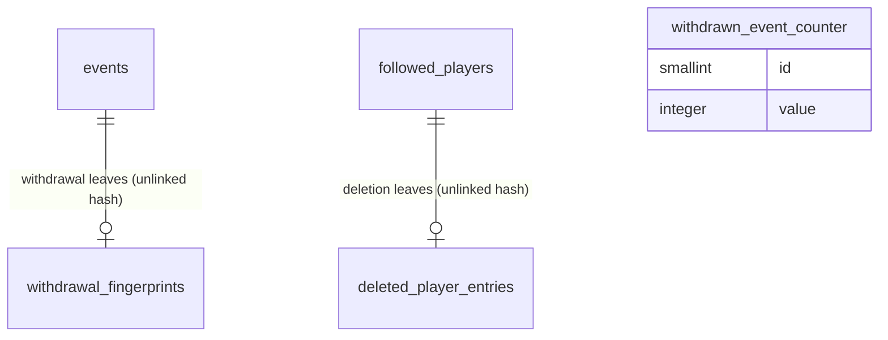

# Sensitive data

The rules of `docs/13-donnees-sensibles.md` as they apply to the model: the withdrawal ledger
(the temporary fingerprints of ADR 0017, the deleted-player entries and the global counter), the
erasure step every removal of an event goes through, the deletion of a player's data, the purges,
and what exports and backups hold. The sensitive-data class of every column is given in the area
files; the classes are defined in the [README](README.md) section 3.

## 1. Entities: the withdrawal ledger

Fingerprints and deleted-player entries form the withdrawal ledger, with the withdrawn-events
counter (CL-DSN-08). No backup and no export contains a ledger entry; the counter's value is written
into each backup and full export. A restore never overwrites the ledger and re-applies it
([operations.md](operations.md) section 2.5, CL-TRV-06). Every hash is HMAC-SHA-256 with the
fingerprint secret of the deployment configuration (TRV-37, ADR 0017); a hash is never displayed,
logged, exported or sent anywhere.

### 1.1 `withdrawal_fingerprints` — `WithdrawalFingerprint`

A keyed hash of the player, type and day of a withdrawn event, kept for the fingerprint horizon so
that detection and the calendar derivation cannot recreate the event and an import flags it
(ADR 0017, CL-DSN-06).

| column        | type        | null | default  | constraint or reference                                                                          | class | spec IDs                       |
| ------------- | ----------- | ---- | -------- | ------------------------------------------------------------------------------------------------ | ----- | ------------------------------ |
| `id`          | integer     | no   | identity | primary key                                                                                      | WL    | —                              |
| `fingerprint` | bytea       | no   | —        | unique; `CHECK (octet_length(fingerprint) = 32)`; HMAC of `<player id>\|<type id>\|<YYYY-MM-DD>` | WL    | ADR 0017, CL-DSN-06, CL-JOU-24 |
| `created_at`  | timestamptz | no   | `now()`  | the only other datum                                                                             | WL    | ADR 0017                       |

The day is the event's reference date: the date as written when it has no time
(`reference_date_on`); otherwise the calendar date of the reference instant in the owner's time
zone (TRV-72). The same function gives the day of every event compared with a fingerprint; a change
of the owner's time zone can shift a day by one, which the window absorbs (CL-DSN-06). An event of
player p, type t and day d matches when the hash of `p|t|d'` is a live fingerprint for some d' from
d − g to d + g, g being `correspondenceWindowDays` (2 by default), the single window of CL-IMP-34;
the unique index serves these lookups. Fingerprints are checked by detection before a model-origin
fact creates an event, never for the owner's own classifications; by the calendar derivation before
it creates an event, on the derived game's day only, with no window, so that a withdrawal never
blocks another qualifying game within g days (record 0015: every such game counts); in every import
preview; and at every restore (CL-DSN-06, CL-TAX-19, CL-SUI-14).

### 1.2 `deleted_player_entries` — the deleted-player entry

A keyed hash of a deleted player's identifier, kept for the same horizon, used only to delete him
again after a restore (CL-JOU-24, CL-TRV-06).

| column        | type        | null | default  | constraint or reference                     | class | spec IDs             |
| ------------- | ----------- | ---- | -------- | ------------------------------------------- | ----- | -------------------- |
| `id`          | integer     | no   | identity | primary key                                 | WL    | —                    |
| `fingerprint` | bytea       | no   | —        | unique; 32 bytes; HMAC of the player's UUID | WL    | CL-JOU-24            |
| `created_at`  | timestamptz | no   | `now()`  | —                                           | WL    | CL-JOU-24, CL-DSN-07 |

### 1.3 `withdrawn_event_counter` — `withdrawnEventCount`

The global count of removal decisions since go-live: withdrawals, preview declines for sensitive
data and the events of deleted players (DSN-29, CL-DSN-04). One row.

| column  | type     | null | default | constraint or reference               | class | spec IDs                  |
| ------- | -------- | ---- | ------- | ------------------------------------- | ----- | ------------------------- |
| `id`    | smallint | no   | `1`     | primary key; `CHECK (id = 1)`         | —     | —                         |
| `value` | integer  | no   | `0`     | `CHECK (value >= 0)`; never decreases | —     | DSN-29, VUE-09, CL-DSN-04 |

The row carries no date, so that it cannot date the last withdrawal (DSN-29: no player, no type,
no date).

## 2. Erasures

### 2.1 The erasure step of one event

Every removal of an event row goes through one step, run in one transaction with the operation
that calls it; each Lot 2 module adds its own sub-step with a test (CL-DSN-16). The step never
completes with part of the event left. Its variants:

| cause                                             | fingerprint | counter       | tally exit                        | designating trace rows deleted | Lot 2 sub-steps                     | spec IDs                              |
| ------------------------------------------------- | ----------- | ------------- | --------------------------------- | ------------------------------ | ----------------------------------- | ------------------------------------- |
| withdrawal, of an event of any origin             | created     | + 1           | none                              | yes                            | all                                 | DSN-26 to DSN-29, ADR 0017, CL-DSN-09 |
| player-data deletion (every origin)               | none        | + 1 per event | none                              | yes                            | all                                 | JOU-24, CL-JOU-06, CL-JOU-24          |
| requalification "does not conform", split erasure | none        | none          | `erased`                          | yes                            | all                                 | TAX-25, TAX-29, CL-TAX-09             |
| manual deletion of a historical event             | none        | none          | `deleted`, the deletion trace     | no                             | —                                   | IMP-33                                |
| replacement at import                             | none        | none          | `replaced_at_import`              | no                             | —                                   | IMP-29, CL-IMP-20                     |
| derivation drop of a schedule event, game started | none        | none          | `no_longer_derived`, a count only | no                             | sheets and tracked case (CL-TAX-19) | CL-TAX-19, CL-SEN-25                  |
| derivation drop of an upcoming schedule event     | none        | none          | none                              | no                             | sheets and tracked case (CL-SUI-14) | CL-TAX-19, CL-SEN-25                  |
| merge of detected events (Lot 2)                  | none        | none          | `merged`                          | no                             | articles move to the kept event     | DET-47                                |

A calendar-derived event can be withdrawn like any other (CL-DSN-09). The regular derivation never
revisits a game it has derived and checks the fingerprints first, so such an event can come back
only through a full derivation run after its fingerprint has expired; the withdrawal screen says so
and offers the permanent alternative, excluding its case (SEN-17, CL-DSN-19).

Order of a withdrawal of event E, every row of the left column being deleted unless stated:

1. Guards: the owner confirmed after the screen of CL-DSN-19, which lists what disappears and the
   limits, the number of Telegram messages mentioning E included.
2. Upsert the fingerprint of E into `withdrawal_fingerprints` with `created_at = now()`.
3. Lot 2 sub-steps: in the alert sheet holding E, everything about it, or the whole sheet and its
   alert-history entry if E was its only event; its tracked-case data; the stored Telegram texts,
   chat identifiers and message identifiers of the messages mentioning it, digests included, after
   one deletion request each, the refused or unreachable ones being listed once to the owner with
   their send date and time and whether each was a digest, then not kept (CL-DSN-13, CL-TEL-09);
   the classification results of its
   articles; every article attached to E and to no other event, with no dedup trace and no other
   record (DSN-34, CL-DSN-10).
4. `import_event_outcomes` and `import_possible_duplicates` rows whose event is E, so that the
   import trace, counts included, keeps nothing designating it (IMP-37).
5. `journal_technical_details` of journal entries that concerned only E; the entries' references
   to E then become null and read "an item that no longer exists" (CL-TRV-10).
6. The `events` row, which cascades to `event_sources` (with their spot-check verdicts),
   `event_import_warnings`, `event_marks`, `event_status_changes`, `event_corrections` and
   `backtest_request_events`.
7. E's case if it holds no other event, with its criteria, flags, decisions and history.
8. `withdrawn_event_counter.value + 1`.
9. A journal entry "an event was withdrawn", with no player, type or date (CL-TRV-10).
10. A full recalculation job with cause `recalculation`; a profile or trend it leaves with no event
    is erased with its verdict history (SEN-48, CL-SEN-18).

What remains afterwards: the counter and, for the horizon, the fingerprint. Accepted residual
limits: a `recalculation` verdict-history entry dated that day (CL-SEN-18); backups until they
rotate out; exports already downloaded; Telegram messages the bot could not delete; a device left
offline until its next refresh; in Lot 2, an article still in a feed, collected and classified
again for at most its maximum age while the fingerprint keeps it from becoming an event
(DSN-28, CL-DSN-10, CL-DSN-19).

### 2.2 Deleting a player's data (JOU-24, CL-JOU-06)

For a withdrawn player, after the counts are shown and two confirmations, in one transaction:

1. Each of his events, of every origin and state, through the erasure step with the player-deletion
   variant (no fingerprint, no tally exit); the counter grows by their number (CA-JOU-16).
2. One `deleted_player_entries` row (CL-JOU-24).
3. In `event_corrections` of other players' events, before or after values holding his id are set
   to null; pending `recalculation_jobs` drop his id and done jobs naming him are deleted.
4. Journal references to him and his events become null ("a deleted player", "an item that no
   longer exists"); technical details concerning only him are deleted (CL-TRV-10).
5. The `followed_players` row, which cascades to his variants, status and team histories, mappings
   and candidates, indicators, box-score lines and statistics corrections, backtest requests with
   their types, imports and outcomes, coverage periods, profiles with their verdict history, tally
   exits, the drafts of his requests, his type occurrences (the proposals stay) and, in Lot 2, his
   exposure counts.
6. A full recalculation job with cause `recalculation`; the journal records the deletion without
   his name.

The screen states the limits: backups keep the data until they rotate out, a restore within the
horizon deletes him again except a restore into a new database without the old one (CL-TRV-06),
downloaded exports keep it, undeletable Telegram messages stay (CL-JOU-06, CL-JOU-24).

### 2.3 Purges

The daily purge task (`data_purge`, 04:00 by default, TRV-25) removes:

| what                                                                                                                               | when                                                                                                                                                                    | spec IDs                |
| ---------------------------------------------------------------------------------------------------------------------------------- | ----------------------------------------------------------------------------------------------------------------------------------------------------------------------- | ----------------------- |
| Journal entries and their technical details                                                                                        | older than `journalRetentionDays` (90), except entries tied to an incident still open                                                                                   | TRV-48, H-TRV-08        |
| Closed incidents                                                                                                                   | closed for longer than `journalRetentionDays`                                                                                                                           | TRV-48                  |
| Withdrawal fingerprints and deleted-player entries                                                                                 | older than the horizon (`backupsKept` × the backup interval, 8 weeks by default) and no backup in the register made before them; nothing while the register is in doubt | CL-DSN-07, ADR 0017     |
| Drafts                                                                                                                             | `draftRetentionDays` (7) after their last change                                                                                                                        | IHM-42, CL-IHM-11       |
| Done recalculation jobs, finished task runs, quota-usage periods, ended sessions and login failures outside the observation period | older than `journalRetentionDays`, or ended                                                                                                                             | own choice (store less) |
| Lot 2: non-relevant articles, excerpts, dedup traces; exposure counts                                                              | per `collection.md` and `detection.md` (COL-34 to COL-39, CL-JOU-19)                                                                                                    | COL-39, CL-JOU-19       |

Core data — players, types, events, cases, statistics, profiles — is never purged, not even to
free space (TRV-07).

## 3. What leaves the database

| destination                           | holds                                                                                                                                           | never holds                                                                                                                                                   | spec IDs                                |
| ------------------------------------- | ----------------------------------------------------------------------------------------------------------------------------------------------- | ------------------------------------------------------------------------------------------------------------------------------------------------------------- | --------------------------------------- |
| Backup (encrypted, off-site)          | every table of classes —, PI, BD, EV, TX and PR, the activity journal with its technical details, incidents, task runs, and the counter's value | SE rows (account password data, sessions, login failures), WL rows (the ledger), DR rows (drafts, server copies included), any deployment-configuration value | TRV-51, CL-TRV-05, CL-DSN-08, CL-DSN-17 |
| Full export (unencrypted, owner only) | the same as a backup                                                                                                                            | the same                                                                                                                                                      | TRV-52, CL-TRV-05                       |
| Spreadsheet exports                   | the columns listed in [operations.md](operations.md) section 5.3                                                                                | free texts beyond the event description, any SE, WL or DR value                                                                                               | TRV-52, CA-TRV-17                       |
| Journal export for a helper           | journal entries rendered for display, technical details per the CL-DSN-11 allowlist                                                             | descriptions, justifications, titles, links, excerpts, DSN-18 items, the birthday value                                                                       | TRV-49, DSN-11, CL-DSN-11, CL-DSN-21    |
| Research and exploration prompts      | public names, teams, type sheets                                                                                                                | the birthday, any event, anything about the owner                                                                                                             | DSN-04, CL-DSN-21                       |
| Telegram (Lot 2)                      | stored data only, private chat only                                                                                                             | an intimate-subject type's name, an article excerpt                                                                                                           | DSN-31, DSN-35                          |

## 4. Lifecycles

### 4.1 Withdrawal fingerprint (ADR 0017, CL-DSN-06, CL-DSN-07)

| from   | to       | trigger                                                | guard                                                               | side effects                                                                              |
| ------ | -------- | ------------------------------------------------------ | ------------------------------------------------------------------- | ----------------------------------------------------------------------------------------- |
| (none) | live     | a withdrawal                                           | —                                                                   | detection and the derivation create no event matching it; an import preview flags a match |
| live   | (erased) | the owner records a flagged event in an import preview | —                                                                   | he has taken that fact back (CL-DSN-06)                                                   |
| live   | (erased) | the daily purge                                        | older than the horizon and no backup in the register made before it | —                                                                                         |
| live   | live     | a restore                                              | —                                                                   | re-applied to the restored data, never overwritten (CL-TRV-06)                            |

A changed fingerprint secret makes every fingerprint unmatchable (CL-DSN-06); the deployment guide
says so.

### 4.2 Counter (DSN-29, CL-DSN-04)

It grows by one at each withdrawal, by one at each preview decline for sensitive data, and by the
number of a deleted player's events; it never decreases; a restore keeps the larger of the ledger's
value and the backup's and does not grow when it re-applies a withdrawal (CL-TRV-06).

## 5. Invariants

| rule                                                                                                          | spec IDs                     | enforced by                                                           |
| ------------------------------------------------------------------------------------------------------------- | ---------------------------- | --------------------------------------------------------------------- |
| After a withdrawal nothing designates the event but the counter and, for the horizon, the fingerprint         | DSN-27, DSN-29, ADR 0017     | the erasure step, in one transaction                                  |
| Only a withdrawal creates a fingerprint                                                                       | CL-DSN-06                    | the erasure step's variants                                           |
| A fingerprint holds only its hash and its creation instant; it is never shown, logged, exported or backed up  | ADR 0017                     | table shape; backup and export writers skip the ledger by name        |
| The counter never decreases and carries no date                                                               | DSN-29, CL-DSN-04            | `CHECK`; no date column; no service decrements it                     |
| An event holds the DSN-06 items and no other; none of the DSN-18 items is stored anywhere                     | DSN-06, DSN-18               | table shapes; writing services                                        |
| The birthday has no year anywhere, and is never sent to an AI or logged as a value                            | JOU-11, CL-DSN-21            | table shape; prompt builder; journal writer                           |
| The pasted text exists only in the draft store                                                                | DSN-32, CL-DSN-17            | no other column holds it; drafts excluded from backups and exports    |
| The journal and its technical details hold no description, justification, title, link, excerpt or DSN-18 item | DSN-11, CL-DSN-11, CL-TRV-10 | journal writer (references by identifier, technical-detail allowlist) |
| A withdrawal is never decided on the game that followed, and no reason selects events by their gap            | DSN-28, H-01                 | no such reason value; the confirmation text                           |

## 6. Stored or derived

| item                                          | stored or derived | when                                                                                          | spec IDs             |
| --------------------------------------------- | ----------------- | --------------------------------------------------------------------------------------------- | -------------------- |
| Fingerprints, deleted-player entries          | stored            | written by the erasure step and the player deletion; erased by the purge                      | ADR 0017, CL-JOU-24  |
| Counter                                       | stored            | each removal decision                                                                         | DSN-29               |
| Fingerprint horizon                           | derived           | `backupsKept` × the backup interval                                                           | CL-DSN-07            |
| "Matches an event you withdrew" in a preview  | derived           | at each preview, never stored                                                                 | ADR 0017, CL-IMP-28  |
| The generic "This item no longer exists" page | derived           | an identifier that matches no row; no tombstone is kept, the fingerprints are never consulted | CL-DSN-05, CL-IHM-19 |

## 7. Exchange formats

The fingerprint input is the UTF-8 string `<player id>|<type id>|<YYYY-MM-DD>` (the player's UUID
in lowercase, the type slug, the day of section 1.1), hashed with HMAC-SHA-256 under the
fingerprint secret; the deleted-player entry hashes the UUID alone (CL-DSN-06, CL-JOU-24). None of
these values ever leaves the database.

## 8. Rulings applied

- ADR 0017, CL-DSN-06, CL-DSN-07, CL-IMP-28: the fingerprint, its day (an instant's date in the
  owner's time zone), its window, the exact-day check of the derivation, its other checks, its
  horizon and its erasure.
- CL-DSN-04: what the counter counts.
- CL-DSN-05, CL-IHM-19: no tombstone; one generic page.
- CL-DSN-08: the ledger stays out of backups and exports.
- CL-DSN-09, CL-SEN-03: calendar-derived events can be withdrawn like any event, with a
  fingerprint; excluding the case (SEN-17) is the permanent alternative.
- CL-DSN-10: no skip entry for an erased article; the repeated classification is accepted.
- CL-DSN-11, CL-TRV-10: the journal's references and its allowlist.
- CL-DSN-13: Telegram deletion requests, refusals shown once and not kept.
- CL-DSN-16: one erasure step, extended by each Lot 2 module.
- CL-DSN-17: the draft store.
- CL-DSN-21: the birthday's limits.
- CL-JOU-06, CL-JOU-24: the scope of a player-data deletion and its entry.
- CL-SEN-25, CL-JOU-16, CL-TAX-19: a dropped schedule event leaves only a count once its game had
  started, nothing before; each drop is also journaled, without the birthday.
- CL-TAX-09: requalification and split erasures have a withdrawal's scope without fingerprint or
  counter.
- Own choice: the counter row has no date column, the strictest reading of DSN-29.
- Own choice: done jobs, finished runs, usage periods, ended sessions and old login failures are
  purged with the journal's retention, since no rule keeps them longer.

## 9. Diagram

The relations drawn are conceptual: no ledger row holds a reference to what it came from.
