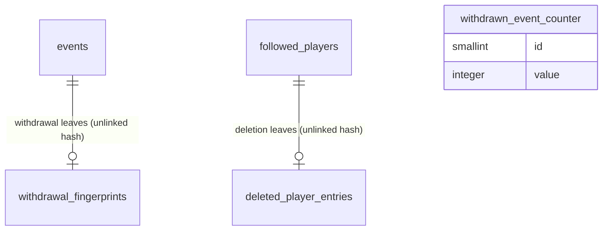

# Sensitive data

The rules of `docs/13-donnees-sensibles.md` as they apply to the model: the withdrawal ledger
(the temporary fingerprints of ADR 0017, the deleted-player entries and the global counter), the
erasure step every removal of an event goes through, the deletion of a player's data, the purges,
and what exports and backups hold. The sensitive-data class of every column is given in the area
files; the classes are defined in the [README](README.md) section 3.

## 1. Entities: the withdrawal ledger

Fingerprints and deleted-player entries form the withdrawal ledger (`WithdrawalLedger`), with the
withdrawn-events counter (CL-DSN-08); their code types are `WithdrawalFingerprint` and
`DeletedPlayerEntry`. No backup and no export contains a ledger entry; the counter's value is written
into each backup and full export. A restore never overwrites the ledger and re-applies it
([operations.md](operations.md) section 2.5, CL-TRV-06). Every hash is HMAC-SHA-256 with the
fingerprint secret of the deployment configuration (TRV-37, ADR 0017); a hash is never displayed,
logged, exported or sent anywhere.

### 1.1 `withdrawal_fingerprints` — `WithdrawalFingerprint`

A keyed hash of the player, type and day of a withdrawn event, kept for the fingerprint horizon so
that detection and the calendar derivation cannot recreate the event and an import flags it
(ADR 0017, CL-DSN-06).

| column        | type        | null | default  | constraint or reference                                                                          | class | spec IDs                       |
| ------------- | ----------- | ---- | -------- | ------------------------------------------------------------------------------------------------ | ----- | ------------------------------ |
| `id`          | integer     | no   | identity | primary key                                                                                      | WL    | —                              |
| `fingerprint` | bytea       | no   | —        | unique; `CHECK (octet_length(fingerprint) = 32)`; HMAC of `<player id>\|<type id>\|<YYYY-MM-DD>` | WL    | ADR 0017, CL-DSN-06, CL-JOU-24 |
| `created_at`  | timestamptz | no   | `now()`  | the only other datum                                                                             | WL    | ADR 0017                       |

The day is the event's reference date: the date as written when it has no time
(`reference_date_on`); otherwise the calendar date of the reference instant in the owner's time
zone (TRV-72). The same function gives the day of every event compared with a fingerprint; a change
of the owner's time zone can shift a day by one, which the window absorbs (CL-DSN-06). An event of
player p, type t and day d matches when the hash of `p|t|d'` is a live fingerprint for some d' from
d − g to d + g, g being `imports.duplicateMaxDateGapDays` (2 by default), the single window of CL-IMP-34;
the unique index serves these lookups. Fingerprints are checked by detection before a model-origin
fact creates an event, never for the owner's own classifications; by the calendar derivation before
it creates an event, on the derived game's day only, with no window, so that a withdrawal never
blocks another qualifying game within g days (record 0015: every such game counts); in every import
preview; and at every restore (CL-DSN-06, CL-TAX-19, CL-SUI-14).

### 1.2 `deleted_player_entries` — the deleted-player entry

A keyed hash of a deleted player's identifier, kept for the same horizon, used only to delete him
again after a restore (CL-JOU-24, CL-TRV-06).

| column        | type        | null | default  | constraint or reference                     | class | spec IDs             |
| ------------- | ----------- | ---- | -------- | ------------------------------------------- | ----- | -------------------- |
| `id`          | integer     | no   | identity | primary key                                 | WL    | —                    |
| `fingerprint` | bytea       | no   | —        | unique; 32 bytes; HMAC of the player's UUID | WL    | CL-JOU-24            |
| `created_at`  | timestamptz | no   | `now()`  | —                                           | WL    | CL-JOU-24, CL-DSN-07 |

### 1.3 `withdrawn_event_counter` — `withdrawnEventCount`

The global count of removal decisions since go-live: withdrawals, preview declines for sensitive
data and the events of deleted players (DSN-29, CL-DSN-04). One row.

| column  | type     | null | default | constraint or reference               | class | spec IDs                  |
| ------- | -------- | ---- | ------- | ------------------------------------- | ----- | ------------------------- |
| `id`    | smallint | no   | `1`     | primary key; `CHECK (id = 1)`         | WL    | —                         |
| `value` | integer  | no   | `0`     | `CHECK (value >= 0)`; never decreases | WL    | DSN-29, VUE-09, CL-DSN-04 |

The row carries no date, so that it cannot date the last withdrawal (DSN-29: no player, no type,
no date). It belongs to the withdrawal ledger (CL-DSN-08): the row is in no backup or export, and
only its value is written into each one's manifest (operations.md section 5.1), so a restore can
never load it as data and lower it (CL-TRV-06). Unlike the hashes of the ledger, its value is
shown — on the "Method and limits" page and, in Lot 2, in the validation table (DSN-29, VUE-09)
— and the server returns it to the devices at each contact (CL-DSN-22, operations.md section
1.12); the row is never erased, by the purge or otherwise.

## 2. Erasures

### 2.1 The erasure step of one event

Every removal of an event row goes through one step, run in one transaction with the operation
that calls it; each Lot 2 module adds its own sub-step with a test (CL-DSN-16). Lot 2 tables point
at detected and calendar-derived events, at `followed_players` and at `backtest_requests` with `ON
DELETE RESTRICT`, and elsewhere with `SET NULL` or `CASCADE` where nothing a requirement keeps is
lost — a classification fact's designated, matched or superseded-into event, a tracked case's decision about a
historical event, cases, exposure counts, task runs, incidents: collection.md section 1.12 is the
authority on each reference (CL-TRV-24) — so the Lot 2 sub-steps run first, before the core deletes
anything, as the event erasers of the module map's reaction lists
(section 1.10): notifications, alerts, tracking, then detection, whose step also erases, through
collection, the articles it leaves without a role; every variant below that runs them keeps that
order.
The step never completes with part of the event left. Its variants:

| cause                                                                                                                                              | fingerprint | counter       | tally exit                        | designating trace rows deleted | Lot 2 sub-steps                                                                                                                                                                                                                                      | spec IDs                              |
| -------------------------------------------------------------------------------------------------------------------------------------------------- | ----------- | ------------- | --------------------------------- | ------------------------------ | ---------------------------------------------------------------------------------------------------------------------------------------------------------------------------------------------------------------------------------------------------- | ------------------------------------- |
| withdrawal, of an event of any origin                                                                                                              | created     | + 1           | none                              | yes                            | all                                                                                                                                                                                                                                                  | DSN-26 to DSN-29, ADR 0017, CL-DSN-09 |
| player-data deletion (every origin)                                                                                                                | none        | + 1 per event | none                              | yes                            | all                                                                                                                                                                                                                                                  | JOU-24, CL-JOU-06, CL-JOU-24          |
| restore's re-application of the ledger (`restore_reapplication`): a restored event withdrawn again, or an event of a restored player deleted again | none        | none          | none                              | yes                            | all, with no Telegram step: the notifications sub-step erases the sent messages the backup brought back without the comparison of CL-TEL-09 (step 5)                                                                                                 | TRV-53, DSN-27, JOU-24, CL-TRV-06     |
| requalification "does not conform", split erasure                                                                                                  | none        | none          | `erased`                          | yes                            | all                                                                                                                                                                                                                                                  | TAX-25, TAX-29, CL-TAX-09             |
| manual deletion of a historical event                                                                                                              | none        | none          | `deleted`, the deletion trace     | no                             | —                                                                                                                                                                                                                                                    | IMP-33                                |
| replacement at import                                                                                                                              | none        | none          | `replaced_at_import`              | no                             | —                                                                                                                                                                                                                                                    | IMP-29, CL-IMP-20                     |
| derivation drop of a calendar-derived event, game started                                                                                          | none        | none          | `no_longer_derived`, a count only | no                             | messages, sheets and tracked case (CL-TAX-19)                                                                                                                                                                                                        | CL-TAX-19, CL-SEN-25                  |
| derivation drop of an upcoming calendar-derived event                                                                                              | none        | none          | none                              | no                             | messages, sheets and tracked case (CL-SUI-14)                                                                                                                                                                                                        | CL-TAX-19, CL-SEN-25                  |
| merge of detected events (Lot 2)                                                                                                                   | none        | none          | `merged`                          | no                             | none: called last by `detection.correct`, after the Lot 2 operations moved or deleted every row that points at the absorbed event and its case; deletes that event and, when it was its case's only event, the case, whose tracked-case rows cascade | DET-47, CL-SUI-16                     |

No Lot 1 operation is ever blocked by a Lot 2 row (CL-TRV-24): the two variants with
no Lot 2 sub-step, the manual deletion and the replacement at import, delete historical events,
which no Lot 2 `RESTRICT` reference names, and every Lot 2 reference to a case cascades.

A calendar-derived event can be withdrawn like any other (CL-DSN-09). The regular derivation never
revisits a game it has derived and checks the fingerprints first, so such an event can come back
only through a full derivation run after its fingerprint has expired; the withdrawal screen says so
and offers the permanent alternative, excluding its case (SEN-17, CL-DSN-19).

Order of a withdrawal of event E. Steps 4 to 12 are the erasure's single transaction, every row
named being deleted unless stated; no outside call runs inside a transaction but a message's own send (CL-TEL-09; notifications.md section 2.2):

1. Guards: the owner confirmed after the screen of CL-DSN-19, which lists what disappears and the
   limits, the number of Telegram messages mentioning E included, and says when an import draft of
   the player will be discarded, with the limit of a device left offline.
2. A first transaction, committed on its own (Lot 2, notifications): it locks the messages
   concerned — those that name E, and those whose fact is E's case or a sheet or update entry the
   alerts sub-step deletes, the entries up to the new production instant of a sheet it initializes
   again, but those it keeps, and the expected-game changes it deletes with E's expected games
   included (CL-ALE-16) — so that a send in progress either commits first, its message being
   then a sent one that this step reads, or finds the message discarded; the unsent messages
   concerned are abandoned, so that none of them can be sent, and the chat and message identifiers
   of the sent ones, digests included, are read (notifications.md section 1.8). A message composed
   later from a fact about E still pending, and sent before step 5, makes step 5 start the
   withdrawal again here (CL-TEL-09).
3. Outside any transaction: the app asks Telegram once to delete each of those messages, whatever
   its age, and keeps the answers in memory.
4. Upsert the fingerprint of E into `withdrawal_fingerprints` with `created_at = now()`.
5. Lot 2 sub-steps, in this order, the module map's: notifications — erases the texts and
   identifiers of every message concerned, whatever Telegram answered in step 3, after comparing
   the sent ones with the identifiers that step 2 read, which the withdrawal passes to it, the
   whole transaction rolling back and the withdrawal starting again at step 2 when one is not among
   them, as a player-data deletion and an erasure by requalification or split start again at their
   own committed step (CL-TEL-09); a restore's re-application, which runs no committed step and
   asks Telegram nothing (CL-TRV-06), erases them without that comparison; alerts — in the sheet holding E, everything about it, or
   the whole sheet and its alert-history entry if E was its only event, and every sheet or section
   a correction or a merge of E left without an event, an initial section going with the event its
   sheet was produced for, or the kept event of the merge that absorbed it (alert-sheets.md section
   1.2), a sheet then left with no event included when it was produced for E, or its initial
   section went with E, or it has no section left, each remaining sheet taking the status and
   the expected-game block of its remaining events with no entry, and a sheet produced for E, or
   left with no initial section, initialized again from its earliest remaining event, its entries up to that event's joining deleted but those about another event a
   correction or a merge took off it before then and the drop of a calendar-derived event before
   then (CL-ALE-16), with the outbox facts of its sheets and update entries, and the
   `alert_sheet_produced` fact of a sheet initialized again whose new initial section still waits
   for its profile values, emitted again when they enter (alert-sheets.md section 1.9, step 5); tracking — its tracked-case data, or, when its case
   keeps other events, the tracked case rebuilt from them (CL-SUI-17), and its regrouping exits, with
   the outbox facts of its tracked game results; detection — the classification results
   of its articles and their attachments, then, through collection's eraser, every article attached
   to E and to no other event, whatever its other roles, with the type occurrences copied from it,
   with no dedup trace and no other record (DSN-34, CL-DSN-10), and, through
   `collection.eraseArticlesWithoutRole`, every other article that the detection step left with no
   part and no other role (CL-COL-16). Each eraser deletes the
   outbox facts of its own objects by `lot2_subject_id` and nulls the journal's `lot2_object_kind`
   and `lot2_object_id` for what it erases.
6. `import_event_outcomes` rows whose event is E, and `import_possible_duplicates` rows whose
   existing or result event is E, so that the import trace, counts included, keeps nothing
   designating it (IMP-37): added events and duplicates keep no rank, the recovered count is
   derived from the rows, and the `shared_link` warnings of other events that name E go with E's
   row in step 8 (`related_player_event_id`). In the same step, the import drafts of every
   backtest request of E's player, since a pasted result may report the withdrawn fact: the server
   copies here; a device's copy that was sent to the server is dropped at the device's next
   contact, since its server copy no longer exists; one never sent is discarded at that contact
   when the withdrawn-events counter has grown since the device recorded it, whatever its player,
   and at the latest at the draft's expiry, counted from its last change (operations.md section
   1.12), so nothing on the server has to record the discard;
   exploration drafts are not concerned (CL-DSN-22, DSN-27, DSN-32; the request ids come from
   `backtest_requests`, and `drafts_import_key` finds each draft).
7. `journal_technical_details` of journal entries that concerned only E; the entries' references
   to E then become null and read "an item that no longer exists" (CL-TRV-10), and so does the Lot 2
   object an entry names beside E, such as an alert sheet that keeps other events; an entry that
   names E's case loses that reference when step 9 deletes the case; when step 9 rebuilds it
   instead, the entries that name it keep that reference and their date, an accepted residual limit
   (CL-SUI-17). An entry that names an event or
   a case names neither its player nor its type (operations.md section 1.2), so none keeps E's
   player, type, request or import (TRV-41, DSN-29).
8. The `events` row, which cascades to `event_sources` (with their spot-check verdicts),
   `event_import_warnings`, `event_marks`, `event_status_changes`, `event_corrections` and
   `backtest_request_events`, the outbox facts and restore-report rows that name it.
9. E's case if it holds no other event, with its criteria, flags, decisions and history; otherwise the case is rebuilt as if E had never been recorded (CL-SUI-17): its `origin` and `created_at` become those that SUI-05, SUI-07 and CL-VUE-13 give its earliest-recorded remaining event, its `case_history_entries` recorded and its `case_review_flags` raised before that new `created_at` are deleted, and the rebuild writes no history row of its own (the job of step 12 records any change, cause `recalculation`, and raises again the flags that still apply). The case's own manual decisions (`case_manual_decisions`) stay, since they apply to its remaining events too; the decisions about E, tracking's, went in step 5, where tracking also rebuilt, created or deleted its tracked case.
10. `withdrawn_event_counter.value + 1`.
11. A journal entry "an event was withdrawn", with no player, type or date (CL-TRV-10).
12. A full recalculation job with cause `recalculation` (after an erasure by requalification or
    split, the job of the cases concerned with the cause `event_corrected_or_removed` instead, which
    replaces no version: SEN-34, CL-SEN-17, CL-SUI-17); a profile or trend it leaves with no event
    is erased with its verdict history and its historical-view versions (SEN-48, CL-SEN-18); for
    every other historical-only profile and trend whose values it changes, the job replaces all
    their versions by one version holding the new values (sensitivity-and-profiles.md section 1.5),
    and tracking derives again, from it alone, the forecast versions of every tracked case whose
    measured game has not started — before the scheduled start of its measured game, or of its
    expected game while no measured game is established, or at any time while no game is known; a waiting case whose expected game has
    started keeps its versions, since SUI-09 freezes the last one before that start, and gets a
    version dated at the job's instant when the job changes its forecast (CL-SUI-03;
    tracking-and-validation.md section 1.8), unless it has no version, such as a case that the
    operation's rebuild turned tracked at or after that start: that case gets none (CL-SUI-17) —
    unless SUI-18 moves its expected game: it then gets versions like any waiting case (SUI-09) —,
    and CL-SUI-18 freezes « sans pronostic ».
13. The result screen gives the number of messages deleted and lists, from memory, the ones
    Telegram refused or could not be reached for, with their send date and time and whether each
    was a digest; that list is never stored (CL-DSN-13, CL-TEL-09).

If the process stops after step 2 or 3, E still exists and the owner withdraws it again; on that
second attempt a message Telegram no longer finds counts as deleted. Committing the erasure first
would instead leave messages in the chat with no record of them if the process stopped before the
requests were sent.

What remains afterwards: the counter and, for the horizon, the fingerprint. Accepted residual
limits: a `recalculation` verdict-history entry dated that day, and the verdict-history entries
written earlier for actions on E — its dismissal or reinstatement, a manual decision, a correction —,
which name no event and keep their profile and date (CL-SEN-18); the journal entries that name a
case rebuilt from its other events, which keep that reference and their date (CL-SUI-17); for a case rebuilt from
its other events, its own decisions dated before its new creation instant and its history rows,
review flags and category changes recorded since that instant while E was in it, and a review flag that the job of step 12 raises again, even one the owner had acknowledged (CL-SUI-17); in Lot 2, the values in force before the
withdrawal wherever a requirement froze them for another event of the same pair or type — the
forecast frozen at a tip-off on another tracked case and the forecast versions that a waiting
tracked case whose expected game has started keeps (SUI-09), the profile and trend snapshots and
outcomes of other sheets and sections (ALE-19), the tracked-game results transmitted and the
messages sent about other events (SUI-19, TEL-11 to TEL-13) — which never change (CL-SEN-18); in
Lot 2, a sheet whose status changed at the withdrawal with no entry, or closed on a day when none
of its cases changed, and the number of a sheet initialized again from its earliest remaining
event, with the snapshots and flags of its sections and the corrections of other events it keeps
from before its new production instant, a calendar-derived event's drop included (CL-ALE-16);
backups until they
rotate out; exports already downloaded; Telegram messages the bot could not delete; a device left
offline until its next refresh; in Lot 2, an article still in a feed, collected and classified
again for at most its maximum age while the fingerprint keeps it from becoming an event
(DSN-28, CL-DSN-10, CL-DSN-19).

### 2.2 Deleting a player's data (JOU-24, CL-JOU-06)

For a withdrawn player, after the counts are shown and two confirmations. Before the erasure's
transaction, as for a withdrawal (2.1, steps 2 and 3, CL-TEL-09): a first committed step abandons
the unsent messages about him and his events and reads the identifiers of the sent ones, then,
outside any transaction, Telegram is asked once to delete each; the screen shown afterwards lists
the refusals from memory. Then, in one transaction:

1. Each of his events, of every origin and state, through the erasure step with the player-deletion
   variant (no fingerprint, no tally exit); the counter grows by their number (CA-JOU-16).
2. The player erasers of the module map's reaction lists (section 1.10) — notifications, alerts,
   tracking, then detection, whose step hands collection the articles it leaves with no part and no other role (collection.md section 1.11) — for his remaining rows: his exposure counts, article parts and
   every other Lot 2 row that points at him or at his requests and cases, so that nothing restricts
   the cascades of step 6 (collection.md section 8).
3. One `deleted_player_entries` row (CL-JOU-24), written by `events.recordDeletedPlayer`.
4. In `event_corrections` of other players' events, before or after values holding his id are set
   to null; the pending and running `recalculation_jobs` drop his id, and a job left with no player
   is deleted (`sensitivity.erasePlayerJobs`; finished jobs are not kept, sensitivity-and-profiles.md
   section 1.4).
5. Journal references to him and his events become null ("a deleted player", "an item that no
   longer exists"); technical details concerning only him are deleted (CL-TRV-10).
6. The `followed_players` row, which cascades to his variants, status and team histories, mappings
   and candidates, indicators, box-score lines and statistics corrections, backtest requests with
   their types, imports and outcomes, coverage periods, profiles with their verdict history and historical-view versions, tally
   exits, the drafts of his requests, his type occurrences (the proposals stay), his outbox
   facts through his requests, and his calendar derivation requests.
7. A full recalculation job with cause `recalculation`; the journal records the deletion without
   his name. As after a withdrawal (2.1, step 12, CL-SEN-18), a profile or trend the job leaves with
   no event is erased, every other historical-only profile and trend whose values it changes has
   all its versions replaced by one version holding the new values, and tracking derives again,
   from it alone, the forecast versions of every tracked case whose measured game has not started,
   a waiting case whose expected game has started keeping its versions (2.1, step 12;
   sensitivity-and-profiles.md section 1.5).

A restore's re-application deletes a restored player again with this scope (CL-TRV-06;
operations.md section 2.5, step 4), with four differences: no Telegram step runs before it, his
events go through the erasure step with the `restore_reapplication` variant, so the counter does
not grow, step 3 writes no entry, the one he matched staying in the ledger, and step 7 records no
job of its own, the restore's full recalculation following (CL-TRV-06).

The player directory keeps its rows: public roster data linked to no followed player
([games-and-statistics.md](games-and-statistics.md) section 1.12).

The screen states the limits: backups keep the data until they rotate out, a restore within the
horizon deletes him again except a restore into a new database without the old one (CL-TRV-06),
downloaded exports keep it, undeletable Telegram messages stay (CL-JOU-06, CL-JOU-24).

### 2.3 Purges

The daily purge task (`purge`, 04:00 by default, TRV-25) removes:

| what                                                                                                                                                                                                                                                                                                                          | when                                                                                                                                                                     | spec IDs                                                    |
| ----------------------------------------------------------------------------------------------------------------------------------------------------------------------------------------------------------------------------------------------------------------------------------------------------------------------------- | ------------------------------------------------------------------------------------------------------------------------------------------------------------------------ | ----------------------------------------------------------- |
| Journal entries and their technical details                                                                                                                                                                                                                                                                                   | older than `journal.retentionDays` (90), except entries tied to an incident still open                                                                                   | TRV-48, H-TRV-08                                            |
| Closed incidents                                                                                                                                                                                                                                                                                                              | closed for longer than `journal.retentionDays`                                                                                                                           | TRV-48                                                      |
| Withdrawal fingerprints and deleted-player entries                                                                                                                                                                                                                                                                            | older than the horizon (`backups.kept` × the backup interval, 8 weeks by default) and no backup in the register made before them; nothing while the register is in doubt | CL-DSN-07, ADR 0017                                         |
| Drafts                                                                                                                                                                                                                                                                                                                        | `display.draftRetentionDays` (7) after their last change                                                                                                                 | IHM-42, CL-IHM-11                                           |
| Finished task runs, quota-usage periods, ended sessions and login failures outside the observation period                                                                                                                                                                                                                     | older than `journal.retentionDays`; an ended session once past its `expires_at` (operations.md section 1.10); login failures outside the observation period              | own choice (store less)                                     |
| Consumed outbox facts; unconsumed ones older than `journal.retentionDays`                                                                                                                                                                                                                                                     | at once once consumed; otherwise after `journal.retentionDays`                                                                                                           | TEL-17, own choice (store less)                             |
| Database activity minutes; database size samples and restore reports                                                                                                                                                                                                                                                          | before the previous month; older than `journal.retentionDays`                                                                                                            | TRV-03, TRV-08, own choice                                  |
| Historical-only profile value versions that no waiting tracked case needs: of each pair or trend, every version older than the last one effective before the creation of its earliest tracked case still waiting for its measured game, and with no such case every version but the latest                                    | daily                                                                                                                                                                    | CL-SEN-18, SUI-09 (sensitivity-and-profiles.md section 1.5) |
| Lot 2: the purge steps of collection.md section 1.11 (non-relevant articles, excerpts, dedup traces) and detection's exposure counts, the three figures journaled; detection's runs (detection.md section 1.9); notifications' final messages, used or expired link codes and old daily counts (notifications.md section 1.8) | per `collection.md`, `detection.md` and `notifications.md` (COL-34 to COL-39, CL-JOU-19)                                                                                 | COL-39, CL-JOU-19                                           |

Core data — players, types, events, cases, statistics, profiles — is never purged, not even to
free space (TRV-07); the value versions above are a working copy of the profiles' past values for
Lot 2 forecasts, not the profiles themselves.

## 3. What leaves the database

| destination                           | holds                                                                                                                                                                                               | never holds                                                                                                                                                                             | spec IDs                                |
| ------------------------------------- | --------------------------------------------------------------------------------------------------------------------------------------------------------------------------------------------------- | --------------------------------------------------------------------------------------------------------------------------------------------------------------------------------------- | --------------------------------------- |
| Backup (encrypted, off-site)          | every table of classes —, PI, BD, EV, TX and PR, Lot 2's EX rows and Telegram chat identifiers (OW), the activity journal with its technical details, incidents, task runs, and the counter's value | SE rows (account password data, sessions, login failures), WL rows (the ledger), DR rows (drafts, server copies included), Telegram link codes (OW), any deployment-configuration value | TRV-51, CL-TRV-05, CL-DSN-08, CL-DSN-17 |
| Full export (unencrypted, owner only) | the same as a backup                                                                                                                                                                                | the same                                                                                                                                                                                | TRV-52, CL-TRV-05                       |
| Spreadsheet exports                   | the columns listed in [operations.md](operations.md) section 5.3                                                                                                                                    | free texts beyond the event description, any SE, WL or DR value                                                                                                                         | TRV-52, CA-TRV-17                       |
| Journal export for a helper           | journal entries rendered for display, technical details per the CL-DSN-11 allowlist                                                                                                                 | descriptions, justifications, titles, links, excerpts, DSN-18 items, the birthday value                                                                                                 | TRV-49, DSN-11, CL-DSN-11, CL-DSN-21    |
| Research and exploration prompts      | public names, teams, type sheets                                                                                                                                                                    | the birthday, any event, anything about the owner                                                                                                                                       | DSN-04, CL-DSN-21                       |
| Telegram (Lot 2)                      | stored data only, private chat only                                                                                                                                                                 | an intimate-subject type's name, an article excerpt                                                                                                                                     | DSN-31, DSN-35                          |

## 4. Lifecycles

### 4.1 Withdrawal fingerprint (ADR 0017, CL-DSN-06, CL-DSN-07)

| from   | to       | trigger                                                | guard                                                               | side effects                                                                              |
| ------ | -------- | ------------------------------------------------------ | ------------------------------------------------------------------- | ----------------------------------------------------------------------------------------- |
| (none) | live     | a withdrawal                                           | —                                                                   | detection and the derivation create no event matching it; an import preview flags a match |
| live   | (erased) | the owner records a flagged event in an import preview | —                                                                   | he has taken that fact back (CL-DSN-06)                                                   |
| live   | (erased) | the daily purge                                        | older than the horizon and no backup in the register made before it | —                                                                                         |
| live   | live     | a restore                                              | —                                                                   | re-applied to the restored data, never overwritten (CL-TRV-06)                            |

A changed fingerprint secret makes every fingerprint unmatchable (CL-DSN-06); the deployment guide
says so.

### 4.2 Counter (DSN-29, CL-DSN-04)

It grows by one at each withdrawal, by one at each preview decline for sensitive data, and by the
number of a deleted player's events; it never decreases; a restore keeps the larger of the ledger's
value and the backup's and does not grow when it re-applies the ledger, a player deleted again included (CL-TRV-06).

## 5. Invariants

| rule                                                                                                                                                                                                                                                                                                                               | spec IDs                     | enforced by                                                           |
| ---------------------------------------------------------------------------------------------------------------------------------------------------------------------------------------------------------------------------------------------------------------------------------------------------------------------------------- | ---------------------------- | --------------------------------------------------------------------- |
| After a withdrawal nothing designates the event but the counter and, for the horizon, the fingerprint, besides the accepted residual limits of section 2.1, the verdict-history entries written earlier for actions on it and the journal entries that name a case rebuilt from its other events among them (CL-SEN-18, CL-SUI-17) | DSN-27, DSN-29, ADR 0017     | the erasure step, in one transaction                                  |
| Only a withdrawal creates a fingerprint                                                                                                                                                                                                                                                                                            | CL-DSN-06                    | the erasure step's variants                                           |
| A fingerprint holds only its hash and its creation instant; it is never shown, logged, exported or backed up                                                                                                                                                                                                                       | ADR 0017                     | table shape; backup and export writers skip the ledger by name        |
| The counter never decreases and carries no date                                                                                                                                                                                                                                                                                    | DSN-29, CL-DSN-04            | `CHECK`; no date column; no service decrements it                     |
| An event holds the DSN-06 items and no other; none of the DSN-18 items is stored anywhere                                                                                                                                                                                                                                          | DSN-06, DSN-18               | table shapes; writing services                                        |
| The birthday has no year anywhere, and is never sent to an AI or logged as a value                                                                                                                                                                                                                                                 | JOU-11, CL-DSN-21            | table shape; prompt builder; journal writer                           |
| The pasted text exists only in the draft store                                                                                                                                                                                                                                                                                     | DSN-32, CL-DSN-17            | no other column holds it; drafts excluded from backups and exports    |
| The journal and its technical details hold no description, justification, title, link, excerpt or DSN-18 item                                                                                                                                                                                                                      | DSN-11, CL-DSN-11, CL-TRV-10 | journal writer (references by identifier, technical-detail allowlist) |
| A withdrawal is never decided on the game that followed, and no reason selects events by their gap                                                                                                                                                                                                                                 | DSN-28, H-01                 | no such reason value; the confirmation text                           |

## 6. Stored or derived

| item                                          | stored or derived | when                                                                                          | spec IDs             |
| --------------------------------------------- | ----------------- | --------------------------------------------------------------------------------------------- | -------------------- |
| Fingerprints, deleted-player entries          | stored            | written by the erasure step and the player deletion; erased by the purge                      | ADR 0017, CL-JOU-24  |
| Counter                                       | stored            | each removal decision                                                                         | DSN-29               |
| Fingerprint horizon                           | derived           | `backups.kept` × the backup interval                                                          | CL-DSN-07            |
| "Matches an event you withdrew" in a preview  | derived           | at each preview, never stored                                                                 | ADR 0017, CL-IMP-28  |
| The generic "This item no longer exists" page | derived           | an identifier that matches no row; no tombstone is kept, the fingerprints are never consulted | CL-DSN-05, CL-IHM-19 |

## 7. Exchange formats

The fingerprint input is the UTF-8 string `<player id>|<type id>|<YYYY-MM-DD>` (the player's UUID
in lowercase, the type slug, the day of section 1.1), hashed with HMAC-SHA-256 under the
fingerprint secret; the deleted-player entry hashes the UUID alone (CL-DSN-06, CL-JOU-24). None of
these values ever leaves the database.

## 8. Rulings applied

- ADR 0017, CL-DSN-06, CL-DSN-07, CL-IMP-28: the fingerprint, its day (an instant's date in the
  owner's time zone), its window, the exact-day check of the derivation, its other checks, its
  horizon and its erasure.
- CL-DSN-04: what the counter counts.
- CL-DSN-05, CL-IHM-19: no tombstone; one generic page.
- CL-DSN-08: the ledger stays out of backups and exports.
- CL-DSN-09, CL-SEN-03: calendar-derived events can be withdrawn like any event, with a
  fingerprint; excluding the case (SEN-17) is the permanent alternative.
- CL-DSN-10: no skip entry for an erased article; the repeated classification is accepted.
- CL-DSN-11, CL-TRV-10: the journal's references and its allowlist.
- CL-DSN-13: Telegram deletion requests, refusals shown once and not kept.
- CL-DSN-16: one erasure step, extended by each Lot 2 module.
- CL-DSN-17: the draft store.
- CL-DSN-21: the birthday's limits.
- CL-JOU-06, CL-JOU-24: the scope of a player-data deletion and its entry.
- CL-SEN-25, CL-JOU-16, CL-TAX-19: a dropped calendar-derived event leaves only a count once its game had
  started, nothing before; each drop is also journaled, without the birthday.
- CL-TAX-09: requalification and split erasures have a withdrawal's scope without fingerprint or
  counter.
- Own choice: the counter row has no date column, the strictest reading of DSN-29.
- Own choice: finished runs, usage periods and old login failures are purged with the journal's
  retention, since no rule keeps them longer, and a recalculation job is deleted when it ends, since
  its scope would name the player and type of a withdrawn event's actions (sensitivity-and-profiles.md
  section 1.4); an ended session is kept until its idle
  expiry, so that its device is told at its next contact (IHM-08, CL-IHM-10), then purged.

## 9. Diagram

The relations drawn are conceptual: no ledger row holds a reference to what it came from.
