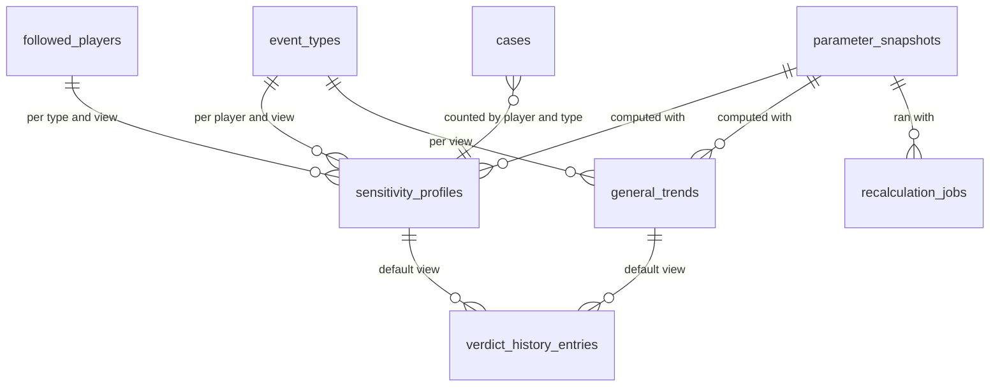

# Sensitivity and profiles

Sensitivity profiles, general trends, the verdict history and the recalculation jobs that write
them (`docs/08-sensibilite-et-verdict.md`). Profiles and trends are stored results of a
deterministic recalculation from stored data (SEN-36); the cases they count, with their states,
reasons and gaps, are in [events-and-cases.md](events-and-cases.md); the parameter values a result
was computed with are referenced through `parameter_snapshots` ([operations.md](operations.md)).
Conventions are in the [README](README.md).

## 1. Entities

### 1.1 `sensitivity_profiles` — `SensitivityProfile`

The calculation for one player, one type and one view (SEN-19 to SEN-27, SEN-21). A profile exists
for a validated type, or a withdrawn one shown archived, while its tally holds at least one event,
the events that left the count included and withdrawn ones excepted (SEN-19, CL-SEN-26). While the
birthday type is validated, a followed player without a recorded birthday also has a birthday
profile: an empty tally, every count 0, the verdict inconclusive, whose page only says why (record
0015, CL-SEN-26, CL-JOU-16). Every view is computed in full at each recalculation (CL-SEN-19); in
Lot 1 every case is historical.

| column                          | type             | null | default  | constraint or reference                                                                                                 | class | spec IDs                          |
| ------------------------------- | ---------------- | ---- | -------- | ----------------------------------------------------------------------------------------------------------------------- | ----- | --------------------------------- |
| `id`                            | integer          | no   | identity | primary key                                                                                                             | EV    | —                                 |
| `player_id`                     | uuid             | no   | —        | `REFERENCES followed_players(id) ON DELETE CASCADE`                                                                     | EV    | SEN-19                            |
| `event_type_id`                 | text             | no   | —        | `REFERENCES event_types(id) ON DELETE RESTRICT`                                                                         | EV    | SEN-19                            |
| `view`                          | text             | no   | —        | `CHECK (view IN ('all_cases','historical_only','tracked_only'))`                                                        | —     | SEN-21, CL-SEN-19                 |
| `event_count`                   | integer          | no   | —        | events counted (exits excluded)                                                                                         | EV    | SEN-20, SEN-32                    |
| `case_count`                    | integer          | no   | —        | —                                                                                                                       | EV    | SEN-20, SEN-32                    |
| `grouped_event_count`           | integer          | no   | —        | events joined to an existing case                                                                                       | EV    | SEN-20, SEN-32                    |
| `awaiting_count`                | integer          | no   | —        | cases awaiting their game                                                                                               | EV    | SEN-20                            |
| `valid_count`                   | integer          | no   | —        | n, the measured cases                                                                                                   | EV    | SEN-20, SEN-38                    |
| `excluded_count`                | integer          | no   | —        | —                                                                                                                       | EV    | SEN-20                            |
| `manually_excluded_count`       | integer          | no   | —        | of which by a manual decision                                                                                           | EV    | SEN-20, SEN-27                    |
| `not_measurable_count`          | integer          | no   | —        | —                                                                                                                       | EV    | SEN-20                            |
| `co_occurring_count`            | integer          | no   | —        | —                                                                                                                       | EV    | SEN-06, SEN-20                    |
| `provisional_gap_count`         | integer          | no   | —        | cases whose gap is provisional                                                                                          | EV    | SEN-20                            |
| `historical_valid_count`        | integer          | no   | —        | valid cases of historical origin                                                                                        | EV    | SEN-21, IHM-46                    |
| `tracked_valid_count`           | integer          | no   | —        | valid cases of tracked origin                                                                                           | EV    | SEN-21, IHM-46                    |
| `tally_reasons`                 | jsonb            | no   | —        | immutable snapshot: counts by awaiting reason, by not-measurable reason and by triggered criterion                      | EV    | SEN-20                            |
| `exit_counts`                   | jsonb            | no   | —        | immutable snapshot: events that left the count, by `TallyExitReason`; never a withdrawal                                | EV    | SEN-20, SEN-33                    |
| `low_research_confidence_count` | integer          | no   | —        | valid cases resting on a low-confidence event; calendar-derived cases never counted                                     | EV    | SEN-43, CL-SEN-03                 |
| `earlier_version_case_count`    | integer          | no   | —        | cases whose event is marked to requalify                                                                                | EV    | SEN-46, CL-TAX-07                 |
| `mean_gap`                      | double precision | yes  | —        | null when n = 0                                                                                                         | EV    | SEN-20, CL-SEN-15                 |
| `gap_dispersion`                | double precision | yes  | —        | sample deviation of the valid gaps; null when n < 2                                                                     | EV    | SEN-20, CL-SEN-15                 |
| `retained_dispersion`           | double precision | yes  | —        | max(dispersion, 1), 1 when n < 2; null when n = 0                                                                       | EV    | SEN-22                            |
| `expected_noise`                | double precision | yes  | —        | null when n = 0                                                                                                         | EV    | SEN-22                            |
| `signal_to_noise`               | double precision | yes  | —        | null when n = 0                                                                                                         | EV    | SEN-22                            |
| `range_low`                     | double precision | yes  | —        | mean − 2 × noise                                                                                                        | EV    | SEN-22, SEN-38                    |
| `range_high`                    | double precision | yes  | —        | mean + 2 × noise                                                                                                        | EV    | SEN-22, SEN-38                    |
| `above_zero_count`              | integer          | no   | —        | —                                                                                                                       | EV    | SEN-20, SEN-39                    |
| `below_zero_count`              | integer          | no   | —        | —                                                                                                                       | EV    | SEN-20, SEN-39                    |
| `verdict_level`                 | text             | no   | —        | `CHECK (verdict_level IN ('inconclusive','possible','probable'))`                                                       | EV    | SEN-23                            |
| `verdict_direction`             | text             | yes  | —        | `CHECK (verdict_direction IN ('increase','decrease'))`                                                                  | EV    | SEN-24                            |
| `is_fragile`                    | boolean          | no   | —        | the robustness test, run only when n reaches the threshold                                                              | EV    | SEN-26, CL-SEN-14                 |
| `profile_confidence`            | text             | no   | —        | `CHECK (profile_confidence IN ('low','medium','high'))`                                                                 | EV    | SEN-25                            |
| `confidence_step_down_reasons`  | text[]           | no   | `'{}'`   | `CHECK (confidence_step_down_reasons <@ ARRAY['high_dispersion','high_doubtful_share','fragile_verdict'])`              | EV    | SEN-25                            |
| `control_case_count`            | integer          | no   | —        | valid cases plus excluded cases with a computable gap                                                                   | EV    | SEN-27                            |
| `control_mean_gap`              | double precision | yes  | —        | —                                                                                                                       | EV    | SEN-27                            |
| `control_verdict_level`         | text             | no   | —        | values of `verdict_level`                                                                                               | EV    | SEN-27                            |
| `control_verdict_direction`     | text             | yes  | —        | values of `verdict_direction`                                                                                           | EV    | SEN-27                            |
| `depends_on_manual_exclusions`  | boolean          | no   | —        | undoing every manual decision would change level or direction                                                           | EV    | SEN-27                            |
| `coverage_warnings`             | text[]           | no   | `'{}'`   | `CHECK (coverage_warnings <@ ARRAY['type_not_covered','incomplete_profile'])`; always empty for a calendar-derived type | EV    | SEN-46, TAX-20, TAX-24, CL-SEN-03 |
| `valid_case_threshold`          | smallint         | no   | —        | the parameter in force at this calculation                                                                              | —     | SEN-20, SEN-31                    |
| `parameter_snapshot_id`         | integer          | no   | —        | `REFERENCES parameter_snapshots(id) ON DELETE RESTRICT`; every parameter value used                                     | —     | SEN-36, TRV-35                    |
| `computed_at`                   | timestamptz      | no   | —        | date of the last calculation                                                                                            | —     | SEN-20                            |

Row checks:

- `event_count = case_count + grouped_event_count` and
  `case_count = awaiting_count + valid_count + excluded_count + not_measurable_count` (SEN-32).
- `valid_count = historical_valid_count + tracked_valid_count`.
- `(verdict_level = 'inconclusive') = (verdict_direction IS NULL)`, and the same for the control
  verdict (SEN-24).
- `(valid_count = 0) = (mean_gap IS NULL)`; `valid_count < 2` iff `gap_dispersion IS NULL`.

Unique: `sensitivity_profiles_key (player_id, event_type_id, view)`.

Indexes: the unique index serves the player page and the profile detail;
`sensitivity_profiles_type_view_idx (event_type_id, view)` serves the profile list by type, the
alert sheet's copy (Lot 2) and the evaluated pairs of SEN-41.

Deletion: with the player; by a withdrawal or player deletion that leaves the pair with no event in
its tally, together with its verdict history (CL-SEN-18); by the job that finds a profile no longer
meeting the existence rule, such as an empty birthday profile once the birthday is recorded without
bringing an event, or once the birthday type is no longer validated.

```ts
type ProfileView = 'all_cases' | 'historical_only' | 'tracked_only';
type Verdict =
  | { level: 'inconclusive'; direction: null }
  | { level: 'possible' | 'probable'; direction: 'increase' | 'decrease' };
type ProfileConfidence = 'low' | 'medium' | 'high';
```

### 1.2 `general_trends` — `GeneralTrend`

The same calculation for one type and one view over all followed players, each case weighing the
same (SEN-28 to SEN-30). Archived when the type is withdrawn (SEN-19); a withdrawn player's valid
cases keep counting (H-JOU-07).

Columns: `id`, `event_type_id` (`REFERENCES event_types(id) ON DELETE RESTRICT`), `view`, and every
column of `sensitivity_profiles` from `event_count` to `computed_at` with the same types and checks,
except that `confidence_step_down_reasons` also admits `dominant_player` (SEN-29). Plus:

| column                            | type    | null | default | constraint or reference                                                             | class | spec IDs       |
| --------------------------------- | ------- | ---- | ------- | ----------------------------------------------------------------------------------- | ----- | -------------- |
| `distinct_player_count`           | integer | no   | —       | players with at least one valid case                                                | —     | SEN-28, SEN-29 |
| `top_contributor_valid_count`     | integer | no   | —       | valid cases of the player who brings the most; the share is this over `valid_count` | —     | SEN-28, SEN-29 |
| `incomplete_profile_player_count` | integer | no   | —       | players whose profile for the type is incomplete                                    | —     | SEN-46         |

The trend carries no `player_id`, so its tally is classed `EV` only through its counts; it names no
player.

Unique: `general_trends_key (event_type_id, view)`.

Deletion: a trend left with no event by a withdrawal is erased with its verdict history (CL-SEN-18).

### 1.3 `verdict_history_entries` — `VerdictHistoryEntry`

Every change of verdict level or direction, or of profile confidence, with its cause (SEN-37).
Written for the default view only, when the job that produced the change finishes (CL-SEN-16,
CL-SEN-19).

| column                   | type        | null | default  | constraint or reference                                                                                                                                                                                          | class | spec IDs                  |
| ------------------------ | ----------- | ---- | -------- | ---------------------------------------------------------------------------------------------------------------------------------------------------------------------------------------------------------------- | ----- | ------------------------- |
| `id`                     | integer     | no   | identity | primary key                                                                                                                                                                                                      | EV    | —                         |
| `sensitivity_profile_id` | integer     | yes  | —        | `REFERENCES sensitivity_profiles(id) ON DELETE CASCADE`                                                                                                                                                          | EV    | SEN-37                    |
| `general_trend_id`       | integer     | yes  | —        | `REFERENCES general_trends(id) ON DELETE CASCADE`                                                                                                                                                                | EV    | SEN-37                    |
| `changed_at`             | timestamptz | no   | `now()`  | the end of the job's run                                                                                                                                                                                         | EV    | SEN-37, CL-SEN-18         |
| `old_verdict_level`      | text        | no   | —        | values of `verdict_level`                                                                                                                                                                                        | EV    | SEN-37                    |
| `old_verdict_direction`  | text        | yes  | —        | values of `verdict_direction`                                                                                                                                                                                    | EV    | SEN-37                    |
| `old_profile_confidence` | text        | no   | —        | values of `profile_confidence`                                                                                                                                                                                   | EV    | SEN-37                    |
| `new_verdict_level`      | text        | no   | —        | values of `verdict_level`                                                                                                                                                                                        | EV    | SEN-37                    |
| `new_verdict_direction`  | text        | yes  | —        | values of `verdict_direction`                                                                                                                                                                                    | EV    | SEN-37                    |
| `new_profile_confidence` | text        | no   | —        | values of `profile_confidence`                                                                                                                                                                                   | EV    | SEN-37                    |
| `cause`                  | text        | no   | —        | `CHECK (cause IN ('new_cases','stats_correction','baseline_updated','manual_decision','event_dismissed','parameter_change','recalculation','event_corrected_or_removed','event_reinstated','taxonomy_changed'))` | EV    | SEN-37, SEN-48, CL-SEN-17 |

Row check: exactly one of `sensitivity_profile_id` and `general_trend_id` is not null; at least one
old value differs from its new value.

Indexes: `verdict_history_entries_profile_idx (sensitivity_profile_id, changed_at)` and
`verdict_history_entries_trend_idx (general_trend_id, changed_at)` serve the history views.

A withdrawal's or a player deletion's changes carry `recalculation` and nothing else (SEN-48,
CL-SEN-18).

```ts
type VerdictChangeCause =
  | 'new_cases'
  | 'stats_correction'
  | 'baseline_updated'
  | 'manual_decision'
  | 'event_dismissed'
  | 'parameter_change'
  | 'recalculation'
  | 'event_corrected_or_removed'
  | 'event_reinstated'
  | 'taxonomy_changed';
```

### 1.4 `recalculation_jobs` — the recorded recalculations

Every change SEN-34 or SEN-35 lists records a job in its own transaction, with its scope and its
cause; jobs run one at a time in the order recorded, chunked from the external trigger when they do
not fit one request (CL-SEN-16).

| column                  | type        | null | default     | constraint or reference                                                                                 | class | spec IDs          |
| ----------------------- | ----------- | ---- | ----------- | ------------------------------------------------------------------------------------------------------- | ----- | ----------------- |
| `id`                    | integer     | no   | identity    | primary key; the run order                                                                              | —     | CL-SEN-16         |
| `recorded_at`           | timestamptz | no   | `now()`     | —                                                                                                       | —     | CL-SEN-16         |
| `scope`                 | text        | no   | —           | `CHECK (scope IN ('import','statistics_update','event_or_case_change','full'))`; items a to d of SEN-34 | —     | SEN-34            |
| `player_ids`            | uuid[]      | yes  | —           | players concerned; null with `full`                                                                     | PI    | SEN-34            |
| `event_type_ids`        | text[]      | yes  | —           | types concerned (their trends); null means every type of those players                                  | —     | SEN-34            |
| `game_ids`              | integer[]   | yes  | —           | the new or modified games a statistics update signals (STA-32)                                          | —     | STA-32, SEN-34    |
| `cause`                 | text        | no   | —           | values of `VerdictChangeCause`; never merged with another cause                                         | —     | SEN-37, CL-SEN-17 |
| `status`                | text        | no   | `'pending'` | `CHECK (status IN ('pending','running','done'))`                                                        | —     | CL-SEN-16         |
| `started_at`            | timestamptz | yes  | —           | —                                                                                                       | —     | CL-SEN-16         |
| `lease_expires_at`      | timestamptz | yes  | —           | technical: a crashed invocation frees the job when it passes                                            | —     | TRV-30, CL-TRV-07 |
| `progress_cursor`       | text        | yes  | —           | technical: where the next chunk resumes                                                                 | —     | TRV-30            |
| `parameter_snapshot_id` | integer     | yes  | —           | `REFERENCES parameter_snapshots(id) ON DELETE RESTRICT`; set when it starts                             | —     | SEN-36            |
| `finished_at`           | timestamptz | yes  | —           | —                                                                                                       | —     | CL-SEN-16         |

Row checks: `scope = 'full'` iff `player_ids IS NULL`; `(status = 'done') = (finished_at IS NOT NULL)`.

Unique: `recalculation_jobs_one_running_key ((true)) WHERE status = 'running'` — one job at a time.

Indexes: `recalculation_jobs_pending_idx (id) WHERE status <> 'done'` serves the runner and the
"recalculation in progress" notice (SEN-36).

Lifetime: done jobs are deleted by the daily purge once older than `journalRetentionDays`; a
player-data deletion removes his id from pending jobs and deletes done jobs naming him
(CL-JOU-06).

## 2. Lifecycles

### 2.1 Recalculation job (CL-SEN-16)

| from    | to      | trigger                                                 | guard                                      | side effects                                                                                                                                           |
| ------- | ------- | ------------------------------------------------------- | ------------------------------------------ | ------------------------------------------------------------------------------------------------------------------------------------------------------ |
| (none)  | pending | a change listed by SEN-34 or SEN-35, in its transaction | —                                          | profiles and trends it covers show "recalculation in progress"                                                                                         |
| pending | running | right after the commit, or the next trigger wake-up     | it is the oldest pending job; none running | `parameter_snapshot_id` and `started_at` set; the lease taken                                                                                          |
| running | running | a chunk ends                                            | —                                          | cases written; each profile and trend written whole; `progress_cursor` and the lease moved                                                             |
| running | done    | the last chunk ends                                     | —                                          | verdict-history entries written for the default view; journal entry `profile_recalculation` (TRV-41); the triggering operation reports itself complete |
| running | running | the lease expires (crashed invocation)                  | —                                          | the next wake-up resumes from `progress_cursor`                                                                                                        |

### 2.2 Profile and trend presentation states — `ProfileNotice`, derived

| state                 | when                                                                                | spec IDs             |
| --------------------- | ----------------------------------------------------------------------------------- | -------------------- |
| below_threshold       | `valid_count < valid_case_threshold`: the SEN-31 presentation with the type's trend | SEN-31               |
| archived              | the player or the type is withdrawn                                                 | SEN-19               |
| recalculating         | a pending or running job covers it                                                  | SEN-36, CL-SEN-16    |
| awaiting_statistics   | its cases all wait with `statistics_pending` or `mapping_not_established`           | 12 « Cas limites »   |
| birthday_not_recorded | a birthday profile whose player has no recorded birthday: only the reason is shown  | CL-SEN-26, CL-JOU-16 |

## 3. Invariants

| rule                                                                                                                      | spec IDs                  | enforced by                                                 |
| ------------------------------------------------------------------------------------------------------------------------- | ------------------------- | ----------------------------------------------------------- |
| Tally invariants: events = cases + grouped events; cases = pending + valid + excluded + not measurable                    | SEN-32                    | row checks                                                  |
| A direction exists exactly when the level is not inconclusive                                                             | SEN-24                    | row checks                                                  |
| A recalculation is deterministic: same data, same parameters, same bits (fixed order of sums)                             | SEN-36, CL-STA-09         | pure engine; `parameter_snapshot_id` records the parameters |
| A recalculation never calls the statistics source and keeps every manual decision on an unchanged game                    | SEN-36, CL-SEN-12         | engine purity; recalculation service                        |
| A profile or trend is never half updated                                                                                  | CL-SEN-16                 | one transaction per profile or trend write                  |
| Only the default view enters the verdict history and SEN-41                                                               | CL-SEN-19, CL-SEN-20      | recalculation service                                       |
| A withdrawal leaves no trace in profiles, trends or the history beyond a `recalculation` entry; an emptied pair is erased | SEN-33, SEN-48, CL-SEN-18 | withdrawal step, then a full job                            |
| Profiles exist only for validated types and archived withdrawn ones                                                       | SEN-19                    | recalculation service                                       |
| While the birthday type is validated, every followed player without a recorded birthday has a birthday profile            | CL-SEN-26, CL-JOU-16      | recalculation service                                       |
| A type with a switched-off criterion shows the confounder warning on every profile and its trend while the switch is on   | ADR 0016, CL-SEN-13       | derived from `event_types.switched_off_criterion`           |
| Jobs with different causes are never merged; one job runs at a time                                                       | CL-SEN-16                 | job service; unique index on the running job                |

## 4. Stored or derived

| item                                                                                                                                                                                | stored or derived | recalculated when                                                                      | spec IDs                                   |
| ----------------------------------------------------------------------------------------------------------------------------------------------------------------------------------- | ----------------- | -------------------------------------------------------------------------------------- | ------------------------------------------ |
| Profile and trend values, tally, warnings of SEN-46                                                                                                                                 | stored            | each job covering them (SEN-34: import; statistics update; event or case change; full) | SEN-20 to SEN-29, SEN-34                   |
| Verdict history                                                                                                                                                                     | stored            | at the end of each job, for changes of the default view                                | SEN-37                                     |
| Archived, recalculating, below threshold                                                                                                                                            | derived           | on read                                                                                | SEN-19, SEN-31, SEN-36                     |
| Remaining refusals shown on profiles                                                                                                                                                | derived           | the sum over the player's requests (CL-SEN-22)                                         | SEN-46, CL-SEN-22                          |
| Confounder warning; "all cases are excluded for unusual stakes"                                                                                                                     | derived           | from the type's switch and the profile's criteria counts (CL-SEN-13)                   | ADR 0016, CL-SEN-13                        |
| Calendar-derived profile warnings: the team-history mention on every former-team profile; "birthday not recorded" and "counted from the first covered season" on a birthday profile | derived           | from the type, the player's birthday and his first NBA game (CL-STA-24)                | CL-STA-24, CL-JOU-16, CL-JOU-18, CL-SEN-03 |
| Doubtful share, top contributor's share, proportions as counts                                                                                                                      | derived           | from stored counts; shown as "k out of m" below `countsBelowCaseCount`                 | SEN-25, SEN-29, SEN-39, CL-SEN-21          |
| Evaluated pairs and verdicts chance alone would produce                                                                                                                             | derived           | on read: default-view profiles with n ≥ threshold × 2 × (1 − Φ(t))                     | SEN-41, CL-SEN-20, ADR 0021                |
| Date of the last change of a parameter that affects calculations                                                                                                                    | derived           | latest of `parameter_changes` (affects calculations) and criterion-switch changes      | SEN-37, TRV-35, CL-TRV-17                  |
| The values a profile was computed with                                                                                                                                              | stored            | `parameter_snapshot_id` at each write                                                  | SEN-36, TRV-35                             |

## 5. Exchange formats

Profiles appear in the spreadsheet export of profiles and in the full export
([operations.md](operations.md) section 5).

## 6. Rulings applied

- ADR 0016, CL-SEN-13: the confounder warning is derived from the type, never stored.
- ADR 0021, CL-SEN-20: editable thresholds; the chance count derived from the parameters in force.
- CL-SEN-14, CL-SEN-15: the robustness test only from the threshold; nulls below two cases.
- CL-SEN-16: recalculation jobs recorded with their change, chunked, one at a time.
- CL-SEN-17: ten causes, three of them new (`event_corrected_or_removed`, `event_reinstated`,
  `taxonomy_changed`).
- CL-SEN-18, CL-SEN-26: when a profile exists, the empty birthday profile included, and when it is
  erased with its history.
- CL-SEN-19: every view computed, the default one historized.
- CL-SEN-22: remaining refusals summed over requests, derived.
- Own choice: `parameter_snapshots` record every parameter value a profile was computed with, so a
  verdict stays reproducible after the journal's 90 days (SEN-36, the traceability rule of the
  model).
- Own choice: the reason breakdown of the tally is a snapshot (`tally_reasons`, `exit_counts`):
  rewritten whole at each job and read back whole; the counts the invariants use are columns.
- Own choice: the job scopes are named after SEN-34's items; the list is new to the glossary.

## 7. Diagram


