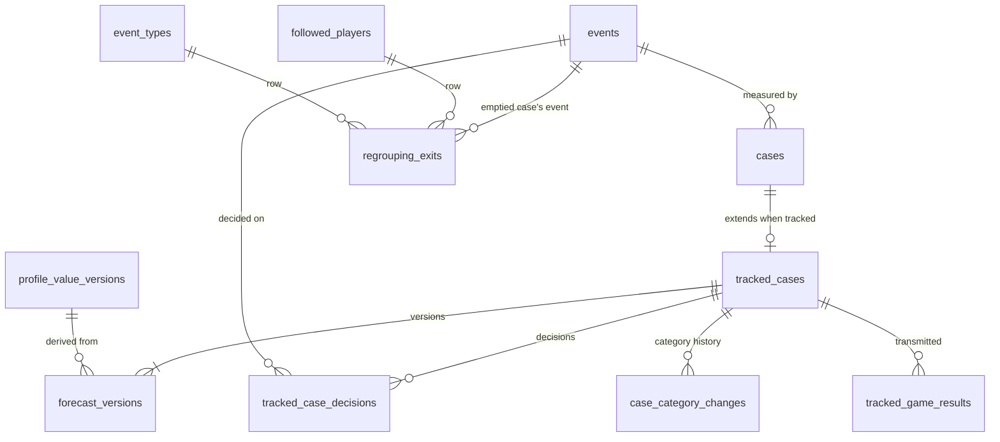

# Domain model — automatic tracking and validation (Lot 2)

Tracked cases before and after their game — forecast versions, the frozen or late forecast, the category and its history, the results transmitted, the decisions that touch the counts, the exits a regrouping leaves — and the validation table, which is derived: file 10 (SUI-01 to SUI-30) as ruled by `CL-SUI-01` to `CL-SUI-15` and `CL-SUI-16`, with ADR 0015 and `CL-DET-09`, `CL-DET-15`. The case itself (status, reason, measured game, gap, baseline) belongs to the core model (file 08); this file adds what file 10 lists "en complément de la description du cas donnée par le document 08".

**Conventions.** As in [collection.md](collection.md). Every "tip-off" below is the game's last known scheduled start (`CL-SUI-13`).

**Sensitive-data classes:** the core model's (`—`, `PI`, `EV`, `TX`, `PR`; README §3) and the two Lot 2 classes `EX` and `OW`, as the top of [collection.md](collection.md) says. A tracked case exists only because of its event: its rows are erased with it (SUI-30).

## 1. Entities

### 1.1 Tracked case — `tracked_cases`

The file-10 extension of a core case of origin `tracked`: its frozen or late forecast and its current category (SUI-01, SUI-08 to SUI-10, SUI-22). The case's creation instant is the core's `cases.created_at`.

| Column | Type | Null | Default | Constraint or reference | Class | Spec |
| --- | --- | --- | --- | --- | --- | --- |
| `id` | integer identity | no | — | primary key | — | SUI-01 |
| `case_id` | integer | no | — | → core `cases.id` `ON DELETE CASCADE`; unique; a case of origin `tracked` | EV | SUI-01, SUI-05 |
| `forecast_state` | text | yes | null | `CHECK (forecast_state IN ('frozen','late','none'))` (`ForecastState`); null until the measured game is first established | — | SUI-08 to SUI-10, CL-SUI-03 |
| `forecast_source` | text | yes | null | `CHECK (forecast_source IN ('player_profile','general_trend','none'))` (`ForecastSource`); `CHECK ((forecast_state IS NULL) = (forecast_source IS NULL))`; `CHECK ((forecast_state = 'none') = (forecast_source = 'none'))` | — | SUI-08, SUI-09 |
| `forecast_level` | text | yes | null | `CHECK (forecast_level IN ('possible','probable'))`; not null exactly when `forecast_source` is `player_profile` or `general_trend` | — | SUI-08 |
| `forecast_direction` | text | yes | null | `CHECK (forecast_direction IN ('increase','decrease'))`; same rule | — | SUI-08, SUI-22 |
| `announced_mean_gap` | double precision | yes | null | mean gap of the historical profile or trend used; same rule | — | SUI-22, SUI-24 |
| `forecast_case_count` | integer | yes | null | `CHECK (forecast_case_count >= 1)`; same rule | — | SUI-08 |
| `forecast_profile_confidence` | text | yes | null | `CHECK (forecast_profile_confidence IN ('low','medium','high'))`; same rule | — | SUI-08 |
| `forecast_frozen_at` | timestamptz | yes | null | `frozen` or `none`: the measured game's scheduled start the choice was made against; `late`: the instant of its computation; `CHECK ((forecast_state IS NULL) = (forecast_frozen_at IS NULL))` | — | SUI-09, SUI-10 |
| `awaiting_late_forecast` | boolean | no | false | true when the case had no forecast at its start because the pair's historical data was not yet available (`CL-SUI-05`); `CHECK (NOT awaiting_late_forecast OR forecast_state = 'none')` | — | SUI-10, CL-SUI-05 |
| `category` | text | yes | null | `CHECK (category IN ('confirmed','refuted','neutral','no_forecast'))` (`CaseCategory`); set while the case is measured, null otherwise | — | SUI-22 |

- **Unique and indexes:** `tracked_cases_case_uq` unique `(case_id)`; `tracked_cases_unfrozen_idx` `(id) WHERE forecast_state IS NULL` — the cases whose forecast versions are still followed, frozen by the first `game-tracking` run after the measured game's scheduled start with the last version before it (`CL-SUI-03`); `tracked_cases_late_idx` `(id) WHERE awaiting_late_forecast` — the late-forecast check after each statistics update and import (`CL-SUI-05`).
- **Deletion cascades to:** `forecast_versions`, `case_category_changes`, `tracked_game_results`, `tracked_case_decisions`.
- **TypeScript:** `id: TrackedCaseId`; `type Forecast = { source: 'player_profile' | 'general_trend'; level: 'possible' | 'probable'; direction: Direction; announcedMeanGap: number; caseCount: number; profileConfidence: ProfileConfidence }`; `type FrozenForecast = { state: 'frozen' | 'late'; forecast: Forecast; frozenAt: EpochMs } | { state: 'none'; frozenAt: EpochMs; awaitingLateForecast: boolean }`.

### 1.2 Forecast version — `forecast_versions`

The forecast the case would get at a given instant, one row per change, recorded while the case waits for its measured game (SUI-09, `CL-SUI-03`). Versions are derived from the core's append-only `profile_value_versions` (`ProfileValueVersion`) of historical-only profiles and trends, so each takes the instant of the change that produced it, whatever the timing of the `game-tracking` run that writes it.

| Column | Type | Null | Default | Constraint or reference | Class | Spec |
| --- | --- | --- | --- | --- | --- | --- |
| `id` | integer identity | no | — | primary key | — | SUI-09 |
| `tracked_case_id` | integer | no | — | → `tracked_cases.id` `ON DELETE CASCADE` | — | SUI-09 |
| `effective_at` | timestamptz | no | — | the case's creation instant for the first version; otherwise the instant the pair's historical profile or the type's historical trend changed | — | SUI-09, CL-SUI-03 |
| `source` | text | no | — | `CHECK (source IN ('player_profile','general_trend','none'))` | — | SUI-08 |
| `level` | text | yes | null | `CHECK (level IN ('possible','probable'))`; `CHECK ((source = 'none') = (level IS NULL))` | — | SUI-08 |
| `direction` | text | yes | null | `CHECK (direction IN ('increase','decrease'))`; `CHECK ((source = 'none') = (direction IS NULL))` | — | SUI-08 |
| `announced_mean_gap` | double precision | yes | null | `CHECK ((source = 'none') = (announced_mean_gap IS NULL))` | — | SUI-08 |
| `case_count` | integer | yes | null | `CHECK ((source = 'none') = (case_count IS NULL))` | — | SUI-08 |
| `profile_confidence` | text | yes | null | `CHECK (profile_confidence IN ('low','medium','high'))`; `CHECK ((source = 'none') = (profile_confidence IS NULL))` | — | SUI-08 |

- **Unique and indexes:** `forecast_versions_uq` unique `(tracked_case_id, effective_at)` — the last version strictly before a scheduled start, and the case's timestamped versions on screen.
- **Deletion:** with its tracked case.
- **TypeScript:** `{ effectiveAt: EpochMs; forecast: Forecast | null }`.

### 1.3 Category change — `case_category_changes`

The category's history (SUI-15, SUI-21): each change with the gap that gave it.

| Column | Type | Null | Default | Constraint or reference | Class | Spec |
| --- | --- | --- | --- | --- | --- | --- |
| `id` | integer identity | no | — | primary key | — | SUI-21 |
| `tracked_case_id` | integer | no | — | → `tracked_cases.id` `ON DELETE CASCADE` | — | SUI-21 |
| `changed_at` | timestamptz | no | — | | — | SUI-15, SUI-21 |
| `category` | text | yes | null | `CHECK (category IN ('confirmed','refuted','neutral','no_forecast'))`; null when the case left the measured status | — | SUI-22 |
| `normalized_gap` | double precision | yes | null | the case's gap at that moment | — | SUI-15, SEN-08 |
| `gap_status` | text | yes | null | `CHECK (gap_status IN ('provisional','final'))` | — | SUI-15, SEN-09 |

- **Unique and indexes:** `case_category_changes_case_idx` `(tracked_case_id, changed_at)`.
- **Deletion:** with its tracked case.
- **TypeScript:** `{ changedAt: EpochMs; category: CaseCategory | null; normalizedGap: number | null; gapStatus: GapStatus | null }`.

### 1.4 Tracked game result — `tracked_game_results`

What file 10 transmitted, with its date and content (SUI-19, SUI-20): the indicative result while the baseline is being built, the final one when the case leaves awaiting its game. Notifications send one message per case in its life (`CL-SUI-09`).

| Column | Type | Null | Default | Constraint or reference | Class | Spec |
| --- | --- | --- | --- | --- | --- | --- |
| `id` | integer identity | no | — | primary key | — | SUI-19 |
| `tracked_case_id` | integer | no | — | → `tracked_cases.id` `ON DELETE CASCADE` | — | SUI-19 |
| `kind` | text | no | — | `CHECK (kind IN ('indicative','final'))` (`TrackedGameResultKind`) | — | SUI-19, SUI-20 |
| `transmitted_at` | timestamptz | no | — | | — | SUI-19 |
| `content` | jsonb | no | — | immutable snapshot of the transmitted result (§5.1), read back whole | EV | SUI-19, SUI-20 |

- **Unique and indexes:** `tracked_game_results_case_idx` `(tracked_case_id, transmitted_at)`.
- **Deletion:** with its tracked case; by the withdrawal step when the case survives (§1.8).
- **TypeScript:** `{ kind: TrackedGameResultKind; transmittedAt: EpochMs; content: TrackedGameResult }`.

### 1.5 Tracked-case decision — `tracked_case_decisions`

Every owner decision of the kinds SUI-17 lists that made a tracked case leave the counts, enter them or change its measured game, with its effect (`CL-SUI-10`). A decision is a **post-tip-off decision** (`PostTipOffDecision`) when `decided_at` is at or after the scheduled start of the case's measured game, or of its expected game while none is established; the position is derived, so a later-established game reclassifies it (`CL-DET-15`).

| Column | Type | Null | Default | Constraint or reference | Class | Spec |
| --- | --- | --- | --- | --- | --- | --- |
| `id` | integer identity | no | — | primary key | — | SUI-17 |
| `tracked_case_id` | integer | no | — | → `tracked_cases.id` `ON DELETE CASCADE` | — | SUI-17 |
| `kind` | text | no | — | `CHECK (kind IN ('event_dismissed','event_reinstated','case_excluded','case_reinstated','context_corrected','reference_date_corrected','player_corrected','type_corrected','dating_mark_lifted'))` (`PostTipOffDecisionKind`) | — | SUI-17 |
| `effect` | text | no | — | `CHECK (effect IN ('exit','entry','measured_game_change'))` (`PostTipOffDecisionEffect`) | — | SUI-17, CL-SUI-10 |
| `player_event_id` | integer | yes | null | → core `events.id` `ON DELETE SET NULL`; the event decided on, which may be a historical event of the tracked case (a context correction); null for `case_excluded` and `case_reinstated`, and set to null when a manual deletion or a replacement at import (IMP-29, IMP-33) deletes the historical event decided on: the decision stays on its tracked case, which stays touched | EV | SUI-17 |
| `decided_at` | timestamptz | no | — | | — | SUI-17, H-SUI-07 |

- **Unique and indexes:** `tracked_case_decisions_case_idx` `(tracked_case_id, decided_at)` — the case's decisions and the latest one (`CL-SUI-10`).
- **Deletion:** with its tracked case, except that a regrouping first moves them to the surviving case's tracked case when there is one (§1.8); the decisions about a withdrawn event by the withdrawal step; repointed to the kept event when two detected events are merged (§1.8); its `player_event_id` set to null when a deletion at import removes the historical event decided on.
- **TypeScript:** `{ kind: PostTipOffDecisionKind; effect: PostTipOffDecisionEffect; playerEventId: PlayerEventId | null; decidedAt: EpochMs }`; `isPostTipOff` is computed.

### 1.6 Regrouping exit — `regrouping_exits`

What remains of a tracked case that a regrouping emptied, or that a merge of two detected events removed with its absorbed event, after its measured game's scheduled start (`CL-SUI-16`). The core then deletes the emptied case (events-and-cases.md §2.5) and its tracked-case rows cascade; this row keeps it counted among the cases "now out of the counts" of its rows (`CL-SUI-10`), with its gap in the forecast direction when it had both a measured gap and a forecast. It is written once by `tracking.moveCaseReferences` in the regrouping reactions (module map §1.10), never recalculated, and holds no date and no game.

| Column | Type | Null | Default | Constraint or reference | Class | Spec |
| --- | --- | --- | --- | --- | --- | --- |
| `id` | integer identity | no | — | primary key | — | SUI-17 |
| `player_event_id` | integer | no | — | → core `events.id` `ON DELETE RESTRICT`; the emptied case's earliest-recorded event of origin `detected` or `calendar`, which now belongs to the surviving case, or after a merge the kept event; never a historical event, so no deletion at import meets the row; that event's erasure deletes the row | EV | SUI-17, SUI-30 |
| `player_id` | uuid | no | — | → core `followed_players.id` `ON DELETE RESTRICT`; the emptied case's player, which places the exit in its rows | PI EV | SUI-23 |
| `event_type_id` | text | no | — | → core `event_types.id` `ON DELETE RESTRICT`; the emptied case's type | EV | SUI-23 |
| `overall_subrow` | text | yes | null | `CHECK (overall_subrow IN ('probable_profile','possible_profile','general_trend'))` (`OverallSubrowKind`), from the forecast the case had at its last known scheduled start, by the freeze's rule: the stored frozen or late forecast, otherwise the forecast version in force at that start (§2.1); null only when the case had no forecast by that rule | EV | SUI-28, CL-SUI-03, CL-SUI-16 |
| `gap_in_forecast_direction` | double precision | yes | null | the case's measured gap, or its opposite for a forecast of decrease, when it had both; `CHECK (gap_in_forecast_direction IS NULL OR overall_subrow IS NOT NULL)` | EV | SUI-22, CL-SUI-10 |

- **Unique and indexes:** `regrouping_exits_pair_idx` `(player_id, event_type_id)` — the rows of the validation table; `regrouping_exits_event_idx` `(player_event_id)` — the erasers.
- **Deletion:** by the erasure of its event — withdrawal, requalification or split erasure, player-data deletion, or the drop of a calendar-derived event by a derivation (tracking's `eraseEventData` in the derivation reactions, which the `RESTRICT` link requires) — as if the emptied case had never existed (SEN-48, SUI-30); repointed to the kept event when two detected events are merged; never purged.
- **TypeScript:** `interface RegroupingExit { playerEventId: PlayerEventId; playerId: PlayerId; eventTypeId: EventTypeId; overallSubrow: OverallSubrowKind | null; gapInForecastDirection: number | null }`.

### 1.7 Validation table (derived) — `ValidationTable`, `ValidationRow`

The table has no storage: the pure calculation core computes it on each read from the tracked cases, their decisions and categories, the regrouping exits (§1.6) and the core's cases (SUI-23 to SUI-28). It informs and stops nothing (SUI-29).

**Rows** (SUI-23, `CL-SUI-02`, `CL-SUI-11`): one per validated or archived type; one per active or paused player; one per player–type pair with at least one tracked case; the overall row with its sub-rows by forecast source and level (`probable_profile`, `possible_profile`, `general_trend`); rows of withdrawn types and players in a separate part labeled "archived". A co-occurring case counts once in each row it belongs to, and each row shows how many of its cases are co-occurring (`CL-SUI-06`).

**Testing set of a row** (SUI-24, `CL-SUI-02`): its tracked cases that are measured (valid), recorded in time, without a late forecast, untouched by a post-tip-off decision, and whose event is not dismissed (`CL-DET-09`).

| Value | Computation | Spec |
| --- | --- | --- |
| Category counts | testing cases with a forecast; confirmed, refuted, neutral among them; cases without forecast | SUI-24 |
| Chance-expected counts | for n cases with a forecast and `tracking.categoryThreshold` t: n × (1 − Φ(t)) confirmed, as many refuted, n × (2Φ(t) − 1) neutral, one decimal | SUI-24, CL-SUI-15 |
| Mean gap in forecast direction | over the testing cases with a forecast: mean m, count n, range m ± 2b with b = max(sample dispersion, 1) ÷ √n (dispersion 1 when n < 2) | SUI-22, SUI-24, SEN-22 |
| Announced gap | mean of their frozen `announced_mean_gap`, in forecast direction | SUI-24 |
| Tracked against historical | mean normalized gap of all testing cases, with and without forecast, with count and range, beside the current mean gap of the valid historical cases of the same row (the overall row: of all of them) | SUI-24, CL-SUI-02 |
| Assessment | only with at least `tracking.minTrackedCasesForAssessment` cases with a forecast, else "too few tracked cases to conclude (k of 10)"; with k = `sensitivity.possibleSignalToNoise`: `confirmed` if m ≥ k·b and a − m < k·b, `confirmed_weaker_than_announced` if m ≥ k·b and a − m ≥ k·b, `refuted` if m < k·b and a − m ≥ k·b, else `undecided` | SUI-26, SUI-27, CL-SUI-07 |
| Late-forecast part | the same values and its own assessment, same minimum | SUI-25, CL-SUI-08 |
| Separate counts | recorded after tip-off; excluded, not measurable, pending; post-tip-off decisions as three counts — now out of the counts (touched cases whose latest decision is an exit, plus the row's regrouping exits), now in by an entry, now in by a measured-game change — each with its mean gap in forecast direction over the cases that have both, a regrouping exit contributing its stored gap; provisional gaps | SUI-25, CL-SUI-10 |
| Header | the withdrawn-events counter (core), the date of the last change of a parameter that affects calculations (core), the three reading rules | SUI-25, SUI-28, SUI-30 |

- **TypeScript:** `interface ValidationRow { scope: ValidationRowScope; playerId?: PlayerId; eventTypeId?: EventTypeId; subrowKind?: OverallSubrowKind; archived: boolean; categoryCounts: CategoryCounts; chanceExpectedCounts: CategoryCounts; meanGapInForecastDirection: GapSummary | null; announcedGap: number | null; trackedMeanGap: GapSummary | null; currentHistoricalMeanGap: GapSummary | null; assessment: RowAssessment | { tooFew: number }; latePart: LatePart; separateCounts: SeparateCounts; coOccurringCount: number; provisionalGapCount: number }`; `interface ValidationTable { rows: readonly ValidationRow[]; withdrawnEventCount: number; lastCalculationParameterChangeAt: EpochMs | null; computedAt: EpochMs }`.

### 1.8 Withdrawal, other erasures, purge, export and backup

**Withdrawal of an event E** (SUI-30). The tracking eraser runs after the alerts eraser and before detection's. In the withdrawal's transaction:

1. if E's case is erased with E (E is its only event), its tracked case is deleted with every row of §1.1 to §1.5;
2. otherwise — the case groups other events of the same type (SEN-05) — the results it transmitted, which name E, and the decisions about E are deleted;
3. the outbox facts of every deleted result (`outbox_facts.lot2_subject_id`, kind `tracked_result_ready`) are deleted with it;
4. E's `regrouping_exits` rows are deleted, since SEN-48 wants the counts as if E had never existed.

The validation table, being derived, no longer counts the case anywhere, separate counts included, and the core's withdrawn-events counter grows by one (DSN-29). Nothing about E remains in these tables.

**Other erasures.** An erasure by requalification or split (CL-TAX-09) follows the same steps without the counter. A player-data deletion erases his tracked cases through the withdrawal of each of his events; `tracking.erasePlayerData` then deletes the regrouping exits that still name him, those whose event a player correction gave to another player included. An upcoming calendar-derived event dropped before its scheduled start is deleted with its case and tracked case, never counts, and is no post-tip-off decision (`CL-SUI-14`); one dropped after its game started is deleted the same way, and the core journals it and counts it in the profile's tally as `no_longer_derived` (`CL-SEN-25`). In both cases tracking's `eraseEventData`, in the derivation reactions (module map §1.10), also deletes the event's `regrouping_exits` rows before the event goes.

**Regrouping** (core events-and-cases.md §2.5, `CL-SUI-16`). The survivor and origin rules are the core's: the event joins the case that already has the game, and no case changes origin. Before a case emptied by a regrouping is deleted, `tracking.moveCaseReferences(fromCaseId, intoCaseId)` runs last in the regrouping reactions (module map §1.10), after notifications':

1. if the emptied case is tracked, its measured game's last known scheduled start has passed and it still holds an event of origin `detected` or `calendar`, one `regrouping_exits` row records it, tied to the earliest-recorded such event, whatever the surviving case's origin, with the forecast the case had at that start by the freeze's rule — the stored frozen or late forecast, otherwise the forecast version in force at that start — and the gap the case had when it was emptied;
2. if the surviving case is tracked, the emptied case's decisions move to the surviving tracked case, which then shows by its latest decision (`CL-SUI-10`);
3. the emptied tracked case's other rows then cascade with the case; an unconsumed `tracked_result_ready` fact whose result no longer exists is dropped by the dispatch as stale (TEL-23).

A regrouping before the scheduled start records no exit: no result was known.

**Merge of two detected events** (DET-47, `CL-SUI-16`). `tracking.moveEventReferences(fromEventId, intoEventId)`, called by `detection.correct` before the absorbed event is erased (module map §1.7):

1. when the absorbed event's case goes with it — it goes when the absorbed event is its only event and the kept event belongs to another case — the same code as `moveCaseReferences(absorbedCaseId, keptCaseId)` runs: one `regrouping_exits` row if that case is tracked and its measured game's last known scheduled start has passed (its rows, the sub-row by the freeze's rule, the gap as it was), and its decisions move to the kept event's tracked case when there is one;
2. the event-level rows then follow the kept event: decisions about the absorbed event and `regrouping_exits` rows tied to it are repointed to the kept event;
3. the absorbed case's other tracked-case rows cascade when the core's erasure step deletes that case.

Before the scheduled start, or when the absorbed event shares its case with another event, step 1 records nothing.

**Limit** (`CL-SUI-16`). A tracked case whose remaining events are all imported or entered by hand, and which the deletion or the replacement of its last event later removes (IMP-29, IMP-33), leaves no regrouping exit: that Lot 1 path runs no Lot 2 step (`CL-TRV-24`), the tracked-case rows cascade with the case, and the profile's tally still counts the deletion or the replacement (SEN-33). For the same reason a regrouping that empties such a case records no exit, having no detected or calendar event to tie it to; the tally counts the grouping (SEN-32).

**Purge.** None: tracked cases are case data and last as long as their case.

**Export and backup** (`CL-TRV-05`). Every table of this file is in each backup and in the full export. The cases spreadsheet (TRV-52, one row per case) carries, for a tracked case, the recording timing, the frozen forecast (source, level, direction, announced gap, late or not) and the category (§8).

## 2. Lifecycles

### 2.1 Forecast of a tracked case (`ForecastState`)

| From | To | Trigger | Guard | Side effects | Spec |
| --- | --- | --- | --- | --- | --- |
| — | (unfrozen) | a detected event creates its case; an upcoming calendar-derived event is derived before its game's scheduled start | — | `tracked_cases` row; version 1 at the case's creation instant from the historical-only profile and trend | SUI-01, SUI-08, CL-SUI-14 |
| (unfrozen) | (unfrozen) | the pair's historical profile or the type's historical trend changes so that the forecast changes | the case still awaits the freeze | a version at the instant of that change | SUI-09, CL-SUI-03 |
| (unfrozen) | `frozen` | file 08 first establishes the measured game | the last version strictly before its scheduled start has a forecast | the forecast copied; `forecast_frozen_at` = that start | SUI-09, CL-SUI-03 |
| (unfrozen) | `none` | the same | that version has no forecast | `awaiting_late_forecast` set when the pair's historical data was not yet available at that start | SUI-08, CL-SUI-05 |
| `none` (awaiting) | `late` | the missing data has arrived and no historical case of the pair awaits its statistics | SUI-08 then gives a possible or probable forecast, computed without this case | the forecast copied; `forecast_frozen_at = now`; the case moves to the late-forecast part | SUI-10, CL-SUI-05 |
| `none` (awaiting) | `none` | the same | SUI-08 gives no forecast | `awaiting_late_forecast = false`; the case stays without forecast in the testing set | CL-SUI-05 |

`frozen` and `late` are final (SUI-09, SUI-10). A post-tip-off decision that changes the measured game keeps the frozen forecast; only the recording timing is computed again against the new game (`CL-SUI-03`).

### 2.2 Category (`CaseCategory`)

| From | To | Trigger | Guard | Side effects | Spec |
| --- | --- | --- | --- | --- | --- |
| null | a category | the case becomes measured | — | from the gap in forecast direction and `tracking.categoryThreshold`: `confirmed` at or above +t, `refuted` at or below −t, `neutral` between; `no_forecast` without a forecast | SUI-22 |
| a category | another or null | the gap changes (provisional baseline, statistics correction), the case is excluded or reinstated, the threshold changes, a late forecast arrives | — | a `case_category_changes` row; the table uses the new value; no new message (TEL-17) | SUI-15, SUI-21, CL-SUI-04 |

### 2.3 Transmitted results (`TrackedGameResultKind`)

| From | To | Trigger | Guard | Side effects | Spec |
| --- | --- | --- | --- | --- | --- |
| — | `indicative` | the measured game is played while the baseline is still being built | — | a result with the index and the indicative comparison; a `tracked_result_ready` outbox fact (`lot2_subject_id` = the result) if no result was notified for the case | SUI-20, CL-SUI-09 |
| — | `final` | the case leaves awaiting its game: measured, excluded or not measurable | — | a result with the measurement or the reason; an outbox fact only if no result was notified yet; the sheet's outcome (alert-sheets.md) | SUI-19, CL-SUI-09 |

A case whose event was dismissed after tip-off is still measured (`CL-DET-15`) but transmits no result (TEL-23, TEL-38).

### 2.4 Decisions (`PostTipOffDecisionKind`, `PostTipOffDecisionEffect`)

A decision row is recorded by the composed action that makes the decision, in its transaction, whenever the decision changes whether the case is in the counts or changes its measured game: dismissal and reinstatement of the event (`exit`, `entry`), manual exclusion and reinstatement (`exit`, `entry`), a context correction that makes the case doubtful or no longer doubtful (`exit`, `entry`), a reference-date correction, a lifted dating mark (`measured_game_change`, or `entry` when it releases a pending case), a player or type correction (`entry` into the new rows). A change of a calculation parameter applies to every case alike and is no decision (`CL-SUI-04`). A calendar-derived case cannot be dismissed, nor its type, player or date corrected (`CL-SUI-14`).

## 3. Invariants

| Rule | Spec | Enforced by |
| --- | --- | --- |
| Every case of origin `tracked` has exactly one `tracked_cases` row, and only those cases have one. | SUI-01, SUI-05 | tracking service, in the transaction that creates the case |
| A case's origin never changes; one event gives one case. | SUI-05, SUI-07 | core cases; detection and import matching (DET-58, IMP-27) |
| A forecast is computed from historical cases only, never from the case itself or another tracked case. | SUI-08, SUI-11 | tracking service reads the historical-only view |
| A trend never replaces the verdict of a pair that reaches the case threshold. | SUI-08, SEN-31 | tracking service |
| Versions are recorded only while the forecast is unfrozen; the frozen forecast is the last version strictly before the measured game's scheduled start. | SUI-09, CL-SUI-03 | tracking service |
| A frozen or late forecast never changes; a late one follows only a `none` frozen while the data was missing. | SUI-09, SUI-10, CL-SUI-05 | tracking service; `CHECK` on `tracked_cases` |
| The forecast's fields match its state and source. | SUI-08 | `CHECK` on `tracked_cases` and `forecast_versions` |
| A category exists exactly while the case is measured. | SUI-22 | tracking service |
| "Recorded in time" means created before the measured game's scheduled start. | SUI-06 | derived, never stored |
| One tracked-game result message per case in its life. | CL-SUI-09, TEL-17 | notifications' unique index (notifications.md) |
| The validation table counts exactly the testing set of each row; it writes nothing. | SUI-24, SUI-29 | pure calculation core; no write path |
| A withdrawn event's case appears in no row, separate counts included. | SUI-30 | eraser of §1.8; the table is derived |
| A tracked case emptied by a regrouping, or removed by a merge of two detected events, after its game's scheduled start still counts once among the cases now out of the counts, through later recalculations, until its event is erased. | SUI-17, CL-SUI-10, CL-SUI-16 | `tracking.moveCaseReferences` in the regrouping reactions writes `regrouping_exits`; nothing recalculates it |

## 4. Stored or derived

| Item | Stored or derived | Recalculation |
| --- | --- | --- |
| Creation instant | stored on the core's case | never changes (SUI-01) |
| Expected game | derived: the core's expected game of the event (STA-27), computed from the reference date as file 04 records it (`CL-SUI-12`); for a calendar-derived event, its derived game | — |
| Recording timing (`RecordingTiming`) | derived: `cases.created_at` before, or at or after, the measured game's scheduled start | recomputed on read, so a changed measured game is followed (`CL-SUI-03`) |
| Forecast versions | stored | appended by the `game-tracking` run from `profile_value_versions` while unfrozen; that task is due after each statistics ingestion (chained to the statistics update or fetch) and at a game's expected availability, never polled at every tick (decision record 0025) |
| Frozen or late forecast | stored | §2.1 |
| Gap in forecast direction | derived: the gap, or its opposite for a decrease | — |
| Category | stored, with its history | §2.2 |
| Transmitted results | stored, immutable | §2.3 |
| Post-tip-off position of a decision | derived (§1.5) | — |
| Regrouping exits | stored (§1.6) | written once when the case is emptied; never recalculated; erased with their event |
| Validation table | derived on each read (§1.7) | — |
| "Computed at" of the table | the instant of the read | — |

## 5. Exchange formats

### 5.1 Tracked game result (`TrackedGameResult`)

The content stored in `tracked_game_results.content` and handed to notifications, which composes the TEL-13 line from it (notifications.md §5). It holds identifiers and numbers, never a text of the event or of an article.

| Key | Type | Allowed values and limits | Spec |
| --- | --- | --- | --- |
| `kind` | string | `indicative`, `final` | SUI-19, SUI-20 |
| `caseId`, `playerId`, `playerEventIds`, `eventTypeId` | identifiers | the case, its player, its events, its type | SUI-19 |
| `measuredGameId` | identifier or null | null when no game was played within the window | SUI-19 |
| `minutes` | number or null | decimal minutes | SUI-19 |
| `performanceIndex` | number or null | | SUI-19 |
| `baseline` | object or null | `{ mean, deviation, status }`: two numbers and the baseline status `final`, `provisional` or `building` | SUI-19, STA-21 |
| `normalizedGap` | number or null | unrounded | SUI-19, SEN-09 |
| `gapStatus` | string or null | `provisional`, `final` | SUI-15 |
| `indicativeComparison` | number or null | the comparison with the previous season, for `indicative` only | SUI-20 |
| `caseStatus` | string | `measured`, `excluded`, `not_measurable`, `awaiting_game` (indicative) | SUI-19 |
| `statusReason` | string or null | a `CaseStatusReason` (`derived_game_missed` for a calendar-derived case whose player did not play the derived game), or the triggered criteria for `excluded` | SUI-19, CL-SEN-03 |
| `forecast` | object or null | the frozen or late forecast: `{ source, level, direction, announcedMeanGap, caseCount }` | SUI-19 |
| `category` | string or null | a `CaseCategory` | SUI-22 |
| `recordedAfterTipOff` | boolean | | SUI-06, SUI-19 |
| `lateForecast` | boolean | | SUI-10, SUI-19 |
| `profile` | object | new state: `{ validCount, meanGap, rangeLow, rangeHigh, verdictLevel, direction, profileConfidence, verdictChanged }` | SUI-19 |
| `noBacktestYet` | boolean | the player is not profiled for a researched type; always false for a calendar-derived type | TEL-13, CL-TEL-16 |

## 6. Rulings applied

- `CL-SUI-01`: acceptance criteria are `CA-SUI-01` to `CA-SUI-21`.
- `CL-SUI-02`: the overall row's contents and comparison.
- `CL-SUI-03`: versions recorded while waiting; the freeze against the first established measured game; no new choice after a post-tip-off change.
- `CL-SUI-04`: a parameter change re-measures every case, changes no frozen forecast, and is no decision.
- `CL-SUI-05`: when a late forecast exists and when it is computed; `awaiting_late_forecast`.
- `CL-SUI-06`: co-occurring cases count once per row.
- `CL-SUI-07`: the assessment's factor is the "possible" signal-to-noise threshold.
- `CL-SUI-08`: the late part's assessment uses the same minimum.
- `CL-SUI-09`: one result message per case.
- `CL-SUI-10`: three counts of touched cases by present situation and latest decision.
- `CL-SUI-11`: rows of withdrawn types and players kept in an archived part.
- `CL-SUI-12`, `CL-SUI-13`: one reference instant per event; scheduled start as tip-off.
- `CL-SUI-14`, `CL-TAX-19`: upcoming calendar-derived events become tracked cases, created by the regular derivation runs; their changes and table membership. A withdrawn type deletes nothing (`CL-SUI-14`, `CL-TAX-20`): its upcoming events and their tracked cases stay and are measured, counting only in the type's archived profiles and trend, in the archived part of the table.
- `CL-SUI-15`: chance-expected counts.
- `CL-DET-09`, `CL-DET-15`: dismissed cases leave every calculation; only a dismissal at or after tip-off shows in the separate count, measured outside the calculations.
- `CL-SUI-16`: a tracked case emptied by a regrouping, or removed by a merge of two detected events, after its game's scheduled start leaves a regrouping exit; the surviving or kept event's tracked case takes its decisions.

Modeling choices of this file:

1. **The validation table is not stored.** Every value is a function of stored case data and parameters; computing it on read cannot go stale, and a few hundred tracked cases a season keep that cheap. Its "computed at" is the read instant.
2. **Recording timing is derived**, not stored, so a measured game changed after tip-off is followed without a second copy (`CL-SUI-03`).
3. **Forecast versions take the instant of the profile change, not the run's**, from the core's append-only `profile_value_versions` (module map choice 8).
4. **Decisions are recorded with their effect whatever their position**, and "post-tip-off" is derived against the measured game once established, like the dismissal position of `CL-DET-15`; the effect cannot be recomputed later, the position can.
5. **New enumeration `TrackedGameResultKind`** (`indicative`, `final`), to add to the glossary.
6. **A regrouping exit is one row tied to its event, not a tally.** It is as small as a count per row, holds no date or game, and the table sums the rows; tied to the emptied case's earliest-recorded event, it goes with that event's erasure, as SEN-48 and SUI-30 want, where a tally without reference, like `CL-SEN-25`'s, would have to survive a withdrawal. A ghost tracked case without a core case was the heavier alternative.

## 7. Entity-relationship diagram

`cases`, `events`, `followed_players`, `event_types` and the core's append-only `profile_value_versions` belong to the core model.

## 8. Requests to the core model

1. **Cases** (`cases`): `origin = 'tracked'` for every detected event's case and for a calendar-derived event created before its game's scheduled start, `historical` otherwise (`CL-SUI-14`); `created_at` immutable, equal to the creation instant (SUI-01, SUI-06); read access to the measured game and its scheduled start, status and reason, gap and its status, baseline, minutes and index; no hook: `game-tracking`, chained after the statistics tasks, `calendar-derivation` and `recalculation` (module map §4, §1.10), reads when a tracked case's measured game is first established or changes, when it leaves awaiting its game, and when its gap, status or baseline changes (SUI-12, SUI-15, SUI-21).
2. **Append-only profile history** (`profile_value_versions`, `ProfileValueVersion`): for each player–type pair in the historical-only view and each type's historical-only trend, a row per change with the instant it took effect, the valid-case count, mean gap, verdict level and direction, and profile confidence, queryable by pair or type and instant (SUI-08, SUI-09, `CL-SEN-19`). The glossary keeps `ProfileSnapshot` for the alert sheet's frozen copy.
3. **Historical data availability of a pair** (`CL-SUI-05`): whether an imported research result covers the type for the player (BKT-10), whether the calendar derivation over the covered seasons has run for him, and whether a historical case of the pair still awaits its statistics.
4. **Decision reports**: the route composed actions (module map §1.7) of manual exclusion and reinstatement (SEN-17), dismissal and reinstatement (DET-45), context, reference-date, player and type corrections (DET-47, DET-48) and the lifting of the dating mark (SEN-45) report to tracking, in their transaction, whether the case left the counts, entered them or changed its measured game.
5. **Calendar derivation in Lot 2** (`CL-SUI-14`, `CL-TAX-19`): the regular runs, in every collection-and-detection pass and at the end of every statistics update, create an upcoming event only for a game that is the player's next game and has not started, with a tracked case; a withdrawn type gets no new event and deletes none; a drop, with its case, runs the derivation reactions first (module map §1.10): notifications `discardPendingFor`, alerts `onCalendarEventDropped`, tracking `eraseEventData`.
6. **Read values**: the withdrawn-events counter (DSN-29); the date of the last change of a parameter that affects calculations (TRV-35, `CL-SUI-04`); the parameters `tracking.categoryThreshold`, `tracking.minTrackedCasesForAssessment`, `sensitivity.possibleSignalToNoise` and the case threshold of SEN-23, `sensitivity.minValidCases`.
7. **Cases spreadsheet export** (TRV-52): for a tracked case, add the recording timing, the frozen forecast (source, level, direction, announced gap, late or not) and the category.
8. **Task due rule** (decision record 0025): `game-tracking` is due after each statistics ingestion (chained to `statistics-update` or `statistics-fetch`) and at a game's expected availability, never as a query at every tick; its freezes use the last forecast version before each scheduled start, so the run's timing changes no forecast.
9. **Regrouping** (`CL-SUI-16`): events-and-cases.md §2.5 adds that the regrouping reactions — notifications, then tracking `moveCaseReferences(fromCaseId, intoCaseId)` — run while the emptied case and its gap are still readable, before the tracked-case rows cascade; the module map's regrouping reactions list gains the tracking slot.
