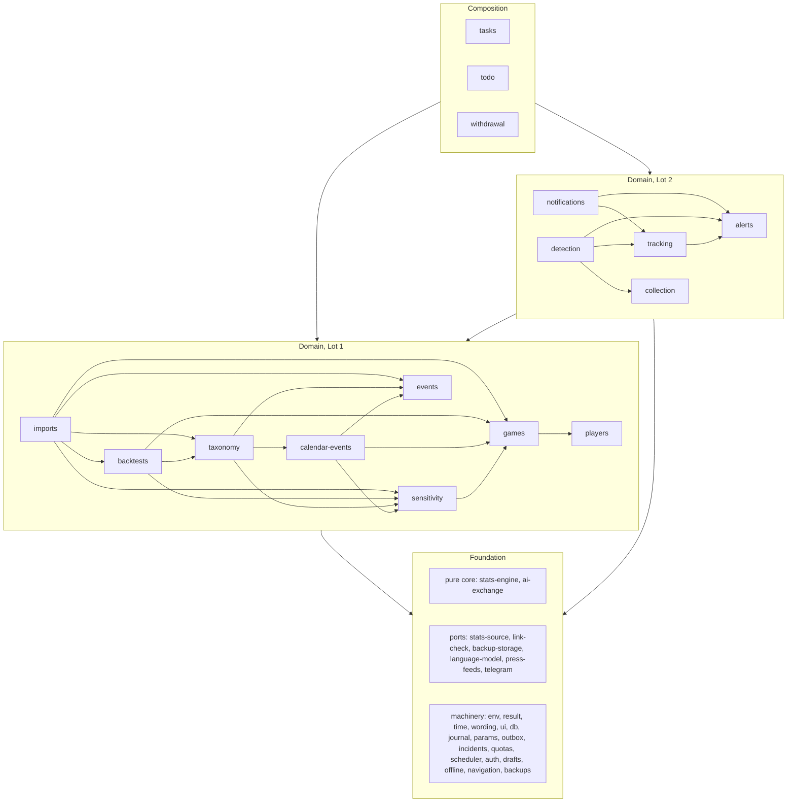

# Egoscope module map

**Status:** draft for integration. Names follow the owner's decisions and the spec digests; they will be aligned with `docs/engineering/glossary.md` once it is merged. Spec IDs (`JOU-04`, `TRV-31`…) point to the French specifications in `docs/`, which stay authoritative except where the [deviations register](spec-deviations.md) and the [decision records](../adr/README.md) change them ("ADR 0015" below). The statistics source is the one chosen in the [service sheet](../services/statistics-source.md) and its [evaluation](statistics-source-evaluation.md).

**How to use this map.** Find your spec file in §0, then your module in §2 or your screen in §3. §1 says what you may import, §7 is the checklist every task follows, §9 lists the shared files you must not edit and what to do instead. Lot 1 is the minimal app (players, types, backtest, import, statistics, profiles); Lot 2 adds the daily watch, alerts, tracking and Telegram.

Contents: [0 Find your place](#0-find-your-place) · [1 Layers and flows](#1-layers-and-flows) · [2 Module catalog](#2-module-catalog) · [3 Route catalog](#3-route-catalog) · [4 Scheduled tasks](#4-scheduled-tasks) · [5 Ports](#5-ports) · [6 Parameter registry](#6-parameter-registry) · [7 Cross-cutting rules](#7-cross-cutting-rules-for-implementers) · [8 Dependency graph](#8-dependency-graph) · [9 Shared files](#9-shared-files-and-how-to-avoid-collisions) · [10 Design choices and open points](#10-design-choices-and-open-points)

## 0. Find your place

| Spec file | Modules (`src/lib/…`) | Screens and handlers (`src/app/…`) |
|---|---|---|
| 00 Overview | `wording` (common states, VUE-08), `stats-engine` (VUE-03), `events` (VUE-04) | `/method` |
| 01 Followed players | `players`, `games` (stats-source link, indicators) | `/players`, `/players/new`, `/players/[playerId]` (+ `/edit`, `/delete`) |
| 02 Event taxonomy | `taxonomy`, `ai-exchange/exploration`, `data/seed/` | `/types/**` |
| 03 News collection (L2) | `collection`, `press-feeds` | `/collection/sources/**`, `/collection/runs/**` |
| 04 Event detection (L2) | `detection`, `language-model`, `ai-exchange/classification` | `/detected-events`, `/collection/queue`, `/collection/not-relevant`, `/collection/detection-log`, `/collection/instructions`, `/collection/articles/[articleId]` |
| 05 Backtest request and prompt | `backtests`, `ai-exchange/research-prompt`, `stats-engine/backtest` | `/backtests`, `/backtests/[requestId]` |
| 06 Research-result import | `imports`, `ai-exchange/research-result`, `drafts`, `link-check` | `/backtests/[requestId]/import`, `/events/[eventId]/edit` |
| 07 Game statistics | `games`, `stats-source`, `stats-engine/{performance,baseline,schedule}` | player-sheet blocks, `/status` |
| 08 Sensitivity and verdict | `sensitivity`, `stats-engine/{measured-game,cases,profiles}` | `/players/[playerId]/profiles/[typeId]`, `/profiles`, `/cases/[caseId]`, `/types/[typeId]/trend` |
| 09 Alert sheet (L2) | `alerts`, `stats-engine/alerts` | `/alerts`, `/alerts/[sheetId]` |
| 10 Tracking and validation (L2) | `tracking`, `stats-engine/tracking` | `/validation`, tracking block of `/cases/[caseId]` |
| 11 Telegram (L2) | `notifications`, `telegram`, `outbox` | `/settings/notifications`, `/api/telegram/webhook` |
| 12 Interface and access | `navigation`, `ui`, `offline`, `drafts`, `todo`, `auth` | every screen; `/`, `/more`, `/help`, `/sign-in`, `/choose-password` |
| 13 Sensitive data | `events` (whitelist, counter, fingerprint), `withdrawal`, `ai-exchange` (text rules) | `/events/[eventId]/withdraw`, `/players/[playerId]/delete` |
| 14 Cross-cutting | `env`, `db`, `time`, `params`, `journal`, `incidents`, `quotas`, `scheduler`, `tasks`, `auth`, `backups` | `/settings/**`, `/journal`, `/status`, `/api/tick`, `/api/health`, `/api/exports/[kind]` |
| Decision records | `calendar-events` (ADR 0015), `taxonomy` criterion switch (ADR 0016), `events` withdrawal fingerprint (ADR 0017), `backups` encryption (ADR 0018), collection hours (ADR 0019) | — |

## 1. Layers and flows

### 1.1 Layers

| Layer | Where | What lives there | May import |
|---|---|---|---|
| Routes | `src/app/**` | pages (React Server Components), `actions.ts` (Server Actions), `queries.ts` (page-only reads), `schema.ts` (form schemas), view and block components, route handlers (`route.ts`) | any `@/lib/<module>` |
| Composition | `src/lib/{withdrawal,todo,tasks}` | use cases that span many modules: event withdrawal, the to-do list, scheduled-task handlers | everything below |
| Domain | `src/lib/<domain>` (§2.4, §2.5) | entities, rules that need the database, read APIs | earlier domain modules (§1.3), machinery, pure core, ports |
| Machinery | `src/lib/{env,result,time,wording,ui,db,journal,params,outbox,incidents,quotas,scheduler,auth,drafts,offline,navigation,backups}` | services every feature uses | earlier machinery (§1.3); `backups` also uses a port |
| Pure core | `src/lib/stats-engine`, `src/lib/ai-exchange` | formulas, decision rules, AI exchange contracts and texts | nothing in `src/lib` |
| Ports | `src/lib/{stats-source,language-model,press-feeds,telegram,backup-storage,link-check}` | one interface, one fake, one or more real adapters per outside service | `env`, `result` |
| Database | Postgres through Drizzle; schema in `src/lib/db/schema/` | the tables of every module (Neon in production, PGlite in tests and development) | — |

### 1.2 Import rules

1. `src/lib` never imports `src/app`; a route folder never imports another route folder. Code that two routes need goes to `src/lib`. *(lint)*
2. A module is imported only as `@/lib/<module>` (its `index.ts`); no deep import, no relative import across modules. *(lint)*
3. No import cycle; a module imports only modules listed before it in §1.3. *(lint)*
4. At most two folder levels below `src/lib`; kebab-case names. Dynamic route segments (`[playerId]`) are camelCase because they become TypeScript properties. *(lint)*
5. `stats-engine` and `ai-exchange` import nothing from `src/lib`, use no Node or browser API, never read the clock and never convert time zones: instants arrive as epoch milliseconds, local dates as `YYYY-MM-DD` strings, parameters as a plain object built by the caller. *(lint)*
6. Only port modules make network calls, only `db` opens database connections, only `time` reads the clock, only `env` reads `process.env`. Server-only modules start with `import "server-only"`. *(lint + review)*
7. A table is written only by the module that owns it (§2, "Owns"). Any module may read any table through `@/lib/db` for lookups and joins; derived values (next game, profile values, coverage, profiled status, case state) are read through their owner's read API. *(review)*
8. Expected failures are returned as `Result` error values, never thrown; thrown errors mean bugs or infrastructure faults. *(review)*
9. **Lot boundary** ([ADR 0001](../adr/0001-build-both-lots-in-dependency-ordered-waves.md)): a Lot 1 domain module never imports a Lot 2 domain module or a Lot 2 port. Lot 2 reactions to Lot 1 actions are wired only in the composition layer (`withdrawal`, `todo`, `tasks`) or in a route's composed action (§1.7), behind the lot gate (`navigation.isLotActive(2)`). *(lint)*

### 1.3 Allowed order

A module may import only modules that appear earlier in this order.

1. **Machinery (no domain knowledge):** `env`, `result`, `time`, `wording` → `ui` → `db` → `journal` → `params` → `outbox` → `incidents` → `quotas` → `scheduler` → `auth` → `drafts` → `offline` → `navigation`.
2. **Pure core:** `stats-engine`, `ai-exchange` (independent of everything).
3. **Ports:** `stats-source`, `language-model`, `press-feeds`, `telegram`, `backup-storage`, `link-check`.
4. **Machinery using a port:** `backups`.
5. **Domain, Lot 1:** `events` → `players` → `games` → `sensitivity` → `calendar-events` → `taxonomy` → `backtests` → `imports`.
6. **Domain, Lot 2:** `collection` → `alerts` → `tracking` → `detection` → `notifications`.
7. **Composition:** `withdrawal` → `todo` → `tasks`.

Why this domain order: `events` is the lowest domain module — it stores events, and the modules that create or change them trigger the consequences. `sensitivity` reads events, games and type states as data and calls none of them back. `taxonomy` calls `sensitivity` after a merge, split, withdrawal or criterion switch, and `calendar-events` when a calendar-derived type is validated, reactivated or changed. `alerts` sits below `tracking` because tracking closes alert sheets with their outcome; `detection` is the highest Lot 2 producer because dismissal, routing and corrections call `sensitivity`, `alerts`, `tracking` and `backtests`.

### 1.4 Flow: a page request

1. **Request proxy** (`src/proxy.ts`, Next.js's request interceptor): security headers; a public path (§3.5) passes; no session cookie → redirect to `/sign-in?next=<path>`.
2. **Authenticated layout** `src/app/(app)/layout.tsx`: `auth.requireSession()` checks the session in the database (idle expiry; an account still on its initial password goes to `/choose-password`); renders the navigation (`navigation`, gated by the active lot) with the to-do count (`todo.todoCount()`).
3. **Page** `page.tsx` (Server Component) reads through its `queries.ts` and the read APIs of `@/lib/<module>`; a page made of blocks lets each block file fetch its own data.
4. **Render** with `ui` components, labels from `wording`, instants through `time` in the user's zone (`display.timeZone`).
5. **Device copy:** the service worker keeps the latest copy of the screens marked "cached" in §3.3; the client refreshes on reopen and on return from another app (IHM-04).

### 1.5 Flow: a Server Action

1. A client form posts to an action of the route's `actions.ts`; offline, the submit button is disabled with the reason and typed input is kept (IHM-58).
2. The action calls `auth.requireSession()` (Server Actions are public endpoints: every action checks), parses the input with the route's zod schema, then calls **one** lib use case — or the composed services of §1.7.
3. The service validates the rules, applies them, writes, calls `journal.record(...)` and, for a notifiable fact, `outbox.emit(...)` — all inside one `transaction()`; nested service calls join the outer transaction.
4. The action maps the `Result` to an `ActionState` (plain-language message from `wording`) and calls `revalidatePath` or `redirect`. Heavy follow-up work is queued (statistics fetch queue, recalculation queue, link checks), never awaited.

### 1.6 Flow: a scheduler tick

1. An external scheduler calls `GET /api/tick` every few minutes with `Authorization: Bearer <tick secret>`. A missing or wrong secret gets `401` and one aggregated journal entry (TRV-65).
2. `scheduler.runTick({ registry, budgetMs })` takes the global tick lease, runs the execution check (missed runs, TRV-31), then computes the due tasks of `tasks.registry`: local-time slots in the user's zone (one execution per slot, even on clock-change days), weekly slots, pending queues with their interval, every-tick tasks.
3. For each due task, in registry order: per-task lease → the handler works in chunks until it is done or the budget is spent → the run is recorded (slot, trigger, pass id, result, cursor). An unfinished run resumes at the next tick from its cursor (TRV-30).
4. Chained tasks run in the same pass, under the same pass id, while budget remains; otherwise at the next tick (TRV-26).
5. Every outbound call goes through `quotas.withQuota`; failures open incidents; facts emitted to the outbox during the pass are sent by `notification-dispatch` at its end (L2), grouped by pass id (TEL-19).
6. The response is a summary with no data.

### 1.7 Composed user actions

When one user action must trigger rules of a module that sits **above** the module owning the action (§1.3), the route's Server Action calls the services in order inside one `transaction()`. These are the only compositions allowed in routes; every other action is one call. For example, dismissal is `detection.dismiss` (detection calls sensitivity, alerts and tracking itself), saving an import is `imports.save`, withdrawing an event is `withdrawal.withdrawEvent`.

| Action (route) | Calls, in order | Spec |
|---|---|---|
| Add a player (`/players/new`) | `players.add` → `games.confirmLink` (or `games.markLinkPending`) → `games.requestHistory`; L2: `detection.reprefilterForPlayer` | JOU-07, JOU-10, STA-03, DET-07 |
| Reactivate a player, add a name variant (`/players/[playerId]`, `/edit`) | `players.reactivate` or `players.updateIdentity`; L2: `detection.reprefilterForPlayer` or `detection.reprefilterForVariant` | JOU-20, DET-07 |
| Withdraw a player (`/players/[playerId]`) | `players.withdraw` → `backtests.cancelOpenRequest(playerId, "player withdrawn")` | JOU-19, BKT-14 |
| Change a parameter (`/settings/parameters`) | `params.setParam` → if the parameter affects calculations, `sensitivity.requestFullRecalculation("parameter change")` | TRV-35, SEN-34 |
| Validate a type born of a detection proposal (`/types/[typeId]/validate`, L2) | `taxonomy.validate` → `detection.requeueProposalArticles` | TAX-19, DET-36 |
| Save an import while the player has a detected event awaiting its game (`/backtests/[requestId]/import`, L2) | `imports.save` → `alerts.produceAfterImport(playerId)` | IMP-36, ALE-05 |

Scheduled reactions that cross the lot boundary (for example completing an alert sheet once the imported player's statistics arrive, ALE-05) are composed in the task handlers of `tasks` (§4), never inside a Lot 1 module.

## 2. Module catalog

Every module is a folder `src/lib/<module>/` with an `index.ts` that re-exports its planned files (listed under **Files**; one file per operation group, flat). **Owns** names the entities whose tables only this module writes; the exact tables come from `docs/engineering/domain-model/`. **Lot** is the lot of the requirements; **Task** says who creates the module: a foundation task of §9 (`F-…`) or the planners' feature tasks.

### 2.1 Machinery

#### `env` — deployment configuration
- **Does:** reads and validates `process.env` once at startup; typed access to every deployment value; marks secrets so they are never logged, displayed or exported; selects the adapter of each port; exposes the active lot.
- **Exposes:** `env`, `isSecret`, `redact`, `adapterFor(port)`, `activeLot`.
- **Values (complete list):** database URL; app base URL; tick secret; initial password; session secret; fingerprint secret (ADR 0017); backup encryption key and backup storage token (ADR 0018); statistics-source base URL (optional, `STATS_SOURCE_BASE_URL`, no secret); language-model key (L2); Telegram bot token and webhook secret (L2); adapter selection per port (`fake` or a provider key; `fake` is refused in production outside the hermetic end-to-end mode); `EGOSCOPE_LOT` (1 until the Lot 2 milestone, then 2).
- **Implements:** TRV-37, TRV-64. **Depends on:** —. **Lot:** foundation. **Task:** F-env.
- **Files:** `schema.ts`, `secrets.ts`, `adapters.ts`.

#### `result` — expected-failure values
- **Does:** the `Result<T, E>` discriminated union and its helpers; `ActionState`, the shape Server Actions return to forms (field errors, one plain-language message).
- **Exposes:** `ok`, `err`, `isOk`, `mapResult`, `toActionState`, types `Result`, `ActionState`.
- **Depends on:** —. **Lot:** foundation. **Task:** F-service-kit.

#### `time` — clock, zones, formatting
- **Does:** the only clock (`now()`, with a fake clock for tests); IANA zone conversion; DST-safe local-time slots, one instant per scheduled local time even on clock-change days (TRV-27); the user's day and a game's US date (TRV-72, H-TRV-11); end of day on the Pacific coast for date-only events (SEN-01); English display formats — "Wednesday 18 November 2026, 01:30 Paris time", short "Wed 18 Nov 2026, 01:30", zone always named, a game's US date and venue time (TRV-71, IHM-14, ADR 0010).
- **Exposes:** `now`, `useFakeClock`, `toZoned`, `localSlotInstant`, `userDay`, `gameUsDate`, `endOfDayPacific`, `formatInstant`, `formatGameTime`, `formatDate`, `formatDuration`.
- **Implements:** TRV-68–TRV-72 (TRV-73 with each owner), IHM-14 (conversion), STA-30 (display). **Depends on:** —. **Lot:** foundation. **Task:** F-time.

#### `wording` — the app's words
- **Does:** the single English rendering of every glossary term and common state (VUE-08); one-sentence definitions (IHM-15); fixed sentences (SEN-30 reminder, SEN-31 label, IHM-50 notice, ALE-17 closing statement, TEL-05 closing mention, IHM-54–IHM-56 empty states, the app-written descriptions of calendar-derived events, ADR 0015); number formats (explicit sign with a true minus, decimal point, index 3 decimals STA-12, gap 2 decimals SEN-09); the banned betting vocabulary and a test helper that scans rendered text (VUE-02, IHM-50, ALE-18, TEL-05).
- **Exposes:** `label`, `definition`, `sentence`, `formatGap`, `formatIndex`, `formatCount`, `formatShare`, `assertNoBettingWords`.
- **Implements:** VUE-08, IHM-13 (numbers), IHM-50 (vocabulary). **Depends on:** —. **Lot:** foundation. **Task:** F-wording.
- **Files:** `states.ts`, `glossary.ts`, `sentences/<area>.ts` (one per spec area), `numbers.ts`, `banned-words.ts`.

#### `ui` — design system
- **Does:** accessible, phone-first components: layout and navigation bars, buttons with explicit labels, forms and field errors, dialogs with double confirmation, banners, empty states, paged lists with state filters and name search (IHM-18), long-text areas, copy and share buttons, a paste area with autocorrect, smart punctuation and auto-capitalization off. `ui/figures/` holds the honest-display components: mean gap with case count and plausible range, verdict with profile confidence and case count, written direction with symmetric styling, origin breakdown (historical / tracked), counts instead of percentages below the threshold, filter summary with the total, the method notice, a glossary term with its one-tap definition, drill-down links to a gap's numbers.
- **Exposes:** components (names fixed by F-ui and F-figures).
- **Implements:** IHM-01, IHM-60–IHM-63; figures: IHM-15, IHM-45–IHM-49, IHM-52, SEN-38, SEN-39 (as components; each screen must use them). **Depends on:** `wording`, `time`. **Lot:** foundation. **Task:** F-ui, F-figures.

#### `db` — database access
- **Does:** the Drizzle client (Neon in production, PGlite in tests and local development), the central schema, migrations applied at deploy time, the test-database helper, and `transaction()`: nested service calls join the outer transaction (interactive transactions are required).
- **Exposes:** `db`, `transaction`, the schema tables, `createTestDatabase`; script `scripts/migrate.ts`.
- **Owns:** the schema files `src/lib/db/schema/<owning-module>.ts`, one per module that owns tables.
- **Implements:** TRV-14 (with the service sheet), TRV-68 (instants as `timestamptz`, dates as `date`), TRV-76. **Depends on:** `env`. **Lot:** foundation. **Task:** F-db (+ `transaction` in F-service-kit).

#### `journal` — activity journal
- **Does:** one entry per task run, recalculation and its cause, external-service failure, incident, data-changing user action, import refused in full, parameter change (old and new value), refused login and lockout, and (L2) Telegram message; level info / warning / incident; plain-language text answering what happened, when, with what consequence, what to do; an optional `objectRef` (the screen the entry leads to) and an optional `eventRef` (a foreign key to the event, set to null when the event is withdrawn, so no entry ever names a withdrawn event); technical details stored apart, redacted, shown on demand; filters by category and period; text export of a period; retention purge that keeps open incidents.
- **Exposes:** `record`, `list`, `exportText`, `purgeExpired`; the complete category enum.
- **Owns:** JournalEntry, JournalTechnicalDetail.
- **Implements:** TRV-41 (capability; each feature writes its own entries), TRV-43, TRV-44, TRV-48, TRV-49 (export function), DSN-11, DSN-29 (event mentions disappear). **Depends on:** `db`, `time`, `result`. **Lot:** foundation. **Task:** F-service-kit.

#### `params` — parameter registry and preferences
- **Does:** the registry of every tunable of §6 (key, type, default, unit, allowed values, owning spec file and requirement, origin, "affects calculations" flag, plain-language sentence); overrides stored in the database; bounds checked with an explanation; reset to default; every change journaled with old and new value; the date of the last change that affects calculations (also moved by a type's criterion switch, ADR 0016); small owner preferences (guide hidden, first profile viewed, phone time-zone prompt dismissed).
- **Exposes:** `getParam`, `getParams`, `setParam`, `resetParam`, `listRegistry`, `lastCalculationChange`, `noteCalculationChange`, `getPreference`, `setPreference`.
- **Owns:** ParameterOverride, Preference.
- **Implements:** TRV-35, TRV-36, TRV-38–TRV-40 (screen: `/settings/parameters`, TRV-34). **Depends on:** `db`, `time`, `journal`, `result`. **Lot:** foundation. **Task:** F-params.
- **Files:** `registry/<family>.ts` (one per key family of §6), `accessors.ts`, `overrides.ts`, `preferences.ts`.

#### `outbox` — notifiable facts
- **Does:** lets a module record, inside its own transaction, a fact Telegram may announce: kind, reference, pass id, version; unique per fact, so a rerun never produces a second message (TRV-29, TEL-17); consumed by `notifications` (L2); purge of consumed facts. In Lot 1 only `incidents` emits, and nothing consumes.
- **Exposes:** `emit`, `pending`, `markConsumed`, `purgeConsumed`; the complete kind enum: `backtest-request.to-do`, `backtest-request.deadline-changed`, `alert-sheet.produced`, `alert-sheet.updated`, `tracked-result.ready`, `type-proposal.new`, `incident.opened`, `incident.closed`.
- **Owns:** OutboxFact. **Implements:** TEL-02 (facts recorded in the app), TEL-17 (with `notifications`). **Depends on:** `db`, `time`. **Lot:** foundation. **Task:** F-incidents.

#### `incidents` — incidents and service states
- **Does:** opens an incident once per cause, keeps it open while the cause lasts, closes it automatically or at the owner's request; hiding with a "hidden incidents" count (IHM-20); a state per service, normal / degraded / unavailable; emits `incident.opened` and `incident.closed` facts.
- **Exposes:** `open`, `close`, `closeByOwner`, `hide`, `listOpen`, `hiddenCount`, `serviceStates`; the complete cause enum: `quota-reached(service)`, `stats-source-unavailable`, `stats-source-schema-changed`, `task-not-run(task)`, `backup-failed`, `logins-refused`; L2: `feed-down(source)`, `collection-impossible`, `source-silent(source)` (warning level), `telegram-link-broken`, `messages-failed`.
- **Owns:** Incident. **Implements:** TRV-45, TRV-46 (service states). **Depends on:** `db`, `time`, `journal`, `outbox`. **Lot:** foundation. **Task:** F-incidents.

#### `quotas` — quota guard and database volume
- **Does:** wraps every outbound call: before the call, checks the service's declared limits per kind and period (per minute, per day, per month, volume) and keeps the reserve for priority work; defers instead of exceeding; after the call, records the requests and bytes the port reports; warning at the warning share; incident when a limit is reached, closed when work resumes; an early refusal by the service counts as "limit reached for the period" (TRV-06); database volume against capacity with its warning; usage in plain words with the reset time; usage history (measured volumes, TRV-08).
- **Exposes:** `withQuota({ service, estimate, priority }, call)`, `usageReport`, `databaseVolume`, `nextAvailableAt`.
- **Owns:** QuotaUsage. **Implements:** TRV-03–TRV-08, the mechanism of STA-39 and DET-08. **Depends on:** `db`, `time`, `params`, `journal`, `incidents`, `result`. **Lot:** foundation. **Task:** F-quotas.

#### `scheduler` — task runs
- **Does:** due computation for five schedule kinds (daily local times, weekly slot, chained after another task, while work is pending with an interval, every tick); DST-safe slots; a global tick lease and per-task leases that expire when a run crashed; chunked execution under a time budget with a persisted cursor; run history (slot, trigger scheduled / on demand / catch-up, pass id, start, end, result); postponement journaled; missed-run detection with the margin, which journals, opens "task not run" and makes the task due at once; on-demand runs that keep the next planned run; a "ready" guard that lets a due task wait (the statistics update waits for the source's refresh).
- **Exposes:** `runTick`, `requestRun`, `taskOverview` (last run, result, next planned run), `checkMissedRuns`, types `TaskDefinition`, `TaskContext` (`now`, `budget`, `passId`, `cursor`).
- **Owns:** TaskRun, TaskLease.
- **Implements:** TRV-27 (scheduling), TRV-28, TRV-29 (runs), TRV-30, TRV-31, TRV-33 (mechanism), TRV-13 (wake-up by the tick). **Depends on:** `db`, `time`, `params`, `journal`, `incidents`, `env`, `result`. **Lot:** foundation. **Task:** F-scheduler.

#### `auth` — single account and sessions
- **Does:** the account, created from the configured initial password, whose keyed fingerprint is kept to detect a reset; until the initial password is replaced only the change screen opens; password hashing with Node's built-in scrypt; minimum length; sessions in a secure cookie, idle expiry, several devices; sign-out here or everywhere; a password change closes the other sessions; lockout after repeated failures, journaled, with the "logins refused" incident closed at the first success; at server start, a changed initial password resets the account, closes every session and lifts the lockout.
- **Exposes:** `ensureAccount`, `signIn`, `choosePassword`, `changePassword`, `signOut`, `signOutEverywhere`, `requireSession`, `currentSession`, `lockoutStatus`, `purgeExpired`.
- **Owns:** Account, Session, LoginAttempt.
- **Implements:** TRV-57, TRV-60–TRV-63 (screens: F-access). **Depends on:** `db`, `time`, `params`, `journal`, `incidents`, `env`, `result`. **Lot:** foundation. **Task:** F-auth.

#### `drafts` — pasted-text drafts
- **Does:** keeps text pasted or typed in the import screen or the exploration screen, at once on the device (IndexedDB) and, when online, on the server attached to its request; the only copy of pasted text — never in saved data, import traces, the journal or backups; gone when the import is saved, when the draft is discarded, or after the retention; survives session expiry, app update and network loss.
- **Exposes:** client `usePasteDraft(kind, ref)`, `clearDeviceDrafts`; server `saveDraft`, `getDraft`, `discardDraft`, `purgeExpired`.
- **Owns:** Draft (kind `research-result` or `exploration-return`, reference, text, saved at).
- **Implements:** IHM-42, DSN-32. **Depends on:** `db`, `time`, `params`, `result`. **Lot:** foundation. **Task:** F-drafts.

#### `offline` — installable app and offline behavior
- **Does:** the web app manifest and icons, the service worker (precached shell, network-first copies of the screens marked "cached" in §3.3, the first-visit offline page), online status, the offline banner with the date of the copy, an online-only submit that says why it is disabled, the new-version banner that waits for unsaved drafts, refresh on reopen and on return from another app, restore of the last screen and scroll position, erasure of device data at sign-out (drafts included).
- **Exposes:** `registerServiceWorker`, `useOnlineStatus`, `OfflineBanner`, `OnlineOnlySubmit`, `UpdateBanner`, `useRefreshOnReturn`, `clearDeviceData`.
- **Implements:** TRV-21, TRV-22, IHM-02 (all but the help page), IHM-03, IHM-04, IHM-41, IHM-57, IHM-58 (helper), IHM-59, DSN-33. **Depends on:** `drafts`, `ui`. **Lot:** foundation. **Task:** F-pwa, F-offline.

#### `navigation` — app map and links
- **Does:** the tab bar and the "More" menu per lot (IHM-16), the lot gate, typed path builders for every screen of §3 (every mentioned object links to its screen, IHM-17), absolute links for Telegram (base URL from `env`).
- **Exposes:** `tabs`, `moreItems`, `paths`, `absoluteUrl`, `isLotActive`.
- **Implements:** IHM-16 (with the shell). **Depends on:** `env`. **Lot:** foundation. **Task:** F-shell.

#### `backups` — backup, export, restore
- **Does:** one archive format shared by export, backup and restore (one JSON Lines file per table plus a documented manifest); the full export and the spreadsheet exports (players, events, cases with one row per case, profiles; CSV) and the journal text export; last-export tracking and the reminder after the configured delay; the weekly backup — authenticated encryption with the configured key, upload part by part to `backup-storage` across ticks, manifest written last, rotation that truly deletes the oldest (ADR 0018), journal entry, "backup failed" incident; a backup before every schema change, taken by the deploy-time migration script (TRV-55); the restore script into an empty database, with the key, followed by a consistency check and the count summary shown on the status screen. Never included: drafts, sessions, secrets; the withdrawal fingerprints follow ADR 0017 open point 3.
- **Exposes:** `exportFull`, `exportPartial(kind)`, `exportJournal(period)`, `runBackup`, `beforeMigration`, `lastBackup`, `lastExport`, `exportReminderDue`, `restoreSummary`; script `scripts/restore.ts`.
- **Owns:** BackupRun, ExportRecord, RestoreReport.
- **Implements:** TRV-49–TRV-56. **Depends on:** `db`, `time`, `params`, `journal`, `incidents`, `env`, `backup-storage`. **Lot:** 1. **Task:** F-export, F-backups, F-restore.
- **Files:** `archive.ts`, `export.ts`, `backup.ts`, `rotation.ts`, `restore.ts`, `queries.ts`.

### 2.2 Pure core

#### `stats-engine` — what is measured and what is concluded
- **Does:** every rule that decides what is measured and what is concluded, as pure functions over plain data: instants in epoch milliseconds, local dates as `YYYY-MM-DD` strings, parameters as a plain object built by the caller from `params`. 100 % coverage, property tests and mutation testing (F-mutation). Pure rules that conclude nothing — prompt texts, JSON extraction, name prefiltering, notification restraint, feed dating — stay in their own module.
- **Parts** (one folder each; one or more planner tasks each):

| Part | Rules | Spec |
|---|---|---|
| `performance/` | Game Score (first function, F-toolchain), decimal minutes, performance index, sheet consistency (made ≤ attempted, points, minutes ceiling 48 + 5 per overtime), incomplete sheet, played game, usable game and playing-time threshold | STA-09–STA-15, H-13 |
| `baseline/` | season baseline per season and phase excluding the measured game; states final / provisional / building / insufficient; "partial" mention; postseason mode; L2 indicative comparison with the previous regular season | STA-16–STA-24 |
| `schedule/` | team record with one game excluded and opponent win share at the game's date (NBA Cup final excluded); playoff series state, series length per season and elimination flag; next game and expected game, "time to be determined"; season of a date; first NBA game; player indicators (games played, average minutes, last game, consecutive games missed); prolonged absence | STA-06, STA-07, STA-26–STA-28, STA-31, STA-46–STA-48, JOU-21, JOU-22, SUI-03, ALE-15 |
| `measured-game/` | measured game after the reference instant, attachment window, known-in-advance rule, fixed game of a calendar-derived event ("not measurable" when missed), precedence of a historical event's sources over its measured game, late detection | SEN-01–SEN-04, SEN-44, IMP-18, DET-33, ADR 0015 |
| `cases/` | grouping of same-type events on one game, concurrent cases, case state and reason, normalized gap, doubtful-case criteria (playing time, return from injury flagged or computed, unusual stakes flagged or computed, opponent level, concurrent), the per-type switched-off criterion, review flags, effect of manual decisions | SEN-05–SEN-18, SEN-45, SEN-47, ADR 0016 |
| `profiles/` | tally and invariants, views by origin, retained dispersion, expected noise, plausible range, signal-to-noise, verdict and direction, profile confidence, robustness (fragile verdict), controls, low-research-confidence count, general trend, expected false signals, verdict-change detection | SEN-19–SEN-33, SEN-37 (diff), SEN-39, SEN-41, SEN-43, SEN-48, VUE-03 |
| `tracking/` | recorded in time, forecast from the historical view and its versions, frozen and late forecast, post-tip-off decisions, gap in the forecast direction and category, validation-table rows and assessment | SUI-06, SUI-08–SUI-11, SUI-15–SUI-17, SUI-22–SUI-27 |
| `alerts/` | grouping of a player's events by expected game, the caveats list (with the switched-off-criterion warning), late mark, sheet state | ALE-03, ALE-16, ALE-24, ALE-26, ADR 0016 |
| `backtest/` | initial, supplement and full-redo extents; coverage merge, clamping of declared coverage and gaps; profiled status; deadline, to-do rank and urgency | BKT-08–BKT-10, BKT-16–BKT-18, IMP-10, H-VUE-02 |
| `matching/` | matching of two events (same type within the date gap, or same cleaned link), removal of tracking parameters from links; calendar-derived events never match | IMP-25, DET-58 (rule), COL-28, ADR 0015 |
| `calendar/` | birthday games (venue-local date with the stored day and month) and first games against a former team after the departure, from the schedule and the player's team history | ADR 0015 |

- **Exposes:** one function per rule (names fixed by each part), plus `evaluatePlayer` (all cases and profiles of one player from his data) and `evaluateTrend` (one type, all players).
- **Depends on:** nothing. **Lot:** 1 (+ the L2 rules marked above). **Task:** F-pure-skeleton (folders, shared types, barrels), then planner tasks per part.

#### `ai-exchange` — contracts and texts of every AI exchange
- **Does:** what the app sends to an AI and reads back, as pure functions: the research prompt with its placeholders and English rules; the research-result format 1.0 with English keys and values; isolation of the JSON in pasted text; recovery of a cut result; format, whole-result and per-event checks with their plain-language messages; the correction message for the AI; the exploration prompt and its return format; the versioned classification instructions and the checks of the model's answer; the automatic description checks (maximum length, no quotation marks).
- **Parts:** shared `conventions.ts` (ISO dates, lowercase enums, no `null`, omitted optional fields), `extract-json.ts` (IMP-04), `text-rules.ts` (DSN-20, DSN-21, DSN-24, DSN-25); `research-prompt/` (BKT-19–BKT-29; calendar-derived types never appear, ADR 0015); `research-result/` (IMP-04–IMP-17 field checks, IMP-20, IMP-21, BKT-23, BKT-24); `exploration/` (TAX-16, TAX-17, the cross-refusals of IMP-06 and 02 AC-17); `classification/` (DET-14, DET-16, DET-21–DET-23, DSN-05, DSN-25; calendar-derived types are not sent, ADR 0015).
- **Depends on:** nothing. **Lot:** 1 (`classification/` L2). **Task:** F-pure-skeleton (shared files and barrels), then planner tasks per part.

### 2.3 Ports

One module per outside service; §5 gives the operations and what each fake simulates. Every port folder holds `index.ts` (interface, types, the accessor that returns the adapter chosen by `env.adapterFor`), `port.ts`, `types.ts`, `errors.ts`, `fake.ts` (scriptable, the default outside production), and one file per real adapter. The shared behavioral tests every adapter must pass live in `test/support/contracts/<port>.ts`, run against the fake and against recorded fixtures of each real adapter (`data/fixtures/<port>/`).

| Port | Service | Lot | Real adapter files | Tasks |
|---|---|---|---|---|
| `stats-source` | statistics source: schedules, box-score lines, players | 1 | `sportsdataverse.ts`, `sportsdataverse-rows.ts`, `venue-time-zones.ts` (service sheet) | F-ports-lot1, F-adapter-stats-source |
| `link-check` | public article links (IMP-17) | 1 | `http.ts` | F-ports-lot1, F-adapter-link-check |
| `backup-storage` | private off-site storage (ADR 0018) | 1 | per the backup service sheet | F-ports-lot1, F-adapter-backup-storage |
| `language-model` | free-tier classification model | 2 | per the language-model service sheet | F-ports-lot2, F-adapter-language-model |
| `press-feeds` | public news feeds | 2 | `syndication.ts` (RSS and Atom) | F-ports-lot2, F-adapter-press-feeds |
| `telegram` | Telegram Bot API | 2 | `bot-api.ts` | F-ports-lot2, F-adapter-telegram |

The deep-research AI is not a port: the app never calls it (VUE-07, TRV-19). The external scheduler is not a port either: it calls the app (§3.5).

### 2.4 Domain modules, Lot 1

#### `events` — the event record
- **Does:** stores the events of every origin — historical, detected (L2), calendar-derived (ADR 0015) — with exactly the DSN-06 whitelist: one followed player (VUE-04), the type and the sheet version it was qualified under, the reference date and its precision, the sources (for a calendar-derived event, its scheduled game instead), the short neutral description, the context indications with their provenance, the research or detection confidence, the marks; the correction history; deletion records; the withdrawn-events counter; the temporary withdrawal fingerprints (keyed hash of player, type and reference day with the fingerprint secret, kept eight weeks, ADR 0017).
- **Exposes:** `createHistorical`, `createDetected`, `createCalendarDerived`, `addSources`, `applyCorrection`, `reassignType`, `setDetectedState`, `deleteHistorical`, `incrementWithdrawnCount`, `withdrawnCount`, `recordFingerprint`, `matchesFingerprint`, `purgeExpiredFingerprints`, `eraseEvent`; reads `getEvent`, `eventsOfPlayer`.
- **Owns:** Event, EventSource, EventCorrection, EventDeletionRecord, WithdrawnEventCounter, WithdrawalFingerprint.
- **Implements:** VUE-04, DSN-01, DSN-03, DSN-06–DSN-08, DSN-10, TAX-23 (stamping), DET-53 (data), ADR 0015 (third origin), ADR 0017. **Depends on:** `db`, `journal`, `params`, `time`, `env`, `result`. **Lot:** 1 (+ L2 fields). **Task:** planners.
- **Files:** `create.ts`, `sources.ts`, `corrections.ts`, `state.ts`, `delete.ts`, `traces.ts` (counter, fingerprints), `erase.ts`, `queries.ts`, `types.ts`.

#### `players` — followed players
- **Does:** the follow list: identity (an app identifier never reused, display name, current team, name variants with ambiguity marks, the day and month of birth only — ADR 0015, from the statistics source or entered by the owner), shared-variant warnings, the cap on active players, states and their history, team history, deletion of a withdrawn player's rows.
- **Exposes:** `add`, `updateIdentity`, `pause`, `reactivate`, `withdraw`, `recordTeamChange`, `deleteRows`; reads `list`, `get`, `activeCount`, `variantsOfActivePlayers`.
- **Owns:** FollowedPlayer, NameVariant, PlayerStatusChange, PlayerTeamChange.
- **Implements:** JOU-01, JOU-04–JOU-09, JOU-11–JOU-20, JOU-23, JOU-25–JOU-28 (data; JOU-24 with `withdrawal`). **Depends on:** `db`, `journal`, `params`, `time`, `result`. **Lot:** 1. **Task:** planners.
- **Files:** `add.ts`, `identity.ts`, `status.ts`, `teams.ts`, `delete.ts`, `queries.ts`, `types.ts`.

#### `games` — game statistics
- **Does:** everything that comes from the statistics source, stored with its fetch date and source version (STA-42): the player directory used for candidate search; each player's confirmed link (candidates with name, teams and seasons; "mapping to establish"; re-confirmation when the source drops an id); teams, seasons and games (phase, status, tip-off instant, "time to be determined", venue date, overtimes, series label, make-up link, excluded games flagged); box-score lines (whole minutes marked as rounded; a did-not-play reason is never stored); consistency checks; corrections within the window and their log; the units of work of the fetch queue (publication probe, season games, season lines of the followed players, player directory) with STA-40 priority, attempts, next attempt, lease, cursor and source version; retries and the outage incident; the career backfill with progress and estimated end; current-team updates; next game; covered seasons.
- **Exposes:** `searchCandidates`, `confirmLink`, `markLinkPending`, `changeLink`, `requestHistory`, `requestRefetch`, `planDailyUpdate`, `processFetchQueue`; reads `nextGame`, `expectedGame`, `gameLog`, `baselineInputs`, `indicators`, `firstNbaGame`, `seasonsOf`, `coveredSeasons`, `fetchProgress`, `lastUpdateAt`, `changedSince`.
- **Owns:** Team, Season, Game, BoxScoreLine, SourcePlayer (directory), StatsSourceLink, FetchUnit, StatCorrection.
- **Implements:** STA-01–STA-05, STA-08, STA-25, STA-29, STA-32–STA-45 (STA-38 L2), JOU-02, JOU-10 (search), JOU-13, VUE-01. **Depends on:** `players`, `stats-engine`, `stats-source`, `quotas`, `incidents`, `journal`, `params`, `time`, `db`. **Lot:** 1. **Task:** planners.
- **Files:** `link.ts`, `directory.ts`, `ingest.ts`, `fetch-queue.ts`, `daily-update.ts`, `history.ts`, `teams.ts`, `outage.ts`, `queries.ts`, `types.ts`.

#### `sensitivity` — cases, profiles, trends
- **Does:** turns events into cases and cases into profiles: attachment to the measured game, measurement, doubtful cases, manual exclusion and reinstatement, the precedence of historical events, profiles per player and type and trends per type for three views (all cases, historical, tracked), verdict history, expected false signals, review flags; recalculation inline for one scope and queued for a full recalculation, with the "recalculating" state; append-only profile snapshots that `tracking` reads to build forecasts.
- **Exposes:** `recalculate(scope, cause)`, `requestFullRecalculation(cause)`, `processRecalculationQueue`, `excludeCase`, `reinstateCase`, `eraseEventData`; reads `getProfile`, `listProfiles` (filter, total, evaluated pairs, expected chance verdicts, last calculation change), `getTrend`, `listCases`, `getCase`, `caseOfEvent`, `verdictHistory`, `reviewFlags`, `isRecalculating`, `snapshotsUntil`.
- **Owns:** Case, CaseEvent, ManualDecision, ProfileSnapshot, VerdictHistoryEntry, RecalculationRequest.
- **Implements:** SEN-01–SEN-48 (persistence and orchestration of the engine rules), IMP-18 (stored result), VUE-03, VUE-05 (data). **Depends on:** `games`, `stats-engine`, `params`, `journal`, `time`, `db`. **Lot:** 1 (SEN-21, SEN-35, SEN-45 L2). **Task:** planners.
- **Files:** `recalculate.ts`, `full-recalculation.ts`, `manual-decisions.ts`, `queries.ts`, `erase.ts`, `types.ts`.

#### `calendar-events` — events read in the schedule (ADR 0015)
- **Does:** for every active or paused player and every validated calendar-derived type, creates one event per birthday game and per first game against a former team over the covered seasons; idempotent (one event per player, type and game); re-runs when such a type is validated, reactivated or substantially changed, when a player's history or team changes, and after each statistics update; these events never enter a prompt, a coverage, matching or detection; the description is written by the app; type, player and date cannot be edited. When upcoming games get their event, and their Lot 2 handling, are ADR 0015 open points 1 and 2.
- **Exposes:** `requestDerivation(scope)`, `processDerivations`.
- **Owns:** DerivationRequest (the events themselves are written through `events.createCalendarDerived`).
- **Implements:** ADR 0015 (Q-TAX-01, Q-SEN-04), SEN-02 for these types, the JOU-11 exception. **Depends on:** `events`, `games`, `sensitivity`, `stats-engine`, `journal`, `db`. **Lot:** 1. **Task:** planners.
- **Files:** `derive.ts`, `requests.ts`, `types.ts`.

#### `taxonomy` — event types
- **Does:** type sheets and their lifecycle (proposed, validated, rejected, withdrawn); validation with the completeness check and the eight-point checklist (the dating item reads "established by the schedule" for a calendar-derived type); versions and modification history with the formal or substantive qualification; merge, split, requalification and distribution of events; withdrawal and reactivation; the nine seeded candidate types (English drafts, two calendar-derived); the exploration round trip (prompt, return, preview, creation of proposals); the do-not-repropose list; per-type flags — known in advance, calendar-derived, intimate subject, the one switched-off doubtful criterion (ADR 0016: history entry, no new version, full recalculation, calculation-change date); L2: proposals and occurrences coming from detection.
- **Exposes:** `seedCandidateTypes`, `createProposal`, `editProposal`, `validate`, `reject`, `reopen`, `modify`, `setSwitchedOffCriterion`, `merge`, `split`, `requalifyEvent`, `distributeEvent`, `withdrawType`, `reactivate`, `generateExplorationPrompt`, `previewExplorationReturn`, `createFromExploration`, `receiveDetectionProposal` (L2), `addOccurrence` (L2); reads `listByState`, `getType`, `validatedSheets` (for prompt, import and classification, calendar-derived excluded), `doNotReproposeList`, `resolveTypeId`, `versionCounters`, `eventsToReview`.
- **Owns:** EventType, TypeSheetVersion, TypeSheetChange, IllustrationSource, TypeProposalOccurrence (L2).
- **Implements:** TAX-01–TAX-33 (TAX-18, TAX-19 L2), H-TAX-05, ADR 0015, ADR 0016. **Depends on:** `events`, `sensitivity`, `calendar-events`, `ai-exchange`, `params`, `journal`, `db`. **Lot:** 1. **Task:** planners (seed file: F-seed).
- **Files:** `seed.ts`, `proposals.ts`, `validate.ts`, `modify.ts`, `criterion-switch.ts`, `merge.ts`, `split.ts`, `review-events.ts`, `lifecycle.ts`, `exploration.ts`, `detection-proposals.ts`, `queries.ts`, `types.ts`.

#### `backtests` — backtest requests and coverage
- **Does:** requests (initial, supplement, full redo; one open request per player) with their extents, deadline, rank and urgency; the stored research prompt and its regeneration under the same reference; the copy time and the "in progress" state shared across devices; update, reduction, cancellation; coverage per type and period with its sheet version; the profiled status; supplement proposals after a validation, reactivation or broadening and after an incomplete import (never for calendar-derived types); L2: requests born of detection, attached detected events, the routing decision of BKT-30.
- **Exposes:** `request(playerId, mode)`, `update`, `reduce`, `cancel`, `cancelOpenRequest`, `recordPromptCopied`, `snoozeInProgressBanner`, `acceptSupplement`, `recordImport` (state and coverage, called by `imports`), `createFromDetection` (L2), `attachDetectedEvent` (L2), `routeDetectedEvent` (L2); reads `list`, `get`, `todoRequests`, `inProgress`, `coverage`, `isProfiled`, `supplementProposals`, `outdatedPrompts`.
- **Owns:** BacktestRequest, RequestedType, CoveragePeriod.
- **Implements:** BKT-01–BKT-30 (BKT-03, BKT-04, BKT-18, BKT-30 L2), IHM-39, IHM-40, H-VUE-02, VUE-07. **Depends on:** `taxonomy`, `games`, `sensitivity`, `ai-exchange`, `stats-engine`, `outbox`, `params`, `journal`, `db`. **Lot:** 1 (+ L2 parts called by `detection`). **Task:** planners.
- **Files:** `request.ts`, `edit.ts`, `prompt.ts`, `coverage.ts`, `supplements.ts`, `detection.ts`, `queries.ts`, `types.ts`.

#### `imports` — research-result import
- **Does:** checks the pasted text against its request (through `ai-exchange`); builds the preview (mode, coverage and gaps, breakdown by type and season, duplicates, precedence, fingerprint matches to decline, refusals, warnings, leads, limits, spot-check of sources); saves in one all-or-nothing operation (historical events and their sources, coverage, request imported, numbered import trace); queues the follow-up (statistics for the measured games and baselines, recalculation, link checks); corrects and deletes historical events; keeps the import history and the remaining refusals; L2: duplicates of detected events (IMP-27).
- **Exposes:** `check(requestId, text, decisions)` (returns the preview), `save`, `correctionMessage`, `correctHistorical`, `deleteHistorical`, `processLinkChecks`, `eraseEventData`; reads `history`, `remainingRefusals`.
- **Owns:** ImportTrace, ImportEventOutcome, SourceLinkCheck.
- **Implements:** IMP-01–IMP-35, IMP-37 (IMP-27 L2; IMP-36 through the composed action of §1.7), DSN-24 (import part), ADR 0017 (preview flag). **Depends on:** `backtests`, `events`, `taxonomy`, `games`, `sensitivity`, `ai-exchange`, `stats-engine`, `link-check`, `drafts`, `params`, `journal`, `db`. **Lot:** 1. **Task:** planners.
- **Files:** `preview.ts`, `save.ts`, `correction-message.ts`, `historical-edit.ts`, `link-checks.ts`, `queries.ts`, `erase.ts`, `types.ts`.

### 2.5 Domain modules, Lot 2

#### `collection` — news collection
- **Does:** press sources (trial read without saving, public-sports-press attestation, dating warnings, edit, deactivate, reactivate, withdraw, address change proposed by a feed); collection runs (one read per source with retries, item checks, language, retained publication instant and its precision under the prudence principle, maximum age and catch-up, link cleaning, deduplication, minimal storage, processing states); source health (never read, working, down, silent) with incidents and gaps; indicators; the collection journal; purge of not-relevant articles, of excerpts and of deduplication traces; immediate erasure of a withdrawn event's articles.
- **Exposes:** `trialRead`, `addSource`, `editSource`, `setSourceActivation`, `withdrawSource`, `runCollection`, `requestOnDemand`, `setArticleState` (for `detection`), `purgeExpired`, `eraseEventData`; reads `sources`, `runs`, `run`, `articlesOfRun`, `article`, `articlesToAnalyze`.
- **Owns:** Source, Article, ArticleSighting, DedupTrace, CollectionGap, CollectionRun.
- **Implements:** COL-01–COL-50, DSN-02, DSN-09, DSN-34, ADR 0019 (times). **Depends on:** `press-feeds`, `stats-engine` (link cleaning), `incidents`, `journal`, `params`, `time`, `db`. **Lot:** 2 (needs nothing from Lot 1, may start early). **Task:** planners.
- **Files:** `sources.ts`, `run.ts`, `dating.ts`, `dedup.ts`, `health.ts`, `purge.ts`, `queries.ts`, `erase.ts`, `types.ts`.

#### `alerts` — alert sheets
- **Does:** produces, at the end of each detection pass and after an import made before kick-off, one sheet per profiled player and expected game: events and sources, the player's profile for the type frozen at issuance, the general trend as benchmark or in place of a profile below the threshold, the expected game, every applicable caveat, the closing statement; dated updates (new event, new source, expected-game change, dismissal and reinstatement, corrected context or attachment); the late mark; closure with the outcome (pushed by `tracking`); the history, cancelled and late sheets included; emits sheet facts.
- **Exposes:** `produceForPass`, `produceAfterImport`, `completeProfileValues`, `addEvent`, `addSource`, `onEventDismissed`, `onEventReinstated`, `onExpectedGameChanged`, `onContextCorrected`, `onAttachmentCorrected`, `close`, `eraseEventData`; reads `list`, `get`, `openSheets`, `lateSheets`.
- **Owns:** AlertSheet, AlertSheetEvent, AlertSnapshot, AlertUpdate, AlertOutcome.
- **Implements:** ALE-01–ALE-31, VUE-10 (part). **Depends on:** `games`, `sensitivity`, `backtests`, `stats-engine`, `outbox`, `journal`, `db`. **Lot:** 2. **Task:** planners.
- **Files:** `produce.ts`, `update.ts`, `close.ts`, `queries.ts`, `erase.ts`, `types.ts`.

#### `tracking` — tracked cases and validation table
- **Does:** creates a tracked case for every detected event with its creation instant; derives forecast versions from the historical-view profile snapshots, so the frozen forecast is exactly the last version before tip-off whatever the tick timing; late forecasts; categories of measured cases; tracked-game results for Telegram (indicative while the baseline is building); closes alert sheets with their outcome; the validation table with its separate sets and the withdrawn-events counter.
- **Exposes:** `createTrackedCase`, `runAfterStatsUpdate`, `refreshForecasts`, `eraseEventData`; reads `trackedCase`, `validationTable`, `results`.
- **Owns:** TrackedCase (extension of Case), ForecastVersion, TrackedGameResult.
- **Implements:** SUI-01–SUI-30, SEN-35, VUE-10 (part). **Depends on:** `sensitivity`, `games`, `alerts`, `stats-engine`, `outbox`, `journal`, `db`. **Lot:** 2. **Task:** planners.
- **Files:** `create.ts`, `forecasts.ts`, `results.ts`, `validation-table.ts`, `queries.ts`, `erase.ts`, `types.ts`.

#### `detection` — event detection
- **Does:** the quota-free prefilter on the names and variants of active players, exposure counts, re-prefiltering after a player or variant change; the priority queue; classification by the language model within quota (validated sheets only, calendar-derived types excluded; answer checks and retries; threshold); grouping into one event per fact and reference date; the "fact already in a backtest" check and the withdrawal-fingerprint check (ADR 0017); type proposals and occurrences; routing of each new event (tracked case, backtest need, alert-sheet request); the detection journal and quality indicators; owner actions (manual classification, new classification, rescue); dismissal and reinstatement; corrections; lifting "dating to verify".
- **Exposes:** `prefilterNew`, `reprefilterForPlayer`, `reprefilterForVariant`, `processQueue`, `classifyManually`, `requestReclassification`, `rescue`, `requeueProposalArticles`, `dismiss`, `reinstate`, `correct`, `moveReferenceDateEarlier`, `liftDatingToVerify`, `eraseEventData`; reads `queue`, `notRelevant`, `runs`, `qualityIndicators`, `articleFate`, `exposure`, `instructions`.
- **Owns:** ClassificationResult, ClassificationQueueItem, ExposureCount, DetectionRun.
- **Implements:** DET-01–DET-58, JOU-03, JOU-18, TAX-19 (detection side), DSN-05, DSN-25, ADR 0015 (DET-14, DET-15), ADR 0017. **Depends on:** `collection`, `events`, `taxonomy`, `backtests`, `alerts`, `tracking`, `sensitivity`, `games`, `language-model`, `quotas`, `ai-exchange`, `stats-engine`, `incidents`, `outbox`, `journal`, `params`, `db`. **Lot:** 2. **Task:** planners.
- **Files:** `prefilter.ts`, `exposure.ts`, `queue.ts`, `classify.ts`, `grouping.ts`, `routing.ts`, `proposals.ts`, `owner-actions.ts`, `dismissal.ts`, `corrections.ts`, `runs.ts`, `queries.ts`, `erase.ts`, `types.ts`.

#### `notifications` — Telegram notifications
- **Does:** linking of the owner's private chat (one-time code, deep link with fallback, confirmation, replacement, unlinking); inbound updates (only the link code from a private chat; anything else ignored without reply and journaled); composition of the catalogue messages from outbox facts; restraint (grouping per pass, quiet hours, urgency, daily cap, staleness check at send time); message statuses; retries and Telegram's slow-down; catch-up after failures; broken link; reminders before a deadline; incident reminders; the export reminder message; abandonment of pending messages and deletion attempts for dismissed or withdrawn events.
- **Exposes:** `startLinking`, `handleInbound`, `unlink`, `sendTest`, `dispatch`, `abandonPendingFor`, `deleteMessagesAbout`, `eraseEventData`; reads `linkState`, `messages`, `failedCount`.
- **Owns:** TelegramLink, LinkCode, NotificationMessage, MessageFact.
- **Implements:** TEL-01–TEL-38, DSN-31, DSN-35, TRV-18, TRV-23, TRV-67, STA-38, TRV-54 (message). **Depends on:** `telegram`, `outbox`, `backtests`, `alerts`, `tracking`, `taxonomy`, `games`, `incidents`, `backups`, `navigation`, `wording`, `time`, `params`, `journal`, `db`. **Lot:** 2 (the Telegram transport needs nothing from Lot 1 and may start early). **Task:** planners.
- **Files:** `linking.ts`, `inbound.ts`, `compose.ts`, `restraint.ts`, `dispatch.ts`, `delivery.ts`, `event-messages.ts`, `queries.ts`, `erase.ts`, `types.ts`.

### 2.6 Composition modules

#### `withdrawal` — event withdrawal and player data deletion
- **Does:** shows what a withdrawal erases and its limits (DSN-28 as extended by ADR 0017); erases an event and every trace in one transaction by calling `eraseEventData` of `sensitivity`, `imports` and, when Lot 2 is active, `alerts`, `tracking`, `collection`, `detection` and `notifications`, then `events.eraseEvent`; increments the counter; records the temporary fingerprint; journals the withdrawal without player, type or date; recalculates; deletes every datum of a withdrawn player (each event withdrawn first, ADR 0017 open point 2 for the fingerprint).
- **Exposes:** `previewWithdrawal`, `withdrawEvent`, `previewPlayerDeletion`, `deletePlayerData`.
- **Implements:** DSN-26–DSN-29, DSN-34 (through `collection`), IMP-37, ALE-30, SUI-30, TEL-38 (through `notifications`), JOU-24, ADR 0017. **Depends on:** the erase hooks above, `events`, `players`, `sensitivity`, `journal`, `db`. **Lot:** 1 (+ L2 hooks). **Task:** planners (erase stubs: F-skeleton-lot1, F-skeleton-lot2).
- **Files:** `preview.ts`, `withdraw.ts`, `player-data.ts`.

#### `todo` — the to-do list
- **Does:** the six sections of IHM-20 in order, an empty section hidden, "Nothing to do for now" when all are empty, and the count shown on the Home tab.
- **Exposes:** `todoList`, `todoCount`.
- **Files (one per section, each filled by the task that owns its source):** `requests.ts` (to-do requests, BKT-17, BKT-18), `supplements.ts` (proposed supplements, BKT-05, BKT-06, TAX-20, TAX-24, TAX-32), `incidents.ts` (open incidents and hidden count, TRV-45), `players.ts` (JOU-04, JOU-06, JOU-10, STA-03, JOU-22), `type-proposals.ts` (proposed types, oldest first), `review.ts` (events to requalify or distribute TAX-25, TAX-29, flagged cases SEN-16, L2 "dating to verify" DET-32, SEN-45).
- **Implements:** IHM-20. **Depends on:** `backtests`, `incidents`, `players`, `games`, `taxonomy`, `sensitivity`, L2 `detection` and `notifications`, `navigation`, `params`. **Lot:** 1 (+ L2 items). **Task:** F-todo (composition and the incidents section), then the section owners.

#### `tasks` — scheduled work
- **Does:** the task registry of §4 (key, plain English name, owning spec, lot, schedule kind and parameters, chain, ready guard) and one handler file per task that composes the domain calls of that task; Lot 2 tasks stay inactive while `EGOSCOPE_LOT` is 1.
- **Exposes:** `registry`.
- **Files:** `registry.ts`, one `<task-key>.ts` per task of §4.
- **Implements:** TRV-25, TRV-26 (with `scheduler`). **Depends on:** everything above. **Lot:** foundation (registry), handlers per lot. **Task:** F-tasks (registry, stubs, purge and execution check), then planners per handler.

## 3. Route catalog

### 3.1 Conventions

- **Route groups.** `src/app/(auth)/` holds the two screens without navigation (sign-in, choose password); `src/app/(app)/` holds every authenticated screen under the shell layout (navigation, session guard); `src/app/api/` holds the route handlers; `src/app/manifest.ts`, `src/app/robots.ts` and `src/app/sw.ts` are the metadata and service-worker entries; `src/app/offline/` is the public offline page. `src/app/layout.tsx` is the single entry point of the interface.
- **Inside a route folder, flat:** `page.tsx`, `actions.ts` (Server Actions), `queries.ts` (page-only reads), `schema.ts` (zod form schemas), view and block components (`*.tsx`), tests (`*.test.ts(x)`). A route imports `@/lib/<module>` only, never another route folder.
- **Pages built from blocks** (§3.4): one file per block, each block fetching its own data; the shell task creates every block as a placeholder, so each feature task fills only its own files.
- **Offline column:** **cached** — kept on the device and readable offline under the offline banner, prompt still copyable (IHM-57); **draft** — typed or pasted text kept on the device, server actions disabled with the reason (IHM-42, IHM-58); **—** — needs the network; offline, the screen says it is not available offline. Every mutating action is disabled offline (IHM-58).
- **Lot gating.** A Lot 2 screen, block, menu item or to-do section is hidden while `EGOSCOPE_LOT` is 1; its route answers "not found".

### 3.2 Navigation (IHM-16)

- **Tabs.** Lot 1: Home `/` (with the to-do count) · Players `/players` · Types `/types` · More `/more`. Lot 2: Home · Players · Alerts `/alerts` · Types · More. Bottom bar on a phone, side bar on a large screen.
- **More menu.** Backtest requests `/backtests` · Profiles `/profiles` (added, §10) · Settings `/settings` · App status `/status` · Activity journal `/journal` · Method and limits `/method` · Help `/help`; Lot 2 adds Detected events `/detected-events` · Validation table `/validation` · Collection and detection `/collection`.
- Every screen not in the tabs or the menu is reached from the screen that mentions its object (IHM-17), or from a Telegram link.

### 3.3 Screens

| Path | Screen and purpose | Reads | Actions → operation | Offline | Nav | Lot | Spec |
|---|---|---|---|---|---|---|---|
| `/sign-in` | Sign in: password field only (show, password-manager fill); lockout message with its end time | `auth` | sign in → `auth.signIn` | — | public | 1 | IHM-06, IHM-07, IHM-10, IHM-11, TRV-57–TRV-62 |
| `/choose-password` | Choose your password: forced while the initial password is in use | `auth` | set → `auth.choosePassword` | — | none | 1 | IHM-06, TRV-57, TRV-60 |
| `/` | Home: request-in-progress banner, system banners, to-do list, L2 open alert sheets nearest tip-off first, last statistics update and L2 last detection, first-launch introduction and self-checking guide | `todo`, `backtests`, `incidents`, `games`, `params`; L2 `alerts`, `detection`, `notifications` | open an item; refresh; hide an incident → `incidents.hide`; "Later" on the banner → `backtests.snoozeInProgressBanner`; hide the guide → `params.setPreference` | cached | tab | 1 (+2) | IHM-04, IHM-19, IHM-20, IHM-40, IHM-53, TEL-25, TEL-36, TEL-37, TRV-31 (check at opening) |
| `/players` | Players: name, team, state, backtest state, valid cases, next game; active by default, state filter, name search, paged; empty state | `players`, `backtests`, `sensitivity`, `games` | open; add | cached | tab | 1 | IHM-18, IHM-21, IHM-54, JOU-28 |
| `/players/new` | Add a player: criteria, active count against the maximum, identity fields, statistics-source candidates (name, teams, seasons), shared-variant flag; refusal beyond the maximum with its options | `players`, `games` | save with the confirmed candidate or as "mapping to establish" → composed action §1.7 | — | from Players | 1 | IHM-66, JOU-01, JOU-04, JOU-05, JOU-07–JOU-10, STA-03 |
| `/players/[playerId]` | Player sheet: identity, birthday (day and month), state and team histories, mapping mention, indicators, next game, season baseline, backtest block, profiles block, events; L2 detected events with dismissed ones, alert sheets, tracked cases, exposure | `players`, `games`, `backtests`, `imports`, `sensitivity`, `events`; L2 `alerts`, `tracking`, `detection` | request a backtest (complete or redo) → `backtests.request`; accept a supplement → `backtests.acceptSupplement`; force statistics → `games.requestRefetch`; pause → `players.pause`; reactivate → `players.reactivate` (+ L2 re-prefilter, §1.7); withdraw → composed action §1.7; open `/edit`, `/delete` | cached | from Players | 1 (+2) | IHM-22, IHM-23, IHM-56, JOU-02, JOU-03, JOU-21, JOU-25–JOU-27, BKT-01, BKT-02, BKT-05–BKT-07, BKT-10, IMP-24, IMP-31, STA-41, STA-44, STA-46, STA-47, SEN-19, SEN-31, SEN-46, ADR 0015 |
| `/players/[playerId]/edit` | Edit identity: display name (the old one kept as a variant), team, variants and ambiguity marks, day and month of birth, change of the statistics-source link | `players`, `games` | save → `players.updateIdentity` (+ L2 re-prefilter, §1.7); change link → `games.changeLink` | — | from the player sheet | 1 | JOU-08, JOU-09, JOU-11, JOU-12, ADR 0015 |
| `/players/[playerId]/delete` | Delete a withdrawn player's data: counts of events, cases and requests that disappear, double confirmation | `withdrawal` | confirm twice → `withdrawal.deletePlayerData` | — | from the player sheet | 1 | JOU-24, IHM-22 |
| `/players/[playerId]/profiles/[typeId]` | Profile detail: summary with checks and warnings, events out of the count, the type's general trend, threshold in force, last calculation and last calculation change, cases grouped by state with reasons, verdict history; origin filter; L2 views by origin | `sensitivity`, `backtests` (coverage warnings), `params` | filter by origin; open a case | cached | from the player sheet | 1 (+2) | IHM-24, IHM-46, IHM-48, IHM-51, SEN-20, SEN-21, SEN-27, SEN-31, SEN-33, SEN-37, SEN-38, SEN-40, SEN-43, SEN-46, ADR 0016 |
| `/profiles` | Profiles: every player–type profile with verdict, confidence and case count; filters by verdict, player and type with the active filter and the total; evaluated pairs and the verdicts chance alone would produce; last calculation change | `sensitivity`, `params` | filter; open a profile | — | More | 1 | SEN-37, SEN-41, IHM-49, 12 AC-12 |
| `/cases/[caseId]` | Case detail: sources, the three numbers of the gap, minutes, context with provenance, doubtful criteria with their values, review flags, manual decisions, history; L2 tracking block (expected game, recorded in time or not, forecast versions, frozen forecast, category, transmitted results) | `sensitivity`, `events`; L2 `tracking` | exclude or reinstate (closed reason list, comment) → `sensitivity.excludeCase` / `reinstateCase`; open the event | cached | from profiles, trends, alert sheets, validation table, Telegram | 1 (+2) | IHM-25, IHM-52, SEN-10, SEN-16–SEN-18, SUI-03, SUI-09, SUI-15, SUI-21 |
| `/events/[eventId]` | Event sheet: player, type and sheet version, reference date and precision, description, sources (or the scheduled game of a calendar-derived event), context with provenance, case state, correction history; historical: research confidence, unverified note, import warnings, precedence, originating import; L2 detected: detection confidence, articles and reference article with their classification results, marks | `events`, `sensitivity`, `imports`; L2 `detection` | delete a historical event (reason) → `imports.deleteHistorical`; L2 dismiss / reinstate → `detection.dismiss` / `reinstate`, lift "dating to verify" → `detection.liftDatingToVerify`; open `/edit`, `/withdraw` | — | from every list of events | 1 (+2) | IHM-67, IHM-32, IMP-19, IMP-33, DET-32, DET-43–DET-46, DET-53, DSN-06, ADR 0015 |
| `/events/[eventId]/edit` | Correct an event: historical — type among validated ones, public date and time, description, sources, context, research confidence, reservation; calendar-derived — context only; L2 detected — type or player, a second player, merge, detach an article, an earlier reference date with a dated source | `events`, `taxonomy`, `imports`; L2 `detection` | save → `imports.correctHistorical` / L2 `detection.correct`, `detection.moveReferenceDateEarlier` | — | from the event sheet | 1 (+2) | IMP-32, DET-47, DET-48, DET-52, H-09, ADR 0015 |
| `/events/[eventId]/withdraw` | Withdraw an event: what disappears, the sensitivity reason, never because of the game, the limits (undeletable Telegram messages, backups, the eight-week fingerprint), explicit confirmation | `withdrawal` | confirm → `withdrawal.withdrawEvent` | — | from the event sheet | 1 | IHM-68, DSN-26–DSN-29, TEL-38, ADR 0017 |
| `/backtests` | Backtest requests: by state, newest first; player, trigger, deadline | `backtests` | open | — | More | 1 | IHM-26 |
| `/backtests/[requestId]` | Request: player, trigger and nature, state, deadline and time left, L2 the games of attached events, types and periods, four-step how-to, prompt collapsed with "show all", copied-at, out-of-date warnings, remaining refusals | `backtests`, `games`, `taxonomy`, `imports`; L2 `sensitivity` (attached cases) | copy the prompt (primary) → `backtests.recordPromptCopied`; share; update → `backtests.update`; reduce → `backtests.reduce`; open the research tool (URL setting); paste the result → `/import`; cancel (optional reason) → `backtests.cancel` | cached (to-do requests) | from Home, the player sheet, the list, Telegram | 1 (+2) | IHM-27, IHM-39, IHM-44, BKT-12–BKT-22, TAX-23, IMP-24 |
| `/backtests/[requestId]/import` | Import: paste area, paste button, text-file picker within the size limit, characters received and end of text, draft state; preview after Check (summary then detail, blocking errors first, decisions: mode, duplicates, split types, sensitive data, fingerprint flag, partial import, cancelled request, spot-check); summary after Save with the statistics progress | `imports`, `drafts`, `backtests`, `games` | check → `imports.check`; save → `imports.save` (+ L2 §1.7); clear; discard the draft → `drafts.discardDraft`; copy the correction message | draft | from the request, the Home banner | 1 (+2) | IHM-28–IHM-30, IHM-42, IHM-43, IMP-01–IMP-31, IMP-35, IMP-37, STA-41, ALE-05, ADR 0017 |
| `/types` | Types: by state with counts and origin; empty state that highlights proposals; merge; explore | `taxonomy` | open; merge; explore | — | tab | 1 | IHM-31, IHM-55, TAX-10, TAX-15 |
| `/types/[typeId]` | Type sheet: definition, criteria, dating rule, example, vigilance points, origin, dates, versions with counters, modification history, L2 occurrences, general-trend summary, archived mention | `taxonomy`, `sensitivity` | reject (reason list, comment) → `taxonomy.reject`; reopen; withdraw (reason) → `taxonomy.withdrawType`; reactivate (checklist); propose supplements → `backtests`; open `/validate`, `/edit`, `/split`, `/review-events`, `/trend` | — | from Types, Telegram | 1 (+2) | IHM-31, TAX-01–TAX-14, TAX-18, TAX-20, TAX-21, TAX-26, TAX-31, TAX-32, BKT-05 |
| `/types/[typeId]/edit` | Edit a proposal or modify a validated sheet: qualification (formal or substantive; broadens, narrows or both), reason, flags (known in advance, calendar-derived, intimate subject), the switched-off criterion | `taxonomy` | save → `taxonomy.editProposal` / `modify` / `setSwitchedOffCriterion` | — | from the type sheet | 1 | TAX-01, TAX-21, TAX-22, TAX-24, TAX-25, ADR 0016 |
| `/types/[typeId]/validate` | Validation: completeness refusal naming the missing element, the eight points confirmed one by one, the supplements to propose (or the derivation for a calendar-derived type) | `taxonomy`, `backtests` | validate → `taxonomy.validate` (+ L2 §1.7) | — | from the type sheet | 1 | TAX-12, TAX-20, TAX-32, BKT-05, ADR 0015 |
| `/types/[typeId]/split` | Split: write two or more sheets and validate them together | `taxonomy` | split → `taxonomy.split` | — | from the type sheet | 1 | TAX-29 |
| `/types/[typeId]/review-events` | Events to review: requalify the events of an earlier version; distribute the events of a split type | `taxonomy`, `events` | requalify, reassign, erase → `taxonomy.requalifyEvent` / `distributeEvent` | — | from the type sheet, the to-do list | 1 | TAX-25, TAX-29 |
| `/types/[typeId]/trend` | General trend: as a profile, plus distinct players, top contributor share, the reminder text, earlier-version and incomplete-profile counts, case list, verdict history; L2 views | `sensitivity` | filter by origin; open a case | — | from the type sheet and profile detail | 1 (+2) | SEN-28–SEN-30, SEN-40, SEN-46 |
| `/types/merge` | Merge: two or more validated types, the survivor, the merged sheet, checklist, "covers at least the union?" | `taxonomy` | merge → `taxonomy.merge` | — | from Types | 1 | TAX-27, TAX-28 |
| `/types/explore` | Explore new types: general or targeted mode, copy the prompt, paste the return, preview with missing elements and possible duplicates, tick the types to create; refuses a backtest result | `taxonomy`, `drafts` | generate and copy → `taxonomy.generateExplorationPrompt`; check → `previewExplorationReturn`; create → `createFromExploration` | draft | from Types | 1 | IHM-31, TAX-16, TAX-17, DSN-32 |
| `/more` | More: the menu of §3.2 | `navigation` | — | cached | tab | 1 (+2) | IHM-16 |
| `/settings` | Settings: Account, Display, Parameters, L2 Notifications, Help | `navigation` | open a section | — | More | 1 | IHM-37 |
| `/settings/account` | Account: change the password (old one required, minimum length recalled, other sessions closed), sign out here or everywhere (unsaved-draft warning, device data erased) | `auth`, `offline` | change → `auth.changePassword`; sign out → `auth.signOut` / `signOutEverywhere` + `offline.clearDeviceData` | — | Settings | 1 | IHM-08, IHM-09, TRV-60, DSN-33 |
| `/settings/display` | Display: time zone (offer to adopt the phone's zone; notice that schedules move and that the collection hours set the share of cases recorded in time), research-tool address | `params`, `time` | save → `params.setParam` | — | Settings | 1 | IHM-14, IHM-44, TRV-27, CA-TRV-40 |
| `/settings/parameters` | Parameters: every registry entry with name, sentence, unit, value, default, allowed values, owning file and requirement, origin, last change; refusal out of bounds; restore default; "all profiles will be recalculated" confirmation | `params`, `sensitivity` | save → composed action §1.7; restore → `params.resetParam` | — | Settings | 1 | TRV-34–TRV-36, IHM-37, IHM-51 |
| `/settings/notifications` | Notifications: link state, last send, failed messages, link (code, "Open Telegram", fallback), test message, unlink, master switch, categories and sub-options, quiet hours, urgent exception, cap, delays, grouping, link to the journal | `notifications`, `params` | link → `notifications.startLinking`; test → `sendTest`; unlink → `unlink`; settings → `params.setParam` | — | Settings | 2 | IHM-37, TEL-24–TEL-32, TEL-34 |
| `/journal` | Activity journal: entries newest first, category and period filters, technical details on demand, export of a period | `journal` | filter; open the object; export → `/api/exports/journal` | — | More | 1 | IHM-38, TRV-41–TRV-44, TRV-49, TEL-34 |
| `/status` | App status: tasks (last run, result, next run), service states, quotas in plain words with reset time, database volume and capacity, last backup and export, export reminder, pending items, open incidents, staleness after an outage, statistics progress, restore summary | `scheduler`, `tasks`, `incidents`, `quotas`, `backups`, `games`, `backtests`; L2 `detection` | run a task → `scheduler.requestRun`; installation check (each port's `checkHealth`, the database, the last tick); force a retrieval → `games.requestRefetch`; download an export → `/api/exports/[kind]` | — | More | 1 | IHM-70, TRV-32, TRV-33, TRV-46, TRV-47, TRV-52, TRV-53, TRV-54, STA-41, STA-44 |
| `/method` | Method and limits: conditional hypothesis, the five known limits, vigilance points, withdrawn-events counter, link to the interpretation pitfalls | `events` (counter) | — | — | More, Help, the method notice | 1 | VUE-09, IHM-69, DSN-29 |
| `/help` | Help: installing the app per phone browser, glossary, relaunch the guide, version, link to the documentation, data attribution of the statistics source (CC BY 4.0) | `wording`, `params` | relaunch the guide → `params.setPreference` | — | More, Settings | 1 | IHM-02, IHM-15, IHM-53, TRV-79, statistics-source service sheet |
| `/alerts` | Alerts: open (by tip-off), closed (newest first), cancelled; filters player, type, verdict, period, late sheets | `alerts` | open a sheet | — | tab | 2 | IHM-33, ALE-28 |
| `/alerts/[sheetId]` | Alert sheet: header, events and sources, frozen sensitivity, benchmark, expected game, caveats, closing statement, dated updates, outcome | `alerts` | open sources, profile, type; dismiss an event → `detection.dismiss` | cached (open sheets) | from Alerts, Home, Telegram | 2 | IHM-34, ALE-07–ALE-27 |
| `/detected-events` | Detected events: newest first; filters state, player, type; confidence, marks, what each triggered, case state | `events`, `detection`, `sensitivity` | dismiss (reason, consequences notice) → `detection.dismiss`; reinstate → `detection.reinstate` | — | More | 2 | IHM-32, DET-43–DET-46 |
| `/validation` | Validation table: rows per type, per player, per pair, overall; counts; separate sets; withdrawn-events counter; last calculation change; reading rules | `tracking`, `events`, `params` | filter by player and type; open a profile or a sheet | — | More | 2 | IHM-35, SUI-23–SUI-29, DSN-29 |
| `/collection` | Collection and detection: hub to sources, runs, queue, not-relevant articles, detection log, instructions | `collection`, `detection` | open | — | More | 2 | IHM-71 |
| `/collection/sources` | Press sources: name, language, health since when, activation, last read, indicators, gaps; the public-sports-press reminder | `collection` | add; edit; deactivate or reactivate → `collection.setSourceActivation`; withdraw → `withdrawSource`; collect now → `requestOnDemand` | — | from the hub, Telegram | 2 | IHM-36, COL-03, COL-07–COL-11, COL-14, COL-40, COL-46 |
| `/collection/sources/new` | Add a source: address, trial read (items, titles with their retained instants, language, share exactly dated), form (name, language, media time zone, attestation), refusals and warnings | `collection` | trial → `collection.trialRead`; save → `addSource` | — | from sources | 2 | COL-02–COL-07, COL-17–COL-22 |
| `/collection/sources/[sourceId]` | Edit a source: name, language, time zone, silence delay; an address change reruns the trial; address change proposed by the feed | `collection` | save → `collection.editSource` | — | from sources | 2 | COL-08, COL-42 |
| `/collection/runs` | Collection journal: runs filterable by source and period, failures in plain words, totals, gaps | `collection` | open a run | — | from the hub | 2 | COL-46, COL-48–COL-50 |
| `/collection/runs/[runId]` | Run detail: per-source results and the articles the run recorded, while they are kept | `collection` | open an article | — | from runs | 2 | COL-49 |
| `/collection/queue` | Classification queue in priority order: manual classification per recognized player, grouping proposal, historical-match warning, new attempt after a failed classification | `detection` | classify → `detection.classifyManually`; new classification → `requestReclassification` | — | from the hub | 2 | DET-09, DET-13, DET-22, DET-28, DET-50, DET-58 |
| `/collection/not-relevant` | Not-relevant articles still kept: reason and the model's answer; rescue; add as a source of a historical event | `detection` | rescue → `detection.rescue` | — | from the hub | 2 | COL-36, DET-24, DET-49, DET-58, IMP-32 |
| `/collection/detection-log` | Detection log and quality indicators over a chosen period; dismissed share per confidence band | `detection` | choose the period | — | from the hub | 2 | DET-25, DET-55, DET-56 |
| `/collection/instructions` | Model instructions, read only, with their version | `detection` | — | — | from the hub | 2 | DET-23 |
| `/collection/articles/[articleId]` | Article fate: recognized players, successive classification results, attached event or non-relevance reason | `detection`, `collection` | open the event | — | from runs, the queue, the event sheet | 2 | DET-54, CA-DET-31 |
| `/offline` | Offline page shown when nothing is cached yet | — | — | precached | public | 1 | TRV-22 |

### 3.4 Pages built from blocks

| Page | Block files (placeholders created by F-shell) | Filled by the tasks of |
|---|---|---|
| `/` | `in-progress-banner.tsx`, `system-banners.tsx`, `todo-list.tsx`, `last-updates.tsx`, `first-launch.tsx`, `open-alerts.tsx` (L2) | backtests, incidents and offline, todo, games and detection, onboarding, alerts |
| `/players/[playerId]` | `identity-block.tsx`, `games-block.tsx`, `backtest-block.tsx`, `profiles-block.tsx`, `events-block.tsx`, `detected-block.tsx` (L2), `alerts-block.tsx` (L2), `tracking-block.tsx` (L2) | players, games, backtests and imports, sensitivity, events, detection, alerts, tracking |
| `/events/[eventId]` | `event-block.tsx`, `historical-block.tsx`, `detected-block.tsx` (L2) | events, imports, detection |
| `/cases/[caseId]` | `case-block.tsx`, `tracking-block.tsx` (L2) | sensitivity, tracking |
| `/backtests/[requestId]` | `request-block.tsx`, `prompt-block.tsx`, `attached-events-block.tsx` (L2) | backtests, backtests, backtests (L2) |
| `/types/[typeId]` | `sheet-block.tsx`, `versions-block.tsx`, `trend-block.tsx`, `occurrences-block.tsx` (L2) | taxonomy, taxonomy, sensitivity, taxonomy (L2) |

### 3.5 Route handlers and public assets

| Handler | Purpose | Guard | Spec | Task |
|---|---|---|---|---|
| `GET` and `POST /api/tick` | Scheduler tick (§1.6) | `Authorization: Bearer <tick secret>`; refused and journaled otherwise | TRV-25–TRV-33, TRV-65 | F-tasks |
| `GET /api/health` | `{ ok, version }`, no data; used by the update banner (IHM-03) and to watch the trigger | public | IHM-03, TRV-13 | F-access |
| `POST /api/telegram/webhook` | Inbound Telegram updates → `notifications.handleInbound`; always answers 200 | Telegram secret-token header; non-linked chats ignored and journaled | TEL-29–TEL-31, TRV-67 | L2 planners |
| `GET /api/exports/[kind]` | Downloads: `full`, `players`, `events`, `cases`, `profiles`, `journal?from=&to=` | session | TRV-49, TRV-52, TRV-56 | F-export |
| `/api/test/*` | Control of the fakes in the hermetic end-to-end mode only | absent unless that mode is on | — | F-e2e |
| `manifest.ts`, `public/icons/`, `sw.ts`, `/offline` | Installable app and offline fallback | public | IHM-02, TRV-21, TRV-22 | F-pwa |
| `robots.ts` and the `X-Robots-Tag` header | Ask search engines not to index | public | TRV-58 | F-access |

The request proxy lets through, without a session, exactly: `/sign-in`, `/choose-password` (which itself needs a session still on the initial password), `/offline`, `/api/health`, `/api/tick`, `/api/telegram/webhook`, the manifest, `/sw.js`, `/icons/*`, `/robots.txt` and Next's static assets. Everything else needs a session (TRV-58, IHM-05).

### 3.6 Sign-in flow

1. No session, or an expired one → `/sign-in?next=<path>`; `next` is a same-origin path, never a token (IHM-10).
2. `auth.signIn`: while locked, the screen gives the end time and no password is examined; each failure is journaled; the threshold of failures within the window locks login and opens "logins refused" (TRV-61, IHM-07).
3. Success: session cookie (`HttpOnly`, `Secure`, `SameSite=Lax`), "logins refused" closed; an account still on its initial password goes to `/choose-password`, any other to `next`, with drafts intact (IHM-11).
4. `/choose-password`: a new password of at least the minimum length; the other sessions are closed; then `next` (TRV-57, TRV-60).
5. Server start: `auth.ensureAccount()`, called from `instrumentation.ts`, creates the account on the first start and detects a reset — a changed initial password becomes the account password, every session is closed, the lockout is lifted, the reset is journaled (TRV-63).
6. Sign-out from `/settings/account`, on this device or everywhere; device data is erased; an unsaved draft is warned about first (IHM-08, DSN-33).
7. A link from Telegram is a plain path and goes through steps 1 to 3 (TEL-07, IHM-05).

## 4. Scheduled tasks

All scheduled work enters through `/api/tick` ([ADR 0002](../adr/0002-free-hosting-on-vercel-and-neon-with-an-external-trigger.md)); the external trigger calls it every 5 minutes, a cadence that suits the configured hours and retry delays (the first Telegram retry of TEL-35 therefore happens at the next tick, about five minutes later). Times are local times in `display.timeZone`. Every task: a plain English name (TRV-26), one run at a time (TRV-28), idempotent (TRV-29), chunked under the tick budget and resumed from its cursor (TRV-30), its run journaled; Lot 2 tasks are inactive while `EGOSCOPE_LOT` is 1. Handlers live in `src/lib/tasks/<key>.ts`.

| Key | Name | Lot | When (parameter) | Kind |
|---|---|---|---|---|
| `execution-check` | Execution check | 1 | start of every tick, and each app opening | every tick |
| `statistics-update` | Schedule and statistics update | 1 | daily at `scheduler.statsUpdateTime`; ready once the source shows a refresh after the last game of the past US competition day, not before `games.dailyUpdateDelayHours` after its last tip-off, or at `scheduler.statsUpdateCutoff` with what is published | daily + ready guard |
| `statistics-fetch` | Pending statistics retrievals | 1 | each tick while due fetch units exist (retry delays, quota renewal) | while pending |
| `calendar-derivation` | Events from the schedule | 1 | chained after the two statistics tasks; each tick while derivation requests are pending | chained + while pending |
| `recalculation` | Full recalculation | 1 | each tick while a full recalculation is queued | while pending |
| `link-check` | Source link checks | 1 | each tick while links wait, if `imports.linkCheckEnabled` | while pending |
| `purge` | Purge of limited-retention data | 1 (+2) | daily at `scheduler.purgeTime` | daily |
| `backup` | Weekly backup | 1 | weekly on `backups.weekday` at `backups.time` | weekly |
| `news-collection` | News collection | 2 | daily at each of `collection.times`; on demand | daily |
| `detection` | Detection | 2 | chained after each collection, same pass | chained |
| `classification-resume` | Classification-queue resumption | 2 | every `detection.queueResumeIntervalHours` while the queue is not empty, at the latest with the next collection | while pending |
| `game-tracking` | Tracking of detected events' games | 2 | chained after the two statistics tasks; forecast freezing every tick | chained + every tick |
| `notification-dispatch` | Notifications | 2 | at the end of each pass, and every tick | every tick |

**`execution-check`** (TRV-31, TRV-32). For each time-scheduled task, a last success older than its interval plus `scheduler.missedRunMarginHours` journals a missed run, opens "task not run" (closed by the next success) and makes the task due at once; a chained task is checked through its parent; a while-pending task when its oldest pending item is older than its interval plus the margin. At app opening (Home's layout) the same check runs and also detects a tick silence longer than the margin, shown on Home and on the status screen; the missed tasks then run at the next tick. Modules: `scheduler`, `incidents`, `journal`.

**`statistics-update`** (TRV-25, STA-25, STA-26, STA-28, STA-32–STA-37, STA-39, STA-40, STA-42, STA-46, JOU-10, JOU-13, JOU-21, JOU-22, SEN-34, SUI-12; source timing from the [service sheet](../services/statistics-source.md)).
1. Ready guard: a conditional probe of the source's publication (`stats-source.getPublication`) at each tick from the start time, then hourly (`games.publicationProbeIntervalMinutes`), until the past competition day is published or the cut-off is reached.
2. `games.planDailyUpdate` queues, at STA-40 levels 2 and 3, the current season's games and the season lines of the followed players (re-reading the current season covers the correction window, STA-33), the player directory, and the searches of links still to establish; consolidated seasons are never fetched again (STA-42).
3. `games.processFetchQueue` under quota: ingest with schema validation, sheet checks and the correction log; current-team updates (`players.recordTeamChange`); next games and player indicators.
4. `sensitivity.recalculate` for the cases whose game, baseline, absence count or opponent record changed, with their cause.
5. Chain `calendar-derivation`, then in Lot 2 `game-tracking` and `notification-dispatch`.
- **Resume:** fetch units are durable (priority, attempts, next attempt, lease, cursor, source version); the run cursor records the step.
- **Failure:** a network error, timeout or server error reschedules the unit after `games.retryFirstDelayHours`, then every `games.retryIntervalHours`; after `games.incidentAfterHours` of continuous failure, "statistics source unavailable" (closed on recovery, Telegram in Lot 2); a changed file layout stops ingestion of that file and opens "statistics source schema changed"; a refusal for quota counts as the limit reached for the period (TRV-06); cases stay "statistics pending" and never become not measurable because of an outage.

**`statistics-fetch`** (STA-36, STA-39–STA-41, STA-44, IMP-34, ALE-05). Drains the fetch queue in STA-40 order: (1) sheets of games that measure a pending tracked case (L2), (2) current-season games and next games, (3) the past day and the correction window, (4) the seasons of pending historical cases, newest first, (5) the rest of the followed players' careers. When a player's requested seasons are complete: `sensitivity.recalculate(player)`, `calendarEvents.requestDerivation(player)`, and in Lot 2 `alerts.completeProfileValues(player)`. Progress and estimated end are shown (STA-41). Resume and failure as for `statistics-update`.

**`calendar-derivation`** (ADR 0015, SEN-02). For each pending scope (a player whose history or team changed, a calendar-derived type validated, reactivated or substantially changed, the players touched by the last statistics run): `stats-engine/calendar` derives the birthday games and the first games against a former team over the covered seasons, for active and paused players; `events.createCalendarDerived`, idempotent per player, type and game; then `sensitivity.recalculate` for those players. Upcoming games: ADR 0015 open points 1 and 2. Resume: one scope at a time. No outside call.

**`recalculation`** (SEN-34, SEN-36, SEN-37, TRV-30). Takes the queued full recalculations (parameter change, criterion switch, type status change, merge, split, deletion of a player's data, owner request); evaluates player by player, then every trend; writes the verdict history with the cause; the touched profiles show "recalculating" until it ends. Resume: per-player cursor. No outside call.

**`link-check`** (IMP-17). `imports.processLinkChecks` opens a few links per tick through `link-check` (one request per domain at a time, generic user agent), marks unreachable sources "not found", never deletes or blocks anything. Resume: per-source status. Failure: a timeout is retried once at a later tick, then the link is marked unreachable.

**`purge`** (TRV-25, TRV-48, COL-34, COL-36, COL-37, COL-39, IHM-42, ADR 0017). Journal entries older than `journal.retentionDays` (open incidents and collection gaps kept); expired drafts; expired sessions and login attempts; consumed outbox facts; withdrawal fingerprints after eight weeks; Lot 2: not-relevant articles after `collection.notRelevantRetentionDays` (deduplication trace kept), excerpts of attached articles at the same term, deduplication traces after `collection.dedupTraceRetentionDays`, expired link codes. One journal entry with the counts. Resume: per-step cursor.

**`backup`** (TRV-50, TRV-51, ADR 0018). `backups.runBackup` serializes every table except drafts, sessions and secrets into the archive format, encrypts it with the configured key, uploads it part by part to `backup-storage`, writes the manifest last, rotates to `backups.kept` with true deletion, journals. Resume: uploaded parts are recorded. Failure, missing storage configuration included: "backup failed" (closed by the next success). The pre-migration backup (TRV-55) runs in the deploy step, not here.

**`news-collection`** (COL-12–COL-33, COL-40–COL-48, TRV-26, TRV-28, ADR 0019). Opens a run; reads each active source once, retrying up to `collection.readAttempts`; per item: link and title present, language English or French, retained instant and precision under the prudence principle, maximum age (catch-up extends it), link cleaning, deduplication; stores new articles "to analyze" with the minimal fields; updates health, last read and gaps; closes the run with its counters; chains `detection` in the same pass. Never two collections at once: an on-demand request during a run is deferred and the owner told (COL-14). Resume: per-source cursor; deduplication makes reruns harmless. Failure: `collection.failedRunsBeforeDown` failed runs in a row make a source "down" with its incident; silence beyond `collection.silenceDelayDays` opens a warning; all sources failing in one run open a single "collection impossible".

**`detection`** (DET-01–DET-42, DET-55, DET-57, DET-58, ALE-02, SUI-01, BKT-03, BKT-04, TRV-26). Prefilters the new articles without quota and updates exposure counts; classifies the queue in priority order through `quotas.withQuota` and `language-model`, with answer checks, retries and the threshold; groups facts into events, sets reference dates, checks backtest matches and withdrawal fingerprints; creates or attaches detected events; records type proposals and occurrences; routes each new event (`tracking.createTrackedCase`, `backtests.createFromDetection` or a supplement, an alert-sheet request); writes the detection run; ends with `alerts.produceForPass`; chains `notification-dispatch`. Resume: durable queue items, idempotent per article. Failure: quota reached or model unavailable keeps the articles queued and opens "quota reached" with the counts (DET-11); `classification-resume` continues.

**`classification-resume`** (DET-10, TRV-25). `detection.processQueue`, routing and `alerts.produceForPass`, as above without the prefilter.

**`game-tracking`** (SUI-06–SUI-22, SEN-35, ALE-26, ALE-27). After a statistics run: for tracked cases that left "awaiting game", the category, the tracked-game result (indicative while the baseline is building), the closure of their alert sheets with the outcome (`alerts.close`), the recalculation of their profiles and trends, the result facts for Telegram. Every tick: new forecast versions from the profile snapshots, freezing of the last version before tip-off, late forecasts. Idempotent per case. A statistics outage keeps cases pending; their sheets are fetched first when the source returns (STA-40 level 1).

**`notification-dispatch`** (TEL-09–TEL-23, TEL-33–TEL-37, TRV-25, TRV-54). Consumes the outbox facts grouped by pass, composes the catalogue messages, applies restraint (grouping, quiet hours, urgency, daily cap, staleness), sends through `telegram`, records statuses; releases deferred messages when quiet hours end; reminders `notifications.reminderLeadHours` before a deadline; retries at `notifications.retryIntervalsMinutes` (minimums, aligned to ticks); incident reminders; the export reminder; the catch-up message after failures. A temporary failure retries, a slow-down waits, a definitive failure breaks the link and opens its incident.

## 5. Ports

Rules for every port: interface and types in the port folder; the accessor returns the adapter that `env.adapterFor` names; the fake is scriptable (scenario data plus failure scripts) and is the default outside production; tests never call out (lint plus a network guard in the test setup); every operation takes a call context (deadline and abort signal inside the tick budget) and returns a `Result` with call metadata (requests, bytes) that `quotas.withQuota` records; `checkHealth` makes at most one request and feeds the installation check (TRV-47); adapters use documented access only, never an undocumented endpoint ([ADR 0012](../adr/0012-statistics-coverage-gives-way.md)); data sent out is limited to what the role needs and never concerns the owner (TRV-66). Instants cross the port as epoch milliseconds and local dates as `YYYY-MM-DD`; an adapter converts what its provider sends.

#### `stats-source` (Lot 1)
- **Needs** (from the [evaluation](statistics-source-evaluation.md), section 12): `getPublication` — when the source was last refreshed and the last league date whose games all have lines; `listCoverage` — seasons held, regular season and playoffs, games listed without lines; `searchPlayers` — every candidate for a name with current team, first and last season, teams; `getPlayerProfile` — display name, current team, day and month of birth (never the year); `getSeasonGames(season, cursor)` — every game of a season, past and upcoming, with phase, exclusion (All-Star, NBA Cup final, preseason, placeholder), tip-off instant with "time known", league date and venue date, venue, teams, status, score, overtimes, series label, make-up link; `getSeasonLines(season, players, cursor)` — the players' box-score lines, did-not-play lines included, with minutes and their precision, the thirteen counts with `null` for "not provided", ejection unknown; optional `mapPlayers` for a replacement source; conditional fetch with the stored source version (`notModified`); pages with a cursor (one page per season file for the chosen provider).
- **Errors:** `unavailable`, `rate_limited`, `not_published`, `not_found`, `schema_changed`, `unauthorized`, `aborted`.
- **Fake must simulate:** an invented league (teams, seasons since a first covered season, players with careers, homonyms for candidate search, a trade, a birthday game, a former-team game, a postponed game and its make-up, play-in and playoff series with eliminations, overtimes, a whole-minutes season, "time to be determined", games without lines, an uncovered season); faults on demand — failing N times, rate limited after N calls, slow past the deadline, schema changed, not published; a correction of a line between two reads; a late publication.
- **Spec:** STA-01–STA-05, STA-08, STA-25, STA-29, STA-31, STA-33, STA-35–STA-37, STA-39, STA-42, STA-45, STA-47, TRV-15, TRV-47, ADR 0012, ADR 0015.

#### `link-check` (Lot 1)
- **Needs:** `probe(url)` — reachable, not found (404, 410), or unreachable, with a short timeout; never follows more than a few redirects, sends no cookie, uses a generic user agent.
- **Fake must simulate:** scripted outcomes per address, timeouts, redirects.
- **Spec:** IMP-17, TRV-66.

#### `backup-storage` (Lot 1)
- **Needs:** `put(name, bytes)`, `get(name)`, `list(prefix)`, `delete(name)` with true deletion (ADR 0018), `checkHealth`.
- **Errors:** `unauthorized`, `not_found`, `too_large`, `unavailable`.
- **Fake must simulate:** an in-memory store with size limits, upload failures in the middle of a backup, failed and successful deletions, an unconfigured storage.
- **Spec:** TRV-47, TRV-50, TRV-53, TRV-56, ADR 0018.

#### `language-model` (Lot 2)
- **Needs:** `classify(request)` — one or several articles per call, each with a traceable answer (DET-12): instructions text and version, title, excerpt, media, retained instant, recognized players, the validated sheets (calendar-derived excluded), the do-not-repropose list, the recent events of each recognized player; returns the raw structured answer per article and the call metadata; `checkHealth`.
- **Errors:** `quota_refused` (before the declared limit counts as reached, TRV-06), `rate_limited` with retry delay, `unavailable`, `timeout`, `malformed`.
- **Fake must simulate:** scripted answers per article — no fact, a fact of a validated type with a confidence above or below the threshold, an attachment to a recent event, a new-type suggestion, an unknown player, a non-validated type, a missing field, an over-long description or justification, quotation marks; quota refusal before the limit; slow answers; malformed output.
- **Spec:** DET-08, DET-12, DET-14, DET-16, DET-22, DET-23, TRV-16, TRV-66, DSN-05.

#### `press-feeds` (Lot 2)
- **Needs:** `readFeed(url, knownVersion)` — the items (identifier, link, title, publication and update dates as given, declared language, origin media for aggregators, excerpt), the feed's language, a new address the feed signals, the version for a conditional read; anonymous, never the article page (COL-26).
- **Errors:** `unreachable`, `http_error` with status, `requires_identification`, `not_a_feed`, `unreadable`.
- **Fake must simulate:** feeds per address with dates with and without time or zone, update-only dates, other languages, items without link or title, the same article in two feeds, aggregator media, a moved address, failure sequences (down, then back), a silent feed, a gap (oldest item newer than the last read), very old items.
- **Spec:** COL-02, COL-04, COL-06, COL-13, COL-17–COL-28, COL-41, COL-42, COL-46, TRV-17, DSN-02.

#### `telegram` (Lot 2)
- **Needs:** `sendMessage(chat, text)` returning the message id; `deleteMessage(chat, id)`; the bot's username for the `https://t.me/<bot>?start=<code>` deep link; `setWebhook(url, secret)` and its status; `parseUpdate(body)` (a `/start` with a code, or anything else, with chat id and chat type); `verifyWebhookSecret(header)`; `checkHealth`.
- **Errors:** temporary — `rate_limited` with the delay Telegram asks (TEL-35), `unreachable`, `timeout`; definitive — `blocked`, `chat_not_found`, `bot_deactivated`, `unauthorized` (link broken, TEL-37); `too_long`; `delete_refused` (TEL-38).
- **Fake must simulate:** an inbox per chat, inbound updates from a private chat, a group or a stranger, expired and reused codes, temporary and definitive failures, slow-down answers, deletion refused after Telegram's delay.
- **Spec:** TEL-01, TEL-03, TEL-07, TEL-28–TEL-31, TEL-35, TEL-37, TEL-38, TRV-18, TRV-67, DSN-31.

## 6. Parameter registry

F-params creates the registry complete, one file per family, from this table (TRV-38–TRV-40). Defaults are the specs' values (the hypothesis that carries each is in the Spec column), as changed by the decision records. "Bounds" lists only what the specs give; F-params adds technical bounds to every other entry (positive integers, shares from 0 to 100 %, times of day, positive durations) and marks them "engineering", so the settings screen can show allowed values (TRV-34). **Calc** marks a parameter whose change triggers a full recalculation and moves the date of the last calculation change shown with profiles and the validation table (TRV-35, SEN-37, SUI-25, IHM-51): the parameters that change a case, a profile, a trend, a forecast or a validation result. Code never hard-codes any of these values.

| Key | Default | Unit | Bounds (specs) | Module | Calc | Spec |
|---|---|---|---|---|---|---|
| `players.maxActive` | 30 | active players | — | players | | JOU-04, JOU-05, H-JOU-01 |
| `players.indicativeMin` | 20 | active players | — | todo | | JOU-04, H-JOU-01 |
| `players.prolongedAbsenceGames` | 10 | consecutive team games missed | — | games, todo | | JOU-22, H-JOU-05 |
| `players.exposureWindowDays` | 30 | days | — | detection (L2) | | JOU-03, H-JOU-08 |
| `collection.times` | 16:30 and 23:00 | local times | one or more a day | tasks (L2) | | COL-12, H-COL-01, ADR 0019 |
| `collection.readAttempts` | 3 | attempts per run | — | collection | | COL-13, H-COL-04 |
| `collection.maxArticleAgeDays` | 3 | days | — | collection, detection | | COL-24, DET-07, H-COL-02 |
| `collection.titleDedupWindowHours` | 6 | hours | — | collection | | COL-30, H-COL-02 |
| `collection.excerptMaxLength` | 500 | characters | — | collection | | COL-27, H-COL-03 |
| `collection.notRelevantRetentionDays` | 30 | days (also the excerpt erasure term) | — | collection | | COL-36, COL-37, H-COL-04 |
| `collection.dedupTraceRetentionDays` | 180 | days | — | collection | | COL-34, H-COL-04 |
| `collection.failedRunsBeforeDown` | 2 | consecutive failed runs | — | collection | | COL-41, H-COL-04 |
| `collection.silenceDelayDays` | 3 | days, overridable per source | — | collection | | COL-42, H-COL-04 |
| `collection.indicatorWindowDays` | 30 | days, rolling | — | collection | | COL-11, H-COL-04 |
| `detection.threshold` | 70 | points | 0–100 scale; never retroactive | detection | | DET-24, DET-26, TRV-36, H-DET-03 |
| `detection.classificationAttempts` | 2 | attempts | — | detection | | DET-22, H-DET-03 |
| `detection.groupingWindowHours` | 72 | hours before the article's retained instant | — | detection | | DET-29, H-DET-04 |
| `detection.priorityHorizonHours` | 48 | hours before tip-off | — | detection | | DET-09, H-DET-05 |
| `detection.queueResumeIntervalHours` | 6 | hours | — | tasks (L2) | | DET-10, H-DET-05 |
| `backtests.maxSourcesPerEvent` | 3 | sources | at least 1 | backtests, imports, ai-exchange callers | | H-BKT-09, BKT-21, IMP-14 |
| `imports.maxPastedTextMegabytes` | 2 | MB | — | imports, drafts | | IMP-02, H-IMP-02 |
| `imports.duplicateMaxDateGapDays` | 2 | days | — | imports, detection | | IMP-25, DET-58, H-IMP-02 |
| `imports.maxSourceLeadDays` | 1 | days | — | imports | | IMP-14, H-IMP-02 |
| `imports.spotCheckSources` | 3 | sources | — | imports | | IMP-23, H-IMP-02 |
| `imports.linkCheckEnabled` | on | on / off | on / off | imports, tasks | | IMP-17, H-IMP-02, H-IMP-08 |
| `imports.disallowedSourceDomains` | the list in `data/seed/disallowed-source-domains.json` (social networks, forums, collaborative encyclopedias, video platforms) | domains | — | imports | | IMP-14, H-IMP-13, ADR 0005 |
| `games.minutesFloor` | 15 | minutes | — | games (engine input) | ✓ | STA-14, H-STA-03 |
| `games.minutesAverageShare` | 50 | % of the season's average minutes per regular-season game played | — | games | ✓ | STA-14, H-STA-03 |
| `games.minBaselineGames` | 10 | usable games, measured game excluded | — | games | ✓ | STA-19, H-STA-07 |
| `games.postseasonBaseline` | postseason | choice | postseason / regular season | games | ✓ | STA-18, H-STA-06 |
| `games.partialBaselineShare` | 20 | % of played games without an index | — | games | ✓ | STA-24, H-STA-10 |
| `games.dailyUpdateDelayHours` | 3 | hours after the last scheduled tip-off of the past competition day | — | tasks | | STA-32, H-STA-12 |
| `games.publicationProbeIntervalMinutes` | 60 | minutes | — | tasks | | statistics-source service sheet (ruling pending) |
| `games.correctionWindowDays` | 7 | days after the game | — | games | | STA-33, H-STA-13 |
| `games.sheetUnavailableAfterDays` | 30 | days after the game, outage days excluded | — | games | | STA-35, H-STA-13 |
| `games.retryFirstDelayHours` | 1 | hours | — | games | | STA-36, H-STA-14 |
| `games.retryIntervalHours` | 4 | hours | — | games | | STA-36, H-STA-14 |
| `games.incidentAfterHours` | 12 | hours of continuous failure | — | games | | STA-37, H-STA-14 |
| `games.quotaReserveShare` | 10 | % of each limit kept for STA-40 levels 1 and 2 | — | games, quotas | | STA-39, STA-40, H-STA-15 |
| `sensitivity.maxAttachmentDays` | 10 | days after the reference instant | — | sensitivity | ✓ | SEN-04, H-SEN-03 |
| `sensitivity.concurrentCasesDoubtful` | off | on / off | on / off | sensitivity | ✓ | SEN-06, H-SEN-04 |
| `sensitivity.injuryReturnMinGamesMissed` | 4 | consecutive team games missed | — | sensitivity | ✓ | SEN-13, H-SEN-05 |
| `sensitivity.injuryReturnFirstGames` | 2 | games played after the absence | — | sensitivity | ✓ | SEN-13, H-SEN-05 |
| `sensitivity.allPlayoffGamesUnusualStakes` | off | on / off | on / off | sensitivity | ✓ | SEN-14, H-SEN-06 |
| `sensitivity.opponentWinShareLow` | 25 | %, strictly below | — | sensitivity | ✓ | SEN-15, H-SEN-07 |
| `sensitivity.opponentWinShareHigh` | 75 | %, strictly above | — | sensitivity | ✓ | SEN-15, H-SEN-07 |
| `sensitivity.opponentMinGames` | 10 | games, measured game excluded | — | sensitivity | ✓ | SEN-15, H-SEN-07 |
| `sensitivity.minValidCases` | 5 | valid cases | — | sensitivity, tracking | ✓ | SEN-23, SEN-31, SUI-08, H-03, ADR 0021 |
| `sensitivity.possibleSignalToNoise` | 2 | multiples of the expected noise | "probable" stricter than "possible" | sensitivity, tracking | ✓ | SEN-23, SUI-27, H-SEN-10, ADR 0021 |
| `sensitivity.possibleMeanGap` | 0.25 | normalized gap | as above | sensitivity | ✓ | SEN-23, H-SEN-10, ADR 0021 |
| `sensitivity.probableSignalToNoise` | 3 | multiples of the expected noise | as above | sensitivity | ✓ | SEN-23, H-SEN-10, ADR 0021 |
| `sensitivity.probableMeanGap` | 0.40 | normalized gap | as above | sensitivity | ✓ | SEN-23, H-SEN-10, ADR 0021 |
| `sensitivity.confidenceMediumFromCases` | 8 | valid cases | — | sensitivity | ✓ | SEN-25, H-SEN-11 |
| `sensitivity.confidenceHighFromCases` | 15 | valid cases | — | sensitivity | ✓ | SEN-25, H-SEN-11 |
| `sensitivity.confidenceDispersionDrop` | 1.5 | observed dispersion | — | sensitivity | ✓ | SEN-25, H-SEN-11 |
| `sensitivity.confidenceDoubtfulShareDrop` | 30 | % excluded ÷ (valid + excluded) | — | sensitivity | ✓ | SEN-25, H-SEN-11 |
| `sensitivity.trendMinPlayers` | 3 | distinct players | — | sensitivity | ✓ | SEN-29, H-SEN-13 |
| `sensitivity.trendMaxTopShare` | 50 | % of the valid cases from one player | — | sensitivity | ✓ | SEN-29, H-SEN-13 |
| `sensitivity.countsBelowCases` | 20 | cases | — | ui, sensitivity | | SEN-39, H-SEN-14 |
| `alerts.confidenceVigilanceMargin` | 10 | points above the detection threshold | 0–100 scale | alerts (L2) | | ALE-16, H-ALE-06 |
| `tracking.categoryThreshold` | 0.25 | normalized gap in the forecast direction | — | tracking (L2) | ✓ | SUI-22, H-SUI-05 |
| `tracking.minTrackedCasesForAssessment` | 10 | tracked cases with a forecast | — | tracking (L2) | ✓ | SUI-26, H-SUI-06 |
| `notifications.enabled` | on | on / off | — | notifications (L2) | | TEL-25 |
| `notifications.quietHours` | 23:00 to 08:00 | local time range | start = end means none; may span midnight | notifications | | TEL-20, H-TEL-03 |
| `notifications.urgentException` | on | on / off | on / off | notifications | | TEL-21, H-TEL-03 |
| `notifications.category.backtestRequests`, `.alerts`, `.trackedResults`, `.typeProposals`, `.incidents` | on | on / off each | on / off | notifications | | TEL-24, H-TEL-03 |
| `notifications.inconclusiveAlerts` | on | on / off | on / off | notifications | | TEL-11, TEL-24 |
| `notifications.incidentEnd` | on | on / off | on / off | notifications | | TEL-24 |
| `notifications.reminderEnabled` | on | on / off | on / off | notifications | | TEL-10, TEL-24 |
| `notifications.reminderLeadHours` | 6 | hours before tip-off | — | notifications | | TEL-10, H-TEL-03 |
| `notifications.alertGroupingThreshold` | 3 | alerts per pass | — | notifications | | TEL-19, H-TEL-03 |
| `notifications.maxDetailedFacts` | 10 | facts per grouped message | — | notifications | | TEL-19, H-TEL-03 |
| `notifications.dailyCap` | 20 | messages per day of the owner's zone | — | notifications | | TEL-22, H-TEL-03 |
| `notifications.retryIntervalsMinutes` | 1, 5, 15, 30, 60 | minutes | — | notifications | | TEL-35, H-TEL-03 |
| `notifications.incidentReminderDays` | 3 | days | — | notifications | | TEL-15, H-TEL-03 |
| `notifications.incidentRecurrenceGraceHours` | 6 | hours | — | notifications | | TEL-15, H-TEL-03 |
| `notifications.linkCodeValidityMinutes` | 15 | minutes | — | notifications | | TEL-29, H-TEL-03 |
| `display.timeZone` | Europe/Paris | IANA time zone | any zone | time, tasks, notifications | | IHM-14, TRV-27, H-IHM-02, ADR 0010 |
| `display.listPageSize` | 50 | items | — | ui | | IHM-18, H-IHM-03 |
| `display.deadlineNearHours` | 24 | hours | — | todo | | IHM-20, H-IHM-03 |
| `display.draftRetentionDays` | 7 | days, at most | — | drafts | | IHM-42, H-IHM-03 |
| `display.researchToolUrl` | none | address, optional | — | backtests screens | | IHM-44, H-IHM-04 |
| `events.maxDescriptionLength` | 200 | characters | — | events, imports, detection, backtests (prompt) | | DSN-20, H-DSN-01, H-BKT-09 |
| `quotas.statsSource.requestsPerDay` | 200 | file downloads | — | quotas | | TRV-03, TRV-39, statistics-source service sheet |
| `quotas.statsSource.megabytesPerDay` | 2,048 | MB downloaded | — | quotas | | TRV-03, statistics-source service sheet |
| `quotas.languageModel.requestsPerMinute`, `.requestsPerDay`, `.requestsPerMonth` | none until its service sheet | calls | — | quotas (L2) | | TRV-03, TRV-39, Q-02 |
| `quotas.database.capacityMegabytes` | from the database service sheet | MB | — | quotas | | TRV-03, TRV-07 |
| `quotas.warningShare` | 80 | % of a limit | — | quotas | | TRV-05, H-TRV-02 |
| `quotas.databaseWarningShare` | 80 | % of the capacity | — | quotas | | TRV-07, H-TRV-03 |
| `scheduler.statsUpdateTime` | 15:00 (spec default 12:00; ruling pending) | local time | — | tasks | | TRV-25, H-TRV-07, statistics-source service sheet |
| `scheduler.statsUpdateCutoff` | 20:00 (ruling pending) | local time | — | tasks | | statistics-source service sheet |
| `scheduler.purgeTime` | 04:00 | local time | — | tasks | | TRV-25, H-TRV-07 |
| `scheduler.missedRunMarginHours` | 2 | hours | — | scheduler | | TRV-31, H-TRV-07 |
| `journal.retentionDays` | 90 | days | — | journal | | TRV-48, H-TRV-08 |
| `backups.weekday` | Monday | weekday | — | tasks | | TRV-50, H-TRV-09 |
| `backups.time` | 05:00 | local time | — | tasks | | TRV-50, H-TRV-09 |
| `backups.kept` | 8 | backups | — | backups | | TRV-50, H-TRV-09 |
| `backups.exportReminderDays` | 30 | days without an export | — | backups | | TRV-54, H-TRV-09 |
| `auth.passwordMinLength` | 12 | characters | — | auth | | TRV-60, H-TRV-10 |
| `auth.loginFailureThreshold` | 5 | failures | — | auth | | TRV-61, H-TRV-10 |
| `auth.loginFailureWindowMinutes` | 15 | minutes | — | auth | | TRV-61, H-TRV-10 |
| `auth.lockoutMinutes` | 15 | minutes | — | auth | | TRV-61, H-TRV-10 |
| `auth.sessionIdleDays` | 30 | days without use | — | auth | | TRV-62, H-TRV-10 |

**Not parameters.** Fixed by the journal (TRV-38): the press languages (H-11, COL-05), the daily frequency of collection and detection (only the hours are set), the backtest depth of a whole NBA career (H-06, BKT-08). Fixed by a spec rule: the Game Score coefficients (STA-11), the minutes ceiling of 48 plus 5 per overtime (STA-09), 3 decimals for the index and 2 for gaps (STA-12, SEN-09), the dispersion floor of 1 and the range of twice the expected noise (SEN-22), the false-signal shares derived from the signal-to-noise thresholds (SEN-41), the Pacific end-of-day convention (SEN-01). Fixed by a decision: the eight-week fingerprint lifetime (ADR 0017; whether it follows `backups.kept` is open point 5). Engineering constants, documented where they are defined: the trigger cadence, lease timeouts, the tick budget, the 10-point confidence bands of DET-25, one statistics download at a time.

**Settings that live on an object, not in the registry:** on a type sheet, the dating rule (known in advance, calendar-derived), the intimate-subject mark, the switched-off doubtful criterion (ADR 0016) and the sheet's own thresholds (for example the media-storm outlet count); on a source, its silence delay and media time zone (COL-04, COL-42).

## 7. Cross-cutting rules for implementers

Check every item that applies before opening a pull request.

**Spec and decisions**
- [ ] Look up each requirement you implement in the [deviations register](spec-deviations.md): a listed ID follows "What we do instead". Never settle an open point of the register in a pull request; raise it with the orchestrator.
- [ ] Each test names the requirement or acceptance criterion it verifies; a test of a criterion the register changes asserts the register's value and cites both.

**Journal** (TRV-41–TRV-44, DSN-11, DSN-29)
- [ ] Every data-changing action and every task run writes one entry, in the same transaction as the change.
- [ ] Plain English that says what happened, when, with what consequence and what to do; level info, warning or incident.
- [ ] Never an event description, a classification justification, an article's text, excerpt or title, or a DSN-18 item; an event is designated only through `eventRef`, never by writing its player, type or date into the text.
- [ ] Raw service answers go to the technical details, reduced to what diagnosis needs, through `env.redact`.

**Incidents** (TRV-45, TEL-15)
- [ ] Open with `incidents.open(cause)` from the cause list of §2.1 and close when the cause disappears; an input error shown to the owner is not an incident; never send a Telegram message for an incident yourself.

**Quotas and outside calls** (TRV-03–TRV-06, STA-39, STA-40, DET-08)
- [ ] Every port call goes through `quotas.withQuota` with its estimate and its priority; a deferred call stays queued and is never lost.
- [ ] No network call outside a port; tests use the fakes only.

**Sensitive data** (DSN-06, DSN-15, DSN-18, DSN-20–DSN-35, TRV-66)
- [ ] An event carries only the DSN-06 whitelist; no absence cause, no health detail, nothing of DSN-18.
- [ ] A description or justification passes the `ai-exchange` text checks before it is stored or sent.
- [ ] Pasted text lives only in `drafts`.
- [ ] A module that stores data about an event implements its `eraseEventData` hook, and `withdrawal` calls it.
- [ ] Nothing about the owner leaves the app; each service receives only what its role needs; a Telegram message never quotes an article and never names an intimate-subject type.

**Time** (TRV-68–TRV-73, ADR 0010)
- [ ] Instants are epoch milliseconds in code and `timestamptz` in the database; local dates are `YYYY-MM-DD` strings and `date` columns.
- [ ] Every "before or after the game" comparison is between instants; no fixed offset; the clock is `time.now()`.
- [ ] Every rule that speaks of a day says which: the owner's day for tasks and displays, the US date for a game.
- [ ] An imprecise instant keeps its precision and is read with prudence (latest compatible instant).
- [ ] Displays go through the `time` formatters, in `display.timeZone`, zone named, games with their US date and venue time.

**Parameters and words** (TRV-34–TRV-36, VUE-02, VUE-08, IHM-45, IHM-50)
- [ ] Every tunable comes from `params`; none is hard-coded; a missing one goes to the orchestrator, never into a module.
- [ ] Labels, states and fixed sentences come from `wording`; numbers through its formatters.
- [ ] No betting word anywhere: screen and message tests call `assertNoBettingWords`.
- [ ] Every mean gap shows its case count and range, every verdict its confidence and case count, through `ui/figures`.

**Access, lots, offline, accessibility** (TRV-58, TRV-64, IHM-10, IHM-58, IHM-61, IHM-62, ADR 0001)
- [ ] `auth.requireSession()` first in every page, Server Action and session-protected route handler.
- [ ] Secrets only through `env`; never a password or token in a URL.
- [ ] A Lot 1 module never imports Lot 2; Lot 2 screens, blocks and items are behind the lot gate.
- [ ] A mutating form uses `OnlineOnlySubmit`.
- [ ] WCAG 2.2 AA, explicit labels, nothing carried by color alone; axe runs on every screen's end-to-end test.

## 8. Dependency graph

Arrows point from a module to what it calls; Lot 2 modules also call the Lot 1 modules listed in §2.5. What must exist before what, as waves of foundation tasks (§9) followed by the features:

1. **Wave 0, predefined:** F-toolchain, then F-db, F-time, F-ui, F-trace, F-security, F-mutation, F-e2e.
2. **Wave 1:** F-env, F-wording, F-pure-skeleton, F-schema-core.
3. **Wave 2:** F-service-kit, F-figures, F-schema-catalog.
4. **Wave 3:** F-params, F-incidents, F-ports-lot1, F-ports-lot2, F-schema-measure.
5. **Wave 4:** F-quotas, F-scheduler, F-auth, F-drafts, F-todo, F-skeleton-lot1, F-export, F-test-support, F-schema-lot2, and the adapters, each once its service sheet exists (F-adapter-stats-source first: its sheet is ready and the decision asks for the statistics source in the foundation wave).
6. **Wave 5:** F-tasks, F-access, F-shell, F-seed, F-skeleton-lot2.
7. **Wave 6:** F-pwa, F-backups.
8. **Wave 7:** F-offline, F-restore.
9. **Lot 1 features.** Engine and `ai-exchange` parts can start after F-pure-skeleton (wave 2). Domain operations follow the order of §1.3 — `events` and `players`, then `games`, `sensitivity`, `calendar-events`, `taxonomy`, `backtests`, `imports`, `withdrawal` — a task starts when the operations it calls are merged. Screens need F-shell and the read APIs they show; task handlers need F-tasks and the operations they compose. Then the Lot 1 milestone: the `00 AC-6` journey passes end to end on a build with no Lot 2 configuration, and `main` is tagged (ADR 0001).
10. **Lot 2.** `collection`, the Telegram transport and their adapters may start as soon as F-skeleton-lot2 and F-ports-lot2 are merged; `alerts`, `tracking`, `detection` and `notifications` follow the order of §1.3 after the milestone; the last Lot 2 task flips the default of `EGOSCOPE_LOT` to 2.

## 9. Shared files and how to avoid collisions

The rule: **a file that many tasks would edit is created complete by one early task; later tasks only fill files they own.** When a task truly needs a change to a file below, it asks the orchestrator, who schedules a small dedicated pull request.

| Shared file or folder | Created complete by | What other tasks do |
|---|---|---|
| `src/lib/navigation/**` — tabs, More menu, `paths` for every route | F-shell | read only; a screen missing from §3 is an orchestrator decision |
| Every route folder of §3.3 with its placeholder `page.tsx`, and the block files of §3.4 | F-shell | replace the files of their own route or block only |
| `src/app/layout.tsx`, `src/app/(app)/layout.tsx`, `error.tsx`, `not-found.tsx` | F-shell | do not edit |
| `src/proxy.ts` (public paths, security headers), `src/app/(auth)/**`, `robots.ts`, `/api/health` | F-access | do not edit; a new public endpoint is an orchestrator decision |
| `src/lib/db/schema/*.ts`, `schema/index.ts`, `drizzle/` migrations and their journal | F-schema-core, F-schema-catalog, F-schema-measure, F-schema-lot2, strictly one after the other | features do not touch the schema; a missing column becomes a schema-amendment pull request that rebases and regenerates its migration (never hand-merge `drizzle/meta`), one in flight at a time |
| `src/lib/params/registry/<family>.ts` | F-params, complete from §6 | read through `getParam`; a missing tunable goes to the orchestrator |
| `src/lib/tasks/registry.ts` and one stub handler per task | F-tasks | implement only their own handler file |
| `src/lib/env/**`, `.env.example` | F-env, with every variable of §2.1 | read only |
| Each port's `index.ts`, `port.ts`, `types.ts`, `errors.ts`, `fake.ts`; `test/support/contracts/<port>.ts` | F-ports-lot1, F-ports-lot2 | adapter tasks add only their adapter files and recorded fixtures |
| Domain module barrels `src/lib/<module>/index.ts`, their planned files (empty) and `types.ts` (row types from the schema), the no-op `erase.ts` hooks | F-skeleton-lot1, F-skeleton-lot2 | fill their planned files; a file not planned in §2 adds one `export *` line (rare, trivial to rebase) |
| `src/lib/stats-engine/index.ts`, `types.ts` and each part's `index.ts`; `src/lib/ai-exchange` shared files and part barrels | F-pure-skeleton | fill their part folder only |
| `src/lib/wording/{states,glossary}.ts`, `sentences/<area>.ts` | F-wording | add fixed sentences in the file of their area only |
| Enumerations: journal categories, incident causes, outbox fact kinds | F-service-kit, F-incidents | use them; an addition is an orchestrator decision |
| `src/lib/todo/<section>.ts` | F-todo (stubs returning nothing, incidents section done) | the owner of each section replaces its own file |
| `src/lib/tasks/purge.ts` step list | F-tasks (machinery steps) | the owner of a purge step (fingerprints, Lot 2 articles, link codes) adds its one line |
| `data/seed/**` | F-seed | read only |
| `data/fixtures/<area>/**`, `test/support/**` | F-test-support (invented league, research results, factories, scenarios) | add files in their own area folder; never edit another area's |
| `next.config.ts` | F-pwa | do not edit |
| `package.json`, `bun.lock` | F-toolchain and the foundation tasks | add a dependency only when needed; on conflict, rebase and rerun `bun install`, never hand-merge the lockfile |
| `docs/engineering/**` | their authors | update only their own page; this map changes through the orchestrator |

Other habits that keep parallel pull requests apart: one task per planned file (the planners assign files, §2); a page made of blocks never gets a page-wide `queries.ts` shared by several tasks; tests and fixtures sit next to the code they test or in their own area folder; a task that discovers missing shared work stops and reports it rather than adding it.
