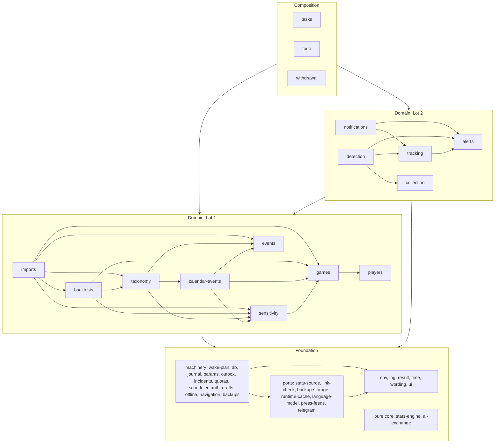

# Egoscope module map

**Status:** draft for integration, revision 3: the external services folded in and checked; names, stored values and rules aligned with `docs/engineering/glossary.md`, the rulings of `docs/engineering/clarifications/` and the data model of `docs/engineering/domain-model/`; then the gaps the seven planning areas found, settled (pass 3: the reaction lists of §1.10, the operations each area needs, the shared test support). Spec IDs (`JOU-04`, `TRV-31`…) point to the French specifications in `docs/`, which stay authoritative except where the [deviations register](spec-deviations.md) and the [decision records](../adr/README.md) change them ("ADR 0015" below). The external services are those of the service sheets in [`docs/services/`](../services/README.md); the stats source is described in its [service sheet](../services/statistics-source.md) and [evaluation](statistics-source-evaluation.md).

**How to use this map.** Find your spec file in §0, then your module in §2 or your screen in §3. §1 says what you may import and how a request, an action and a tick run; §1.8 and §1.9 explain the database budget that every task must respect; §1.10 says how Lot 2 reacts to Lot 1 work; §7 is the checklist every task follows; §9 lists the shared files you must not edit and what to do instead, and §9.2 tells each planning area which modules, screens and task handlers it builds. Lot 1 is the minimal app (players, types, backtest, import, statistics, profiles); Lot 2 adds the daily watch, alerts, tracking and Telegram.

Contents: [0 Find your place](#0-find-your-place) · [1 Layers and flows](#1-layers-and-flows) · [2 Module catalog](#2-module-catalog) · [3 Route catalog](#3-route-catalog) · [4 Scheduled tasks](#4-scheduled-tasks) · [5 Ports](#5-ports) · [6 Parameter registry](#6-parameter-registry) · [7 Cross-cutting rules](#7-cross-cutting-rules-for-implementers) · [8 Dependency graph](#8-dependency-graph) · [9 Shared files](#9-shared-files-and-how-to-avoid-collisions) · [10 Design choices and open points](#10-design-choices-and-open-points)

## 0. Find your place

| Spec file                       | Modules (`src/lib/…`)                                                                                                                                                                                                                                                                                                                       | Screens and handlers (`src/app/…`)                                                                                                                                   |
| ------------------------------- | ------------------------------------------------------------------------------------------------------------------------------------------------------------------------------------------------------------------------------------------------------------------------------------------------------------------------------------------- | -------------------------------------------------------------------------------------------------------------------------------------------------------------------- |
| 00 Overview                     | `wording` (common states, VUE-08), `stats-engine` (VUE-03), `events` (VUE-04)                                                                                                                                                                                                                                                               | `/method`                                                                                                                                                            |
| 01 Followed players             | `players`, `games` (stats-source mapping, indicators)                                                                                                                                                                                                                                                                                       | `/players`, `/players/new`, `/players/[playerId]` (+ `/edit`, `/delete`)                                                                                             |
| 02 Event taxonomy               | `taxonomy`, `ai-exchange/exploration`, `data/seeds/`                                                                                                                                                                                                                                                                                        | `/types/**`                                                                                                                                                          |
| 03 News collection (L2)         | `collection`, `press-feeds`                                                                                                                                                                                                                                                                                                                 | `/collection/sources/**`, `/collection/runs/**`                                                                                                                      |
| 04 Event detection (L2)         | `detection`, `language-model` (Workers AI, optional Groq fallback), `ai-exchange/classification`                                                                                                                                                                                                                                            | `/detected-events`, `/collection/queue`, `/collection/not-relevant`, `/collection/detection-journal`, `/collection/instructions`, `/collection/articles/[articleId]` |
| 05 Backtest request and prompt  | `backtests`, `ai-exchange/research-prompt`, `stats-engine/backtest`                                                                                                                                                                                                                                                                         | `/backtests`, `/backtests/[requestId]`                                                                                                                               |
| 06 Research-result import       | `imports`, `ai-exchange/research-result`, `drafts`, `link-check`                                                                                                                                                                                                                                                                            | `/backtests/[requestId]/import`, `/events/[eventId]/edit`                                                                                                            |
| 07 Game statistics              | `games`, `stats-source`, `stats-engine/{performance,baseline,schedule}`                                                                                                                                                                                                                                                                     | player-page blocks, `/status`                                                                                                                                        |
| 08 Sensitivity and verdict      | `sensitivity`, `stats-engine/{measured-game,cases,profiles}`                                                                                                                                                                                                                                                                                | `/players/[playerId]/profiles/[typeId]`, `/profiles`, `/cases/[caseId]`, `/types/[typeId]/trend`                                                                     |
| 09 Alert sheet (L2)             | `alerts`, `stats-engine/alerts`                                                                                                                                                                                                                                                                                                             | `/alerts`, `/alerts/[sheetId]`                                                                                                                                       |
| 10 Tracking and validation (L2) | `tracking`, `stats-engine/tracking`                                                                                                                                                                                                                                                                                                         | `/validation`, tracking block of `/cases/[caseId]`                                                                                                                   |
| 11 Telegram (L2)                | `notifications`, `telegram`, `outbox`                                                                                                                                                                                                                                                                                                       | `/settings/notifications`, `/api/telegram/webhook`                                                                                                                   |
| 12 Interface and access         | `navigation`, `ui`, `offline`, `drafts`, `todo`, `auth`                                                                                                                                                                                                                                                                                     | every screen; `/`, `/more`, `/settings`, `/settings/account`, `/settings/display`, `/help`, `/log-in`, `/choose-password`                                            |
| 13 Sensitive data               | `events` (whitelist, counter, fingerprint), `withdrawal`, `ai-exchange` (text rules)                                                                                                                                                                                                                                                        | `/events/[eventId]/withdraw`, `/players/[playerId]/delete`                                                                                                           |
| 14 Cross-cutting                | `env`, `db`, `time`, `params`, `journal`, `incidents`, `quotas`, `wake-plan`, `runtime-cache`, `scheduler`, `tasks`, `auth`, `backups`                                                                                                                                                                                                      | `/settings/parameters`, `/journal`, `/status`, `/api/tick`, `/api/health`, `/api/exports/[kind]`                                                                     |
| Decision records                | `calendar-events` (ADR 0015), `taxonomy` criterion switch (ADR 0016), `events` withdrawal fingerprint (ADR 0017), `backups` encryption (ADR 0018), collection times (ADR 0019), stats source (ADR 0023), external services (ADR 0024), the wake plan (ADR 0025), runtime (ADR 0026), supply-chain guard (ADR 0027), a game's day (ADR 0028) | —                                                                                                                                                                    |

## 1. Layers and flows

### 1.1 Layers

| Layer        | Where                                                                                                                                           | What lives there                                                                                                                                                                   | May import                                                 |
| ------------ | ----------------------------------------------------------------------------------------------------------------------------------------------- | ---------------------------------------------------------------------------------------------------------------------------------------------------------------------------------- | ---------------------------------------------------------- |
| Routes       | `src/app/**`                                                                                                                                    | pages (React Server Components), `actions.ts` (Server Actions), `queries.ts` (page-only reads), `schema.ts` (form schemas), view and block components, route handlers (`route.ts`) | any `@/lib/<module>`                                       |
| Composition  | `src/lib/{withdrawal,todo,tasks}`                                                                                                               | use cases that span many modules: event withdrawal, the to-do list, scheduled-task handlers                                                                                        | everything below                                           |
| Domain       | `src/lib/<domain>` (§2.4, §2.5)                                                                                                                 | entities, rules that need the database, read APIs                                                                                                                                  | earlier domain modules (§1.3), machinery, pure core, ports |
| Machinery    | `src/lib/{env,log,result,time,wording,ui,wake-plan,db,journal,params,outbox,incidents,quotas,scheduler,auth,drafts,offline,navigation,backups}` | services every feature uses                                                                                                                                                        | earlier machinery and ports (§1.3)                         |
| Pure core    | `src/lib/stats-engine`, `src/lib/ai-exchange`                                                                                                   | formulas, decision rules, AI exchange contracts and texts                                                                                                                          | nothing in `src/lib`                                       |
| Ports        | `src/lib/{stats-source,link-check,backup-storage,runtime-cache,language-model,press-feeds,telegram}`                                            | one interface, one fake, one or more real adapters per outside service                                                                                                             | `env`, `log`, `time`                                       |
| Test support | `src/lib/testing`                                                                                                                               | factories, scenario builders, fake controls, fixed clock                                                                                                                           | anything; imported only by tests and `scripts/` (lint)     |
| Database     | Postgres through Drizzle; schema in `src/lib/db/schema/`                                                                                        | the tables of every module (Neon in production, PGlite in tests and development)                                                                                                   | —                                                          |

### 1.2 Import rules

1. `src/lib` never imports `src/app`; a route folder never imports another route folder. Code that two routes need goes to `src/lib`. _(lint)_
2. A module is imported only as `@/lib/<module>` (its `index.ts`); no deep import, no relative import across modules. _(lint)_
3. No import cycle; a module imports only modules listed before it in §1.3. _(lint)_
4. At most two folder levels below `src/lib`; kebab-case names. Dynamic route segments (`[playerId]`) are camelCase because they become TypeScript properties. _(lint)_
5. `stats-engine` and `ai-exchange` import nothing from `src/lib`, use no Node or browser API, never read the clock and never convert time zones: instants arrive as epoch milliseconds, local dates as `YYYY-MM-DD` strings, parameters as a plain object built by the caller. _(lint)_
6. Only port modules make network calls, only `db` opens database connections, only `time` reads the clock, only `env` reads `process.env`. Server-only modules start with `import "server-only"`. _(lint + review)_
7. A table is written only by the module that owns it (§2, "Owns"). Any module may read any table through `@/lib/db` for lookups and joins; derived values (next game, profile values, coverage, profiled status, case status) are read through their owner's read API. _(review)_
8. Expected failures are returned as values, never thrown: `Result` in services and actions, each port's own outcome type (with call metadata) at the port boundary; thrown errors mean bugs or infrastructure faults. _(review)_
9. **Lot boundary** ([ADR 0001](../adr/0001-build-both-lots-in-dependency-ordered-waves.md)): the machinery, the pure core, the Lot 1 ports and the Lot 1 domain modules never import a Lot 2 domain module or a Lot 2 port; the composition modules (`withdrawal`, `todo`, `tasks`) and the routes may, since they come after Lot 2 in §1.3. Lot 2 reactions to Lot 1 work are wired only through the reaction lists of §1.10 and the routes' composed actions (§1.7), behind the lot gate (`navigation.isLotActive(2)`). _(lint, and a test of the Lot 1 build that finds every reaction list empty)_
10. **Database budget** (§1.8): nothing connects to the database at import time or at server start; code reachable from an idle tick, from `/api/health` or from the Telegram webhook's stranger path opens no database connection. _(review + a test that runs an idle tick against a database stub that fails on any query)_

### 1.3 Allowed order

A module may import only modules that appear earlier in this order.

1. **Machinery without the database:** `env` → `log`; `result`, `time`, `wording` → `ui`.
2. **Ports:** `stats-source`, `link-check`, `backup-storage`, `runtime-cache`, `language-model`, `press-feeds`, `telegram`.
3. **Pure core:** `stats-engine`, `ai-exchange` (independent of everything).
4. **Machinery:** `wake-plan` → `db` → `journal` → `params` → `outbox` → `incidents` → `quotas` → `scheduler` → `auth` → `drafts` → `offline` → `navigation` → `backups`.
5. **Domain, Lot 1:** `events` → `players` → `games` → `sensitivity` → `calendar-events` → `taxonomy` → `backtests` → `imports`.
6. **Domain, Lot 2:** `collection` → `alerts` → `tracking` → `detection` → `notifications`.
7. **Composition:** `withdrawal` → `todo` → `tasks`.
8. **Test support:** `testing`, which no production module imports.

Why this domain order: `events` is the lowest domain module — it stores events, and the modules that create or change them trigger the consequences. `sensitivity` reads events, games and type statuses as data and calls none of them back. `taxonomy` calls `sensitivity` after a merge, split, withdrawal or criterion switch, and `calendar-events` when a calendar-derived type is validated, reactivated or changed. `alerts` sits below `tracking` because tracking closes alert sheets with their outcome; `detection` is the highest Lot 2 producer because dismissal, routing and corrections call `sensitivity`, `alerts`, `tracking` and `backtests`. `wake-plan` sits below `db` because it never touches the database: anything that schedules work can call it.

### 1.4 Flow: a page request

1. **Request proxy** (`src/proxy.ts`, Next.js's request interceptor): security headers; a public path (§3.5) passes; no session cookie → redirect to `/log-in?next=<path>`.
2. **Authenticated layout** `src/app/(app)/layout.tsx`: `auth.requireSession()` checks the session in the database (idle expiry; an account still on its initial password goes to `/choose-password`); renders the navigation (`navigation`, gated by the active lot) with the to-do count (`todo.todoCount()`); records the minute's database activity for the compute estimate (`quotas`); after answering, runs the run check at app opening of TRV-25 (`tasks.runCheckAtOpening` in `after()`): a missed run is journaled, opens "task not run" and its catch-up run starts at once, so a silent trigger service cannot hide missed work from an owner who opens the app (TRV-31). The database is already awake for the session check, so neither costs a wake-up.
3. **Page** `page.tsx` (Server Component) reads through its `queries.ts` and the read APIs of `@/lib/<module>`; a page made of blocks lets each block file fetch its own data. The database pool opens on the first query of the request.
4. **Render** with `ui` components, labels from `wording`, instants through `time` in the owner's zone (`display.timeZone`).
5. **Device copy:** the service worker keeps the latest copy of the screens marked "cached" in §3.3; the client refreshes on reopen and on return from another app (IHM-04), never on a timer.

### 1.5 Flow: a Server Action

1. A client form posts to an action of the route's `actions.ts`; offline, the submit button is disabled with the reason and typed input is kept (IHM-58).
2. The action calls `auth.requireSession()` (Server Actions are public endpoints: every action checks), parses the input with the route's zod schema, then calls **one** lib use case — or the composed services of §1.7.
3. The service checks the object's version that the form carried and refuses a stale one (`db.updateVersioned`, which returns the `changed_elsewhere` error of `result`; the form shows the current version with the `ui` notice and keeps the owner's input, CL-IHM-18), validates the rules, applies them, writes, calls `journal.record(...)` and, for a notifiable fact, `outbox.emit(...)` — all inside one `transaction()`; nested service calls join the outer transaction. When the change creates work for later (a queued fetch, a recalculation, a deferred message), the service also calls `wakePlan.wakeAt(instant, reason)` (§1.9).
4. The action maps the `Result` to an `ActionState` (plain-language message from `wording`) and calls `revalidatePath` or `redirect`. Heavy follow-up work is queued, never awaited; an on-demand run asked by the owner, and the recalculation job a change records (CL-SEN-16), start in the same request with `after()` through `scheduler.requestRun`, so that the task handler of `tasks` runs them with their reaction lists (§1.10).

### 1.6 Flow: a scheduler tick

Two outside callers hit the same endpoint ([scheduler sheet](../services/scheduler.md)): a Cloudflare Worker cron every 5 minutes (POST, `x-tick-source: cloudflare`) and, as backstop, Vercel Schedules every 15 minutes with up to 15 minutes of jitter (user agent `vercel-cron/1.0`; the route accepts GET as well as POST). Nothing in the design assumes either cadence (§4.1) or the backstop's presence: it only wakes the same protected tick while the app keeps its own schedule ([ADR 0024](../adr/0024-external-services.md)), so removing its one `vercel.json` entry changes no behavior.

1. **Authenticate without the database.** `Authorization: Bearer <CRON_SECRET>` is compared in constant time. A refusal answers `401` and is recorded in memory by the server instance with its instant and kind; the instance writes its pending attempts to the Runtime Cache at most once a minute, and the next database pass journals each attempt as its own entry (TRV-65, CL-TRV-21; beyond 1,000 pending attempts only their count is kept until the pass). A stream of refused calls therefore never wakes the database and costs at most one cache write a minute per busy instance (the cache budget is in §1.9).
2. **Answer at once.** The route answers `202` within a second or two and continues in `after()` within the function limit (`quotas.hosting.functionMaxDurationSeconds`, 300 s on Hobby).
3. **Suppress duplicates.** If the last accepted tick (`tick:last`, in the Runtime Cache) is less than a minute old, stop, without writing: the two callers overlapped, or Vercel delivered a run twice. Otherwise record this tick and its caller (one write).
4. **Decide from the wake plan (§1.9), still without the database.** No plan, a plan older than an hour, a plan from another deployment, or a plan whose earliest due instant has passed → go on to step 5. A plan that only asks for a database-free probe (the stats source's refresh while the daily update waits; Telegram `getUpdates` in polling mode while a link code is pending) → make that call through its port; it either finds work (go on to step 5) or moves the probe to its next instant in the plan and stops. Otherwise stop: an idle tick costs two or three cache reads, one cache write and no query.
5. **Open the database.** `scheduler.execute` takes the pass lease, the single `scheduler_lease` row with its expiry (never a session-level lock, which pooled connections do not keep; a lease older than twice the function limit is stale, CL-TRV-07), flushes the cache counters into the journal and `quotas`, records the pass's database activity, then runs the due tasks of `tasks.registry` in registry order, under the pass lease: the handler works in chunks until it is done or the budget is spent → the run is recorded (occurrence, trigger, pass id, result, cursor). An interrupted run resumes at the next tick from its cursor (TRV-30).
6. **Chain.** Chained tasks run in the same pass, under the same pass id, while budget remains; otherwise at the next tick (TRV-26). Every outbound call goes through `quotas.withQuota`; failures open incidents; facts emitted to the outbox during the pass are sent by `notification-dispatch` at its end (L2), grouped by pass id (TEL-19).
7. **Check, then rewrite the plan.** At the end of the pass the run check runs (TRV-25, TRV-31): a missed occurrence is journaled, opens "task not run" and becomes due at once, in this pass if budget remains. Then, before releasing the lease, `scheduler.computeWakePlan` recomputes every due instant from the database and writes the plan in full.

### 1.7 Composed user actions

When one user action must trigger rules of a module that sits **above** the module owning the action (§1.3), the route's Server Action calls the services in order inside one `transaction()`. These are the only compositions allowed in routes; every other action is one call. For example, saving an import is `imports.save`, withdrawing an event is `withdrawal.withdrawEvent`, and a schedule parameter change is `params.setParam` (which itself invalidates the wake plan, since `wake-plan` sits below `params`). A Lot 2 call of a Lot 1 screen ("L2" below) is a line of that screen's Lot 2 hook, added by the screen's own area in a Lot 2 task behind the lot gate; it is one of the reaction lists of §1.10.

| Action (route)                                                                                                    | Calls, in order                                                                                                                                                                                                                                                                                                                                                                                                                                                                                                                                                                                                                                                                                                                                                                                                                                                                                                                                                                                                                                                                                                                                                                                                                                                                                                                                                                                                                                                                                                                                                  | Spec                                                   |
| ----------------------------------------------------------------------------------------------------------------- | ---------------------------------------------------------------------------------------------------------------------------------------------------------------------------------------------------------------------------------------------------------------------------------------------------------------------------------------------------------------------------------------------------------------------------------------------------------------------------------------------------------------------------------------------------------------------------------------------------------------------------------------------------------------------------------------------------------------------------------------------------------------------------------------------------------------------------------------------------------------------------------------------------------------------------------------------------------------------------------------------------------------------------------------------------------------------------------------------------------------------------------------------------------------------------------------------------------------------------------------------------------------------------------------------------------------------------------------------------------------------------------------------------------------------------------------------------------------------------------------------------------------------------------------------------------------- | ------------------------------------------------------ |
| Add a player (`/players/new`)                                                                                     | `players.add` → `games.confirmMapping` (or `games.markMappingToEstablish`) → `games.requestHistory`; L2: `detection.reprefilterForPlayer`                                                                                                                                                                                                                                                                                                                                                                                                                                                                                                                                                                                                                                                                                                                                                                                                                                                                                                                                                                                                                                                                                                                                                                                                                                                                                                                                                                                                                        | JOU-07, JOU-10, STA-03, DET-07                         |
| Reactivate a player (`/players/[playerId]`)                                                                       | `players.reactivate`; L2: `detection.reprefilterForPlayer`. No derivation request: the next regular run covers the gap from `followed_players.last_calendar_derivation_at`                                                                                                                                                                                                                                                                                                                                                                                                                                                                                                                                                                                                                                                                                                                                                                                                                                                                                                                                                                                                                                                                                                                                                                                                                                                                                                                                                                                       | JOU-20, DET-07, CL-TAX-19                              |
| Edit a player's identity (`/players/[playerId]/edit`)                                                             | `players.updateIdentity` → if the birthday changed, `calendarEvents.requestDerivation({ player, kind: "full", cause: "birthday_changed" })`; L2, if a variant was added, `detection.reprefilterForVariant`                                                                                                                                                                                                                                                                                                                                                                                                                                                                                                                                                                                                                                                                                                                                                                                                                                                                                                                                                                                                                                                                                                                                                                                                                                                                                                                                                       | JOU-09, JOU-12, DET-07, ADR 0015                       |
| Confirm or change the mapping of a followed player (`/players/[playerId]/edit`; the to-do item opens this screen) | `games.confirmMapping` or `games.changeMapping` → `sensitivity.requestRecalculation({ player }, cause)` → `calendarEvents.requestDerivation({ player, kind: "full", cause: "mapping_changed" })` → `games.requestHistory`                                                                                                                                                                                                                                                                                                                                                                                                                                                                                                                                                                                                                                                                                                                                                                                                                                                                                                                                                                                                                                                                                                                                                                                                                                                                                                                                        | JOU-11, STA-03, CL-JOU-11, CL-TAX-19                   |
| Withdraw a player (`/players/[playerId]`)                                                                         | `players.withdraw` → `backtests.cancelRequestToDo(playerId, "player_withdrawn")`                                                                                                                                                                                                                                                                                                                                                                                                                                                                                                                                                                                                                                                                                                                                                                                                                                                                                                                                                                                                                                                                                                                                                                                                                                                                                                                                                                                                                                                                                 | JOU-19, BKT-14                                         |
| Change a parameter (`/settings/parameters`)                                                                       | `params.setParam` → if the parameter affects calculations, `sensitivity.requestRecalculation({ kind: "full" }, "parameter_change")`                                                                                                                                                                                                                                                                                                                                                                                                                                                                                                                                                                                                                                                                                                                                                                                                                                                                                                                                                                                                                                                                                                                                                                                                                                                                                                                                                                                                                              | TRV-35, SEN-34                                         |
| Validate, reactivate or modify a type (`/types/[typeId]/validate`, `/types/[typeId]`, `/types/[typeId]/edit`)     | `taxonomy.validate`, `reactivate` or `modify` → `backtests.proposedSupplements(typeId)` → `taxonomy.recordProposedSupplements(versionId, count)`; L2, for a type born of a detection proposal: `detection.requeueProposalArticles`                                                                                                                                                                                                                                                                                                                                                                                                                                                                                                                                                                                                                                                                                                                                                                                                                                                                                                                                                                                                                                                                                                                                                                                                                                                                                                                               | TAX-19, TAX-20, TAX-24, TAX-26, TAX-32, BKT-05, DET-36 |
| Merge types (`/types/merge`)                                                                                      | `taxonomy.merge` → `backtests.inheritCoverage("merge")` → `backtests.proposedSupplements` → `taxonomy.recordProposedSupplements`                                                                                                                                                                                                                                                                                                                                                                                                                                                                                                                                                                                                                                                                                                                                                                                                                                                                                                                                                                                                                                                                                                                                                                                                                                                                                                                                                                                                                                 | TAX-26, TAX-27, CL-BKT-06                              |
| Split a type (`/types/[typeId]/split`)                                                                            | `taxonomy.split` → `backtests.inheritCoverage("split")` → `backtests.proposedSupplements` → `taxonomy.recordProposedSupplements`                                                                                                                                                                                                                                                                                                                                                                                                                                                                                                                                                                                                                                                                                                                                                                                                                                                                                                                                                                                                                                                                                                                                                                                                                                                                                                                                                                                                                                 | TAX-26, TAX-29, CL-BKT-06                              |
| Erase an event while requalifying or distributing (`/types/[typeId]/review-events`)                               | `taxonomy.requalifyEvent` or `taxonomy.distributeEvent` (the choice and its count on the version) → `withdrawal.eraseEventWithScope(eventId, "requalification_erasure" or "split_erasure")`                                                                                                                                                                                                                                                                                                                                                                                                                                                                                                                                                                                                                                                                                                                                                                                                                                                                                                                                                                                                                                                                                                                                                                                                                                                                                                                                                                      | TAX-25, TAX-26, TAX-29, CL-TAX-09                      |
| Reject a type born of a detection proposal (`/types/[typeId]`, L2)                                                | `taxonomy.reject` → `detection.releaseRejectedProposalArticles(typeId)`                                                                                                                                                                                                                                                                                                                                                                                                                                                                                                                                                                                                                                                                                                                                                                                                                                                                                                                                                                                                                                                                                                                                                                                                                                                                                                                                                                                                                                                                                          | TAX-19, DET-36                                         |
| Attach a detection proposal as an occurrence of another entry (`/types/[typeId]`, L2)                             | `taxonomy.attachAsOccurrence` → `detection.moveProposalFacts(proposalId, entryId)`                                                                                                                                                                                                                                                                                                                                                                                                                                                                                                                                                                                                                                                                                                                                                                                                                                                                                                                                                                                                                                                                                                                                                                                                                                                                                                                                                                                                                                                                               | TAX-18                                                 |
| Exclude or reinstate a case (`/cases/[caseId]`)                                                                   | `sensitivity.excludeCase` or `reinstateCase`; L2: `tracking.recordDecision`                                                                                                                                                                                                                                                                                                                                                                                                                                                                                                                                                                                                                                                                                                                                                                                                                                                                                                                                                                                                                                                                                                                                                                                                                                                                                                                                                                                                                                                                                      | SEN-17, SUI-17                                         |
| Dismiss or reinstate a detected event (`/events/[eventId]`, `/detected-events`, `/alerts/[sheetId]`, L2)          | `detection.dismiss` or `reinstate` (detection calls sensitivity, alerts and tracking itself) → on a dismissal, `notifications.discardPendingFor(eventId)`; the send-time staleness check stays (TEL-23)                                                                                                                                                                                                                                                                                                                                                                                                                                                                                                                                                                                                                                                                                                                                                                                                                                                                                                                                                                                                                                                                                                                                                                                                                                                                                                                                                          | DET-43–DET-46, TEL-38                                  |
| Merge two detected events of one player (`/events/[eventId]/edit`, the detected-edit block, L2)                   | `notifications.moveEventReferences(absorbedEventId, keptEventId)` first, since `detection` cannot import `notifications` and these rows would block the erasure: the message-event rows, and the result fact of the absorbed case, when that case goes, moved to the kept event's case or deleted → `detection.correct` (the merge), in its own order: (1) its attachments and designated facts moved to the kept event, whose reference date, reference article and detection confidence it recomputes; (2) `tracking.moveEventReferences`: when the absorbed case goes, the regrouping exit and the decisions as `moveCaseReferences` handles them (CL-SUI-16), then the decisions and exits about the absorbed event repointed to the kept event; (3) `alerts.onAttachmentCorrected` for the merge: the absorbed event's sheet-event row deleted with its `attachment_corrected` entry and the ALE-31 cancellation, its history moved, caveats and expected games recomputed, the outcome of a case that goes deleted; (4) the erasure of the absorbed event: `collection.eraseArticlesWithoutRole`, then the core's erasure step in its merge variant (tally exit `merged`, no fingerprint, no counter), through `events.eraseEvent` and `sensitivity.eraseEventData` for the absorbed case when it goes. The absorbed case goes when the absorbed event is its only event and the kept event belongs to another case; each operation works that out by itself, so the route holds no logic; a merge that detection refuses rolls the whole transaction back | DET-47, ALE-31, CL-SUI-16, CL-TEL-09                   |
| Save an import while the player has a detected event awaiting its game (`/backtests/[requestId]/import`, L2)      | `imports.save` → `alerts.produceAfterImport(playerId)`                                                                                                                                                                                                                                                                                                                                                                                                                                                                                                                                                                                                                                                                                                                                                                                                                                                                                                                                                                                                                                                                                                                                                                                                                                                                                                                                                                                                                                                                                                           | IMP-36, ALE-05                                         |

Scheduled reactions that cross the lot boundary are written in the task handlers of `tasks` (§4) and in `withdrawal`, through the reaction lists of §1.10, never inside a Lot 1 module.

### 1.8 Hosting, runtime and the database budget

- **Hosting** ([hosting sheet](../services/hosting.md)): Vercel Hobby, functions in `fra1` (Frankfurt, next to the database), declared in `vercel.json`. Production runs on the **Node.js runtime**, Node 22 for the whole build; Bun installs, runs the scripts and the tests only, since Vercel's Bun runtime is beta, and production code uses no Bun-only API ([ADR 0026](../adr/0026-runtime-node-in-production-bun-for-tooling.md)). A hardening task at the end of the build moves CI and production to the newest Node LTS that passes the gate (Node 22 ends on 2027-04-30). Functions last at most 300 s, request and non-streamed response bodies at most 4.5 MB (large exports are streamed), and long work runs in chunks (TRV-30). Outside callers (tick, Telegram) use the production address `APP_BASE_URL`.
- **Database** ([database sheet](../services/database.md)): Neon Free in AWS Frankfurt, compute fixed at 0.25 CU, **100 compute-hours a month**. The compute stays awake 5 minutes after the last query, so a query every 5 minutes would keep it awake all month (182.5 compute-hours) and Neon would suspend the database until the next month. Hence the wake plan (§1.9): an idle tick never queries. The app connects through node-postgres with a pool registered with `attachDatabasePool` from `@vercel/functions`, lazily on first use; `DATABASE_URL` (pooled, PgBouncer in transaction mode) serves the app, `DATABASE_URL_UNPOOLED` (direct) serves the migrations of the deploy step and the long reads of the backup export. The pooled connection keeps no session state: no `SET`, `LISTEN`, SQL `PREPARE`, temporary table or session-level advisory lock.
- **Budget, as code rules:** no connection at import or at server start (`auth.ensureAccount` runs before the first login or session check of an instance, never at start-up, §3.6); `/api/health` reads no table; the interface never polls the server on a timer; a task that must wait for a rate limit stops its chunk and lets a later tick resume it, never sleeping inside a function; every database pass rewrites the wake plan ([ADR 0025](../adr/0025-database-compute-budget-shapes-the-scheduler.md)). A plan older than an hour always triggers a pass, so about 24 passes a day happen whatever else is due: the hourly passes alone cost 14 to 17 compute-hours a month, and the database sheet expects **about 18 to 30 compute-hours a month in Lot 1 and 20 to 45 in Lot 2**, against 100; if the Runtime Cache fails, each function instance beyond the first adds about 14 to 17 more (§1.9). `quotas` estimates the month's use from the app's own database activity (§2.1) and warns at the warning share; Neon's console stays the authority.

### 1.9 The wake plan

The wake plan is one small JSON entry in Vercel's Runtime Cache that tells a tick, without the database, whether the database is needed now.

- **Owner.** The `wake-plan` module owns the entry and its format and offers `readPlan`, `writePlan`, `wakeAt(instant, reason)` (keep the earliest due instant), `invalidate`, the tick records and the counters. It reaches the cache through the `runtime-cache` port (Vercel adapter in production, an in-memory fake in tests and development). `scheduler` alone computes the full plan, from the database, at the end of every database pass.
- **Content.** The deployment id that wrote it; when it was computed; the earliest due instant; one entry per task with its due instant and reason; the database-free probes a tick may make (the stats source's refresh while the daily update waits for it, with the threshold instant the refresh must pass and the version for the conditional request; Telegram polling while a link code is pending, with the hash of the pending code and the update offset; each probe records its own calls for `quotas` when it updates its state). No personal data: hashes, task names and instants only. Beside it, `tick:last` records the last accepted tick and the time of each caller's last call, and a counters entry holds what was recorded without the database (refused ticks and ignored Telegram updates, each with its instant and kind, CL-TRV-21) until the next database pass journals each one. Each server instance buffers them in memory and writes them at most once a minute, and only when they changed.
- **Every kind of task gets a due instant, so no task needs a query per tick.** A daily or weekly task is due at its next local-time occurrence; a chained task inherits its parent's pass; a task with a queue is due at the earliest instant its owner computes from its rows — the next attempt of a fetch queue item, the end of the classification queue's last run plus its interval while an item is eligible (or, when that run stopped on a model provider's quota, the provider's reset instant if it comes earlier: ruling refining CL-DET-04), the earliest pending link check, recalculation or derivation request, the next deferred, retried or reminder message, and for game tracking the expected availability of an awaiting tracked case's statistics, never earlier than its last run (a due instant already processed would wake the database at every tick). An interrupted run is due at once.
- **Who refreshes it, in the same request.** Every operation that changes when work is due: a run finishing (the full rewrite of §1.6 step 7); a queue receiving work (`wakeAt` by the enqueuing module: `games`, `sensitivity`, `calendar-events`, `imports`, `collection`, `detection`, `notifications`); an outbox fact while Lot 2 is active (`outbox.emit` calls `wakeAt(now)`); a schedule parameter or the time zone changing (`params.setParam` calls `invalidate`); an on-demand run (`scheduler.requestRun` calls `wakeAt(now)` and starts it in `after()`); a restore or a new deployment (a plan written by another deployment counts as missing, and the installation check after a restore rewrites it). `wakeAt` reads the plan and writes only when it moves the earliest due instant earlier; inside a database pass it writes nothing, since the pass rewrites the plan at its end.
- **When the plan is lost or wrong.** A missing, unreadable or foreign plan costs one database pass, which rewrites it. A plan older than an hour also triggers a pass: this is the hourly safety check, which also runs the run check of TRV-31, so a lost `wakeAt` (two writers racing on the entry, eviction) delays work by at most an hour. If the cache itself fails or is paused for the month, the tick falls back to at most one database pass per hour per function instance and the status screen shows the runtime cache as degraded. The deployment id is the host's `VERCEL_DEPLOYMENT_ID`, present only while the project setting "Enable access to System Environment Variables" is on: without it the plan carries no deployment id, a new deployment is caught by the hourly check instead, and the installation check fails with that cause.
- **Cache budget.** The free allowance is 1,000,000 reads and 200,000 writes a month; beyond it the cache pauses for the rest of the month, which would send every tick to the hourly fallback, so nothing writes to the cache once per request. Worst case for a 30-day month: one write per accepted tick (both callers, about 11,500), one plan rewrite per database pass (up to about 1,500), the `wakeAt` calls that move the plan earlier outside a pass (owner actions, inbound events: a few hundred), the probes' state (about 200), and the counters (rarely written): about 14,000 writes, 7 % of the allowance. Under a continuous stream of refused calls or of stranger Telegram updates, each busy instance adds at most one write a minute, about 43,200 a month: one such instance brings the total to about 58,000, and the invocation allowance (1,000,000 a month, about 23 calls a minute sustained) runs out before the cache's does. Reads are two or three per tick: about 35,000 a month.

### 1.10 Lot 2 reactions to Lot 1 work

One mechanism lets Lot 2 react to what Lot 1 does while no Lot 1 module imports Lot 2 (rule 9): the **reaction list**. A reaction list is an ordered list of Lot 2 functions held in a file of the composition layer, the file of the code that runs it. The Lot 1 task that creates the file leaves one commented slot per Lot 2 module, in the order below; the task named in the table fills each slot with one import and one entry, with the test that proves the reaction (CL-DSN-16). A list returns its entries only while `navigation.isLotActive(2)`, and nothing otherwise, so a Lot 1 build calls nothing of Lot 2, and a Lot 1 task never waits for a Lot 2 task.

A list runs in one of three places:

- **after** the Lot 1 operation, in the same transaction, called by its composition caller (a task handler, `withdrawal`, a route's composed action of §1.7);
- **inside** the Lot 1 operation, when Lot 2 rows must change before a Lot 1 row they reference (`ON DELETE RESTRICT`) is deleted: the operation takes a `reactions` argument whose type its module declares in its `types.ts` (plain ids and the transaction in, a `Result` out), calls it at the moment named below, and is tested with empty and spying reactions; its composition caller passes the list;
- **before** the operation's transaction, for an outside call, since no outside call runs inside a database transaction: the Telegram deletions of a withdrawal (CL-TEL-09).

| List (file, created by)                                                               | Run by, moment                                                                                                                                                                                                                                                                                                                                                                                                                                                                                                                                                                                                                                                    | Slots, in order (filled by)                                                                                                                                                                                                                                                                                                                                                                                                                                                                                                                                                                                                                                                                                                 |
| ------------------------------------------------------------------------------------- | ----------------------------------------------------------------------------------------------------------------------------------------------------------------------------------------------------------------------------------------------------------------------------------------------------------------------------------------------------------------------------------------------------------------------------------------------------------------------------------------------------------------------------------------------------------------------------------------------------------------------------------------------------------------- | --------------------------------------------------------------------------------------------------------------------------------------------------------------------------------------------------------------------------------------------------------------------------------------------------------------------------------------------------------------------------------------------------------------------------------------------------------------------------------------------------------------------------------------------------------------------------------------------------------------------------------------------------------------------------------------------------------------------------- |
| Event erasers (`src/lib/withdrawal/withdraw.ts`, sensitive-crosscutting)              | `withdrawal.withdrawEvent` and `eraseEventWithScope`, before the Lot 1 erasers, which `withdraw.ts` calls itself as plain functions (`sensitivity.eraseEventData`, `imports.eraseEventData`, the drafts of the player's requests, `events.eraseEvent`)                                                                                                                                                                                                                                                                                                                                                                                                            | notifications, alerts, tracking, detection, whose step also erases the articles it leaves without a role through `collection.eraseArticlesWithoutRole` (each area's eraser task)                                                                                                                                                                                                                                                                                                                                                                                                                                                                                                                                            |
| Telegram deletions (`withdraw.ts` and `player-data.ts`)                               | the same operations, before their erasure transaction (CL-TEL-09): a first committed step abandons the unsent messages about the event (for a player, about him and his events) and reads the identifiers of the sent ones; then, outside any transaction, Telegram is asked once to delete each, whatever its age; then the erasure's transaction runs, the notifications eraser erasing the texts and identifiers whatever the answers; the screen shown right after lists the refusals from memory, never stored. A stop before the erasure leaves the event in place and the owner withdraws again; a message Telegram no longer finds then counts as deleted | notifications: `discardPendingFor`, the committed step, which abandons the unsent messages and returns the sent ones' identifiers, then `deleteMessagesAbout(identifiers)` (alerts-tracking-telegram)                                                                                                                                                                                                                                                                                                                                                                                                                                                                                                                       |
| Withdrawal preview (`src/lib/withdrawal/preview.ts`, sensitive-crosscutting)          | `withdrawal.previewWithdrawal` and `previewPlayerDeletion`                                                                                                                                                                                                                                                                                                                                                                                                                                                                                                                                                                                                        | notifications (`countSentAbout`), alerts, tracking, detection (each area's eraser task)                                                                                                                                                                                                                                                                                                                                                                                                                                                                                                                                                                                                                                     |
| Player erasers (`src/lib/withdrawal/player-data.ts`, sensitive-crosscutting)          | `withdrawal.deletePlayerData`, after his events went through the event erasers, before his Lot 1 rows                                                                                                                                                                                                                                                                                                                                                                                                                                                                                                                                                             | notifications, alerts, tracking, detection, collection: `erasePlayerData(playerId)` where the module keeps rows naming him, his requests or his cases (each area's eraser task)                                                                                                                                                                                                                                                                                                                                                                                                                                                                                                                                             |
| Derivation reactions (`src/lib/tasks/calendar-derivation.ts`, statistics-sensitivity) | inside `calendarEvents.processDerivations(ctx, reactions)`, before a calendar-derived event and its case are deleted by the derivation (an upcoming one, or one whose game started, after a correction)                                                                                                                                                                                                                                                                                                                                                                                                                                                           | notifications `discardPendingFor`, alerts `onCalendarEventDropped`, tracking `eraseEventData` (the statistics-sensitivity Lot 2 task)                                                                                                                                                                                                                                                                                                                                                                                                                                                                                                                                                                                       |
| Regrouping reactions (`src/lib/tasks/recalculation.ts`, statistics-sensitivity)       | inside `sensitivity.processRecalculationJobs(ctx, reactions)`, before a case emptied by a regrouping is deleted, with the emptied and the surviving case, while the emptied case and its gap are still readable                                                                                                                                                                                                                                                                                                                                                                                                                                                   | alerts, then notifications, then tracking, each with `moveCaseReferences(fromCaseId, intoCaseId)`: alerts (the outcomes and the history entries that name the case) and notifications (the result facts) move the rows that point at the emptied case to the surviving one, or delete them when that case already has one; tracking records a regrouping exit (`regrouping_exits`) when the emptied case is tracked and its measured game's last known scheduled start has passed, and moves the emptied case's decisions to the surviving case's tracked case when there is one, the emptied tracked case's other rows then cascading (CL-SUI-16; the data model's case-merge hook; the statistics-sensitivity Lot 2 task) |
| Installation check (`src/lib/tasks/installation-check.ts`, sensitive-crosscutting)    | `tasks.checkInstallation`, after the Lot 1 checks                                                                                                                                                                                                                                                                                                                                                                                                                                                                                                                                                                                                                 | the language model, the press feeds, the Telegram webhook (`notifications.registerWebhook`, `webhookStatus`) (each area's Lot 2 tasks)                                                                                                                                                                                                                                                                                                                                                                                                                                                                                                                                                                                      |
| Purge steps (`src/lib/tasks/purge.ts`, F-tasks)                                       | the `purge` task                                                                                                                                                                                                                                                                                                                                                                                                                                                                                                                                                                                                                                                  | collection's articles, excerpts and traces, detection's exposure and runs, the link codes (each area's purge task)                                                                                                                                                                                                                                                                                                                                                                                                                                                                                                                                                                                                          |
| To-do items (`src/lib/todo/requests.ts`, `review.ts`, the interface area)             | `todo.todoList`                                                                                                                                                                                                                                                                                                                                                                                                                                                                                                                                                                                                                                                   | the detection-born requests and their urgent order, the "dating to verify" and possible-duplicate marks of detected events (the interface Lot 2 task)                                                                                                                                                                                                                                                                                                                                                                                                                                                                                                                                                                       |

Everything else Lot 2 needs from Lot 1 work is a read, not a call: a Lot 2 task chained after the Lot 1 tasks reads what changed. `game-tracking`, chained after the statistics tasks, `calendar-derivation` and `recalculation` (§4), creates the missing tracked cases and alert sheets of upcoming calendar-derived events (CL-SUI-14, CL-ALE-13), completes the profile values of the sheets waiting for them (ALE-05), marks "profile changed since issue" (ALE-19) and measures the tracked cases whose statistics arrived. A new list, or a new moment in a list, is an orchestrator decision.

**Lint.** The lot-boundary rule (rule 9) refuses an import of a Lot 2 domain module or port from the machinery, the pure core, a Lot 1 port or a Lot 1 domain module, and allows it in the composition modules and the routes; a test of the Lot 1 build (`EGOSCOPE_LOT=1`) runs every reaction list and finds it empty.

## 2. Module catalog

Every module is a folder `src/lib/<module>/` whose `index.ts` re-exports, by name, the public API of its files (`export { name } from './file'`; `export *` is banned). **Files** lists the planned files, one per operation group, flat; each is created by the task that implements it, with its colocated test. A task may add internal files beside its planned ones (a split for size, a builder of engine inputs, pure texts), which export nothing through the barrel and so need no slot. **Owns** names the entities whose tables only this module writes; the exact tables come from `docs/engineering/domain-model/`. **Lot** is the lot of the requirements; **Task** says who creates the module: a foundation task of §9 (`F-…`) or the planners' feature tasks.

### 2.1 Machinery

#### `env` — deployment configuration

- **Does:** reads and validates `process.env` once (`readServerEnv`, created by F-toolchain with `LOG_LEVEL` only; F-db adds the two database URLs and F-e2e the fakes switch); F-env completes the schema with every other deployment value up front, so no feature edits it; a preview deployment, which carries no database variables by design (hosting sheet, TRV-78), gets an invalid result naming them and never connects; marks secrets so they are never logged, displayed or exported, and marks the real credentials (both database URLs and every service token); selects the adapters (real by default, fakes only for development and the hermetic end-to-end mode); `EGOSCOPE_FAKES` together with any real credential is an invalid configuration that refuses to start, and so is `EGOSCOPE_FAKES` while `VERCEL_ENV` is `production`, so fakes are impossible on any deployment that carries a credential whether or not the host provides its system variables; `isHermetic()` is true for `EGOSCOPE_FAKES=all` on a valid configuration; exposes the active lot, the deployment id (`VERCEL_DEPLOYMENT_ID`, undefined when the host does not provide it) and `hostCheck()`, which reports a missing `VERCEL_ENV` or `VERCEL_DEPLOYMENT_ID` so that the installation check fails with that cause (the project setting "Enable access to System Environment Variables" must stay on).
- **Exposes:** `readServerEnv`, `parseServerEnv`, `isSecret`, `redact`, `adapterFor(port)`, `isHermetic`, `activeLot`, `deploymentId`, `hostCheck`.
- **Values (complete list), the names of the [accounts-and-keys sheet](../services/accounts-and-keys.md):** `APP_BASE_URL`, `DATABASE_URL`, `DATABASE_URL_UNPOOLED`, `CRON_SECRET`, `INITIAL_PASSWORD`, `FINGERPRINT_KEY`, `BACKUP_GITHUB_REPOSITORY`, `BACKUP_GITHUB_TOKEN`, `BACKUP_ENCRYPTION_KEY`; Lot 2: `CLOUDFLARE_ACCOUNT_ID`, `CLOUDFLARE_AI_API_TOKEN`, `GROQ_API_KEY` (optional: without it the model chain is the primary alone), `TELEGRAM_BOT_TOKEN`, `TELEGRAM_WEBHOOK_SECRET`. Not in that sheet yet: `LOG_LEVEL` (optional, default `info`), `STATS_SOURCE_BASE_URL` (optional mirror, from the statistics sheet), `EGOSCOPE_LOT` (build-time lot switch, 1 until the Lot 2 milestone, then 2; the owner never sets it), `EGOSCOPE_FAKES` (comma-separated ports or `all`, development and hermetic end-to-end only). Read from the host, never set: `VERCEL_ENV`, `VERCEL_DEPLOYMENT_ID`. No session secret: sessions are random tokens stored hashed (`auth`).
- **Implements:** TRV-37, TRV-64. **Depends on:** —. **Lot:** foundation. **Task:** F-toolchain, F-db and F-e2e, completed by F-env.
- **Files:** `server-env.ts`, `hermetic.ts` (F-e2e), `secrets.ts`, `adapters.ts`, `host.ts`.

#### `log` — server logger

- **Does:** the structured server log for diagnosis (the host keeps it one hour), the only writer to the console; never a secret, an event description, a justification or article text. It is not the activity journal: the journal is the owner's record in the database, the log is for whoever operates the host.
- **Exposes:** `logger`, types `Logger`, `LogLevel`, `LogFields`.
- **Implements:** TRV-44 (with `journal`), TRV-64. **Depends on:** `env`. **Lot:** foundation. **Task:** F-toolchain.

#### `result` — expected-failure values

- **Does:** the `Result<T, E>` discriminated union and its helpers for services; `ActionState`, the shape Server Actions return to forms (field errors, one plain-language message); the shared `changed_elsewhere` error that a save sent with a stale version returns, carrying the current version, which `ActionState` turns into the "changed elsewhere" notice while the form keeps the owner's input (CL-IHM-18). Ports keep their own outcome types with call metadata.
- **Exposes:** `ok`, `err`, `isOk`, `mapResult`, `toActionState`, `changedElsewhere`, types `Result`, `ActionState`, `ChangedElsewhere`.
- **Depends on:** —. **Lot:** foundation. **Task:** F-service-kit.

#### `time` — clock, zones, formatting

- **Does:** the branded types `EpochMs` (an instant as epoch milliseconds) and `IsoDate` (a `YYYY-MM-DD` calendar date), which the pure core receives as plain numbers and strings under aliases of the same names; the only clock, through the `Clock` port (`systemClock`, `fixedClock`, `now()`, and `useFakeClock` for tests and the hermetic end-to-end mode); IANA zone conversion, every function taking the zone it works in (the owner's zone is the `display.timeZone` setting, read by callers); DST-safe local-time occurrences, one instant per scheduled local time even on clock-change days, a missing time moving past the gap and a repeated one taking its first occurrence (TRV-27); the owner's day; **a game's day, which is its date in US Eastern time (`America/New_York`) for every rule and display, games abroad included (CL-TRV-03, [ADR 0028](../adr/0028-a-game-day-is-its-us-eastern-date.md))**, and its start, 00:00 Eastern, at which a game whose time is to be determined is deemed to start; end of day on the Pacific coast for date-only events (SEN-01); `parseTimestamp`, which never guesses a missing offset; English display formats — "Wednesday 18 November 2026, 01:30 Paris time", short "Wed 18 Nov 2026, 01:30", zone named by the full form or once at the top of a screen; for a game, its US date with the part of day of its Eastern start (morning before 12:00, afternoon before 17:00, evening from 17:00) when it differs from the owner's date ("Wed 18 Nov 2026, 01:30 — Tuesday evening in the US", CL-TRV-02), and "time TBD" for a game without a time, never 00:00.
- **Exposes:** types `EpochMs`, `IsoDate`, `Clock`; `systemClock`, `fixedClock`, `now`, `useFakeClock`, `toZoned`, `localOccurrenceInstant`, `userDay`, `gameDay`, `gameDayStart`, `endOfDayPacific`, `parseTimestamp`, `formatInstant`, `formatGameTime`, `formatDate`, `formatDuration`.
- **Implements:** TRV-68–TRV-72 (TRV-73 with each owner), IHM-14 (conversion), STA-30 (display). **Depends on:** —. **Lot:** foundation. **Task:** F-time (claims TRV-69–TRV-72, CA-TRV-22, CA-TRV-23, CA-TRV-36 and CA-IHM-15).

#### `wording` — the app's words

- **Does:** the single English rendering of every glossary term and common state (VUE-08); one-sentence definitions (IHM-15); fixed sentences (SEN-30 reminder, SEN-31 label, IHM-50 short notice, ALE-17 standing notice, TEL-05 closing line, IHM-54–IHM-56 empty states, the app-written descriptions of calendar-derived events, ADR 0015); number formats (explicit sign with a true minus, decimal point, index 3 decimals STA-12, normalized gap 2 decimals SEN-09); the banned betting vocabulary and a test helper that scans rendered text (VUE-02, IHM-50, ALE-18, TEL-05); the lint rule, beside the ambient-time rule of `time`, that refuses `toFixed`, `toLocaleString`, `toLocaleDateString`, `toLocaleTimeString`, `Intl.NumberFormat` and `Intl.DateTimeFormat` in `src/` outside `time` and `wording`, so every number and date goes through their formatters (IHM-13).
- **Exposes:** `label`, `definition`, `sentence`, `formatGap`, `formatIndex`, `formatCount`, `formatShare`, `assertNoBettingWords`.
- **Implements:** VUE-08, IHM-13 (numbers), IHM-50 (vocabulary). **Depends on:** —. **Lot:** foundation. **Task:** F-wording.
- **Files:** `states.ts`, `glossary.ts`, `numbers.ts`, `banned-words.ts`, and one fixed-sentences file per spec file under these names: `sentences/overview.ts` (00), `players.ts` (01), `taxonomy.ts` (02), `collection.ts` (03), `detection.ts` (04), `backtests.ts` (05), `imports.ts` (06), `statistics.ts` (07), `sensitivity.ts` (08), `alerts.ts` (09), `tracking.ts` (10), `notifications.ts` (11), `interface.ts` (12), `sensitive-data.ts` (13), `cross-cutting.ts` (14). An area adds its sentences in the file of the spec it implements, one commented group per screen or task, at the end of the file.

#### `ui` — design system

- **Does:** accessible, phone-first components (WCAG 2.2 AA, a light and a dark theme following the phone, text that follows the phone's size): page layout primitives, buttons with explicit labels, forms and field errors, dialogs with a double confirmation, banners, status pills, empty states, paged lists with status filters and name search (IHM-18), long-text areas, copy and share buttons, a paste area with autocorrect, smart punctuation and auto-capitalization off; every visible text is a prop and no component formats a date or a number; the "changed elsewhere" notice that shows the current version and keeps the input (CL-IHM-18); the `/dev/ui` gallery, reachable only in development and the hermetic mode. The navigation bar and the More menu are F-shell's, built from these components. A component that several screens need goes to `src/lib`, never into one route (rule 1): when it is a figure of one area (the case list and the verdict history of the profile and trend screens, for example), it is a file of that area under `ui/figures/`, exported in that area's sub-slot of the ui barrel's figures slot. `ui/figures/` holds the honest-display components: mean gap with case count and plausible range, verdict with profile confidence and case count, written direction with symmetric styling, origin breakdown (historical / tracked), counts instead of percentages below the threshold, filter summary with the total, the short notice, a glossary term with its one-tap definition, drill-down links to a gap's numbers.
- **Exposes:** components (names fixed by F-ui and F-figures).
- **Implements:** IHM-01, IHM-60–IHM-63; figures: IHM-15, IHM-45–IHM-49, IHM-52, SEN-38, SEN-39 (as components; each screen must use them). **Depends on:** nothing in `src/lib` for the base components (F-ui, which runs before `wording` exists); `wording` for `ui/figures` (F-figures). **Lot:** foundation. **Task:** F-ui (claims IHM-60–IHM-63), F-figures (which leaves one sub-slot per planning area), then the areas' shared figures.

#### `wake-plan` — the tick's wake plan

- **Does:** the Runtime Cache entry that lets an idle tick decide without the database (§1.9): its format, versioned by deployment; `wakeAt` merges an earlier due instant, writing only when it moves the plan earlier and never inside a database pass; `invalidate` drops it; the tick records (`tick:last`, last call per caller, one write per accepted tick) and the counters a database pass flushes (refused ticks, ignored Telegram updates), aggregated in memory per server instance and written at most once a minute. It keeps the cache's writes within the allowance (§1.9, cache budget), never touches the database and holds no personal data.
- **Exposes:** `readPlan`, `writePlan`, `wakeAt`, `invalidate`, `recordTick`, `lastTicks`, `bumpCounter`, `drainCounters`, types `WakePlan`, `WakeEntry`, `WakeProbe`.
- **Implements:** the idle-tick constraint of the database and scheduler sheets; supports TRV-25, TRV-28–TRV-31, TRV-65. **Depends on:** `runtime-cache`, `env`, `time`. **Lot:** foundation. **Task:** F-wake-plan.
- **Files:** `plan.ts`, `wake.ts`, `ticks.ts`, `counters.ts`.

#### `db` — database access

- **Does:** the Drizzle client over node-postgres in production (pool registered with `attachDatabasePool`, created by the first query, never at import or start-up, `sslmode=verify-full`); `DATABASE_URL` (pooled) for the app, `DATABASE_URL_UNPOOLED` (direct) for migrations and long exports; PGlite outside Vercel only — in memory for tests and for the hermetic end-to-end server, persisted under `.pglite/` for `next dev`, migrated on first use — while a Vercel deployment without a URL is "not configured" and never falls back to PGlite; `ping()` for the installation check; the central schema; migrations applied in the deploy step (`scripts/migrate.ts`, run by the production build before `next build`, with slots for the pre-migration backup and the seeding); the test-database helper; `transaction()`, in which nested service calls join the outer transaction (interactive transactions work through the pooler: one client per transaction); `nextValue(name)`, the gapless increment of `sequence_counters` in the caller's transaction, for request references (CL-BKT-11) and import numbers (IMP-31); `updateVersioned`, the update that compares the row's `row_version` with the one the screen showed, increments it, and returns `changed_elsewhere` when they differ (CL-IHM-18).
- **Exposes:** `getDb`, `getDirectDb`, `ping`, `transaction`, `nextValue`, `updateVersioned`, the schema tables, `createTestDatabase`; script `scripts/migrate.ts`.
- **Owns:** `installation`, `sequence_counters` ([operations](domain-model/operations.md)), and the schema files `src/lib/db/schema/<owning-module>.ts`, one per module that owns tables.
- **Implements:** TRV-14 (with the service sheet), TRV-68 (instants as `timestamptz`, dates as `date`), TRV-76. **Depends on:** `env`. **Lot:** foundation. **Task:** F-db (claims TRV-14 and TRV-76; + `transaction`, `nextValue` and `updateVersioned` in F-service-kit).

#### `journal` — activity journal

- **Does:** one entry per task pass, recalculation and its cause, external-service failure, incident, data-changing user action, import refused in full, parameter change (old and new value), refused login and lockout, and (L2) Telegram message; one entry per attempt counted without the database (refused ticks, strangers' Telegram updates), written at the next pass with the attempt's own instant and kind, and one count entry for the attempts beyond the instance's buffer (CL-TRV-21); level info / warning / incident; a fixed message key from the closed list with typed references (event, player, request, import, alert sheet, type), its text built at display and answering what happened, when, with what consequence, what to do; every kind of erasure removes the references it concerns through `eraseDetailsAbout`, which also deletes the technical details that concerned only that item (CL-TRV-10); an optional `objectRef` (the screen the entry leads to) and an optional `playerEventRef` (a foreign key to the event, set to null when the event is withdrawn, so no entry ever names a withdrawn event); technical details stored apart, limited to the allowlist of CL-DSN-11 (never a response body), redacted, shown on demand; filters by category and period; text export of a period; retention purge that keeps open incidents.
- **Exposes:** `record`, `list`, `exportText`, `eraseDetailsAbout({ playerEventId } | { playerId } | { lot2Object })`, `purgeExpired`; the complete lists of categories and message keys (unions of literals).
- **Owns:** `journal_entries`, `journal_technical_details` ([operations](domain-model/operations.md)).
- **Implements:** TRV-41 (capability; each feature writes its own entries), TRV-43, TRV-44, TRV-48, TRV-49 (export function), DSN-11, DSN-29 (event references disappear). **Depends on:** `db`, `time`, `result`. **Lot:** foundation. **Task:** F-service-kit.

#### `params` — parameter registry and interface settings

- **Does:** the registry of every tunable of §6 (key, type, default, unit, allowed values, owning spec file and requirement, origin, "affects calculations" and "moves the schedule" flags, plain-language sentence); overrides stored in the database; bounds checked with an explanation; a save sent with a stale version refused with `changed_elsewhere` (CL-IHM-18); reset to default; every change journaled with old and new value; the value a parameter had at a given instant, from that history (`valueAt`: the threshold in force when a forecast version was made, SUI-08); the snapshot of the parameters in force that profiles, trends and recalculation jobs reference (`snapshotCalculationParams`, upserted by the hash of its values); a change of a schedule parameter or of the time zone invalidates the wake plan; the date of the last change that affects calculations (also moved by a type's criterion switch, ADR 0016); small owner interface settings kept by the app across devices (`ui_state`: guide state, first profile viewed, the hidden in-progress banner, which reappears at the next prompt copy, CL-IHM-13); the declined time-zone offer and the last screen with its scroll position stay on the device (`offline`, CL-IHM-05, CL-IHM-06).
- **Exposes:** `getParam`, `getParams`, `setParam(key, value, expectedVersion)`, `resetParam`, `listRegistry`, `valueAt(key, instant)`, `snapshotCalculationParams`, `lastCalculationChange`, `noteCalculationChange`, `getUiSetting`, `setUiSetting(key, value, expectedVersion)`.
- **Owns:** `parameter_overrides`, `parameter_changes`, `parameter_snapshots`, `ui_state` (`UiSettings`; [operations](domain-model/operations.md)).
- **Implements:** TRV-35, TRV-36, TRV-38–TRV-40 (screen: `/settings/parameters`, TRV-34). **Depends on:** `db`, `time`, `journal`, `wake-plan`, `result`. **Lot:** foundation. **Task:** F-params.
- **Files:** `registry/<family>.ts` (one per key family of §6), `accessors.ts`, `overrides.ts`, `ui-settings.ts`.

#### `outbox` — notifiable facts

- **Does:** lets a module record, inside its own transaction, a fact Telegram may announce: kind, reference, pass id, version; unique per fact, so a rerun never produces a second message (TRV-29, TEL-17); while Lot 2 is active, an emitted fact pulls the wake plan to now so `notification-dispatch` runs at the next tick; consumed by `notifications` (L2); purge of consumed facts. In Lot 1 only `incidents` emits, nothing consumes and nothing wakes.
- **Exposes:** `emit`, `pending`, `markConsumed`, `purgeConsumed`; the complete list of fact kinds (`OutboxFactKind`): `backtest_request_to_do`, `backtest_request_deadline_changed`, `alert_sheet_produced`, `alert_sheet_updated`, `tracked_result_ready`, `type_proposal_new`, `incident_opened`, `incident_closed`. The export reminder needs no fact of its own: it is the incident `export_reminder`, whose `incident_opened` fact gives its one message.
- **Owns:** `outbox_facts` ([operations](domain-model/operations.md)). **Implements:** TEL-02 (facts recorded in the app), TEL-17 (with `notifications`). **Depends on:** `db`, `time`, `wake-plan`, `env`. **Lot:** foundation. **Task:** F-incidents.

#### `incidents` — incidents and service statuses

- **Does:** opens an incident once per cause, keeps it open while the cause lasts, closes it automatically when its cause disappears, never at the owner's request: the owner can only hide one (CL-TRV-11, CL-IHM-20); hiding with a "hidden incidents" count (IHM-20); a status per service, normal / degraded / unavailable; emits `incident_opened` and `incident_closed` facts.
- **Exposes:** `open`, `close`, `hide`, `listOpen`, `hiddenCount`, `serviceStatuses`; the complete list of incident kinds (`IncidentKind`): `quota_reached`, `stats_source_unavailable` (with its cause; for a late source, "not refreshed since …", opened only after `scheduler.statsLateDaysBeforeIncident` late competition days in a row, CL-TRV-23), `stats_source_schema_changed` (notified like `stats_source_unavailable`, CL-TEL-17), `task_not_run`, `backup_failed` (one incident per cause, CL-TRV-04), `logins_refused`, `quota_warning` and `database_volume_warning` (warnings, not notified), `export_reminder` (a reminder, notified once per opening, CL-TRV-22); `quota_reached` names its cause (`QuotaIncidentCause`: `limit_reached`, `refused_before_limit`, `not_answering`); for the language model it is the one classification incident that `detection` opens, updates without a new message and closes at the end of the first run after which no item is eligible, with the eligible count in its details (CL-DET-04, CL-DET-05); L2: `press_source_down`, `collection_impossible` (at least two active sources, CL-COL-05), `press_source_silent` (warning, notified), `feed_too_short` (warning, not notified), `telegram_link_broken`. The failed-messages notice of TEL-36 is a Home banner, not an incident.
- **Owns:** `incidents` ([operations](domain-model/operations.md)). **Implements:** TRV-45, TRV-46 (service statuses). **Depends on:** `db`, `time`, `journal`, `outbox`. **Lot:** foundation. **Task:** F-incidents.

#### `quotas` — quota guard, database volume and compute

- **Does:** wraps every outbound call: before the call, checks the service's declared limits per kind and period — requests, tokens or neurons per minute, day or month, megabytes, file size — each period reset at the instant its service declares or reports: a declared boundary (Workers AI's day at 00:00 UTC) or the reset instants a provider sends back with its answers (Groq publishes no boundary and gives the time left before refill in its `x-ratelimit-reset` headers), never an assumed UTC day — and keeps the reserve for priority work; defers instead of exceeding; after the call, records the requests, bytes, tokens or neurons the port reports; adds the probe calls a tick made without the database; warning at the warning share; incident when a limit is reached, closed when work resumes, except for the language-model services (`workersAi`, `groq`), whose usage it still records, defers and warns about while `detection` keeps their one classification incident (CL-DET-04, CL-DET-05); an early refusal by the service counts as reached, with the cause `refused_before_limit` (TRV-06); database volume against capacity with its warning; **an estimate of the month's database compute-hours** from the app's own database activity (the minutes recorded by each database pass and each authenticated page, at most one row a minute per server instance, each extended by the 5-minute tail, at 0.25 CU), warned at the warning share of `quotas.database.computeHoursPerMonth`; usage in plain words with the reset time; usage history (measured volumes, TRV-08); the hosting limits as reference values for the status screen; `nextAvailableAt(service)`, the instant the limit that deferred a call resets, which due computations use (the classification queue's resumption, §4).
- **Exposes:** `withQuota({ service, estimate, priority }, call)`, `recordProbeCalls`, `recordDatabaseActivity`, `usageReport`, `databaseVolume`, `computeEstimate`, `nextAvailableAt`.
- **Owns:** `quota_usage`, `database_activity_minutes`, `database_size_samples` ([operations](domain-model/operations.md)). **Implements:** TRV-03–TRV-08, the mechanism of STA-39 and DET-08. **Depends on:** `db`, `time`, `params`, `journal`, `incidents`, `result`. **Lot:** foundation. **Task:** F-quotas.

#### `scheduler` — task runs and the wake plan's computation

- **Does:** `decide` — from the wake plan alone, whether a tick needs the database (§1.6 step 4), running the plan's database-free probes through the probe functions the registry declares; `execute` — the database pass: the tick lease (the `scheduler_lease` row, which every pass takes — scheduled, on demand or at opening — so no two runs ever overlap, TRV-28), the cache counters flushed into the journal and `quotas`, the pass's database activity recorded, due tasks run in registry order under a time budget derived from the function limit, chunk cursors persisted, run history (occurrence, trigger `scheduled` or `on_demand` — a catch-up run counts as `scheduled` (CL-TRV-08) —, pass id, start, end and its `TaskRunResult` — `succeeded`, `failed`, `interrupted` or `source_late`, none while it runs; each portion records a progress mark), a postponement journaled once per occurrence (a postponement and a missed run are journal entries, not results), then the run check with the margin (journal, "task not run", due at once); on-demand runs that keep the next scheduled run; a ready guard that lets a due task wait without holding any lock (the statistics update, CL-TRV-23); `computeWakePlan` — every task's next due instant for four schedule kinds: daily local times, weekly occurrence, chained after another task, due instant computed by the task's owner from its queue; `triggerStatuses` — the trigger service degraded when the last accepted tick, whoever sent it, is older than twice `scheduler.expectedTickIntervalMinutes` (a silent primary, or no caller at all), each caller's last call for diagnosis, and the runtime cache's status, read from the tick records without the database; no caller is assumed, so the backstop can be removed without any change.
- **Exposes:** `decide`, `execute`, `computeWakePlan`, `requestRun`, `checkMissedRuns`, `taskOverview` (last run, result, next scheduled run), `triggerStatuses`, types `ScheduledTask`, `TaskContext` (`now`, `budget`, `passId`, `cursor`).
- **Owns:** `task_runs`, `scheduler_lease` ([operations](domain-model/operations.md)).
- **Implements:** TRV-27 (scheduling), TRV-28, TRV-29 (runs), TRV-30, TRV-31 (mechanism; the run check at app opening is in `tasks`), TRV-33 (mechanism), TRV-13 (wake-up by the tick). **Depends on:** `db`, `time`, `params`, `journal`, `incidents`, `quotas`, `wake-plan`, `env`, `result`. **Lot:** foundation. **Task:** F-scheduler.

#### `auth` — single account and sessions

- **Does:** the account, created from `INITIAL_PASSWORD`, with a scrypt initial-password fingerprint (a scrypt hash) of that initial password kept to detect a reset; until the initial password is replaced only the "Choose your password" screen opens; password hashing with Node's built-in scrypt; minimum length; sessions as random tokens in a secure cookie, stored hashed in the database (so no signing secret), idle expiry, several devices; logout here or everywhere; a password change closes the other sessions; a device whose session was ended by a logout, a password change or a reset (never by expiry) is told so at its next contact, and erases its device data before the login page shows (CL-IHM-10; the login side is F-access's); lockout after repeated failures, journaled, with the "logins refused" incident closed at the first success; before the first login or session check of a server instance (never at start-up, so a cold start for an idle tick touches nothing), a changed initial password resets the account, closes every session and lifts the lockout.
- **Exposes:** `ensureAccount`, `logIn`, `choosePassword`, `changePassword`, `logOut`, `logOutEverywhere`, `requireSession`, `currentSession`, `lockoutStatus`, `purgeExpired`.
- **Owns:** `accounts`, `sessions`, `login_failures` ([operations](domain-model/operations.md)).
- **Implements:** TRV-57, TRV-60–TRV-63 (screens: F-access). **Depends on:** `db`, `time`, `params`, `journal`, `incidents`, `env`, `result`. **Lot:** foundation. **Task:** F-auth.

#### `drafts` — pasted-text drafts

- **Does:** keeps text pasted or typed in the import screen or the exploration screen, at once on the device (IndexedDB) and, when online, on the server attached to its request; the only copy of pasted text — never in saved data, import traces, the journal or backups; gone when the import is saved, when the draft is discarded, or after the retention; survives session expiry, app update and network loss; tells whether the device holds a draft not yet sent to the server, for the logout warning (CL-IHM-10); discards the drafts of given requests for a withdrawal, the server copy in the caller's transaction and each device's copy at that device's next contact, at the latest at the draft's expiry (ruling on drafts and withdrawal).
- **Exposes:** client `usePasteDraft(kind, ref)`, `hasUnsentDeviceDrafts`, `clearDeviceDrafts`; server `saveDraft`, `getDraft`, `discardDraft`, `discardDraftsOfRequests(requestIds)`, `purgeExpired`.
- **Owns:** `drafts` (`ImportDraft`, kind `research_result` or `exploration_response`; [operations](domain-model/operations.md)).
- **Implements:** IHM-42, DSN-32. **Depends on:** `db`, `time`, `params`, `result`. **Lot:** foundation. **Task:** F-drafts.

#### `offline` — installable app and offline behavior

- **Does:** the web app manifest and icons, the service worker (precached shell, network-first copies of the screens marked "cached" in §3.3, the first-visit offline page), online status, the offline banner with the date of the copy, an online-only submit that says why it is disabled, the new-version banner (version read from `/api/health` on reopen and return, never on a timer) that waits for unsaved drafts, refresh on reopen and on return from another app, restore of the last screen and scroll position, erasure of device data at logout (drafts included) and at the next contact after a session ended elsewhere; the app-wide pieces (service-worker registration, offline and update banners, refresh on return) mounted once, in the slot that F-shell leaves in the authenticated layout, leaving the update banner to Home's `system-banners.tsx` on Home (IHM-19).
- **Exposes:** `registerServiceWorker`, `useOnlineStatus`, `OfflineBanner`, `OnlineOnlySubmit`, `UpdateBanner`, `useRefreshOnReturn`, `DeviceShell`, `clearDeviceData`.
- **Implements:** TRV-21, TRV-22, IHM-02 (all but the help page), IHM-03, IHM-04, IHM-41, IHM-57, IHM-58 (helper), IHM-59, DSN-33. **Depends on:** `drafts`, `ui`. **Lot:** foundation. **Task:** F-pwa, F-offline.

#### `navigation` — app map and links

- **Does:** the navigation bar and the "More" menu per lot (IHM-16), the lot gate, typed path builders for every screen of §3 (every mentioned object links to its screen, IHM-17), absolute links for Telegram (`APP_BASE_URL`).
- **Exposes:** `navigationEntries`, `moreMenuEntries`, `paths`, `absoluteUrl`, `isLotActive`.
- **Implements:** IHM-16 (with the shell). **Depends on:** `env`. **Lot:** foundation. **Task:** F-shell.

#### `backups` — backup, export, restore

- **Does:** one archive format shared by export, backup and restore (one JSON Lines file per table plus a documented manifest, packed into one compressed file), read through the direct connection; the full export and the spreadsheet exports (players, events, cases with one row per case, profiles; CSV; the cases file keeps one commented slot for its Lot 2 columns, the recording timing, the frozen forecast and the category, TRV-52) and the journal text export, all streamed; last-export tracking (full exports only) and the export reminder: once `backups.exportReminderDays` have passed since the last full export downloaded, or since the first start (`installation.first_started_at`) when none was, the daily purge pass opens the incident `export_reminder`, which stays on the status screen until a full export is downloaded and, in Lot 2, sends one message through its `incident_opened` fact (CL-TRV-22); the weekly backup — the archive encrypted with AES-256-GCM under `BACKUP_ENCRYPTION_KEY` and uploaded as **one release asset** named with its creation instant in UTC and its kind (weekly, manual or before an update; `egoscope-backup-<UTC instant>-<kind>.bin` in the data model), under 2 GiB, after checking that the space is private (CL-TRV-04) of a draft release in the owner's private backup repository, in one invocation, retried whole at the next tick after a failure; rotation by count after each successful backup — every backup beyond `backups.kept` is deleted, the most recent kept, all kinds counted together — each deletion confirmed by listing again, an unverified one keeping the backup in the backup register and opening "backup failed" (CL-TRV-04, [backup storage sheet](../services/backup-storage.md), ADR 0018); no backup is deleted for its age: the **fingerprint horizon**, `backups.kept` times the backup interval (eight weeks by default), sets how long the withdrawal fingerprints live, and the purge erases one only when it is older than the horizon and no backup in the register predates it, nothing while the register is in doubt (CL-DSN-07); journal entry and "backup failed" incident; a backup before every schema change, taken by the deploy-time migration script (TRV-55); the restore script, with the key, into the current database or a new empty one: it never overwrites the withdrawal ledger or the account data, first copies the ledger from the previous database when the target is new and the previous one is still reachable, loads the data, then runs its re-application step, a commented step that `withdrawal.reapplyLedger` fills (re-deleting deleted players, re-withdrawing a restored event that certainly matches a live fingerprint, listing the ambiguous ones), keeps the larger counter, then runs a full recalculation and the consistency check, and shows the restore summary on the status screen (CL-TRV-06); `checkStorage`, for the installation check, writes, reads back, decrypts and deletes a test object, verifies that it is gone and checks that the space is private (CL-TRV-04); `storedBackups`, the backup register with its in-doubt state, which the purge of the withdrawal ledger reads (CL-DSN-07). Never included: drafts, sessions, login-failure state, the account's password data, secrets (CL-TRV-05); the withdrawal ledger is never in a backup or an export, and the withdrawn-events counter's value goes in the manifest (CL-DSN-08).
- **Exposes:** `exportAll`, `exportPartial(kind)`, `exportJournal(period)`, `runBackup`, `pruneBackups`, `fingerprintHorizon`, `storedBackups`, `checkStorage`, `beforeMigration`, `lastBackup`, `lastExport`, `exportReminderDue`, `restoreSummary`; script `scripts/restore.ts`.
- **Owns:** `backups`, `export_downloads`, `restore_reports`, `restore_report_events` (`Backup` and the backup register, `Export`, `RestoreSummary`; [operations](domain-model/operations.md)).
- **Implements:** TRV-49–TRV-56. **Depends on:** `db`, `time`, `params`, `journal`, `incidents`, `env`, `backup-storage`. **Lot:** 1. **Task:** F-export, F-backups, F-restore.
- **Files:** `archive.ts`, `export.ts`, `backup.ts`, `prune.ts`, `restore.ts`, `queries.ts`.

#### `testing` — shared test support

- **Does:** database factories per entity area, scenario builders ("a profiled player with seven valid cases", "a type validated, a request to do"), controls of the fakes (the runtime cache's included, so a test can evict or lose the wake plan), the fixed clock, and a database stub that fails on any query to prove that idle paths stay off the database; used by colocated tests across modules and by the hermetic end-to-end endpoints that load scenarios, set the clock and script the fakes (`/api/test/seed`, `/api/test/clock`, `/api/test/fakes`, in the server's in-memory database); never imported by production code except those endpoints (lint). **Worlds:** each area keeps the scenarios its screens and journeys need in its own files, `src/lib/testing/worlds/<area>-lot<n>.ts`, each registered by one line in its commented slot of `scenarios.ts`; `/api/test/seed` applies a list of named scenarios in the order given, after the reference data that F-seed loads (the installation row and the nine proposals), so scenarios combine. The Lot 2 fakes' controls (press feeds, language model, Telegram) come with F-test-support-lot2.
- **Exposes:** `factories`, `scenarios`, `fakeControls`, `fixedClock`, `noQueryDatabase`.
- **Depends on:** `db`, `time`, the ports' fakes; data in `data/fixtures/testing/` and the invented league of `data/fixtures/stats-source/world/`. **Lot:** foundation. **Task:** F-test-support (the Lot 1 factories, `factories/<entity-area>.ts`, the worlds' registration lines, one export slot per planning area in `index.ts`, for the factory and world files the area adds), F-test-support-lot2 (the Lot 2 controls and the Lot 2 hermetic project), extended by the feature tasks (one new factory file per entity area, one world file per area and lot).

### 2.2 Pure core

#### `stats-engine` — what is measured and what is concluded

- **Does:** every rule that decides what is measured and what is concluded, as pure functions over plain data: instants in epoch milliseconds, local dates as `YYYY-MM-DD` strings (a game's day is its US Eastern date, CL-TRV-03, computed by the caller), parameters as a plain object built by the caller from `params`. 100 % coverage, property tests and mutation testing (F-mutation). Pure rules that conclude nothing — prompt texts, JSON extraction, name prefiltering, notification restraint, feed dating — stay in their own module.
- **Parts** (one folder each; one or more planner tasks each):

| Part              | Rules                                                                                                                                                                                                                                                                                                                                                                                                                                    | Spec                                                                                                                                                         |
| ----------------- | ---------------------------------------------------------------------------------------------------------------------------------------------------------------------------------------------------------------------------------------------------------------------------------------------------------------------------------------------------------------------------------------------------------------------------------------- | ------------------------------------------------------------------------------------------------------------------------------------------------------------ |
| `performance/`    | Game Score (first function, F-toolchain), decimal minutes, performance index, box-score consistency (made ≤ attempted, points, minutes ceiling 48 + 5 per overtime), incomplete box score, played game, usable game and playing-time threshold                                                                                                                                                                                           | STA-09–STA-15, H-13                                                                                                                                          |
| `baseline/`       | season baseline per season and phase excluding the measured game; statuses final / provisional / building / insufficient; "partial" notice; postseason baseline choice; L2 indicative comparison with the previous regular season                                                                                                                                                                                                        | STA-16–STA-24                                                                                                                                                |
| `schedule/`       | team win-loss record with one game excluded and opponent win share at the game's day (NBA Cup final excluded); series wins before the game, series length per season and elimination flag; next game and expected game, "time TBD" (deemed to start at the beginning of its US date); season of a date; first NBA game; player indicators (games played, average minutes, last game played, consecutive games missed); prolonged absence | STA-06, STA-07, STA-26–STA-28, STA-31, STA-46–STA-48, JOU-21, JOU-22, CL-TRV-03 (the expected game that SUI-03 and ALE-15 show is placed where they show it) |
| `measured-game/`  | measured game after the reference instant, attachment window, known-in-advance rule on the game's US date, derived game of a calendar-derived event ("not measurable", reason `derived_game_missed`, when missed), precedence of a historical event's sources over its measured game, detected after tip-off                                                                                                                             | SEN-01–SEN-04, SEN-44, IMP-18, DET-33, ADR 0015, CL-TRV-03                                                                                                   |
| `cases/`          | grouping of same-type events on one game, co-occurring cases, case status and reason, normalized gap, doubtful-case criteria (playing time, return from injury flagged or calculated, unusual stakes flagged or calculated, opponent strength, co-occurring), the per-type switched-off criterion, review flags, effect of manual decisions                                                                                              | SEN-05–SEN-18, SEN-45, SEN-47, ADR 0016                                                                                                                      |
| `profiles/`       | tally and invariants, views by origin, retained dispersion, expected noise, plausible range, signal-to-noise, verdict and direction, profile confidence, robustness (fragile verdict), checks, low-research-confidence count, general trend, expected false signals, verdict-change detection                                                                                                                                            | SEN-19–SEN-33, SEN-37 (diff), SEN-39, SEN-41, SEN-43, SEN-48, VUE-03                                                                                         |
| `tracking/`       | recorded in time, forecast from the historical view and its versions, frozen and late forecast, post-tip-off decisions, gap in the forecast direction and category, validation-table rows and assessment                                                                                                                                                                                                                                 | SUI-06, SUI-08–SUI-11, SUI-15–SUI-17, SUI-22–SUI-27                                                                                                          |
| `alerts/`         | grouping of a player's events by expected game, the caveats list (with the confounder warning), late mark, sheet status                                                                                                                                                                                                                                                                                                                  | ALE-03, ALE-16, ALE-24, ALE-26, ADR 0016                                                                                                                     |
| `backtest/`       | initial, supplement and full-redo extents; coverage merge, clamping of declared coverage and gaps; profiled status; deadline, to-do rank and urgency                                                                                                                                                                                                                                                                                     | BKT-08–BKT-10, BKT-16–BKT-18, IMP-10, H-VUE-02                                                                                                               |
| `correspondence/` | correspondence of two events (same type within the correspondence window, or same cleaned link), removal of ad-tracking parameters from links; calendar-derived events never correspond                                                                                                                                                                                                                                                  | IMP-25, DET-58 (rule), COL-28, ADR 0015                                                                                                                      |
| `calendar/`       | birthday games (a game whose US date has the stored day and month, CL-TRV-03) and first games against a former team after the departure, from the schedule and the player's team history                                                                                                                                                                                                                                                 | ADR 0015, CL-TRV-03                                                                                                                                          |

- **Exposes:** one function per rule (names fixed by each part), plus `evaluatePlayer` (all cases and profiles of one player from his data) and `evaluateTrend` (one type, all players).
- **Depends on:** nothing. **Lot:** 1 (+ the L2 rules marked above). **Task:** F-pure-skeleton (part layout, shared types, the barrel's slots — one per part, and inside it one sub-slot per file the integrated plan gives that part, so two tasks of one part never touch adjacent lines — and `game-score.ts` moved into `performance/`), then the area of each part (§9.2).

#### `ai-exchange` — contracts and texts of every AI exchange

- **Does:** what the app sends to an AI and reads back, as pure functions: the research prompt with its placeholders and English rules; the research-result format 1.0 with English keys and values; isolation of the JSON in pasted text; recovery of a truncated result; format, whole-result and per-event checks with their plain-language messages; the correction message for the AI; the exploration prompt and the exploration-response format; the versioned classification instructions, the classification answer's JSON schema written for strict mode (every property required, no additional property) and its checks, with the static part of the request first and byte for byte identical across calls so the fallback provider's prompt cache applies; the automatic description checks (maximum length, no quotation marks).
- **Parts:** shared `conventions.ts` (ISO dates, lowercase enumerated values, no `null`, omitted optional fields), `extract-json.ts` (IMP-04), `text-rules.ts` (DSN-20, DSN-21, DSN-24, DSN-25); `research-prompt/` (BKT-19–BKT-29; only research types appear, ADR 0015); `research-result/` (IMP-04–IMP-17 field checks, IMP-20, IMP-21, BKT-23, BKT-24; its `check-sources.ts` holds the per-source check of IMP-14, which `exploration/` reuses for illustration sources through the barrel, CL-TAX-04); `exploration/` (TAX-16, TAX-17, the cross-refusals of IMP-06 and CA-TAX-17); `classification/` (DET-14, DET-16, DET-21–DET-23, DSN-05, DSN-25; calendar-derived types are sent only as the calendar-handled types (`calendarHandledTypes`), whose facts are not reported, ADR 0015).
- **Depends on:** nothing. **Lot:** 1 (`classification/` L2). **Task:** F-pure-skeleton (shared files and barrels, with the same sub-slots per planned file), then the area of each part (§9.2).

### 2.3 Ports

One module per outside service; §5 gives the operations and what each fake simulates. Every port folder holds `index.ts` (interface, types, the accessor that returns the adapter chosen by `env.adapterFor`), `port.ts`, `types.ts`, `errors.ts`, `fake.ts` (scriptable; the default in tests, development and the hermetic end-to-end mode), and one file per real adapter. Ports depend only on `env`, `log` and `time` and return their own outcome type with call metadata. The shared behavioral tests every adapter must pass live in the port's `contract.ts`, never re-exported by `index.ts` and run by the port's own colocated tests against the fake and against recorded fixtures of each real adapter in `data/fixtures/<port>/` (read through `@data/`). A recorded fixture is anonymized before it is committed: no real person's name or identifier (ADR 0006); for the stats source, the evaluation's section 13 gives the rules.

| Port             | Service (sheet)                                                                                                                                                                     | Lot | Real adapter files                                  | Tasks                                                           |
| ---------------- | ----------------------------------------------------------------------------------------------------------------------------------------------------------------------------------- | --- | --------------------------------------------------- | --------------------------------------------------------------- |
| `stats-source`   | SportsDataverse release files: schedules, box scores, player files ([sheet](../services/statistics-source.md))                                                                      | 1   | `sportsdataverse.ts`, `sportsdataverse-rows.ts`     | F-ports-lot1, F-adapter-stats-source                            |
| `link-check`     | public article links (IMP-17)                                                                                                                                                       | 1   | `http.ts`                                           | F-ports-lot1 (adapter included)                                 |
| `backup-storage` | release assets of a draft release in the owner's private GitHub repository ([sheet](../services/backup-storage.md))                                                                 | 1   | `github-releases.ts`                                | F-port-backup-storage, F-adapter-backup-storage                 |
| `runtime-cache`  | Vercel Runtime Cache, through `getCache` of `@vercel/functions` ([hosting sheet](../services/hosting.md))                                                                           | 1   | `vercel.ts`                                         | F-wake-plan (adapter included)                                  |
| `language-model` | ordered chain of providers: Cloudflare Workers AI `@cf/zai-org/glm-4.7-flash`, then Groq `openai/gpt-oss-120b` when `GROQ_API_KEY` is set ([sheet](../services/detection-model.md)) | 2   | `workers-ai.ts`, `groq.ts`; the chain in `chain.ts` | F-port-language-model, F-adapter-language-model, F-adapter-groq |
| `press-feeds`    | public news feeds                                                                                                                                                                   | 2   | `syndication.ts` (RSS and Atom)                     | F-ports-lot2, F-adapter-press-feeds                             |
| `telegram`       | Telegram Bot API ([sheet](../services/telegram.md))                                                                                                                                 | 2   | `bot-api.ts`                                        | F-ports-lot2, F-adapter-telegram                                |

The deep-research AI is not a port: the app never calls it (VUE-07, TRV-19). The trigger service (Cloudflare Worker cron, Vercel Schedules backstop) is not a port either: it calls the app (§1.6, §3.5).

### 2.4 Domain modules, Lot 1

#### `events` — the event record

- **Does:** stores the events of every origin — `historical`, `detected` (L2), `calendar` (ADR 0015) — with exactly the DSN-06 whitelist: one followed player (VUE-04), the type and the sheet version it was qualified under, the reference date and its precision, the sources (for a calendar-derived event, its derived game instead), the short neutral description, the context indications with their origin, the research or detection confidence, the marks; the correction history; deletion traces; the withdrawn-events counter; the temporary withdrawal fingerprints (keyed hash of player, type and reference day under `FINGERPRINT_KEY`, ADR 0017), kept for the fingerprint horizon — `backups.kept` times the backup interval, eight weeks by default — and erased only once no backup in the backup register predates it (CL-DSN-07). Other modules change event rows only through these operations (rule 7): `imports` the sources, their link checks and spot checks, and the fingerprints a flagged preview matched (CL-DSN-06, CL-IMP-25, CL-IMP-28); `taxonomy` the type links, the requalification and distribution marks and the sheet versions (TAX-25, TAX-29, CL-TAX-22); `sensitivity` the case of each event and the precedence of a historical one, re-derived at each recalculation (CL-IMP-17); `detection` the detected status with its dismissal and reinstatement history, the marks, and the corrections with their before and after values (DET-52); a corrected link loses its check.
- **Exposes:** `createHistorical`, `createDetected`, `createCalendarDerived`, `addSources`, `recordLinkCheck`, `recordSpotCheck`, `applyCorrection`, `reassignType`, `markTypeLink`, `clearTypeLink`, `restampSheetVersion`, `recordCaseLinks`, `setDetectedStatus`, `deleteHistorical`, `incrementWithdrawnEventCount`, `withdrawnEventCount`, `recordFingerprint`, `matchesWithdrawalFingerprint`, `eraseMatchingFingerprints`, `purgeExpiredFingerprints`, `eraseEvent`, `scrubPlayerFromCorrections`; reads `getEvent`, `eventsOfPlayer`, `uncheckedSources`.
- **Owns:** `events`, `event_sources`, `event_import_warnings`, `event_marks`, `event_status_changes`, `event_corrections`, `tally_exits` ([events and cases](domain-model/events-and-cases.md)); the withdrawal ledger `withdrawal_fingerprints`, `deleted_player_entries`, `withdrawn_event_counter` ([sensitive data](domain-model/sensitive-data.md)).
- **Implements:** VUE-04, DSN-01, DSN-03, DSN-06–DSN-08, DSN-10, TAX-23 (stamping), DET-53 (data), ADR 0015 (origin `calendar`), ADR 0017. **Depends on:** `db`, `journal`, `params`, `time`, `env`, `result`. **Lot:** 1 (+ L2 fields). **Task:** the sensitive-crosscutting area.
- **Files:** `create.ts`, `sources.ts`, `corrections.ts`, `status.ts`, `delete.ts`, `ledger.ts` (counter, fingerprints), `erase.ts`, `queries.ts`, `types.ts`.

#### `players` — followed players

- **Does:** the follow list: identity (an app identifier never reused, display name, current team, name variants with ambiguous flags, the day and month of birth only — ADR 0015, from the stats source or entered by the owner), shared-variant warnings, the maximum of active players, statuses and their history, team history, deletion of a withdrawn player's rows.
- **Exposes:** `add`, `updateIdentity`, `setBirthdayFromSource` (called by `games` when the source gives a day and month, CL-JOU-16), `pause`, `reactivate`, `withdraw`, `declinePauseSuggestion` (JOU-22), `recordTeamChange` (observed, from `games`), `enterTeamChange` (entered by the owner, CL-JOU-03), `recordDerivationRun` (`last_calendar_derivation_at`, from `calendar-events`), `deleteRows`; reads `list`, `get` (with the declined pause suggestion), `activeCount`, `statusGates` (what each state allows, CL-JOU-05), `sharedVariants`, `history`, `variantsOfActivePlayers`.
- **Owns:** `followed_players`, `player_name_variants`, `player_status_changes`, `player_team_changes` ([players](domain-model/players.md)).
- **Implements:** JOU-01, JOU-04–JOU-09, JOU-11–JOU-20, JOU-23, JOU-25–JOU-28 (data; JOU-24 with `withdrawal`). **Depends on:** `db`, `journal`, `params`, `time`, `result`. **Lot:** 1. **Task:** the players-taxonomy area.
- **Files:** `add.ts`, `identity.ts`, `status.ts`, `teams.ts`, `delete.ts`, `queries.ts`, `types.ts`.

#### `games` — game statistics

- **Does:** everything that comes from the stats source, stored with its fetch date and source version (STA-42), season by season: the games (phase, status, tip-off instant, "time TBD", the game's US US date, overtimes, series round and game number, make-up game, games that never count — All-Star games and the NBA Cup final — dropped at ingestion and never stored (CL-STA-16 as the data model reads it)); the team directory (each team's name, abbreviation and location that season, under an id that survives relocations), to show current teams and opponents (JOU-08, STA-26) and to map teams to a replacement source (CL-TRV-14); the source coverage (phases held, games listed without box scores, uncovered seasons, STA-45); the player directory (each player's names and the teams of his box scores with their first and last game days), in which candidate search runs (case- and accent-folded names; candidates with name, teams and seasons), so adding a player never waits for the source; each player's established mapping ("mapping to establish"; re-confirmation when the source drops an id); box scores (whole minutes marked as rounded; a did-not-play reason is never stored); consistency checks; corrections within the window and the stats correction journal; each competition day's completeness, derived after ingestion (which final games still lack box scores); the units of work of the fetch queue (the publication probe, a season's games, a season's box scores of the followed players together with its player directory, so the source's file is read once, the followed players' stats-source records) with STA-40 priority, attempts, next attempt, lease, cursor and source version, each new or rescheduled unit pulling the wake plan to its next attempt; retries and the "Stats source unavailable" incident; the career backfill with progress and estimated end, and the one-time backfill of past seasons' directories, newest first; current teams and team history (JOU-13, ADR 0015); next game; covered seasons; the daily update's waiting rule (CL-TRV-23): the threshold instant left in the wake plan, the "source late" result at the cut-off, the incident only after `scheduler.statsLateDaysBeforeIncident` late days in a row.
- **Exposes:** `searchCandidates`, `confirmMapping`, `markMappingToEstablish`, `changeMapping`, `refreshPendingCandidates`, `requestHistory` (idempotent; the seasons of pending historical cases at STA-40 level 4, IMP-34), `requestRefetch`, `planDailyUpdate`, `publicationProbe`, `processFetchQueue`, `nextDueAt`; reads `nextGame`, `expectedGame(playerId, instant)` (the first official game of his teams after an instant, which also gives the import preview its precedence shortcut, CL-IMP-17), `gameLog`, `baselineInputs`, `indicators`, `firstNbaGame`, `team`, `teams` (current team names, for choices), `teamHistory`, `pendingMappings` (with their stored candidates, for the to-do list), `seasonsOf`, `coveredSeasons`, `completeThrough`, `fetchProgress`, `dailyUpdateState`, `lastUpdateAt`, `changedSince`.
- **Owns:** `stats_source_mappings`, `mapping_candidates` (filed in [players](domain-model/players.md), written by `games`), `teams`, `team_source_refs`, `seasons`, `team_seasons`, `series`, `games`, `box_scores`, `stat_corrections`, `player_indicators`, `fetch_queue_items`, `stats_source_versions`, `player_directory_entries`, `player_directory_teams` ([games and statistics](domain-model/games-and-statistics.md)).
- **Implements:** STA-01–STA-05, STA-08, STA-25, STA-29, STA-32–STA-45 (STA-38 L2), JOU-02, JOU-08 (team names), JOU-10 (search), JOU-13, VUE-01, CL-TRV-23. **Depends on:** `players`, `stats-engine`, `stats-source`, `quotas`, `incidents`, `wake-plan`, `journal`, `params`, `time`, `db`. **Lot:** 1. **Task:** the statistics-sensitivity area.
- **Files:** `mapping.ts`, `directory.ts` (player directory, candidate search), `teams.ts` (team directory, current teams, team history), `ingest.ts`, `completeness.ts`, `fetch-queue.ts`, `daily-update.ts`, `history.ts`, `outage.ts`, `queries.ts`, `types.ts`.

#### `sensitivity` — cases, profiles, trends

- **Does:** turns events into cases and cases into profiles: attachment to the measured game, measurement, doubtful cases, manual exclusion and reinstatement, the precedence of historical events, profiles per player and type and trends per type for three views (all cases, historical, tracked), verdict history, expected false signals, review flags; every recalculation, scoped or full, a job (`recalculation_jobs`: scope and cause) recorded in the transaction of the change and run after the commit, one at a time in order (CL-SEN-16; the queue pulls the wake plan), with the "Recalculation in progress" notice; append-only profile value versions of the historical-only view (`profile_value_versions`) that `tracking` reads to build forecasts.
- **Exposes:** `requestRecalculation(scope, cause)` (a full job is the scope `{ kind: "full" }`), `requestFullRecalculation(cause)`, `processRecalculationJobs(ctx, reactions)` (the regrouping reactions of §1.10, called before a case emptied by a regrouping is deleted), `nextDueAt`, `excludeCase`, `reinstateCase`, `eraseEventData`; reads `getProfile`, `listProfiles` (filter, total, evaluated pairs, chance verdict count, last parameter change), `getTrend`, `listCases`, `getCase`, `caseOfEvent`, `verdictHistory`, `reviewFlags`, `isRecalculating`, `profileValueVersionsUntil`.
- **Owns:** `cases`, `case_triggered_criteria`, `case_review_flags`, `case_manual_decisions`, `case_history_entries`, `sensitivity_profiles`, `general_trends`, `verdict_history_entries`, `recalculation_jobs`, `profile_value_versions` ([events and cases](domain-model/events-and-cases.md), [sensitivity and profiles](domain-model/sensitivity-and-profiles.md)).
- **Implements:** SEN-01–SEN-48 (persistence and orchestration of the engine rules), IMP-18 (stored result), VUE-03, VUE-05 (data). **Depends on:** `games`, `stats-engine`, `params`, `journal`, `wake-plan`, `time`, `db`. **Lot:** 1 (SEN-21, SEN-35, SEN-45 L2). **Task:** the statistics-sensitivity area.
- **Files:** `recalculate.ts`, `full-recalculation.ts`, `manual-decisions.ts`, `queries.ts`, `erase.ts`, `types.ts`.

#### `calendar-events` — events read in the schedule (ADR 0015)

- **Does:** for every active or paused player and every validated calendar-derived type, creates one event per birthday game (a game whose US date has the player's day and month, CL-TRV-03) and per first game against a former team over the covered seasons; idempotent (one event per player, type and game); re-runs, through derivation requests that pull the wake plan, when such a type is validated, reactivated or substantially changed, when a player's birthday, history or team changes, and after each statistics update and each collection pass, from the player's previous run (`followed_players.last_calendar_derivation_at`, written through `players`) to his next game; it checks the withdrawal fingerprints, creates the events of upcoming games, and deletes a derived event whose game no longer qualifies, with its tally exit (CL-TAX-19, CL-SEN-25); these events never enter a prompt, a coverage, correspondence or detection; the description is written by the app; type, player and date cannot be edited. In Lot 2 an upcoming derived event gets its tracked case and alert sheet, whether or not the player is profiled, from `game-tracking`, which runs after the derivation and the recalculation it records (CL-SUI-14, CL-ALE-13, CL-TEL-21); a drop, before tip-off or after a correction, runs the derivation reactions of §1.10 before the event and its case are deleted.
- **Exposes:** `requestDerivation(scope)`, `processDerivations(ctx, reactions)` (the derivation reactions of §1.10, called before a derived event and its case are deleted), `previewBirthdayChange(playerId, dayAndMonth)` (the events and cases a birthday change adds and drops, shown before saving, CL-JOU-16), `nextDueAt`.
- **Owns:** `calendar_derivation_requests` (the events themselves are written through `events.createCalendarDerived`; [events and cases](domain-model/events-and-cases.md)).
- **Implements:** ADR 0015 (Q-TAX-01, Q-SEN-04), SEN-02 for these types, the JOU-11 exception. **Depends on:** `events`, `games`, `sensitivity`, `stats-engine`, `wake-plan`, `journal`, `db`. **Lot:** 1. **Task:** the statistics-sensitivity area.
- **Files:** `derive.ts`, `requests.ts`, `types.ts`.

#### `taxonomy` — event types

- **Does:** type sheets and their lifecycle (proposed, validated, rejected, withdrawn); validation with the completeness check and the eight-point checklist (the dating item reads "established by the schedule" for a calendar-derived type); versions and change history with the formal or substantive qualification; merge, split, requalification and distribution of events; withdrawal and reactivation; the nine seeded candidate types (English starter sheets, two calendar-derived); the exploration round trip (prompt, response, preview, creation of proposals); the do-not-repropose list; per-type flags — known in advance, calendar-derived, intimate subject, the one switched-off doubtful criterion (ADR 0016: history entry, no new version, full recalculation, last-parameter-change date); L2: proposals and occurrences coming from detection.
- **Exposes:** `seedCandidateTypes`, `createProposal`, `editProposal`, `validate`, `reject`, `reopen`, `modify`, `setSwitchedOffCriterion`, `merge`, `split`, `requalifyEvent`, `distributeEvent`, `withdrawType`, `reactivate`, `recordProposedSupplements(versionId, count)` (TAX-26, from the composed actions of §1.7), `generateExplorationPrompt`, `previewExplorationResponse`, `createFromExploration`, `receiveDetectionProposal` (L2), `addOccurrence` (L2), `attachAsOccurrence` (L2), `detachOccurrence` (L2); reads `listByStatus`, `getType`, `validatedSheets` (for prompt, import and classification, research types only), `handledByCalendarList` (the name and definition of every calendar-derived type, whatever its state, for the classification, CL-DET-22), `doNotReproposeList`, `resolveTypeId`, `versionCounters`, `sheetHistory`, `possibleDuplicates`, `eventsToReview`, `proposalArticleReferences` (L2). A new identifier follows CL-TAX-02 and treats the static segments under `/types` (`merge`, `explore`) as taken, so such a name gets `-2`.
- **Owns:** `event_types`, `event_type_status_changes`, `type_sheet_versions`, `type_sheet_changes`, `type_illustration_sources`, `type_occurrences` (the last one L2; [event types](domain-model/event-types.md)).
- **Implements:** TAX-01–TAX-33 (TAX-18, TAX-19 L2), H-TAX-05, ADR 0015, ADR 0016. **Depends on:** `events`, `sensitivity`, `calendar-events`, `ai-exchange`, `params`, `journal`, `db`. **Lot:** 1. **Task:** the players-taxonomy area (seed file: F-seed).
- **Files:** `seed.ts`, `proposals.ts`, `validate.ts`, `modify.ts`, `criterion-switch.ts`, `merge.ts`, `split.ts`, `review-events.ts`, `lifecycle.ts`, `exploration.ts`, `detection-proposals.ts`, `queries.ts`, `types.ts`.

#### `backtests` — backtest requests and coverage

- **Does:** requests (initial, supplement, full redo; at most one request to do per player) with their extents, deadline, rank and urgency; the stored research prompt and its regeneration under the same reference; the copy time and the derived "in progress" indication shared across devices; update, reduction, cancellation; coverage per type and period with its sheet version; the profiled status; proposed supplements, computed from the coverage whenever they are shown and never stored: every already-processed player whose coverage has no counting period for a validated research type, whatever the order of his imports and of the type's validation, reactivation or broadening, and the supplement after an incomplete import (research types only, CL-BKT-26); L2: requests born of detection, attached detected events, the routing decision of BKT-30.
- **Exposes:** `createRequest(playerId, kind)`, `update`, `reduce`, `cancel`, `cancelRequestToDo`, `recordPromptCopied`, `hideInProgressBanner`, `acceptSupplement`, `recordImport` (status and coverage, called by `imports`), `inheritCoverage(merge | split)` (the coverage a merged or split type inherits, CL-BKT-06), `createFromDetection` (L2), `attachDetectedEvent` (L2), `routeDetectedEvent` (L2); reads `list`, `get`, `requestsToDo`, `requestsOfPlayer` (every request of one player, whatever its status: the withdrawal discards their drafts), `inProgress`, `coverage`, `isProfiled`, `proposedSupplements`, `outdatedPrompts`.
- **Owns:** `backtest_requests`, `backtest_request_types`, `backtest_request_events`, `backtest_coverage_periods` (`backtest_request_events` L2; [backtest and import](domain-model/backtest-and-import.md)).
- **Implements:** BKT-01–BKT-30 (BKT-03, BKT-04, BKT-18, BKT-30 L2), IHM-39, IHM-40, H-VUE-02, VUE-07. **Depends on:** `taxonomy`, `games`, `sensitivity`, `ai-exchange`, `stats-engine`, `outbox`, `params`, `journal`, `db`. **Lot:** 1 (+ L2 parts called by `detection`). **Task:** the backtest-import area.
- **Files:** `request.ts`, `edit.ts`, `prompt.ts`, `coverage.ts`, `supplements.ts`, `detection.ts`, `queries.ts`, `types.ts`.

#### `imports` — research-result import

- **Does:** checks the pasted text against its request (through `ai-exchange`); builds the preview (mode, coverage and gaps, breakdown by type and season, duplicates, precedence, fingerprint matches to decline, refusals, warnings, leads, limitations, spot-check of sources); saves in one all-or-nothing operation (historical events and their sources, coverage, request imported, numbered import trace); queues the follow-up (statistics for the measured games and baselines, recalculation, link checks — each queue pulling the wake plan); corrects and deletes historical events; keeps the import history and the remaining refusals; L2: duplicates of detected events (IMP-27).
- **Exposes:** `check(requestId, text, decisions)` (returns the preview), `save`, `correctionMessage`, `correctHistorical`, `deleteHistorical`, `processLinkChecks`, `nextDueAt`, `eraseEventData`; reads `history`, `remainingRefusals`.
- **Owns:** `imports`, `import_event_outcomes`, `import_possible_duplicates` (link checks are columns of `event_sources`, written through `events`; [backtest and import](domain-model/backtest-and-import.md)).
- **Implements:** IMP-01–IMP-35, IMP-37 (IMP-27 L2; IMP-36 through the composed action of §1.7), DSN-24 (import part), ADR 0017 (preview flag). **Depends on:** `backtests`, `events`, `taxonomy`, `games`, `sensitivity`, `ai-exchange`, `stats-engine`, `link-check`, `drafts`, `wake-plan`, `params`, `journal`, `db`. **Lot:** 1. **Task:** the backtest-import area.
- **Files:** `preview.ts`, `save.ts`, `correction-message.ts`, `historical-edit.ts`, `link-checks.ts`, `queries.ts`, `erase.ts`, `types.ts`.

### 2.5 Domain modules, Lot 2

#### `collection` — news collection

- **Does:** press sources (trial read without saving, public-sports-press attestation, dating warnings, edit, deactivate, reactivate, withdraw, address change proposed by a feed); collection runs (one read per source with retries, item checks, language, retained publication instant and its precision under the prudence principle, maximum age and catch-up, link cleaning, deduplication, minimal storage, processing statuses); source health (never read, working, down, silent) with incidents and collection gaps; indicators; the collection journal; purge of not-relevant articles, of excerpts and of deduplication traces; immediate erasure of a withdrawn event's articles; an on-demand run pulls the wake plan.
- **Exposes:** `trialRead`, `addSource`, `editSource`, `setSourceActivation`, `withdrawSource`, `runCollection`, `requestOnDemand`, `setArticleStatus` and `countPrefilterKept` (for `detection`, CL-COL-21), `purgeExpired`, `eraseArticlesWithoutRole` (the articles an erasure leaves attached to no event, run by detection's erasers, CL-COL-16, CL-TAX-09, CL-JOU-06); reads `sources`, `runs`, `run`, `articlesOfRun`, `article`, `articlesToAnalyze`.
- **Owns:** `press_sources`, `press_source_deactivations`, `press_source_daily_counts`, `articles`, `article_sightings`, `dedup_traces`, `collection_source_reads`, `collection_gaps`, `press_source_incidents` (a collection run is its `task_runs` row plus `collection_source_reads`; [collection](domain-model/collection.md)).
- **Implements:** COL-01–COL-50, DSN-02, DSN-09, DSN-34, ADR 0019 (times). **Depends on:** `press-feeds`, `stats-engine` (link cleaning), `incidents`, `wake-plan`, `journal`, `params`, `time`, `db`. **Lot:** 2 (needs nothing from Lot 1, may start early). **Task:** the collection-detection area.
- **Files:** `sources.ts`, `run.ts`, `dating.ts`, `dedup.ts`, `health.ts`, `purge.ts`, `queries.ts`, `erase.ts`, `types.ts`.

#### `alerts` — alert sheets

- **Does:** produces, at the end of each detection pass and after an import made before tip-off, one sheet per profiled player and expected game: events and sources, the player's profile for the type frozen at issue, the general trend as benchmark or in place of a profile below the threshold, the expected game, every applicable caveat, the standing notice; dated updates (new event, new source, expected-game change, dismissal and reinstatement, corrected context or attachment); at a merge of two detected events (`onAttachmentCorrected`, called by `detection.correct` after tracking's step, DET-47), nothing left that points at the absorbed event or at its case when that case goes: the absorbed event's sheet-event row deleted with its `attachment_corrected` entry and the ALE-31 cancellation, its history entries moved to the kept event, the caveats and expected games recomputed, the outcome of a case that goes deleted; at a regrouping (`moveCaseReferences`, §1.10), the outcomes and the history entries that name the emptied case (`alert_sheet_updates.case_id`) moved to the surviving case; the late mark; closure with the outcome (pushed by `tracking`); the history, canceled and late sheets included; emits sheet facts.
- **Exposes:** `produceForPass`, `produceAfterImport`, `completeProfileValues`, `addEvent` (also the sheet of an event born of the owner's own action, produced at once and not notified, CL-ALE-09), `addSource`, `onEventDismissed`, `onEventReinstated`, `onExpectedGameChanged`, `refreshExpectedGames`, `onContextCorrected`, `onAttachmentCorrected`, `onCalendarEventDropped`, `recordProfileChanges`, `recordOutcomeChange`, `close`, `moveCaseReferences`, `eraseEventData`, `erasePlayerData`; reads `list`, `get`, `sheetOfEvent`, `openSheets`, `lateSheets`.
- **Owns:** `alert_sheets`, `alert_sheet_sections`, `alert_sheet_snapshots`, `alert_sheet_events`, `alert_sheet_expected_games`, `alert_sheet_caveats`, `alert_sheet_updates`, `alert_sheet_outcomes` (the frozen `ProfileSnapshot` and `TrendSnapshot`; [alert sheets](domain-model/alert-sheets.md)).
- **Implements:** ALE-01–ALE-31, VUE-10 (part). **Depends on:** `games`, `sensitivity`, `backtests`, `stats-engine`, `outbox`, `journal`, `db`. **Lot:** 2. **Task:** the alerts-tracking-telegram area.
- **Files:** `produce.ts`, `update.ts`, `close.ts`, `queries.ts`, `erase.ts`, `types.ts`.

#### `tracking` — tracked cases and validation table

- **Does:** creates a tracked case for every detected event with its creation instant; derives forecast versions from the historical-view profile value versions (`profile_value_versions`), so the frozen forecast is exactly the last version before tip-off whatever the tick timing; late forecasts; categories of measured cases; tracked-game results for Telegram (indicative while the baseline is building); closes alert sheets with their outcome; the owner's decisions that touch a tracked case (SUI-17), recorded by the callers of `recordDecision` (dismissal, reinstatement and corrections in `detection`, exclusion and reinstatement on `/cases/[caseId]`); the missing tracked cases of tracked-origin cases, created by reconciliation (`ensureTrackedCases`); before a case emptied by a regrouping is deleted, its entry of the regrouping reactions (`moveCaseReferences`, §1.10): a regrouping exit when the emptied case is tracked and its measured game's last known scheduled start has passed, and the emptied case's decisions moved to the surviving case's tracked case when there is one (CL-SUI-16); the regrouping exits deleted with their event by tracking's eraser at every erasure of that event — a withdrawal, a requalification or split erasure, a player-data deletion, or the drop of a calendar-derived event by the derivation (tracking's entry of the derivation reactions, §1.10); at a merge of two detected events (`moveEventReferences`, called by `detection.correct` before the absorbed event is erased, DET-47, CL-SUI-16): when the absorbed case goes — the absorbed event its only event, the kept event in another case — and is tracked after its game's last known scheduled start, a regrouping exit tied to the kept event, and its decisions moved to the kept event's tracked case when there is one, as `moveCaseReferences` does; then the decisions and exits about the absorbed event repointed to the kept event; the validation table with its separate counts, the regrouping exits counted among the cases now out of the counts, and the withdrawn-events counter; its task, `game-tracking`, is chained after the statistics tasks, `calendar-derivation` and `recalculation`, and otherwise due at the expected availability of an awaiting tracked case's statistics, later than its last run (ADR 0025).
- **Exposes:** `createTrackedCase`, `ensureTrackedCases`, `recordDecision`, `runAfterStatsUpdate`, `refreshForecasts`, `nextDueAt`, `moveCaseReferences`, `moveEventReferences`, `eraseEventData`, `erasePlayerData`; reads `trackedCase`, `trackedCasesOfPlayer`, `validationTable`, `results`.
- **Owns:** `tracked_cases`, `forecast_versions`, `case_category_changes`, `tracked_game_results`, `tracked_case_decisions`, `regrouping_exits` ([tracking and validation](domain-model/tracking-and-validation.md)).
- **Implements:** SUI-01–SUI-30, SEN-35, VUE-10 (part). **Depends on:** `sensitivity`, `games`, `alerts`, `stats-engine`, `outbox`, `journal`, `db`. **Lot:** 2. **Task:** the alerts-tracking-telegram area.
- **Files:** `create.ts`, `forecasts.ts`, `results.ts`, `validation-table.ts`, `queries.ts`, `erase.ts`, `types.ts`.

#### `detection` — event detection

- **Does:** the quota-free prefilter on the names and variants of active players, exposure counts, re-prefiltering after a player or variant change; the classification queue (each new item pulls the wake plan) and its resumption, due at the end of the last run that processed the queue (pass or resume) plus `detection.queueResumeIntervalHours`, or earlier at the reset instant of the provider whose quota stopped that run (`quotas.nextAvailableAt`; ruling refining CL-DET-04), the instant the one classification incident (`quota_reached` of the language model, which detection opens, updates and closes, CL-DET-04, CL-DET-05) shows as the planned resumption (DET-11); classification through the `language-model` provider chain, each provider within its own budget (research types' sheets only, plus the calendar-handled types (`calendarHandledTypes`); every answer validated against the strict schema and the DET-21 and DET-22 rules; a malformed response gets one further attempt on the next provider, or the same one when it is alone; threshold); the provider and model ID recorded with each result; grouping into one event per fact and reference date; the "already reported by a backtest" check and the withdrawal-fingerprint check (ADR 0017); type proposals and occurrences, with the `type_proposal_new` fact emitted by detection when `taxonomy.receiveDetectionProposal` returns a new proposal (taxonomy emits no fact); routing of each new event (tracked case, backtest need, alert sheet); the detection journal and quality indicators, comparable by model; owner actions (manual classification, reclassification, rescue); dismissal and reinstatement; corrections, a merge of two events of one player included (DET-47, §1.7): once the route has moved notifications' rows, detection moves the absorbed event's attachments and designated facts to the kept event and recomputes its reference date, reference article and detection confidence, calls `tracking.moveEventReferences`, then `alerts.onAttachmentCorrected`, then erases the absorbed event: `collection.eraseArticlesWithoutRole`, then the core's erasure step in its merge variant (tally exit `merged`, no fingerprint, no counter) through `events.eraseEvent` and `sensitivity.eraseEventData`, Lot 1 modules below it in §1.3 — never `withdrawal`, which sits above it; lifting "dating to verify".
- **Exposes:** `prefilterNew`, `reprefilterForPlayer`, `reprefilterForVariant`, `processQueue`, `nextDueAt`, `classifyManually`, `requestReclassification`, `rescue`, `requeueProposalArticles`, `releaseRejectedProposalArticles` (DET-36), `moveProposalFacts` (TAX-18), `dismiss`, `reinstate`, `correct`, `markNotSameFact` (CL-DET-10), `moveReferenceDateEarlier`, `liftDatingToVerify`, `purgeExpiredExposure`, `purgeExpiredRuns`, `eraseEventData` (its step also erases, through `collection.eraseArticlesWithoutRole`, the articles left attached to no event), `erasePlayerData`; reads `queue`, `queueSummary`, `classificationIncidentSummary`, `notRelevant`, `runs`, `qualityIndicators`, `articleFate`, `exposure`, `instructions`, `detectedEvents({ status, player, type, mark })`, `detectedEventDetail`, `previewDismissal`, `previewOwnerClassification`.
- **Owns:** `article_parts`, `classification_results`, `classification_facts`, `article_attachments`, `exposure_counts`, `detection_runs`, `classification_incident_details` (the classification queue is the pending `article_parts`; [detection](domain-model/detection.md)).
- **Implements:** DET-01–DET-58, JOU-03, JOU-18, TAX-19 (detection side), DSN-05, DSN-25, ADR 0015 (DET-14, DET-15), ADR 0017. **Depends on:** `collection`, `events`, `taxonomy`, `backtests`, `alerts`, `tracking`, `sensitivity`, `games`, `language-model`, `quotas`, `ai-exchange`, `stats-engine`, `incidents`, `outbox`, `wake-plan`, `journal`, `params`, `db`. **Lot:** 2. **Task:** the collection-detection area.
- **Files:** `prefilter.ts`, `exposure.ts`, `queue.ts`, `classify.ts`, `grouping.ts`, `routing.ts`, `proposals.ts`, `owner-actions.ts`, `dismissal.ts`, `corrections.ts`, `runs.ts`, `queries.ts`, `erase.ts`, `types.ts`.

#### `notifications` — Telegram notifications

- **Does:** linking of the owner's private chat (a one-time code of 32 random bytes, 43 base64url characters, valid `notifications.linkCodeValidityMinutes`, carried by the `https://t.me/<bot>?start=<code>` deep link with its fallback; confirmation; replacement; unlinking); inbound updates through the webhook protected by the `secret_token` header (`TELEGRAM_WEBHOOK_SECRET`), registered by the installation check with `allowed_updates` `message` and `my_chat_member` and `max_connections` 1, deduplicated on `update_id` (the last one handled kept in `telegram_links.last_update_id`), the inbound mode in use, webhook or polling, recorded by the registration — and, when the webhook cannot be used, polling with `getUpdates` from the tick while a link code is pending (a probe in the wake plan) and at each database pass otherwise, plus a "check now" the owner can press; only a valid `/start <code>` from a private chat, or an update from the linked chat, opens the database — every other update is recorded in the wake plan's counters with its instant and the kind of conversation and journaled as its own entry at the next pass, answered at most with the neutral reply (TEL-31, CL-TRV-21); composition of the catalog messages from outbox facts; restraint (grouping per pass, quiet hours, urgency, daily cap, staleness check at send time); sends paced at most one per second; message statuses; retries at their intervals, or after Telegram's `retry_after` when longer; catch-up after failures, at most once per `notifications.catchUpIntervalMinutes`; broken link; reminders before a deadline; incident reminders; the export reminder message; the next due instant for the wake plan (deferred release, retries, reminders); discarding of pending messages; at a withdrawal, before the erasure's transaction and outside it, a committed step that abandons the unsent messages about the event and reads the identifiers of the sent ones, then one request to Telegram to delete each sent message about the event whatever its age, the refusals returned once in memory so the screen shown right after the withdrawal lists them for the owner to delete by hand, then, in the erasure, the texts and identifiers erased whatever the answers (CL-TEL-09); the rows that point at a case emptied by a regrouping moved to the surviving case (`moveCaseReferences`); at a merge of two detected events (`moveEventReferences`, called first by the merge's composed action of §1.7), the message-event rows of the absorbed event moved to the kept event, or deleted when the message already names it, so that a later withdrawal of the kept event still finds its messages (CL-TEL-09), and the result fact of the absorbed case, when that case goes, moved to the kept event's case or deleted; due instants for the catch-up (`notifications.catchUpIntervalMinutes`, CL-TEL-12) and for the delayed end message of an incident (`notifications.incidentRecurrenceGraceHours`, CL-TEL-08).
- **Exposes:** `startLinking`, `confirmChatLink`, `handleInbound`, `pollUpdates`, `checkLinkNow`, `unlink`, `registerWebhook`, `sendTest`, `dispatch`, `deliver`, `nextDueAt`, `discardPendingFor`, `deleteMessagesAbout(identifiers)`, `moveCaseReferences`, `moveEventReferences`, `purgeExpired`, `eraseEventData`, `erasePlayerData`; reads `linkStatus`, `botUsername`, `webhookStatus`, `messages`, `failedCount`, `countSentAbout`.
- **Owns:** `telegram_links`, `telegram_link_codes`, `notification_messages`, `notification_message_facts`, `notification_message_events`, `notification_daily_counts` ([notifications](domain-model/notifications.md)).
- **Implements:** TEL-01–TEL-38, DSN-31, DSN-35, TRV-18, TRV-23, TRV-67, STA-38, TRV-54 (message). **Depends on:** `telegram`, `outbox`, `backtests`, `alerts`, `tracking`, `taxonomy`, `games`, `incidents`, `backups`, `wake-plan`, `navigation`, `wording`, `time`, `params`, `journal`, `db`. **Lot:** 2 (the Telegram transport needs nothing from Lot 1 and may start early). **Task:** the alerts-tracking-telegram area.
- **Files:** `linking.ts`, `inbound.ts`, `polling.ts`, `compose.ts`, `restraint.ts`, `dispatch.ts`, `delivery.ts`, `event-messages.ts`, `queries.ts`, `erase.ts`, `types.ts`; internal: `templates.ts` (the pure texts of every message kind), `reminders.ts` (deadline and incident reminders, the export reminder).

### 2.6 Composition modules

#### `withdrawal` — event withdrawal and player data deletion

- **Does:** shows what a withdrawal erases and its limits (DSN-28 as extended by ADR 0017, CL-DSN-19: the number of sent Telegram messages that mention the event and that Telegram may refuse to delete the older ones, the player's import drafts that will be discarded, how long a device's copy can remain); on confirmation, before the erasure and outside its transaction, runs the Telegram deletions of §1.10 (CL-TEL-09); then erases the event and every trace in one transaction: the Lot 2 erasers of the event erasers list in the order notifications, alerts, tracking, detection (§1.10), then `sensitivity.eraseEventData`, `imports.eraseEventData`, the server copies of the import drafts of every backtest request of the event's player (read from `backtests.requestsOfPlayer`, discarded with `drafts.discardDraftsOfRequests`, no journal entry, CL-DSN-22), the journal references (`journal.eraseDetailsAbout`) and `events.eraseEvent`, which `withdraw.ts` calls itself as plain functions (CL-DSN-16, sensitive-data 2.1); increments the counter; records the temporary fingerprint; journals the withdrawal without player, type or date; records the full recalculation; the screen shown right after lists the Telegram messages that could not be deleted. `eraseEventWithScope(eventId, cause)` runs the same scope for the other variants of sensitive-data 2.1 — `requalification_erasure` and `split_erasure` (no fingerprint, no counter, tally exit `erased`, CL-TAX-09), `player_deletion` (no fingerprint, the counter + 1) and `restore_reapplication` (no fingerprint, no counter, no Telegram request, CL-TRV-06). Deletes every datum of a withdrawn player — his events through the same scope, then the player erasers list and his Lot 1 rows: cases, box scores, exposure counts, requests, drafts, profiles and proposal occurrences (CL-JOU-06) — leaving no fingerprint but one deleted-player entry in the ledger, purged like the fingerprints. `reapplyLedger`, run by the restore script's re-application step once the data are loaded, deletes again a restored player that matches a deleted-player entry and withdraws again the single restored event lying on a live fingerprint's day, returns the ambiguous ones for the restore summary and keeps the larger counter, writing no fingerprint (CL-TRV-06, CL-DSN-08).
- **Exposes:** `previewWithdrawal`, `withdrawEvent`, `eraseEventWithScope`, `previewPlayerDeletion`, `deletePlayerData`, `reapplyLedger`.
- **Implements:** DSN-26–DSN-29, DSN-34 (through `collection`), IMP-37, ALE-30, SUI-30, TEL-38 (through `notifications`), JOU-24, ADR 0017. **Depends on:** the reaction lists of §1.10, `events`, `players`, `sensitivity`, `imports`, `backtests`, `drafts`, `journal`, `db`. **Lot:** 1 (+ L2 lists). **Task:** the sensitive-crosscutting area; each Lot 2 area fills its slots of the lists (§1.10).
- **Files:** `preview.ts`, `withdraw.ts`, `player-data.ts`, `reapply.ts`.

#### `todo` — the to-do list

- **Does:** the six sections of IHM-20 in order, an empty section hidden, "Nothing to do right now" when all are empty, and the count shown on the Home entry of the navigation bar.
- **Exposes:** `todoList`, `todoCount`.
- **Files (one per section; `incidents.ts` by F-todo, the five others by the interface area, each listing what its source's read API returns):** `requests.ts` (requests to do, BKT-17, BKT-18), `supplements.ts` (proposed supplements, BKT-05, BKT-06, TAX-20, TAX-24, TAX-32), `incidents.ts` (open incidents and hidden count, TRV-45), `players.ts` (JOU-04, JOU-06, JOU-10, STA-03, JOU-22: the mappings to establish from `games.pendingMappings`, the pause suggestions from `games.indicators` and the declined instant of `players.get`, declined through `players.declinePauseSuggestion`), `type-proposals.ts` (proposed types, oldest first), `review.ts` (events to requalify or distribute TAX-25, TAX-29, flagged cases SEN-16, L2 "dating to verify" and "possible duplicate of a historical event" from `detection.detectedEvents({ mark })`, DET-32, SEN-45).
- **Implements:** IHM-20. **Depends on:** `backtests`, `incidents`, `players`, `games`, `taxonomy`, `sensitivity`, L2 `detection` and `notifications`, `navigation`, `params`. **Lot:** 1 (+ L2 items). **Task:** F-todo (composition and the incidents section), then the interface area.

#### `tasks` — scheduled work

- **Does:** the task registry of §4 (key, plain English name, owning spec, lot, schedule kind and parameters, chain, ready guard, the owner's `nextDueAt`, an optional database-free probe) and one handler file per task that composes the domain calls of that task; Lot 2 tasks stay inactive while `EGOSCOPE_LOT` is 1; the run check at app opening that the authenticated layout runs after answering (`scheduler.checkMissedRuns` with the registry, then the catch-up run at once, TRV-25, TRV-31); the installation check of TRV-47 (`checkInstallation`: each service on its own — the database, the runtime cache, the host's system variables, the stats source, the backup storage's round trip through `backups.checkStorage`, the trigger, the quota limits entered, and in Lot 2 the reaction list of its Lot 2 checks — with one plain-English result per service, the wake plan rewritten and the results journaled); the reaction lists of the handlers that run Lot 1 work (§1.10); the tick route handler; the backstop schedule in `vercel.json`.
- **Exposes:** `registry`, `runCheckAtOpening`, `checkInstallation`.
- **Files:** `registry.ts`, `run-check.ts`, `not-yet-implemented.ts`, `installation-check.ts`, one `<task-key>.ts` per task of §4 (`purge.ts` holds the purge step list).
- **Implements:** TRV-25, TRV-26 and TRV-31 (with `scheduler`). **Depends on:** everything above. **Lot:** foundation (registry), handlers per lot. **Task:** F-tasks (registry, the shared not-yet-implemented handler, the purge machinery steps, the run check at app opening, the tick route, the barrel's slot for `checkInstallation`), then the area of each handler (§9.2); `installation-check.ts` is the sensitive-crosscutting area's.

## 3. Route catalog

### 3.1 Conventions

- **Route groups.** `src/app/(auth)/` holds the two screens without navigation (login, choose password); `src/app/(app)/` holds every authenticated screen under the shell layout (navigation, session guard); `src/app/api/` holds the route handlers; `src/app/manifest.ts`, `src/app/robots.ts` and `src/app/sw.ts` are the metadata and service-worker entries; `src/app/offline/` is the public offline page; `src/app/dev/ui/` is the component gallery and `src/app/api/test/` the end-to-end controls, both reachable only in development or the hermetic end-to-end mode (`isHermetic()`) and not found everywhere else. `src/app/layout.tsx` is the single entry point of the interface.
- **Static and dynamic siblings.** A static segment wins over its dynamic sibling, so no identifier may equal one: a type identifier treats `merge` and `explore` as taken and gets the suffix of CL-TAX-02 instead (`/types/merge`, `/types/explore` beside `/types/[typeId]`).
- **Inside a route folder, flat:** `page.tsx`, `actions.ts` (Server Actions), `queries.ts` (page-only reads), `schema.ts` (zod form schemas), view and block components (`*.tsx`), tests (`*.test.ts(x)`). A route imports `@/lib/<module>` only, never another route folder.
- **Pages built from blocks** (§3.4): one file per block, each block fetching its own data and tested beside it; `page.tsx` is a thin route shell (lint caps its size, and it is left out of coverage). F-shell writes each such page with a header slot, for the statement of the zone in use ("Times in Paris time", CL-IHM-04) that the page's area fills, then one commented slot per block, separated by blank lines; the owner of a block adds its file and replaces its slot, so two block tasks never touch the same lines. A block that needs Server Actions of its own keeps them in `<block-name>-actions.ts` beside it, owned with the block, so the page's `actions.ts` stays with the page's area.
- **Offline column:** **cached** — kept on the device and readable offline under the offline banner, prompt still copyable (IHM-57); **draft** — typed or pasted text kept on the device, server actions disabled with the reason (IHM-42, IHM-58); **—** — needs the network; offline, the screen says it is not available offline. Every mutating action is disabled offline (IHM-58).
- **No timers.** No screen polls the server on a timer (§1.8); screens refresh on reopen, on return and on the owner's request.
- **Lot gating.** A Lot 2 screen, block, menu item or to-do section is hidden while `EGOSCOPE_LOT` is 1; its route answers "not found".

### 3.2 Navigation (IHM-16)

- **Navigation bar.** Lot 1: Home `/` (with the to-do count) · Players `/players` · Types `/types` · More `/more`. Lot 2: Home · Players · Alerts `/alerts` · Types · More. Bottom bar on a phone, side bar on a large screen.
- **More menu.** Backtest requests `/backtests` · Profiles `/profiles` (added, §10) · Settings `/settings` · App status `/status` · Activity journal `/journal` · Method and limits `/method` · Help `/help`; Lot 2 adds Detected events `/detected-events` · Validation table `/validation` · Collection and detection `/collection`.
- Every screen not in the navigation bar or the menu is reached from the screen that mentions its object (IHM-17), or from a Telegram link.

### 3.3 Screens

| Path                                    | Screen and purpose                                                                                                                                                                                                                                                                                                                                                                                                                                                                                                   | Reads                                                                                                                         | Actions → operation                                                                                                                                                                                                                                                                                                                                                                                                                                   | Offline                 | Nav                                                             | Lot    | Spec                                                                                                                                                                                   |
| --------------------------------------- | -------------------------------------------------------------------------------------------------------------------------------------------------------------------------------------------------------------------------------------------------------------------------------------------------------------------------------------------------------------------------------------------------------------------------------------------------------------------------------------------------------------------- | ----------------------------------------------------------------------------------------------------------------------------- | ----------------------------------------------------------------------------------------------------------------------------------------------------------------------------------------------------------------------------------------------------------------------------------------------------------------------------------------------------------------------------------------------------------------------------------------------------- | ----------------------- | --------------------------------------------------------------- | ------ | -------------------------------------------------------------------------------------------------------------------------------------------------------------------------------------- |
| `/log-in`                               | Log in: password field only (show, password-manager fill); lockout message with its end time                                                                                                                                                                                                                                                                                                                                                                                                                         | `auth`                                                                                                                        | log in → `auth.logIn`                                                                                                                                                                                                                                                                                                                                                                                                                                 | —                       | public                                                          | 1      | IHM-06, IHM-07, IHM-10, IHM-11, TRV-57–TRV-62                                                                                                                                          |
| `/choose-password`                      | Choose your password: forced while the initial password is in use                                                                                                                                                                                                                                                                                                                                                                                                                                                    | `auth`                                                                                                                        | set → `auth.choosePassword`                                                                                                                                                                                                                                                                                                                                                                                                                           | —                       | none                                                            | 1      | IHM-06, TRV-57, TRV-60                                                                                                                                                                 |
| `/`                                     | Home: request-in-progress banner, system banners, to-do list, L2 open alert sheets nearest tip-off first, last statistics update and L2 last detection, first-launch introduction and getting-started guide                                                                                                                                                                                                                                                                                                          | `todo`, `backtests`, `incidents`, `games`, `params`; L2 `alerts`, `detection`, `notifications`                                | open an item; refresh; hide an incident → `incidents.hide`; "Later" on the banner → `backtests.hideInProgressBanner`; hide the guide → `params.setUiSetting`                                                                                                                                                                                                                                                                                          | cached                  | navigation bar                                                  | 1 (+2) | IHM-04, IHM-19, IHM-20, IHM-40, IHM-53, TEL-25, TEL-36, TEL-37, TRV-31 (run check at opening)                                                                                          |
| `/players`                              | Players: name, team, status, backtest status, valid cases, next game; active by default, status filter, name search, paged; empty state                                                                                                                                                                                                                                                                                                                                                                              | `players`, `backtests`, `sensitivity`, `games`                                                                                | open; add                                                                                                                                                                                                                                                                                                                                                                                                                                             | cached                  | navigation bar                                                  | 1      | IHM-18, IHM-21, IHM-54, JOU-28                                                                                                                                                         |
| `/players/new`                          | Add a player: criteria, active count against the maximum, identity fields, stats-source candidates (name, teams, seasons) from the stored directories, or, until the installation's read of every season has finished, the notice that the directory is still loading and no candidate (CL-STA-29); shared-variant flag; refusal beyond the maximum with its options                                                                                                                                                 | `players`, `games`                                                                                                            | save with the confirmed candidate or as "mapping to establish" → composed action §1.7                                                                                                                                                                                                                                                                                                                                                                 | —                       | from Players                                                    | 1      | IHM-66, JOU-01, JOU-04, JOU-05, JOU-07–JOU-10, STA-03                                                                                                                                  |
| `/players/[playerId]`                   | Player page: identity, birthday (day and month), status and team histories, mapping notice, indicators, next game, season baseline, backtest block, profiles block, events; L2 detected events with dismissed ones, alert sheets, tracked cases, exposure                                                                                                                                                                                                                                                            | `players`, `games`, `backtests`, `imports`, `sensitivity`, `events`; L2 `alerts`, `tracking`, `detection`                     | request a backtest (fill gaps or redo) → `backtests.createRequest`; accept a supplement → `backtests.acceptSupplement`; refetch → `games.requestRefetch`; pause → `players.pause`; reactivate and withdraw → composed actions §1.7; open `/edit`, `/delete`                                                                                                                                                                                           | cached                  | from Players                                                    | 1 (+2) | IHM-22, IHM-23, IHM-56, JOU-02, JOU-03, JOU-21, JOU-25–JOU-27, BKT-01, BKT-02, BKT-05–BKT-07, BKT-10, IMP-24, IMP-31, STA-41, STA-44, STA-46, STA-47, SEN-19, SEN-31, SEN-46, ADR 0015 |
| `/players/[playerId]/edit`              | Edit identity: display name (the old one kept as a variant), team, variants and ambiguous flags, day and month of birth, change of the stats-source mapping                                                                                                                                                                                                                                                                                                                                                          | `players`, `games`                                                                                                            | save → composed action §1.7; confirm or change the mapping → composed action §1.7                                                                                                                                                                                                                                                                                                                                                                     | —                       | from the player page                                            | 1      | JOU-08, JOU-09, JOU-11, JOU-12, ADR 0015                                                                                                                                               |
| `/players/[playerId]/delete`            | Delete player data: counts of events, cases and requests that disappear, double confirmation                                                                                                                                                                                                                                                                                                                                                                                                                         | `withdrawal`                                                                                                                  | confirm twice → `withdrawal.deletePlayerData`                                                                                                                                                                                                                                                                                                                                                                                                         | —                       | from the player page                                            | 1      | JOU-24, IHM-22                                                                                                                                                                         |
| `/players/[playerId]/profiles/[typeId]` | Profile detail: summary with checks and warnings, events that left the tally, the type's general trend, threshold in force, last calculation and last parameter change, cases grouped by status with reasons, each with its origin (historical or tracked) and the summary's split by origin (IHM-46, in both lots: CL-VUE-13 allows tracked cases in Lot 1), verdict history; origin filter; L2 views by origin (SEN-21)                                                                                            | `sensitivity`, `backtests` and `imports` (coverage warnings and remaining refusals, computed on the screen, SEN-46), `params` | filter by origin; open a case; the first visit records the first profile viewed → `params.setUiSetting` (IHM-53)                                                                                                                                                                                                                                                                                                                                      | cached                  | from the player page                                            | 1 (+2) | IHM-24, IHM-46, IHM-48, IHM-51, SEN-20, SEN-21, SEN-27, SEN-31, SEN-33, SEN-37, SEN-38, SEN-40, SEN-43, SEN-46, ADR 0016                                                               |
| `/profiles`                             | Profiles: every player–type profile with verdict, profile confidence and case count; filters by verdict, player and type with the active filter and the total; evaluated pairs and the verdicts chance alone would produce; last parameter change                                                                                                                                                                                                                                                                    | `sensitivity`, `params`                                                                                                       | filter; open a profile                                                                                                                                                                                                                                                                                                                                                                                                                                | —                       | More                                                            | 1      | SEN-37, SEN-41, IHM-49, CA-IHM-12                                                                                                                                                      |
| `/cases/[caseId]`                       | Case detail: origin (historical or tracked, IHM-46), sources, the three numbers of the gap, minutes, context with origin, triggered criteria with their triggering values, review flags, manual decisions, history; L2 tracking block (expected game, recorded in time or not, forecast versions, frozen forecast, category, transmitted results)                                                                                                                                                                    | `sensitivity`, `events`; L2 `tracking`                                                                                        | exclude or reinstate (closed reason list, comment) → composed action §1.7; open the event                                                                                                                                                                                                                                                                                                                                                             | cached                  | from profiles, trends, alert sheets, validation table, Telegram | 1 (+2) | IHM-25, IHM-52, SEN-10, SEN-16–SEN-18, SUI-03, SUI-09, SUI-15, SUI-21                                                                                                                  |
| `/events/[eventId]`                     | Event page: player, type and sheet version, reference date and precision, description, sources (or the derived game of a calendar-derived event), context with origin, case status, correction history; historical: research confidence, unverified note, import warnings, precedence, origin import; L2 detected: detection confidence, provider and model, articles and reference article with their classification results, marks                                                                                 | `events`, `sensitivity`, `imports`; L2 `detection`                                                                            | delete a historical event (reason) → `imports.deleteHistorical`; L2 dismiss / reinstate → composed action §1.7, lift "dating to verify" → `detection.liftDatingToVerify`; open `/edit`, `/withdraw`                                                                                                                                                                                                                                                   | —                       | from every list of events                                       | 1 (+2) | IHM-67, IHM-32, IMP-19, IMP-33, DET-32, DET-43–DET-46, DET-53, DSN-06, ADR 0015                                                                                                        |
| `/events/[eventId]/edit`                | Correct an event: historical — type among validated ones, public date and time, description, sources, context, research confidence, unverified note; calendar-derived — context only; L2 detected — type or player, a second player, merge, detach an article, an earlier reference date with a dated source                                                                                                                                                                                                         | `events`, `taxonomy`, `imports`; L2 `detection`                                                                               | save → `imports.correctHistorical` / L2 `detection.correct`, `detection.moveReferenceDateEarlier`; L2 a merge of two detected events → composed action §1.7                                                                                                                                                                                                                                                                                           | —                       | from the event page                                             | 1 (+2) | IMP-32, DET-47, DET-48, DET-52, H-09, ADR 0015                                                                                                                                         |
| `/events/[eventId]/withdraw`            | Withdraw and erase this event: what disappears, the sensitivity reason, never because of the game, the limits (Telegram messages older than 48 hours, which the bot cannot delete, backups, the fingerprint kept for the fingerprint horizon), explicit confirmation; afterwards, the old Telegram messages to delete by hand                                                                                                                                                                                        | `withdrawal`                                                                                                                  | confirm → `withdrawal.withdrawEvent`                                                                                                                                                                                                                                                                                                                                                                                                                  | —                       | from the event page                                             | 1      | IHM-68, DSN-26–DSN-29, TEL-38, ADR 0017                                                                                                                                                |
| `/backtests`                            | Backtest requests: by status, newest first; player, trigger, deadline                                                                                                                                                                                                                                                                                                                                                                                                                                                | `backtests`                                                                                                                   | open                                                                                                                                                                                                                                                                                                                                                                                                                                                  | —                       | More                                                            | 1      | IHM-26                                                                                                                                                                                 |
| `/backtests/[requestId]`                | Request: player, trigger and kind, status, deadline and time remaining, L2 the games of attached events, types and periods, four-step how-to, prompt collapsed with "show all", copied-at, out-of-date warnings, remaining refusals                                                                                                                                                                                                                                                                                  | `backtests`, `games`, `taxonomy`, `imports`; L2 `sensitivity` (attached cases)                                                | copy the prompt (primary) → `backtests.recordPromptCopied`; share; update → `backtests.update`; reduce → `backtests.reduce`; open the research tool (URL setting); paste the result → `/import`; cancel (optional reason) → `backtests.cancel`                                                                                                                                                                                                        | cached (requests to do) | from Home, the player page, the list, Telegram                  | 1 (+2) | IHM-27, IHM-39, IHM-44, BKT-12–BKT-22, TAX-23, IMP-24                                                                                                                                  |
| `/backtests/[requestId]/import`         | Import: paste area, paste button, text-file picker within the size limit, characters received and end of text, draft status; preview after Check (summary then detail, blocking errors first, decisions: mode, duplicates, split types, sensitive data, fingerprint flag, partial import, canceled request, spot-check); summary after Save with the statistics progress                                                                                                                                             | `imports`, `drafts`, `backtests`, `games`                                                                                     | check → `imports.check`; save → `imports.save` (+ L2 §1.7); clear; discard the draft → `drafts.discardDraft`; copy the correction message                                                                                                                                                                                                                                                                                                             | draft                   | from the request, the Home banner                               | 1 (+2) | IHM-28–IHM-30, IHM-42, IHM-43, IMP-01–IMP-31, IMP-35, IMP-37, STA-41, ALE-05, ADR 0017                                                                                                 |
| `/types`                                | Types: by status with counts and origin; empty state that highlights proposals; merge; explore                                                                                                                                                                                                                                                                                                                                                                                                                       | `taxonomy`                                                                                                                    | open; merge; explore                                                                                                                                                                                                                                                                                                                                                                                                                                  | —                       | navigation bar                                                  | 1      | IHM-31, IHM-55, TAX-10, TAX-15                                                                                                                                                         |
| `/types/[typeId]`                       | Type sheet: definition, criteria, dating rule, example, caution notes, origin, dates, versions with counters, change history, L2 occurrences, general-trend summary, archived notice                                                                                                                                                                                                                                                                                                                                 | `taxonomy`, `sensitivity`                                                                                                     | reject (reason list, comment) → `taxonomy.reject` (a detection-born proposal: composed action §1.7); reopen; withdraw (reason) → `taxonomy.withdrawType`; reactivate (checklist) → composed action §1.7; the players the supplements are offered to, by coverage (`backtests.proposedSupplements`, CL-BKT-26); L2 attach a proposal as an occurrence → composed action §1.7; open `/validate`, `/edit`, `/split`, `/review-events`, `/trend`          | —                       | from Types, Telegram                                            | 1 (+2) | IHM-31, TAX-01–TAX-14, TAX-18, TAX-20, TAX-21, TAX-26, TAX-31, TAX-32, BKT-05                                                                                                          |
| `/types/[typeId]/edit`                  | Edit a proposal or modify a validated sheet: qualification (formal or substantive; broadens, narrows or both), reason, flags (known in advance, intimate subject; the "derived from the calendar" mark is fixed at seeding and never offered, CL-TAX-20), the switched-off criterion                                                                                                                                                                                                                                 | `taxonomy`                                                                                                                    | save → `taxonomy.editProposal` / `setSwitchedOffCriterion`; a modification → composed action §1.7                                                                                                                                                                                                                                                                                                                                                     | —                       | from the type sheet                                             | 1      | TAX-01, TAX-21, TAX-22, TAX-24, TAX-25, ADR 0016                                                                                                                                       |
| `/types/[typeId]/validate`              | Validation: completeness refusal naming the missing element, the eight points confirmed one by one, the supplements to propose (or the derivation for a calendar-derived type)                                                                                                                                                                                                                                                                                                                                       | `taxonomy`, `backtests`                                                                                                       | validate → composed action §1.7                                                                                                                                                                                                                                                                                                                                                                                                                       | —                       | from the type sheet                                             | 1      | TAX-12, TAX-20, TAX-32, BKT-05, ADR 0015                                                                                                                                               |
| `/types/[typeId]/split`                 | Split: write two or more sheets and validate them together                                                                                                                                                                                                                                                                                                                                                                                                                                                           | `taxonomy`                                                                                                                    | split → composed action §1.7                                                                                                                                                                                                                                                                                                                                                                                                                          | —                       | from the type sheet                                             | 1      | TAX-29                                                                                                                                                                                 |
| `/types/[typeId]/review-events`         | Events to review: requalify the events of an earlier version; distribute the events of a split type                                                                                                                                                                                                                                                                                                                                                                                                                  | `taxonomy`, `events`                                                                                                          | requalify, reassign → `taxonomy.requalifyEvent` / `distributeEvent`; erase → composed action §1.7                                                                                                                                                                                                                                                                                                                                                     | —                       | from the type sheet, the to-do list                             | 1      | TAX-25, TAX-29                                                                                                                                                                         |
| `/types/[typeId]/trend`                 | General trend: as a profile, plus distinct players, top contributor share, the reminder text, earlier-version and incomplete-profile counts, case list with each case's origin (IHM-46), verdict history; L2 views by origin (SEN-21)                                                                                                                                                                                                                                                                                | `sensitivity`, `backtests` (the incomplete-profile count, computed on the screen, SEN-46)                                     | filter by origin; open a case                                                                                                                                                                                                                                                                                                                                                                                                                         | —                       | from the type sheet and profile detail                          | 1 (+2) | SEN-28–SEN-30, SEN-40, SEN-46                                                                                                                                                          |
| `/types/merge`                          | Merge: two or more validated types, the surviving type, the merged sheet, checklist, "covers at least the union?"                                                                                                                                                                                                                                                                                                                                                                                                    | `taxonomy`                                                                                                                    | merge → composed action §1.7                                                                                                                                                                                                                                                                                                                                                                                                                          | —                       | from Types                                                      | 1      | TAX-27, TAX-28                                                                                                                                                                         |
| `/types/explore`                        | Explore new types: general or targeted mode, copy the prompt, paste the response, preview with missing items and possible duplicates, tick the types to create; refuses a backtest result                                                                                                                                                                                                                                                                                                                            | `taxonomy`, `drafts`                                                                                                          | generate and copy → `taxonomy.generateExplorationPrompt`; check → `previewExplorationResponse`; create → `createFromExploration`                                                                                                                                                                                                                                                                                                                      | draft                   | from Types                                                      | 1      | IHM-31, TAX-16, TAX-17, DSN-32                                                                                                                                                         |
| `/more`                                 | More: the menu of §3.2                                                                                                                                                                                                                                                                                                                                                                                                                                                                                               | `navigation`                                                                                                                  | —                                                                                                                                                                                                                                                                                                                                                                                                                                                     | cached                  | navigation bar                                                  | 1 (+2) | IHM-16                                                                                                                                                                                 |
| `/settings`                             | Settings: Account, Display, Parameters, L2 Notifications, Help                                                                                                                                                                                                                                                                                                                                                                                                                                                       | `navigation`                                                                                                                  | open a section                                                                                                                                                                                                                                                                                                                                                                                                                                        | —                       | More                                                            | 1      | IHM-37                                                                                                                                                                                 |
| `/settings/account`                     | Account: change the password (old one required, minimum length recalled, other sessions closed), log out here or everywhere (unsaved-draft warning, device data erased)                                                                                                                                                                                                                                                                                                                                              | `auth`, `offline`                                                                                                             | change → `auth.changePassword`; log out → `auth.logOut` / `logOutEverywhere` + `offline.clearDeviceData`                                                                                                                                                                                                                                                                                                                                              | —                       | Settings                                                        | 1      | IHM-08, IHM-09, TRV-60, DSN-33                                                                                                                                                         |
| `/settings/display`                     | Display: time zone (offer to adopt the phone's zone; notice that schedules move and that the collection times set the share of cases recorded in time), research-tool address                                                                                                                                                                                                                                                                                                                                        | `params`, `time`                                                                                                              | save → `params.setParam` (invalidates the wake plan)                                                                                                                                                                                                                                                                                                                                                                                                  | —                       | Settings                                                        | 1      | IHM-14, IHM-44, TRV-27, CA-TRV-40                                                                                                                                                      |
| `/settings/parameters`                  | Parameters: every registry entry with name, sentence, unit, value, default, allowed values, owning file and requirement, origin, last change; refusal out of bounds; restore default; "all profiles will be recalculated" confirmation; a value edited on another screen (the time zone, the research-tool address) shown read only with a link to that screen, and the Lot 2 parameters hidden while only Lot 1 runs (CL-IHM-23)                                                                                    | `params`, `sensitivity`                                                                                                       | save → composed action §1.7; restore → `params.resetParam`                                                                                                                                                                                                                                                                                                                                                                                            | —                       | Settings                                                        | 1      | TRV-34–TRV-36, IHM-37, IHM-51                                                                                                                                                          |
| `/settings/notifications`               | Notifications: link status, last send, failed messages, link (code, "Open Telegram", fallback), "I tapped Start" check when the webhook is unusable, test message, unlink, master switch, categories and sub-options, quiet hours, urgent exception, daily cap, delays, grouping, link to the journal                                                                                                                                                                                                                | `notifications`, `params`                                                                                                     | link → `notifications.startLinking`; check → `checkLinkNow`; test → `sendTest`; unlink → `unlink`; settings → `params.setParam`                                                                                                                                                                                                                                                                                                                       | —                       | Settings                                                        | 2      | IHM-37, TEL-24–TEL-32, TEL-34                                                                                                                                                          |
| `/journal`                              | Activity journal: entries newest first, category and period filters, technical details on demand, export of a period                                                                                                                                                                                                                                                                                                                                                                                                 | `journal`                                                                                                                     | filter; open the object; export → `/api/exports/journal`                                                                                                                                                                                                                                                                                                                                                                                              | —                       | More                                                            | 1      | IHM-38, TRV-41–TRV-44, TRV-49, TEL-34                                                                                                                                                  |
| `/status`                               | App status: tasks (last run, result, next run), the wake plan's next wake, the trigger service's status, each caller's last call and the runtime cache's status (`scheduler.triggerStatuses`), service statuses, quotas in plain words with reset time, database volume and capacity, the month's database compute estimate, last backup and export, export reminder, pending items, open incidents, staleness after an outage, statistics progress and the daily update's waiting line (CL-TRV-23), restore summary | `scheduler`, `tasks`, `wake-plan`, `incidents`, `quotas`, `backups`, `games`, `backtests`; L2 `detection`                     | run a task → `scheduler.requestRun`; installation check → `tasks.checkInstallation` (each port's `checkHealth`, the database, the runtime cache, the host's system variables through `env.hostCheck`, the backup storage's round trip, the quota limits entered, the last tick of each caller; L2 the Telegram webhook registration), which also rewrites the wake plan; refetch → `games.requestRefetch`; download an export → `/api/exports/[kind]` | —                       | More                                                            | 1      | IHM-70, TRV-32, TRV-33, TRV-46, TRV-47, TRV-52, TRV-53, TRV-54, STA-41, STA-44                                                                                                         |
| `/method`                               | Method and limits: conditional hypothesis, the five known limits, caution notes, withdrawn-events counter, link to the interpretation pitfalls                                                                                                                                                                                                                                                                                                                                                                       | `events` (counter)                                                                                                            | —                                                                                                                                                                                                                                                                                                                                                                                                                                                     | —                       | More, Help, the short notice                                    | 1      | VUE-09, IHM-69, DSN-29                                                                                                                                                                 |
| `/help`                                 | Help: installing the app per phone browser, glossary, reopen the guide, version, link to the documentation, data attribution of the stats source (CC BY 4.0)                                                                                                                                                                                                                                                                                                                                                         | `wording`, `params`                                                                                                           | reopen the guide → `params.setUiSetting`                                                                                                                                                                                                                                                                                                                                                                                                              | —                       | More, Settings                                                  | 1      | IHM-02, IHM-15, IHM-53, TRV-79, statistics-source service sheet                                                                                                                        |
| `/alerts`                               | Alerts: open (by tip-off), closed (newest first), canceled; filters player, type, verdict, period, late sheets                                                                                                                                                                                                                                                                                                                                                                                                       | `alerts`                                                                                                                      | open a sheet                                                                                                                                                                                                                                                                                                                                                                                                                                          | —                       | navigation bar                                                  | 2      | IHM-33, ALE-28                                                                                                                                                                         |
| `/alerts/[sheetId]`                     | Alert sheet: header, events and sources, frozen sensitivity, trend benchmark, expected game, caveats, standing notice, dated updates, outcome                                                                                                                                                                                                                                                                                                                                                                        | `alerts`                                                                                                                      | open sources, profile, type; dismiss an event → composed action §1.7                                                                                                                                                                                                                                                                                                                                                                                  | cached (open sheets)    | from Alerts, Home, Telegram                                     | 2      | IHM-34, ALE-07–ALE-27                                                                                                                                                                  |
| `/detected-events`                      | Detected events: newest first; filters status, player, type; detection confidence, marks, what each triggered, case status                                                                                                                                                                                                                                                                                                                                                                                           | `events`, `detection`, `sensitivity`                                                                                          | dismiss (reason, consequences notice) or reinstate → composed action §1.7                                                                                                                                                                                                                                                                                                                                                                             | —                       | More                                                            | 2      | IHM-32, DET-43–DET-46                                                                                                                                                                  |
| `/validation`                           | Validation table: rows per type, per player, per pair, overall; counts; separate counts; withdrawn-events counter; last parameter change; reading rules                                                                                                                                                                                                                                                                                                                                                              | `tracking`, `events`, `params`                                                                                                | filter by player and type; open a profile or a sheet                                                                                                                                                                                                                                                                                                                                                                                                  | —                       | More                                                            | 2      | IHM-35, SUI-23–SUI-29, DSN-29                                                                                                                                                          |
| `/collection`                           | Collection and detection: hub to sources, runs, queue, not-relevant articles, detection journal, instructions                                                                                                                                                                                                                                                                                                                                                                                                        | `collection`, `detection`                                                                                                     | open                                                                                                                                                                                                                                                                                                                                                                                                                                                  | —                       | More                                                            | 2      | IHM-71                                                                                                                                                                                 |
| `/collection/sources`                   | Press sources: name, language, health since when, activation, last read, indicators, collection gaps; the public-sports-press reminder                                                                                                                                                                                                                                                                                                                                                                               | `collection`                                                                                                                  | add; edit; deactivate or reactivate → `collection.setSourceActivation`; withdraw → `withdrawSource`; collect now → `requestOnDemand`                                                                                                                                                                                                                                                                                                                  | —                       | from the hub, Telegram                                          | 2      | IHM-36, COL-03, COL-07–COL-11, COL-14, COL-40, COL-46                                                                                                                                  |
| `/collection/sources/new`               | Add a press source: address, trial read (items, titles with their retained instants, language, share exactly dated), form (name, language, outlet time zone, attestation), refusals and warnings                                                                                                                                                                                                                                                                                                                     | `collection`                                                                                                                  | trial → `collection.trialRead`; save → `addSource`                                                                                                                                                                                                                                                                                                                                                                                                    | —                       | from sources                                                    | 2      | COL-02–COL-07, COL-17–COL-22                                                                                                                                                           |
| `/collection/sources/[sourceId]`        | Edit a press source: name, language, time zone, silence period; an address change reruns the trial; address change proposed by the feed                                                                                                                                                                                                                                                                                                                                                                              | `collection`                                                                                                                  | save → `collection.editSource`                                                                                                                                                                                                                                                                                                                                                                                                                        | —                       | from sources                                                    | 2      | COL-08, COL-42                                                                                                                                                                         |
| `/collection/runs`                      | Collection journal: runs filterable by source and period, failures in plain words, totals, collection gaps                                                                                                                                                                                                                                                                                                                                                                                                           | `collection`                                                                                                                  | open a run                                                                                                                                                                                                                                                                                                                                                                                                                                            | —                       | from the hub                                                    | 2      | COL-46, COL-48–COL-50                                                                                                                                                                  |
| `/collection/runs/[runId]`              | Run detail: per-source results and the articles the run recorded, while they are kept                                                                                                                                                                                                                                                                                                                                                                                                                                | `collection`                                                                                                                  | open an article                                                                                                                                                                                                                                                                                                                                                                                                                                       | —                       | from runs                                                       | 2      | COL-49                                                                                                                                                                                 |
| `/collection/queue`                     | Classification queue in priority order: manual classification per recognized player, grouping proposal, "Possible duplicate of a historical event" mark, new attempt after a failed classification                                                                                                                                                                                                                                                                                                                   | `detection`                                                                                                                   | classify → `detection.classifyManually`; reclassification → `requestReclassification`                                                                                                                                                                                                                                                                                                                                                                 | —                       | from the hub                                                    | 2      | DET-09, DET-13, DET-22, DET-28, DET-50, DET-58                                                                                                                                         |
| `/collection/not-relevant`              | Not-relevant articles still kept: reason and the model's answer; rescue; add as a source of a historical event                                                                                                                                                                                                                                                                                                                                                                                                       | `detection`                                                                                                                   | rescue → `detection.rescue`                                                                                                                                                                                                                                                                                                                                                                                                                           | —                       | from the hub                                                    | 2      | COL-36, DET-24, DET-49, DET-58, IMP-32                                                                                                                                                 |
| `/collection/detection-journal`         | Detection journal and quality indicators over a chosen period, by provider and model; dismissal rate per confidence band                                                                                                                                                                                                                                                                                                                                                                                             | `detection`                                                                                                                   | choose the period                                                                                                                                                                                                                                                                                                                                                                                                                                     | —                       | from the hub                                                    | 2      | DET-25, DET-55, DET-56                                                                                                                                                                 |
| `/collection/instructions`              | Model instructions, read only, with their version                                                                                                                                                                                                                                                                                                                                                                                                                                                                    | `detection`                                                                                                                   | —                                                                                                                                                                                                                                                                                                                                                                                                                                                     | —                       | from the hub                                                    | 2      | DET-23                                                                                                                                                                                 |
| `/collection/articles/[articleId]`      | Article: recognized players, successive classification results (with provider and model), attached event or not-relevant reason                                                                                                                                                                                                                                                                                                                                                                                      | `detection`, `collection`                                                                                                     | open the event                                                                                                                                                                                                                                                                                                                                                                                                                                        | —                       | from runs, the queue, the event page                            | 2      | DET-54, CA-DET-31                                                                                                                                                                      |
| `/offline`                              | Offline page shown when nothing is cached yet                                                                                                                                                                                                                                                                                                                                                                                                                                                                        | —                                                                                                                             | —                                                                                                                                                                                                                                                                                                                                                                                                                                                     | precached               | public                                                          | 1      | TRV-22                                                                                                                                                                                 |

### 3.4 Pages built from blocks

| Page                                                    | Block files, in slot order                                                                                                                                                             | Area of each block (§9.2)                                                                                                                                                           |
| ------------------------------------------------------- | -------------------------------------------------------------------------------------------------------------------------------------------------------------------------------------- | ----------------------------------------------------------------------------------------------------------------------------------------------------------------------------------- |
| `/` (blocks in `src/app/(app)/`, beside its `page.tsx`) | `in-progress-banner.tsx`, `system-banners.tsx`, `todo-list.tsx`, `open-alerts.tsx` (L2), `last-updates.tsx`, `first-launch.tsx` (IHM-19's order)                                       | backtest-import, interface, interface, alerts-tracking-telegram, interface, interface                                                                                               |
| `/players/[playerId]`                                   | `identity-block.tsx`, `games-block.tsx`, `backtest-block.tsx`, `profiles-block.tsx`, `events-block.tsx`, `detected-block.tsx` (L2), `alerts-block.tsx` (L2), `tracking-block.tsx` (L2) | players-taxonomy, statistics-sensitivity, backtest-import, statistics-sensitivity, sensitive-crosscutting, collection-detection, alerts-tracking-telegram, alerts-tracking-telegram |
| `/events/[eventId]`                                     | `event-block.tsx`, `historical-block.tsx`, `detected-block.tsx` (L2)                                                                                                                   | sensitive-crosscutting, backtest-import, collection-detection                                                                                                                       |
| `/events/[eventId]/edit`                                | `historical-edit-block.tsx` (historical and calendar-derived corrections), `detected-edit-block.tsx` (L2)                                                                              | backtest-import, collection-detection                                                                                                                                               |
| `/cases/[caseId]`                                       | `case-block.tsx`, `tracking-block.tsx` (L2)                                                                                                                                            | statistics-sensitivity, alerts-tracking-telegram                                                                                                                                    |
| `/backtests/[requestId]`                                | `request-block.tsx`, `prompt-block.tsx`, `attached-events-block.tsx` (L2)                                                                                                              | backtest-import for all three                                                                                                                                                       |
| `/types/[typeId]`                                       | `sheet-block.tsx`, `versions-block.tsx`, `trend-block.tsx`, `occurrences-block.tsx` (L2)                                                                                               | players-taxonomy, players-taxonomy, statistics-sensitivity, players-taxonomy                                                                                                        |

### 3.5 Route handlers and public assets

| Handler                                                   | Purpose                                                                                                                                                                                                                                                                                                    | Guard                                                                                                                                                                                                      | Spec                   | Task                            |
| --------------------------------------------------------- | ---------------------------------------------------------------------------------------------------------------------------------------------------------------------------------------------------------------------------------------------------------------------------------------------------------- | ---------------------------------------------------------------------------------------------------------------------------------------------------------------------------------------------------------- | ---------------------- | ------------------------------- |
| `GET` and `POST /api/tick`                                | Scheduler tick (§1.6): `202` at once, work in `after()`; an idle tick reads the wake plan and opens no database connection                                                                                                                                                                                 | `Authorization: Bearer <CRON_SECRET>`, compared in constant time; a refusal answers `401` and is counted in memory, written to the cache at most once a minute per instance and journaled at the next pass | TRV-25–TRV-33, TRV-65  | F-tasks                         |
| `GET /api/health`                                         | `{ status }` from the environment check only, never the database; F-offline adds the build version for the update banner (IHM-03), which a logged-in client reads                                                                                                                                          | session (CL-TRV-13: not on the list of what answers without one)                                                                                                                                           | IHM-03, TRV-13, TRV-64 | F-toolchain (exists), F-offline |
| `POST /api/telegram/webhook`                              | Inbound Telegram updates → `notifications.handleInbound`; answers `200` quickly to every genuine update; deduplicates on `update_id`; opens the database only for a valid `/start <code>` from a private chat or an update from the linked chat; any other update is counted in memory like a refused tick | `X-Telegram-Bot-Api-Secret-Token` equal to `TELEGRAM_WEBHOOK_SECRET` (constant time), else `401`                                                                                                           | TEL-29–TEL-31, TRV-67  | alerts-tracking-telegram area   |
| `GET /api/exports/[kind]`                                 | Streamed downloads (the 4.5 MB body limit applies only to unstreamed responses): `full`, `players`, `events`, `cases`, `profiles`, `journal?from=&to=`                                                                                                                                                     | session                                                                                                                                                                                                    | TRV-49, TRV-52, TRV-56 | F-export                        |
| `/api/test/*`                                             | End-to-end control of the running app: `ping` (F-e2e); `seed`, which loads a named scenario into the server's in-memory database, `clock`, which sets the fixed clock, and `fakes`, which scripts a fake (F-test-support)                                                                                  | each route answers 404 unless `isHermetic()`: `EGOSCOPE_FAKES=all` on a configuration without any real credential; only then does the proxy let it through without a session                               | —                      | F-e2e, F-test-support           |
| `/dev/ui`                                                 | The component gallery, for humans and for the real-browser axe check of every component in both themes                                                                                                                                                                                                     | reachable only in development and the hermetic mode, not found everywhere else                                                                                                                             | IHM-60–IHM-63          | F-ui                            |
| `manifest.ts`, `public/icons/`, `sw.ts`, the offline page | Installable app; the offline fallback is a static page the service worker carries and serves from its cache, never a server-rendered route                                                                                                                                                                 | public: the manifest, the icons and the service worker script (CL-TRV-13)                                                                                                                                  | IHM-02, TRV-21, TRV-22 | F-pwa                           |
| `robots.ts` and the `X-Robots-Tag` header                 | Ask search engines not to index                                                                                                                                                                                                                                                                            | public                                                                                                                                                                                                     | TRV-58                 | F-access                        |

The request proxy lets through, without a session, exactly the closed list of CL-TRV-13: `/log-in` and the static files it needs, the manifest, `/icons/*`, `/sw.js`, `/robots.txt`, and the endpoints that check their own secret, `/api/tick` and `/api/telegram/webhook`; `/choose-password` needs a session still on the initial password; in the hermetic end-to-end mode only, which never runs in production, also `/api/test/*` and `/dev/ui`. Every other page redirects to the login page and every other data request is refused; every response carries `X-Robots-Tag: noindex, nofollow`; the service worker caches no data before login and clears its data at logout (TRV-58, IHM-05, CL-TRV-13, DSN-33). The proxy itself never touches the database.

### 3.6 Login flow

1. No session, or an expired one → `/log-in?next=<path>`; `next` is a same-origin path, never a token (IHM-10).
2. `auth.logIn`: while locked, the screen gives the end time and no password is examined; each failure is journaled; the threshold of failures within the window locks login and opens "logins refused" (TRV-61, IHM-07).
3. Success: a random session token in a cookie (`HttpOnly`, `Secure`, `SameSite=Lax`), only its hash in the database, "logins refused" closed; an account still on its initial password goes to `/choose-password`, any other to `next`, with drafts intact (IHM-11).
4. `/choose-password`: a new password of at least the minimum length; the other sessions are closed; then `next` (TRV-57, TRV-60).
5. Reset detection (TRV-63): `auth.ensureAccount()` runs once per server instance, before its first login or session check — never at start-up, so that a cold start serving an idle tick touches nothing. It creates the account on the first use and, when `INITIAL_PASSWORD` no longer matches the stored initial-password fingerprint (a scrypt hash) of the initial password, makes it the account password, closes every session, lifts the lockout and journals the reset.
6. Logout from `/settings/account`, on this device or everywhere; device data is erased; an unsaved draft is warned about first (IHM-08, DSN-33).
7. A link from Telegram is a plain path and goes through steps 1 to 3 (TEL-07, IHM-05).

## 4. Scheduled tasks

All scheduled work enters through `/api/tick` ([ADR 0002](../adr/0002-free-hosting-on-vercel-and-neon-with-an-external-trigger.md), [scheduler sheet](../services/scheduler.md)) and runs only when the wake plan says it is due (§1.9). Times are local times in `display.timeZone`. Every task: a plain English name (TRV-26), one run at a time (TRV-28), idempotent (TRV-29), chunked under the tick budget and resumed from its cursor (TRV-30), its run journaled, a due instant for the wake plan; Lot 2 tasks are inactive while `EGOSCOPE_LOT` is 1. Handlers live in `src/lib/tasks/<key>.ts`.

| Key                     | Name                                | Lot    | When (parameter)                                                                                                                                                                                                                                                                                                        | Kind                                      |
| ----------------------- | ----------------------------------- | ------ | ----------------------------------------------------------------------------------------------------------------------------------------------------------------------------------------------------------------------------------------------------------------------------------------------------------------------- | ----------------------------------------- |
| `statistics-update`     | Schedule and statistics update      | 1      | daily at `scheduler.statsUpdateTime` (15:00); waits for the source's refresh, probing every `scheduler.statsProbeIntervalMinutes` (60), until `scheduler.statsUpdateCutoff` (20:00) (CL-TRV-23)                                                                                                                         | daily + ready guard + database-free probe |
| `statistics-fetch`      | Pending statistics fetch resumption | 1      | at the next attempt of the earliest due fetch queue item (retry delays, quota renewal)                                                                                                                                                                                                                                  | due instant                               |
| `calendar-derivation`   | Calendar derivation                 | 1      | chained after the two statistics tasks and, in Lot 2, after `detection` (each parent records its regular derivation request, cause `statistics_update` or `collection_pass`); at the earliest pending derivation request                                                                                                | chained + due instant                     |
| `recalculation`         | Full recalculation                  | 1      | while a recalculation job, scoped or full, is pending (CL-SEN-16)                                                                                                                                                                                                                                                       | due instant                               |
| `link-check`            | Link check                          | 1      | at the earliest pending link check, if `imports.linkCheckEnabled`                                                                                                                                                                                                                                                       | due instant                               |
| `purge`                 | Data purge                          | 1 (+2) | daily at `scheduler.purgeTime` (04:00)                                                                                                                                                                                                                                                                                  | daily                                     |
| `backup`                | Backup                              | 1      | on `backups.weekday` at `backups.time` (Monday 05:00), or every day                                                                                                                                                                                                                                                     | weekly or daily                           |
| `news-collection`       | News collection                     | 2      | daily at each of `collection.times` (16:30, 23:00); on demand                                                                                                                                                                                                                                                           | daily                                     |
| `detection`             | Event detection                     | 2      | chained after each collection, same pass                                                                                                                                                                                                                                                                                | chained                                   |
| `classification-resume` | Classification queue resumption     | 2      | `detection.queueResumeIntervalHours` after the end of the last run that processed the queue (pass or resume), or earlier at the reset instant of the provider whose quota stopped that run (ruling refining CL-DET-04), while an item is eligible; at once on the owner's retry; at the latest with the next collection | due instant                               |
| `game-tracking`         | Game tracking                       | 2      | chained after the two statistics tasks, `calendar-derivation` and `recalculation`; otherwise at the expected availability of an awaiting tracked case's statistics, later than its last run                                                                                                                             | chained + due instant                     |
| `notification-dispatch` | Notification sending                | 2      | at the end of each pass; at the earliest pending fact, deferred release, retry or reminder                                                                                                                                                                                                                              | chained + due instant                     |

The run check is not a task of its own: it runs at the end of every database pass (the hourly safety check of §1.9 included) and at each app opening (TRV-25, TRV-31).

**Run check** (TRV-31, TRV-32). An occurrence of a timed task (each configured time), of a chained task (each successful parent run) or of a due-instant task (its due instant while its condition holds) is missed when no run of the task that started at or after it has succeeded by the occurrence plus `scheduler.missedRunMarginHours`: one journal entry per missed occurrence, one "task not run" incident per task (closed by the next success), one catch-up run at once. The trigger service is watched from the tick records alone: when the last accepted tick, whoever sent it, is older than twice `scheduler.expectedTickIntervalMinutes`, the trigger service shows as degraded on Home and the status screen (a silent primary while the backstop keeps the tasks running, or no caller at all), with each caller's last call listed for diagnosis, and without any "task not run" while the tasks still run. No caller is expected by name, so the app behaves the same with the backstop removed. Modules: `scheduler`, `tasks` (run check at app opening), `wake-plan`, `incidents`, `journal`.

**`statistics-update`** (TRV-25, STA-25, STA-26, STA-28, STA-32–STA-37, STA-39, STA-40, STA-42, STA-46, JOU-10, JOU-13, JOU-21, JOU-22, SEN-34, SUI-12, CL-TRV-23).

1. Ready guard, database-free: from the start time, at each probe interval, the tick's probe asks `stats-source.getPublication` with the stored version (one small conditional request) and compares the refresh instant with the threshold the last pass left in the wake plan: the last scheduled tip-off of the past competition day (its US US date, CL-TRV-03) plus `games.dailyUpdateDelayHours`. Nothing is locked while it waits, so a manual run can happen meanwhile. After a competition day without games it does not wait.
2. Once the source has refreshed past the threshold, the database opens and `games.planDailyUpdate` queues, at STA-40 levels 2 and 3: the current season's games with its teams and source coverage, the current season's box scores of the followed players together with its player directory, and the followed players' stats-source records (current team). Re-reading the current season covers the correction window (STA-33); consolidated seasons are never fetched again (STA-42).
3. `games.processFetchQueue` under quota: ingest with schema validation, box-score checks and the stats correction journal; the past day's completeness, derived from what was ingested (a final game still without box scores stays pending, STA-35); the candidate search, in the refreshed directory, of the players whose mapping is still to establish (STA-03); current-team updates (`players.recordTeamChange`); next games and player indicators.
4. `sensitivity.recalculate` for the cases whose game, baseline, absence count or opponent record changed, with their cause.
5. Record the regular derivation request (cause `statistics_update`) and chain `calendar-derivation`, then in Lot 2 `game-tracking` (also chained after the recalculation this run recorded) and `notification-dispatch`.

- **Cut-off:** at `scheduler.statsUpdateCutoff` the run fetches what is published and ends "source late" (a journal warning, the status line, no Telegram message). The incident "Stats source unavailable" opens only after `scheduler.statsLateDaysBeforeIncident` (2) late competition days in a row, with the cause "not refreshed since {instant}"; it is notified like any incident and closed when a refresh lands. A late source is never "task not run". A manual run (TRV-33) never waits.
- **Resume:** fetch queue items are durable (priority, attempts, next attempt, lease, cursor, source version); the run cursor records the step.
- **Failure:** a network error, timeout or server error reschedules the unit after `games.retryFirstDelayHours`, then every `games.retryIntervalHours`; after `games.incidentAfterHours` of continuous failure, "Stats source unavailable" (closed on recovery, Telegram in Lot 2); a changed file layout stops ingestion of that file and opens "Stats source format changed", notified like "Stats source unavailable" (CL-TEL-17); a refusal for quota counts as the limit reached (`quota_reached`) (TRV-06); cases stay "statistics pending" and never become not measurable because of an outage.

**`statistics-fetch`** (STA-36, STA-39–STA-41, STA-44, IMP-34, ALE-05). Drains the fetch queue in STA-40 order: (1) box scores of games that measure a pending tracked case (L2), (2) current-season games and next games, (3) the past day and the correction window, (4) the seasons of pending historical cases, newest first, (5) the rest of the followed players' careers and the player directories of past seasons, newest first, each read once (STA-42). When a player's requested seasons are complete: `sensitivity.requestRecalculation({ player })` and `calendarEvents.requestDerivation({ player, kind: "full", cause: "history_stored" })`; in Lot 2 the alert sheets waiting for his profile values are completed by `game-tracking`, after the recalculation that computes them (ALE-05). Progress and estimated end are shown (STA-41). Resume and failure as for `statistics-update`.

**`calendar-derivation`** (ADR 0015, SEN-02, CL-TRV-03). For each pending request — a regular run recorded by `statistics-update` or, in Lot 2, by `detection` (cause `statistics_update` or `collection_pass`), or a full run for a player whose birthday, mapping, history or team history changed, or for a calendar-derived type validated, reactivated or substantially changed (CL-TAX-19) — `stats-engine/calendar` derives the birthday games and the first games against a former team, for active and paused players; `events.createCalendarDerived`, idempotent per player, type and game, after the fingerprint check; an event whose game no longer qualifies is deleted with its case (an upcoming one before tip-off, CL-SUI-14; a started one with its tally exit, CL-SEN-25), after the derivation reactions of §1.10 have run (Lot 2); each player's run is noted through `players.recordDerivationRun`; then a recalculation job for those players. Resume: one request at a time, per-player cursor. No outside call.

**`recalculation`** (SEN-34, SEN-36, SEN-37, TRV-30, CL-SEN-16). Runs the recalculation jobs one at a time, in the order of their changes — scoped ones (a player, a case, a type) as well as full ones (parameter change, criterion switch, type status change, merge, split, deletion of a player's data, owner request); due at once while a job waits, and started right after the commit of the change that recorded it, through `scheduler.requestRun` in `after()`, so this handler always passes the regrouping reactions of §1.10; a full job evaluates player by player, then every trend; each profile and trend is written whole with its verdict-history entry and the cause, in one transaction, as the job advances, and the job's end only marks it complete (CL-SEN-16); the touched profiles show "Recalculation in progress" until it ends. Resume: per-player cursor. No outside call.

**`link-check`** (IMP-17). `imports.processLinkChecks` fetches the saved sources one request at a time through `link-check` (GET, up to 5 redirects, `imports.linkCheckTimeoutSeconds`, generic user agent); it marks a source "not found" only for a 404, a 410 or a host that does not resolve, stores nothing for any other outcome, never retries, and never deletes or blocks anything (CL-IMP-25). Resume: per-source status.

**`purge`** (TRV-25, TRV-48, COL-34, COL-36, COL-37, COL-39, IHM-42, ADR 0017, ADR 0018). Journal entries older than `journal.retentionDays` (open incidents and collection gaps kept); closed incidents closed for longer than `journal.retentionDays`; expired drafts; expired sessions and login failures; consumed outbox facts, and unconsumed ones older than `journal.retentionDays`; finished task runs, quota-usage periods, size samples and restore reports older than `journal.retentionDays`, and the database activity minutes before the previous month; done recalculation jobs older than `journal.retentionDays` (the statistics-sensitivity area's step); withdrawal fingerprints and deleted-player entries older than the fingerprint horizon once no backup in the register (`backups.storedBackups`) predates them, nothing erased while the register is in doubt (CL-DSN-07, the sensitive-crosscutting area's step); the backup prune (`backups.pruneBackups`: nothing beyond the newest `backups.kept`, all kinds counted together, never by age); Lot 2: not-relevant articles after `collection.notRelevantRetentionDays` (deduplication trace kept), excerpts of attached articles at the same term, deduplication traces after `collection.dedupTraceRetentionDays`, detection's exposure counts and runs past their windows, expired link codes (sensitive-data 2.3). One journal entry with the counts. Resume: per-step cursor.

**`backup`** (TRV-50, TRV-51, ADR 0018). `backups.runBackup` reads every table except drafts, sessions, secrets and the withdrawal ledger through the direct connection, packs and compresses the archive, encrypts it, uploads it as one release asset, then prunes by count and confirms each deletion by listing again; journals. One invocation does it all (a realistic backup is 5 to 50 MB); a failed attempt deletes any half-created asset and is retried whole at the next pass. Failure, missing storage configuration included: "backup failed" (closed by the next success). The pre-migration backup (TRV-55) runs in the deploy step, not here.

**`news-collection`** (COL-12–COL-33, COL-40–COL-48, TRV-26, TRV-28, ADR 0019). Opens a run; reads each active source once, retrying up to `collection.readAttempts`; per item: link and title present, language English or French, retained instant and precision under the prudence principle, maximum age (catch-up extends it), link cleaning, deduplication; stores new articles "to analyze" with the minimal fields; updates health, last read and collection gaps; closes the run with its counters; chains `detection` in the same pass. Never two collections at once: an on-demand request during a run is deferred and the owner told (COL-14). Resume: per-source cursor; deduplication makes reruns harmless. Failure: `collection.failedRunsBeforeDown` failed runs in a row make a source "down" with its incident; silence beyond `collection.silencePeriodDays` opens a warning; all sources failing in one run open a single "collection impossible".

**`detection`** (DET-01–DET-42, DET-55, DET-57, DET-58, ALE-02, SUI-01, BKT-03, BKT-04, TRV-26). Prefilters the new articles without quota and updates exposure counts; classifies the queue in priority order through the `language-model` provider chain, each provider guarded by `quotas.withQuota`, with answer validation, the further attempt on the next provider and the threshold; when a provider's minute limit is hit, the chunk stops and a later tick resumes it (no waiting inside the function); groups facts into events, sets reference dates, checks facts already reported by a backtest and withdrawal fingerprints; creates or attaches detected events; records type proposals and occurrences, emitting `type_proposal_new` for a new proposal; routes each new event (`tracking.createTrackedCase`, `backtests.createFromDetection` or a supplement, an alert sheet); writes the detection journal entry; ends with `alerts.produceForPass` and records the regular derivation request (cause `collection_pass`, CL-TAX-19); chains `calendar-derivation`, then `notification-dispatch`. Resume: durable queue items, idempotent per article. Failure: every provider exhausted or failing keeps the articles queued in priority order; detection opens or keeps the one classification incident (`quota_reached` with its cause, the number of eligible articles at its opening and the planned resumption, DET-08, DET-11, CL-DET-04, CL-DET-05): the earlier of the 6-hour mark and the reset instant of the quota that stopped the run; `classification-resume` continues, and the incident closes at the end of the first run after which no item is eligible.

**`classification-resume`** (DET-10, TRV-25, ruling refining CL-DET-04). `detection.processQueue`, routing and `alerts.produceForPass`, as above without the prefilter. Due `detection.queueResumeIntervalHours` (6, H-DET-05) after the end of the last run that processed the queue, pass or resume, while an item is eligible (CL-DET-04), and at once when the owner retries an item; when that run stopped on a provider's quota and the provider's reset instant is known (`quotas.nextAvailableAt`: Workers AI's day ends at 00:00 UTC, 01:00 or 02:00 in Paris; Groq's from its headers), due at that instant if it comes before the 6-hour mark, so the overflow of the 23:00 run is classified soon after the allocation renews rather than around 05:00, after most tip-offs; at the latest with the next collection.

**`game-tracking`** (SUI-06–SUI-22, SEN-35, ALE-05, ALE-19, ALE-26, ALE-27, CL-SUI-14, CL-ALE-13). Chained after the statistics tasks, `calendar-derivation` and `recalculation`, it reads what they changed (a read, not a call, §1.10): the missing tracked cases of tracked-origin cases (`tracking.ensureTrackedCases`) and the sheets of upcoming calendar-derived events of active players (CL-ALE-13); new forecast versions; for tracked cases that left "awaiting game", the category, the tracked-game result (indicative while the baseline is building), the closure of their alert sheets with the outcome (`alerts.close`), the recalculation of their profiles and trends, the result facts for Telegram; the expected-game changes (`alerts.refreshExpectedGames`); the profile values of the sheets waiting for them (`alerts.completeProfileValues`, ALE-05); the "profile changed since issue" marks, dated with the profile's calculation instant (`alerts.recordProfileChanges`, ALE-19). Otherwise due at the expected availability of an awaiting tracked case's statistics, later than its last run, so an instant already processed never wakes the database again (ADR 0025); freezing needs no run at tip-off, since the frozen forecast is the last version before the scheduled start, derived from the snapshot history. Idempotent per case. A statistics outage keeps cases pending; their box scores are fetched first when the source returns (STA-40 level 1).

**`notification-dispatch`** (TEL-09–TEL-23, TEL-33–TEL-37, TRV-25, TRV-54). Consumes the outbox facts grouped by pass, composes the catalog messages, applies restraint (grouping, quiet hours, urgency, daily cap, staleness), sends through `telegram` at most one message a second, records statuses; releases deferred messages when quiet hours end; reminders `notifications.reminderLeadHours` before a deadline; retries after `notifications.retryIntervalsMinutes` or Telegram's `retry_after`, whichever is longer; incident reminders; the export reminder; the catch-up message after failures, at most once per `notifications.catchUpIntervalMinutes`; in polling mode, `notifications.pollUpdates`. A temporary failure retries, a slow-down waits, a permanent failure breaks the link and opens its incident.

### 4.1 Cadence: what changes when only the 15-minute backstop runs

The primary trigger calls every 5 minutes; the backstop every 15 minutes with up to 15 minutes of jitter, so up to about 30 minutes can pass between two of its calls. No rule counts ticks: every delay below is "until the first tick after the due instant".

| Where                                                                                                                                                                     | With the primary (5 min)                                                                                                                                          | With the backstop only (15 min + jitter)                                                                                                                                     |
| ------------------------------------------------------------------------------------------------------------------------------------------------------------------------- | ----------------------------------------------------------------------------------------------------------------------------------------------------------------- | ---------------------------------------------------------------------------------------------------------------------------------------------------------------------------- |
| Timed starts: collection 16:30 and 23:00, statistics 15:00, purge 04:00, backup Monday 05:00                                                                              | at most about 5 minutes late                                                                                                                                      | up to about 30 minutes late; a late 23:00 collection can push a few detections after early tip-offs, so slightly fewer tracked cases are recorded in time (SUI-06, Q-SUI-02) |
| Telegram retries of 1, 5, 15, 30 and 60 minutes (TEL-35) and the catch-up after them (TEL-36)                                                                             | the 1-minute retry happens at the next tick, about 5 minutes later                                                                                                | the first retries wait up to about 30 minutes; the intervals stay minimums, the catch-up comes later                                                                         |
| End of quiet hours (TEL-20), reminders 6 hours before tip-off (TEL-10), incident reminders                                                                                | minutes late                                                                                                                                                      | up to about 30 minutes late; a reminder that becomes moot is discarded by the staleness check (TEL-23)                                                                       |
| Linking Telegram with the polling fallback (TEL-29, code valid 15 minutes)                                                                                                | a poll every 5 minutes, inside the validity                                                                                                                       | a poll could come after the code expires: the owner's "I tapped Start" check polls at once; with the webhook, the default, nothing depends on the cadence                    |
| A provider's minute limit during detection (Groq 30 requests and 8,000 tokens a minute, Workers AI 300 requests a minute)                                                 | the chunk resumes about 5 minutes later                                                                                                                           | each pause can last up to about 30 minutes, so a busy detection pass takes longer                                                                                            |
| The statistics probe every 60 minutes and its 20:00 cut-off                                                                                                               | on time to within 5 minutes                                                                                                                                       | each check up to about 30 minutes late; the cut-off holds, the day may end "source late" a little later                                                                      |
| Queues with a due instant: statistics retries (1 h, then 4 h), queue resumption (6 h, or the provider's quota reset when earlier), recalculation, derivation, link checks | minutes late                                                                                                                                                      | up to about 30 minutes late                                                                                                                                                  |
| Run check (2-hour margin) and the hourly safety check                                                                                                                     | unaffected                                                                                                                                                        | unaffected; the trigger service is judged by the gap since the last accepted tick, whoever sent it, so it shows as degraded while only the backstop runs, as it should       |
| Duplicate calls (both callers, or a run Vercel delivers twice)                                                                                                            | suppressed within a minute                                                                                                                                        | suppressed within a minute                                                                                                                                                   |
| Things that never wait for a tick                                                                                                                                         | urgent pre-game alerts go out in the detection pass itself (TEL-21); frozen forecasts derive from the snapshot history; on-demand runs start in their own request | same                                                                                                                                                                         |

## 5. Ports

Rules for every port: interface and types in the port folder; the accessor returns the adapter that `env.adapterFor` names; the fake is scriptable (scenario data plus failure scripts); tests never call out (lint plus a network guard in the test setup); every operation takes a call context (deadline and abort signal inside the tick budget) and returns an outcome with call metadata (requests, bytes, tokens or neurons, and the instants the provider says its limits reset, when it says so) that `quotas.withQuota` records; `checkHealth` makes at most one request and feeds the installation check (TRV-47); adapters use documented access only, never an undocumented endpoint ([ADR 0012](../adr/0012-statistics-coverage-gives-way.md)); data sent out is limited to what the role needs and never concerns the owner (TRV-66). Instants cross the port as epoch milliseconds and local dates as `YYYY-MM-DD`; an adapter converts what its provider sends.

### `stats-source` (Lot 1)

- **Shape:** source-neutral — no file, column or provider name crosses the port — and cheap to feed from the chosen source ([evaluation](statistics-source-evaluation.md), sections 10 and 12): one call reads at most one season's files, and whatever only many files could answer is derived by `games` from what it has stored.
- **Needs:**
  - `getPublication(knownVersion)` — the source's last refresh instant and its version, or `not_modified`; nothing more, so the hourly probe of CL-TRV-23 is one small conditional request. Which games of a day have box scores is derived by `games` after ingestion.
  - `getSeasonGames(season, knownVersion)` — every game of the season, past and upcoming, with phase, exclusion (All-Star, NBA Cup final, preseason, placeholder), tip-off instant with "time known", the game's day (the league's date, which is the US Eastern date of the tip-off instant, CL-TRV-03), home and away team ids, neutral site, status, score, overtimes, series round and game number (missing before 2003-04 and 2008-09 respectively in the chosen source, so `stats-engine/schedule` derives them from the results), make-up game; with the season's **teams** (id, stable across relocations; name, abbreviation and location that season) and its **source coverage** (phases held with box scores; final, counted games listed without box scores).
  - `getSeasonBoxScores(season, players, knownVersion)` — the requested players' box scores, did-not-play box scores included: game, player, team, opponent, at home, did not play (never its reason), minutes with their precision, the thirteen counts with `null` for "not provided", ejection when known.
  - `getSeasonPlayers(season, knownVersion)` — the season's **player directory**: every player with a box score that season, his names as the source gives them, and each team of his box scores with the first and last game day with it; the directory includes did-not-play lines, so whether a player played for a team comes from his own box scores with minutes. It feeds candidate search (STA-03, JOU-10), which runs on the stored directory and never through the port, and team history (JOU-13, ADR 0015).
  - `getPlayerRecords(players)` — for each player: display name, current team, day and month of birth (never the year).
  - `mapPlayers(otherSource, season)`, optional, from the 2001-02 season on, since the chosen source has no player crosswalk before it (older seasons are mapped by a new confirmation) — each player's id in another source, for a replacement (TRV-12, CL-TRV-14); teams and games of the open seasons are mapped by date, home team and away team, through the team lists.
  - `firstCoveredSeason()` — the oldest season the source covers, a constant of the adapter that costs no request (1993-94 for the chosen source; the fake's league has its own), for the coverage of CL-STA-22 and the backfill of past directories, newest first down to it.
  - `checkHealth` — one conditional request.
  - Pages with a cursor where a source needs them (one season file is one page for the chosen source); every fetch conditional on the stored source version.
- **Cost with the chosen source** (sizes from the evaluation, T1, T2, T12): the probe file is 43 bytes; a season is a schedule file (0.8 to 9.2 MB), a box-score file (2.2 to 17.9 MB) and a player file (under 0.25 MB), each streamed and parsed in under 2.5 seconds; a consolidated season is read once (STA-42) and the current one at each daily update (about 27 MB at the end of a season); every season's directory, read once at installation with the followed players' careers, comes to about 510 MB, plus 57 MB of schedules. When `getSeasonBoxScores` and `getSeasonPlayers` of one season are asked in one call context, the adapter downloads the box-score file once.
- **Never produced by the chosen source**, which its adapter's tests assert: the preseason exclusion (its files hold no preseason game), `unauthorized` (it has no key), and an ejection (always unknown, so SEN-16 never flags one).
- **Errors:** `unavailable`, `rate_limited` (with the retry delay when given), `not_published` (a season the source does not hold), `not_found`, `schema_changed` (an unexpected file layout, or a game's day that disagrees with its tip-off instant), `unauthorized`, `aborted`.
- **Fake must simulate:** an invented league (teams, one relocated under the same id; seasons since a first covered season; players with careers, namesakes for candidate search, a trade within a season; a birthday game, a former-team game, a game played abroad, a postponed game and its make-up, play-in and playoff series with eliminations, overtimes, a whole-minutes season, "time TBD", games without box scores, an uncovered season); faults on demand — failing N times, rate limited after N calls, slow past the deadline, schema changed, not published; a box score corrected between two reads; a late refresh.
- **Recorded fixtures:** in `data/fixtures/stats-source/recorded/`, anonymized as the evaluation's section 13 prescribes: player identifiers remapped consistently across files, names replaced by invented ones, free text and unread personal columns blanked, columns never removed, and a last scan, run where the original files are, that fails on any real name or headshot address left.
- **Spec:** STA-01–STA-05, STA-08, STA-25, STA-29, STA-31, STA-33, STA-35–STA-37, STA-39, STA-42, STA-45, STA-47, JOU-08, JOU-10, JOU-13, TRV-15, TRV-47, ADR 0012, ADR 0015, CL-TRV-03, CL-TRV-14, CL-TRV-23.

### `link-check` (Lot 1)

- **Needs:** `probe(url, timeout)` — `not_found` for a 404, a 410 or a host that does not resolve, any other outcome reported as such and never stored by the caller (CL-IMP-25); a GET following up to 5 redirects, no cookie, a generic user agent.
- **Fake must simulate:** scripted outcomes per address, timeouts, redirects.
- **Spec:** IMP-17, TRV-66.

### `backup-storage` (Lot 1)

- **Needs** ([sheet](../services/backup-storage.md)): `ensureContainer` — the draft release `backups` of `BACKUP_GITHUB_REPOSITORY`, created once; `upload(name, bytes)` — one release asset, under 2 GiB, `201` with state `uploaded` and the right size, a name already taken reported, a half-created asset in state `starter` deleted before a retry; `list()` with creation dates; `delete(id)` with true deletion; `download(id)` following the redirect; `checkHealth`. Authenticated with `BACKUP_GITHUB_TOKEN` (Contents read and write on that repository only).
- **Errors:** `unauthorized` (expired or revoked token), `not_found`, `too_large`, `rate_limited`, `unavailable`.
- **Fake must simulate:** an in-memory release with size limits, a failure in the middle of an upload, a leftover `starter` asset, failed and successful deletions, an expired token, an unconfigured storage.
- **Spec:** TRV-47, TRV-50, TRV-53, TRV-56, ADR 0018.

### `runtime-cache` (Lot 1)

- **Needs** ([hosting sheet](../services/hosting.md)): `get(key)`, `set(key, value, ttl)`, `delete(key)` on small JSON values; nothing else. The Vercel adapter uses `getCache` of `@vercel/functions`; the allowance is 1,000,000 reads and 200,000 writes a month, items up to 2 MB, and entries can be evicted at any time.
- **Errors:** `unavailable` (the cache failing, or paused for the rest of the month after its allowance).
- **Fake must simulate:** an in-memory store shared by the requests of one process, eviction on demand, total loss, unavailability, two writers racing on one key.
- **Spec:** the idle-tick constraint of the database sheet; TRV-25, TRV-31.

### `language-model` (Lot 2)

- **Needs** ([sheet](../services/detection-model.md)): an ordered **chain of providers** behind one interface — Cloudflare Workers AI with `languageModel.primaryModel` (`@cf/zai-org/glm-4.7-flash`, `CLOUDFLARE_ACCOUNT_ID`, `CLOUDFLARE_AI_API_TOKEN`), then, only when `GROQ_API_KEY` is set, Groq with `languageModel.fallbackModel` (`openai/gpt-oss-120b`); the app works fully with the primary alone. `classify(request, { budget, validate, attempts })` runs the chain in `chain.ts`: each provider is tried through the caller's budget callback (`quotas.withQuota` on its own service, `workersAi` or `groq`), skipped when its budget defers or it fails, and every answer goes through the caller's validator (the strict schema and the DET-21 and DET-22 checks of `ai-exchange/classification`); a malformed response gets one further attempt on the next provider, or on the same one when it is alone, within `detection.classificationAttempts`; the result carries the raw answer, the provider and the model ID. Each request: one or several articles with traceable answers (DET-12); the static part first (instructions, type sheets, do-not-repropose list), identical across calls; `response_format` with the JSON schema in strict mode; a Groq request kept under about 7,000 tokens including the maximum output; usage reported as tokens and, for Workers AI, neurons computed from the model's published rates; the reset instants of each provider's limits: Workers AI's declared day boundary (00:00 UTC), Groq's read from the `x-ratelimit-reset-requests` and `x-ratelimit-reset-tokens` headers of each answer, since Groq publishes no boundary.
- **Errors:** `quota_refused` (before the declared limit counts as reached, TRV-06), `rate_limited` with retry delay, `schema_not_met` (Workers AI cannot guarantee schema-valid output), `unavailable`, `timeout`, `malformed`.
- **Fake must simulate:** two providers with scripted answers per article — no fact, a fact of a validated type with a detection confidence above or below the threshold, an attachment to a recent event, a new type proposal, an unknown player, a non-validated type, a missing field, an over-long description or justification, quotation marks, malformed or schema-breaking output; quota refusal before the limit; minute and day limits; slow answers; the fallback absent.
- **Spec:** DET-08, DET-12, DET-14, DET-16, DET-22, DET-23, DET-53, DET-56, TRV-16, TRV-66, DSN-05.

### `press-feeds` (Lot 2)

- **Needs:** `readFeed(url, knownVersion)` — the items (identifier, link, title, publication and update dates as given, declared language, origin outlet for aggregators, excerpt), the feed's language, a new address the feed signals, the version for a conditional read; anonymous, never the article page (COL-26).
- **Errors:** `unreachable`, `http_error` with status, `requires_identification`, `not_a_feed`, `unreadable`.
- **Fake must simulate:** feeds per address with dates with and without time or zone, update-only dates, other languages, items without link or title, the same article in two feeds, aggregator feeds, a moved address, failure sequences (down, then back), a silent feed, a gap (oldest item newer than the last read), very old items.
- **Spec:** COL-02, COL-04, COL-06, COL-13, COL-17–COL-28, COL-41, COL-42, COL-46, TRV-17, DSN-02.

### `telegram` (Lot 2)

- **Needs** ([sheet](../services/telegram.md)): `sendMessage(chat, text)` in HTML mode with link previews off, returning the message id; `deleteMessages(chat, ids)`, which only works for messages under 48 hours old; `getMe` for the bot's username (the `https://t.me/<bot>?start=<code>` deep link); `setWebhook(url, secretToken)` with `allowed_updates` `message` and `my_chat_member`, `max_connections` 1 and `drop_pending_updates`, `getWebhookInfo` (last delivery error, shown by the installation check) and `deleteWebhook`; `getUpdates(offset)` for the polling fallback; `parseUpdate(body)` (a `/start` with a code, or anything else, with chat id, chat type and `update_id`); `verifyWebhookSecret(header)` in constant time; `checkHealth`.
- **Errors:** temporary — `rate_limited` with the `retry_after` Telegram gives (TEL-35), `unreachable`, `timeout`; permanent — `blocked`, `chat_not_found`, `bot_deactivated`, `unauthorized` (link broken, TEL-37); `too_long` (4,096 characters); `delete_refused` (TEL-38); `webhook_conflict` (polling while a webhook is set).
- **Fake must simulate:** an inbox per chat, inbound updates from a private chat, a group or a stranger, duplicate deliveries of an update, expired and reused codes, temporary and permanent failures, slow-down answers, deletion refused after 48 hours, a webhook that cannot be registered.
- **Spec:** TEL-01, TEL-03, TEL-07, TEL-28–TEL-31, TEL-35, TEL-37, TEL-38, TRV-18, TRV-67, DSN-31.

## 6. Parameter registry

F-params creates the registry complete, one file per family, from this table (TRV-38–TRV-40). Defaults are the specs' values (the hypothesis that carries each is in the Spec column), as changed by the decision records, the two rulings applied here and the service sheets (the quota values each sheet asks to enter, TRV-03). "Bounds" are those of CL-TRV-16 and the rulings it cites, so the settings screen can show the allowed values (TRV-34); a quota limit has no default: the owner enters the value its service sheet gives, and an unset limit fails the installation check (CL-TRV-12, CL-TRV-16). **Calc** marks a parameter whose change triggers a full recalculation and moves the date of the last parameter change shown with profiles and the validation table (TRV-35, SEN-37, SUI-25, IHM-51): every parameter of files 07, 08 and 10, retry delays included, and the per-type criterion switch, which the register lists with that mark (CL-TRV-17, CL-IHM-12). **Sched** marks a parameter whose change moves a due instant, so `setParam` invalidates the wake plan. Code never hard-codes any of these values.

| Key                                                                                                                                                                              | Default                                                                                                                         | Unit                                                                                                                                                                                 | Bounds (specs, rulings)                                                                         | Module                                               | Calc | Sched | Spec                                                                                       |
| -------------------------------------------------------------------------------------------------------------------------------------------------------------------------------- | ------------------------------------------------------------------------------------------------------------------------------- | ------------------------------------------------------------------------------------------------------------------------------------------------------------------------------------ | ----------------------------------------------------------------------------------------------- | ---------------------------------------------------- | ---- | ----- | ------------------------------------------------------------------------------------------ |
| `players.maxActive`                                                                                                                                                              | 30                                                                                                                              | active players                                                                                                                                                                       | 1 to 100                                                                                        | players                                              |      |       | JOU-04, JOU-05, H-JOU-01, CL-TRV-16, CL-JOU-10                                             |
| `players.indicativeMin`                                                                                                                                                          | 20                                                                                                                              | active players                                                                                                                                                                       | 0 to 100, at most the maximum; 0 means no reminder                                              | todo                                                 |      |       | JOU-04, H-JOU-01, CL-TRV-16                                                                |
| `players.prolongedAbsenceGames`                                                                                                                                                  | 10                                                                                                                              | consecutive team games missed                                                                                                                                                        | 1 to 82 games                                                                                   | games, todo                                          |      |       | JOU-22, H-JOU-05, CL-TRV-16                                                                |
| `players.exposureWindowDays`                                                                                                                                                     | 30                                                                                                                              | days                                                                                                                                                                                 | 1 to 90 days                                                                                    | detection (L2)                                       |      |       | JOU-03, H-JOU-08, CL-TRV-16, CL-JOU-19                                                     |
| `collection.times`                                                                                                                                                               | 16:30 and 23:00                                                                                                                 | local times                                                                                                                                                                          | 1 to 6 distinct times of day, at least 60 minutes apart                                         | tasks (L2)                                           |      | ✓     | COL-12, H-COL-01, ADR 0019, CL-TRV-16, CL-COL-17, CL-TRV-09                                |
| `collection.readAttempts`                                                                                                                                                        | 3                                                                                                                               | attempts per run                                                                                                                                                                     | 1 to 5                                                                                          | collection                                           |      |       | COL-13, H-COL-04, CL-TRV-16, CL-COL-09                                                     |
| `collection.maxArticleAgeDays`                                                                                                                                                   | 3                                                                                                                               | days                                                                                                                                                                                 | 1 to 14 days                                                                                    | collection, detection                                |      |       | COL-24, DET-07, H-COL-02, CL-TRV-16                                                        |
| `collection.titleDedupWindowHours`                                                                                                                                               | 6                                                                                                                               | hours                                                                                                                                                                                | 1 to 72 hours                                                                                   | collection                                           |      |       | COL-30, H-COL-02, CL-TRV-16                                                                |
| `collection.excerptMaxLength`                                                                                                                                                    | 500                                                                                                                             | characters                                                                                                                                                                           | 100 to 1,000                                                                                    | collection                                           |      |       | COL-27, H-COL-03, CL-TRV-16                                                                |
| `collection.notRelevantRetentionDays`                                                                                                                                            | 30                                                                                                                              | days (also the excerpt erasure term)                                                                                                                                                 | 1 to 180 days                                                                                   | collection                                           |      |       | COL-36, COL-37, H-COL-04, CL-TRV-16, CL-COL-08                                             |
| `collection.dedupTraceRetentionDays`                                                                                                                                             | 180                                                                                                                             | days                                                                                                                                                                                 | 7 to 365 days, at least the maximum article age                                                 | collection                                           |      |       | COL-34, H-COL-04, CL-TRV-16                                                                |
| `collection.failedRunsBeforeDown`                                                                                                                                                | 2                                                                                                                               | consecutive failed runs                                                                                                                                                              | 1 to 10                                                                                         | collection                                           |      |       | COL-41, H-COL-04, CL-TRV-16, CL-COL-06, CL-COL-17                                          |
| `collection.silencePeriodDays`                                                                                                                                                   | 3                                                                                                                               | days, overridable per source                                                                                                                                                         | 1 to 30 days                                                                                    | collection                                           |      |       | COL-42, H-COL-04, CL-TRV-16                                                                |
| `collection.indicatorWindowDays`                                                                                                                                                 | 30                                                                                                                              | days, rolling                                                                                                                                                                        | 1 to 90 days                                                                                    | collection                                           |      |       | COL-11, H-COL-04, CL-TRV-16, CL-COL-21                                                     |
| `detection.threshold`                                                                                                                                                            | 70                                                                                                                              | points; never retroactive and not a calculation parameter (CL-TRV-17)                                                                                                                | 1 to 100                                                                                        | detection                                            |      |       | DET-24, DET-26, TRV-36, H-DET-03, CL-TRV-16, CL-TRV-17                                     |
| `detection.confidenceBandWidth`                                                                                                                                                  | 10                                                                                                                              | points per band of detection confidence in the detection journal (0–9, 10–19 …)                                                                                                      | 1 to 50                                                                                         | detection (L2)                                       |      |       | DET-25, CL-DET-24, CL-TRV-16                                                               |
| `detection.classificationAttempts`                                                                                                                                               | 2                                                                                                                               | attempts (the second one on the next provider, or the same one when it is alone)                                                                                                     | 1 to 5                                                                                          | detection, language-model chain                      |      |       | DET-22, H-DET-03, detection-model sheet, CL-TRV-16, CL-DET-03                              |
| `detection.groupingWindowHours`                                                                                                                                                  | 72                                                                                                                              | hours before the article's retained instant                                                                                                                                          | 1 to 240 hours                                                                                  | detection                                            |      |       | DET-29, H-DET-04, CL-TRV-16, CL-DET-11                                                     |
| `detection.priorityHorizonHours`                                                                                                                                                 | 48                                                                                                                              | hours before tip-off                                                                                                                                                                 | 1 to 240 hours                                                                                  | detection                                            |      |       | DET-09, H-DET-05, CL-TRV-16, CL-DET-13                                                     |
| `detection.queueResumeIntervalHours`                                                                                                                                             | 6                                                                                                                               | hours; the queue resumes earlier when the quota that stopped the last run resets first                                                                                               | 1 to 24 hours                                                                                   | tasks (L2)                                           |      | ✓     | DET-10, H-DET-05, CL-DET-04, CL-TRV-16, CL-TRV-08                                          |
| `languageModel.primaryModel`                                                                                                                                                     | `@cf/zai-org/glm-4.7-flash`                                                                                                     | Workers AI model ID                                                                                                                                                                  | a model whose neuron rates the adapter knows                                                    | language-model (L2)                                  |      |       | detection-model sheet                                                                      |
| `languageModel.fallbackModel`                                                                                                                                                    | `openai/gpt-oss-120b`                                                                                                           | Groq model ID, used only when `GROQ_API_KEY` is set                                                                                                                                  | a Groq production model                                                                         | language-model (L2)                                  |      |       | detection-model sheet                                                                      |
| `backtests.maxSourcesPerEvent`                                                                                                                                                   | 3                                                                                                                               | sources                                                                                                                                                                              | 1 to 10                                                                                         | backtests, imports, ai-exchange callers              |      |       | H-BKT-09, BKT-21, IMP-14, CL-TRV-16                                                        |
| `imports.maxPastedTextMegabytes`                                                                                                                                                 | 2                                                                                                                               | MB of the pasted text or the chosen file, UTF-8, 1 MB = 1,000,000 bytes (CL-IMP-27)                                                                                                  | 0.5 to 4 MB, step 0.5                                                                           | imports, drafts                                      |      |       | IMP-02, H-IMP-02, CL-TRV-16, CL-IMP-27                                                     |
| `imports.duplicateMaxDateGapDays`                                                                                                                                                | 2                                                                                                                               | days                                                                                                                                                                                 | 0 to 7 days                                                                                     | imports, detection, events (every fingerprint check) |      |       | IMP-25, DET-58, H-IMP-02, CL-TRV-16, CL-IMP-12, CL-IMP-34, CL-DSN-06, CL-IMP-34, CL-DSN-06 |
| `imports.maxSourceLeadDays`                                                                                                                                                      | 1                                                                                                                               | days                                                                                                                                                                                 | 0 to 7 days                                                                                     | imports                                              |      |       | IMP-14, H-IMP-02, CL-TRV-16, CL-IMP-11                                                     |
| `imports.spotCheckSources`                                                                                                                                                       | 3                                                                                                                               | sources                                                                                                                                                                              | 1 to 20                                                                                         | imports                                              |      |       | IMP-23, H-IMP-02, CL-TRV-16                                                                |
| `imports.linkCheckEnabled`                                                                                                                                                       | on                                                                                                                              | on / off                                                                                                                                                                             | on / off                                                                                        | imports, tasks                                       |      | ✓     | IMP-17, H-IMP-02, H-IMP-08                                                                 |
| `imports.linkCheckTimeoutSeconds`                                                                                                                                                | 10                                                                                                                              | seconds per link fetch (one request at a time, up to 5 redirects)                                                                                                                    | 1 to 60                                                                                         | imports                                              |      |       | IMP-17, CL-IMP-25, CL-TRV-16                                                               |
| `imports.disallowedSourceDomains`                                                                                                                                                | the list in `data/seeds/disallowed-source-domains.json` (social networks, forums, collaborative encyclopedias, video platforms) | domains                                                                                                                                                                              | 0 to 500 domain names, lowercase, without scheme or path                                        | imports                                              |      |       | IMP-14, H-IMP-13, ADR 0005, CL-TRV-16                                                      |
| `games.minutesFloor`                                                                                                                                                             | 15                                                                                                                              | minutes                                                                                                                                                                              | 0 to 48 minutes                                                                                 | games (engine input)                                 | ✓    |       | STA-14, H-STA-03, CL-TRV-16, CL-STA-06, CL-STA-07                                          |
| `games.minutesAverageShare`                                                                                                                                                      | 50                                                                                                                              | % of the season's average minutes per regular-season game played                                                                                                                     | 0 to 100 %                                                                                      | games                                                | ✓    |       | STA-14, H-STA-03, CL-TRV-16, CL-STA-07                                                     |
| `games.minBaselineGames`                                                                                                                                                         | 10                                                                                                                              | usable games, measured game excluded                                                                                                                                                 | 2 to 82 games                                                                                   | games                                                | ✓    |       | STA-19, H-STA-07, CL-TRV-16                                                                |
| `games.postseasonBaseline`                                                                                                                                                       | postseason                                                                                                                      | choice                                                                                                                                                                               | postseason / regular season                                                                     | games                                                | ✓    |       | STA-18, H-STA-06                                                                           |
| `games.partialBaselineShare`                                                                                                                                                     | 20                                                                                                                              | % of played games without an index                                                                                                                                                   | 0 to 100 %                                                                                      | games                                                | ✓    |       | STA-24, H-STA-10, CL-TRV-16                                                                |
| `games.dailyUpdateDelayHours`                                                                                                                                                    | 3                                                                                                                               | hours after the last scheduled tip-off of the past competition day                                                                                                                   | 1 to 12 hours                                                                                   | tasks                                                | ✓    | ✓     | STA-32, H-STA-12, CL-TRV-16, CL-STA-10, CL-TRV-23, CL-TRV-17                               |
| `games.correctionWindowDays`                                                                                                                                                     | 7                                                                                                                               | days after the game                                                                                                                                                                  | 1 to 30 days                                                                                    | games                                                | ✓    |       | STA-33, H-STA-13, CL-TRV-16, CL-TRV-17                                                     |
| `games.boxScoreUnavailableAfterDays`                                                                                                                                             | 30                                                                                                                              | days after the game, days of outage and of an open `quota_reached` incident excluded (CL-STA-11)                                                                                     | 1 to 365 days, at least the correction window                                                   | games                                                | ✓    |       | STA-35, H-STA-13, CL-TRV-16, CL-STA-11, CL-TRV-17                                          |
| `games.retryFirstDelayHours`                                                                                                                                                     | 1                                                                                                                               | hours                                                                                                                                                                                | 0.25 to 24 hours, step 0.25                                                                     | games                                                | ✓    | ✓     | STA-36, H-STA-14, CL-TRV-16, CL-STA-15, CL-TRV-17                                          |
| `games.retryIntervalHours`                                                                                                                                                       | 4                                                                                                                               | hours                                                                                                                                                                                | 1 to 24 hours, step 0.25                                                                        | games                                                | ✓    | ✓     | STA-36, H-STA-14, CL-TRV-16, CL-STA-15, CL-TRV-17                                          |
| `games.incidentAfterHours`                                                                                                                                                       | 12                                                                                                                              | hours of continuous failure                                                                                                                                                          | 1 to 72 hours                                                                                   | games                                                | ✓    |       | STA-37, H-STA-14, CL-TRV-16, CL-STA-15, CL-TRV-17                                          |
| `games.quotaReserveShare`                                                                                                                                                        | 10                                                                                                                              | % of each limit kept for STA-40 levels 1 and 2                                                                                                                                       | 0 to 50 %                                                                                       | games, quotas                                        | ✓    |       | STA-39, STA-40, H-STA-15, CL-TRV-16, CL-STA-15, CL-TRV-17                                  |
| `sensitivity.maxAttachmentDays`                                                                                                                                                  | 10                                                                                                                              | days after the reference instant                                                                                                                                                     | 1 to 60 days                                                                                    | sensitivity                                          | ✓    |       | SEN-04, H-SEN-03, CL-TRV-16, CL-SEN-05                                                     |
| `sensitivity.coOccurringCasesDoubtful`                                                                                                                                           | off                                                                                                                             | on / off                                                                                                                                                                             | on / off                                                                                        | sensitivity                                          | ✓    |       | SEN-06, H-SEN-04                                                                           |
| `sensitivity.injuryReturnMinGamesMissed`                                                                                                                                         | 4                                                                                                                               | consecutive team games missed                                                                                                                                                        | 1 to 82                                                                                         | sensitivity                                          | ✓    |       | SEN-13, H-SEN-05, CL-TRV-16, CL-SEN-09                                                     |
| `sensitivity.injuryReturnFirstGames`                                                                                                                                             | 2                                                                                                                               | games played after the absence                                                                                                                                                       | 1 to 10                                                                                         | sensitivity                                          | ✓    |       | SEN-13, H-SEN-05, CL-TRV-16, CL-SEN-09                                                     |
| `sensitivity.allPlayoffGamesUnusualStakes`                                                                                                                                       | off                                                                                                                             | on / off                                                                                                                                                                             | on / off                                                                                        | sensitivity                                          | ✓    |       | SEN-14, H-SEN-06                                                                           |
| `sensitivity.opponentWinShareLow`                                                                                                                                                | 25                                                                                                                              | %, strictly below                                                                                                                                                                    | 0 to 49 %                                                                                       | sensitivity                                          | ✓    |       | SEN-15, H-SEN-07, CL-TRV-16, CL-SEN-10                                                     |
| `sensitivity.opponentWinShareHigh`                                                                                                                                               | 75                                                                                                                              | %, strictly above                                                                                                                                                                    | 51 to 100 %                                                                                     | sensitivity                                          | ✓    |       | SEN-15, H-SEN-07, CL-TRV-16, CL-SEN-10                                                     |
| `sensitivity.opponentMinGames`                                                                                                                                                   | 10                                                                                                                              | games, measured game excluded                                                                                                                                                        | 1 to 82                                                                                         | sensitivity                                          | ✓    |       | SEN-15, H-SEN-07, CL-TRV-16, CL-SEN-10                                                     |
| `sensitivity.minValidCases`                                                                                                                                                      | 5                                                                                                                               | valid cases                                                                                                                                                                          | 2 to 100                                                                                        | sensitivity, tracking                                | ✓    |       | SEN-23, SEN-31, SUI-08, H-03, ADR 0021, CL-TRV-16, CL-SEN-14, CL-SEN-20                    |
| `sensitivity.possibleSignalToNoise`                                                                                                                                              | 2                                                                                                                               | multiples of the expected noise                                                                                                                                                      | 0.5 to 10, step 0.1; 'probable' at least 'possible'                                             | sensitivity, tracking                                | ✓    |       | SEN-23, SUI-27, H-SEN-10, ADR 0021, CL-TRV-16, CL-SEN-20, CL-SUI-07                        |
| `sensitivity.possibleMeanGap`                                                                                                                                                    | 0.25                                                                                                                            | normalized gap                                                                                                                                                                       | 0 to 5, step 0.01; 'probable' at least 'possible'                                               | sensitivity                                          | ✓    |       | SEN-23, H-SEN-10, ADR 0021, CL-TRV-16                                                      |
| `sensitivity.probableSignalToNoise`                                                                                                                                              | 3                                                                                                                               | multiples of the expected noise                                                                                                                                                      | 0.5 to 10, step 0.1; at least the 'possible' value                                              | sensitivity                                          | ✓    |       | SEN-23, H-SEN-10, ADR 0021, CL-TRV-16, CL-SEN-20                                           |
| `sensitivity.probableMeanGap`                                                                                                                                                    | 0.40                                                                                                                            | normalized gap                                                                                                                                                                       | 0 to 5, step 0.01; at least the 'possible' value                                                | sensitivity                                          | ✓    |       | SEN-23, H-SEN-10, ADR 0021, CL-TRV-16                                                      |
| `sensitivity.confidenceMediumFromCases`                                                                                                                                          | 8                                                                                                                               | valid cases                                                                                                                                                                          | 1 to 200                                                                                        | sensitivity                                          | ✓    |       | SEN-25, H-SEN-11, CL-TRV-16                                                                |
| `sensitivity.confidenceHighFromCases`                                                                                                                                            | 15                                                                                                                              | valid cases                                                                                                                                                                          | 2 to 500, above medium                                                                          | sensitivity                                          | ✓    |       | SEN-25, H-SEN-11, CL-TRV-16                                                                |
| `sensitivity.confidenceDispersionDrop`                                                                                                                                           | 1.5                                                                                                                             | observed dispersion                                                                                                                                                                  | 0.1 to 10, step 0.1                                                                             | sensitivity                                          | ✓    |       | SEN-25, H-SEN-11, CL-TRV-16                                                                |
| `sensitivity.confidenceDoubtfulShareDrop`                                                                                                                                        | 30                                                                                                                              | % excluded ÷ (valid + excluded)                                                                                                                                                      | 0 to 100 %                                                                                      | sensitivity                                          | ✓    |       | SEN-25, H-SEN-11, CL-TRV-16                                                                |
| `sensitivity.trendMinPlayers`                                                                                                                                                    | 3                                                                                                                               | distinct players                                                                                                                                                                     | 1 to 30                                                                                         | sensitivity                                          | ✓    |       | SEN-29, H-SEN-13, CL-TRV-16                                                                |
| `sensitivity.trendMaxTopShare`                                                                                                                                                   | 50                                                                                                                              | % of the valid cases from one player                                                                                                                                                 | 1 to 100 %                                                                                      | sensitivity                                          | ✓    |       | SEN-29, H-SEN-13, CL-TRV-16                                                                |
| `sensitivity.countsBelowCases`                                                                                                                                                   | 20                                                                                                                              | cases                                                                                                                                                                                | 1 to 200 cases                                                                                  | ui, sensitivity                                      | ✓    |       | SEN-39, H-SEN-14, CL-TRV-16, CL-SEN-21, CL-TRV-17                                          |
| `alerts.confidenceVigilanceMargin`                                                                                                                                               | 10                                                                                                                              | points above the detection threshold                                                                                                                                                 | 0–100 scale                                                                                     | alerts (L2)                                          |      |       | ALE-16, H-ALE-06                                                                           |
| `tracking.categoryThreshold`                                                                                                                                                     | 0.25                                                                                                                            | normalized gap in the forecast direction                                                                                                                                             | 0 to 5, step 0.01                                                                               | tracking (L2)                                        | ✓    |       | SUI-22, H-SUI-05, CL-TRV-16, CL-SUI-15                                                     |
| `tracking.minTrackedCasesForAssessment`                                                                                                                                          | 10                                                                                                                              | tracked cases with a forecast                                                                                                                                                        | 1 to 200                                                                                        | tracking (L2)                                        | ✓    |       | SUI-26, H-SUI-06, CL-TRV-16, CL-SUI-08                                                     |
| `notifications.enabled`                                                                                                                                                          | on                                                                                                                              | on / off                                                                                                                                                                             | —                                                                                               | notifications (L2)                                   |      | ✓     | TEL-25                                                                                     |
| `notifications.quietHours`                                                                                                                                                       | 23:00 to 08:00                                                                                                                  | local time range                                                                                                                                                                     | start = end means none; may span midnight                                                       | notifications                                        |      | ✓     | TEL-20, H-TEL-03                                                                           |
| `notifications.urgentException`                                                                                                                                                  | on                                                                                                                              | on / off                                                                                                                                                                             | on / off                                                                                        | notifications                                        |      |       | TEL-21, H-TEL-03                                                                           |
| `notifications.category.backtestRequests`, `.alerts`, `.trackedResults`, `.typeProposals`, `.incidents`                                                                          | on                                                                                                                              | on / off each                                                                                                                                                                        | on / off                                                                                        | notifications                                        |      |       | TEL-24, H-TEL-03                                                                           |
| `notifications.inconclusiveAlerts`                                                                                                                                               | on                                                                                                                              | on / off                                                                                                                                                                             | on / off                                                                                        | notifications                                        |      |       | TEL-11, TEL-24                                                                             |
| `notifications.incidentEnd`                                                                                                                                                      | on                                                                                                                              | on / off                                                                                                                                                                             | on / off                                                                                        | notifications                                        |      |       | TEL-24                                                                                     |
| `notifications.reminderEnabled`                                                                                                                                                  | on                                                                                                                              | on / off                                                                                                                                                                             | on / off                                                                                        | notifications                                        |      | ✓     | TEL-10, TEL-24                                                                             |
| `notifications.reminderLeadHours`                                                                                                                                                | 6                                                                                                                               | hours before tip-off                                                                                                                                                                 | 1 to 48 hours                                                                                   | notifications                                        |      | ✓     | TEL-10, H-TEL-03, CL-TRV-16                                                                |
| `notifications.alertGroupingThreshold`                                                                                                                                           | 3                                                                                                                               | alerts per pass                                                                                                                                                                      | 1 to 20                                                                                         | notifications                                        |      |       | TEL-19, H-TEL-03, CL-TRV-16, CL-TEL-11                                                     |
| `notifications.maxDetailedFacts`                                                                                                                                                 | 10                                                                                                                              | facts per digest                                                                                                                                                                     | 1 to 50                                                                                         | notifications                                        |      |       | TEL-19, H-TEL-03, CL-TRV-16                                                                |
| `notifications.dailyCap`                                                                                                                                                         | 20                                                                                                                              | messages per day of the owner's zone                                                                                                                                                 | 1 to 200                                                                                        | notifications                                        |      |       | TEL-22, H-TEL-03, CL-TRV-16, CL-TEL-07                                                     |
| `notifications.retryIntervalsMinutes`                                                                                                                                            | 1, 5, 15, 30, 60                                                                                                                | minutes, minimums (the first tick after each is when it happens, §4.1)                                                                                                               | 1 to 10 values, strictly increasing, each 1 to 1,440 minutes                                    | notifications                                        |      | ✓     | TEL-35, H-TEL-03, CL-TRV-16                                                                |
| `notifications.catchUpIntervalMinutes`                                                                                                                                           | 60                                                                                                                              | minutes between two catch-up attempts while messages wait (TEL-36)                                                                                                                   | 15 to 1,440                                                                                     | notifications (L2)                                   |      | ✓     | TEL-36, CL-TEL-12, CL-TRV-16                                                               |
| `notifications.incidentReminderDays`                                                                                                                                             | 3                                                                                                                               | days                                                                                                                                                                                 | 1 to 30 days                                                                                    | notifications                                        |      | ✓     | TEL-15, H-TEL-03, CL-TRV-16, CL-TEL-08                                                     |
| `notifications.incidentRecurrenceGraceHours`                                                                                                                                     | 6                                                                                                                               | hours                                                                                                                                                                                | 0 to 48 hours                                                                                   | notifications                                        |      | ✓     | TEL-15, H-TEL-03, CL-TRV-16, CL-TEL-08                                                     |
| `notifications.linkCodeValidityMinutes`                                                                                                                                          | 15                                                                                                                              | minutes                                                                                                                                                                              | 5 to 60 minutes                                                                                 | notifications                                        |      |       | TEL-29, H-TEL-03, CL-TRV-16, CL-TEL-23                                                     |
| `display.timeZone`                                                                                                                                                               | Europe/Paris                                                                                                                    | IANA time zone                                                                                                                                                                       | any zone                                                                                        | time, tasks, notifications                           |      | ✓     | IHM-14, TRV-27, H-IHM-02, ADR 0010                                                         |
| `display.listPageSize`                                                                                                                                                           | 50                                                                                                                              | items                                                                                                                                                                                | 10 to 200                                                                                       | ui                                                   |      |       | IHM-18, H-IHM-03, CL-TRV-16                                                                |
| `display.deadlineSoonHours`                                                                                                                                                      | 24                                                                                                                              | hours                                                                                                                                                                                | 1 to 168 hours                                                                                  | todo                                                 |      |       | IHM-20, H-IHM-03, CL-TRV-16                                                                |
| `display.draftRetentionDays`                                                                                                                                                     | 7                                                                                                                               | days after the draft's last change (CL-IHM-11)                                                                                                                                       | 1 to 30 days                                                                                    | drafts                                               |      | ✓     | IHM-42, H-IHM-03, CL-TRV-16, CL-IHM-11                                                     |
| `display.researchToolUrl`                                                                                                                                                        | none                                                                                                                            | address, optional                                                                                                                                                                    | empty, or an https address of at most 2,000 characters                                          | backtests screens                                    |      |       | IHM-44, H-IHM-04, CL-TRV-16                                                                |
| `events.maxDescriptionLength`                                                                                                                                                    | 200                                                                                                                             | characters, counted in code points after trimming; also caps the other free texts (CL-IMP-26, CL-DET-18, CL-TAX-11)                                                                  | 80 to 500                                                                                       | events, imports, detection, backtests (prompt)       |      |       | DSN-20, H-DSN-01, H-BKT-09, CL-TRV-16, CL-DET-18, CL-IMP-26                                |
| `quotas.statsSource.requestsPerDay`                                                                                                                                              | — (the owner enters it; sheet value 200)                                                                                        | file downloads (own ceiling; the source publishes none)                                                                                                                              | empty until entered, then an integer of at least 1; an unset limit fails the installation check | quotas                                               |      |       | TRV-03, TRV-39, statistics-source sheet, CL-TRV-16                                         |
| `quotas.statsSource.megabytesPerDay`                                                                                                                                             | — (the owner enters it; sheet value 2,048)                                                                                      | MB downloaded                                                                                                                                                                        | empty until entered, then an integer of at least 1; an unset limit fails the installation check | quotas                                               |      |       | TRV-03, statistics-source sheet, CL-TRV-16                                                 |
| `quotas.workersAi.neuronsPerDay`                                                                                                                                                 | — (the owner enters it; sheet value 10,000)                                                                                     | neurons, reset at 00:00 UTC                                                                                                                                                          | empty until entered, then an integer of at least 1; an unset limit fails the installation check | quotas (L2)                                          |      |       | TRV-03, detection-model sheet, CL-TRV-16                                                   |
| `quotas.workersAi.requestsPerMinute`                                                                                                                                             | — (the owner enters it; sheet value 300)                                                                                        | requests                                                                                                                                                                             | empty until entered, then an integer of at least 1; an unset limit fails the installation check | quotas (L2)                                          |      |       | TRV-03, detection-model sheet, CL-TRV-16                                                   |
| `quotas.groq.requestsPerMinute`, `.requestsPerDay`                                                                                                                               | — (the owner enters it; sheet value 30, 1,000)                                                                                  | requests, reset at the instants Groq's `x-ratelimit-reset-requests` header reports                                                                                                   | empty until entered, then an integer of at least 1; an unset limit fails the installation check | quotas (L2)                                          |      |       | TRV-03, detection-model sheet, CL-TRV-16                                                   |
| `quotas.groq.tokensPerMinute`, `.tokensPerDay`                                                                                                                                   | — (the owner enters it; sheet value 8,000, 200,000)                                                                             | tokens (cached tokens not counted), reset at the instants Groq's `x-ratelimit-reset-tokens` header reports                                                                           | empty until entered, then an integer of at least 1; an unset limit fails the installation check | quotas (L2)                                          |      |       | TRV-03, detection-model sheet, CL-TRV-16                                                   |
| `quotas.database.capacityMegabytes`                                                                                                                                              | — (the owner enters it; sheet value 1,024)                                                                                      | MB                                                                                                                                                                                   | empty until entered, then an integer of at least 1; an unset limit fails the installation check | quotas                                               |      |       | TRV-03, TRV-07, database sheet, CL-TRV-16                                                  |
| `quotas.database.computeHoursPerMonth`                                                                                                                                           | — (the owner enters it; sheet value 100)                                                                                        | compute-hours (the app's estimate at 0.25 CU; Neon's console is the authority)                                                                                                       | empty until entered, then an integer of at least 1; an unset limit fails the installation check | quotas                                               |      |       | TRV-03, database sheet, CL-TRV-16                                                          |
| `quotas.database.transferMegabytesPerMonth`                                                                                                                                      | — (the owner enters it; sheet value 5,120)                                                                                      | MB of egress (reference: not measured)                                                                                                                                               | empty until entered, then an integer of at least 1; an unset limit fails the installation check | quotas                                               |      |       | TRV-03, database sheet, CL-TRV-16                                                          |
| `quotas.hosting.invocationsPerMonth`, `.activeCpuHoursPerMonth`, `.memoryGbHoursPerMonth`, `.runtimeCacheReadsPerMonth`, `.runtimeCacheWritesPerMonth`, `.schedulesRunsPerMonth` | — (the owner enters it; sheet value 1,000,000, 4, 360, 1,000,000, 200,000, 5,000)                                               | reference values shown on the status screen (not enforced: the host meters them)                                                                                                     | empty until entered, then an integer of at least 1; an unset limit fails the installation check | quotas                                               |      |       | TRV-03, hosting and scheduler sheets, CL-TRV-16                                            |
| `quotas.telegram.messagesPerSecond`                                                                                                                                              | — (the owner enters it; sheet value 1)                                                                                          | messages in one chat                                                                                                                                                                 | empty until entered, then an integer of at least 1; an unset limit fails the installation check | notifications (L2)                                   |      |       | TRV-03, telegram sheet, CL-TRV-16                                                          |
| `quotas.backupStorage.maxFileMegabytes`                                                                                                                                          | — (the owner enters it; sheet value 2,048)                                                                                      | MB per asset                                                                                                                                                                         | empty until entered, then an integer of at least 1; an unset limit fails the installation check | backups                                              |      |       | TRV-03, backup storage sheet, CL-TRV-16                                                    |
| `quotas.backupStorage.requestsPerHour`                                                                                                                                           | — (the owner enters it; sheet value 5,000)                                                                                      | requests (reference)                                                                                                                                                                 | empty until entered, then an integer of at least 1; an unset limit fails the installation check | backups                                              |      |       | TRV-03, backup storage sheet, CL-TRV-16                                                    |
| `quotas.warningShare`                                                                                                                                                            | 80                                                                                                                              | % of a limit                                                                                                                                                                         | 1 to 99 %                                                                                       | quotas                                               |      |       | TRV-05, H-TRV-02, CL-TRV-16, CL-TRV-12                                                     |
| `quotas.databaseWarningShare`                                                                                                                                                    | 80                                                                                                                              | % of the capacity                                                                                                                                                                    | 1 to 99 %                                                                                       | quotas                                               |      |       | TRV-07, H-TRV-03, CL-TRV-16                                                                |
| `scheduler.statsUpdateTime`                                                                                                                                                      | 15:00                                                                                                                           | local time                                                                                                                                                                           | any time of day                                                                                 | tasks                                                |      | ✓     | TRV-25, H-TRV-07, CL-TRV-23                                                                |
| `scheduler.statsUpdateCutoff`                                                                                                                                                    | 20:00                                                                                                                           | local time                                                                                                                                                                           | at least one hour after the start                                                               | tasks                                                |      | ✓     | CL-TRV-23                                                                                  |
| `scheduler.statsProbeIntervalMinutes`                                                                                                                                            | 60                                                                                                                              | minutes                                                                                                                                                                              | 15–120                                                                                          | tasks                                                |      | ✓     | CL-TRV-23                                                                                  |
| `scheduler.statsLateDaysBeforeIncident`                                                                                                                                          | 2                                                                                                                               | consecutive late competition days                                                                                                                                                    | 1–7                                                                                             | games                                                |      |       | CL-TRV-23                                                                                  |
| `scheduler.purgeTime`                                                                                                                                                            | 04:00                                                                                                                           | local time                                                                                                                                                                           | any time of day                                                                                 | tasks                                                |      | ✓     | TRV-25, H-TRV-07, CL-TRV-16                                                                |
| `scheduler.missedRunMarginHours`                                                                                                                                                 | 2                                                                                                                               | hours                                                                                                                                                                                | 0.25 to 24 hours, step 0.25                                                                     | scheduler                                            |      |       | TRV-31, H-TRV-07, CL-TRV-16, CL-TRV-08                                                     |
| `scheduler.expectedTickIntervalMinutes`                                                                                                                                          | 5                                                                                                                               | minutes, the primary trigger service's interval: the trigger service shows as degraded when no tick, from any caller, came for twice as long (monitoring only; no rule counts ticks) | —                                                                                               | scheduler                                            |      |       | TRV-03, scheduler sheet                                                                    |
| `journal.retentionDays`                                                                                                                                                          | 90                                                                                                                              | days                                                                                                                                                                                 | 7 to 365 days                                                                                   | journal                                              |      |       | TRV-48, H-TRV-08, CL-TRV-16                                                                |
| `backups.weekday`                                                                                                                                                                | Monday                                                                                                                          | a weekday, or every day (the backup interval is then 1 day)                                                                                                                          | a weekday or 'every day'                                                                        | tasks                                                |      | ✓     | TRV-50, H-TRV-09, CL-TRV-16, CL-DSN-07                                                     |
| `backups.time`                                                                                                                                                                   | 05:00                                                                                                                           | local time                                                                                                                                                                           | a time of day                                                                                   | tasks                                                |      | ✓     | TRV-50, H-TRV-09, CL-TRV-16                                                                |
| `backups.kept`                                                                                                                                                                   | 8                                                                                                                               | backups, all kinds counted together; times the backup interval it gives the fingerprint horizon (eight weeks by default, CL-DSN-07)                                                  | 1 to 52                                                                                         | backups, events                                      |      |       | TRV-50, H-TRV-09, CL-DSN-07, CL-TRV-04, CL-TRV-16                                          |
| `backups.exportReminderDays`                                                                                                                                                     | 30                                                                                                                              | days since the last full export downloaded or, when none was, since the first start (CL-TRV-22)                                                                                      | 1 to 365 days                                                                                   | backups                                              |      |       | TRV-54, H-TRV-09, CL-TRV-16, CL-TRV-22                                                     |
| `auth.passwordMinLength`                                                                                                                                                         | 12                                                                                                                              | characters                                                                                                                                                                           | 12 to 128                                                                                       | auth                                                 |      |       | TRV-60, H-TRV-10, CL-TRV-16                                                                |
| `auth.loginFailureThreshold`                                                                                                                                                     | 5                                                                                                                               | failures                                                                                                                                                                             | 3 to 20                                                                                         | auth                                                 |      |       | TRV-61, H-TRV-10, CL-TRV-16                                                                |
| `auth.loginFailureWindowMinutes`                                                                                                                                                 | 15                                                                                                                              | minutes                                                                                                                                                                              | 1 to 1,440 minutes                                                                              | auth                                                 |      |       | TRV-61, H-TRV-10, CL-TRV-16                                                                |
| `auth.lockoutMinutes`                                                                                                                                                            | 15                                                                                                                              | minutes                                                                                                                                                                              | 1 to 1,440 minutes                                                                              | auth                                                 |      |       | TRV-61, H-TRV-10, CL-TRV-16                                                                |
| `auth.sessionIdleDays`                                                                                                                                                           | 30                                                                                                                              | days without use                                                                                                                                                                     | 1 to 365 days                                                                                   | auth                                                 |      |       | TRV-62, H-TRV-10, CL-TRV-16                                                                |

**Not parameters.** Fixed by the journal (TRV-38): the press languages (H-11, COL-05), the daily frequency of collection and detection (only the hours are set), the historical depth of a backtest, the whole NBA career (H-06, BKT-08). Fixed by a spec rule: the Game Score coefficients (STA-11), the minutes ceiling of 48 plus 5 per overtime (STA-09), 3 decimals for the index and 2 for normalized gaps (STA-12, SEN-09), the dispersion floor of 1 and the range of twice the expected noise (SEN-22), the false-signal shares derived from the signal-to-noise thresholds (SEN-41), the Pacific end-of-day convention (SEN-01). Fixed by a decision or ruling: the fingerprint horizon, `backups.kept` times the backup interval, which sets the life of the withdrawal fingerprints and deleted-player entries while the pruning goes by count only (ADR 0017, CL-DSN-07, CL-TRV-04), a game's day as its US Eastern date (CL-TRV-03, ADR 0028), the classification queue's earlier resumption at a provider's quota reset (ruling refining CL-DET-04). Engineering constants, documented where they are defined: the wake plan's one-hour safety age and one-minute duplicate window, the once-a-minute flush of the counters, lease timeouts (above the 300-second function limit), the share of the function limit kept as the tick budget, the parts of day of a game's Eastern start (morning before 12:00, afternoon before 17:00, evening from 17:00), the neuron rates of each known Workers AI model (from its service sheet), the function limit of the host (300 s, from the hosting sheet; the stale-lease delay is twice it, CL-TRV-07), the Telegram message length (4,096 characters, from the Telegram sheet, CL-TEL-14), one statistics download at a time.

**Settings that live on an object, not in the registry:** on a type sheet, the dating rule (known in advance, calendar-derived), the intimate-subject mark, the switched-off doubtful criterion (ADR 0016) and the coverage threshold (CL-TAX-14); on a press source, its silence period and outlet time zone (COL-04, COL-42).

## 7. Cross-cutting rules for implementers

Check every item that applies before opening a pull request.

**Spec, decisions and code habits** (the repository's `CLAUDE.md` holds the complete rules)

- [ ] Look up each requirement you implement in the [deviations register](spec-deviations.md): a listed ID follows "What we do instead". Never settle an open point of the register in a pull request; raise it with the orchestrator.
- [ ] A test sits beside the file it tests and its title starts with the IDs it verifies (`it('[JOU-04] rejects a 31st active player', …)`); a test of a criterion the register changes asserts the register's value and cites both.
- [ ] Exported functions carry a JSDoc that cites their requirement IDs; no magic number, no enum, no `export *`; technical logs through `logger` from `@/lib/log`, never the console.
- [ ] No real NBA player's name or identifier anywhere, fixtures included: a recorded fixture is anonymized before it is committed (ADR 0006; for the stats source, the evaluation's section 13).

**Database budget and cadence** (§1.8, §1.9, §4.1)

- [ ] Nothing connects to the database at import or at server start; code reachable from an idle tick, `/api/health`, the request proxy or the webhook's stranger path runs no query (prove it with `testing.noQueryDatabase`).
- [ ] When your change creates work for later or moves a due instant, call `wakePlan.wakeAt(instant, reason)` in the same request, and give your task's owner a `nextDueAt` the scheduler can read.
- [ ] Never write to the Runtime Cache once per request or per item: count in memory with `wakePlan.bumpCounter` (flushed at most once a minute) and let `wakeAt` decide whether a write is needed; the month's allowance is 200,000 writes (§1.9).
- [ ] Never wait inside a function for a rate limit or a retry delay: stop the chunk, record the next attempt, let a later tick resume. The one exception is the feed-read retries within a collection run, at most 30 seconds of pauses per source (CL-COL-09).
- [ ] Never count ticks or assume a 5-minute cadence: express every delay as a due instant.
- [ ] No screen polls the server on a timer.

**Journal** (TRV-41–TRV-44, DSN-11, DSN-29)

- [ ] Every data-changing action and every task pass writes one entry, in the same transaction as the change.
- [ ] Plain English that says what happened, when, with what consequence and what to do; level info, warning or incident.
- [ ] Never an event description, a classification justification, an article's text, excerpt or title, or a DSN-18 item; an event is designated only through `playerEventRef`, never by writing its player, type or date into the text.
- [ ] Raw service answers go to the technical details, reduced to what diagnosis needs, through `env.redact`.
- [ ] What happens without the database (refused ticks, ignored Telegram updates) is counted with `wakePlan.bumpCounter` and journaled at the next pass, one entry per attempt with its own instant (CL-TRV-21).

**Incidents** (TRV-45, TEL-15)

- [ ] Open with `incidents.open(kind)` from the incident-kind list of §2.1 and close when the cause disappears; an input error shown to the owner is not an incident; never send a Telegram message for an incident yourself.

**Quotas and outside calls** (TRV-03–TRV-06, STA-39, STA-40, DET-08)

- [ ] Every port call goes through `quotas.withQuota` with its estimate and its priority; a deferred call stays queued and is never lost; a database-free probe reports its calls through the wake plan's counters.
- [ ] No network call outside a port; tests use the fakes only.

**Sensitive data** (DSN-06, DSN-15, DSN-18, DSN-20–DSN-35, TRV-66)

- [ ] An event carries only the DSN-06 whitelist; no absence cause, no health detail, nothing of DSN-18.
- [ ] A description or justification passes the `ai-exchange` text checks before it is stored or sent.
- [ ] Pasted text lives only in `drafts`.
- [ ] A Lot 1 module that stores data about an event exposes its eraser as a plain function, which `withdrawal/withdraw.ts` calls; a Lot 2 module fills its slots of the erasers lists of §1.10 (event, player, preview) in the pull request of its `erase.ts`, with the test that proves the step.
- [ ] Nothing about the owner leaves the app, and nothing personal goes into the Runtime Cache (hashes and instants only); each service receives only what its role needs; a Telegram message never quotes an article and never names an intimate-subject type.

**Time** (TRV-68–TRV-73, ADR 0010, CL-TRV-02, CL-TRV-03)

- [ ] Instants are epoch milliseconds in code and `timestamptz` in the database; local dates are `YYYY-MM-DD` strings and `date` columns.
- [ ] Every "before or after the game" comparison is between instants; no fixed offset; the clock is `time.now()`.
- [ ] Every rule that speaks of a day says which: the owner's day for tasks and displays, a game's US Eastern date (`time.gameDay`) for games, games abroad included (CL-TRV-03).
- [ ] An imprecise instant keeps its precision and is read with prudence (latest compatible instant).
- [ ] Displays go through the `time` formatters, in `display.timeZone`, zone named, a game's US date recalled when it differs (CL-TRV-02).

**Parameters and words** (TRV-34–TRV-36, VUE-02, VUE-08, IHM-45, IHM-50)

- [ ] Every tunable comes from `params`; none is hard-coded; a missing one goes to the orchestrator, never into a module.
- [ ] Labels, states and fixed sentences come from `wording`, in the sentences file of your spec; numbers and dates only through the `wording` and `time` formatters (lint refuses `toFixed`, `toLocaleString` and `Intl` formats elsewhere).
- [ ] No betting word anywhere: screen and message tests call `assertNoBettingWords`.
- [ ] Every mean gap shows its case count and range, every verdict its profile confidence and case count, through `ui/figures`.

**Access, lots, offline, accessibility** (TRV-58, TRV-64, IHM-10, IHM-58, IHM-61, IHM-62, ADR 0001)

- [ ] `auth.requireSession()` first in every page, Server Action and session-protected route handler.
- [ ] Secrets only through `env`; never a password or token in a URL; secrets compared in constant time.
- [ ] A Lot 1 module never imports Lot 2: a Lot 2 reaction is a slot of a reaction list in the composition layer, passed to your operation as its `reactions` argument when it must act inside it (§1.10); Lot 2 screens, blocks and items are behind the lot gate.
- [ ] An action that changes an object sends the version the screen showed; the service writes through `db.updateVersioned`, a stale version returns `changed_elsewhere`, and the form shows the notice and keeps the input (CL-IHM-18).
- [ ] A mutating form uses `OnlineOnlySubmit`.
- [ ] WCAG 2.2 AA, explicit labels, nothing carried by color alone; axe runs on every screen's end-to-end test.

## 8. Dependency graph

Arrows point from a module to what it calls; Lot 2 modules also call the Lot 1 modules listed in §2.5. What must exist before what, as steps of the predefined and foundation tasks (§9; a task starts once everything it depends on is merged) followed by the features:

1. **Step 0:** F-toolchain.
2. **Step 1:** F-db, F-time, F-trace, F-security, F-mutation (predefined); F-wording.
3. **Step 2:** F-e2e (predefined, after F-db: both edit the environment schema, and its hermetic mode uses the in-memory database); F-pure-skeleton, F-schema-core.
4. **Step 3:** F-ui (predefined, after F-e2e: its gallery uses the hermetic switch and the axe fixture); F-env (after F-db and F-e2e, for the same schema file), F-service-kit, F-schema-catalog.
5. **Step 4:** F-wake-plan, F-figures, F-ports-lot1, F-port-backup-storage, F-ports-lot2, F-port-language-model, F-schema-measure.
6. **Step 5:** F-params, F-incidents, the adapters, each once its port exists (F-adapter-stats-source first: the decision asks for the stats source in the foundation), F-skeleton-lot1, F-test-support, F-schema-lot2.
7. **Step 6:** F-quotas, F-auth, F-drafts, F-todo, F-export, F-seed (after F-test-support, whose seed route it completes), F-skeleton-lot2, F-test-support-lot2 (Lot 2).
8. **Step 7:** F-scheduler, F-shell, F-access.
9. **Step 8:** F-tasks (it fills the run-check slot of F-shell's layout), F-pwa.
10. **Step 9:** F-backups, F-offline. **Step 10:** F-restore.
11. **Lot 1 features.** Engine and `ai-exchange` parts can start after F-pure-skeleton. Domain operations follow the order of §1.3 — `events` and `players`, then `games`, `sensitivity`, `calendar-events`, `taxonomy`, `backtests`, `imports`, `withdrawal` — a task starts when the operations it calls are merged. Screens need F-shell and the read APIs they show; task handlers need F-tasks and the operations they compose. Then the Lot 1 milestone: the CA-VUE-06 journey passes end to end on a build with no Lot 2 configuration, and `main` is tagged (ADR 0001).
12. **Lot 2.** `collection`, the Telegram transport and their adapters may start as soon as F-skeleton-lot2 and their ports are merged; `alerts`, `tracking`, `detection` and `notifications` follow the order of §1.3 after the milestone; the Lot 2 milestone task flips the default of `EGOSCOPE_LOT` to 2 once the Lot 2 journey and the Lot 2 sweep pass end to end, which changes nothing for the Lot 1 specs, run on their own server with the lot set to 1.
13. **End of the build.** A hardening task moves CI and production to the newest Node LTS that passes the gate (Node 22 ends on 2027-04-30). The end-of-build tasks — this one, the security review and the documentation deliverables — depend on every task of every area, which the orchestrator adds at integration, since a plan's `dependsOn` cannot name another area's tasks.

## 9. Shared files and how to avoid collisions

The rule: **a file that many tasks would edit is created complete by one early task; later tasks only fill files they own.** When a task truly needs a change to a file below, it asks the orchestrator, who schedules a small dedicated pull request.

| Shared file or folder                                                                                                                                                                                    | Created complete by                                                                                                                                                                                                                                                                                                                                                                                      | What other tasks do                                                                                                                                                                                                                                                                                                                   |
| -------------------------------------------------------------------------------------------------------------------------------------------------------------------------------------------------------- | -------------------------------------------------------------------------------------------------------------------------------------------------------------------------------------------------------------------------------------------------------------------------------------------------------------------------------------------------------------------------------------------------------- | ------------------------------------------------------------------------------------------------------------------------------------------------------------------------------------------------------------------------------------------------------------------------------------------------------------------------------------- |
| `src/lib/navigation/**` — navigation bar, More menu, `paths` for every route                                                                                                                             | F-shell                                                                                                                                                                                                                                                                                                                                                                                                  | read only; a screen missing from §3 is an orchestrator decision                                                                                                                                                                                                                                                                       |
| Every route folder of §3.3 with its placeholder `page.tsx`; in the pages of §3.4, a header slot (the zone statement) and one commented slot per block                                                    | F-shell                                                                                                                                                                                                                                                                                                                                                                                                  | replace their own route's files; a block owner adds its block file and fills its slot only; the page's area fills the header slot                                                                                                                                                                                                     |
| `src/app/layout.tsx`, `src/app/(app)/layout.tsx` (with two commented slots: the run check at app opening and the app-wide device pieces), `error.tsx`, `not-found.tsx`                                   | F-shell                                                                                                                                                                                                                                                                                                                                                                                                  | do not edit; F-tasks adds the run check at app opening and F-offline the app-wide device pieces (§2.1 `offline`), each in its slot                                                                                                                                                                                                    |
| `src/proxy.ts` (public paths, security headers), `src/app/(auth)/**`, `robots.ts`                                                                                                                        | F-access                                                                                                                                                                                                                                                                                                                                                                                                 | do not edit; a new public endpoint is an orchestrator decision                                                                                                                                                                                                                                                                        |
| `vercel.json`                                                                                                                                                                                            | F-env (functions in `fra1`), then F-tasks (the Vercel Schedules backstop on `/api/tick`, one entry that can be removed without any change of behavior, ADR 0024)                                                                                                                                                                                                                                         | do not edit                                                                                                                                                                                                                                                                                                                           |
| The wake plan's format and cache keys (`src/lib/wake-plan/**`)                                                                                                                                           | F-wake-plan                                                                                                                                                                                                                                                                                                                                                                                              | call `wakeAt`, `invalidate` and the counters; a new probe kind is an orchestrator decision                                                                                                                                                                                                                                            |
| `src/lib/db/schema/*.ts`, `schema/index.ts`, `drizzle/` migrations and their journal                                                                                                                     | F-schema-core, F-schema-catalog, F-schema-measure, F-schema-lot2, strictly one after the other                                                                                                                                                                                                                                                                                                           | features do not touch the schema; a missing column becomes a schema-amendment pull request that rebases and regenerates its migration (never hand-merge `drizzle/meta`), one in flight at a time                                                                                                                                      |
| `src/lib/params/registry/<family>.ts`                                                                                                                                                                    | F-params, complete from §6                                                                                                                                                                                                                                                                                                                                                                               | read through `getParam`; a missing tunable goes to the orchestrator                                                                                                                                                                                                                                                                   |
| `src/lib/tasks/registry.ts`, every task of §4 pointing at one shared "not yet implemented" handler                                                                                                       | F-tasks                                                                                                                                                                                                                                                                                                                                                                                                  | add their handler file and replace their task's handler line                                                                                                                                                                                                                                                                          |
| `src/lib/env/server-env.ts` (the schema of every variable), `.env.example`                                                                                                                               | F-toolchain, then F-db (the database URLs) and F-e2e (`EGOSCOPE_FAKES`, the credential rule, `isHermetic()`), completed by F-env with the names of the accounts-and-keys sheet                                                                                                                                                                                                                           | read only                                                                                                                                                                                                                                                                                                                             |
| Each port's `index.ts`, `port.ts`, `types.ts`, `errors.ts`, `fake.ts`, `contract.ts` (and the language-model `chain.ts`)                                                                                 | F-ports-lot1, F-port-backup-storage, F-ports-lot2, F-port-language-model, F-wake-plan (runtime cache)                                                                                                                                                                                                                                                                                                    | adapter tasks add only their adapter files and their recorded, anonymized fixtures                                                                                                                                                                                                                                                    |
| Domain barrels `src/lib/<module>/index.ts` — the row types from `types.ts`, then one commented slot per planned file of §2, slots separated by blank lines                                               | F-skeleton-lot1, F-skeleton-lot2                                                                                                                                                                                                                                                                                                                                                                         | add their named exports inside their file's slot, nowhere else (the withdrawal barrel has a slot for `reapply.ts`)                                                                                                                                                                                                                    |
| `src/lib/stats-engine/index.ts` (one slot per part, with one sub-slot per file the integrated plan gives the part) and `types.ts`; `src/lib/ai-exchange/index.ts` (the same) and its shared files        | F-pure-skeleton                                                                                                                                                                                                                                                                                                                                                                                          | add files in their part folder and exports in their file's sub-slot; a file the plan did not foresee gets its line at the end of its part's slot                                                                                                                                                                                      |
| `eslint.config.ts` and `scripts/eslint-plugin.ts`: one section per rule, created by its owner                                                                                                            | F-toolchain (the base rules), F-db (the Drizzle override), F-time (the ambient-time rule), F-e2e (the Playwright override), F-wording (the formatting rule), F-skeleton-lot1 extended by F-skeleton-lot2 (module order and lot boundary)                                                                                                                                                                 | do not edit                                                                                                                                                                                                                                                                                                                           |
| `src/lib/wording/{states,glossary}.ts` and the fifteen `sentences/<spec>.ts` files of §2.1                                                                                                               | F-wording                                                                                                                                                                                                                                                                                                                                                                                                | add fixed sentences in the file of the spec they implement only, one commented group per screen or task, at the end of the file                                                                                                                                                                                                       |
| Closed lists (unions of literals): journal categories, incident kinds, outbox fact kinds                                                                                                                 | F-service-kit, F-incidents                                                                                                                                                                                                                                                                                                                                                                               | use them; an addition is an orchestrator decision                                                                                                                                                                                                                                                                                     |
| `src/lib/todo/todo-list.ts`, the six sections in order, five of them empty                                                                                                                               | F-todo (the incidents section done)                                                                                                                                                                                                                                                                                                                                                                      | the interface area adds each other section's file and replaces its line (§9.2)                                                                                                                                                                                                                                                        |
| `src/lib/tasks/purge.ts` step list                                                                                                                                                                       | F-tasks (machinery steps)                                                                                                                                                                                                                                                                                                                                                                                | the owner of a purge step (fingerprints, backup prune, Lot 2 articles, link codes) adds its one line                                                                                                                                                                                                                                  |
| `scripts/restore.ts`, the step after loading                                                                                                                                                             | F-restore, a commented step                                                                                                                                                                                                                                                                                                                                                                              | SX-ledger-reapply fills it with `withdrawal.reapplyLedger`                                                                                                                                                                                                                                                                            |
| `src/lib/tasks/index.ts`, the slot of `checkInstallation`                                                                                                                                                | F-tasks                                                                                                                                                                                                                                                                                                                                                                                                  | the sensitive-crosscutting area fills it                                                                                                                                                                                                                                                                                              |
| `src/lib/ui/index.ts`, the figures slot, with one sub-slot per planning area                                                                                                                             | F-figures                                                                                                                                                                                                                                                                                                                                                                                                | an area exports there the shared figures it adds under `src/lib/ui/figures/`                                                                                                                                                                                                                                                          |
| The Lot 2 columns of the cases CSV in `src/lib/backups/export.ts`                                                                                                                                        | F-export, a commented slot                                                                                                                                                                                                                                                                                                                                                                               | the alerts-tracking-telegram area fills it (recording timing, frozen forecast, category; TRV-52)                                                                                                                                                                                                                                      |
| The reaction lists of §1.10: `src/lib/withdrawal/{withdraw,player-data,preview}.ts`, `src/lib/tasks/{calendar-derivation,recalculation,installation-check,purge}.ts`, the Lot 2 lines of `src/lib/todo/` | the Lot 1 task that creates each file, with one commented slot per Lot 2 module                                                                                                                                                                                                                                                                                                                          | the task that §1.10 names for a slot adds one import and one entry in it, with its test; a Lot 1 eraser is a plain function the withdrawal calls, never a slot                                                                                                                                                                        |
| `data/seeds/**`                                                                                                                                                                                          | F-seed                                                                                                                                                                                                                                                                                                                                                                                                   | read only                                                                                                                                                                                                                                                                                                                             |
| `data/fixtures/<module>/**`, `src/lib/testing/**`                                                                                                                                                        | F-ports-lot1 (the invented league, `data/fixtures/stats-source/world/`), F-pure-skeleton (`data/fixtures/ai-exchange/extract-json/`), F-test-support (`data/fixtures/testing/`, the Lot 1 factories, scenarios with one registration line per area and lot, one export slot per planning area, fake controls, fixed clock, the no-query database), F-test-support-lot2 (the controls of the Lot 2 fakes) | add files in their own module's fixture folder (`data/fixtures/<module>/<part>/` where a module is shared, as in `ai-exchange`), one factory file per new entity area under `src/lib/testing/factories/`, and one world file per area and lot under `src/lib/testing/worlds/` with its registration line; never edit another module's |
| `e2e/` and `src/app/api/test/**`                                                                                                                                                                         | F-e2e (the harness: `e2e/fixtures/`, the smoke spec, `/api/test/ping`, a Lot 1 server with `EGOSCOPE_LOT=1` set), F-test-support (`/api/test/seed`, `/clock`, `/fakes`), F-seed (the reference data the seed route loads first), F-ui (`e2e/ui-gallery.spec.ts`), F-test-support-lot2 (the Lot 2 server and its projects, which run `e2e/lot2/`)                                                         | each screen task adds its own `e2e/<screen>.spec.ts` (under `e2e/lot2/` for a Lot 2 screen or block); a new end-to-end control is an orchestrator decision                                                                                                                                                                            |
| `next.config.ts`                                                                                                                                                                                         | F-toolchain, with the sections of F-db (the drivers) and F-pwa (the service worker)                                                                                                                                                                                                                                                                                                                      | do not edit                                                                                                                                                                                                                                                                                                                           |
| `package.json`, `bun.lock`                                                                                                                                                                               | F-toolchain and the foundation tasks (`@vercel/functions` comes with F-db)                                                                                                                                                                                                                                                                                                                               | add a dependency only when needed; on conflict, rebase and rerun `bun install`, never hand-merge the lockfile                                                                                                                                                                                                                         |
| `docs/engineering/**`                                                                                                                                                                                    | their authors                                                                                                                                                                                                                                                                                                                                                                                            | update only their own page; this map changes through the orchestrator                                                                                                                                                                                                                                                                 |

Other habits that keep parallel pull requests apart: one task per planned file (§9.2 gives each planned file its area); a page made of blocks never gets a page-wide `queries.ts` shared by several tasks; tests sit beside the file they test and fixtures in their module's folder of `data/fixtures/`; a task that discovers missing shared work stops and reports it rather than adding it. Lists that several tasks extend keep one entry per line with a blank line between groups, so two additions rarely touch adjacent lines; when they do, the rebase is mechanical.

### 9.1 Who builds what

| Foundation task                                                                                                                            | Creates                                                                                                                                                                                                                                                                                                                                                                                                                                                                                                                                                                                                                                                                                                   |
| ------------------------------------------------------------------------------------------------------------------------------------------ | --------------------------------------------------------------------------------------------------------------------------------------------------------------------------------------------------------------------------------------------------------------------------------------------------------------------------------------------------------------------------------------------------------------------------------------------------------------------------------------------------------------------------------------------------------------------------------------------------------------------------------------------------------------------------------------------------------- |
| F-env                                                                                                                                      | completes `env` (created by F-toolchain): every deployment variable under its sheet name, secrets, adapter selection, lot switch; `vercel.json` with the `fra1` region                                                                                                                                                                                                                                                                                                                                                                                                                                                                                                                                    |
| F-service-kit                                                                                                                              | `result` (with the `changed_elsewhere` error), `journal` (message keys, `eraseDetailsAbout`), `db.transaction`, `db.nextValue`, `db.updateVersioned`                                                                                                                                                                                                                                                                                                                                                                                                                                                                                                                                                      |
| F-wake-plan                                                                                                                                | the `runtime-cache` port (Vercel adapter and fake) and `wake-plan`                                                                                                                                                                                                                                                                                                                                                                                                                                                                                                                                                                                                                                        |
| F-wording · F-figures                                                                                                                      | `wording` (the fifteen sentences files, the formatting lint rule); `ui/figures` (with one export sub-slot per planning area)                                                                                                                                                                                                                                                                                                                                                                                                                                                                                                                                                                              |
| F-pure-skeleton                                                                                                                            | the part layout and barrel slots of `stats-engine` and `ai-exchange`, shared engine types, JSON isolation, text rules                                                                                                                                                                                                                                                                                                                                                                                                                                                                                                                                                                                     |
| F-schema-core · F-schema-catalog · F-schema-measure · F-schema-lot2                                                                        | the tables of the data model files, in that order: [operations](domain-model/operations.md) (machinery; `installation` and `sequence_counters` come with F-db), then [players](domain-model/players.md), [games and statistics](domain-model/games-and-statistics.md) and [event types](domain-model/event-types.md) in one migration (players and games reference each other), then [events and cases](domain-model/events-and-cases.md), [backtest and import](domain-model/backtest-and-import.md), [sensitivity and profiles](domain-model/sensitivity-and-profiles.md) and [sensitive data](domain-model/sensitive-data.md) with the machinery foreign keys they complete, then the five Lot 2 files |
| F-params · F-incidents · F-quotas                                                                                                          | `params` with the complete registry; `incidents` and `outbox`; `quotas` with the per-provider limits and the compute estimate                                                                                                                                                                                                                                                                                                                                                                                                                                                                                                                                                                             |
| F-scheduler · F-tasks                                                                                                                      | `scheduler` (decide, execute with the run check, the wake plan's computation, trigger statuses); `tasks` registry with the chains of §4, stub handlers, the run check at app opening, machinery purge steps, `/api/tick`, the backstop schedule, the barrel slot of `checkInstallation`                                                                                                                                                                                                                                                                                                                                                                                                                   |
| F-auth · F-access                                                                                                                          | `auth`; request proxy, headers, login and choose-password screens, `robots.ts`                                                                                                                                                                                                                                                                                                                                                                                                                                                                                                                                                                                                                            |
| F-drafts · F-pwa · F-offline                                                                                                               | `drafts` (with `hasUnsentDeviceDrafts` and `discardDraftsOfRequests`); manifest, service worker, offline page, update banner; offline copies, the app-wide device pieces in the layout's slot, and device-data erasure, at logout and at the next contact after a session ended elsewhere                                                                                                                                                                                                                                                                                                                                                                                                                 |
| F-ports-lot1 · F-port-backup-storage · F-ports-lot2 · F-port-language-model                                                                | the statistics-source port with the invented league, and the link-check port with its adapter; the backup-storage port; the press-feeds and Telegram ports; the language-model port with its provider chain                                                                                                                                                                                                                                                                                                                                                                                                                                                                                               |
| F-adapter-stats-source · F-adapter-backup-storage · F-adapter-language-model · F-adapter-groq · F-adapter-press-feeds · F-adapter-telegram | the real adapters, each from its service sheet (the statistics adapter with its fixture anonymization script)                                                                                                                                                                                                                                                                                                                                                                                                                                                                                                                                                                                             |
| F-skeleton-lot1 · F-skeleton-lot2                                                                                                          | the domain modules' barrels with their slots, row types, module-order and lot-boundary lint rules                                                                                                                                                                                                                                                                                                                                                                                                                                                                                                                                                                                                         |
| F-todo · F-shell                                                                                                                           | `todo` composition; `navigation`, layouts (with the run-check and device-pieces slots), every placeholder route with its header and block slots                                                                                                                                                                                                                                                                                                                                                                                                                                                                                                                                                           |
| F-seed · F-test-support · F-test-support-lot2                                                                                              | `data/seeds/` (no team and no player directory, which come from the stats source, CL-STA-29) and the reference-data step of `/api/test/seed`; `testing` (the Lot 1 factories, scenarios with one registration line per area and lot, fake controls, the no-query database), the research-result fixtures and the hermetic endpoints `/api/test/seed`, `/clock` and `/fakes`; the controls of the Lot 2 fakes and the Lot 2 hermetic project (Lot 2)                                                                                                                                                                                                                                                       |
| F-export · F-backups · F-restore                                                                                                           | `backups`: archive and streamed exports with `/api/exports/[kind]` (the cases CSV with a slot for its Lot 2 columns); encrypted weekly and pre-migration backups with pruning, `checkStorage` and `storedBackups`; the restore script of CL-TRV-06 with its re-application step left to the withdrawal                                                                                                                                                                                                                                                                                                                                                                                                    |

Left to the planners: every domain operation of §2.4 and §2.5 (each with its `nextDueAt` and its `wakeAt` calls), `withdrawal`, the parts of `stats-engine` and `ai-exchange`, every screen except login, choose-password, More, the offline page and the placeholders, every task handler except the run check at app opening, the machinery purge steps and `backup`, the Telegram webhook handler, and the documentation deliverables of TRV-74 to TRV-80. At the end of the build, the orchestrator schedules the Node LTS hardening task (§8).

The predefined tasks run first, from briefs aligned with this map: F-toolchain (the toolchain, the gate, `log`, the first `env`, the health route, the Game Score), F-db (`db` as §2.1 describes it, `scripts/migrate.ts`), F-time (`time`), F-trace, F-security and F-mutation (the pure core: `stats-engine` and `ai-exchange`), F-e2e (the harness and the hermetic mode, after F-db), and F-ui (the base components and `/dev/ui`, after F-e2e). The requirement and criterion IDs each predefined or foundation task fully implements are listed with it in the planning files; they are already placed.

### 9.2 Planning areas

Seven area planners turn the requirements and criteria of their prefixes into tasks. Each area plans the modules, screens and task handlers of its slice below, every one of them, whatever the prefix of the IDs it implements: an ID implemented in another area's file is delegated by its owner and expected by the implementer, and a dependency on another area is named by the file path of §2 or §3 that it needs. Everything §9 and §9.1 give to a predefined or foundation task is out of the areas' hands; where an area adds to a shared file, it uses the slot §9 describes.

| Area (prefixes)                          | Modules and files (§2)                                                                                                                                                                                                                | Screens and blocks (§3)                                                                                                                                                                                                                                                                                                                  | Task handlers (§4)                                                              |
| ---------------------------------------- | ------------------------------------------------------------------------------------------------------------------------------------------------------------------------------------------------------------------------------------- | ---------------------------------------------------------------------------------------------------------------------------------------------------------------------------------------------------------------------------------------------------------------------------------------------------------------------------------------- | ------------------------------------------------------------------------------- |
| players-taxonomy (VUE, JOU, TAX)         | `players`; `taxonomy` (its L2 `detection-proposals.ts` included); `ai-exchange/exploration/`                                                                                                                                          | `/players`, `/players/new`, `/players/[playerId]` (page and `identity-block.tsx`), `/players/[playerId]/edit`, `/types` and every `/types/**` screen except `/types/[typeId]/trend`, with the type sheet's `sheet-block.tsx`, `versions-block.tsx` and L2 `occurrences-block.tsx`; `/method`                                             | —                                                                               |
| backtest-import (BKT, IMP)               | `backtests` (its L2 `detection.ts` included); `imports`; `stats-engine/backtest/`, `stats-engine/correspondence/` (the link cleaning that collection reuses in Lot 2); `ai-exchange/research-prompt/`, `ai-exchange/research-result/` | `/backtests`, `/backtests/[requestId]` (all blocks), `/backtests/[requestId]/import`, `/events/[eventId]/edit` (page and `historical-edit-block.tsx`: historical and calendar-derived corrections), the `historical-block.tsx` of `/events/[eventId]`, the `backtest-block.tsx` of the player page, the `in-progress-banner.tsx` of Home | `link-check`                                                                    |
| statistics-sensitivity (STA, SEN)        | `games`; `sensitivity`; `calendar-events`; `stats-engine/performance/`, `baseline/`, `schedule/`, `measured-game/`, `cases/`, `profiles/`, `calendar/`                                                                                | `/players/[playerId]/profiles/[typeId]`, `/profiles`, `/cases/[caseId]` (page and `case-block.tsx`), `/types/[typeId]/trend` and the type sheet's `trend-block.tsx`, the player page's `games-block.tsx` and `profiles-block.tsx`                                                                                                        | `statistics-update`, `statistics-fetch`, `calendar-derivation`, `recalculation` |
| collection-detection (COL, DET)          | `collection`; `detection`; `ai-exchange/classification/`                                                                                                                                                                              | `/collection` and every `/collection/**` screen, `/detected-events`; the L2 `detected-block.tsx` of the player page and of `/events/[eventId]`, and the L2 `detected-edit-block.tsx` of `/events/[eventId]/edit`                                                                                                                         | `news-collection`, `detection`, `classification-resume`                         |
| alerts-tracking-telegram (ALE, SUI, TEL) | `alerts`; `tracking`; `notifications`; `stats-engine/alerts/`, `stats-engine/tracking/`                                                                                                                                               | `/alerts`, `/alerts/[sheetId]`, `/validation`, `/settings/notifications`, `POST /api/telegram/webhook`; the L2 `alerts-block.tsx` and `tracking-block.tsx` of the player page, the `tracking-block.tsx` of `/cases/[caseId]`, the `open-alerts.tsx` block of Home                                                                        | `game-tracking`, `notification-dispatch`                                        |
| interface (IHM)                          | the `todo` sections other than incidents (`requests.ts`, `supplements.ts`, `players.ts`, `type-proposals.ts`, `review.ts`), each listing what its source's read API returns                                                           | `/` (page, `system-banners.tsx`, `todo-list.tsx`, `last-updates.tsx`, `first-launch.tsx`), `/settings`, `/settings/account`, `/settings/display`, `/help`                                                                                                                                                                                | —                                                                               |
| sensitive-crosscutting (DSN, TRV)        | `events`; `withdrawal`; the documentation deliverables of TRV-74 to TRV-80 (proposed home `docs/guide/`)                                                                                                                              | `/events/[eventId]` (page and `event-block.tsx`), `/events/[eventId]/withdraw`, `/players/[playerId]/delete`, the player page's `events-block.tsx`, `/settings/parameters`, `/journal`, `/status`                                                                                                                                        | — (the foundation builds the machinery's handlers)                              |

How the table is read:

- A screen's `page.tsx`, `actions.ts`, `queries.ts`, `schema.ts` and view components belong to the screen's area; a block file, with its own `<block-name>-actions.ts` when it needs one, belongs to the area named for it, and an L2 block of a Lot 1 screen goes in the slot F-shell leaves for it. The composed actions of §1.7 live in the screen's `actions.ts`; their Lot 2 call is added by the screen's own area in a Lot 2 task, which expects the other area's operation.
- A module's planned files of §2, with its `erase.ts`, its `nextDueAt` and its tests, belong to the module's area; a part folder of the pure core belongs to the area named for it.
- In shared files an area adds only its own lines: its exports in the barrel slots of its modules and parts, its handler line in `tasks/registry.ts`, its purge step in `tasks/purge.ts` (withdrawal fingerprints and deleted-player entries: sensitive-crosscutting; done recalculation jobs: statistics-sensitivity; Lot 2 articles, traces, exposure and runs: collection-detection; link codes: alerts-tracking-telegram), its slots in the reaction lists of §1.10 (a Lot 2 module's erasers and previews; the derivation and regrouping reactions, filled by statistics-sensitivity with the alerts-tracking-telegram operations), its fixed sentences in the `wording/sentences/` file of its spec, its shared figures under `src/lib/ui/figures/` with their export lines, one factory file per new entity area under `src/lib/testing/factories/`, one world file per lot under `src/lib/testing/worlds/` with its registration line, its fixtures under `data/fixtures/<module>/`, one `e2e/<screen>.spec.ts` per screen.
- An ID that a predefined or foundation task implements only in part is not claimed by it, and its area places or delegates it for the rest like any other ID: TRV-27, for example, whose scheduling across clock changes is F-scheduler's, while its announcement before a time-zone change belongs to the display settings screen of the interface area.

## 10. Design choices and open points

### 10.1 Choices made where the specs leave room

1. **Reads join any table, writes go through the owner, calls follow one order (§1.3)** — no import cycle and no event bus to learn (no ruling).
2. **Cross-module user actions are composed only in the listed Server Actions (§1.7), scheduled ones in `tasks`** — Lot 1 modules never import Lot 2 (ADR 0001) (agrees: CL-DSN-16).
3. **The wake plan (§1.9)** — one Runtime Cache entry owned by `wake-plan`, computed in full by `scheduler` at the end of each database pass, merged earlier by `wakeAt` from any request that schedules work, invalidated by schedule parameters, a new deployment and a restore; every task has a due instant, so no task needs a query per tick; a lost plan costs one pass, a stale one triggers the hourly safety check (agrees: CL-TRV-08).
4. **The tick answers `202` at once, suppresses duplicates within a minute and works in `after()`** — two callers and Vercel's double deliveries cost nothing; the work stays inside the 300-second limit (no ruling).
5. **Database-free probes in the plan** — the statistics update waits for its source, and Telegram polling waits for a link, without waking the database between checks (agrees: CL-TRV-23).
6. **What happens without the database is recorded in memory, written to the cache at most once a minute per instance and journaled at the next pass, one entry per attempt (CL-TRV-21)** — refused ticks (TRV-65) and strangers writing to the bot (TEL-31) can burn neither the compute budget nor the cache's 200,000 writes a month.
7. **Notifications read a transactional outbox tagged with the pass id** — producers never import `notifications`, a rerun never sends twice (TRV-29), grouping per pass comes for free (TEL-19) (agrees: CL-TEL-11, CL-TEL-05).
8. **Forecast versions are derived from the append-only profile value versions** — the frozen forecast is exactly the last version before tip-off whatever the tick timing (SUI-08–SUI-10), and `sensitivity` never calls `tracking` (agrees: CL-SUI-03).
9. **Every recalculation is a job, scoped or full, run after the commit and one at a time in order (CL-SEN-16)** — fits the serverless limit (TRV-30); a full job runs player by player across ticks.
10. **The language-model chain runs in the port with the caller's budget and validator injected** — the port stays free of `quotas` and `ai-exchange` imports, the attempt rule of DET-22 stays a parameter of `detection`, and both providers are tested together with fakes (agrees: CL-DET-03).
11. **Ports return their own outcome types with call metadata, as the statistics-source evaluation proposes** — they depend on `env`, `log` and `time` only, so they and the wake plan can be built early (no ruling).
12. **Sessions are random tokens stored hashed, and reset detection compares `INITIAL_PASSWORD` with a stored scrypt hash** — no signing or fingerprint secret beyond the sheet's variables; `ensureAccount` runs lazily so a cold start for an idle tick touches nothing (agrees: CL-TRV-05).
13. **One encrypted release asset per backup, named with its kind and produced in one invocation; rotation by count only** — no multi-part resumption is needed at 5 to 50 MB; no backup is deleted for its age, and the fingerprint horizon follows `backups.kept` (CL-TRV-04, CL-DSN-07).
14. **Telegram updates arrive by webhook; polling is the fallback, with an owner-pressed check** — the 15-minute code validity holds whatever the cadence (no ruling).
15. **Migrations, the pre-migration backup and seeding run in the deploy step, on the direct connection** — a failed backup stops the deploy and the previous version keeps serving (TRV-55, TRV-76, TRV-77) (agrees: CL-TRV-19).
16. **Restore is a script, not an in-app upload** — request bodies are limited to 4.5 MB; the developer-level guide allows commands (ADR 0014) (agrees: CL-TRV-06).
17. **One archive format, JSON Lines per table, for export, backup and restore** — one serializer, testable by a round trip (TRV-52, TRV-53, CA-TRV-16) (agrees: CL-TRV-05).
18. **Barrels are created up front with one commented slot per planned file** — the toolchain bans `export *`, so every export is a named line; slots keep two parallel pull requests off the same lines of an `index.ts` (no ruling).
19. **A lot switch, `EGOSCOPE_LOT`** — the Lot 1 milestone runs on a build with no Lot 2 configuration while Lot 2 code merges early (ADR 0001) (no ruling).
20. **The session is checked in the authenticated layout and in every action; the proxy only checks that a cookie exists** — no database access in the request proxy (agrees: CL-TRV-13).
21. **A profiles list, `/profiles`, in the More menu** — SEN-37, SEN-41 and IHM-49 (CA-IHM-12) need a list of all profiles that file 12 does not place (no ruling).
22. **Help is one screen**, reached from More and from Settings (IHM-16 and IHM-37 both name it) (agrees: CL-IHM-09).
23. **Opening the app restores the device's last screen at its scroll position whenever the device holds one; Home opens only after installation, after logout, or when that screen's object is gone** (CL-IHM-06).
24. **WCAG 2.2 level AA** — IHM-61 names no version, and touch-target size is level AA only in 2.2 (agrees: CL-IHM-08).
25. **Leases expire after a timeout above the function limit** — a crashed run can be resumed without breaking TRV-28 (agrees: CL-TRV-07).
26. **"Influences calculations" covers every parameter of files 07, 08 and 10, retry delays included, and the per-type criterion switch** (CL-TRV-17, CL-IHM-12).
27. **The engine holds the rules that decide what is measured and concluded**; pure operational rules stay in their module; AI contracts and texts sit in `ai-exchange` (no ruling).
28. **Exports are streamed, session-protected route handlers**, the journal export being one of their kinds; **`/api/health` reads no table, carries the build version for the update banner and answers only with a session** (CL-TRV-13).
29. **Port contract suites sit in the port's `contract.ts`, run by the port's own tests and never re-exported; fixtures in `data/fixtures/<port>/`** (ADR 0005); cross-module test helpers live in a test-only module, `testing` (no ruling).
30. **The compute-hours estimate lives in `quotas`** — the app cannot read Neon's metering without an API key the design does not want, so it adds up the minutes its database passes and authenticated pages were active, each with the 5-minute tail, and warns early (no ruling).
31. **The statistics port asks only what its source serves cheaply** — the probe returns the refresh instant alone and completeness is derived after ingestion; source coverage and the team list come with each season's games; candidates are searched in a stored per-season player directory instead of a search call that would read up to 34 files; the port still names no file or column (agrees: CL-TRV-23).
32. **The run check at app opening runs in the authenticated layout, after the answer** — TRV-25 asks for it at each opening, and a silent trigger service is exactly when it matters; the database is already awake for the session check, so it costs no wake-up (agrees: CL-TRV-08).
33. **Fakes are refused next to any real credential** — `EGOSCOPE_FAKES` with a database URL or a service token refuses to start, so the safety does not depend on the host's system variables, which a project setting can switch off (no ruling).
34. **The hermetic end-to-end server runs on an in-memory database, controlled through `/api/test/*`** — each server start is a fresh world, scenarios load in the server's own process, and nothing in it exists outside the hermetic mode (no ruling).
35. **The trigger service is watched by the gap since the last tick, whoever sent it** — a silent primary shows while the backstop runs, and the backstop stays one removable configuration entry (ADR 0024) (no ruling).
36. **The classification queue resumes at the quota's reset when that comes before the 6-hour mark** — with the primary provider alone, the overflow of the 23:00 run is classified soon after the allocation renews (01:00 or 02:00 in Paris) instead of around 05:00; the six hours count from the end of the last run that processed the queue; CL-DET-05 makes the planned resumption the first run at or after the reset (agrees: CL-DET-04).
37. **Planning areas follow the spec file of each module and screen (§9.2)** — one owner per planned file, delegation for the IDs that cross (no ruling).
38. **The export reminder is the incident `export_reminder`, not an outbox fact of its own** — it opens when the delay has passed, stays on the status screen until a full export is downloaded and, in Lot 2, gives one message through its `incident_opened` fact; the glossary's provisional `export_reminder_due` is not needed (CL-TRV-22; the data model's `incidents.kind`).
39. **One pass lease, the `scheduler_lease` row, for every pass** — scheduled ticks, on-demand runs and the catch-up at opening take the same row, so two runs never overlap without per-task leases (TRV-28; agrees: CL-TRV-07; the data model).
40. **Module entries name the data model's tables, and the four schema tasks follow the model files as they are** (§9, §9.1).
41. **One mechanism for Lot 2 reactions to Lot 1 work: reaction lists in the composition layer (§1.10)** — a Lot 1 module never imports Lot 2; Lot 2 rows that block a Lot 1 deletion are handled inside the Lot 1 operation through the `reactions` argument its composition caller passes; what Lot 2 only follows, it reads from a task chained after the Lot 1 task; one rule for the erasers, the calendar drops, the case regroupings and the installation check, without an event bus (agrees: CL-DSN-16, CL-SUI-16; the data model's case-merge hook).
42. **Hermetic worlds per area, and one hermetic server per lot** — each area registers its scenarios in `testing`, the seed route combines them after the reference data, and the Lot 1 specs keep their own server with the lot set to 1, so the Lot 2 milestone changes nothing for them (no ruling).
43. **A figure shared by several screens of one area is that area's file under `ui/figures/`** — routes never share components, and a copy per route would drift (rule 1; no ruling).

### 10.2 Conflicts and gaps between spec files that affect the structure

1. **No screen for the profile list.** SEN-37, SEN-41 and CA-IHM-12 (IHM-49) describe a list of profiles with filters, total, last parameter change and chance verdict count; file 12's inventory and IHM-16 have none. Placed as `/profiles` (choice 21).
2. **Start screen.** IHM-02 starts on Home; IHM-41 reopens on the last screen (choice 23).
3. **Crashed runs.** TRV-28 forbids overlapping runs and TRV-30 expects interruptions, but nothing says when a run that never finished may be resumed (choice 25).
4. **The journal is not append-only.** TRV-41 and DSN-29 erase event references on withdrawal; hence `playerEventRef` set to null and no event identity in entry texts.
5. **The server-side draft** of IHM-42 must be kept out of backups although TRV-51 says a backup holds everything; drafts are excluded explicitly.
6. **Restore against withdrawal.** TRV-53 restores identically, so a restored backup brings back withdrawn events and an older counter (DSN-29); the withdrawal ledger stays out of backups and a restore re-applies it (CL-DSN-08).
7. **Lot 1 needs a Lot 2 rule.** IMP-25 (Lot 1) relies on the link cleaning of COL-28 (Lot 2); the cleaning sits in the engine's `correspondence` part, built in Lot 1.
8. **Journaling every refused trigger (TRV-65) and every stranger's message (TEL-31) would let anyone wake the database at will** against the 100 compute-hours a month; they are counted without the database and journaled at the next pass, one entry per attempt, an instance keeping at most 1,000 pending attempts and only their count beyond (choice 6, CL-TRV-21).
9. **TRV-63 says the reset is detected "at startup"**, but a start-up check would query the database on every cold start, idle ticks included; it runs before the first login or session check of an instance (choice 12).
10. **TEL-29's 15-minute code against the polling fallback**: at the backstop's cadence a poll can come after the code expires; the owner's check closes the gap (§4.1, choice 14).
11. **TEL-35's one-minute first retry** cannot happen between ticks; every retry interval is a minimum (§4.1).
12. **Public exceptions to TRV-58** are not listed; §3.5 lists them, including the secret-protected tick and webhook.
13. **Help in two places** (IHM-16, IHM-37); one screen (choice 22).
14. **TRV-35's "affects calculations"** is not precise enough to drive the recalculation prompt (choice 26).
15. **Correcting a player's birthday** (ADR 0015 allows the owner to enter it) re-runs the derivation, but nothing says what becomes of the events derived from the old date; the same question arises when a schedule change moves a derived game (ADR 0015 open point 2).
16. **The statistics evaluation's section 12 still maps `listCoverage`, `searchPlayers` and a completeness field of `getPublication`**, which this map replaced (§5, choice 31): the same source fields now feed `getSeasonGames` (teams and source coverage), `getSeasonPlayers` and the completeness that `games` derives, and the mapping tables need that update.
17. **Decision record 0025 still quotes 11 to 48 compute-hours a month**, the figure of the earlier database sheet; the sheet now gives about 18 to 30 in Lot 1 and 20 to 45 in Lot 2 (§1.8).
18. **Already resolved:** the US date of a game played abroad (its US Eastern date, CL-TRV-03 and ADR 0028, which also removed the venue time-zone table and the venue date), the statistics hour (CL-TRV-23), the service sheets' statistics hour and tick method (aligned with this map), the backup age limit (pruning by count, CL-DSN-07 and CL-TRV-04), and, in the updated statistics evaluation, instants as epoch milliseconds and the anonymization of recorded fixtures (its section 13).
19. **Outbox fact kinds**: resolved — both data models now use the glossary's kinds (`backtest_request_deadline_changed`, `tracked_result_ready`, `type_proposal_new`).
20. **Model fixes before the schema tasks**: done by the models' reconciliation pass (core at `c0157f3`, Lot 2 at `4f551bc` or later): uuid `player_id` columns to `followed_players`, `telegram_links.last_update_id`, `quota_usage.resets_at`, `incidents.quota_causes`, the core's table, task and parameter names, the mappings filed under games, the glossary's stored values; the schema tasks follow those files. Still asked of the models, which the map already follows: a split-born type's origin and first status row, the coverage warnings computed on the screens, no profile-change hook (game-tracking reads), the stored Telegram inbound mode, and the withdrawal's Telegram deletions before the erasure (CL-TEL-09).
21. **CL-STA-16**: resolved — the clarifications README now says what the data model does: the games that never count are dropped at ingestion.
22. **The resumption of the classification queue at the quota's reset** (choice 36): resolved — CL-DET-04 now says it.
23. **The statistics evaluation names port operations this pass renamed**: `getSeasonLines` is now `getSeasonBoxScores` and `getPlayerProfiles` `getPlayerRecords` (a profile is a player–type profile); its section 12 needs the new names.

### 10.3 Open or provisional placements

- **Open points of the deviations register** that landed in modules are settled by the rulings, which the modules above follow: upcoming calendar-derived events and their Lot 2 handling (CL-TAX-19, CL-SUI-14, CL-ALE-13, CL-SEN-25), the calendar-handled types sent to the classifier (CL-DET-22), the fingerprint (CL-DSN-06), the withdrawal ledger outside backups (CL-DSN-08), the fingerprint horizon (CL-DSN-07) and the deleted-player entries (CL-JOU-24). New open points go to the orchestrator.
- **The predefined tasks** (F-db, F-time, F-ui, F-trace, F-security, F-mutation, F-e2e) were briefed before this map existed; their revised briefs carry what §1.8, §2.1, §3.5 and §9 require of them (the lazy pool and the two connection strings, the game's US date and the `Clock` port, base components without `wording`, the canonical ID list, the pure core of two modules, the hermetic mode). A predefined task merged from an older brief needs a small adjustment task before the foundation tasks that build on it.
- **Documentation deliverables** (TRV-74–TRV-80: deployment checklist, user guide, operations guide, service sheets, parameter list, troubleshooting, release notes, requirement status) are not modules; proposed home `docs/guide/` beside `docs/services/`, planned by the sensitive-crosscutting area (§9.2) as end-of-build tasks, the requirement status generated by F-trace.
